<!-- source: DeepWiki mcp.deepwiki.com · repo microsoft/muzic · page 6 Developer Guide · fetched 2026-10-26 -->

# Developer Guide

<details>
<summary>Relevant source files</summary>

The following files were used as context for generating this wiki page:

- [README.md](README.md)
- [getmusic/README.md](getmusic/README.md)
- [getmusic/configs/train.yaml](getmusic/configs/train.yaml)
- [getmusic/example_data/inference/childhood.mid](getmusic/example_data/inference/childhood.mid)
- [getmusic/example_data/train/0_01023_TS0.mid](getmusic/example_data/train/0_01023_TS0.mid)
- [musecoco/2-attribute2music_dataprepare/midi_data_extractor/data_extractor.py](musecoco/2-attribute2music_dataprepare/midi_data_extractor/data_extractor.py)
- [musecoco/2-attribute2music_model/data/truncated_5120/dict.txt](musecoco/2-attribute2music_model/data/truncated_5120/dict.txt)
- [musecoco/README.md](musecoco/README.md)
- [musecoco/requirements.txt](musecoco/requirements.txt)
- [pdaugment/README.md](pdaugment/README.md)

</details>


This guide provides technical information for developers who want to extend or modify components of the Microsoft Muzic project. It covers development environment setup, data preprocessing techniques, model training procedures, and inference/generation workflows. For general usage information and examples, see [Usage and Examples](#5).

## System Architecture

The Microsoft Muzic project consists of multiple interconnected components that work together to enable AI-powered music understanding and generation. Below is a high-level architecture of the development workflow:

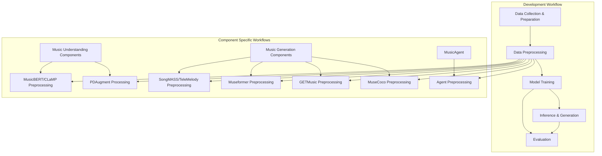

Sources: [README.md:65-72]()

## Development Environment Setup

### Base Requirements

The Muzic project has the following base requirements:

- Linux operating system (tested on Ubuntu 16.04.6 LTS)
- CUDA 10
- Python 3.6.12

```bash
# Install base requirements
pip install -r requirements.txt
```

Sources: [README.md:66-72]()

### Component-Specific Requirements

Different components have their own specific requirements. Below are examples for key components:

#### MuseCoco

```bash
# Text-to-Attribute Understanding
conda create -n MuseCoco python=3.8
conda activate MuseCoco
conda install pytorch=1.11.0 -c pytorch
pip install -r requirements.txt
```

Sources: [musecoco/README.md:26-33](), [musecoco/requirements.txt:1-25]()

#### GETMusic

```bash
pip install torch==1.12.1+cu113 torchvision==0.13.1+cu113 torchaudio==0.12.1 --extra-index-url https://download.pytorch.org/whl/cu113    
pip install tensorboard pyyaml tqdm transformers einops miditoolkit scipy
```

Sources: [getmusic/README.md:9-19]()

## Code Organization

The following diagram shows the relationship between the conceptual components and their implementation in the codebase:

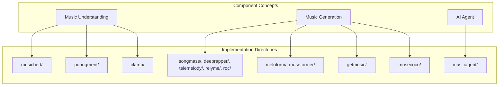

Sources: [README.md:6-45]()

## Data Preprocessing

Data preprocessing is a critical step in the development workflow. Different components require different preprocessing approaches.

### MIDI Data Processing

#### MuseCoco Data Processing

MuseCoco uses a two-stage approach requiring two separate data preprocessing pipelines:

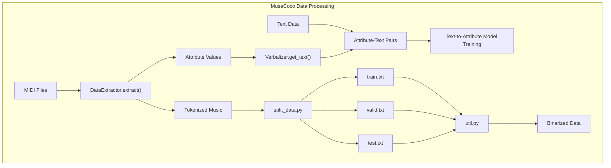

For the attribute extraction process:

```bash
# For text-to-attribute understanding
cd musecoco/1-text2attribute_dataprepare
bash run.sh

# For attribute-to-music generation
cd musecoco/2-attribute2music_dataprepare
python extract_data.py path/to/midi/files path/to/save/dataset

# Process the data into train, validation, test sets
cd 2-attribute2music_model/data_process
python split_data.py
python util.py
```

Sources: [musecoco/README.md:56-95](), [musecoco/2-attribute2music_dataprepare/midi_data_extractor/data_extractor.py:87-242]()

#### GETMusic Data Processing

GETMusic preprocessing involves:

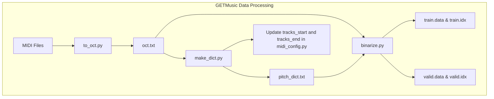

```bash
# Filter MIDI files and infer chords
python preprocess/to_oct.py example_data/train example_data/processed_train

# Construct vocabulary
python preprocess/make_dict.py example_data/processed_train/ 3

# Configure training and validation sets
python preprocess/binarize.py example_data/processed_train/pitch_dict.txt example_data/processed_train/oct.txt example_data/processed_train
```

Sources: [getmusic/README.md:130-185]()

### Audio Processing with PDAugment

PDAugment adjusts pitch and duration of speech to help train automatic lyrics transcription models:

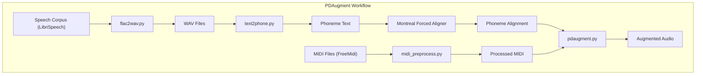

Sources: [pdaugment/README.md:12-149]()

## Training Models

### MuseCoco Training

MuseCoco training has two stages:

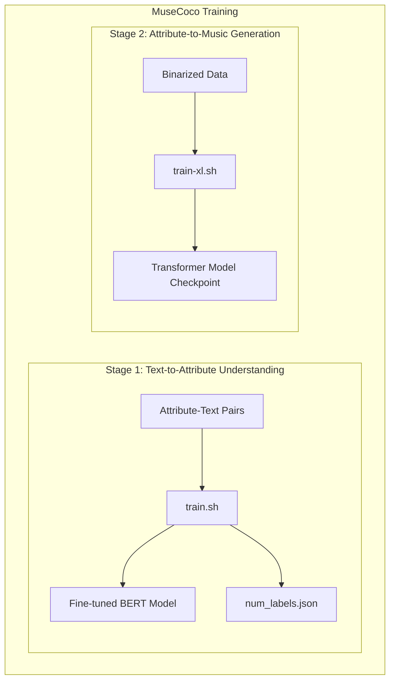

To train MuseCoco:

```bash
# Stage 1: Text-to-Attribute Understanding
cd musecoco/1-text2attribute_model
bash train.sh

# Stage 2: Attribute-to-Music Generation
cd musecoco/2-attribute2music_model
bash train-xl.sh
```

Sources: [musecoco/README.md:68-105]()

### GETMusic Training

Training GETMusic involves:

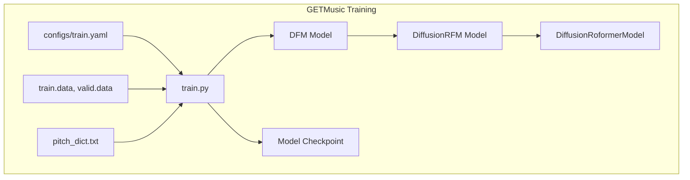

Configuration file (`configs/train.yaml`) includes:

```yaml
model:
  target: getmusic.modeling.models.dfm.DFM
  params:
    diffusion_config:
      target: getmusic.modeling.roformer.diffusion_roformer.DiffusionRFM
      params:
        diffusion_step: 100
        alpha_init_type: 'alpha1'
        roformer_config:
          target: getmusic.modeling.roformer.roformer_utils.DiffusionRoformerModel
          params:
            vocab_size: 11880
```

To train GETMusic:

```bash
# Update configs/train.yaml with appropriate parameters
# Then run training
python train.py
```

Sources: [getmusic/README.md:190-197](), [getmusic/configs/train.yaml:1-72]()

## Inference and Generation

### MuseCoco Inference

The MuseCoco inference process follows the same two-stage approach as training:

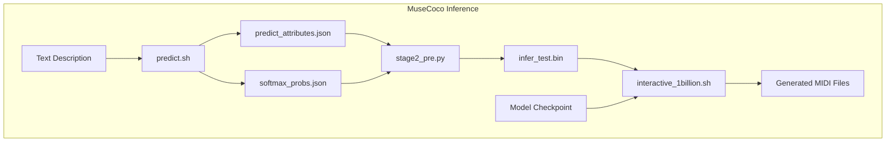

To perform inference with MuseCoco:

```bash
# Stage 1: Text-to-Attribute Understanding
cd musecoco/1-text2attribute_model
bash predict.sh
python stage2_pre.py

# Stage 2: Attribute-to-Music Generation
cd musecoco/2-attribute2music_model
bash interactive_1billion.sh 0 200
```

Sources: [musecoco/README.md:109-146]()

### GETMusic Inference

GETMusic supports two generation modes:

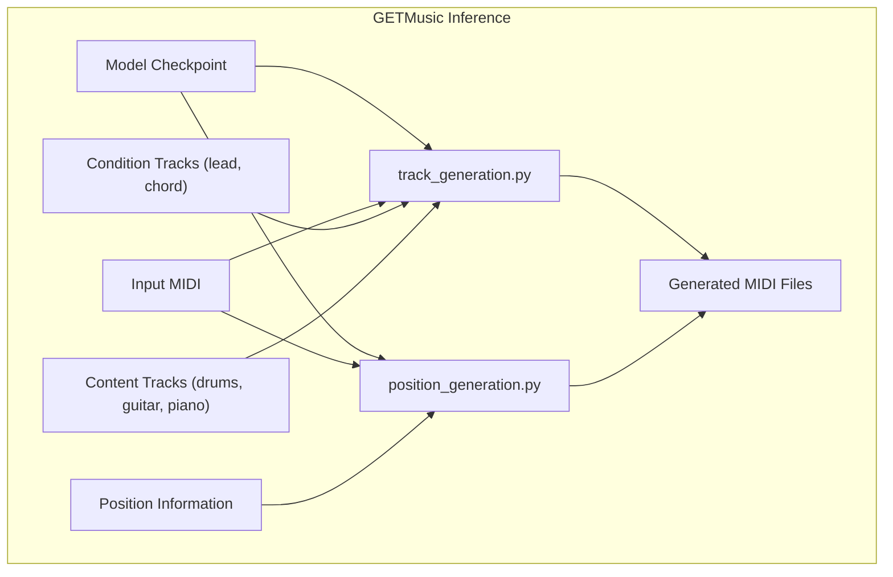

Track Generation:
```bash
python track_generation.py --load_path /path-of-checkpoint --file_path example_data/inference
```

Position-based Generation:
```bash
python position_generation.py --load_path /path-of-checkpoint --file_path example_data/inference
```

Sources: [getmusic/README.md:23-99]()

## Evaluating Generated Music

For evaluating the quality of generated music, specific tools are available:

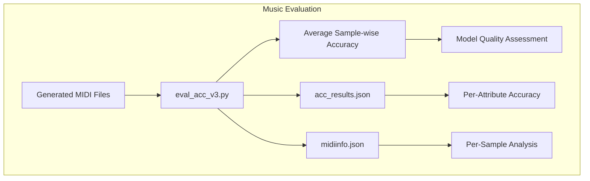

For MuseCoco, you can evaluate the generated music with:

```bash
cd musecoco/evaluation
python eval_acc_v3.py --root=PATH_OF_GENERATED_MUSIC
```

This will calculate the average sample-wise accuracy for objective attributes and produce detailed evaluation metrics.

Sources: [musecoco/README.md:141-148]()

## Extending the Muzic Components

When extending or modifying Muzic components, consider the following workflow:

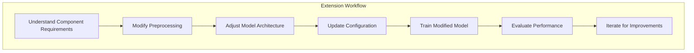

### Tips for Development

1. **Data Format Compatibility**: When extending components, ensure your data format is compatible with the existing pipelines.

2. **Tokenization Schemes**: Pay attention to the tokenization schemes used in different components:
   - MuseCoco: Uses specific attribute tokens (e.g., I1s2_0_0, R1_0) as shown in [musecoco/2-attribute2music_model/data/truncated_5120/dict.txt:982-1248]()
   - GETMusic: Uses track-specific tokens for different instruments

3. **Configuration Management**: Update configuration files appropriately when changing model architectures or training parameters.

4. **Vocabulary Size**: When modifying vocabulary, update the `vocab_size` parameter in configuration files accordingly.

5. **Training Resources**: Most models require significant GPU resources for training. Consider using smaller datasets or model sizes during development.

## Common Development Workflows

### Developing New Music Generation Models

1. Prepare and preprocess your MIDI dataset
2. Define your tokenization scheme
3. Implement the model architecture
4. Configure training parameters
5. Train the model
6. Implement inference logic
7. Evaluate generation quality

### Integrating with Existing Components

1. Understand the input/output formats of the target component
2. Implement adapter methods if necessary
3. Ensure data compatibility
4. Test the integration with small examples
5. Scale up to full functionality

## Advanced Development Topics

### Custom Attribute Extraction

The `DataExtractor` class in MuseCoco can be extended to extract additional musical attributes:

```python
# Example of adding a custom attribute extractor
class CustomDataExtractor(DataExtractor):
    def __init__(self, attribute_list_version, encoding_method='REMIGEN', attribute_list=None):
        super().__init__(attribute_list_version, encoding_method, attribute_list)
        # Add custom initialization
        
    def extract_custom_attribute(self, midi_obj):
        # Custom attribute extraction logic
        return custom_value
        
    def extract(self, midi_dir, midi_path, **kwargs):
        tokens, pos_info, bars_chords, info_dict, loaded_record = super().extract(
            midi_dir, midi_path, **kwargs)
        
        # Add custom attribute to extracted data
        for piece in info_dict['pieces']:
            piece['values']['custom_attr'] = self.extract_custom_attribute(midi_obj)
            
        return tokens, pos_info, bars_chords, info_dict, loaded_record
```

Sources: [musecoco/2-attribute2music_dataprepare/midi_data_extractor/data_extractor.py:87-242]()

### Customizing Model Architectures

When modifying model architectures, update the appropriate configuration files:

- For GETMusic: Update `configs/train.yaml`
- For MuseCoco: Modify the training scripts and model definitions

Remember to maintain compatibility with the data preprocessing pipeline and inference scripts.

Sources: [getmusic/configs/train.yaml:1-72]()

## Conclusion

This Developer Guide provides the technical foundation for extending and modifying the Microsoft Muzic components. By understanding the data flows, preprocessing techniques, training procedures, and inference workflows, developers can contribute to and build upon this comprehensive AI music ecosystem.

For specific implementation details, refer to the individual component READMEs and source code. The modular design of the Muzic project allows for flexible development and integration of new music understanding and generation capabilities.

---

