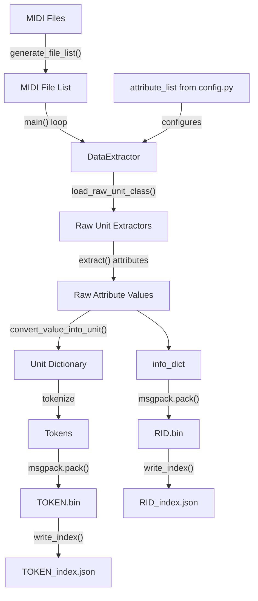
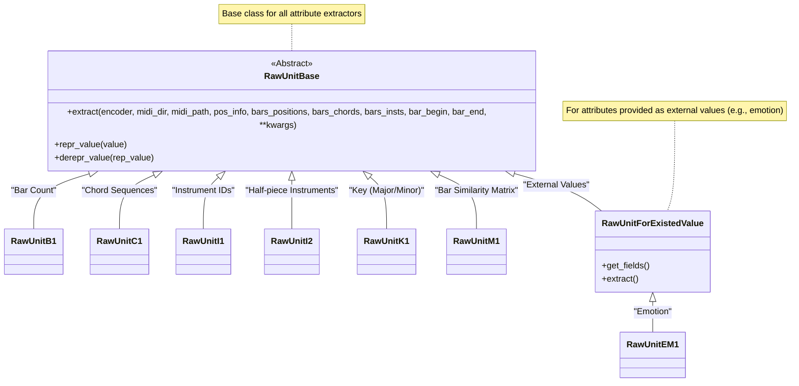
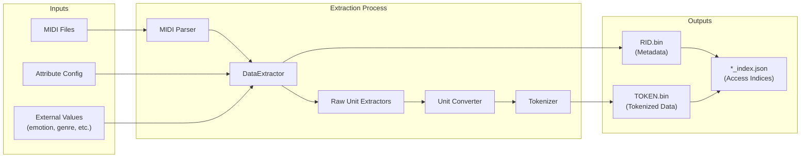

<!-- source: DeepWiki mcp.deepwiki.com · repo microsoft/muzic · page 6.1 Data Preprocessing · fetched 2026-10-26 -->

# Data Preprocessing

<details>
<summary>Relevant source files</summary>

The following files were used as context for generating this wiki page:

- [emogen/data/Piano/data-bin/dict.txt](emogen/data/Piano/data-bin/dict.txt)
- [emogen/data/Piano/midi/0.mid](emogen/data/Piano/midi/0.mid)
- [emogen/data/Piano/midi/1.mid](emogen/data/Piano/midi/1.mid)
- [emogen/data/Piano/midi/10.mid](emogen/data/Piano/midi/10.mid)
- [emogen/data/Piano/midi/11.mid](emogen/data/Piano/midi/11.mid)
- [emogen/data/Piano/midi/2.mid](emogen/data/Piano/midi/2.mid)
- [emogen/data/Piano/midi/3.mid](emogen/data/Piano/midi/3.mid)
- [musecoco/2-attribute2music_dataprepare/config.py](musecoco/2-attribute2music_dataprepare/config.py)
- [musecoco/2-attribute2music_dataprepare/extract_data.py](musecoco/2-attribute2music_dataprepare/extract_data.py)
- [musecoco/2-attribute2music_dataprepare/midi_data_extractor/__init__.py](musecoco/2-attribute2music_dataprepare/midi_data_extractor/__init__.py)
- [musecoco/2-attribute2music_dataprepare/midi_data_extractor/attribute_unit/__init__.py](musecoco/2-attribute2music_dataprepare/midi_data_extractor/attribute_unit/__init__.py)
- [musecoco/2-attribute2music_dataprepare/midi_data_extractor/attribute_unit/raw_unit_b.py](musecoco/2-attribute2music_dataprepare/midi_data_extractor/attribute_unit/raw_unit_b.py)
- [musecoco/2-attribute2music_dataprepare/midi_data_extractor/attribute_unit/raw_unit_base.py](musecoco/2-attribute2music_dataprepare/midi_data_extractor/attribute_unit/raw_unit_base.py)
- [musecoco/2-attribute2music_dataprepare/midi_data_extractor/attribute_unit/raw_unit_c.py](musecoco/2-attribute2music_dataprepare/midi_data_extractor/attribute_unit/raw_unit_c.py)
- [musecoco/2-attribute2music_dataprepare/midi_data_extractor/attribute_unit/raw_unit_em.py](musecoco/2-attribute2music_dataprepare/midi_data_extractor/attribute_unit/raw_unit_em.py)
- [musecoco/2-attribute2music_dataprepare/midi_data_extractor/attribute_unit/raw_unit_i.py](musecoco/2-attribute2music_dataprepare/midi_data_extractor/attribute_unit/raw_unit_i.py)
- [musecoco/2-attribute2music_dataprepare/midi_data_extractor/attribute_unit/raw_unit_k.py](musecoco/2-attribute2music_dataprepare/midi_data_extractor/attribute_unit/raw_unit_k.py)
- [musecoco/2-attribute2music_dataprepare/midi_data_extractor/attribute_unit/raw_unit_m.py](musecoco/2-attribute2music_dataprepare/midi_data_extractor/attribute_unit/raw_unit_m.py)

</details>


This page documents the data preprocessing components of the Microsoft Muzic project, focusing on how musical data is extracted, transformed, and prepared for training the various music generation models. For information about training models with this preprocessed data, see [Training Models](#6.2).

## Overview

Data preprocessing in Muzic involves transforming raw musical data (primarily MIDI files) into structured representations suitable for model training. This process is crucial for components like MuseCoco that require well-organized musical elements for text-to-music generation.

The preprocessing pipeline typically involves:

1. Loading and parsing MIDI files
2. Extracting musical attributes (bars, chords, instruments, etc.)
3. Converting these attributes into tokenized representations
4. Storing the processed data in an efficient format for model training

The primary implementation for this process is found in the MuseCoco component, specifically in the `2-attribute2music_dataprepare` directory.

Sources: [musecoco/2-attribute2music_dataprepare/extract_data.py:1-76](), [musecoco/2-attribute2music_dataprepare/midi_data_extractor/__init__.py:1-3]()

## MIDI Data Extraction Architecture

The core of the data preprocessing system is the MIDI data extraction framework, which extracts structured information from MIDI files.

### MIDI Data Extraction Flow



Sources: [musecoco/2-attribute2music_dataprepare/extract_data.py:10-68](), [musecoco/2-attribute2music_dataprepare/midi_data_extractor/attribute_unit/__init__.py:1-45]()

The main components of this architecture are:

1. **File List Generation**: Implemented in `get_midi_file_list()`, which identifies all MIDI files in a directory
2. **DataExtractor**: The central class that coordinates the extraction of attributes from MIDI files
3. **Attribute Units**: Specialized classes that extract specific musical attributes
4. **MessagePack Serialization**: Efficiently stores the extracted data in binary format
5. **Index Generation**: Creates indices in JSON format for random access to the binary data

The entry point for data preprocessing is `extract_data.py`, which implements this flow in its `main()` function.

Sources: [musecoco/2-attribute2music_dataprepare/extract_data.py:14-67]()

## Attribute Extraction System

The attribute extraction system uses a modular approach with specialized "raw unit" classes responsible for extracting specific musical attributes from MIDI files.

### Attribute Unit Architecture



Sources: [musecoco/2-attribute2music_dataprepare/midi_data_extractor/attribute_unit/raw_unit_base.py:1-54](), [musecoco/2-attribute2music_dataprepare/midi_data_extractor/attribute_unit/__init__.py:5-38]()

Each raw unit implements the `extract()` method defined in the base class, which extracts a specific attribute from the MIDI data. The system dynamically loads the appropriate raw unit classes based on the attribute list configuration using the utility functions `load_raw_unit_class()` and `load_unit_class()`.

Sources: [musecoco/2-attribute2music_dataprepare/midi_data_extractor/attribute_unit/__init__.py:5-32]()

## Extracted Attributes

The system extracts various musical attributes from MIDI files. Here are the main attribute types based on the code:

| Attribute Code | Description | Implemented By | Return Value |
|----------------|-------------|---------------|--------------|
| B1 | Bar count | RawUnitB1 | Integer (number of bars) |
| C1 | Chord sequences | RawUnitC1 | List (chord sequence, 2 per bar) |
| EM1 | Emotion | RawUnitEM1 | Dictionary (emotion labels) |
| I1 | Instrument IDs | RawUnitI1 | Tuple (instrument IDs used) |
| I2 | Instruments by half | RawUnitI2 | Two tuples (instruments in each half) |
| K1 | Key (major/minor) | RawUnitK1 | String ('major' or 'minor') |
| M1 | Bar similarity matrix | RawUnitM1 | Dictionary (similarity between bars) |

Sources: [musecoco/2-attribute2music_dataprepare/midi_data_extractor/attribute_unit/raw_unit_b.py:1-19](), [musecoco/2-attribute2music_dataprepare/midi_data_extractor/attribute_unit/raw_unit_c.py:1-27](), [musecoco/2-attribute2music_dataprepare/midi_data_extractor/attribute_unit/raw_unit_em.py:1-8](), [musecoco/2-attribute2music_dataprepare/midi_data_extractor/attribute_unit/raw_unit_i.py:1-51](), [musecoco/2-attribute2music_dataprepare/midi_data_extractor/attribute_unit/raw_unit_k.py:1-27](), [musecoco/2-attribute2music_dataprepare/midi_data_extractor/attribute_unit/raw_unit_m.py:1-23]()

The full list of attributes to extract is configured in `config.py`:

```
attribute_list = ['I1s2', 'R1', 'R3', 'S2s1', 'S4', 'B1s1', 'TS1s1', 'K1', 'T1s1', 'P4', 'EM1', 'TM1']
```

Sources: [musecoco/2-attribute2music_dataprepare/config.py:1-1]()

This configuration determines which attributes will be extracted from each MIDI file. The naming convention for attributes typically includes:
- First letter(s): Type of attribute (I for instruments, B for bars, etc.)
- Number: Specific version of that attribute type
- Optional suffix: Processing parameters (s1, s2, etc.)

## Implementation Details of Key Attribute Extractors

### Bar Count Extractor (RawUnitB1)

Extracts the number of bars in a segment:

```python
# Returns the number of bars in the specified range
def extract(cls, encoder, midi_dir, midi_path, pos_info, bars_positions, 
            bars_chords, bars_insts, bar_begin, bar_end, **kwargs):
    return bar_end - bar_begin
```

Sources: [musecoco/2-attribute2music_dataprepare/midi_data_extractor/attribute_unit/raw_unit_b.py:4-18]()

### Instrument Extractor (RawUnitI1)

Extracts the set of instruments used in a segment:

```python
# Returns a tuple of instrument IDs used in the bars
def extract(cls, encoder, midi_dir, midi_path, pos_info, bars_positions, 
            bars_chords, bars_insts, bar_begin, bar_end, **kwargs):
    insts = set()
    for bar_insts in bars_insts[bar_begin: bar_end]:
        for inst_id in bar_insts:
            insts.add(inst_id)
    insts = tuple(insts)
    return insts
```

Sources: [musecoco/2-attribute2music_dataprepare/midi_data_extractor/attribute_unit/raw_unit_i.py:4-21]()

### Key Extractor (RawUnitK1)

Determines whether the piece is in a major or minor key:

```python
# Returns 'major', 'minor', or None
def extract(cls, encoder, midi_dir, midi_path, pos_info, bars_positions, 
            bars_chords, bars_insts, bar_begin, bar_end, **kwargs):
    r = None
    if 'is_major' in kwargs:
        is_major = kwargs['is_major']
        if is_major is True:
            r = 'major'
        elif is_major is False:
            r = 'minor'
        elif is_major is None:
            r = None
    return r
```

Sources: [musecoco/2-attribute2music_dataprepare/midi_data_extractor/attribute_unit/raw_unit_k.py:4-26]()

## Data Storage Format

The extracted data is stored in binary format using MessagePack for efficient storage and retrieval:

1. `RID.bin`: Contains information dictionaries with metadata about each processed MIDI file
2. `TOKEN.bin`: Contains tokenized representations of the musical attributes

For efficient random access, the system also generates index files:
- `RID_index.json`: Contains byte offsets for each record in `RID.bin`
- `TOKEN_index.json`: Contains byte offsets for each record in `TOKEN.bin`

Sources: [musecoco/2-attribute2music_dataprepare/extract_data.py:28-65]()

The tokenization follows a specific encoding scheme where each token has a type prefix:
- `p-`: Pitch tokens (e.g., p-60 for middle C)
- `d-`: Duration tokens
- `o-`: Offset tokens
- `i-`: Instrument tokens
- `s-`: Special tokens
- `t-`: Tempo tokens
- `v-`: Velocity tokens

This encoding can be seen in dictionary files like the one found in the `emogen` data directory.

Sources: [emogen/data/Piano/data-bin/dict.txt:1-459]()

## Data Flow Diagram

The following diagram illustrates how data flows through the preprocessing system from raw MIDI files to tokenized representations:



Sources: [musecoco/2-attribute2music_dataprepare/extract_data.py:18-67]()

## Usage Example

To preprocess a set of MIDI files, use the `extract_data.py` script:

```bash
python extract_data.py <data_dir> <save_dir>
```

Where:
- `<data_dir>` is the directory containing MIDI files
- `<save_dir>` is the directory where the processed data will be saved

The script will:
1. Find all MIDI files in the data directory
2. Process each file to extract the configured attributes
3. Save the tokenized data and metadata to the specified save directory
4. Create index files for efficient access to the binary data

Example execution:

```bash
python extract_data.py ./midi_collection ./processed_data
```

Sources: [musecoco/2-attribute2music_dataprepare/extract_data.py:70-75]()

## Integration with Music Generation Models

The preprocessed data is particularly important for music generation components like MuseCoco, which uses it for text-to-music generation. The extracted attributes provide the models with structured musical information that can be associated with other modalities like text.

For information on how to use this preprocessed data for training models, see [Training Models](#6.2). For information about inference and generation with trained models, see [Inference and Generation](#6.3).

Sources: [musecoco/2-attribute2music_dataprepare/extract_data.py:1-76]()

---

