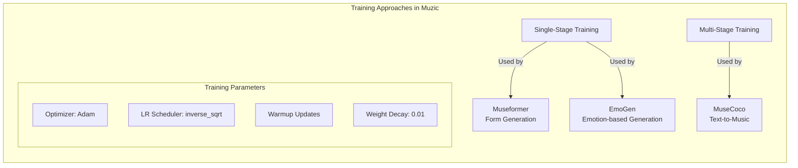
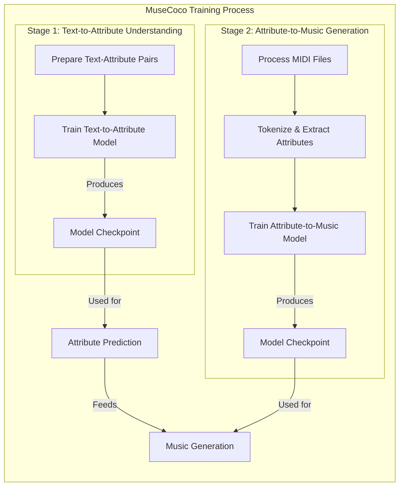
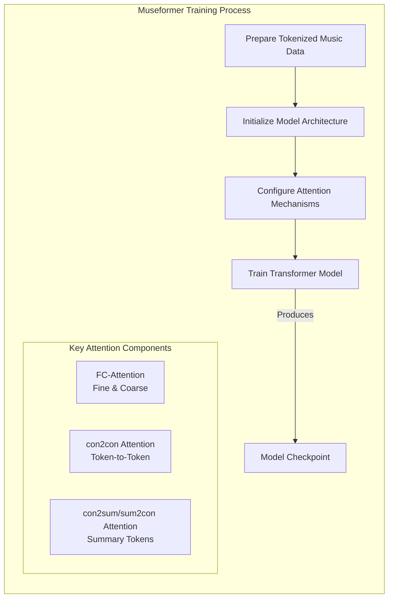
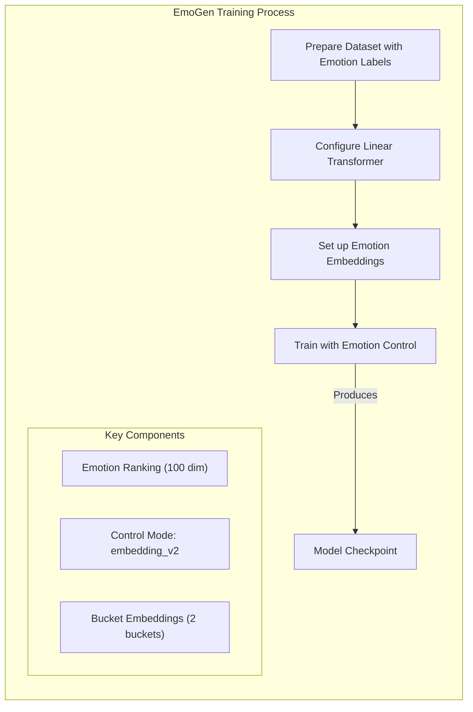

<!-- source: DeepWiki mcp.deepwiki.com · repo microsoft/muzic · page 6.2 Training Models · fetched 2026-10-26 -->

# Training Models

<details>
<summary>Relevant source files</summary>

The following files were used as context for generating this wiki page:

- [emogen/Piano_gen.sh](emogen/Piano_gen.sh)
- [emogen/Piano_train.sh](emogen/Piano_train.sh)
- [emogen/TopMAGD_gen.sh](emogen/TopMAGD_gen.sh)
- [emogen/TopMAGD_train.sh](emogen/TopMAGD_train.sh)
- [musecoco/2-attribute2music_dataprepare/midi_data_extractor/data_extractor.py](musecoco/2-attribute2music_dataprepare/midi_data_extractor/data_extractor.py)
- [musecoco/2-attribute2music_model/data/truncated_5120/dict.txt](musecoco/2-attribute2music_model/data/truncated_5120/dict.txt)
- [musecoco/README.md](musecoco/README.md)
- [musecoco/requirements.txt](musecoco/requirements.txt)
- [museformer/museformer/attention/__init__.py](museformer/museformer/attention/__init__.py)
- [museformer/museformer/attention/self_attention_v2s1/rpe_self_attention_v2s1.py](museformer/museformer/attention/self_attention_v2s1/rpe_self_attention_v2s1.py)
- [museformer/museformer/museformer_decoder.py](museformer/museformer/museformer_decoder.py)
- [museformer/museformer/museformer_decoder_layer.py](museformer/museformer/museformer_decoder_layer.py)
- [museformer/museformer/museformer_lm.py](museformer/museformer/museformer_lm.py)
- [museformer/ttrain/mf-lmd6remi-1.sh](museformer/ttrain/mf-lmd6remi-1.sh)

</details>


This page provides comprehensive documentation on how to train the various AI models within the Microsoft Muzic project. It covers the training procedures, parameters, and best practices for the different music generation and understanding systems. For information about data preprocessing before training, see [Data Preprocessing](#6.1), and for using trained models for inference and generation, see [Inference and Generation](#6.3).

## Overview of Training Approaches

The Muzic project encompasses multiple models with different training methodologies. Training approaches vary based on the specific task and model architecture:



Sources: [musecoco/README.md:54-106](), [museformer/ttrain/mf-lmd6remi-1.sh:1-47](), [emogen/Piano_train.sh:1-66]()

## Common Training Infrastructure

Most models in the Muzic project share similar training infrastructure requirements and configurations:

### Environment Setup

Before training any model, set up the required environment with the necessary dependencies:

```bash
# Create conda environment
conda create -n MuseCoco python=3.8
conda activate MuseCoco
conda install pytorch=1.11.0 -c pytorch
pip install -r requirements.txt
```

The major dependencies required for training include:

| Dependency Category | Key Libraries |
|---------------------|---------------|
| Deep Learning | PyTorch, fairseq |
| Music Processing | miditoolkit, music21 |
| NLP | transformers, datasets, sentencepiece |
| Visualization | tensorboardX, matplotlib |
| Utilities | tqdm, scikit-learn, numpy |

Sources: [musecoco/requirements.txt:1-24]()

### Training Hardware Considerations

Most models require at least one GPU with sufficient VRAM. The scripts typically auto-detect CPU thread count and utilize all available threads:

```bash
OMP_NUM_THREADS=$(cat /proc/cpuinfo| grep "processor"| wc -l)
```

Common batch size and parallelization configurations can be adjusted based on available hardware:

```bash
BATCH_SIZE=1 # Base batch size per GPU
UPDATE_FREQ=1 # Gradient accumulation steps
```

Sources: [museformer/ttrain/mf-lmd6remi-1.sh:6-11](), [emogen/Piano_train.sh:19-20]()

## Training MuseCoco: Text-to-Music Generation

MuseCoco uses a two-stage training process, with separate models for text-to-attribute understanding and attribute-to-music generation.



Sources: [musecoco/README.md:54-106]()

### Stage 1: Text-to-Attribute Understanding

This stage trains a model to understand musical attributes from textual descriptions.

#### 1. Preparing Attribute-Text Pairs

First, construct attribute-text pairs for training:

```bash
cd 1-text2attribute_dataprepare
bash run.sh
```

This process creates `att_key.json` and `test.json` files that will be used for training.

#### 2. Training the Text-to-Attribute Model

```bash
cd 1-text2attribute_model
bash train.sh
```

The training process produces a fine-tuned language model and a `num_labels.json` file that maps attributes to values.

Sources: [musecoco/README.md:56-74]()

### Stage 2: Attribute-to-Music Generation

This stage trains a model to generate music based on attributes.

#### 1. Data Processing

First, process and tokenize the MIDI files, extracting musical attributes:

```bash
python extract_data.py path/to/the/folder/containing/midi/files path/to/save/the/dataset
```

This creates several files:
- `Token.bin`: Tokenized music data
- `Token_index.json`: Index mapping for tokens
- `RID.bin`: Raw ID data
- `RID_index.json`: Index mapping for IDs

Next, split and binarize the data:

```bash
python split_data.py
python util.py
```

#### 2. Training the Music Generation Model

```bash
bash train-xl.sh
```

This trains a large model with approximately 200M parameters. The training process uses a transformer-based architecture with the following key parameters:

| Parameter | Value |
|-----------|-------|
| Learning Rate | 5e-4 |
| Warmup Updates | 16000 |
| Optimizer | Adam with β=(0.9, 0.98), ε=1e-9 |
| Weight Decay | 0.01 |
| LR Scheduler | inverse_sqrt |
| Max Token Length | 5120 |
| FP16 Training | Enabled |
| Save Interval | 5000 updates |

The model is trained to predict music tokens conditioned on the given attributes.

Sources: [musecoco/README.md:76-105](), [musecoco/2-attribute2music_dataprepare/midi_data_extractor/data_extractor.py:88-302](), [musecoco/2-attribute2music_model/data/truncated_5120/dict.txt:1-1250]()

## Training Museformer for Music Form Generation

Museformer uses an attention mechanism with fine and coarse-grained attention for music generation, focusing on long-term structure and form.



### Training Configuration

Training Museformer involves setting up specific attention patterns and training a transformer-based model:

```bash
fairseq-train \
  $DATA_DIR \
  --user-dir museformer \
  --task museformer_language_modeling \
  --arch museformer_lm_v2s1 \
  --con2con '((((-2, 0), -4, -8, -12, -16, -24, -32),),)' \
  --con2sum '((((None, -32), (-31, -24), (-23, -16), (-15, -12), (-11, -8), (-7, -4), -3,),),)' \
  --num-layers 4 \
  --tokens-per-sample 100000 \
  --truncate-train 15360 \
  --truncate-valid 10240 \
  --batch-size 1 \
  --update-freq $UPDATE_FREQ \
  --optimizer adam \
  --adam-betas '(0.9, 0.98)' \
  --adam-eps 1e-9 \
  --weight-decay 0.01 \
  --lr $PEAK_LR \
  --lr-scheduler inverse_sqrt \
  --warmup-updates $WARMUP_UPDATES \
  --fp16
```

### Key Architecture Components

Museformer uses a specialized decoder architecture with critical components:

1. **Attention Mechanisms**: Implements blocksparse attention with fine and coarse granularity
2. **Layer Structure**: Uses MuseformerDecoderLayer that processes both regular tokens and summary tokens
3. **Attention Patterns**: Configured through parameters like `con2con` and `con2sum` that define relationships between tokens

The model architecture is defined in `museformer_lm.py` and implemented across various components including:

- `museformer_decoder_layer.py`: Implements the core layer with attention mechanisms
- `attention/__init__.py`: Defines attention creation functions
- `rpe_self_attention_v2s1.py`: Implements relative positional encoding attention

Sources: [museformer/ttrain/mf-lmd6remi-1.sh:17-47](), [museformer/museformer/museformer_decoder_layer.py:126-466](), [museformer/museformer/attention/__init__.py:1-39](), [museformer/museformer/museformer_lm.py:24-159]()

## Training Emotion-based Music Generation Models

The EmoGen system trains models to generate music with specific emotional characteristics.



### Training Configuration

EmoGen models are trained using specialized emotion embedding approaches:

```bash
python train.py  \
$DATA_DIR/data-bin \
--truncated_length 1280 \
--task language_modeling_control \
--arch linear_transformer_lm_std \
--control_mode embedding_v2 \
--command_path $DATA_DIR \
--feature_num 100 \
--bucket_num 2 \
--sample-break-mode eos \
--tokens-per-sample 10000000 \
--batch-size $BATCH_SIZE \
--optimizer adam \
--adam-betas '(0.9, 0.98)' \
--adam-eps 1e-9 \
--weight-decay 0.01 \
--lr $PEAK_LR \
--lr-scheduler inverse_sqrt \
--warmup-updates $WARMUP_UPDATES \
--find-unused-parameters
```

### Training Parameters

Different datasets have their own training configurations:

| Dataset | Truncation Length | Batch Size | Control Mode |
|---------|------------------|------------|--------------|
| Piano   | 1280 tokens      | 8          | embedding_v2 |
| TopMAGD | 2560 tokens      | 1          | embedding_v2 |

The common elements in EmoGen training include:
- Emotion ranking features (100 dimensions)
- Bucket-based embedding approach (2 buckets)
- Linear transformer architecture
- Emotion control through specialized embeddings

Sources: [emogen/Piano_train.sh:1-66](), [emogen/TopMAGD_train.sh:1-66]()

## Training Best Practices

Based on the training scripts and configurations across the Muzic project, here are recommended best practices for training models:

### Learning Rate and Warmup

Most models use the inverse square root learning rate scheduler with a warmup period:

```
--lr 1e-4  # Adjust based on dataset and model size
--lr-scheduler inverse_sqrt
--warmup-updates 16000  # Larger for bigger models/datasets
```

### Checkpointing

Regular checkpointing helps resume training and evaluate progress:

```
--save-interval-updates 2000
--save-dir checkpoints/$MODEL_NAME
--no-epoch-checkpoints  # Only keep best and last checkpoints
```

### Memory Optimization

For large models or limited GPU memory:
- Use FP16 precision with `--fp16` 
- Adjust batch size and gradient accumulation with `--batch-size` and `--update-freq`
- For the largest models, consider gradient checkpointing

### Training Stability

For more stable training:
- Use Adam optimizer with β=(0.9, 0.98), ε=1e-9
- Apply weight decay (0.01)
- Set a patience value for early stopping

### Hardware Utilization

Optimize training speed by:
- Using all available CPU threads for data loading
- Setting appropriate batch size for GPU memory
- Using distributed training for multi-GPU setups when available

Sources: [musecoco/README.md:27-165](), [museformer/ttrain/mf-lmd6remi-1.sh:1-47](), [emogen/Piano_train.sh:1-66](), [emogen/TopMAGD_train.sh:1-66]()

---

