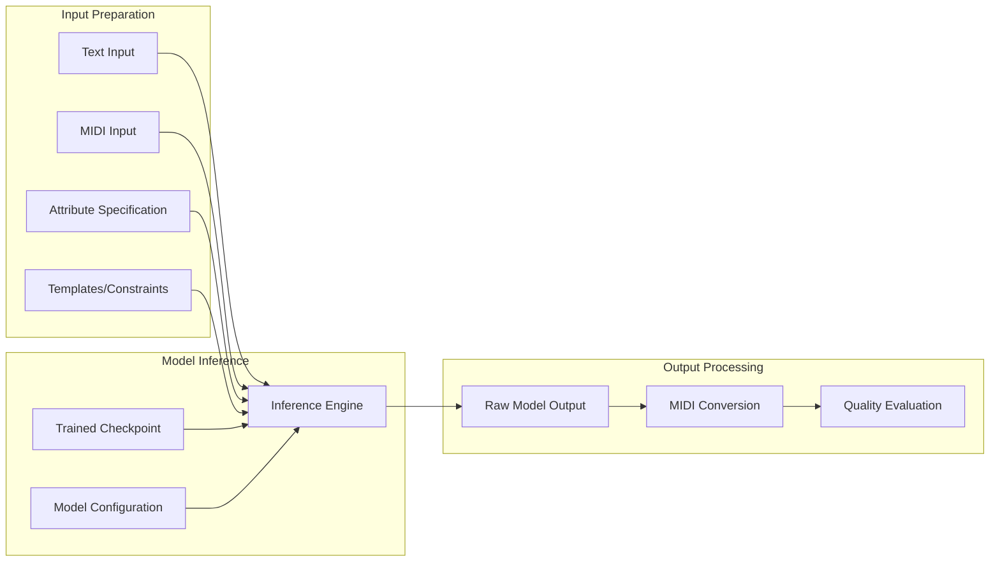
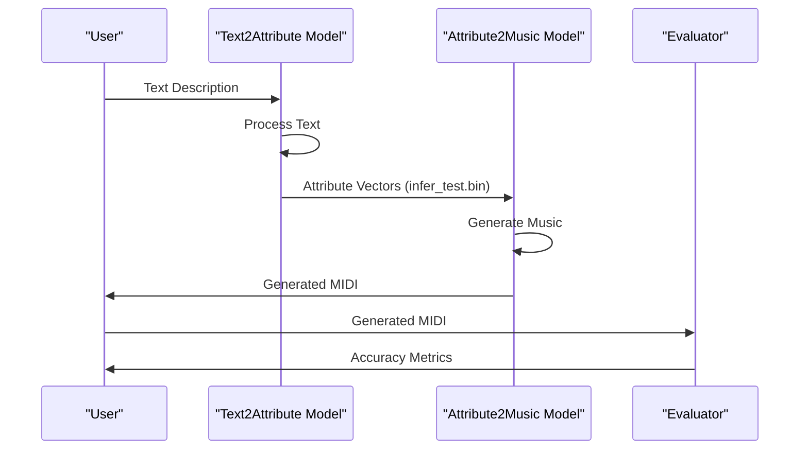
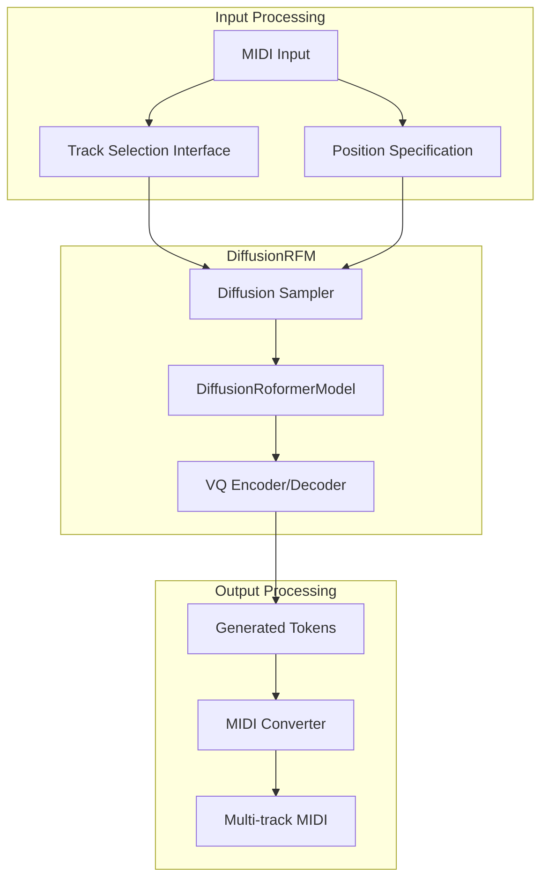
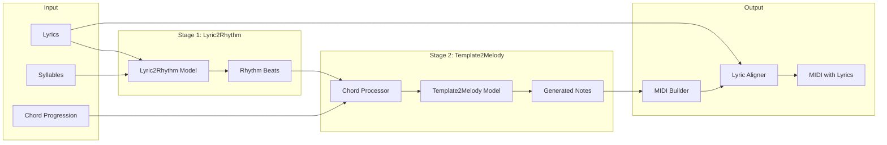
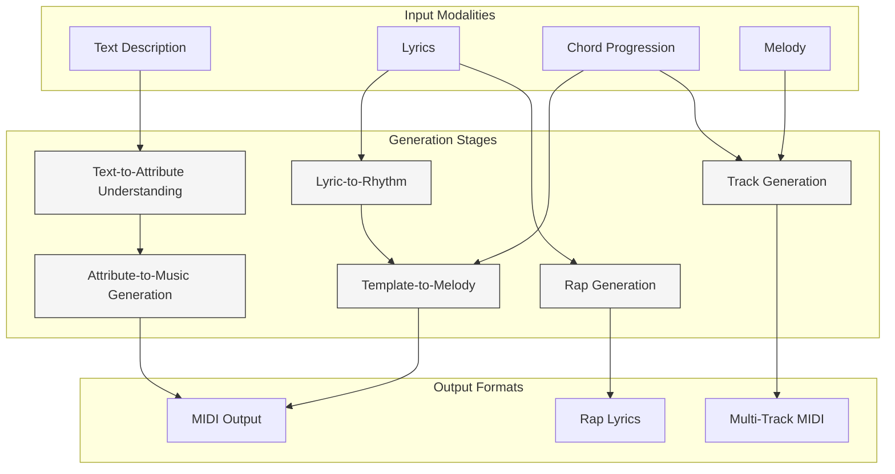

<!-- source: DeepWiki mcp.deepwiki.com · repo microsoft/muzic · page 6.3 Inference and Generation · fetched 2026-10-26 -->

# Inference and Generation

<details>
<summary>Relevant source files</summary>

The following files were used as context for generating this wiki page:

- [deeprapper/README.md](deeprapper/README.md)
- [emogen/Piano_gen.sh](emogen/Piano_gen.sh)
- [emogen/Piano_train.sh](emogen/Piano_train.sh)
- [emogen/TopMAGD_gen.sh](emogen/TopMAGD_gen.sh)
- [emogen/TopMAGD_train.sh](emogen/TopMAGD_train.sh)
- [getmusic/README.md](getmusic/README.md)
- [getmusic/configs/train.yaml](getmusic/configs/train.yaml)
- [getmusic/example_data/inference/childhood.mid](getmusic/example_data/inference/childhood.mid)
- [getmusic/example_data/train/0_01023_TS0.mid](getmusic/example_data/train/0_01023_TS0.mid)
- [musecoco/2-attribute2music_dataprepare/midi_data_extractor/data_extractor.py](musecoco/2-attribute2music_dataprepare/midi_data_extractor/data_extractor.py)
- [musecoco/2-attribute2music_model/data/truncated_5120/dict.txt](musecoco/2-attribute2music_model/data/truncated_5120/dict.txt)
- [musecoco/README.md](musecoco/README.md)
- [musecoco/requirements.txt](musecoco/requirements.txt)
- [musicbert/README.md](musicbert/README.md)
- [songmass/README.md](songmass/README.md)
- [telemelody/README.md](telemelody/README.md)
- [telemelody/inferrence/infer_zh.py](telemelody/inferrence/infer_zh.py)

</details>


This page provides detailed technical instructions for running inference and generating music outputs using the trained models in the Microsoft Muzic ecosystem. It covers the core inference procedures for major components like MuseCoco, GETMusic, TeleMelody, and others. For information on training these models, see [Training Models](#6.2).

## 1. Common Inference Patterns

Most music generation systems in the Muzic ecosystem follow a similar inference workflow despite their architectural differences. This standardized approach typically includes:

1. **Model Loading**: Loading trained checkpoints
2. **Input Preparation**: Formatting inputs specific to each model
3. **Inference Execution**: Running the model for generation
4. **Post-processing**: Converting raw outputs to music formats (MIDI)

### Inference Flow in Muzic



Sources: [musecoco/README.md:109-147](), [getmusic/README.md:22-66](), [telemelody/README.md:97-109]()

## 2. Text-to-Music Generation (MuseCoco)

MuseCoco is a two-stage system for generating symbolic music from text descriptions. The inference process involves text-to-attribute understanding followed by attribute-to-music generation.

### 2.1 Text-to-Attribute Understanding

1. Prepare text descriptions in the format shown in [musecoco/1-text2attribute_model/data/predict.json]()
2. Run prediction to convert text to attribute values:

```
cd 1-text2attribute_model
bash predict.sh
```

This generates `predict_attributes.json` and `softmax_probs.json` containing the attribute values derived from text.

3. Preprocess the attributes for the music generation stage:

```
python stage2_pre.py
```

This creates `infer_test.bin` as input for the attribute-to-music generation stage.

### 2.2 Attribute-to-Music Generation

1. Ensure you have the checkpoint prepared in `checkpoint/linear_mask-1billion`
2. Place the `infer_test.bin` file in `data/infer_input/`
3. Run music generation:

```
bash interactive_1billion.sh 0 200
```

This processes records 0-200 from the input file and generates corresponding music.

### 2.3 MuseCoco Inference Architecture



Sources: [musecoco/README.md:110-148](), [musecoco/2-attribute2music_dataprepare/midi_data_extractor/data_extractor.py:88-242]()

### 2.4 Supported Attributes

MuseCoco uses the following musical attributes for control:

| Code | Attribute |
|------|-----------|
| I1s2 | Instrument |
| R1 | Rhythm Danceability |
| R3 | Rhythm Intensity |
| S2s1 | Artist |
| S4 | Genre |
| B1s1 | Bar |
| TS1s1 | Time Signature |
| K1 | Key |
| T1s1 | Tempo |
| P4 | Pitch Range |
| EM1 | Emotion |
| TM1 | Time |

Sources: [musecoco/README.md:36-51](), [musecoco/2-attribute2music_model/data/truncated_5120/dict.txt:982-1248]()

### 2.5 Evaluation of Generated Music

To evaluate objective attribute accuracy of generated music:

```
cd evaluation
python eval_acc_v3.py --root=PATH_OF_GENERATED_MUSIC
```

This produces an average sample-wise accuracy (ASA) score for objective attributes and details in `acc_results.json`.

Sources: [musecoco/README.md:141-148]()

## 3. Multi-Track Music Generation (GETMusic)

GETMusic supports different modes of music generation, primarily focused on multi-track composition.

### 3.1 Basic Track Generation

For basic track generation with condition tracks:

```
python track_generation.py --load_path /path-of-checkpoint --file_path example_data/inference
```

The system will prompt you to:
1. Select condition tracks (existing tracks to build upon)
2. Select content tracks (tracks to generate)

For example:
```
Select condition tracks ('b' for bass, 'd' for drums, 'g' for guitar, 'l' for lead, 'p' for piano, 's' for strings, 'c' for chords): lc
Select content tracks ('l' for lead, 'b' for bass, 'd' for drums, 'g' for guitar, 'p' for piano, 's' for strings): dgp
```

This would generate drum, guitar, and piano tracks based on the existing lead and chord tracks.

### 3.2 Advanced Operations

GETMusic supports hybrid generation with position-based specifications:

```
python position_generation.py --load_path /path-of-checkpoint --file_path example_data/inference
```

This allows more fine-grained control over which positions to condition on and which to generate:

```
Input positions you want to condition on: 0,0,200;6,0,
Input positions you want to empty: 1,0,;4,0,;5,0,
```

In this example:
- Condition on first 200 time units of lead track (0) and the entire chord track (6)
- Generate the entire bass (1), piano (4), and string (5) tracks

### 3.3 GETMusic Inference Architecture



Sources: [getmusic/README.md:21-128](), [getmusic/configs/train.yaml:4-16]()

### 3.4 Usage Tips

For optimal results with GETMusic:

1. **Check MIDI program IDs**: GETMusic supports specific instruments with MIDI program IDs: 0 (piano), 25 (guitar), 32 (bass), 48 (string), 80 (lead melody).

2. **Enable chord guidance**: Always use chord guidance when generating music for better pattern regularity.

3. **Use incremental generation** for multiple tracks:
   - Stage 1: chord → lead
   - Stage 2: chord, lead → bass, drum, guitar, piano, string

4. **Tune volumes**: Adjust the volume of each instrument for better composition balance.

Sources: [getmusic/README.md:102-128]()

## 4. Lyric-to-Melody Generation (TeleMelody)

TeleMelody generates melodies from lyrics using a template-based two-stage approach.

### 4.1 Inference Setup

1. Prepare word-level (EN) or character-level (ZH) lyrics in `data/{lang}/{data_prefix}/lyric.txt`
2. Prepare chord progression in `data/{lang}/{data_prefix}/chord.txt`
3. For English lyrics, prepare syllable-level lyrics in `data/en/{data_prefix}/syllable.txt`

### 4.2 Running Inference

For English lyrics:
```
cd inference/
python infer_en.py {en_lyric2rhythm_prefix} {template2melody_prefix} {en_data_prefix} {en_save_prefix}
```

For Chinese lyrics:
```
cd inference/
python infer_zh.py {zh_lyric2rhythm_prefix} {template2melody_prefix} {zh_data_prefix} {zh_save_prefix}
```

Generated results are saved in `results/{save_prefix}/midi/`.

### 4.3 TeleMelody Inference Pipeline



Sources: [telemelody/README.md:97-109](), [telemelody/inferrence/infer_zh.py:56-382]()

### 4.4 Evaluation Metrics

TeleMelody supports several evaluation metrics:

1. **PD & DD** (Pitch and Duration Distribution Similarity):
   ```
   cd evaluation
   python cal_similarity.py {gt_prefix} {hyp_prefix}
   ```

2. **MD** (Melody Distance):
   ```
   python cal_dtw.py {gt_prefix} {hyp_prefix}
   ```

3. **TA, CA, RA, AA** (Template Accuracy metrics):
   ```
   python cal_acc.py {prefix}
   ```

Sources: [telemelody/README.md:113-138]()

## 5. Symbolic Music Understanding (MusicBERT)

While primarily a music understanding model, MusicBERT supports inference for various downstream tasks.

### 5.1 Melody Completion and Accompaniment Suggestion

To evaluate on melody completion:
```
python -u eval_nsp.py checkpoints/checkpoint_last_nsp_next_checkpoint_last_musicbert_base.pt next_data_bin
```

To evaluate on accompaniment suggestion:
```
python -u eval_nsp.py checkpoints/checkpoint_last_nsp_acc_checkpoint_last_musicbert_small.pt acc_data_bin
```

### 5.2 Genre and Style Classification

To evaluate on genre classification:
```
python -u eval_genre.py checkpoints/checkpoint_last_genre_topmagd_x_checkpoint_last_musicbert_small.pt topmagd_data_bin/x
```

Sources: [musicbert/README.md:144-156]()

## 6. Other Generation Systems

### 6.1 Rap Generation (DeepRapper)

DeepRapper generates rap lyrics with rhyme and rhythm modeling:

```
bash generate_from_pretrain.sh
```

This uses the pretrained model located at `model/deeprapper-model/` to generate rap lyrics.

Sources: [deeprapper/README.md:75-91]()

### 6.2 Song Writing (SongMASS)

SongMASS supports both lyric-to-melody and melody-to-lyric generation:

For lyric inference:
```
bash infer_lyric.sh $data_dir $user_dir $model
```

For melody generation:
```
bash infer_melody.sh $data_dir $user_dir $model
```

Sources: [songmass/README.md:62-79]()

## 7. Cross-Model Inference Workflow

The different Muzic models can be combined to create more complex music generation pipelines, as illustrated below:



Sources: [musecoco/README.md:109-147](), [getmusic/README.md:21-127](), [telemelody/README.md:97-109](), [deeprapper/README.md:66-91]()

## 8. Tips for Effective Generation

Across all models in the Muzic ecosystem, consider these general recommendations:

1. **Use appropriate checkpoints**: Always use the latest or recommended checkpoints for each model.

2. **Model-specific inputs**: Pay attention to the specific input format required by each model.

3. **Domain relevance**: Results are best when inputs align with the domain of the training data (usually pop music).

4. **Progressive refinement**: Generate multiple samples and select the best ones based on evaluation metrics.

5. **Post-processing**: Most generated music benefits from manual refinement of dynamics, timing, or arrangement.

Sources: [musecoco/README.md:150-155](), [getmusic/README.md:102-128](), [telemelody/README.md:97-109]()

## 9. Common Inference Dependencies

The following dependencies are commonly required for inference across Muzic models:

| Dependency | Purpose | Used By |
|------------|---------|---------|
| miditoolkit | MIDI processing utilities | All models |
| fairseq | Neural sequence modeling toolkit | MuseCoco, TeleMelody, SongMASS |
| torch | PyTorch ML framework | All models |
| transformers | Transformer models | MuseCoco, MusicBERT |
| numpy | Numerical computing | All models |
| tqdm | Progress bar | All models |
| scikit-learn | Machine learning utilities | MuseCoco evaluation |
| matplotlib | Visualization | Evaluation |

Sources: [musecoco/requirements.txt:1-25]()