# Page: Overview

# Overview

<details>
<summary>Relevant source files</summary>

The following files were used as context for generating this wiki page:

- [README.md](README.md)
- [pdaugment/README.md](pdaugment/README.md)

</details>


Microsoft Muzic is a comprehensive research project focused on using artificial intelligence to advance music understanding and generation. This page provides a high-level overview of the Muzic project's architecture, components, and capabilities.

## Introduction to Microsoft Muzic

Microsoft Muzic is a large-scale AI music research initiative that leverages deep learning and artificial intelligence to empower music understanding and generation. The project was started by researchers from Microsoft Research Asia and has received contributions from external collaborators. Muzic (pronounced [ˈmjuːzeik]) encompasses multiple interconnected systems designed to handle various aspects of music processing, from symbolic music understanding to complete music generation and AI agent capabilities.

Sources: [README.md:6-7]()

## Project Architecture

Muzic is organized into three main categories of components that work together to create a comprehensive AI music ecosystem:

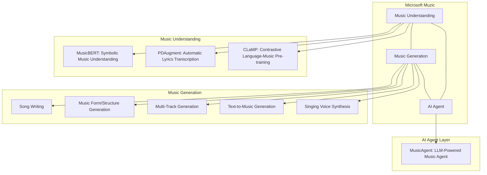

**Figure 1: Microsoft Muzic Architecture**

Sources: [README.md:27-46]()

### Music Understanding

The Music Understanding components focus on analyzing and interpreting musical data:

- **MusicBERT**: Symbolic music understanding with large-scale pre-training
- **PDAugment**: Data augmentation for automatic lyrics transcription
- **CLaMP**: Contrastive Language-Music Pre-training for cross-modal music information retrieval

These systems form the foundation for understanding music at different levels, from symbolic representation to cross-modal relationships between music and language.

Sources: [README.md:28-31](), [pdaugment/README.md:1-3]()

### Music Generation

The Music Generation components focus on creating various aspects of music:

1. **Song Writing**
   - SongMASS: Bidirectional lyric-melody generation
   - DeepRapper: Neural rap generation with rhyme and rhythm modeling
   - TeleMelody: Template-based lyric-to-melody generation
   - ReLyMe: Lyric-to-melody generation with relationship modeling
   - ROC: Theory-guided lyric-to-melody generation

2. **Music Form/Structure Generation**
   - MeloForm: Music form generation
   - Museformer: Fine- and coarse-grained attention for music generation

3. **Multi-Track Generation**
   - PopMAG: Pop music accompaniment generation
   - GETMusic: Any music tracks generation

4. **Text-to-Music Generation**
   - MuseCoco: Generating symbolic music from text

5. **Singing Voice Synthesis**
   - HiFiSinger: High-fidelity neural singing voice synthesis

Sources: [README.md:32-44]()

### AI Agent

The AI Agent layer integrates capabilities from both Music Understanding and Music Generation:

- **MusicAgent**: An LLM-powered AI agent for versatile music processing

MusicAgent represents the latest evolution of the Muzic project, using large language models to coordinate various music understanding and generation tasks. For more detailed information on MusicAgent, see [MusicAgent](#4).

Sources: [README.md:45-46]()

## Component Relationships and Data Flow

The following diagram illustrates how different components in the Muzic ecosystem relate to each other and build upon previous research. The arrows indicate technical influence or evolutionary progression:

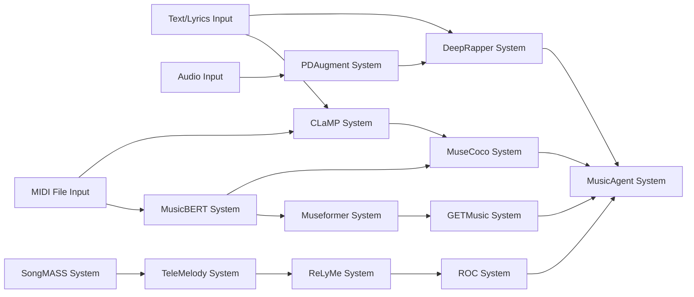

**Figure 2: Component Relationships and Data Flow**

Sources: [README.md:27-46]()

### Data Processing Pipeline

The data processing pipeline in Muzic varies depending on the task:

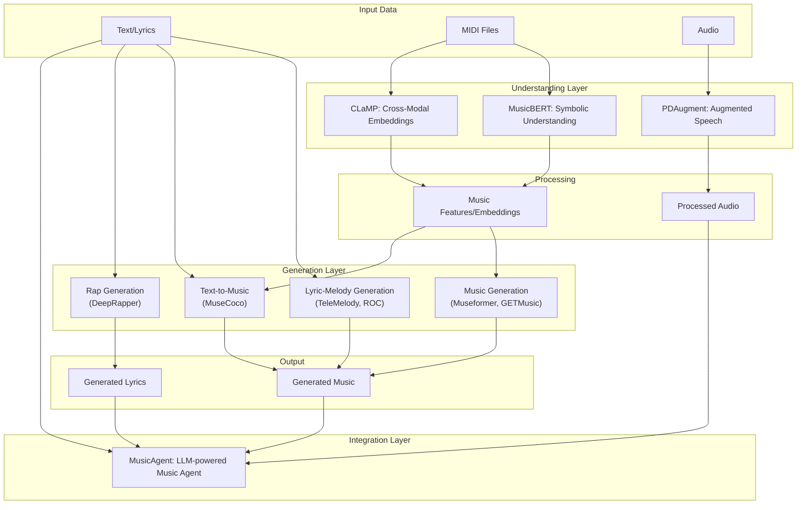

**Figure 3: Data Processing Pipeline**

Sources: [README.md:32-46](), [pdaugment/README.md:3-9]()

For example, in the PDAugment subsystem, the pipeline involves:
1. Processing speech data (LibriSpeech)
2. Converting text to phoneme level
3. Performing phoneme level alignment
4. Processing music scores (FreeMidi)
5. Augmenting the speech data by adjusting pitch and duration to match musical notes

Sources: [pdaugment/README.md:12-149]()

## Capabilities and Use Cases

Microsoft Muzic offers a comprehensive set of capabilities across the music AI landscape:

| Category | Capability | Components | Use Cases |
|---|---|---|---|
| **Music Understanding** | Symbolic Music Analysis | MusicBERT | Music classification, similarity search |
| | Lyrics Transcription | PDAugment | Converting singing to text |
| | Cross-Modal Retrieval | CLaMP | Finding music matching text descriptions |
| **Music Generation** | Lyric-Melody Creation | SongMASS, TeleMelody, ReLyMe, ROC | Songwriting assistance |
| | Rap Generation | DeepRapper | Creating rap lyrics with rhyme and rhythm |
| | Music Structure Generation | Museformer, MeloForm | Creating structured musical pieces |
| | Multi-Track Music | GETMusic, PopMAG | Creating complete arrangements |
| | Text-to-Music | MuseCoco | Generating music from text descriptions |
| | Singing Voice | HiFiSinger | Creating realistic singing voices |
| **AI Agent** | Integrated Music Processing | MusicAgent | End-to-end music creation and editing |

Sources: [README.md:27-46]()

### Recent Developments

The Muzic project continues to advance with several notable recent achievements:

- CLaMP won the Best Student Paper Award at ISMIR 2023
- MusicAgent was released, integrating capabilities using large language models
- MuseCoco was released for generating symbolic music from text
- GETMusic was released as a versatile music generation system

For more information on usage examples, see [Usage and Examples](#5).

Sources: [README.md:56-63]()

## Technical Requirements

The Microsoft Muzic project is primarily designed to run on Linux operating systems. The repository has been tested on Ubuntu 16.04.6 LTS with CUDA 10 and Python 3.6.12. The requirements for running Muzic are listed in the repository's `requirements.txt` file.

Sources: [README.md:66-71]()

## References and Links

For each component, detailed documentation is available in the corresponding subdirectory of the repository. These components include MusicBERT, PDAugment, CLaMP, DeepRapper, SongMASS, TeleMelody, ReLyMe, ROC, MeloForm, Museformer, GETMusic, MuseCoco, and MusicAgent.

For more detailed information on specific components, please refer to their respective wiki pages:
- For Music Understanding Components, see [Music Understanding Components](#2)
- For Music Generation Components, see [Music Generation Components](#3)
- For MusicAgent, see [MusicAgent](#4)
- For usage examples, see [Usage and Examples](#5)
- For developer guides, see [Developer Guide](#6)

Sources: [README.md:72]()

---

# Page: Project Goals and Architecture

# Project Goals and Architecture

<details>
<summary>Relevant source files</summary>

The following files were used as context for generating this wiki page:

- [README.md](README.md)
- [musicagent/.env](musicagent/.env)
- [musicagent/README.md](musicagent/README.md)
- [musicagent/agent.py](musicagent/agent.py)
- [musicagent/auxiliary/muzic/roc/main.py](musicagent/auxiliary/muzic/roc/main.py)
- [pdaugment/README.md](pdaugment/README.md)

</details>


This document provides an overview of the Microsoft Muzic project's objectives and architectural design. It explains the research goals driving the project and details how the various components are organized and interact within the system. For information about specific capabilities and use cases, see [Capabilities and Use Cases](#1.2).

## Research Objectives

Microsoft Muzic is a comprehensive research initiative that aims to advance artificial intelligence for music understanding and generation. The project integrates deep learning techniques with music theory to create systems capable of analyzing, interpreting, and creating music in various forms.

The primary research objectives of the Muzic project include:

1. **Developing foundation models for music understanding** - Creating systems that can comprehend symbolic music representations, transcribe lyrics, and establish cross-modal relationships between music and language
   
2. **Advancing techniques for music generation** - Researching and implementing methods for composing various aspects of music, from melodies and lyrics to complete multi-track compositions
   
3. **Exploring music-language interactions** - Investigating the relationship between textual descriptions and musical elements to enable text-based music generation and control
   
4. **Building integrated AI music agents** - Developing unified systems that can leverage large language models to perform diverse music tasks

Sources: [README.md:6-7](), [README.md:27-46]()

## High-Level Architecture

The Muzic project is organized into three primary subsystems, each addressing distinct aspects of AI music technology:

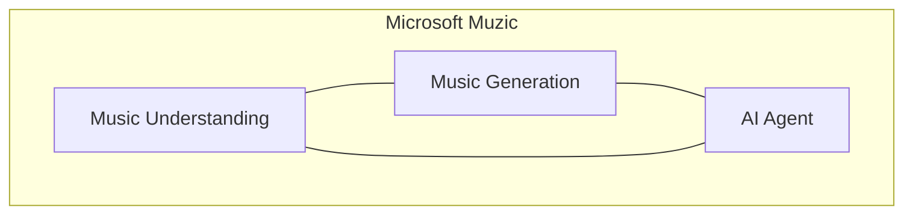

Title: Core Subsystems of Microsoft Muzic

Sources: [README.md:17-23]()

### Core Components Overview

Each subsystem contains specialized components focused on specific research challenges:

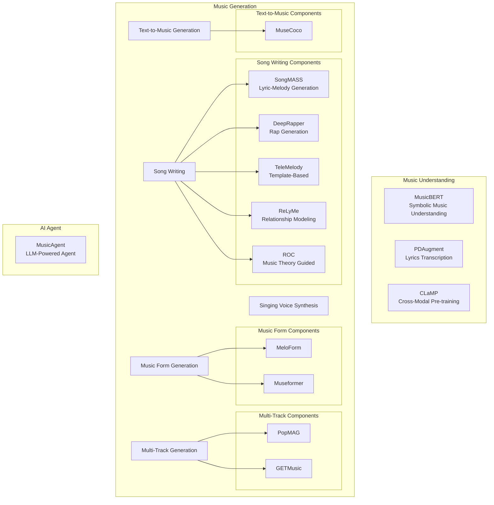

Title: Detailed Component Structure of Microsoft Muzic

Sources: [README.md:27-46](), [pdaugment/README.md:1-3](), [musicagent/README.md:1-17]()

## Music Understanding Components

The music understanding subsystem focuses on developing models that can interpret and analyze musical content in different forms:

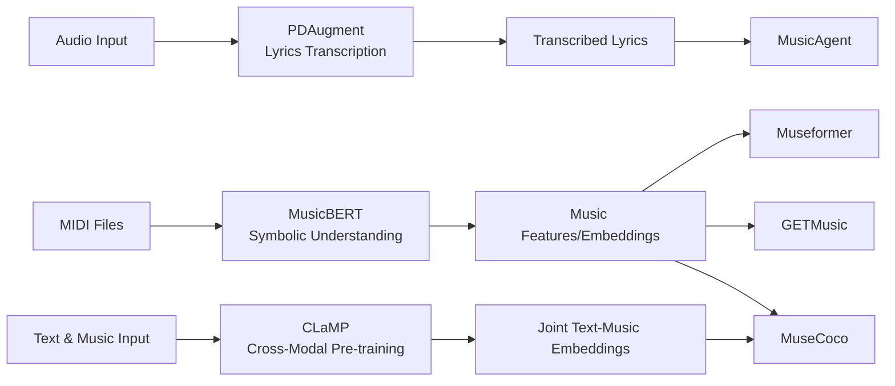

Title: Music Understanding Data Flow

Sources: [README.md:28-31](), [pdaugment/README.md:1-3]()

### Key Concepts and Technologies

The understanding components implement several key technologies:

1. **Symbolic Music Representation** - A tokenized representation of musical elements that enables transformer-based models to process musical structures
   
2. **Data Augmentation Techniques** - Methods like PDAugment that adjust pitch and duration of speech to narrow the gap between natural speech and singing voice
   
3. **Cross-Modal Embeddings** - Techniques to create unified representations of both text and music for joint understanding

Sources: [README.md:29-31](), [pdaugment/README.md:3-9]()

## Music Generation Components

The music generation subsystem comprises multiple specialized systems for creating different aspects of musical content:

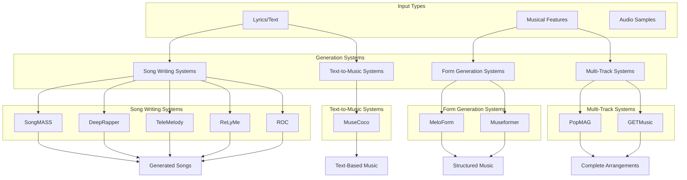

Title: Music Generation System Architecture

Sources: [README.md:32-44](), [musicagent/auxiliary/muzic/roc/main.py:519-764]()

### Generation Components Evolution

The Muzic project shows a clear evolution path in its research development, particularly in the song writing domain:

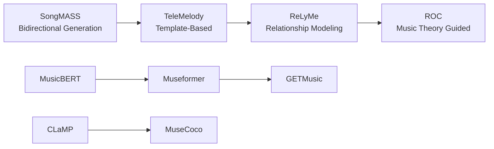

Title: Component Evolution and Research Progression

Sources: [README.md:34-36]()

### Technical Approach to Music Generation

The music generation components implement various technical approaches:

1. **Lyric-to-Melody Generation** - Systems like ROC use music theory to guide the conversion of lyrics to melodies by analyzing syllable structure and sentiment

2. **Template-Based Generation** - TeleMelody employs a two-stage approach that first extracts templates and then fills them with musical content

3. **Multi-Track Diffusion** - GETMusic utilizes a diffusion framework to generate various instrumental tracks in a complete arrangement

4. **Text-Conditioned Generation** - MuseCoco takes textual descriptions and generates corresponding symbolic music

Sources: [README.md:34-43](), [musicagent/auxiliary/muzic/roc/main.py:31-161]()

## MusicAgent: Unifying AI Agent

MusicAgent serves as an integrative system that leverages large language models to coordinate diverse music understanding and generation tasks:

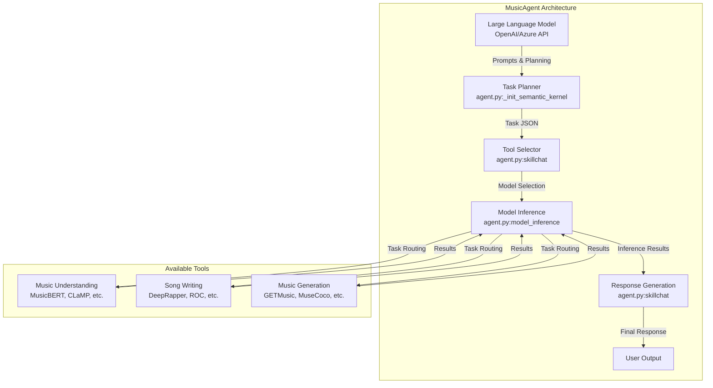

Title: MusicAgent System Architecture

Sources: [musicagent/agent.py:21-141](), [musicagent/README.md:6-17]()

### Plugin System and Tool Selection

MusicAgent employs a modular architecture with a plugin system:

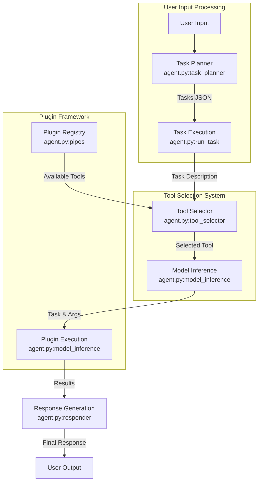

Title: MusicAgent Plugin Architecture and Tool Selection

Sources: [musicagent/agent.py:130-268](), [musicagent/README.md:12-17]()

The key aspects of the MusicAgent architecture include:

1. **Task Planning** - Analyzes user input to determine required music processing tasks

2. **Tool Selection** - Dynamically selects the most appropriate tool for each identified task

3. **Plugin Execution** - Executes the selected tool with appropriate parameters

4. **Response Generation** - Synthesizes results into coherent responses for the user

Sources: [musicagent/agent.py:130-140](), [musicagent/agent.py:229-341](), [musicagent/README.md:14-17]()

## Data Flow Between Components

The complete Muzic ecosystem features complex data flows between components, with outputs from understanding components often serving as inputs to generation components:

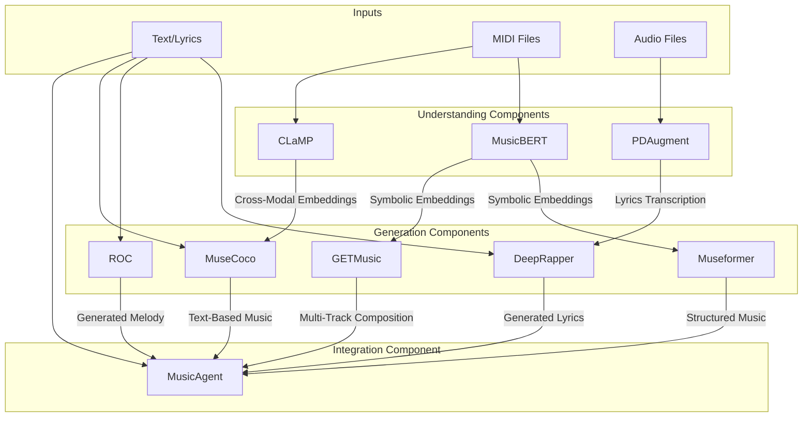

Title: Data Flow in the Muzic Ecosystem

Sources: [README.md:27-46](), [pdaugment/README.md:1-3](), [musicagent/agent.py:130-141]()

## Implementation Architecture

The codebase implementation follows a modular structure, with each research component contained in its own directory:

| Subsystem | Component | Directory | Purpose |
|-----------|-----------|-----------|---------|
| Music Understanding | MusicBERT | `/musicbert` | Symbolic music understanding with pre-training |
| Music Understanding | PDAugment | `/pdaugment` | Data augmentation for lyrics transcription |
| Music Understanding | CLaMP | `/clamp` | Contrastive language-music pre-training |
| Music Generation | SongMASS | `/songmass` | Automatic song writing with pre-training |
| Music Generation | DeepRapper | `/deeprapper` | Neural rap generation |
| Music Generation | TeleMelody | `/telemelody` | Template-based lyric-to-melody generation |
| Music Generation | ReLyMe | `/relyme` | Lyric-to-melody with relationship modeling |
| Music Generation | ROC | `/roc` | Music theory guided lyric-to-melody generation |
| Music Generation | MeloForm | `/meloform` | Music form generation |
| Music Generation | Museformer | `/museformer` | Fine- and coarse-grained attention for music |
| Music Generation | GETMusic | `/getmusic` | Multi-track music generation |
| Music Generation | MuseCoco | `/musecoco` | Text-to-music generation |
| AI Agent | MusicAgent | `/musicagent` | LLM-powered music agent |

Sources: [README.md:72](), [musicagent/README.md:1-17]()

## Integration and Extensibility

The Muzic project is designed to be extensible, allowing for new components to be added and integrated into the existing architecture. The MusicAgent particularly showcases this extensibility through its plugin-based design:

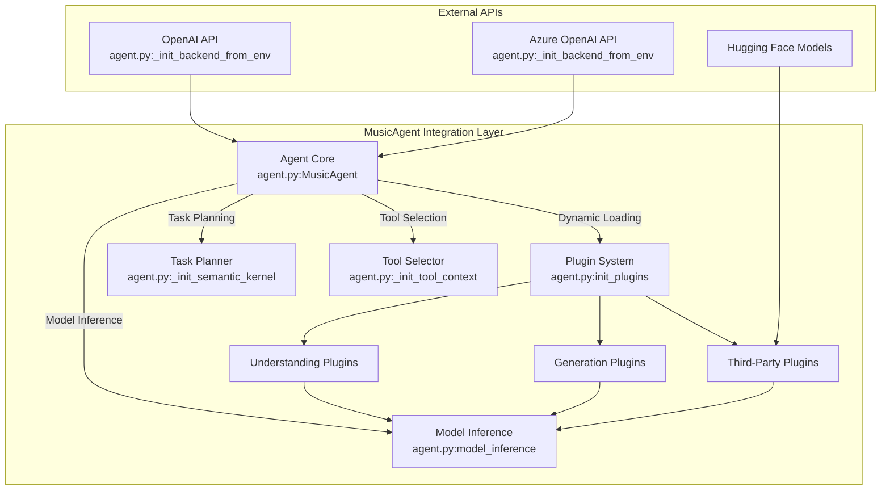

Title: MusicAgent Integration and Extensibility Architecture

Sources: [musicagent/agent.py:41-117](), [musicagent/README.md:12-17]()

The extensibility of the system is facilitated by:

1. **Modular Component Design** - Each component can be used independently or as part of the integrated system

2. **Plugin Architecture** - MusicAgent's plugin system allows for easy addition of new tools and capabilities

3. **Standardized Interfaces** - Components interact through well-defined interfaces, enabling interchangeability

4. **Configuration-Based Setup** - Environment variables and configuration files allow for flexible deployment

Sources: [musicagent/README.md:12-17](), [musicagent/agent.py:97-116](), [musicagent/.env:1-6]()

## Summary

The Microsoft Muzic project represents a comprehensive research initiative in AI music technology, with a structured architecture that encompasses understanding, generation, and agent components. The system is designed to be modular and extensible, allowing for continued research development while maintaining integration between components. Through this architecture, Muzic aims to advance the state-of-the-art in AI music capabilities across multiple domains.

Sources: [README.md:6-7](), [README.md:27-46](), [musicagent/README.md:6-17]()

---

# Page: Capabilities and Use Cases

# Capabilities and Use Cases

<details>
<summary>Relevant source files</summary>

The following files were used as context for generating this wiki page:

- [README.md](README.md)
- [musicagent/config.yaml](musicagent/config.yaml)
- [musicagent/gradio_agent.py](musicagent/gradio_agent.py)
- [musicagent/model_utils.py](musicagent/model_utils.py)
- [musicagent/models/download.sh](musicagent/models/download.sh)
- [musicagent/plugins.py](musicagent/plugins.py)
- [musicagent/requirements.txt](musicagent/requirements.txt)
- [musicagent/skills/MusicAgent/ChatBot/config.json](musicagent/skills/MusicAgent/ChatBot/config.json)
- [pdaugment/README.md](pdaugment/README.md)

</details>


This document outlines the key capabilities of the Microsoft Muzic project and their potential applications. It provides a comprehensive overview of what the system can do and how different components can be used individually or together to accomplish music-related tasks. For information about the overall architecture of Muzic, see [Project Goals and Architecture](#1.1).

## Core Capabilities Overview

Microsoft Muzic provides a diverse set of AI-powered capabilities organized into three main categories:

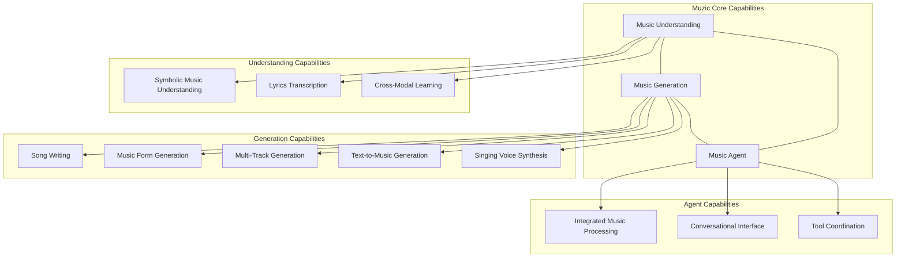

Sources: [README.md:15-26]()

## Music Understanding Capabilities

Music understanding components enable the system to analyze and comprehend musical data across different modalities:

1. **Symbolic Music Understanding (MusicBERT)** - Understands music in symbolic representations (e.g., MIDI) through large-scale pre-training
2. **Automatic Lyrics Transcription (PDAugment)** - Converts singing voices to text lyrics using data augmentation techniques
3. **Cross-Modal Embeddings (CLaMP)** - Creates unified representations between language and music for improved information retrieval

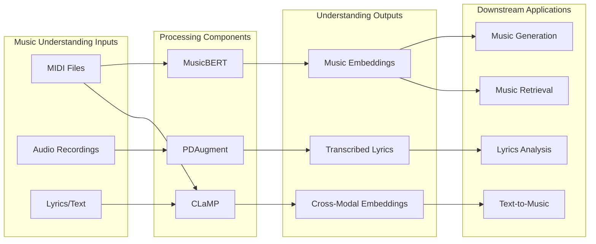

Sources: [README.md:27-31](), [pdaugment/README.md:1-3]()

### Use Cases for Music Understanding

| Component | Use Cases |
|-----------|-----------|
| MusicBERT | - Finding similar musical patterns<br>- Classifying music by style or genre<br>- Enabling more intelligent music generation<br>- Music data mining and analysis |
| PDAugment | - Automatic lyrics transcription from recordings<br>- Creating lyrics datasets from singing performances<br>- Assisting with music transcription<br>- Improving vocal recognition systems |
| CLaMP | - Cross-modal music retrieval (finding music based on text descriptions)<br>- Enhanced music recommendation systems<br>- Creating text descriptions of musical content<br>- Bridging the gap between language and music understanding |

Sources: [README.md:27-31](), [pdaugment/README.md:1-3]()

## Music Generation Capabilities

Muzic offers multiple specialized music generation systems that can create different aspects of musical content:

### Song Writing

Components focused on lyrics and melody generation:

1. **SongMASS** - Bidirectional lyric-to-melody and melody-to-lyric generation
2. **DeepRapper** - Specialized in rap lyric generation with rhyme and rhythm modeling
3. **TeleMelody** - Template-based approach for converting lyrics to melodies
4. **ReLyMe** - Improved lyric-to-melody generation incorporating relationship modeling
5. **ROC (Re-creation of Creations)** - Theory-guided approach for lyric-to-melody generation

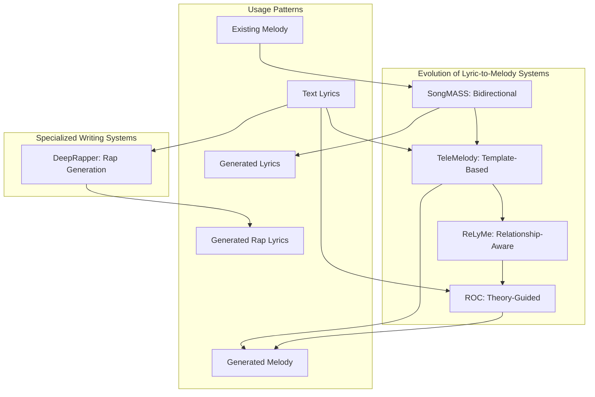

Sources: [README.md:32-36](), [musicagent/plugins.py:161-211]()

### Music Form/Structure Generation

Components focused on generating music with proper structural organization:

1. **MeloForm** - Generates music with coherent musical form
2. **Museformer** - Uses fine and coarse-grained attention mechanisms for improved long-form music generation

### Multi-Track Generation

Systems that can create multiple musical tracks or full arrangements:

1. **PopMAG** - Specialized in pop music accompaniment generation
2. **GETMusic** - Versatile system for generating any musical tracks using a unified representation and diffusion framework

### Text-to-Music Generation

Converting textual descriptions to music:

1. **MuseCoco** - Generates symbolic music based on text descriptions

### Singing Voice Synthesis

Converting melodies and lyrics to singing voice:

1. **HiFiSinger** - High-fidelity singing voice synthesis

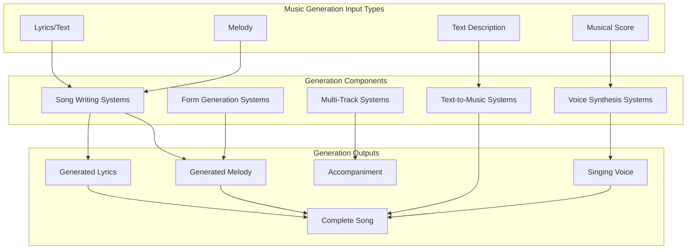

Sources: [README.md:37-44](), [musicagent/plugins.py:212-339](), [musicagent/plugins.py:749-781]()

### Use Cases for Music Generation

| Category | Components | Use Cases |
|----------|------------|-----------|
| Song Writing | SongMASS, DeepRapper, TeleMelody, ReLyMe, ROC | - Assisted songwriting for lyricists and composers<br>- Creating melody from lyrics or lyrics from melody<br>- Specialized rap generation<br>- Expanding musical ideas |
| Music Form | MeloForm, Museformer | - Generating structurally coherent music<br>- Creating longer musical pieces<br>- Maintaining thematic consistency in compositions |
| Multi-Track | PopMAG, GETMusic | - Creating accompaniments for melodies<br>- Generating complete arrangements<br>- Producing multi-instrument tracks from prompts |
| Text-to-Music | MuseCoco | - Creating music from textual descriptions<br>- Mood-based music generation<br>- Converting narrative concepts to music |
| Voice Synthesis | HiFiSinger | - Creating singing performances from score and lyrics<br>- Virtual vocalist production<br>- Converting melodies to vocal performances |

Sources: [README.md:32-44](), [musicagent/gradio_agent.py:192-201]()

## Music Agent Capabilities

MusicAgent integrates the various capabilities into a unified, LLM-powered system that can:

1. **Understand and respond to natural language instructions**
2. **Coordinate multiple music processing tools**
3. **Handle complex music-related tasks through tool composition**
4. **Process and generate multiple modalities** (text, music, audio)

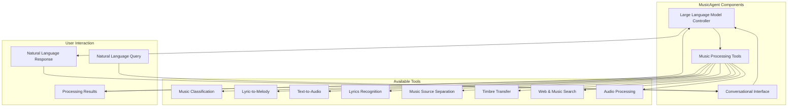

Sources: [musicagent/gradio_agent.py:10-204](), [musicagent/plugins.py:24-85]()

### MusicAgent Tool Ecosystem

MusicAgent integrates a wide range of tools through its plugin architecture, enabling complex music-related tasks through natural language:

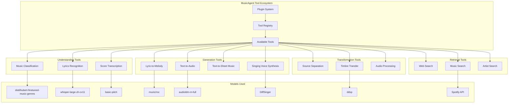

Sources: [musicagent/plugins.py:24-85](), [musicagent/models/download.sh:1-36]()

### Use Cases for MusicAgent

MusicAgent enables complex, multi-step music processing through natural language interaction:

| Category | Use Cases |
|----------|-----------|
| Content Creation | - Writing lyrics about specific topics<br>- Generating Chinese songs with specific styles<br>- Creating melodies for lyrics<br>- Generating audio from text descriptions |
| Music Analysis | - Finding the genre of a song<br>- Transcribing lyrics from recordings<br>- Extracting sheet music from audio<br>- Analyzing music trends |
| Audio Manipulation | - Separating vocals from instruments<br>- Converting vocals to different instruments<br>- Mixing and splicing audio files<br>- Creating accompaniment for vocals |
| Music Discovery | - Searching for music by artists<br>- Finding information about songs or albums<br>- Discovering music based on descriptions<br>- Getting information about music trends |

Sources: [musicagent/gradio_agent.py:192-201](), [musicagent/plugins.py:131-781]()

## Integration Examples

Here are examples of how the capabilities can be combined to accomplish complex music-related tasks:

### Example 1: Complete Song Creation

1. User provides a text prompt describing desired song style and theme
2. MusicAgent coordinates:
   - Lyric generation using DeepRapper or prompting the LLM
   - Melody generation using ROC or TeleMelody
   - Full arrangement using GETMusic
   - Optional vocal synthesis using DiffSinger

### Example 2: Music Analysis and Transformation

1. User uploads an audio recording
2. MusicAgent coordinates:
   - Lyrics transcription using Whisper model
   - Music source separation using Demucs
   - Genre classification using music classification models
   - Optional timbre transfer to create new versions

### Example 3: Music Retrieval and Exploration

1. User asks about specific artists or musical styles
2. MusicAgent coordinates:
   - Web search for information
   - Spotify integration for finding tracks
   - Audio playback and analysis
   - Creating similar music using generation components

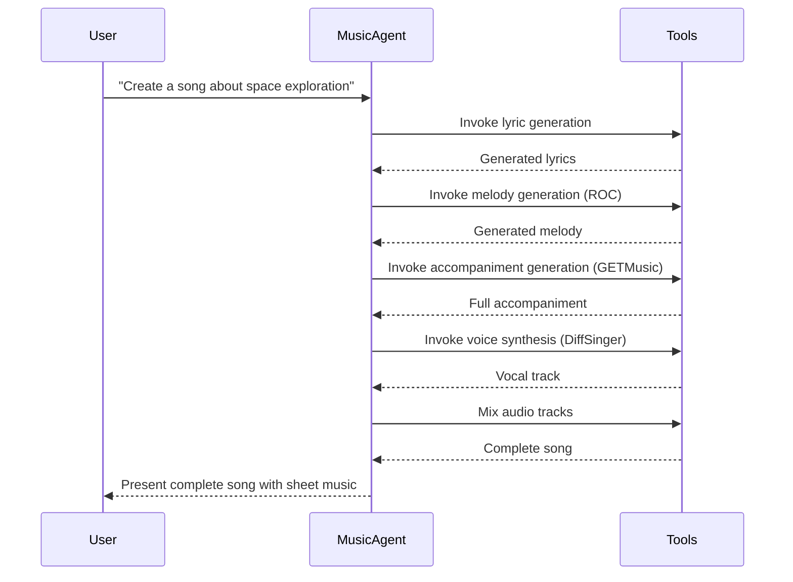

Sources: [musicagent/gradio_agent.py:64-122](), [musicagent/plugins.py:131-781]()

## Supported Input/Output Formats

Microsoft Muzic supports various input and output formats across its components:

### Input Formats
- **Text**: Lyrics, descriptions, prompts
- **Audio**: WAV, MP3, FLAC recordings
- **MIDI**: Symbolic music representation
- **Structured Data**: Song information, musical scores

### Output Formats
- **Audio**: Generated music, processed recordings
- **MIDI**: Symbolic music, sheet music
- **Text**: Generated lyrics, transcriptions, analysis
- **Visualizations**: Sheet music representations

Sources: [musicagent/gradio_agent.py:35-52](), [musicagent/plugins.py:410-747]()

## System Requirements and Dependencies

The Muzic system has several key dependencies that enable its capabilities:

- **Core Libraries**: transformers, librosa, pytorch, tensorflow
- **Audio Processing**: soundfile, pydub, ddsp, demucs
- **Music Generation**: diffusers, fairseq
- **Natural Language**: Google APIs, Hugging Face models
- **External Services**: Spotify API (for music search)

For full installation details, see [Installation and Setup](#5.1).

Sources: [musicagent/requirements.txt:1-37](), [musicagent/models/download.sh:1-36]()

---

# Page: Music Understanding Components

# Music Understanding Components

<details>
<summary>Relevant source files</summary>

The following files were used as context for generating this wiki page:

- [README.md](README.md)
- [deeprapper/README.md](deeprapper/README.md)
- [musicbert/README.md](musicbert/README.md)
- [pdaugment/README.md](pdaugment/README.md)
- [songmass/README.md](songmass/README.md)
- [telemelody/README.md](telemelody/README.md)
- [telemelody/inferrence/infer_zh.py](telemelody/inferrence/infer_zh.py)

</details>


This page provides a technical overview of the music understanding components within the Microsoft Muzic project. These components are responsible for analyzing and extracting structured representations from music data, which serve as foundations for the music generation systems covered in [Music Generation Components](#3).

The Music Understanding section of Muzic consists of three key components:
- MusicBERT: for symbolic music understanding
- PDAugment: for automatic lyrics transcription
- CLaMP: for contrastive language-music pre-training

## Component Architecture and Data Flow

The following diagram illustrates how music understanding components process different input data types and generate meaningful representations:

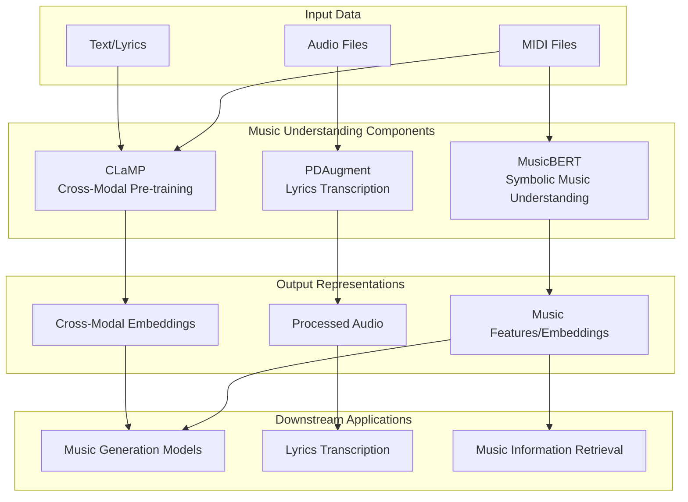

Sources: [README.md:27-31](), [musicbert/README.md:1-12](), [pdaugment/README.md:1-9]()

## Component Relationships with Generation Models

The music understanding components provide foundational capabilities that enable the more complex music generation tasks:

```mermaid
graph LR
    subgraph "Music Understanding"
        MusicBERT["MusicBERT"]
        PDAugment["PDAugment"]
        CLaMP["CLaMP"]
    end
    
    subgraph "Music Generation"
        Museformer["Museformer<br>FC-Attention"]
        GETMusic["GETMusic<br>Track Generation"]
        MuseCoco["MuseCoco<br>Text-to-Music"]
        DeepRapper["DeepRapper<br>Rap Generation"]
    end
    
    MusicBERT --> Museformer
    MusicBERT --> GETMusic
    MusicBERT --> MuseCoco
    CLaMP --> MuseCoco
    PDAugment --> DeepRapper
```

Sources: [README.md:17-23]()

This diagram shows how music understanding components feed into various generation models. For example, MusicBERT's music representations power multiple generation models while PDAugment specifically supports DeepRapper for high-quality rap generation.

## Overview of Components

The following table summarizes the key characteristics of each music understanding component:

| Component | Purpose | Input Data | Output | Key Technologies |
|-----------|---------|------------|--------|------------------|
| MusicBERT | Symbolic music understanding with pre-training | MIDI files | Music embeddings | OctupleMIDI encoding, Bar-level masking |
| PDAugment | Data augmentation for automatic lyrics transcription | Speech audio, Music scores | Augmented speech audio | Pitch adjustment, Duration adjustment |
| CLaMP | Contrastive Language-Music Pre-training | MIDI files, Text | Cross-modal embeddings | Contrastive learning |

Sources: [README.md:27-31](), [musicbert/README.md:1-4](), [pdaugment/README.md:1-3]()

## MusicBERT

MusicBERT is a large-scale pre-trained model for symbolic music understanding. It adapts the BERT (Bidirectional Encoder Representations from Transformers) approach from NLP to music data, utilizing several music-specific techniques.

### Architecture and Encoding

```mermaid
graph TD
    subgraph "MusicBERT Pipeline"
        Input["MIDI Input"]
        Preprocess["MIDI Preprocessing"]
        OctupleEnc["OctupleMIDI Encoding"]
        Masking["Bar-level Masking"]
        Transformer["Transformer Encoder"]
        Output["Music Representations"]
    end
    
    Input --> Preprocess
    Preprocess --> OctupleEnc
    OctupleEnc --> Masking
    Masking --> Transformer
    Transformer --> Output
    
    subgraph "OctupleMIDI Encoding Components"
        Bar["Bar"]
        Position["Position"]
        Instrument["Instrument"]
        Pitch["Pitch"]
        Duration["Duration"]
        Velocity["Velocity"]
        TimeSignature["Time Signature"]
        Tempo["Tempo"]
    end
    
    OctupleEnc --- Bar
    OctupleEnc --- Position
    OctupleEnc --- Instrument
    OctupleEnc --- Pitch
    OctupleEnc --- Duration
    OctupleEnc --- Velocity
    OctupleEnc --- TimeSignature
    OctupleEnc --- Tempo
```

Sources: [musicbert/README.md:8-11]()

### Key Features

1. **OctupleMIDI Encoding**: Transforms MIDI events into 8-tuple representations that capture comprehensive musical information including bar position, pitch, duration, velocity, and more.

2. **Bar-level Masking Strategy**: Instead of masking individual tokens as in text BERT models, MusicBERT masks entire bars to better capture musical phrases and structures.

3. **Pre-training Task**: Uses masked language modeling approach adapted to music data to learn deep representations of musical structure.

### Supported Tasks

MusicBERT supports multiple downstream tasks for symbolic music understanding:

| Task | Description | Implementation |
|------|-------------|----------------|
| Melody Completion | Predicting the next melody notes given previous context | `eval_nsp.py` with "next" task |
| Accompaniment Suggestion | Suggesting accompaniment notes for a given melody | `eval_nsp.py` with "acc" task |
| Genre Classification | Identifying music genre from symbolic representation | `eval_genre.py` with "topmagd" dataset |
| Style Classification | Identifying music style from symbolic representation | `eval_genre.py` with "masd" dataset |

Sources: [musicbert/README.md:144-156]()

### Data Pipeline

MusicBERT requires a specific data pipeline to process MIDI files:

1. Data preparation: Convert raw MIDI files to the OctupleMIDI format
2. Binarization: Convert text-based OctupleMIDI data into binary format for efficient training
3. Pre-training: Train the model on large MIDI datasets like the Lakh MIDI Dataset (LMD)
4. Fine-tuning: Adapt the pre-trained model for specific downstream tasks

Sources: [musicbert/README.md:13-109]()

## PDAugment

PDAugment is a data augmentation method specifically designed for automatic lyrics transcription. It narrows the gap between natural speech and singing voice by adjusting pitch and duration of speech to match the characteristics of singing.

### System Pipeline

```mermaid
graph LR
    subgraph "PDAugment Pipeline"
        Speech["Speech Corpus<br>(LibriSpeech)"]
        MusicScore["Music Scores<br>(FreeMidi)"]
        TextToPhone["Text-to-Phoneme<br>Conversion"]
        PhoneAlign["Montreal Forced<br>Aligner (MFA)"]
        PitchAdj["Pitch<br>Adjustment"]
        DurAdj["Duration<br>Adjustment"]
        Augmented["Augmented<br>Speech"]
        LyricsModel["Lyrics Transcription<br>Model"]
    end
    
    Speech --> TextToPhone
    TextToPhone --> PhoneAlign
    MusicScore --> PitchAdj
    MusicScore --> DurAdj
    PhoneAlign --> PitchAdj
    PhoneAlign --> DurAdj
    PitchAdj --> Augmented
    DurAdj --> Augmented
    Augmented --> LyricsModel
```

Sources: [pdaugment/README.md:12-150]()

### Key Features

1. **Pitch Adjustment**: Modifies the pitch of speech syllables to match the corresponding notes in music scores, making speech sound more like singing.

2. **Duration Adjustment**: Extends or shortens the duration of speech syllables to match note durations in music, accommodating the timing patterns in singing.

3. **Phoneme-level Processing**: Operates at the phoneme level for precise control over speech modifications.

### Data Requirements

PDAugment requires two primary data sources:

1. **Speech Corpus**: LibriSpeech ASR corpus is used as the speech source
2. **Music Score Dataset**: FreeMidi dataset provides melody information including pitch and duration

The system also requires phoneme-level alignment of speech, obtained through the Montreal Forced Aligner (MFA) tool.

Sources: [pdaugment/README.md:12-102]()

## CLaMP (Contrastive Language-Music Pre-training)

CLaMP is a cross-modal system that aligns language and music through contrastive learning. It won the Best Student Paper Award at ISMIR 2023.

### System Approach

CLaMP uses contrastive learning to create a shared embedding space between language (text) and music (symbolic representations). This enables cross-modal information retrieval and generation tasks.

### Applications

1. **Cross-modal Music Information Retrieval**: Finding music based on textual descriptions and vice versa
2. **Text-to-Music Generation**: Providing foundations for systems like MuseCoco that generate music from text

### Integration with Generation Systems

CLaMP's cross-modal embeddings are particularly valuable for text-to-music generation systems. The shared representation space allows models to map between linguistic descriptions and musical elements.

Sources: [README.md:58](), [README.md:92]()

## Integration with Music Generation Components

The music understanding components provide essential capabilities that enable the more advanced music generation systems:

1. **MusicBERT → Museformer, GETMusic, MuseCoco**: MusicBERT's symbolic music understanding powers multiple generation systems through its rich music representations.

2. **CLaMP → MuseCoco**: CLaMP's cross-modal alignments specifically enable MuseCoco to generate symbolic music from text descriptions.

3. **PDAugment → DeepRapper**: PDAugment's enhanced lyrics transcription capabilities help DeepRapper generate rap with better pronunciation and rhythm.

Sources: [README.md:27-46]()

## Summary

The Music Understanding components in the Muzic project provide the foundational technologies for analyzing and representing music data. By extracting structured representations from different music modalities (symbolic, audio, text), these components enable the more complex generation tasks in the Muzic ecosystem.

The three components (MusicBERT, PDAugment, and CLaMP) address different aspects of music understanding:
- Symbolic music understanding through pre-training
- Bridging the gap between speech and singing for lyrics transcription
- Creating cross-modal alignments between music and language

These capabilities form the backbone of the Muzic project's broader goal of empowering AI music generation and understanding.

---

# Page: MusicBERT

# MusicBERT

<details>
<summary>Relevant source files</summary>

The following files were used as context for generating this wiki page:

- [deeprapper/README.md](deeprapper/README.md)
- [musicbert/README.md](musicbert/README.md)
- [songmass/README.md](songmass/README.md)
- [telemelody/README.md](telemelody/README.md)
- [telemelody/inferrence/infer_zh.py](telemelody/inferrence/infer_zh.py)

</details>


## Purpose and Scope

MusicBERT is a large-scale pre-trained model for symbolic music understanding within the Microsoft Muzic project. This document explains MusicBERT's architecture, encoding mechanism, pre-training approach, downstream capabilities, and usage instructions. MusicBERT serves as a foundational component for music understanding, providing music feature representations that other generation systems in the Muzic ecosystem can build upon.

For information about other music understanding components like CLaMP (Contrastive Language-Music Pre-training), see [CLaMP](#2.2).

Sources: [musicbert/README.md:1-4]()

## Model Overview

MusicBERT adapts the BERT (Bidirectional Encoder Representations from Transformers) architecture for music data. It includes several mechanisms specifically designed for symbolic music understanding:

1. **OctupleMIDI encoding**: A specialized encoding format for representing symbolic music
2. **Bar-level masking strategy**: A music-specific approach to masked language modeling

The model achieves state-of-the-art accuracy on several music understanding tasks, including melody completion, accompaniment suggestion, genre classification, and style classification.

### MusicBERT Architecture

```mermaid
flowchart TD
    subgraph "MusicBERT"
        Input["OctupleMIDI\nEncoded Input"]
        Embedding["Embedding Layer"]
        TF["Transformer Encoder Layers"]
        Output["Feature Representations"]
        
        Input --> Embedding
        Embedding --> TF
        TF --> Output
    end
    
    subgraph "Pre-training Tasks"
        MLM["Masked Language Modeling\nwith Bar-level Strategy"]
        TF --> MLM
    end
    
    subgraph "Downstream Tasks"
        MC["Melody Completion"]
        AS["Accompaniment Suggestion"]
        GC["Genre Classification"]
        SC["Style Classification"]
        
        Output --> MC
        Output --> AS
        Output --> GC
        Output --> SC
    end
```

Sources: [musicbert/README.md:1-4](), [musicbert/README.md:9-11]()

### OctupleMIDI Encoding

The OctupleMIDI encoding is a comprehensive representation that captures multiple dimensions of musical information:

```mermaid
flowchart LR
    MIDI["MIDI File"] --> Processor["MusicBERT\nPreprocessor"]
    
    Processor --> Encoding["OctupleMIDI Encoding"]
    
    subgraph "8-Dimensional Representation"
        Encoding --> Bar["Bar Position"]
        Encoding --> Pos["Position in Bar"]
        Encoding --> Pitch["Note Pitch"]
        Encoding --> Dur["Note Duration"]
        Encoding --> Vel["Velocity"]
        Encoding --> TS["Time Signature"]
        Encoding --> Tempo["Tempo"]
        Encoding --> Program["Program/Instrument"]
    end
```

Sources: [musicbert/README.md:9-11]()

## Pre-training Approach

MusicBERT is pre-trained on The Lakh MIDI Dataset (LMD-full), a large collection of MIDI files. The pre-training process consists of:

1. **Data preparation**: Converting MIDI files to OctupleMIDI encoding
2. **Masked language modeling**: Using a specialized bar-level masking strategy
3. **Model training**: Training the Transformer-based architecture to predict masked tokens

Pre-trained checkpoints are available in both "small" and "base" configurations, with different model capacities.

Sources: [musicbert/README.md:13-21](), [musicbert/README.md:112-120]()

## Integration with Other Components

MusicBERT serves as a foundation for several other components in the Muzic ecosystem:

```mermaid
flowchart TD
    MusicBERT["MusicBERT\nSymbolic Music Understanding"]
    
    subgraph "Direct Applications"
        MC["Melody Completion"]
        AS["Accompaniment Suggestion"]
        GC["Genre Classification\n(TOPMAGD)"]
        SC["Style Classification\n(MASD)"]
    end
    
    subgraph "Downstream Muzic Components"
        Museformer["Museformer\nMusic Form Generation"]
        GETMusic["GETMusic\nMulti-Track Generation"]
        MuseCoco["MuseCoco\nText-to-Music Generation"]
    end
    
    MusicBERT --> MC
    MusicBERT --> AS
    MusicBERT --> GC
    MusicBERT --> SC
    
    MusicBERT --> Museformer
    MusicBERT --> GETMusic
    MusicBERT --> MuseCoco
```

Sources: [musicbert/README.md:4-6]()

## Capabilities and Downstream Tasks

MusicBERT supports several music understanding tasks:

### Melody Completion

Predicts the next notes in a melody given a context sequence.

### Accompaniment Suggestion

Generates appropriate accompaniment patterns for a given melody.

### Genre Classification

Classifies music into different genres using the TOPMAGD dataset.

### Style Classification

Identifies musical styles using the MASD dataset.

Sources: [musicbert/README.md:2-4](), [musicbert/README.md:144-156]()

## Usage Guide

### Setting Up MusicBERT

#### 1. Preparing Pre-training Datasets

```bash
# Download LMD-full dataset
wget http://hog.ee.columbia.edu/craffel/lmd/lmd_full.tar.gz
tar -xzvf lmd_full.tar.gz
zip -r lmd_full.zip lmd_full

# Process the dataset
python -u preprocess.py

# Binarize the dataset
bash binarize_pretrain.sh lmd_full
```

Sources: [musicbert/README.md:13-44]()

#### 2. Preparing Task-Specific Datasets

Task-specific datasets are required for downstream applications:

| Task | Dataset | Preparation Script |
|------|---------|-------------------|
| Melody Completion | PiRhDy | `gen_nsp.py` (with "next" option) |
| Accompaniment Suggestion | PiRhDy | `gen_nsp.py` (with "acc" option) |
| Genre Classification | TOPMAGD | `gen_genre.py` (with "topmagd" option) |
| Style Classification | MASD | `gen_genre.py` (with "masd" option) |

Sources: [musicbert/README.md:46-110]()

### Training MusicBERT

#### Pre-training

```bash
bash train_mask.sh lmd_full small
```

Pre-trained checkpoints:
- Small configuration: Available for download
- Base configuration: Available for download

Sources: [musicbert/README.md:114-121]()

#### Fine-tuning

Fine-tuning commands for downstream tasks:

```bash
# Melody completion
bash train_nsp.sh next checkpoints/checkpoint_last_musicbert_base.pt

# Accompaniment suggestion
bash train_nsp.sh acc checkpoints/checkpoint_last_musicbert_small.pt

# Genre classification
bash train_genre.sh topmagd 13 0 checkpoints/checkpoint_last_musicbert_base.pt

# Style classification
bash train_genre.sh masd 25 4 checkpoints/checkpoint_last_musicbert_small.pt
```

Sources: [musicbert/README.md:123-142]()

### Evaluation

Evaluating MusicBERT on downstream tasks:

```bash
# Melody completion and accompaniment suggestion
python -u eval_nsp.py checkpoints/checkpoint_last_nsp_next_checkpoint_last_musicbert_base.pt next_data_bin

# Genre and style classification
python -u eval_genre.py checkpoints/checkpoint_last_genre_topmagd_x_checkpoint_last_musicbert_small.pt topmagd_data_bin/x
```

Sources: [musicbert/README.md:144-156]()

## Workflow Diagram

The complete workflow for using MusicBERT:

```mermaid
flowchart TD
    subgraph "Dataset Preparation"
        Raw["Raw MIDI Data\n(LMD-full)"]
        Preprocess["preprocess.py\nOctupleMIDI Conversion"]
        Binarize["binarize_pretrain.sh\nBinarization"]
        
        Raw --> Preprocess
        Preprocess --> Binarize
    end
    
    subgraph "Pre-training"
        Train["train_mask.sh\nMasked Language Modeling"]
        Checkpoints["Pre-trained Checkpoints\nSmall/Base Models"]
        
        Binarize --> Train
        Train --> Checkpoints
    end
    
    subgraph "Task-Specific Data"
        TaskData1["Melody/Accompaniment\n(PiRhDy)"]
        TaskData2["Genre/Style\n(TOPMAGD/MASD)"]
        
        TaskConvert1["gen_nsp.py\nTask Conversion"]
        TaskConvert2["gen_genre.py\nTask Conversion"]
        
        TaskBinarize1["binarize_nsp.sh\nBinarization"]
        TaskBinarize2["binarize_genre.sh\nBinarization"]
        
        TaskData1 --> TaskConvert1
        TaskData2 --> TaskConvert2
        
        TaskConvert1 --> TaskBinarize1
        TaskConvert2 --> TaskBinarize2
    end
    
    subgraph "Fine-tuning"
        FineTuneMelody["train_nsp.sh\nMelody Completion"]
        FineTuneAcc["train_nsp.sh\nAccompaniment"]
        FineTuneGenre["train_genre.sh\nGenre Classification"]
        FineTuneStyle["train_genre.sh\nStyle Classification"]
        
        Checkpoints --> FineTuneMelody & FineTuneAcc & FineTuneGenre & FineTuneStyle
        TaskBinarize1 --> FineTuneMelody & FineTuneAcc
        TaskBinarize2 --> FineTuneGenre & FineTuneStyle
    end
    
    subgraph "Evaluation"
        EvalMelody["eval_nsp.py\nMelody Evaluation"]
        EvalGenre["eval_genre.py\nGenre Evaluation"]
        
        FineTuneMelody & FineTuneAcc --> EvalMelody
        FineTuneGenre & FineTuneStyle --> EvalGenre
    end
```

Sources: [musicbert/README.md:13-156]()

## External Projects Using MusicBERT

MusicBERT has been used in external projects, including:

- **midiformers**: A customized MIDI music remixing tool with an easy-to-use interface

Sources: [musicbert/README.md:4-6]()

---

# Page: CLaMP

# CLaMP

<details>
<summary>Relevant source files</summary>

The following files were used as context for generating this wiki page:

- [clamp/clamp.py](clamp/clamp.py)
- [clamp/inference/cache/music_key_cache_1024.pth](clamp/inference/cache/music_key_cache_1024.pth)
- [clamp/inference/cache/music_key_cache_512.pth](clamp/inference/cache/music_key_cache_512.pth)
- [clamp/inference/cache/text_key_cache_1024.pth](clamp/inference/cache/text_key_cache_1024.pth)
- [clamp/inference/cache/text_key_cache_512.pth](clamp/inference/cache/text_key_cache_512.pth)
- [clamp/inference/music_keys/music_keys.zip](clamp/inference/music_keys/music_keys.zip)
- [clamp/inference/music_query.mxl](clamp/inference/music_query.mxl)
- [clamp/inference/text_keys.txt](clamp/inference/text_keys.txt)
- [clamp/inference/text_query.txt](clamp/inference/text_query.txt)
- [clamp/inference/xml2abc.py](clamp/inference/xml2abc.py)
- [clamp/requirements.txt](clamp/requirements.txt)
- [img/clamp_clamp.png](img/clamp_clamp.png)
- [img/clamp_cross-modal tasks.png](img/clamp_cross-modal tasks.png)

</details>


CLaMP (Contrastive Language-Music Pre-training) is a cross-modal embedding system that enables semantic understanding and retrieval between music and text. This document covers the architecture, functionality, and usage of the CLaMP model within the Microsoft Muzic project. CLaMP provides embeddings for both music and text in a shared semantic space, supporting cross-modal tasks such as text-to-music retrieval, music-to-text retrieval, and semantic similarity computation.

## Overview and Architecture

CLaMP uses contrastive learning to align music and text representations in a shared embedding space. It consists of separate encoders for music and text, with projection layers that map their outputs to a common space where semantically related content is positioned closer together.

```mermaid
flowchart TB
    subgraph "CLaMP Architecture"
        direction TB
        
        MusicInput["Music Input"] --> Patchilizer["MusicPatchilizer"]
        Patchilizer --> MusicEnc["music_enc (Transformer)"]
        MusicEnc --> MusicPool["avg_pooling()"]
        MusicPool --> MusicProj["music_proj()"]
        
        TextInput["Text Input"] --> Tokenizer["Tokenizer (DistilRoBERTa)"]
        Tokenizer --> TextEnc["text_enc (Transformer)"]
        TextEnc --> TextPool["avg_pooling()"]
        TextPool --> TextProj["text_proj()"]
        
        MusicProj --> SharedSpace["Shared Embedding Space"]
        TextProj --> SharedSpace
    end
```

Sources: [clamp/clamp.py:33-41](). [clamp/clamp.py:147-165]()

## Core Components

CLaMP consists of several key components that work together to provide cross-modal embedding functionality:

### Model Architecture

The CLaMP model has separate encoders for music and text, with projection layers that map their representations to a shared embedding space.

```mermaid
classDiagram
    class CLaMP {
        config
        music_enc
        text_enc
        music_proj
        text_proj
        avg_pooling()
    }
    
    class MusicPatchilizer {
        encode()
    }
    
    class AutoTokenizer {
        __call__()
    }
    
    CLaMP --> MusicPatchilizer : uses
    CLaMP --> AutoTokenizer : uses
```

Sources: [clamp/clamp.py:33-41](), [clamp/clamp.py:39-40]()

### Input Processing Components

CLaMP uses specialized components to process raw inputs into a format suitable for the model:

1. **MusicPatchilizer**: Converts music notation (from MusicXML/ABC format) into patches that can be processed by the transformer model
2. **Tokenizer**: Uses a pre-trained DistilRoBERTa tokenizer to convert text into token IDs

Sources: [clamp/clamp.py:39](), [clamp/clamp.py:40]()

### Feature Extraction

The system extracts features from both modalities and projects them into a shared embedding space:

```mermaid
flowchart LR
    subgraph "get_features()"
        direction LR
        IDs["ids_list"] --> | "music" | MusicFeatures["model.music_enc()"]
        IDs --> | "text" | TextFeatures["model.text_enc()"]
        
        MusicFeatures --> MusicPooling["model.avg_pooling()"]
        TextFeatures --> TextPooling["model.avg_pooling()"]
        
        MusicPooling --> MusicProjection["model.music_proj()"]
        TextPooling --> TextProjection["model.text_proj()"]
        
        MusicProjection --> Features["features_list"]
        TextProjection --> Features
    end
```

Sources: [clamp/clamp.py:136-165]()

### Similarity Computation

CLaMP computes similarity between embeddings using scaled cosine similarity:

```mermaid
flowchart LR
    subgraph "compute_values()"
        QueryEmb["Q_e (Query embeddings)"] --> Normalize1["torch.nn.functional.normalize()"]
        KeyEmb["K_e (Key embeddings)"] --> Normalize2["torch.nn.functional.normalize()"]
        
        Normalize1 --> MatrixMult["torch.mm() * scaling"]
        Normalize2 --> MatrixMult
        
        MatrixMult --> Softmax["softmax()"]
        Softmax --> Values["similarity values"]
    end
```

Sources: [clamp/clamp.py:43-62]()

## Cross-Modal Tasks

CLaMP supports several cross-modal tasks through its unified embedding space:

```mermaid
flowchart TD
    subgraph "Cross-Modal Tasks"
        MusicEmb["Music Embeddings"] --- SharedSpace["Shared Embedding Space"]
        TextEmb["Text Embeddings"] --- SharedSpace
        
        SharedSpace --> MusicToText["Music-to-Text Retrieval"]
        SharedSpace --> TextToMusic["Text-to-Music Retrieval"]
        SharedSpace --> SemanticSimilarity["Semantic Similarity"]
    end
```

Sources: [img/clamp_cross-modal tasks.png]()

### Text-to-Music Retrieval

Search for music using natural language descriptions. The system encodes the text query, computes similarities with music embeddings, and returns the most relevant music pieces.

### Music-to-Text Retrieval

Find textual descriptions that match a given music piece. The system encodes the music query, computes similarities with text embeddings, and returns the most relevant text items.

### Semantic Similarity

Compute the semantic similarity between music and text to understand their relationships.

## Usage Workflow

The typical workflow for using CLaMP involves:

```mermaid
flowchart TD
    LoadModel["Load CLaMP model"] --> InitComponents["Initialize patchilizer, tokenizer"]
    InitComponents --> PrepareData["Prepare query and keys"]
    PrepareData --> ProcessInput["Process inputs (encode_data)"]
    ProcessInput --> ExtractFeatures["Extract features (get_features)"]
    ExtractFeatures --> ComputeSimilarity["Compute similarity (compute_values)"]
    ComputeSimilarity --> RankResults["Rank results"]
```

Sources: [clamp/clamp.py:168-312]()

## Implementation Details

### Model Loading

CLaMP offers pre-trained models in two variants:

- `sander-wood/clamp-small-512`: Supports smaller context length (512 tokens)
- `sander-wood/clamp-small-1024`: Supports longer context length (1024 tokens)

```python
# Load CLaMP model
model = CLaMP.from_pretrained(CLAMP_MODEL_NAME)
music_length = model.config.max_length
model = model.to(device)
model.eval()
```

Sources: [clamp/clamp.py:33-36]()

### Data Encoding

The system encodes music and text inputs differently:

```python
# For music:
patches = patchilizer.encode(item, music_length=music_length, add_eos_patch=True)
ids_list.append(torch.tensor(patches).reshape(-1))

# For text:
text_encodings = tokenizer(item, return_tensors='pt', truncation=True, max_length=TEXT_LENGTH)
ids_list.append(text_encodings['input_ids'].squeeze(0))
```

Sources: [clamp/clamp.py:65-89]()

### Music Loading and Processing

For music in MusicXML format, the system:
1. Converts MusicXML to ABC notation using `xml2abc.py`
2. Filters metadata from the ABC file
3. Processes the filtered content to create input for the model

Sources: [clamp/clamp.py:92-134](), [clamp/inference/xml2abc.py:1-43]()

### Caching for Efficiency

CLaMP implements a caching mechanism to avoid reprocessing previously seen inputs:

```python
# Check if cache exists
if os.path.exists("inference/cache/"+KEY_MODAL+"_key_cache_"+str(music_length)+".pth"):
    with open("inference/cache/"+KEY_MODAL+"_key_cache_"+str(music_length)+".pth", 'rb') as f:
        key_cache = torch.load(f)
    cached_keys = key_cache["keys"]
    cached_key_filenames = key_cache["filenames"]
    cached_key_features = key_cache["features"]
```

Sources: [clamp/clamp.py:190-195](), [clamp/clamp.py:239-244]()

## Performance Considerations

### Hardware Requirements

CLaMP requires a CUDA-capable GPU for optimal performance. The system checks for GPU availability:

```python
if torch.cuda.is_available():    
    device = torch.device("cuda")
    print('There are %d GPU(s) available.' % torch.cuda.device_count())
    print('We will use the GPU:', torch.cuda.get_device_name(0))
else:
    print('No GPU available, using the CPU instead.')
    device = torch.device("cpu")
```

Sources: [clamp/clamp.py:6-13]()

### Memory Usage

The system's memory usage depends on:
1. The model size (`clamp-small-512` vs `clamp-small-1024`)
2. The number of keys being compared
3. The sequence lengths of inputs

For large collections, consider:
- Processing batches incrementally
- Using the caching mechanism
- Setting appropriate maximum sequence lengths

## Command Line Interface

CLaMP provides a command-line interface with several configurable parameters:

| Parameter | Description | Default |
|-----------|-------------|---------|
| `-clamp_model_name` | Model name to use | `sander-wood/clamp-small-512` |
| `-query_modal` | Query modality (music/text) | `music` |
| `-key_modal` | Key modality (music/text) | `text` |
| `-top_n` | Number of top results to return | `10` |

Sources: [clamp/clamp.py:15-21]()

## Example Usage Scenarios

### Finding Music That Matches a Text Description

```
python clamp.py -query_modal text -key_modal music -top_n 5
```

This retrieves the top 5 music pieces from the "music_keys" folder that best match the text in "text_query.txt".

### Finding Text Descriptions for a Music Piece

```
python clamp.py -query_modal music -key_modal text -top_n 5
```

This finds the top 5 text descriptions from "text_keys.txt" that best match the music in "music_query.mxl".

## Dependencies

CLaMP relies on several external libraries:

- transformers 4.18.0
- torch 1.9.1+cu111
- torchvision 0.10.1+cu111
- requests 2.27.1
- tqdm 4.63.1
- unidecode 1.3.4

Sources: [clamp/requirements.txt:1-8]()

## Position in Microsoft Muzic Ecosystem

CLaMP is a fundamental component within the Microsoft Muzic ecosystem, providing music understanding capabilities that other components can build upon.

```mermaid
flowchart TD
    subgraph "Microsoft Muzic Ecosystem"
        direction TB
        
        subgraph "Music Understanding"
            MusicBERT["MusicBERT"]
            CLaMP["CLaMP"]
            PDAugment["PDAugment"]
        end
        
        subgraph "Music Generation"
            MuseCoco["MuseCoco"]
            GETMusic["GETMusic"]
            Others["Other Generators"]
        end
        
        subgraph "Music Agent"
            MusicAgent["MusicAgent"]
        end
        
        CLaMP --> MuseCoco
        MusicBERT --> GETMusic
        CLaMP --> MusicAgent
    end
```

Sources: [Based on the repository overview diagrams provided]

CLaMP provides cross-modal understanding between music and text, which is particularly valuable for text-to-music generation systems like MuseCoco and for intelligent music agents that need to understand relationships between music and language.

---

# Page: PDAugment

# PDAugment

<details>
<summary>Relevant source files</summary>

The following files were used as context for generating this wiki page:

- [README.md](README.md)
- [pdaugment/README.md](pdaugment/README.md)

</details>


## Introduction

PDAugment is a data augmentation method that adjusts pitch and duration of speech to help the training of automatic lyrics transcription systems. It narrows the gap between natural speech and singing voice by adjusting the pitch and duration of each syllable in natural speech to match those of corresponding notes extracted from music scores. This wiki page documents the architecture, implementation, and usage of the PDAugment system within Microsoft's Muzic project.

For information about other music understanding components, see [Music Understanding Components](#2).

Sources: [README.md:29-31]()', [pdaugment/README.md:1-9]()

## System Overview

PDAugment is designed to solve the problem of insufficient training data for lyrics transcription systems by leveraging existing speech recognition datasets and music scores. The system transforms regular speech data by adjusting its pitch and duration characteristics to more closely resemble singing voice data, thereby creating synthetic training data for automatic lyrics transcription systems.

```mermaid
flowchart TD
    subgraph "PDAugment System"
        direction TB
        subgraph "Data Preparation"
            direction LR
            Speech["Speech Data<br>(LibriSpeech)"]
            Scores["Music Scores<br>(FreeMidi)"]
            
            Speech --> Text2Phone["Text to Phone<br>Conversion"]
            Text2Phone --> PhoneAlign["Phoneme Level<br>Alignment"]
            Scores --> MidiPreprocess["MIDI<br>Preprocessing"]
        end
        
        subgraph "Augmentation Process"
            direction LR
            PitchAdj["Pitch<br>Adjustment"]
            DurationAdj["Duration<br>Adjustment"]
            PDCombine["Combined<br>PDAugment"]
        end
        
        PhoneAlign --> PitchAdj
        PhoneAlign --> DurationAdj
        MidiPreprocess --> PitchAdj
        MidiPreprocess --> DurationAdj
        PitchAdj --> PDCombine
        DurationAdj --> PDCombine
        
        PDCombine --> AugmentedData["Augmented Data<br>for Lyrics Transcription"]
    end
```

The PDAugment pipeline consists of two main stages:
1. **Data Preparation**: Processing speech datasets and music scores to extract phoneme-level information and musical notes
2. **Augmentation Process**: Adjusting the pitch and duration of speech data based on musical information

Sources: [pdaugment/README.md:5-9]()

## Data Preparation Process

The data preparation process involves collecting and processing two types of data:

1. **Speech Data**: Using the LibriSpeech ASR corpus
2. **Music Scores**: Using FreeMidi dataset (specifically pop songs)

```mermaid
flowchart LR
    subgraph "Speech Processing"
        LibriSpeech["LibriSpeech<br>ASR Corpus"] --> FlacToWav["FLAC to WAV<br>Conversion"]
        FlacToWav --> TextToPhone["Text to Phone<br>Conversion"]
        TextToPhone --> PhonemeAlignment["MFA Phoneme<br>Alignment"]
        PhonemeAlignment --> AlignmentPickle["Alignment<br>Pickle File"]
    end
    
    subgraph "Music Score Processing"
        FreeMidi["FreeMidi<br>Dataset"] --> MidiClean["Clean and<br>Extract Lead Track"]
        MidiClean --> ProcessedMidi["Processed<br>MIDI Files"]
    end
```

### Speech Data Processing

1. **Download LibriSpeech ASR Corpus**
   - Save in `data/speech/raw`
   - Convert FLAC to WAV format using `ffmpeg`

2. **Text to Phone Conversion**
   - Convert word-level text to phoneme-level text using `phonemizer`
   - Generate metadata CSV files with phoneme information

3. **Phoneme Level Alignment**
   - Use Montreal Forced Aligner (MFA) to get phoneme-level alignment
   - Generate alignment pickle files with split positions between phonemes

Sources: [pdaugment/README.md:12-77]()

### Music Score Processing

1. **Download FreeMidi Dataset**
   - Use specifically pop songs (approximately 4000 MIDI files)
   - Save in `data/midis/raw`

2. **MIDI Preprocessing**
   - Clean multitrack data
   - Recognize and extract the lead track information
   - Save processed files in `data/midis/processed/midi_6tracks`

Sources: [pdaugment/README.md:81-102]()

## Augmentation Process

The core of PDAugment involves two types of adjustments that can be applied independently or combined:

```mermaid
flowchart TD
    subgraph "PDAugment Process"
        direction LR
        Speech["Speech Audio"] --> |"Phoneme<br>Alignment"| SpeechPhonemes["Phoneme-Split<br>Speech Audio"]
        MidiNotes["MIDI Note<br>Information"] --> |"Extract<br>Note Properties"| NoteFeatures["Pitch and Duration<br>Features"]
        
        SpeechPhonemes --> PitchAdjustment["Pitch<br>Adjustment"]
        SpeechPhonemes --> DurationAdjustment["Duration<br>Adjustment"]
        
        NoteFeatures --> PitchAdjustment
        NoteFeatures --> DurationAdjustment
        
        PitchAdjustment --> PitchAudio["Pitch-Adjusted<br>Audio"]
        DurationAdjustment --> DurationAudio["Duration-Adjusted<br>Audio"]
        
        PitchAudio --> CombinedAdjustment["Combined<br>Adjustment"]
        DurationAudio --> CombinedAdjustment
        
        CombinedAdjustment --> PDAugmentedAudio["PDAugmented<br>Audio"]
    end
```

### Pitch Adjustment

Pitch adjustment modifies the pitch of each phoneme in the speech to match the pitch of corresponding notes in music scores. This process:

1. Uses the phoneme alignment information to identify each phoneme segment
2. Extracts pitch information from music notes
3. Adjusts the pitch of each phoneme using frequency mapping

### Duration Adjustment

Duration adjustment modifies the length of each phoneme to match the duration of corresponding notes in music scores. This process:

1. Uses the phoneme alignment information to identify each phoneme segment
2. Extracts duration information from music notes
3. Either stretches or compresses each phoneme segment to match the target duration

### Combined PDAugment

The full PDAugment process applies both pitch and duration adjustments to create speech that more closely resembles singing voice in terms of melodic characteristics.

Sources: [pdaugment/README.md:5-9](), [pdaugment/README.md:105-149]()

## Implementation and Usage

The PDAugment system is implemented in Python and requires specific dependencies to run.

### Code Structure

The main implementation consists of:

- `pdaugment.py`: Main script for the augmentation process
- `text2phone.py`: Script for converting text to phoneme
- `flac2wav.py`: Script for converting FLAC files to WAV format
- `midi_preprocess/`: Directory containing MIDI preprocessing scripts
  - `preprocess.py`: Script for processing MIDI files
  - `configs/default.yaml`: Configuration for MIDI preprocessing

### Requirements

To run PDAugment, you need:

```
python=3.6
ffmpeg (for audio conversion)
phonemizer (for text-to-phone conversion)
Montreal Forced Aligner (for phoneme alignment)
```

Additional Python dependencies are listed in `requirements.txt`.

### Usage Instructions

The main augmentation process is performed by running `pdaugment.py` with the following parameters:

```
python pdaugment.py <pickle_path> <frequency_json_file> <dataset_dir> <midi_file_dir> <metadata_dir> <output_duration_dir> <output_pitch_dir> <output_pdaugment_dir> <number_of_threads>
```

Where:
- `pickle_path`: Path to the phoneme alignment pickle file
- `frequency_json_file`: Mapping between semitone and frequency
- `dataset_dir`: Directory containing the speech dataset
- `midi_file_dir`: Directory containing processed MIDI files
- `metadata_dir`: Path to the metadata CSV file
- `output_duration_dir`: Output directory for duration-adjusted audio
- `output_pitch_dir`: Output directory for pitch-adjusted audio
- `output_pdaugment_dir`: Output directory for combined PDAugmented audio
- `number_of_threads`: Number of parallel processing threads

Example usage:
```
python pdaugment.py data/pickle/mel_splits.pickle utils/frequency.json data/speech/wav/dev-clean data/midis/processed/midi_6tracks data/speech/phone/dev-clean_metadata.csv data/duration data/pitch data/pdaugment 16
```

Sources: [pdaugment/README.md:105-149]()

## Performance and Applications

PDAugment significantly improves the performance of automatic lyrics transcription systems. According to research results, systems trained with PDAugment outperform previous state-of-the-art systems by:

- 5.9% WER (Word Error Rate) reduction on the DSing30 dataset
- 18.1% WER reduction on the Dali dataset

```mermaid
flowchart LR
    subgraph "Automatic Lyrics Transcription System"
        direction LR
        Input["Singing Voice<br>Input"] --> ASRModel["Speech Recognition<br>Model"]
        ASRModel --> LyricsOutput["Transcribed<br>Lyrics"]
        
        subgraph "Training Process"
            direction TB
            SpeechData["Speech Data"] --> PDAugment["PDAugment<br>Process"]
            SingingData["Limited Singing<br>Voice Data"] --> Combine["Combined<br>Training Data"]
            PDAugment --> Combine
            Combine --> Train["Model<br>Training"]
            Train --> ASRModel
        end
    end
```

The augmented data created by PDAugment helps bridge the gap between speech and singing voice, making it possible to leverage large speech recognition datasets for training lyrics transcription systems.

Sources: [pdaugment/README.md:3]()

## Related Work

PDAugment is part of Microsoft's Muzic project, which includes other music understanding components:

- **MusicBERT**: Symbolic Music Understanding with Large-Scale Pre-Training
- **CLaMP**: Contrastive Language-Music Pre-training

For more information about these related systems, see [Music Understanding Components](#2).

Sources: [README.md:27-31]()

---

# Page: Music Generation Components

# Music Generation Components

<details>
<summary>Relevant source files</summary>

The following files were used as context for generating this wiki page:

- [README.md](README.md)
- [deeprapper/README.md](deeprapper/README.md)
- [musicbert/README.md](musicbert/README.md)
- [pdaugment/README.md](pdaugment/README.md)
- [songmass/README.md](songmass/README.md)
- [telemelody/README.md](telemelody/README.md)
- [telemelody/inferrence/infer_zh.py](telemelody/inferrence/infer_zh.py)

</details>


## Purpose and Scope

This document provides a comprehensive overview of the music generation components within the Microsoft Muzic project. Music generation represents the creative aspect of AI music technology, focused on producing novel musical content across various forms including lyrics, melodies, multi-track compositions, and structured musical pieces. For information about music understanding components, see [Music Understanding Components](#2).

Sources: [README.md:32-44]()

## Overview of Music Generation in Muzic

The Muzic project organizes music generation capabilities into five major categories, each addressing a distinct aspect of music creation:

1. **Song Writing** - Generation of melodies and lyrics, including specialized systems for rap generation
2. **Music Form/Structure Generation** - Generation of music with coherent structural form
3. **Multi-Track Generation** - Creation of multiple instrumental tracks or accompaniments
4. **Text-to-Music Generation** - Conversion of textual descriptions into symbolic music
5. **Singing Voice Synthesis** - Creation of realistic singing voices

These components can be used independently or in combination to create complete musical works.

### Architecture of Music Generation Components

```mermaid
flowchart TD
    subgraph "MusicGeneration"
        SW["Song Writing"]
        MF["Music Form/Structure Generation"]
        MTG["Multi-Track Generation"]
        T2M["Text-to-Music Generation"]
        SVS["Singing Voice Synthesis"]
    end

    subgraph "SongWriting"
        SongMASS["SongMASS\nLyric-Melody Bidirectional"]
        DeepRapper["DeepRapper\nRap Generation"]
        TeleMelody["TeleMelody\nTemplate-Based Lyric-to-Melody"]
        ReLyMe["ReLyMe\nImproved Lyric-to-Melody"]
        ROC["ROC\nMusic Theory-guided Generation"]
    end

    subgraph "MusicFormGeneration"
        MeloForm["MeloForm\nMusic Form Generation"]
        Museformer["Museformer\nStructure Modeling"]
    end

    subgraph "MultiTrackGeneration"
        PopMAG["PopMAG\nAccompaniment Generation"]
        GETMusic["GETMusic\nAny Track Generation"]
    end

    subgraph "Text2Music"
        MuseCoco["MuseCoco\nText-to-Symbolic Music"]
    end

    subgraph "SingingVoice"
        HiFiSinger["HiFiSinger\nSinging Voice Synthesis"]
    end

    SW --> SongWriting
    MF --> MusicFormGeneration
    MTG --> MultiTrackGeneration
    T2M --> Text2Music
    SVS --> SingingVoice
```

Sources: [README.md:32-44]()

## Song Writing Systems

Song writing components focus on generating lyrics, melodies, or both, addressing the challenge of creating musically coherent compositions that follow musical patterns like rhymes and rhythms.

### SongMASS: Bidirectional Lyric-Melody Generation

SongMASS (Song Masked Sequence to Sequence) uses pre-training and alignment constraint for generating melodies from lyrics and lyrics from melodies. It leverages masked sequence to sequence pre-training to learn the correlation between lyrics and melodies.

```mermaid
flowchart LR
    subgraph "SongMASS Architecture"
        direction TB
        MASS["MASS Pre-training"]
        Align["Alignment Modeling"]
        MASS --> FT["Fine-tuning"]
        Align --> FT
        
        FT --> M2L["Melody-to-Lyric\nGeneration"]
        FT --> L2M["Lyric-to-Melody\nGeneration"]
    end
    
    Input["Input\n(Lyric or Melody)"] --> MASS
    M2L --> OutputL["Generated Lyrics"]
    L2M --> OutputM["Generated Melody"]
```

Sources: [songmass/README.md:3-8](), [README.md:34]()

### DeepRapper: Neural Rap Generation

DeepRapper is a specialized system for rap generation that models both rhymes and rhythms. It generates lyrics in reverse order, using both rhyme representation and beat symbols for rhythm modeling.

```mermaid
flowchart TD
    subgraph "DeepRapper System"
        Input["Input Condition\n(e.g., beginning of rap)"]
        ReverseGen["Reversed Generation\nwith Rhyme Constraints"]
        Beat["Beat Symbol Insertion\nfor Rhythm Modeling"]
        
        Input --> ReverseGen
        ReverseGen --> Beat
        Beat --> Output["Generated Rap Lyrics\nwith Rhymes and Rhythm"]
    end
```

Key features:
- Reverse-order generation to enhance rhyming
- Beat symbol integration for rhythm modeling
- Transformer-based architecture

Sources: [deeprapper/README.md:2-4](), [README.md:35]()

### TeleMelody: Template-Based Lyric-to-Melody

TeleMelody is a two-stage system that bridges the gap between lyrics and melodies using music templates. It consists of a lyric-to-template module and a template-to-melody module.

```mermaid
flowchart LR
    subgraph "TeleMelody Two-Stage System"
        L["Lyrics"]
        L2T["Lyric-to-Template\nModule"]
        T2M["Template-to-Melody\nModule"]
        M["Generated Melody"]
        
        L --> L2T
        L2T --> |"Template\n(Tonality, Chord Progression,\nRhythm Pattern, Cadence)"| T2M
        T2M --> M
    end
```

The system's modularity provides several advantages:
- Better controllability of melody generation
- Reduced dependency on paired lyric-melody data
- Higher quality melody output

The implementation includes distinct components for rhythm modeling and melody generation, with support for both English and Chinese lyrics.

Sources: [telemelody/README.md:3-6](), [telemelody/inferrence/infer_zh.py:1-383](), [README.md:36]()

### ReLyMe and ROC

ReLyMe (Improved Lyric-to-Melody Generation) builds on TeleMelody by incorporating explicit modeling of lyric-melody relationships.

ROC (Re-creation of Creations) introduces music theory guidance into the lyric-to-melody generation process, enabling more musically coherent outputs.

Sources: [README.md:36]()

## Music Form/Structure Generation

### MeloForm

MeloForm focuses on generating music with coherent structural form, addressing the challenge of creating longer musical pieces with consistent themes and variations.

### Museformer

Museformer introduces fine- and coarse-grained attention mechanisms for long-form music generation. It enables the model to capture both local patterns and global structure in music.

```mermaid
flowchart TD
    subgraph "Museformer Architecture"
        Input["Input Music Context"]
        FA["Fine-grained Attention\n(Local Patterns)"]
        CA["Coarse-grained Attention\n(Global Structure)"]
        Comb["Combined Representation"]
        Gen["Generation Layer"]
        
        Input --> FA
        Input --> CA
        FA --> Comb
        CA --> Comb
        Comb --> Gen
        Gen --> Output["Generated Music\nwith Structural Coherence"]
    end
```

Sources: [README.md:37-39]()

## Multi-Track Generation

Multi-track generation systems create complete musical arrangements with multiple instrumental tracks.

### PopMAG

PopMAG (Pop Music Accompaniment Generation) specializes in generating accompaniment tracks for pop music, creating supporting instrumental parts for existing melodies.

### GETMusic

GETMusic (Generating Any Music Tracks) provides a versatile system for generating multiple tracks of music simultaneously using a unified representation and diffusion framework.

```mermaid
flowchart TD
    subgraph "GETMusic Framework"
        UR["Unified Music Representation"]
        DF["Diffusion Framework"]
        
        Input["Input\n(Text, Partial Tracks, etc.)"] --> UR
        UR --> DF
        DF --> Tracks["Generated Music Tracks"]
        
        subgraph "Output Tracks"
            Melody["Melody Track"]
            Bass["Bass Track"]
            Drums["Drums Track"]
            Piano["Piano Track"]
            Strings["String Track"]
        end
        
        Tracks --> Melody & Bass & Drums & Piano & Strings
    end
```

Sources: [README.md:40-42]()

## Text-to-Music Generation

### MuseCoco

MuseCoco enables the generation of symbolic music directly from textual descriptions, serving as a music composition copilot. It connects natural language understanding with musical composition.

```mermaid
flowchart LR
    subgraph "MuseCoco System"
        Text["Text Description\n(e.g., 'A peaceful piano melody')"]
        Encoder["Text Encoder"]
        Generator["Music Generator"]
        
        Text --> Encoder
        Encoder --> |"Encoded Text\nRepresentation"| Generator
        Generator --> Output["Generated Symbolic\nMusic Score"]
    end
```

Sources: [README.md:43]()

## Singing Voice Synthesis

### HiFiSinger

HiFiSinger provides high-fidelity singing voice synthesis, converting lyrics and melody into realistic singing voices.

Sources: [README.md:44]()

## Data Flow in Music Generation

The following diagram illustrates how data flows through the different music generation components, showing their inputs and outputs:

```mermaid
flowchart LR
    subgraph "InputSources"
        Text["Lyrics/Text"]
        MIDI["MIDI/Music"]
        MusUnderstanding["Music Understanding\nComponents"]
    end
    
    subgraph "GenerationSystems"
        SongWriting["Song Writing Systems\n(SongMASS, DeepRapper,\nTeleMelody, ReLyMe, ROC)"]
        FormGeneration["Form Generation\n(MeloForm, Museformer)"]
        MultiTrack["Multi-Track Generation\n(PopMAG, GETMusic)"]
        Text2Music["Text-to-Music\n(MuseCoco)"]
        SingVoice["Singing Voice\n(HiFiSinger)"]
    end
    
    subgraph "Outputs"
        Melody["Generated Melody"]
        Lyrics["Generated Lyrics"]
        CompleteMusic["Complete Music\nMulti-Track"]
        Singing["Singing Voice"]
    end
    
    Text --> SongWriting
    Text --> Text2Music
    MIDI --> SongWriting
    MIDI --> FormGeneration
    MIDI --> MultiTrack
    MusUnderstanding --> |"Music Features\nand Embeddings"| SongWriting & FormGeneration & MultiTrack & Text2Music
    
    SongWriting --> Melody
    SongWriting --> Lyrics
    FormGeneration --> Melody
    MultiTrack --> CompleteMusic
    Text2Music --> CompleteMusic
    
    Melody & Lyrics --> SingVoice
    SingVoice --> Singing
```

Sources: [README.md:32-44]()

## Code Structure and Implementation

The music generation components are organized into separate directories within the Muzic repository, each containing specialized implementation for their specific task:

| Component | Primary Directory | Core Functionality |
|-----------|------------------|-------------------|
| SongMASS | `/songmass` | Bidirectional lyric-melody generation using MASS pre-training |
| DeepRapper | `/deeprapper` | Rap generation with rhyme and rhythm modeling |
| TeleMelody | `/telemelody` | Two-stage lyric-to-melody generation |
| Museformer | `/museformer` | Music generation with fine- and coarse-grained attention |
| GETMusic | `/getmusic` | Multi-track generation with unified representation |
| MuseCoco | `/musecoco` | Text-to-symbolic music generation |

Each component maintains its own training, inference, and evaluation scripts, with many providing pre-trained models for immediate use.

Sources: [README.md:72]()

## Integration with Other Components

Music generation components integrate with other parts of the Muzic ecosystem:

1. **Integration with Music Understanding** - Components like Museformer and GETMusic leverage music understanding capabilities from MusicBERT to generate more contextually appropriate music

2. **Integration with MusicAgent** - The MusicAgent system provides a unified interface to many of these generation capabilities, using large language models to orchestrate different music generation components

```mermaid
flowchart TD
    subgraph "MusicAgent Integration"
        LLM["Large Language Model"]
        API["Agent API"]
        
        User["User Request"] --> LLM
        LLM --> API
        
        API --> SongWriting["Song Writing\n(ROC, DeepRapper)"]
        API --> T2M["Text-to-Music\n(MuseCoco)"]
        API --> MTG["Multi-Track\n(GETMusic)"]
        
        SongWriting & T2M & MTG --> Result["Generated Music"]
        Result --> User
    end
```

Sources: [README.md:45-46](), [README.md:58-60]()

## Summary

The music generation components in Muzic provide a comprehensive set of tools for creating various aspects of music, from lyrics and melodies to multi-track compositions and singing voices. These components can be used individually for specialized tasks or combined to create complete musical works.

The progression of components shows a research evolution toward more sophisticated and controllable music generation, with newer systems addressing limitations of previous approaches. The entire ecosystem supports diverse musical creation tasks across different genres, styles, and composition types.

Sources: [README.md:32-46]()

---

# Page: Song Writing Systems

# Song Writing Systems

<details>
<summary>Relevant source files</summary>

The following files were used as context for generating this wiki page:

- [README.md](README.md)
- [deeprapper/README.md](deeprapper/README.md)
- [musicbert/README.md](musicbert/README.md)
- [pdaugment/README.md](pdaugment/README.md)
- [songmass/README.md](songmass/README.md)
- [telemelody/README.md](telemelody/README.md)
- [telemelody/inferrence/infer_zh.py](telemelody/inferrence/infer_zh.py)

</details>


## Purpose and Scope

This document provides an overview of the song writing systems within the Microsoft Muzic project. These systems focus on automating various aspects of song composition, including lyric generation, melody creation, and the integration of lyrics with melodies. For information about other music generation components such as multi-track generation, see [Music Generation Components](#3), and for text-to-music generation, see [Text-to-Music Generation](#3.4).

Sources: [README.md:32-36]()

## Overview of Song Writing Systems

The Microsoft Muzic project includes five principal song writing systems, each addressing different aspects of the song creation process:

```mermaid
flowchart TD
    subgraph "Song Writing Systems"
        direction LR
        
        SongMASS["SongMASS
        Bidirectional lyric-melody generation"]
        
        DeepRapper["DeepRapper
        Rap generation with rhyme & rhythm"]
        
        TeleMelody["TeleMelody
        Template-based lyric-to-melody"]
        
        ReLyMe["ReLyMe
        Lyric-melody relationship modeling"]
        
        ROC["ROC
        Music theory-guided generation"]
        
        SongMASS --> TeleMelody
        TeleMelody --> ReLyMe
        ReLyMe --> ROC
    end
```

### System Progression and Evolution

These systems represent an evolutionary progression in lyric-to-melody generation capabilities:

1. **SongMASS (2021)**: The foundational system that enables bidirectional generation between lyrics and melodies using pre-training and alignment constraints.

2. **DeepRapper (2021)**: Specialized system focusing on rap generation with explicit modeling of rhymes and rhythms.

3. **TeleMelody (2022)**: Improves upon SongMASS by introducing a template-based two-stage approach that bridges the gap between lyrics and melodies.

4. **ReLyMe (2022)**: Enhances lyric-to-melody generation by explicitly incorporating lyric-melody relationships.

5. **ROC (2022)**: Further advances the field by incorporating music theory principles into the generation process.

Sources: [README.md:32-36](), [telemelody/README.md:1-3](), [deeprapper/README.md:1-2](), [songmass/README.md:1-3]()

## Approaches and Data Flow

The song writing systems employ different approaches to generate lyrics and melodies:

```mermaid
flowchart TD
    subgraph "Inputs"
        L["Lyrics"]
        M["Melodies"]
        T["Templates"]
    end
    
    subgraph "Systems"
        SongMASS["SongMASS"]
        DeepRapper["DeepRapper"]
        TeleMelody["TeleMelody"]
        ReLyMe["ReLyMe"]
        ROC["ROC"]
    end
    
    subgraph "Outputs"
        LOut["Generated Lyrics"]
        MOut["Generated Melodies"]
        LMOut["Aligned Lyrics & Melodies"]
    end
    
    L --> SongMASS --> M
    M --> SongMASS --> L
    
    L --> DeepRapper --> LOut
    
    L --> TeleMelody
    T --> TeleMelody
    TeleMelody --> MOut
    
    L --> ReLyMe --> MOut
    
    L --> ROC --> MOut
    
    style SongMASS fill:lightgrey
    style DeepRapper fill:lightgrey
    style TeleMelody fill:lightgrey
    style ReLyMe fill:lightgrey
    style ROC fill:lightgrey
```

Sources: [README.md:32-36](), [telemelody/README.md:1-3](), [deeprapper/README.md:1-2](), [songmass/README.md:1-3]()

## Technical Architecture Details

### SongMASS

SongMASS (Song with Masked Sequence to Sequence) employs a bidirectional generation approach inspired by MASS (Masked Sequence to Sequence) pre-training. It uses:

- Song-level MASS pre-training to learn patterns from unpaired data
- Alignment constraint mechanism to ensure synchronization between lyrics and melodies
- Encoder-decoder architecture for both lyric-to-melody and melody-to-lyric generation

Sources: [songmass/README.md:1-9]()

### DeepRapper

DeepRapper generates rap lyrics by modeling both rhymes and rhythms:

- Reverse-order generation with rhyme representation and constraints
- Beat symbols insertion for rhythm/beat modeling
- Transformer-based architecture fine-tuned for rap-specific characteristics

Sources: [deeprapper/README.md:1-4]()

### TeleMelody

TeleMelody introduces a template-based two-stage approach:

```mermaid
flowchart LR
    subgraph "TeleMelody Architecture"
        L["Input Lyrics"] --> L2R["Lyric-to-Rhythm Module"]
        L2R --> RP["Rhythm Pattern"]
        RP --> T2M["Template-to-Melody Module"]
        
        subgraph "Music Template"
            T["Tonality"]
            CP["Chord Progression"]
            RP["Rhythm Pattern"]
            C["Cadence"]
            
            T --- CP
            CP --- RP
            RP --- C
        end
        
        T2M --> M["Generated Melody"]
    end
```

The system consists of:
- Lyric-to-rhythm module
- Template-to-melody module
- Music template components (tonality, chord progression, rhythm, cadence)

The code in [telemelody/inferrence/infer_zh.py]() shows how TeleMelody processes lyrics to generate rhythms (beats) and then uses those with chord progressions to generate melodies.

Sources: [telemelody/README.md:1-7](), [telemelody/inferrence/infer_zh.py:148-383]()

### ReLyMe

ReLyMe (Relationship-based Lyric-to-Melody) incorporates:

- Explicit modeling of relationships between lyrics and melodies
- Enhanced understanding of how linguistic features influence melodic choices
- Improved melody generation by considering lyric-melody relationships

Sources: [README.md:86]()

### ROC

ROC (Re-creation of Creations) introduces:

- Music theory principles to guide the generation process
- Framework for creating melodies that adhere to established composition rules
- Enhanced control over musical structure and form

Sources: [README.md:87]()

## Integration with Muzic Components

The song writing systems integrate with other components of the Muzic project:

```mermaid
flowchart TD
    subgraph "Song Writing Systems"
        SongMASS["SongMASS"]
        DeepRapper["DeepRapper"]
        TeleMelody["TeleMelody"]
        ReLyMe["ReLyMe"]
        ROC["ROC"]
    end
    
    subgraph "Music Understanding"
        MusicBERT["MusicBERT"]
        PDAugment["PDAugment"]
    end
    
    subgraph "Music Form/Structure"
        MeloForm["MeloForm"]
        Museformer["Museformer"]
    end
    
    subgraph "High-Level Integration"
        MusicAgent["MusicAgent"]
    end
    
    PDAugment --> DeepRapper
    MusicBERT -.-> ROC
    
    SongMASS & DeepRapper & TeleMelody & ReLyMe & ROC --> MusicAgent
    
    style MusicBERT fill:lightgrey
    style PDAugment fill:lightgrey
    style MusicAgent fill:lightgrey
    style MeloForm fill:lightgrey
    style Museformer fill:lightgrey
```

- **PDAugment** provides enhanced audio processing for DeepRapper
- **MusicBERT** offers symbolic music understanding that can inform theory-based approaches like ROC
- All song writing systems can be leveraged by the **MusicAgent** that integrates various components

Sources: [README.md:27-46](), [pdaugment/README.md:1-3](), [musicbert/README.md:1-3]()

## Data Processing and Representation

The song writing systems use various data representations and processing techniques:

| System | Input Format | Processing | Output Format |
|--------|-------------|------------|--------------|
| SongMASS | Lyrics/MIDI | MASS pre-training, alignment constraint | Generated lyrics/melodies |
| DeepRapper | Lyrics, pinyin | Rhyme/rhythm modeling, reverse generation | Rap lyrics with beat symbols |
| TeleMelody | Lyrics, chord progressions | Lyric-to-rhythm conversion, template-based generation | MIDI with lyrics |
| ReLyMe | Lyrics | Lyric-melody relationship modeling | MIDI melodies |
| ROC | Lyrics | Music theory-guided generation | Theory-compliant melodies |

Sources: [songmass/README.md:10-22](), [deeprapper/README.md:7-45](), [telemelody/README.md:8-40]()

## System Components and Code Structure

The core components of the song writing systems map to specific implementation elements:

```mermaid
flowchart TD
    subgraph "TeleMelody System"
        L2R["lyric2rhythm
        (TransformerModel)"]
        
        L2R --> Beats["Beat Patterns
        (e.g., BEAT_0, BEAT_1)"]
        
        Beats --> T2M["template2melody
        (TransformerModel)"]
        
        CP["Chord Progression
        (e.g., Chord_C:MAJ)"]
        
        CP --> T2M
        
        T2M --> Notes["Generated Notes
        (Bar_X, Pos_Y, Pitch_Z, Dur_W)"]
        
        Notes --> MIDI["MIDI Output
        (miditoolkit)"]
    end
```

This diagram illustrates how TeleMelody's components correspond to code entities, showing the transformation from lyrics to MIDI output through two transformer models and template components.

Sources: [telemelody/inferrence/infer_zh.py:148-383](), [telemelody/README.md:8-140]()

## Evaluation Metrics

The song writing systems are evaluated using several metrics:

| Metric | Description | System |
|--------|-------------|--------|
| PD (Pitch Distribution) | Similarity between generated and ground-truth pitch distributions | TeleMelody, SongMASS |
| DD (Duration Distribution) | Similarity between generated and ground-truth duration distributions | TeleMelody, SongMASS |
| MD (Melody Distance) | DTW distance between generated and ground-truth melodies | TeleMelody, SongMASS |
| TA (Tonality Accuracy) | Accuracy of generated melody in following specified tonality | TeleMelody |
| CA (Chord Accuracy) | Accuracy of generated melody in following chord progression | TeleMelody |
| RA (Rhythm Accuracy) | Accuracy of generated melody in following rhythm pattern | TeleMelody |
| AA (Alignment Accuracy) | Accuracy of alignment between lyrics and melody | TeleMelody, SongMASS |

Sources: [telemelody/README.md:114-138](), [songmass/README.md:82-114]()

## Conclusion

The song writing systems in Microsoft Muzic demonstrate a progressive evolution in AI-based music composition capabilities. Starting with the foundational SongMASS system for bidirectional lyric-melody generation, the technology has advanced through specialized systems like DeepRapper for rap generation, and increasingly sophisticated approaches like TeleMelody's template-based generation, ReLyMe's relationship modeling, and ROC's theory-guided generation.

These systems collectively provide a comprehensive toolkit for automated song composition, addressing various aspects of the creative process from lyric generation to melody creation and their alignment. The progression of these systems shows increasing sophistication in understanding and modeling the complex relationships between linguistics and music.

Sources: [README.md:32-36]()

---

# Page: SongMASS

# SongMASS

<details>
<summary>Relevant source files</summary>

The following files were used as context for generating this wiki page:

- [deeprapper/README.md](deeprapper/README.md)
- [musicbert/README.md](musicbert/README.md)
- [songmass/README.md](songmass/README.md)
- [telemelody/README.md](telemelody/README.md)
- [telemelody/inferrence/infer_zh.py](telemelody/inferrence/infer_zh.py)

</details>


## Purpose and Overview

SongMASS is an automatic song writing system within the Microsoft Muzic project that enables bidirectional generation between lyrics and melodies. It leverages masked sequence to sequence (MASS) pre-training and attention-based alignment modeling to create high-quality lyric-to-melody and melody-to-lyric conversions. The system was published as "SongMASS: Automatic Song Writing with Pre-training and Alignment Constraint" at AAAI 2021.

SongMASS represents one of the foundational song writing systems in the Muzic ecosystem and serves as a predecessor to more specialized systems like [TeleMelody](#3.1.3), [ReLyMe](#3.1.4), and [ROC](#3.1.5).

Sources: [songmass/README.md:1-3]()

## Architecture and Working Principles

SongMASS introduces two key innovations for song writing:

1. **MASS Pre-training**: Adapts the masked sequence-to-sequence pre-training framework to the music domain
2. **Alignment Constraint**: Implements attention-based alignment modeling to ensure the generated content maintains proper structure

### System Architecture

```mermaid
flowchart TD
    subgraph "SongMASS Framework"
        PreTraining["MASS Pre-training"]
        AlignmentConstraint["Alignment Constraint"]
        L2M["Lyric-to-Melody\nGeneration"]
        M2L["Melody-to-Lyric\nGeneration"]
        
        PreTraining --> L2M
        PreTraining --> M2L
        AlignmentConstraint --> L2M
        AlignmentConstraint --> M2L
    end
    
    Lyrics["Lyrics Input"] --> L2M
    L2M --> GeneratedMelody["Generated Melody"]
    
    Melody["Melody Input"] --> M2L
    M2L --> GeneratedLyrics["Generated Lyrics"]
```

Sources: [songmass/README.md:5-7]()

### MASS Pre-training

MASS (Masked Sequence to Sequence) pre-training is adapted for the music domain with song-level masking. The pre-training process involves:

1. Randomly masking a fragment of the input sequence
2. Predicting the masked fragment in the decoder side
3. Learning bidirectional context representation through this self-supervised task

```mermaid
flowchart LR
    subgraph "Song-level MASS Pre-training"
        direction TB
        Input["Input Sequence\n(Lyrics or Melody)"]
        Masking["Random Fragment\nMasking"]
        Encoder["Encoder"]
        Decoder["Decoder"]
        Output["Output Sequence\n(Predict Masked Fragment)"]
        
        Input --> Masking
        Masking --> Encoder
        Encoder --> Decoder
        Decoder --> Output
    end
```

Sources: [songmass/README.md:7-8]()

## Data Processing and Preparation

SongMASS is trained on the LMD (Lakh MIDI Dataset) with processed lyrics and melody pairs. The system requires both monolingual (unpaired) and parallel (paired lyric-melody) data.

### Data Structure

```mermaid
flowchart TD
    subgraph "Data Preparation"
        LMD["Lakh MIDI Dataset"]
        Preprocessing["Data Preprocessing"]
        
        LMD --> Preprocessing
        
        Preprocessing --> MonoData["Monolingual Data\n- train.melody\n- train.lyric\n- valid.melody\n- valid.lyric"]
        
        Preprocessing --> ParaData["Parallel Data\n- train.melody\n- train.lyric\n- valid.melody\n- valid.lyric\n- test.melody\n- test.lyric"]
        
        MonoData --> Binarization["Binarization Process"]
        ParaData --> Binarization
        
        Binarization --> ProcessedData["Processed Data for Training"]
    end
```

The data processing pipeline includes:
1. Obtaining LMD dataset
2. Parsing MIDI and lyrics data
3. Creating paired and unpaired datasets
4. Converting lyrics to BPE code
5. Binarizing the data for training

Sources: [songmass/README.md:9-51]()

## Model Training

SongMASS training involves two main stages:

1. **Pre-training Stage**: Uses MASS objective on both monolingual and parallel data
2. **Fine-tuning Stage**: Trains on parallel data with cross-attention alignment

### Training Process

```mermaid
flowchart TD
    subgraph "SongMASS Training"
        direction TB
        PT["Pre-training\n(MASS Objective)"]
        FT["Fine-tuning\n(Cross-attention Alignment)"]
        
        MonoData["Monolingual Data"] --> PT
        ParaData["Parallel Data"] --> PT
        PT --> FT
        ParaData --> FT
    end
    
    FT --> L2M["Lyric-to-Melody Model"]
    FT --> M2L["Melody-to-Lyric Model"]
```

The training process uses a Transformer-based architecture with encoder-decoder configuration and includes mechanisms for handling musical features such as pitch, duration, and rhythm.

Sources: [songmass/README.md:52-60]()

## Inference

SongMASS supports bidirectional generation:

1. **Lyric-to-Melody Generation**: Takes lyrics as input and generates corresponding melodies
2. **Melody-to-Lyric Generation**: Takes melodies as input and generates matching lyrics

### Inference Process

```mermaid
flowchart LR
    subgraph "Lyric-to-Melody Generation"
        L["Lyrics"] --> LEncode["Encoder Processing"]
        LEncode --> LDecode["Melody Decoder"]
        LDecode --> M["Generated Melody"]
    end
    
    subgraph "Melody-to-Lyric Generation"
        M2["Melody"] --> MEncode["Encoder Processing"]
        MEncode --> MDecode["Lyric Decoder"]
        MDecode --> L2["Generated Lyrics"]
    end
```

During inference, the system can:
- Generate melodies that match the structure and emotion of input lyrics
- Generate lyrics that align with the rhythm and mood of input melodies

Sources: [songmass/README.md:62-80]()

## Evaluation Metrics

SongMASS is evaluated using several metrics to measure the quality of generated content:

| Metric | Description | Implementation |
|--------|-------------|----------------|
| Pitch Distribution Similarity (PD) | Measures how closely the pitch distribution of generated melodies matches ground truth | [evaluate_histo.py](songmass/evaluate/) |
| Duration Distribution Similarity (DD) | Measures similarity of note duration distributions | [evaluate_histo.py](songmass/evaluate/) |
| Melody Distance (MD) | Calculates how close generated melodies are to ground truth using time series analysis | [evaluate_timeseries.py](songmass/evaluate/) |

These metrics provide quantitative measures of generation quality in terms of musical coherence and alignment with input content.

Sources: [songmass/README.md:82-114]()

## Integration with Muzic Ecosystem

SongMASS is a foundational component in the Microsoft Muzic project's song writing systems. It establishes techniques that are extended by later systems.

```mermaid
flowchart TD
    subgraph "Song Writing Systems Evolution"
        SongMASS["SongMASS\nBidirectional Lyric-Melody Generation"]
        TeleMelody["TeleMelody\nTemplate-Based Lyric-to-Melody"]
        ReLyMe["ReLyMe\nImproved Lyric-Melody Relationships"]
        ROC["ROC\nMusic Theory-guided Generation"]
        DeepRapper["DeepRapper\nRap Generation with Rhythm & Rhyme"]
        
        SongMASS --> TeleMelody
        TeleMelody --> ReLyMe
        ReLyMe --> ROC
        
        SongMASS -.influences.-> DeepRapper
    end
    
    subgraph "Integration Points"
        MusicBERT["MusicBERT\nSymbolic Music Understanding"]
        MusicAgent["MusicAgent\nLLM-powered Music Agent"]
        
        MusicBERT -.enhances.-> SongMASS
        ROC --> MusicAgent
        DeepRapper --> MusicAgent
    end
```

In the Muzic ecosystem, SongMASS introduces the fundamental approach for lyric-melody conversion that is later refined in subsequent systems:
- TeleMelody adds template-based generation with better control
- ReLyMe improves the lyric-melody relationship modeling
- ROC incorporates music theory guidance

Sources: [telemelody/README.md:1-3](), [deeprapper/README.md:1-2](), [musicbert/README.md:1-2]()

## Technical Implementation

SongMASS is implemented using the fairseq framework and consists of the following key components:

1. **Data Processing Pipeline**:
   - Parsing LMD dataset
   - Extracting lyric-melody pairs
   - BPE encoding for lyrics
   - Binarization for efficient training

2. **Model Architecture**:
   - Transformer-based encoder-decoder architecture
   - MASS pre-training implementation
   - Attention-based alignment mechanism

3. **Inference Components**:
   - Beam search for melody generation
   - Beam search for lyric generation
   - Post-processing to ensure musical coherence

The system outputs MIDI files for melodies and text files for lyrics, which can be auditioned to evaluate subjective quality.

Sources: [songmass/README.md:9-51](), [songmass/README.md:62-80]()

## Conclusion

SongMASS introduced innovative approaches for automatic song writing through bidirectional lyric-melody generation. Its main contributions—MASS pre-training and alignment constraint—enable the creation of coherent and matched lyric-melody pairs. As a foundational system in the Muzic ecosystem, it paved the way for more specialized and improved song writing approaches in subsequent research.

For more information about related systems, refer to:
- [TeleMelody](#3.1.3) for template-based lyric-to-melody generation
- [DeepRapper](#3.1.2) for rap generation with rhyme and rhythm modeling
- [ReLyMe](#3.1.4) for improved lyric-to-melody relationships
- [ROC](#3.1.5) for music theory-guided lyric-to-melody generation

Sources: [songmass/README.md:116]()

---

# Page: DeepRapper

# DeepRapper

<details>
<summary>Relevant source files</summary>

The following files were used as context for generating this wiki page:

- [deeprapper/README.md](deeprapper/README.md)
- [deeprapper/beam_search.py](deeprapper/beam_search.py)
- [deeprapper/generate.py](deeprapper/generate.py)
- [deeprapper/tokenizations/tokenization_bert.py](deeprapper/tokenizations/tokenization_bert.py)
- [deeprapper/tokenizations/tokenization_bert_word_level.py](deeprapper/tokenizations/tokenization_bert_word_level.py)
- [musicbert/README.md](musicbert/README.md)
- [musicbert/binarize_genre.sh](musicbert/binarize_genre.sh)
- [pdaugment/midi_preprocess/steps/track_separate.py](pdaugment/midi_preprocess/steps/track_separate.py)
- [pdaugment/midi_preprocess/utils/chord_recog.py](pdaugment/midi_preprocess/utils/chord_recog.py)
- [songmass/README.md](songmass/README.md)
- [songmass/mass/song_sequence_generator.py](songmass/mass/song_sequence_generator.py)
- [telemelody/README.md](telemelody/README.md)
- [telemelody/inferrence/infer_zh.py](telemelody/inferrence/infer_zh.py)

</details>


## Overview

DeepRapper is a Transformer-based rap generation system that can model both rhymes and rhythms simultaneously. It generates rap lyrics with appropriate rhythmic patterns and rhyming structures, creating outputs that capture the stylistic elements of rap music. DeepRapper specifically generates lyrics in reverse order with rhyme representation and constraints for rhyme enhancement, and inserts beat symbols into lyrics for rhythm/beat modeling.

Sources: [deeprapper/README.md:1-4]()

## System Architecture

DeepRapper employs a unique architecture designed to handle both linguistic content and musical elements of rap. The system uses a modified Transformer model with specialized representation for handling rhymes and rhythms.

```mermaid
flowchart TB
    subgraph "DeepRapper System"
        direction TB
        input["User Input (Prefix Text)"] --> tokenization["Tokenization"]
        tokenization --> model["GPT2-Based Model"]
        model --> rhyme["Rhyme Enhancement"]
        model --> rhythm["Beat/Rhythm Integration"]
        rhyme --> generation["Beam Search Generation"]
        rhythm --> generation
        generation --> output["Generated Rap Lyrics"]
    end

    subgraph "Model Components"
        direction TB
        tokens["Token Embeddings"] --> transformer["Transformer Layers"]
        finals["Pinyin Final Embeddings"] --> transformer
        sentences["Sentence Position Embeddings"] --> transformer
        beats["Beat Embeddings"] --> transformer
        poses["Intra-sentence Position Embeddings"] --> transformer
        transformer --> lm_head["Language Model Head"]
    end
```

The system has several key characteristics:

1. **Reverse Order Generation**: Generates lyrics from end to beginning to better control rhyming
2. **Rhyme Representation**: Uses phonetic finals (pinyin finals for Chinese) to model rhymes
3. **Rhythm Modeling**: Inserts [BEAT] symbols to represent musical beats
4. **Multi-embedding Approach**: Combines token, phonetic, position, and beat embeddings

Sources: [deeprapper/README.md:1-4](), [deeprapper/generate.py:46-106]()

## Input and Output Representation

DeepRapper uses a specialized representation format for both input and output that captures the rhythmic and rhyming structure of rap music.

```mermaid
flowchart LR
    subgraph "Input Representation"
        direction TB
        raw_text["Raw Text Prefix"] --> tokenized["Tokenized Text"]
        tokenized --> finals["Phonetic Finals"]
        tokenized --> sentences["Sentence Positions"]
        tokenized --> beats["Beat Markers"]
        tokenized --> poses["Intra-sentence Positions"]
    end

    subgraph "Output Example"
        direction TB
        line1["20_[01:12.56][BEAT]那就[BEAT]让我再沉[BEAT]沦这一世"]
        line2["21_[01:14.49][BEAT]不理[BEAT]解早已[BEAT]经不止一次"]
        line3["22_[01:16.59][BEAT]那就[BEAT]让我孤[BEAT]注最后一掷"]
        line4["23_[01:18.61][BEAT]不想昏[BEAT]暗之中[BEAT]度过每日"]
    end

    raw_text --> model["DeepRapper Model"]
    model --> line1
    model --> line2
    model --> line3
    model --> line4
```

The output format includes:
- Line numbers with timestamps
- [BEAT] markers indicating rhythmic positions
- Chinese characters (or other language tokens) forming lyrics
- Natural grouping of lyrics around beat positions

The system also maintains a parallel pinyin (phonetic) representation to track rhyming structures:

```
20_[01:12.56][BEAT] a ou [BEAT] ang o ai en [BEAT] en e i i
21_[01:14.49][BEAT] u i [BEAT] ie ao i [BEAT] in u i i i
22_[01:16.59][BEAT] a ou [BEAT] ang o u [BEAT] u ei ou i i
23_[01:18.61][BEAT] u ang en [BEAT] an i ong [BEAT] u o ei i
```

This representation helps the model understand and maintain rhyming patterns by tracking the phonetic finals.

Sources: [deeprapper/README.md:24-44]()

## Key Components

### 1. Tokenization System

DeepRapper utilizes multiple tokenization components to process different aspects of rap lyrics:

1. **Token Tokenizer**: Processes raw text into token IDs
2. **Final Tokenizer**: Converts text to phonetic finals for rhyme modeling
3. **Sentence Tokenizer**: Tracks sentence boundaries and positions
4. **Beat Tokenizer**: Handles rhythm markers
5. **Position Tokenizer**: Models relative positions within sentences

The system supports both character-level and word-level tokenization, with special handling for Chinese characters.

Sources: [deeprapper/tokenizations/tokenization_bert.py:86-156](), [deeprapper/tokenizations/tokenization_bert_word_level.py:90-158]()

### 2. GPT-2 Based Model

The core of DeepRapper is a modified GPT-2 model with:

- Support for multiple embedding types (token, final, sentence, beat, position)
- Integration of rhythmic and phonetic information during generation
- Special handling for generation in reverse order

Sources: [deeprapper/generate.py:138-142]()

### 3. Beam Search Generation

DeepRapper implements a specialized beam search algorithm that:

1. Maintains multiple candidate sequences
2. Scores candidates based on language model probability
3. Applies rhyme enhancement to promote better rhyming structures
4. Considers rhythm constraints during generation
5. Can generate in both forward and reverse directions

```mermaid
flowchart TD
    input["Input Context"] --> initialize["Initialize Beam Nodes"]
    initialize --> loop["For Each Step"]
    
    subgraph "Generation Loop"
        loop --> predict["Model Predictions"]
        predict --> normalize["Normalize Logits"]
        normalize --> rhyme_control["Apply Rhyme Control"]
        rhyme_control --> sample["Sample Next Tokens"]
        sample --> generate_aux["Generate Additional Tokens\n(Finals, Beats, etc.)"]
        generate_aux --> select["Select Best Beams"]
        select --> continue{"Continue?"}
        continue -->|"Yes"| loop
        continue -->|"No"| finish["Finalize Outputs"]
    end
    
    finish --> results["Generated Rap Lyrics"]
```

Sources: [deeprapper/beam_search.py:293-366](), [deeprapper/generate.py:47-112]()

## Data Preparation

To train or use DeepRapper, data needs to be prepared in a specific format:

1. **Lyrics**: Plain text of rap lyrics
2. **Pinyin**: Phonetic representation of lyrics for rhyme modeling
3. **Beat Markers**: Indicators of rhythmic beats in the lyrics

The data structure is organized as:

```
data/
└── lyrics/
    └── lyrics_samples/
        └── raw/
            └── singer01/
                └── album01/
                    ├── song01/
                    │   ├── lyric_with_beat_global.txt
                    │   └── mapped_final_with_beat_global.txt
                    └── song02/
                        ├── lyric_with_beat_global.txt
                        └── mapped_final_with_beat_global.txt
```

Each song requires two files:
- `lyric_with_beat_global.txt`: Lyrics with beat markers and timestamps
- `mapped_final_with_beat_global.txt`: Phonetic finals with beat markers

Sources: [deeprapper/README.md:6-45]()

## Training Process

Training DeepRapper involves the following steps:

1. Prepare the dataset in the required format with lyrics, phonetic finals, and beat markers
2. Configure training parameters including batch size, epoch count, etc.
3. Run the training script (`train.sh`)

During training, the model learns to:
- Generate coherent rap lyrics
- Maintain appropriate rhyming patterns
- Align lyrics with rhythmic beats

The model saves checkpoints to the specified directory (e.g., `model/lyrics/lyrics_samples_reverse/samples/final_model`).

Sources: [deeprapper/README.md:47-65]()

## Generation Process

Generating rap with DeepRapper involves:

1. **Input Preparation**: Providing a prefix text to start generation
2. **Parameter Configuration**: Setting beam width, rhythm controls, etc.
3. **Generation**: Running beam search to create rap lyrics

### Key Generation Parameters

| Parameter | Description | Default |
|-----------|-------------|---------|
| `beam_width` | Number of beam search hypotheses | 2 |
| `nsamples` | Number of samples to generate | 4 |
| `temperature` | Sampling temperature (higher = more random) | 1.0 |
| `prefix` | Text to start generation with | "大海" |
| `with_beat` | Whether to generate beat markers | True |
| `beat_mode` | Beat control (0=no control, 2=global, 3=local) | 0 |
| `dynamic_rhyme` | Whether to use dynamic rhyming | True |
| `rhyme_count` | Number of words rhyming | 2 |
| `rhyme_bonus` | Logits bonus for rhyming words | 5 |

The generation process integrates rhythm and rhyme constraints throughout the beam search, promoting outputs that have consistent rhyming and rhythmic patterns.

```mermaid
sequenceDiagram
    participant User
    participant Generator
    participant Model
    participant RhymeController
    participant BeatController
    
    User->>Generator: provide prefix and parameters
    Generator->>Model: initialize context
    loop For each generation step
        Model->>Model: predict next token probabilities
        Model->>RhymeController: get rhyme constraints
        RhymeController->>Model: enhance rhyming tokens
        Model->>BeatController: get rhythm constraints
        BeatController->>Model: enhance beat pattern
        Model->>Generator: sample next token
        Generator->>Generator: update beam candidates
    end
    Generator->>User: return generated rap lyrics
```

Sources: [deeprapper/generate.py:60-113](), [deeprapper/beam_search.py:293-366]()

## Pretrained Model

A pretrained DeepRapper model is available for immediate use:

1. Download the pretrained model from the provided link
2. Place the model files in the `model/deeprapper-model/` directory
3. Use the `generate_from_pretrain.sh` script to generate rap lyrics

The model demonstrates the ability to generate Chinese rap lyrics with appropriate rhyming and rhythmic patterns.

Sources: [deeprapper/README.md:75-91]()

## Integration with Other Muzic Components

DeepRapper is part of the larger Microsoft Muzic ecosystem, specifically within the Song Writing category of Music Generation components. It can potentially integrate with:

1. **PDAugment**: For automatic lyrics transcription (preprocessing)
2. **MusicAgent**: As a specialized rap generation component

```mermaid
flowchart LR
    subgraph "Microsoft Muzic Ecosystem"
        direction LR
        pdaugment["PDAugment\nAutomatic Lyrics Transcription"]
        musicbert["MusicBERT\nMusic Understanding"]
        
        subgraph "Song Writing"
            direction TB
            songmass["SongMASS\nBidirectional Lyric-Melody"]
            deeprapper["DeepRapper\nRap Generation"]
            telemelody["TeleMelody\nTemplate-Based Lyric-to-Melody"]
        end
        
        musicagent["MusicAgent\nLLM-Powered Music Agent"]
    end
    
    pdaugment -->|"Transcribed Lyrics"| deeprapper
    deeprapper -->|"Generated Rap"| musicagent
    musicbert -.->|"Musical Context"| deeprapper
```

Sources: [deeprapper/README.md:1-3](), [pdaugment/midi_preprocess/steps/track_separate.py:13-135]()

---

# Page: TeleMelody

# TeleMelody

<details>
<summary>Relevant source files</summary>

The following files were used as context for generating this wiki page:

- [deeprapper/README.md](deeprapper/README.md)
- [musicbert/README.md](musicbert/README.md)
- [songmass/README.md](songmass/README.md)
- [telemelody/README.md](telemelody/README.md)
- [telemelody/inferrence/infer_zh.py](telemelody/inferrence/infer_zh.py)
- [telemelody/test/en/phone_test.lyric](telemelody/test/en/phone_test.lyric)
- [telemelody/test/en/test.chord](telemelody/test/en/test.chord)
- [telemelody/test/en/test.lyric](telemelody/test/en/test.lyric)
- [telemelody/test/en/test.melody](telemelody/test/en/test.melody)
- [telemelody/test/zh/test.chord](telemelody/test/zh/test.chord)
- [telemelody/test/zh/test.lyric](telemelody/test/zh/test.lyric)
- [telemelody/test/zh/test.melody](telemelody/test/zh/test.melody)
- [telemelody/training/lyric2rhythm/data/en_example/test.beat](telemelody/training/lyric2rhythm/data/en_example/test.beat)
- [telemelody/training/lyric2rhythm/data/en_example/test.lyric](telemelody/training/lyric2rhythm/data/en_example/test.lyric)
- [telemelody/training/lyric2rhythm/data/en_example/train.beat](telemelody/training/lyric2rhythm/data/en_example/train.beat)
- [telemelody/training/lyric2rhythm/data/en_example/train.lyric](telemelody/training/lyric2rhythm/data/en_example/train.lyric)
- [telemelody/training/lyric2rhythm/data/en_example/valid.beat](telemelody/training/lyric2rhythm/data/en_example/valid.beat)
- [telemelody/training/lyric2rhythm/data/en_example/valid.lyric](telemelody/training/lyric2rhythm/data/en_example/valid.lyric)

</details>


TeleMelody is a template-based two-stage system for lyric-to-melody generation within the Microsoft Muzic project. It uses music templates (including tonality, chord progression, rhythm pattern, and cadence) to bridge the gap between lyrics and melodies, resulting in higher quality music generation with better controllability. Unlike earlier approaches such as [SongMASS](#3.1.1), TeleMelody requires less paired lyric-melody data while producing more coherent musical outputs.

## 1. System Architecture

TeleMelody employs a two-stage architecture that separates the lyric-to-rhythm conversion from the template-to-melody generation process.

### Two-Stage Generation Architecture

```mermaid
graph TD
    subgraph "TeleMelody System"
        subgraph "Stage 1: Lyric-to-Rhythm"
            Lyrics["Input Lyrics"] --> SyllableProc["Syllable/Character Processing"]
            SyllableProc --> L2RModel["Lyric-to-Rhythm Model"]
            L2RModel --> RhythmPatterns["Rhythm Patterns"]
        end
        
        subgraph "Stage 2: Template-to-Melody"
            RhythmPatterns --> TemplateGen["Template Generation"]
            ChordProg["Chord Progressions"] --> TemplateGen
            TemplateGen --> Templates["Music Templates"]
            Templates --> T2MModel["Template-to-Melody Model"]
            T2MModel --> RawMelody["Raw Melody"]
            RawMelody --> PostProc["Post-Processing"]
            PostProc --> FinalMelody["Final Melody"]
        end
        
        FinalMelody --> MIDIOutput["MIDI Output"]
    end
```

Sources: [telemelody/README.md:1-6](), [telemelody/README.md:48-109]()

### Component Detail

```mermaid
graph TD
    subgraph "Lyric-to-Rhythm Module"
        L2R_EN["English L2R Model"] --> |"Syllable->Beat Mapping"| RhythmEN["English Rhythm"]
        L2R_ZH["Chinese L2R Model"] --> |"Character->Beat Mapping"| RhythmZH["Chinese Rhythm"]
    end
    
    subgraph "Template-to-Melody Module"
        Rhythm["Rhythm Patterns"] --> TemplateConstr["Template Construction"]
        Chords["Chord Progressions"] --> TemplateConstr
        Mode["Musical Mode (MAJ/MIN)"] --> TemplateConstr
        
        TemplateConstr --> |"Creates Template"| Template["Template"]
        Template --> |"Encodes as Trend"| Trend["Trend Sequence"]
        Trend --> T2MTransformer["Template-to-Melody Transformer"]
        T2MTransformer --> |"Decodes to"| Notes["Note Sequence"]
        Notes --> |"Encodes as MIDI"| MIDI["MIDI File"]
    end
```

Sources: [telemelody/inferrence/infer_zh.py:152-162](), [telemelody/inferrence/infer_zh.py:260-307]()

## 2. Data Flow and Formats

TeleMelody processes different types of lyrics (English and Chinese) with specialized models, while sharing the same template-to-melody conversion framework.

### Data Processing Pipeline

```mermaid
flowchart LR
    subgraph "Input Data"
        ENLyrics["English Word-Level Lyrics"]
        ZHLyrics["Chinese Character-Level Lyrics"]
        ChordData["Chord Progression Data"]
    end
    
    subgraph "Preprocessing"
        ENLyrics --> PhoneticConv["Phonetic Conversion"]
        PhoneticConv --> SyllablesEN["Syllable-Level Lyrics"]
        ZHLyrics --> |"Direct Input"| SyllablesZH["Character-Level Lyrics"]
    end
    
    subgraph "Lyric-to-Rhythm"
        SyllablesEN --> L2R_EN["lyric2beats_en Model"]
        SyllablesZH --> L2R_ZH["lyric2beats_zh Model"]
        L2R_EN --> RhythmEN["Beat Patterns"]
        L2R_ZH --> RhythmZH["Beat Patterns"]
    end
    
    subgraph "Template Construction"
        RhythmEN --> AdaptRhythmEN["adapt() Function"]
        RhythmZH --> AdaptRhythmZH["adapt() Function"]
        AdaptRhythmEN --> TemplateEN["Rhythm Template"]
        AdaptRhythmZH --> TemplateZH["Rhythm Template"]
        
        ChordData --> ChordProc["Chord Processing"]
        ChordProc --> ChordTemplate["Chord Template"]
        
        TemplateEN & ChordTemplate --> CombinedTemplateEN["Combined Template"]
        TemplateZH & ChordTemplate --> CombinedTemplateZH["Combined Template"]
    end
    
    subgraph "Template-to-Melody"
        CombinedTemplateEN --> T2M["trend2notes Model"]
        CombinedTemplateZH --> T2M
        T2M --> RawNotes["Raw Note Sequence"]
        RawNotes --> AdaptNotes["adapt_e() Function"]
        AdaptNotes --> AlignedNotes["Aligned Note Sequence"]
    end
    
    subgraph "Output"
        AlignedNotes --> MIDIEncoding["encoding_to_midi()"]
        MIDIEncoding --> MIDIFile["MIDI File"]
    end
```

Sources: [telemelody/inferrence/infer_zh.py:167-327](), [telemelody/README.md:95-109]()

### Data Formats Example

| Stage | Format | Example |
|-------|--------|---------|
| English Lyrics | Phonetic Transcription | `dh_ax_s th_ih_ng k_ao_l_d l_ah_v ae_n_d ay jh_ah_s_t [sep]` |
| Chinese Lyrics | Character with Spaces | `今 夜 特 别 漫 长 [sep] 有 个 号 码 一 直 被 存 放 [sep]` |
| Beat Patterns | Integer Sequence | `1 1 1 1 2 2 2 2 [sep]` |
| Chord Progression | Text Format | `C:m C:m D:m7b5 Eb:maj7 C:m C:m D:m7b5 Eb:maj7` |
| Melody Encoding | Integer Pairs | `67 129 [align] 67 129 [align] 128 129 65 129 [align]` |

Sources: [telemelody/test/en/phone_test.lyric:1-10](), [telemelody/test/zh/test.lyric:1-10](), [telemelody/test/zh/test.chord:1-10](), [telemelody/test/zh/test.melody:1-10]()

## 3. Training Process

Training TeleMelody consists of training two separate models: the lyric-to-rhythm model and the template-to-melody model.

### Lyric-to-Rhythm Model Training

```mermaid
graph TD
    subgraph "Lyric-to-Rhythm Training"
        TrainData["Lyric-Beat Training Data"]
        TrainData --> |"Format: Syllables + Beat labels"| DataPrep["Data Preparation"]
        DataPrep --> |"English/Chinese split"| TrainCmd["Train Command"]
        TrainCmd --> |"bash train.sh"| L2RModel["Lyric-to-Rhythm Model"]
        L2RModel --> |"Save checkpoint"| Checkpoint["Checkpoint File"]
    end
```

The lyric-to-rhythm model is trained on syllable/character-level lyrics paired with beat annotations. Due to potential copyright issues, limited training examples are provided, but the system can be trained following the pipeline mentioned in the paper.

Command:
```
cd training/lyric2rhythm/
bash train.sh data/example example 8192
```

Sources: [telemelody/README.md:10-21](), [telemelody/training/lyric2rhythm/data/en_example/train.lyric:1-10](), [telemelody/training/lyric2rhythm/data/en_example/train.beat:1-10]()

### Template-to-Melody Model Training

```mermaid
graph TD
    subgraph "Template-to-Melody Training"
        LMD["Lakh MIDI Dataset (lmd-matched)"]
        LMD --> |"Extract templates and melodies"| GenData["Generate Training Data"]
        GenData --> |"python gen.py lmd_matched lmd_matched"| DataDir["Training Data"]
        
        DataDir --> |"Generate Alignments"| GenAlign["Generate Alignments"]
        GenAlign --> |"python gen_align.py lmd_matched"| AlignDir["Alignment Data"]
        
        DataDir --> Preprocess["Preprocess Data"]
        AlignDir --> Preprocess
        Preprocess --> |"bash preprocess.sh"| BinData["Binarized Data"]
        
        BinData --> TrainCmd["Train Command"]
        TrainCmd --> |"bash train.sh lmd_matched"| T2MModel["Template-to-Melody Model"]
        T2MModel --> |"Save checkpoint"| Checkpoint["Checkpoint File"]
    end
```

The template-to-melody model is trained on the Lakh MIDI Dataset (lmd-matched), which provides rich musical examples for generating templates and corresponding melodies.

Sources: [telemelody/README.md:23-47]()

## 4. Inference Process

TeleMelody provides inference pipelines for both English and Chinese lyrics, with slight differences in the preprocessing step.

### English Inference Flow

For English lyrics, the inference process first converts word-level lyrics to syllable-level through phonetic transcription before generating rhythms.

```
cd inference/
python infer_en.py {en_lyric2rhythm_prefix} {template2melody_prefix} {en_data_prefix} {en_save_prefix}
```

### Chinese Inference Flow

For Chinese lyrics, characters are used directly as input units for the lyric-to-rhythm model.

```mermaid
graph TD
    subgraph "Chinese Inference Pipeline"
        LoadModels["Load Models"]
        LoadModels --> |"lyric2beats Model"| L2R["Lyric-to-Rhythm Model"]
        LoadModels --> |"trend2notes Model"| T2M["Template-to-Melody Model"]
        
        ReadInputs["Read Inputs"]
        ReadInputs --> |"Character-level lyrics"| Lyrics["Chinese Lyrics"]
        ReadInputs --> |"Bar-level chords"| Chords["Chord Progressions"]
        
        Lyrics --> L2R
        L2R --> |"lyric2beats.translate()"| BeatPatterns["Beat Patterns"]
        BeatPatterns --> |"adapt() Function"| AdaptedBeats["Adapted Beat Patterns"]
        
        AdaptedBeats --> |"Template Generation"| Template["Music Template"]
        Chords --> Template
        
        Template --> |"trend2notes.translate()"| T2M
        T2M --> |"Note Generation"| RawNotes["Raw Note Sequence"]
        
        RawNotes --> |"adapt_e() Function"| AlignedNotes["Aligned Note Sequence"]
        
        AlignedNotes --> |"encoding_to_midi()"| MIDI["MIDI Object"]
        MIDI --> |"Add Lyrics as MIDI text"| LyricMIDI["MIDI with Lyrics"]
        LyricMIDI --> |"midi_obj.dump()"| OutputMIDI["Output MIDI File"]
    end
```

Key code components:
- Loading models: [telemelody/inferrence/infer_zh.py:152-162]()
- Reading inputs: [telemelody/inferrence/infer_zh.py:167-169]()
- Generating beats: [telemelody/inferrence/infer_zh.py:205-214]()
- Creating templates: [telemelody/inferrence/infer_zh.py:260-286]()
- Generating notes: [telemelody/inferrence/infer_zh.py:299-307]()
- Post-processing: [telemelody/inferrence/infer_zh.py:313-326]()
- MIDI conversion: [telemelody/inferrence/infer_zh.py:344-382]()

Command:
```
cd inference/
python infer_zh.py {zh_lyric2rhythm_prefix} {template2melody_prefix} {zh_data_prefix} {zh_save_prefix}
```

Sources: [telemelody/README.md:102-109](), [telemelody/inferrence/infer_zh.py:148-383]()

## 5. Evaluation Metrics

TeleMelody's performance is evaluated using several metrics to measure the quality and accuracy of generated melodies:

### Objective Metrics

| Metric | Description | Calculation |
|--------|-------------|-------------|
| PD (Pitch Distribution) | Similarity between generated and ground-truth pitch distributions | `python cal_similarity.py {gt_prefix} {hyp_prefix}` |
| DD (Duration Distribution) | Similarity between generated and ground-truth duration distributions | `python cal_similarity.py {gt_prefix} {hyp_prefix}` |
| MD (Melody Distance) | Dynamic Time Warping distance between generated and ground-truth melodies | `python cal_dtw.py {gt_prefix} {hyp_prefix}` |

### Template Accuracy Metrics

| Metric | Description | Calculation |
|--------|-------------|-------------|
| TA (Tonality Accuracy) | Measures how well the generated melody follows the intended tonality | `python cal_acc.py {prefix}` |
| CA (Chord Accuracy) | Measures how well the generated melody aligns with the chord progression | `python cal_acc.py {prefix}` |
| RA (Rhythm Accuracy) | Measures how well the generated melody follows the rhythm template | `python cal_acc.py {prefix}` |
| AA (Accent Accuracy) | Measures how well the generated melody places accents according to the template | `python cal_acc.py {prefix}` |

Sources: [telemelody/README.md:114-138]()

## 6. Code Organization and Implementation

TeleMelody's implementation follows a modular structure with separate components for training, inference, and evaluation.

### Directory Structure

```mermaid
graph TD
    Root["telemelody/"]
    Root --> Training["training/"]
    Root --> Inference["inference/"]
    Root --> Evaluation["evaluation/"]
    Root --> Data["data/"]
    Root --> Test["test/"]
    Root --> Checkpoints["checkpoints/"]
    
    Training --> L2R["lyric2rhythm/"]
    Training --> T2M["template2melody/"]
    
    Inference --> InferEN["infer_en.py"]
    Inference --> InferZH["infer_zh.py"]
    Inference --> Utils["utils.py"]
    
    Data --> EN["en/"]
    Data --> ZH["zh/"]
    
    Test --> TestEN["en/"]
    Test --> TestZH["zh/"]
```

### Key Implementation Components

1. **Lyric-to-Rhythm Module**:
   - Transformer-based sequence-to-sequence model
   - Predicts beat positions for syllables/characters
   - Available pre-trained checkpoints for English and Chinese

2. **Template-to-Melody Module**:
   - Transformer-based sequence-to-sequence model
   - Converts templates into note sequences
   - Trained on the Lakh MIDI Dataset

3. **Post-Processing Utilities**:
   - `adapt()`: Adjusts rhythm patterns for musical coherence
   - `adapt_e()`: Adjusts note sequences for syllable alignment
   - `encoding_to_midi()`: Converts note encodings to MIDI format

4. **Data Formats**:
   - Syllable/Character representations for lyrics
   - Beat position encodings for rhythm patterns
   - Pitch and duration encodings for melodies

Sources: [telemelody/README.md:1-142](), [telemelody/inferrence/infer_zh.py:1-383]()

## 7. Usage Examples

To use TeleMelody for generating melodies from lyrics, follow these steps:

### For English Lyrics

1. Prepare word-level lyrics in `data/en/{data_prefix}/lyric.txt`
2. Prepare syllable-level lyrics in `data/en/{data_prefix}/syllable.txt`
3. Prepare chord progressions in `data/en/{data_prefix}/chord.txt`
4. Run inference:
   ```
   cd inference/
   python infer_en.py {en_lyric2rhythm_prefix} {template2melody_prefix} {en_data_prefix} {en_save_prefix}
   ```
5. Find generated MIDI files in `results/{save_prefix}/midi/`

### For Chinese Lyrics

1. Prepare character-level lyrics in `data/zh/{data_prefix}/lyric.txt`
2. Prepare chord progressions in `data/zh/{data_prefix}/chord.txt`
3. Run inference:
   ```
   cd inference/
   python infer_zh.py {zh_lyric2rhythm_prefix} {template2melody_prefix} {zh_data_prefix} {zh_save_prefix}
   ```
4. Find generated MIDI files in `results/{save_prefix}/midi/`

Sources: [telemelody/README.md:95-109]()

## 8. Contribution to the Muzic Ecosystem

Within the Microsoft Muzic project, TeleMelody represents an important step in the evolution of lyric-to-melody generation systems, building upon SongMASS and leading to further advancements like ReLyMe and ROC. Its template-based approach provides better controllability and musical coherence while requiring less paired training data than previous methods.

Sources: [musicbert/README.md:1-13](), [deeprapper/README.md:1-4](), [songmass/README.md:1-6]()

---

# Page: ReLyMe

# ReLyMe

<details>
<summary>Relevant source files</summary>

The following files were used as context for generating this wiki page:

- [README.md](README.md)
- [pdaugment/README.md](pdaugment/README.md)
- [relyme/telemelody_zh/_keyword.py](relyme/telemelody_zh/_keyword.py)

</details>


ReLyMe (Improving Lyric-to-Melody Generation by Incorporating Lyric-Melody Relationships) is a system developed by Microsoft Research that enhances automatic melody generation from lyrics by explicitly modeling and leveraging the relationships between lyric content and melodic structure. Published at ACM Multimedia 2022, ReLyMe represents an advancement over its predecessor [TeleMelody](#3.1.3) in the Microsoft Muzic ecosystem.

## Purpose and Scope

The purpose of ReLyMe is to improve lyric-to-melody generation by capturing the intrinsic relationships between lyrics and melodies more effectively. While [TeleMelody](#3.1.3) introduced a template-based two-stage method for melody generation, ReLyMe specifically focuses on understanding how lyric content (such as keywords, phrases, and sentiment) should influence melodic choices, resulting in more contextually appropriate and natural-sounding melodies.

This document covers the architecture of ReLyMe, its key components, and how it advances upon previous systems through relationship modeling. For information about the predecessor system, see [TeleMelody](#3.1.3), and for the successor system that builds upon ReLyMe's foundation with music theory guidance, see [ROC (Re-creation of Creations)](#3.1.5).

## System Architecture

### ReLyMe Architecture

```mermaid
graph TD
    subgraph "ReLyMe System"
        L["Lyrics Input"] --> LP["Lyric Processing"]
        LP --> KE["Keyword Extraction"]
        LP --> SA["Semantic Analysis"]
        LP --> SS["Sentence Segmentation"]
        
        KE --> RMM["Relationship Modeling Module"]
        SA --> RMM
        SS --> RMM
        
        RMM --> TS["Template Selection"]
        TS --> MG["Melody Generation"]
        
        MG --> M["Generated Melody"]
    end
```

ReLyMe builds upon the template-based approach of TeleMelody but introduces a critical new component: explicit modeling of the relationships between lyrics and melodies.

Sources: [README.md:35-36]()

### Key Components

1. **Lyric Processing**
   - Preprocesses input lyrics for downstream analysis
   - Segments lyrics into phrases and sentences 
   - Extracts structural information and contextual features

2. **Keyword Extraction**
   - Identifies important keywords from lyrics that should influence the melody
   - Uses TextRank algorithm to rank words by importance
   - May combine with TF-IDF for more robust keyword identification

3. **Relationship Modeling Module**
   - Core innovation of ReLyMe
   - Models correlations between lyric features and melodic characteristics
   - Maps lyrical content, sentiment, and structure to appropriate melodic patterns

4. **Template Selection**
   - Selects melodic templates based on lyric structure and content
   - Adapts templates according to the modeled relationships

5. **Melody Generation**
   - Produces the final melody by applying relationship-aware adjustments
   - Ensures musical coherence and quality

Sources: [relyme/telemelody_zh/_keyword.py:1-120]()

## Keyword Extraction Process

### Keyword Extraction Flow

```mermaid
flowchart LR
    L["Lyrics"] --> P["Preprocessing"]
    P --> TR["TextRank Algorithm"]
    
    TR --> R["Keyword Ranking"]
    R --> K["Important Keywords"]
    
    subgraph "TextRank Process"
        T1["Build Word Graph"] --> T2["Calculate Word Importance"]
        T2 --> T3["Extract Top Keywords"]
    end
```

The keyword extraction process in ReLyMe:

1. **Preprocessing**: Input lyrics are tokenized and processed to remove stop words and normalize text.

2. **TextRank Analysis**: A graph-based ranking algorithm identifies important words based on their relationships with other words in the text.

3. **Keyword Ranking**: Words are ranked by their importance, which will influence the melody generation.

The implementation uses the TextRank4Keyword library to analyze text and extract keywords:

```python
def get_textrank(text, topk=10) -> list:
    tr4w = TextRank4Keyword()
    tr4w.analyze(text=text, lower=True, window=2)
    rank = [ (item.word, item.weight) for item in tr4w.get_keywords(topk, word_min_len=1) ]
    return rank
```

Sources: [relyme/telemelody_zh/_keyword.py:84-90]()

## Lyric-Melody Relationship Modeling

### Relationship Modeling Flow

```mermaid
flowchart TD
    subgraph "Lyric Features"
        KW["Keywords"]
        SE["Semantic Content"]
        ST["Sentence Structure"]
    end
    
    subgraph "Relationship Modeling"
        RM["Correlation Analysis"]
        PM["Pattern Matching"]
        LM["Learning Model"]
    end
    
    subgraph "Melodic Features"
        PT["Pitch"]
        RT["Rhythm"]
        CN["Contour"]
        DR["Duration"]
    end
    
    KW --> RM
    SE --> RM
    ST --> RM
    
    RM --> PM
    PM --> LM
    
    LM --> PT
    LM --> RT
    LM --> CN
    LM --> DR
```

The core innovation of ReLyMe is its explicit modeling of relationships between lyric features and melodic characteristics:

1. **Lyric Feature Extraction**:
   - Extracts keywords, semantic content, and sentence structure
   - Analyzes emotional and contextual aspects of lyrics

2. **Relationship Analysis**:
   - Identifies correlations between lyric features and melodic elements
   - Maps patterns from lyrics to appropriate musical expressions

3. **Melodic Decision-Making**:
   - Determines appropriate pitch, rhythm, contour, and duration based on lyric features
   - Ensures musical coherence while maintaining lyric-melody relationship

Sources: [README.md:86]()

## Data Flow in ReLyMe

### End-to-End Processing Flow

```mermaid
flowchart TD
    L["Raw Lyrics"] --> P["Preprocessed Lyrics"]
    
    P --> KE["Keyword Extraction"]
    P --> SS["Semantic Analysis"]
    P --> SG["Sentence Segmentation"]
    
    KE --> LF["Lyric Features"]
    SS --> LF
    SG --> LF
    
    LF --> RM["Relationship Modeling"]
    RM --> MP["Melodic Patterns"]
    
    MP --> TS["Template Selection"]
    TS --> MT["Melody Templates"]
    
    MT --> MG["Melody Generation"]
    MG --> FM["Final Melody"]
```

The data flow in ReLyMe follows these main steps:

1. **Lyrics Processing**: Raw lyrics are preprocessed, normalized, and analyzed.

2. **Feature Extraction**: 
   - Keywords are identified using TextRank algorithm
   - Semantic content and sentence structure are analyzed

3. **Relationship Modeling**:
   - System models how lyric features should map to melodic elements
   - This is where ReLyMe improves upon TeleMelody

4. **Template Processing**:
   - Appropriate melodic templates are selected and adapted
   - Templates are modified based on the modeled relationships

5. **Melody Generation**:
   - Final melody is generated with relationship-aware adjustments
   - Musical coherence and quality are ensured

Sources: [README.md:35-36](), [relyme/telemelody_zh/_keyword.py:92-120]()

## ReLyMe in the Muzic Ecosystem

### Song Writing Systems Evolution

```mermaid
graph LR
    subgraph "Progression of Lyric-to-Melody Systems"
        SM["SongMASS"] --> TM["TeleMelody"]
        TM --> RL["ReLyMe"]
        RL --> ROC["ROC"]
    end
    
    SM["SongMASS<br>Bidirectional Generation"]
    TM["TeleMelody<br>Template-Based Two-Stage"]
    RL["ReLyMe<br>Relationship Modeling"]
    ROC["ROC<br>Music Theory Guided"]
```

ReLyMe represents an important advancement in Microsoft's lyric-to-melody generation systems:

1. **SongMASS**: Introduced automatic song writing with bidirectional generation and alignment constraint.
2. **TeleMelody**: Developed a template-based two-stage method for more structured lyric-to-melody generation.
3. **ReLyMe**: Enhanced generation quality by explicitly modeling relationships between lyrics and melodies.
4. **ROC (Re-creation of Creations)**: Further improved the approach by incorporating music theory guidance.

Sources: [README.md:34-36]()

## Implementation Details

### Keyword Extraction Implementation

The keyword extraction component relies primarily on the TextRank algorithm to identify important words in lyrics that should influence melody generation:

```python
def get_keyword(text) -> dict:
    """Using TF-IDF and TextRank to find keywords

    Args:
        text (string): raw text

    Returns:
        results (dict): {[keywords]: [score]}
    """
    a = 0.5
    textrank = dict(get_textrank(text), topk=5)
    
    keys = sorted(textrank, key=textrank.get)
    results = { k: textrank[k] for k in keys }
    return results
```

The system can potentially combine TextRank with TF-IDF scores for more robust keyword identification, though the implementation provided focuses primarily on TextRank.

Sources: [relyme/telemelody_zh/_keyword.py:92-120]()

## Comparison with Related Systems

| System | Approach | Key Innovation | Limitations Addressed |
|--------|----------|----------------|----------------------|
| TeleMelody | Template-based two-stage | Uses templates to ensure musical quality | Limited relationship modeling |
| ReLyMe | Relationship modeling | Explicit modeling of lyric-melody correlations | Improves contextual appropriateness |
| ROC | Music theory guided | Incorporates musical theory into generation | Addresses musical rule compliance |

ReLyMe specifically addresses the limitation in TeleMelody where the relationship between lyric content and melodic choices wasn't fully captured. By explicitly modeling these relationships, ReLyMe produces melodies that better reflect the semantic and emotional content of the lyrics.

Sources: [README.md:35-36](), [README.md:86]()

## References

- Chen Zhang, LuChin Chang, Songruoyao Wu, Xu Tan, Tao Qin, Tie-Yan Liu, Kejun Zhang, "ReLyMe: Improving Lyric-to-Melody Generation by Incorporating Lyric-Melody Relationships," ACM Multimedia 2022.
- [Paper link](https://arxiv.org/abs/2207.05688)

---

# Page: ROC

# ROC

<details>
<summary>Relevant source files</summary>

The following files were used as context for generating this wiki page:

- [roc/README.md](roc/README.md)
- [roc/chord.txt](roc/chord.txt)
- [roc/gen.py](roc/gen.py)
- [roc/lyrics.txt](roc/lyrics.txt)
- [roc/lyrics_to_melody.py](roc/lyrics_to_melody.py)
- [roc/meldoy_lm.sh](roc/meldoy_lm.sh)
- [roc/music-ckps/dict.txt](roc/music-ckps/dict.txt)
- [roc/utils/embedding.txt](roc/utils/embedding.txt)
- [roc/utils/find_chorus.py](roc/utils/find_chorus.py)
- [roc/utils/format_correct.py](roc/utils/format_correct.py)

</details>


## Purpose and Overview

ROC (Re-creation of Creations) is a paradigm for lyric-to-melody generation within the Microsoft Muzic project. It addresses two critical challenges: (1) the lack of aligned lyric-melody training data to sufficiently learn feature alignment, and (2) the lack of controllability in generation to explicitly guarantee lyric-melody feature alignment. 

Unlike other lyric-to-melody generation systems like [SongMASS](#3.1.1), [TeleMelody](#3.1.3), and [ReLyMe](#3.1.4), ROC doesn't require paired lyric-melody data and explicitly incorporates music theories and composition guidelines, providing greater controllability.

Sources: [roc/README.md:1-7]()

## Architecture and Components

ROC implements a generation-retrieval pipeline that combines a pre-trained melody language model with a database of melody segments to generate melodies for given lyrics.

```mermaid
flowchart TD
    subgraph "Input"
        lyrics["Lyrics Text"]
        chord["Chord Progressions"]
    end

    subgraph "Core Components"
        structure["Structure Recognition<br>(find_chorus.py)"]
        melody_lm["Melody Language Model<br>(TransformerLanguageModel)"]
        database["Melody Database<br>(ROC.db)"]
        melody_retrieval["Melody Retrieval<br>(select_melody)"]
        theory["Music Theory Rules<br>(Tendency, Pitch Range)"]
        lm_scoring["Language Model Scoring<br>(lm_score)"]
    end

    subgraph "Processing"
        polish["Melody Polish<br>(polish, splice)"]
        concat["Melody Concatenation"]
        save["MIDI Generation<br>(save_demo)"]
    end

    lyrics --> structure
    chord --> melody_retrieval
    structure --> melody_retrieval
    database --> melody_retrieval
    melody_retrieval --> theory
    theory --> lm_scoring
    melody_lm --> lm_scoring
    lm_scoring --> concat
    concat --> polish
    polish --> save

    style melody_retrieval fill:#f9f9f9,stroke:#333
    style lm_scoring fill:#f9f9f9,stroke:#333
    style structure fill:#f9f9f9,stroke:#333
```

**Diagram: ROC System Architecture**

Sources: [roc/README.md:3-7](), [roc/lyrics_to_melody.py:1-772]()

## Database and Model Structure

ROC uses a SQLite database to store melody segments and a transformer-based language model for melody generation and scoring.

```mermaid
erDiagram
    MELOLIB {
        string NOTES "Melody notes sequence"
        string CHORDS "Chord progression"
        string LENGTH "Number of syllables"
        boolean CHORUS "Is chorus section"
        boolean MAJOR "Is major tonality"
    }

    USER-INPUT {
        string LYRICS "Song lyrics (lyrics.txt)"
        string CHORDS "Chord progressions (chord.txt)"
        string LANGUAGE "zh or en"
    }

    TransformerLM {
        string CHECKPOINT "checkpoint_best.pt"
        string TOKENIZER "space"
    }

    USER-INPUT ||--o{ MELOLIB : "queries"
    TransformerLM ||--o{ MELOLIB : "scores"
```

**Diagram: ROC Data Structures**

Sources: [roc/lyrics_to_melody.py:9-27](), [roc/lyrics_to_melody.py:30-42]()

## Workflow and Process

The ROC system follows a well-defined workflow to convert lyrics into a melody:

```mermaid
sequenceDiagram
    participant User
    participant Structure as "Struct Recognition"
    participant Retrieval as "Melody Retrieval"
    participant Theory as "Music Theory"
    participant LM as "Melody LM Scoring"
    participant Polish as "Concat & Polish"
    participant MIDI as "MIDI Generation"

    User->>Structure: Input lyrics & chords
    Note over Structure: Identify chorus sections
    Structure->>Retrieval: Syllable count & structure
    Retrieval->>Theory: Query candidate melodies
    Theory->>LM: Filter by music theory rules
    LM->>Polish: Score & select melodies
    Polish->>MIDI: Concatenate & polish
    MIDI->>User: Return MIDI with lyrics
```

**Diagram: ROC Workflow**

Sources: [roc/lyrics_to_melody.py:517-772]()

### 1. Input Processing

ROC takes two primary inputs:
- Lyrics in a text file (`lyrics.txt`)
- Chord progressions in a text file (`chord.txt`)

The system supports both Chinese (`zh`) and English (`en`) lyrics, with the language specified in the chord file.

```
zh C: G: A:m E: D:m G:
en A:m F: C: G:
```

Sources: [roc/chord.txt:1-2](), [roc/lyrics.txt:1-2](), [roc/lyrics_to_melody.py:537-545]()

### 2. Structure Recognition

ROC analyzes the structure of lyrics to identify repetitive sections, particularly chorus sections, using self-similarity matrices and pattern detection:

1. The system identifies the similarity between different sections of lyrics
2. It detects horizontal lines in the similarity matrix indicating repetitions
3. It selects the most likely chorus section based on repetition patterns

Sources: [roc/utils/find_chorus.py:1-186](), [roc/lyrics_to_melody.py:592-600]()

### 3. Melody Retrieval and Selection

For each lyric section, ROC:

1. Queries the database for melody segments matching the syllable count and structure type
2. Filters candidates by chord progression compatibility using regular expressions
3. Applies music theory rules for melody selection:
   - Considers melodic tendency (certain notes want to resolve to others)
   - Maintains reasonable pitch range between consecutive segments
   - Avoids monotonous or duplicate segments

Sources: [roc/lyrics_to_melody.py:30-161](), [roc/lyrics_to_melody.py:394-417]()

### 4. Language Model Scoring

Candidate melody segments are scored using a pre-trained melody language model:

1. For each candidate segment, the model calculates a likelihood score
2. Segments are ranked by their scores
3. Top-scoring segments (within a small margin of the best) are selected for consideration

```python
def lm_score(bars, note_string, bar_idx):
    tmp_string = []
    n = ' '.join(note_string.split(' ')[-100:])
    for sbar in bars:
        sbar_, _ = fill_template(sbar[0], bar_idx)
        tmp_string.append(n + sbar_)

    score = [x['score'].item() for x in custom_lm.score(tmp_string)]
    # Select top-scoring candidates
    tmp = list(zip(bars, score))
    tmp.sort(key=lambda x: x[1], reverse=True)
    tmp = tmp[:30]
    best_score = tmp[0][1]
    res = []
    for x in tmp:
        if best_score - x[1] < 0.1:
            res.append(x[0])
    return res
```

Sources: [roc/lyrics_to_melody.py:163-183]()

### 5. Melody Construction Strategies

ROC employs three strategies for melody construction based on the structure value:

1. **No sharing** (parent[i] == -1): Generate a completely new melody segment
2. **Partial sharing** (parent[i] == -2): Share part of the melody from the previous section with modifications
3. **Complete sharing** (parent[i] > 0): Directly reuse a melody from a previous section with the same lyrics

This approach creates coherent songs with appropriate repetition structure.

Sources: [roc/lyrics_to_melody.py:623-758]()

### 6. Melody Concatenation and Polishing

The selected melody segments are concatenated and polished to create a cohesive melody:

1. The `splice` function joins melody segments, handling transitions
2. The `polish` function ensures segments don't overlap, fixes rhythm, and adjusts note durations
3. The `polish_chord` function aligns chords with the melody

Sources: [roc/lyrics_to_melody.py:310-379](), [roc/lyrics_to_melody.py:419-514]()

### 7. MIDI Generation

Finally, ROC generates a MIDI file with both melody and chord tracks, with lyrics aligned to the melody notes:

1. Creates a two-track MIDI file (melody and chords)
2. Writes notes for both tracks based on selected segments
3. Adds lyrics as text events aligned with melody notes

Sources: [roc/lyrics_to_melody.py:190-294]()

## Training and Database Construction

ROC requires two main components that need to be prepared:

1. A melody language model
2. A database of melody segments

### 1. Melody Language Model Training

The melody language model is trained using the following steps:

1. Prepare MIDI files (using the lmd-matched dataset)
2. Convert melodies to string representations using `gen.py`
3. Train a transformer language model using `melody_lm.sh`

```mermaid
flowchart LR
    midi["MIDI Dataset<br>(lmd-matched)"] --> gen["gen.py<br>(Melody to String)"]
    gen --> split["Data Split<br>(90% Train, 10% Valid)"]
    split --> train["fairseq-train<br>(Transformer LM)"]
    train --> model["Melody Language Model<br>(checkpoint_best.pt)"]
```

**Diagram: Melody Model Training Process**

Sources: [roc/README.md:33-52](), [roc/meldoy_lm.sh:1-26]()

### 2. Database Construction

The melody database is constructed through these steps:

1. Prepare pitch embeddings (provided or derived from the language model)
2. Correct melody format using `format_correct.py`
3. Generate short melody pieces using the language model
4. Store the pieces in the ROC database

```mermaid
flowchart TD
    embedding["Pitch Embeddings<br>(embedding.txt)"] --> correct["format_correct.py<br>(Format Correction)"]
    correct --> generate["lm_generate_piece.py<br>(Generate Melody Pieces)"]
    generate --> annotate["Structure Annotation<br>(Chorus/Verse)"]
    annotate --> db["piece_to_database<br>(Create ROC.db)"]
```

**Diagram: Database Construction Process**

Sources: [roc/README.md:53-78](), [roc/utils/format_correct.py:1-41]()

## Usage and Inference

To use ROC for generating melodies from lyrics:

1. Prepare your melody language model and database
2. Create a lyrics file (`lyrics.txt`) and chord progression file (`chord.txt`)
3. Run `lyrics_to_melody.py` with desired options

### Command Line Arguments

| Argument | Default value | Description |
|----------|---------------|-------------|
| `--lyrics_path` | `lyrics.txt` | Path to lyrics file |
| `--chord_path` | `chord.txt` | Path to chord progressions file |
| `--db_path` | `database/ROC.db` | Path to database |
| `--debug` | False | If true, output composition details |
| `--sentiment` | False | If true, automatically set tonality by analyzing sentiment |

Sources: [roc/README.md:8-30](), [roc/lyrics_to_melody.py:518-526]()

## Evaluation

ROC can be evaluated using:
- DIST (Diversity) and ENT (Entropy) metrics
- Demo samples available at the ROC demo website

Sources: [roc/README.md:80-86]()

## Summary

ROC presents a novel approach to lyric-to-melody generation by combining machine learning with explicit music theory rules. Its generation-retrieval pipeline provides greater controllability without requiring aligned lyric-melody data. The system demonstrates how domain knowledge (music theory) can be integrated with neural models to create coherent, musically plausible compositions.

---

# Page: Music Form/Structure Generation

# Music Form/Structure Generation

<details>
<summary>Relevant source files</summary>

The following files were used as context for generating this wiki page:

- [README.md](README.md)
- [museformer/README.md](museformer/README.md)
- [museformer/data/meta/general_use_dict.txt](museformer/data/meta/general_use_dict.txt)
- [museformer/tgen/generation__mf-lmd6remi-x.sh](museformer/tgen/generation__mf-lmd6remi-x.sh)
- [pdaugment/README.md](pdaugment/README.md)

</details>


This document provides an overview of the music form and structure generation components in the Microsoft Muzic project. These components focus on generating music with coherent structural organization across different time scales, which is essential for creating musically meaningful compositions that exhibit proper form.

For information about song writing systems like lyric-to-melody generation, see [Song Writing Systems](#3.1). For multi-track generation, see [Multi-Track Generation](#3.3).

## 1. Overview

Music form and structure refer to the organization of musical ideas over time. In traditional music theory, forms like ABA (where A and B represent distinct musical sections) provide structure that makes music coherent and engaging. Generating music with proper structural form is challenging for AI systems, as it requires both local coherence (within measures or phrases) and global coherence (across entire compositions).

The Microsoft Muzic project includes two systems for addressing music form/structure generation:

1. **MeloForm**: Generates melody with musical form based on a combination of expert systems and neural networks
2. **Museformer**: Models both long-range and short-range musical structures using a transformer architecture with specialized attention mechanisms

These systems produce music that not only sounds good at a local level but also exhibits coherent structural organization at a global level.

Sources: [README.md:37-39]()

## 2. Position in Muzic Ecosystem

The music form/structure generation components are positioned as critical elements in the Muzic ecosystem, bridging the gap between song writing systems and multi-track generation.

### Music Form/Structure Components in the Muzic Architecture

```mermaid
graph TD
    subgraph "Microsoft Muzic Ecosystem"
        MU["Music Understanding"]
        MG["Music Generation"]
        
        MU --- MG
    end
    
    subgraph "Music Understanding Components"
        MusicBERT["musicbert/ - MusicBERT"]
    end
    
    subgraph "Music Generation Components"
        SW["Song Writing (songmass/, deeprapper/, etc.)"]
        MF["Music Form/Structure (meloform/, museformer/)"]
        MT["Multi-Track Generation (getmusic/)"]
        T2M["Text-to-Music (musecoco/)"]
        
        SW --- MF
        MF --- MT
        MT --- T2M
    end
    
    subgraph "Music Form/Structure Components"
        MeloForm["meloform/ - MeloForm"]
        Museformer["museformer/ - FC-Attention Transformer"]
    end
    
    MF --> MeloForm & Museformer
    
    MusicBERT --> Museformer
    Museformer --> GETMusic["getmusic/ - GETMusic"]
```

Sources: [README.md:17-24](), [README.md:37-39]()

## 3. Components

### 3.1 MeloForm

MeloForm is a system for generating melody with musical form, combining expert systems with neural networks. It's designed to create melodies that follow traditional musical structures.

Key features of MeloForm:
- Integration of music theory rules through expert systems
- Neural networks for creative generation
- Focus on producing structured, form-aware melodies

Sources: [README.md:38]()

### 3.2 Museformer

Museformer is a transformer-based model with a novel fine- and coarse-grained attention (FC-Attention) mechanism specifically designed for music generation. It addresses the challenge of capturing both local patterns and global structure in music.

#### 3.2.1 Key Innovations

Museformer introduces FC-Attention, which has two main components:

1. **Fine-grained attention**: Allows a token of a specific bar to directly attend to all tokens in bars that are most relevant to music structures (e.g., the previous 1st, 2nd, 4th and 8th bars, selected via similarity statistics)

2. **Coarse-grained attention**: Enables a token to attend to summaries of other bars rather than individual tokens, reducing computational complexity

This approach provides two major advantages:
- It captures both music structure-related correlations (via fine-grained attention) and other contextual information (via coarse-grained attention)
- It is computationally efficient, allowing the model to handle sequences that are 3 times longer than traditional full-attention transformers

Sources: [museformer/README.md:3-9]()

#### 3.2.2 FC-Attention Mechanism

The FC-Attention mechanism is the core innovation of Museformer, enabling efficient modeling of both local and global music structures.

### Museformer's FC-Attention Architecture

```mermaid
graph TD
    subgraph "Museformer FC-Attention Implementation"
        Input["Input: Token Sequence"]
        Bars["Bar Segmentation (using note timing)"]
        FA["Fine-grained Attention (con2con param)"]
        CA["Coarse-grained Attention (con2sum param)"]
        Combine["Combine Attentions (in forward pass)"]
        Output["Output: Next Token Prediction"]
        
        Input --> Bars
        Bars --> FA
        Bars --> CA
        FA --> Combine
        CA --> Combine
        Combine --> Output
    end
    
    subgraph "Fine-grained Attention Implementation"
        BarToken["Current Bar Token"]
        RelBars["RelBars: Select 1st, 2nd, 4th, 8th previous bars"]
        FullAttention["Full Self-Attention (standard transformer)"]
        
        BarToken --> RelBars
        RelBars --> FullAttention
    end
    
    subgraph "Coarse-grained Attention Implementation"
        OtherBars["Other Bars"]
        Summarize["Bar Summarization Function"]
        AttendToSummary["Attention to Bar Summaries Only"]
        
        OtherBars --> Summarize
        Summarize --> AttendToSummary
    end
```

Sources: [museformer/README.md:3-9](), [museformer/README.md:109]()

#### 3.2.3 Technical Implementation

Museformer is implemented on top of the Fairseq framework and requires specific hardware and software dependencies:
- Recommended hardware: NVIDIA V100 32GB GPU
- Required software: Python 3.8, Fairseq 0.10.2, TensorboardX 2.2, and the Triton library

Sources: [museformer/README.md:74-97]()

## 4. Data Processing and Workflow

The workflow for using Museformer involves several stages from data preprocessing to music generation.

### Museformer Data Processing Pipeline

```mermaid
flowchart TD
    MIDI["MIDI Files (data/midi/)"] --> Preprocess["MidiProcessor (mp-batch-encoding)"]
    Preprocess --> Tokens["Token Files (data/token/)"]
    Tokens --> Split["Split Data (tools/generate_token_data_by_file_list.py)"]
    Split --> Binary["Binary Data (fairseq-preprocess, data-bin/lmd6remi/)"]
    
    Binary --> Train["Train Museformer (ttrain/mf-lmd6remi-1.sh)"]
    Train --> Model["Trained Model (checkpoints/mf-lmd6remi-1/)"]
    
    Model --> Generate["Generate Music (tgen/generation__mf-lmd6remi-x.sh)"]
    Generate --> GeneratedTokens["Generated Tokens (output_log/generation.log)"]
    GeneratedTokens --> ExtractTokens["Extract Tokens (tools/batch_extract_log.py)"]
    ExtractTokens --> TokenFiles["Token Files (output/generation/)"]
    TokenFiles --> ConvertToMIDI["Convert to MIDI (tools/batch_generate_midis.py)"]
    ConvertToMIDI --> OutputMIDI["Output MIDI Files (output/generation/)"]
    
    subgraph "Preprocessing Pipeline"
        MIDI
        Preprocess
        Tokens
        Split
        Binary
    end
    
    subgraph "Training Pipeline"
        Train
        Model
    end
    
    subgraph "Inference Pipeline"
        Generate
        GeneratedTokens
        ExtractTokens
        TokenFiles
        ConvertToMIDI
        OutputMIDI
    end
```

Sources: [museformer/README.md:13-69](), [museformer/README.md:98-112](), [museformer/README.md:128-152]()

### 4.1 Dataset and Preprocessing

Museformer was trained on the Lakh MIDI dataset (LMD-full), preprocessed with the following steps:

1. Normalize MIDI files:
   - Time signatures to 4/4
   - Instruments to 6 basic ones: square synthesizer (80), piano (0), guitar (25), string (48), bass (43), drum

2. Encode MIDI files into tokens using MidiProcessor with the REMIGEN2 representation:

```bash
mp-batch-encoding $midi_dir $token_dir --encoding-method REMIGEN2 --normalize-pitch-value --remove-empty-bars --ignore-ts --sort-insts 6tracks_cst1
```

3. Gather tokens for each data split:

```bash
python tools/generate_token_data_by_file_list.py data/meta/${split}.txt $token_dir $split_dir
```

4. Create binary data using fairseq-preprocess:

```bash
fairseq-preprocess \
  --only-source \
  --trainpref $split_dir/train.data \
  --validpref $split_dir/valid.data \
  --testpref $split_dir/test.data \
  --destdir $data_bin_dir \
  --srcdict data/meta/dict.txt
```

Sources: [museformer/README.md:13-69]()

### 4.2 Training

Training Museformer is done using fairseq-train with parameters that control:
- The bars used for fine-grained attention (`con2con`)
- The bars used for coarse-grained attention (`con2sum`)

The model is typically trained on 4 GPUs with an effective batch size of 4 (batch size 1 per GPU).

Sources: [museformer/README.md:98-112]()

### 4.3 Inference and Generation

To generate music with Museformer:

1. Run the generation script with a trained checkpoint:
```bash
fairseq-interactive $DATA_DIR \
  --path checkpoints/$MODEL_NAME/$CHECKPOINT  \
  --user-dir museformer \
  --task museformer_language_modeling \
  --sampling --sampling-topk 8  --beam 1 --nbest 1 \
  --min-len 1024 \
  --max-len-b 20480 \
  --num-workers $NUM_WORKERS \
  --seed $SEED
```

2. Extract token sequences from the generation log:
```bash
python tools/batch_extract_log.py output_log/generation.log output/generation --start_idx 1
```

3. Convert the token sequences back to MIDI files:
```bash
python tools/batch_generate_midis.py --encoding-method REMIGEN2 --input-dir output/generation --output-dir output/generation
```

Sources: [museformer/README.md:128-152](), [museformer/tgen/generation__mf-lmd6remi-x.sh:1-16]()

## 5. General Use Cases

Museformer can be adapted to work with arbitrary datasets with various time signatures and instruments by modifying the preprocessing steps:

1. Use `--encoding-method REMIGEN` and `--sort-insts id` instead of the default parameters
2. Remove the `--ignore-ts` parameter to encode time signature information
3. Use a more comprehensive dictionary (`data/meta/general_use_dict.txt`) that includes various time signatures and instruments
4. Add `--beat-mask-ts True` for the `fairseq-train` command

The dictionary file contains a comprehensive list of tokens for different musical elements:
- Bar tokens (`b-*`)
- Octave tokens (`o-*`)
- Instrument tokens (`i-*`)
- Pitch tokens (`p-*`)
- Duration tokens (`d-*`)
- Velocity tokens (`v-*`)
- Position tokens (`s-*`)
- Time signature tokens (`t-*`)
- Other special tokens

This flexibility allows Museformer to be used with a wide range of musical styles and formats beyond the standard dataset used in the original implementation.

Sources: [museformer/README.md:35-36](), [museformer/README.md:70](), [museformer/README.md:110](), [museformer/data/meta/general_use_dict.txt:1-1021]()

## 6. Conclusion

Music form/structure generation is a critical aspect of AI music composition. MeloForm and Museformer represent Microsoft's approach to addressing the challenge of generating music with coherent and meaningful structure, bridging the gap between local patterns and global organization in AI-generated music.

The Museformer model, in particular, demonstrates how specialized attention mechanisms can efficiently model both local and global structures in music, enabling the generation of longer, more coherent musical pieces. By selectively applying different types of attention to different parts of the music, it effectively captures the hierarchical nature of musical composition without the computational overhead of full attention mechanisms.

Sources: [museformer/README.md:3-9](), [README.md:37-39]()

---

# Page: Museformer

# Museformer

<details>
<summary>Relevant source files</summary>

The following files were used as context for generating this wiki page:

- [museformer/README.md](museformer/README.md)
- [museformer/data/meta/general_use_dict.txt](museformer/data/meta/general_use_dict.txt)
- [museformer/museformer/attention/__init__.py](museformer/museformer/attention/__init__.py)
- [museformer/museformer/attention/self_attention_v2s1/rpe_self_attention_v2s1.py](museformer/museformer/attention/self_attention_v2s1/rpe_self_attention_v2s1.py)
- [museformer/museformer/museformer_decoder.py](museformer/museformer/museformer_decoder.py)
- [museformer/museformer/museformer_decoder_layer.py](museformer/museformer/museformer_decoder_layer.py)
- [museformer/museformer/museformer_lm.py](museformer/museformer/museformer_lm.py)
- [museformer/tgen/generation__mf-lmd6remi-x.sh](museformer/tgen/generation__mf-lmd6remi-x.sh)
- [museformer/ttrain/mf-lmd6remi-1.sh](museformer/ttrain/mf-lmd6remi-1.sh)

</details>


## Introduction and Purpose

Museformer is a transformer-based model with a novel fine- and coarse-grained attention (FC-Attention) mechanism designed specifically for music generation. It addresses the challenges of capturing long-term musical structures while maintaining computational efficiency. This page documents the architecture, implementation, and usage of the Museformer system within the Microsoft Muzic project.

Museformer enables the generation of high-quality music with coherent structures by allowing tokens to directly attend to structurally relevant bars while using summarized information for other context. This approach significantly improves efficiency, allowing the model to process sequences up to 3 times longer than traditional full-attention transformers.

Sources: [museformer/README.md:1-7]()

## Architecture Overview

Museformer follows a transformer-like architecture with specialized components for music understanding and generation. The model accepts tokenized MIDI files as input and produces music tokens that can be converted back to MIDI.

```mermaid
flowchart TD
    subgraph "Museformer Architecture"
        InputTokens["MIDI Tokens"] --> Embeddings["Token & Position Embeddings"]
        Embeddings --> DecoderStack["Transformer Decoder Stack"]
        DecoderStack --> OutputLayer["Output Projection Layer"]
        OutputLayer --> OutputTokens["Generated Music Tokens"]
        
        subgraph "Decoder Layer"
            FC["FC-Attention Block"] --> FFN["Feed-Forward Network"]
            FFN --> LayerNorm["Layer Normalization"]
        end
        
        subgraph "FC-Attention"
            FineGrained["Fine-Grained Attention"]
            CoarseGrained["Coarse-Grained Attention"]
        end
    end
    
    InputTokens -. "Encoded using\nREMIGEN2 representation" .-> MidiProcessor["MidiProcessor"]
    OutputTokens -. "Decoded to MIDI" .-> MidiOutput["Generated MIDI Files"]
```

The model consists of several key components:

1. **Token Embeddings**: Encodes musical tokens into vector representations
2. **Position Embeddings**: Captures bar and beat positions to enhance musical understanding
3. **Transformer Decoder Layers**: Processes embeddings through multiple layers of FC-Attention
4. **FC-Attention Mechanism**: The core innovation that enables efficient processing of long musical sequences
5. **Output Projection**: Maps hidden states to token probabilities for generation

Sources: [museformer/README.md:1-11](), [museformer/museformer/museformer_lm.py:1-45](), [museformer/museformer/museformer_decoder.py:1-50]()

## Fine- and Coarse-Grained Attention (FC-Attention)

The key innovation in Museformer is the FC-Attention mechanism, which combines:

1. **Fine-grained attention**: Tokens directly attend to bars that are most relevant to music structures (e.g., previous 1st, 2nd, 4th, and 8th bars)
2. **Coarse-grained attention**: Tokens attend to summarized information from other bars rather than each token within them

```mermaid
flowchart LR
    subgraph "Fine-grained Attention"
        direction TB
        FQ["Current Bar\nQuery"] --> FA1["Direct Attention to\n1st Previous Bar"]
        FQ --> FA2["Direct Attention to\n2nd Previous Bar"]
        FQ --> FA4["Direct Attention to\n4th Previous Bar"]
        FQ --> FA8["Direct Attention to\n8th Previous Bar"]
    end
    
    subgraph "Coarse-grained Attention"
        direction TB
        CQ["Current Bar\nQuery"] --> CS["Summarization Tokens"]
        CS --> CA["Attention to All\nOther Bars Summary"]
    end
    
    FQ -. "Captures Structure" .-> MusicStructure["Musical Structure\nRelationships"]
    CA -. "Captures Context" .-> ContextInfo["Contextual\nInformation"]
    
    MusicStructure --> OutputBar["Generated Bar"]
    ContextInfo --> OutputBar
```

The FC-Attention mechanism provides two main advantages:

1. **Structural awareness**: The fine-grained attention captures music structure-related correlations by focusing on musically relevant positions
2. **Computational efficiency**: The coarse-grained attention reduces computational complexity by attending to summaries rather than all tokens

Museformer implements this using summary tokens for each chunk (bar) of music that capture coarse-grained information, while fine-grained attention is implemented through specific attention patterns defined in the configuration.

Sources: [museformer/README.md:3-7](), [museformer/museformer/museformer_decoder_layer.py:126-144](), [museformer/museformer/attention/__init__.py:1-39]()

## Code Structure and Implementation

The Museformer implementation is organized into several key components:

```mermaid
classDiagram
    class MuseformerLanguageModel {
        +build_model(args, task)
        +get_targets(sample, net_output)
    }
    
    class MuseformerDecoder {
        +embed_regular_tokens
        +embed_summary_tokens
        +layers[]
        +forward()
        +extract_features()
    }
    
    class MuseformerDecoderLayer {
        +self_attn
        +dropout_module
        +reg_self_attn_layer_norm
        +reg_fc1
        +reg_fc2
        +reg_final_layer_norm
        +forward()
        +run_self_attn()
        +run_ffn()
    }
    
    class RpeSelfAttentionV2S1 {
        +reg_query_proj
        +reg_key_proj
        +reg_value_proj
        +reg_out_proj
        +sum_query_proj
        +sum_key_proj
        +sum_value_proj
        +forward()
    }
    
    class BlocksparseRpeSelfAttentionV2S1 {
        +do_qk_scores_for_sx()
        +do_masking_for_sx()
        +do_attn_softmax_for_sx()
        +do_av_mul_for_sx()
        +do_qk_scores_for_rx()
    }
    
    MuseformerLanguageModel *-- MuseformerDecoder
    MuseformerDecoder *-- "N" MuseformerDecoderLayer
    MuseformerDecoderLayer *-- RpeSelfAttentionV2S1
    RpeSelfAttentionV2S1 <|-- BlocksparseRpeSelfAttentionV2S1
```

### Key Components:

1. **MuseformerLanguageModel**: The top-level model class that inherits from `FairseqLanguageModel`
2. **MuseformerDecoder**: Implements the transformer decoder with specialized components for music generation
3. **MuseformerDecoderLayer**: Individual layers in the decoder stack that contain the FC-Attention mechanism
4. **RpeSelfAttentionV2S1**: Base class for the relative position-enhanced self-attention implementation
5. **BlocksparseRpeSelfAttentionV2S1**: Efficient implementation of FC-Attention with block-sparse operations

Sources: [museformer/museformer/museformer_lm.py:24-159](), [museformer/museformer/museformer_decoder.py:50-367](), [museformer/museformer/museformer_decoder_layer.py:126-466](), [museformer/museformer/attention/self_attention_v2s1/rpe_self_attention_v2s1.py:11-337]()

## Attention Pattern Configuration

Museformer's FC-Attention mechanism relies on carefully defined attention patterns that specify which bars a token should attend to. These patterns are defined in the model configuration:

```
--con2con '((((-2, 0), -4, -8, -12, -16, -24, -32),),)' 
--con2sum '((((None, -32), (-31, -24), (-23, -16), (-15, -12), (-11, -8), (-7, -4), -3,),),)'
```

These configuration strings define:

1. **con2con**: Fine-grained attention patterns where each token directly attends to tokens in specific bars (e.g., previous 2nd, 4th, 8th, etc. bars)
2. **con2sum**: Coarse-grained attention patterns where tokens attend to summaries of ranges of bars

This configuration is parsed by the `AttentionScheme` class and used to generate the appropriate attention masks for each layer.

The following table shows the common attention pattern configurations:

| Pattern | Description | Example Configuration |
|---------|-------------|------------------------|
| con2con | Content-to-content direct attention | `((((-2, 0), -4, -8, -12, -16, -24, -32),),)` |
| con2sum | Content-to-summary attention | `((((None, -32), (-31, -24), (-23, -16), (-15, -12), (-11, -8), (-7, -4), -3,),),)` |
| sum2con | Summary-to-content attention | `((None,),)` |
| sum2sum | Summary-to-summary attention | `((None,),)` |

Sources: [museformer/ttrain/mf-lmd6remi-1.sh:22-23](), [museformer/museformer/museformer_lm.py:54-78]()

## Data Flow and Processing

Museformer processes music data through several stages from tokenization to generation:

```mermaid
flowchart TD
    MIDI["MIDI Files"] -->|MidiProcessor Encoding| Tokens["Token Representation"]
    Tokens -->|Fairseq Preprocessing| BinaryData["Binary Data"]
    
    BinaryData --> Training["Model Training"]
    Training --> Checkpoint["Trained Model Checkpoint"]
    
    BinaryData --> Inference["Inference/Generation"]
    Checkpoint --> Inference
    
    Inference -->|Token Generation| GeneratedTokens["Generated Token Sequences"]
    GeneratedTokens -->|Token to MIDI Conversion| GeneratedMIDI["Generated MIDI Files"]
    
    subgraph "Museformer Internal Processing"
        Input["Input Tokens"] --> TokenEmbed["Token Embedding"]
        TokenEmbed --> PosEmbed["Position Embedding"]
        PosEmbed --> SummarizeChunks["Chunk Summarization"]
        SummarizeChunks --> FCAttention["FC-Attention"]
        FCAttention --> FFN["Feed-Forward Network"]
        FFN --> OutputProj["Output Projection"]
        OutputProj --> NextToken["Next Token Prediction"]
    end
```

### Processing Steps:

1. **Data Preprocessing**:
   - MIDI files are encoded into tokens using the REMIGEN2 representation
   - Tokens are gathered by splits (train, valid, test) and converted to binary format

2. **Model Processing**:
   - Input tokens are embedded and processed through the decoder stack
   - Each layer applies FC-Attention to capture structure and context
   - The model outputs probabilities for the next token

3. **Generation**:
   - During inference, tokens are generated autoregressively
   - Generated token sequences are converted back to MIDI files

Sources: [museformer/README.md:13-152](), [museformer/tgen/generation__mf-lmd6remi-x.sh:1-16]()

## Embedding and Positional Information

Museformer uses various embeddings to capture musical structure and position information:

```mermaid
flowchart TD
    subgraph "Museformer Embeddings"
        TokenEmbed["Token Embedding"]
        BarPosEmbed["Bar Position Embedding"]
        BeatPosEmbed["Beat Position Embedding"]
        TokenInChunkPosEmbed["Token-in-Chunk Position Embedding"]
        
        TokenEmbed --> CombinedEmbed["Combined Embeddings"]
        BarPosEmbed --> CombinedEmbed
        BeatPosEmbed --> CombinedEmbed
        TokenInChunkPosEmbed --> CombinedEmbed
        
        CombinedEmbed --> ProjEmbed["Projection to Model Dimension"]
        ProjEmbed --> LayerNorm["Layer Normalization"]
    end
    
    subgraph "Summary Tokens"
        RegularTokens["Regular Tokens"]
        RegularTokens --> ChunkSummarization["Chunk Summarization"]
        ChunkSummarization --> SummaryTokens["Summary Tokens"]
        SummaryTokens --> SummaryEmbed["Summary Embeddings"]
    end
```

The model uses several types of embeddings to encode musical information:

1. **Token Embeddings**: Encode the musical events (notes, durations, etc.)
2. **Bar Position Embeddings**: Capture the absolute bar position for structural awareness
3. **Beat Position Embeddings**: Encode rhythmic information within bars
4. **Token-in-Chunk Position Embeddings**: Capture the position of tokens within a musical chunk

These embeddings are combined and projected to the model dimension to create rich representations of musical information.

Sources: [museformer/museformer/museformer_decoder.py:172-304](), [museformer/museformer/museformer_lm.py:134-149]()

## Usage and Training

Museformer can be trained on MIDI datasets and used to generate new music. The model is implemented using the Fairseq framework with custom components for music processing.

### Training Process:

To train Museformer, follow these steps:

1. **Data Preparation**:
   ```
   midi_dir=data/midi
   token_dir=data/token
   mp-batch-encoding $midi_dir $token_dir --encoding-method REMIGEN2 --normalize-pitch-value --remove-empty-bars --ignore-ts --sort-insts 6tracks_cst1
   ```

2. **Data Preprocessing**:
   ```
   fairseq-preprocess \
     --only-source \
     --trainpref $split_dir/train.data \
     --validpref $split_dir/valid.data \
     --testpref $split_dir/test.data \
     --destdir $data_bin_dir \
     --srcdict data/meta/dict.txt
   ```

3. **Model Training**:
   ```
   fairseq-train \
     $DATA_DIR \
     --user-dir museformer \
     --task museformer_language_modeling \
     --arch museformer_lm_v2s1 \
     --con2con '((((-2, 0), -4, -8, -12, -16, -24, -32),),)' \
     --con2sum '((((None, -32), (-31, -24), (-23, -16), (-15, -12), (-11, -8), (-7, -4), -3,),),)' \
     --num-layers 4 \
     --tokens-per-sample 100000 \
     --batch-size 1 \
     --optimizer adam \
     --lr 5e-4
   ```

### Generation Process:

To generate music with Museformer:

1. **Run Generation**:
   ```
   fairseq-interactive $DATA_DIR \
     --path checkpoints/$MODEL_NAME/checkpoint_best.pt \
     --user-dir museformer \
     --task museformer_language_modeling \
     --sampling --sampling-topk 8 --beam 1 --nbest 1 \
     --min-len 1024 \
     --max-len-b 20480 \
     --seed $SEED
   ```

2. **Extract Tokens**:
   ```
   python tools/batch_extract_log.py output_log/generation.log output/generation --start_idx 1
   ```

3. **Convert to MIDI**:
   ```
   python tools/batch_generate_midis.py --encoding-method REMIGEN2 --input-dir output/generation --output-dir output/generation
   ```

Sources: [museformer/README.md:13-152](), [museformer/ttrain/mf-lmd6remi-1.sh:1-47](), [museformer/tgen/generation__mf-lmd6remi-x.sh:1-16]()

## Technical Implementation Details

### FC-Attention Implementation

The FC-Attention mechanism is implemented in the `MuseformerDecoderLayer` class, which manages:

1. **Attention Mask Generation**: Creates masks that define which tokens can attend to which other tokens
2. **Separate Processing Paths**: Handles regular tokens and summary tokens separately
3. **Projections**: Applies various projections for queries, keys, and values

The attention computation is performed efficiently using block-sparse operations when possible, allowing the model to handle longer sequences.

```python
# Key attention configuration in the training script
--con2con '((((-2, 0), -4, -8, -12, -16, -24, -32),),)' 
--con2sum '((((None, -32), (-31, -24), (-23, -16), (-15, -12), (-11, -8), (-7, -4), -3,),),)'
```

The `con2con` parameter defines the fine-grained attention pattern, specifying that each token should attend to tokens in the previous 2nd, 4th, 8th, 12th, 16th, 24th, and 32nd bars directly.

The `con2sum` parameter defines the coarse-grained attention pattern, specifying that tokens should attend to summaries of ranges of bars (e.g., bars 31-24, 23-16, etc.).

Sources: [museformer/museformer/museformer_decoder_layer.py:126-466](), [museformer/ttrain/mf-lmd6remi-1.sh:17-47]()

### Performance Considerations

Museformer's design allows it to model significantly longer music sequences than traditional full-attention transformers. Key performance optimizations include:

1. **Block-sparse Operations**: The model uses block-sparse attention implementation for memory-efficient processing
2. **Attention Pattern Optimization**: The carefully designed attention patterns reduce computational complexity
3. **Gradient Checkpointing**: Supports training on longer sequences with limited memory

These optimizations enable Museformer to model music sequences that are over 3 times longer than those possible with full-attention models.

Sources: [museformer/README.md:3-7](), [museformer/museformer/museformer_decoder.py:371-379]()

## Conclusion

Museformer represents a significant advancement in music generation models by addressing the challenges of capturing long-term musical structure while maintaining computational efficiency. The FC-Attention mechanism enables the model to focus on musically relevant positions directly while using summarization for broader context, resulting in higher-quality music generation with coherent structure.

The model has been demonstrated to generate music with better structure and can handle sequences over 3 times longer than traditional full-attention transformers, making it particularly suitable for generating extended musical pieces.

Sources: [museformer/README.md:1-11]()

---

# Page: Multi-Track Generation

# Multi-Track Generation

<details>
<summary>Relevant source files</summary>

The following files were used as context for generating this wiki page:

- [README.md](README.md)
- [getmusic/README.md](getmusic/README.md)
- [getmusic/configs/train.yaml](getmusic/configs/train.yaml)
- [getmusic/example_data/inference/childhood.mid](getmusic/example_data/inference/childhood.mid)
- [getmusic/example_data/train/0_01023_TS0.mid](getmusic/example_data/train/0_01023_TS0.mid)
- [pdaugment/README.md](pdaugment/README.md)

</details>


## Overview

Multi-Track Generation addresses the challenge of creating multiple complementary instrument tracks that form a cohesive musical piece. This capability is essential for generating rich, multi-layered music compositions where each instrument plays its role in harmony with others. Within the Microsoft Muzic project, Multi-Track Generation focuses on systems for generating accompaniment and creating arbitrary instrument tracks in music production.

The Multi-Track Generation component includes two primary systems:
1. PopMAG (Pop Music Accompaniment Generation)
2. GETMusic (Generating Any Music Tracks)

Sources: [README.md:39-42]()

## Position in Muzic Ecosystem

Multi-Track Generation is one component within the larger Music Generation category of the Microsoft Muzic project. It bridges the gap between Music Form/Structure Generation and Text-to-Music Generation systems.

### Music Generation Component Architecture

```mermaid
flowchart TD
    subgraph "Music Generation Components"
        SW["Song Writing Systems"]
        MF["Music Form/Structure Generation"]
        MT["Multi-Track Generation"]
        T2M["Text-to-Music Generation"]
        SVS["Singing Voice Synthesis"]
    end
    
    subgraph "Multi-Track Generation"
        PopMAG["PopMAG: Pop Music Accompaniment"]
        GETMusic["GETMusic: Any Music Tracks Generation"]
    end
    
    MF --> MT
    SW --> MT
    MT --> T2M
    
    MT --- PopMAG & GETMusic
```

Sources: [README.md:27-46]()

## Core Systems

### PopMAG: Pop Music Accompaniment Generation

PopMAG focuses specifically on generating accompaniment for pop music. It takes existing melody tracks and generates appropriate accompanying instrument tracks to create complete musical pieces.

Sources: [README.md:41]()

### GETMusic: Any Music Tracks Generation

GETMusic is a versatile system built on a unified representation and diffusion framework. It can generate any combination of music tracks, providing a comprehensive solution for creating multi-track music with flexible conditions.

#### GETMusic Architecture

```mermaid
flowchart TD
    subgraph "Input Processing"
        MIDI["Input MIDI Files"] --> Tokenizer["MIDI Tokenizer"]
        Tokenizer --> Oct["OctupleMIDI Representation"]
    end
    
    subgraph "Diffusion Framework"
        DFM["DiffusionRFM Model"]
        RFM["DiffusionRoformerModel"]
        
        DFM --> RFM
    end
    
    subgraph "Conditional Inputs"
        CT["Conditional Tracks"]
        CG["Chord Guidance"]
        PosC["Position Conditions"]
    end
    
    Oct --> DFM
    CT & CG & PosC --> DFM
    
    DFM --> GTracks["Generated Tracks"]
    GTracks --> PostP["Post-processing"]
    PostP --> Output["Output MIDI"]
```

Sources: [getmusic/README.md:1-18](), [getmusic/configs/train.yaml:1-16]()

## Track Types and Representation

GETMusic works with multiple instrument tracks, each represented by specific MIDI program numbers:

| Track Type | MIDI Program ID | Description |
|------------|----------------|-------------|
| Piano      | 0              | Piano tracks |
| Guitar     | 25             | Guitar tracks |
| Bass       | 32             | Bass Guitar/Electric Bass |
| String     | 48             | String tracks |
| Lead       | 80             | Lead melody tracks |
| Drums      | N/A            | Percussion tracks (special handling) |
| Chord      | N/A            | Harmony representation |

The system uses a tokenization approach that converts MIDI data into a vocabulary of discrete tokens, enabling the use of diffusion-based generative models for music creation.

Sources: [getmusic/README.md:106-112]()

## Generation Capabilities

### Track Generation

GETMusic can generate music tracks conditioned on other existing tracks. This allows for flexible music composition scenarios:

```mermaid
flowchart LR
    subgraph "Input Conditional Tracks"
        lead["Lead Melody"]
        chord["Chord Progression"]
    end
    
    subgraph "Generated Tracks"
        drums["Drums"]
        guitar["Guitar"]
        piano["Piano"]
        bass["Bass"]
        string["Strings"]
    end
    
    lead & chord --> GETMusic["GETMusic Diffusion Model"]
    GETMusic --> drums & guitar & piano & bass & string
```

For example, you can provide lead melody and chord tracks as conditions and generate complementary drum, guitar, and piano tracks that fit harmoniously with the input.

Sources: [getmusic/README.md:23-54]()

### Position-Based Generation and Infilling

In addition to track-wise generation, GETMusic supports advanced operations like position-based generation and infilling, which allows for:

1. Conditioning on specific time positions in certain tracks
2. Emptying selected positions for regeneration
3. Hybrid generation combining track-wise composition and infilling

```mermaid
flowchart TD
    subgraph "Position-based Operations"
        direction LR
        TW["1. Specify condition tracks/positions"]
        TE["2. Specify positions to empty"]
        DG["3. Diffusion-based Generation"]
        PG["4. Position-aware Generation"]
    end
    
    Music["Input Music"] --> RepVis["Representation Visualization"]
    RepVis --> TW
    TW --> TE
    TE --> DG
    DG --> PG
    PG --> Output["Modified Output MIDI"]
```

Sources: [getmusic/README.md:59-96]()

## Implementation Details

### Data Representation

The GETMusic system uses a specialized tokenization approach based on the OctupleMIDI format (developed for MusicBERT) to represent multi-track MIDI data. The representation includes:

1. Track-specific token ranges in the vocabulary
2. Special tokens like [EMPTY] for masked positions
3. A unified representation for all instrument tracks

Sources: [getmusic/README.md:133-144](), [getmusic/configs/train.yaml:14-16]()

### Diffusion Framework

GETMusic employs a diffusion-based approach for music generation:

1. A diffusion model (DFM) that progressively denoises latent representations
2. Roformer-based architecture for handling music sequences
3. Conditional generation mechanisms for incorporating track dependencies

The model is configured with parameters such as:
- Diffusion steps: 100
- Vocabulary size: ~11,880 tokens
- Alpha initialization type: 'alpha1'

Sources: [getmusic/configs/train.yaml:1-16]()

## Recommended Generation Workflow

Based on empirical findings, the GETMusic documentation recommends an incremental generation approach when creating multiple tracks from scratch:

1. **Stage 1**: Generate fundamental elements (chord → lead)
2. **Stage 2**: Generate remaining tracks (chord, lead → bass, drum, guitar, piano, string)

This approach produces more coherent results with better musical regularity and quality.

```mermaid
flowchart TD
    subgraph "Stage 1: Fundamental Elements"
        Chord["Chord Progression"] --> Lead["Lead Melody"]
    end
    
    subgraph "Stage 2: Full Arrangement"
        FE["Chord + Lead"] --> MT["Multiple Tracks"]
        MT --> Bass["Bass"] & Drums["Drums"] & Guitar["Guitar"] & Piano["Piano"] & Strings["Strings"]
    end
    
    Chord & Lead --> FE
```

Sources: [getmusic/README.md:118-122]()

## Usage Considerations

When working with the GETMusic system, several factors can impact generation quality:

1. **Input style compatibility**: Results may vary if input music differs significantly from the training data (pop music)
2. **Track-wise domain matching**: Ensure input tracks are assigned appropriate instrument roles
3. **Volume balancing**: Post-generation volume adjustment is often necessary for balanced arrangements
4. **Chord guidance**: Always enable chord guidance for more regular musical patterns

Sources: [getmusic/README.md:102-127]()

## Integration with Other Muzic Components

The Multi-Track Generation systems integrate with other components in the Muzic ecosystem:

1. They can utilize representations from Music Understanding components like MusicBERT
2. They provide input to Text-to-Music systems like MuseCoco
3. They can be accessed through the MusicAgent framework

```mermaid
flowchart TD
    subgraph "Data Flow"
        MusicBERT["MusicBERT"] --> GETMusic["GETMusic"]
        GETMusic --> MuseCoco["MuseCoco"]
        GETMusic --> MusicAgent["MusicAgent"]
    end
    
    subgraph "Inputs"
        MidiFiles["MIDI Files"] --> MusicBERT
        CondTracks["Conditional Tracks"] --> GETMusic
    end
    
    subgraph "Outputs"
        GETMusic --> MultiTrack["Multi-Track Music"]
        MuseCoco --> TextMusic["Text-to-Music"]
        MusicAgent --> AgentMusic["Agent-Generated Music"]
    end
```

Sources: [README.md:27-46]()

## Technical References

The GETMusic system acknowledges several foundational technologies:

1. VQ-diffusion for the diffusion framework
2. MusicBERT for symbolic music representation
3. Roformer for rotary position embeddings in the transformer model

Sources: [getmusic/README.md:199-208]()

---

# Page: GETMusic

# GETMusic

<details>
<summary>Relevant source files</summary>

The following files were used as context for generating this wiki page:

- [getmusic/README.md](getmusic/README.md)
- [getmusic/configs/train.yaml](getmusic/configs/train.yaml)
- [getmusic/example_data/inference/childhood.mid](getmusic/example_data/inference/childhood.mid)
- [getmusic/example_data/train/0_01023_TS0.mid](getmusic/example_data/train/0_01023_TS0.mid)

</details>


GETMusic is a multi-track music generation system within the Microsoft Muzic project that employs a unified representation and diffusion framework to generate various instrumental tracks. This page documents the architecture, functionality, and usage of GETMusic for generating various music tracks such as drums, guitar, piano, bass, and strings based on conditional tracks (like lead melody and chord progressions).

## 1. System Overview

GETMusic is designed for multi-track music generation, enabling users to generate specific instrumental tracks while maintaining musical coherence with existing tracks. It falls under the Multi-Track Generation category within the Microsoft Muzic ecosystem, building upon foundations laid by MusicBERT and Museformer.

```mermaid
flowchart TD
    subgraph "GETMusic System"
        input["Input MIDI Files"] --> tokenize["Tokenization"]
        tokenize --> model["DiffusionRFM Model"]
        model --> sampling["Diffusion Sampling"]
        sampling --> output["Generated MIDI Tracks"]
    end

    subgraph "Main Capabilities"
        cap1["Track Generation"] 
        cap2["Position-based Generation"]
        cap3["Chord Guidance"]
    end

    subgraph "Track Types"
        t1["Lead (Melody)"]
        t2["Bass"]
        t3["Drums"]
        t4["Guitar"]
        t5["Piano"] 
        t6["Strings"]
        t7["Chord"]
    end
```

Sources: [getmusic/README.md:1-117]()

## 2. Architecture

GETMusic uses a diffusion-based framework with a RoFormer backbone. The architecture consists of several key components interacting to transform input tracks into generated music.

```mermaid
graph TD
    subgraph "Model Architecture"
        Input["Input Tracks"] --> Tokenizer["OctupleMIDI Tokenizer"]
        Tokenizer --> DFM["DFM (Diffusion Model)"]
        DFM --> DiffusionRFM["DiffusionRoformer"]
        DiffusionRFM --> RoformerModel["DiffusionRoformerModel"]
        
        subgraph "Diffusion Components"
            DiffusionConfig["Diffusion Configuration
            - 100 diffusion steps
            - alpha1 initialization
            - auxiliary loss"]
        end
        
        RoformerModel --> DiffusionSampling["Diffusion Sampling"]
        DiffusionSampling --> OutputGenerator["Generated Tracks"]
    end
```

The model architecture as specified in the configuration file includes:

- **DFM**: Main diffusion model that orchestrates the generation process
- **DiffusionRFM**: Implements the diffusion process with RoFormer
- **DiffusionRoformerModel**: Configured with vocabulary size and condition weights
- **Diffusion Parameters**: 100 diffusion steps, alpha1 initialization type, and auxiliary loss with adaptive weighting

Sources: [getmusic/configs/train.yaml:1-72]()

## 3. Music Representation

GETMusic represents music through a multi-track structure where each track corresponds to a specific instrument or musical element.

```mermaid
graph TD
    Music["Music Representation"] --> Tracks["Track Structure"]
    
    Tracks --> Lead["Lead Melody
    (MIDI Program 80)"]
    
    Tracks --> Bass["Bass
    (MIDI Program 32)"]
    
    Tracks --> Drums["Drums/Percussion"]
    
    Tracks --> Guitar["Guitar
    (MIDI Program 25)"]
    
    Tracks --> Piano["Piano
    (MIDI Program 0)"]
    
    Tracks --> Strings["Strings
    (MIDI Program 48)"]
    
    Tracks --> Chords["Chord Progression"]
    
    Tracks --> VocabTokens["Tokenized Representation
    (Vocabulary Size: 11880)"]
```

The system uses the OctupleMIDI format for representation, which tokenizes music into discrete tokens that can be processed by the model. Each instrument type is assigned a specific MIDI program ID as shown in the diagram.

Sources: [getmusic/README.md:105-110]()

## 4. Generation Capabilities

### 4.1. Track Generation

The primary capability of GETMusic is generating specific instrumental tracks while conditioned on existing tracks. For example, users can generate drums, guitar, and piano tracks based on lead melody and chord tracks.

```mermaid
flowchart LR
    Input["Input MIDI"] --> Extract["Extract Tracks"]
    Extract --> Conditional["Select Conditional Tracks
    (e.g., lead, chords)"]
    Extract --> Content["Select Content Tracks
    (e.g., drums, guitar, piano)"]
    Conditional --> Model["DiffusionRFM Model"]
    Content --> Model
    Model --> Sampling["Diffusion Sampling"]
    Sampling --> Generated["Generated Tracks"]
    Generated --> Output["Output MIDI File"]
```

Sources: [getmusic/README.md:26-56]()

### 4.2. Position-based Generation

GETMusic supports more granular control through position-based generation, allowing users to specify which segments of tracks should be generated or preserved.

```mermaid
flowchart TD
    Input["Input MIDI"] --> Positions["Position Specification
    Format: 'track_id,start,end'"]
    Positions --> CondPositions["Conditional Positions"]
    Positions --> EmptyPositions["Positions to Generate"]
    CondPositions --> Model["DiffusionRFM Model"]
    EmptyPositions --> Model
    Model --> Output["Generated MIDI"]
```

In position-based generation, users specify positions to condition on and positions to empty/generate using a format like `track_id,start,end`, where track_id corresponds to different instruments (0=lead, 1=bass, etc.).

Sources: [getmusic/README.md:64-94]()

### 4.3. Chord Guidance

Chord guidance is used to provide musical structure and harmony to the generated tracks. The system automatically infers chords from input tracks to guide generation.

Sources: [getmusic/README.md:97-99]()

## 5. Usage

### 5.1. Track Generation

The basic workflow for track generation involves:

1. Run the generation script:
```
python track_generation.py --load_path /path-of-checkpoint --file_path example_data/inference
```

2. For each MIDI file, specify:
   - Conditional tracks (what to base generation on)
   - Content tracks (what to generate)

For example, to generate drums, guitar, and piano tracks based on lead and chord tracks, you would specify:
```
Select condition tracks ('b' for bass, 'd' for drums, 'g' for guitar, 'l' for lead, 'p' for piano, 's' for strings, 'c' for chords; multiple choices): lc
Select content tracks ('l' for lead, 'b' for bass, 'd' for drums, 'g' for guitar, 'p' for piano, 's' for strings; multiple choices): dgp
```

Sources: [getmusic/README.md:23-56]()

### 5.2. Position-based Generation

For more advanced control, position-based generation allows specifying exact positions:

1. Run the position generation script:
```
python position_generation.py --load_path /path-of-checkpoint --file_path example_data/inference
```

2. Specify positions to condition on and positions to generate:
```
Input positions you want to condition on: 0,0,200;6,0,
Input positions you want to empty: 1,0,;4,0,;5,0,
```

This example conditions on the first 200 time units of the lead track (track 0) and the entire chord track (track 6), while generating the entire bass (track 1), piano (track 4), and string (track 5) tracks.

Sources: [getmusic/README.md:59-94]()

## 6. Implementation Details

### 6.1. Data Preprocessing

The data preprocessing pipeline transforms raw MIDI files into training data:

```mermaid
flowchart LR
    MIDI["MIDI Files"] --> Filter["Filter & Infer Chords
    (to_oct.py)"]
    Filter --> OctupleMIDI["OctupleMIDI Format"]
    OctupleMIDI --> Vocabulary["Construct Vocabulary
    (make_dict.py)"]
    Vocabulary --> Binarize["Binarize Data
    (binarize.py)"]
    Binarize --> TrainingData["Training Data"]
```

The preprocessing steps include:

1. Filter MIDI files and infer chords:
```
python preprocess/to_oct.py input_folder output_folder
```

2. Construct vocabulary:
```
python preprocess/make_dict.py processed_folder min_frequency
```

3. Binarize data for training:
```
python preprocess/binarize.py vocab_file octtxt_file output_folder
```

Sources: [getmusic/README.md:132-171]()

### 6.2. Training Configuration

GETMusic training is configured through `train.yaml`, which specifies model architecture, optimization parameters, and data settings:

| Component | Configuration |
|-----------|---------------|
| Model | DFM with DiffusionRFM and Roformer |
| Diffusion | 100 steps, alpha1 initialization |
| Optimizer | AdamW with betas=(0.9, 0.999), weight_decay=1.0e-2 |
| Learning rate | Base LR: 3.0e-6, min LR: 1.0e-6, warmup LR: 1.0e-4 |
| Training | 50 epochs, batch size 3 per GPU |
| Validation | Every epoch |

Sources: [getmusic/configs/train.yaml:1-72]()

## 7. Best Practices and Tips

Based on the documentation, here are some recommended practices for using GETMusic effectively:

1. **Enable Chord Guidance**: Always enable chord guidance for regular pattern generation
2. **Incremental Generation**: Use a two-stage generation approach for better results:
   - Stage 1: Chord → Lead
   - Stage 2: Chord, Lead → Bass, Drum, Guitar, Piano, String

3. **Check MIDI Program IDs**: Ensure instruments use correct MIDI program numbers:
   - Piano: 0
   - Guitar: 25
   - Bass: 32
   - String: 48
   - Lead melody: 80

4. **Volume Tuning**: Adjust volume levels of each track for balanced compositions

5. **Avoid Domain Gap**: Input MIDI should match the training data style (pop music)

Sources: [getmusic/README.md:102-127]()

## 8. Acknowledgements

GETMusic builds upon several other projects:
- VQ-diffusion
- MusicBert
- Roformer (from Hugging Face Transformers)

Sources: [getmusic/README.md:199-207]()

---

# Page: Text-to-Music Generation

# Text-to-Music Generation

<details>
<summary>Relevant source files</summary>

The following files were used as context for generating this wiki page:

- [README.md](README.md)
- [musecoco/2-attribute2music_dataprepare/midi_data_extractor/data_extractor.py](musecoco/2-attribute2music_dataprepare/midi_data_extractor/data_extractor.py)
- [musecoco/2-attribute2music_model/data/truncated_5120/dict.txt](musecoco/2-attribute2music_model/data/truncated_5120/dict.txt)
- [musecoco/README.md](musecoco/README.md)
- [musecoco/requirements.txt](musecoco/requirements.txt)
- [pdaugment/README.md](pdaugment/README.md)

</details>


This page documents the Text-to-Music Generation component of the Microsoft Muzic project, which enables the generation of symbolic music from natural language descriptions. Text-to-Music Generation bridges the gap between language understanding and music creation, allowing users to generate music by describing the desired characteristics in plain text.

For information about Multi-Track Generation, see [Multi-Track Generation](#3.3). For Singing Voice Synthesis, see [HiFiSinger](#3.5).

## 1. Purpose and Overview

Text-to-Music Generation takes textual descriptions as input and produces symbolic music (MIDI files) that matches the described characteristics. This component serves as an interface between natural language and music generation, making music creation more accessible to users without musical expertise.

The primary implementation of Text-to-Music Generation in the Muzic project is MuseCoco, a system that follows a two-stage approach to transform text into music.

Sources: [README.md:42-43](), [musecoco/README.md:1-2]()

## 2. Architecture Overview

Text-to-Music Generation within the Muzic ecosystem functions as a bridge between textual descriptions and generated music. The system converts natural language descriptions into structured musical attributes, which are then used to guide the music generation process.

**Data Flow in Text-to-Music Generation**

```mermaid
flowchart LR
    subgraph "Text-to-Music Generation System"
        TR["Text Representation"] --> TAU["Text-to-Attribute Understanding"]
        TAU --> MAS["Musical Attribute Space"]
        MAS --> AMG["Attribute-to-Music Generation"]
        AMG --> MGO["Music Generation Output"]
    end
    
    IN["Text Description\n(Natural Language)"] --> TR
    MGO --> OUT["Symbolic Music\n(MIDI)"]

    style TAU stroke-width:2px
    style AMG stroke-width:2px
    style MAS stroke-width:2px
```

Sources: [musecoco/README.md:1-20]()

## 3. MuseCoco System

MuseCoco is the primary implementation of Text-to-Music Generation in the Muzic project. It generates symbolic music (MIDI) based on textual descriptions, following a two-stage architecture:

**MuseCoco Architecture**

```mermaid
flowchart TB
    subgraph "Stage 1: Text-to-Attribute Understanding"
        Text["Text Input"] --> PreProc["Text Preprocessing"]
        PreProc --> FT_LM["Fine-tuned T5 Model"]
        FT_LM --> Attributes["Predicted Attributes"]
    end
    
    subgraph "Stage 2: Attribute-to-Music Generation"
        Attributes --> AttEncoder["Attribute Encoder"]
        AttEncoder --> FairseqModel["Transformer Model\n(Fairseq)"]
        FairseqModel --> Tokens["Music Tokens"]
        Tokens --> PostProc["Token Decoder"]
        PostProc --> MIDI["MIDI Output"]
    end
    
    Text --> |"User Query"| "Stage 1: Text-to-Attribute Understanding"
    "Stage 1: Text-to-Attribute Understanding" --> |"Attribute Vectors"| "Stage 2: Attribute-to-Music Generation"
    "Stage 2: Attribute-to-Music Generation" --> |"Music Generation"| MIDI
```

Sources: [musecoco/README.md:5-19]()

### 3.1 Attribute Space

The MuseCoco system uses a rich attribute space to bridge text descriptions and music generation. These attributes serve as an intermediate representation that captures various musical characteristics.

| Attribute Type | Keyword | Description |
|----------------|---------|-------------|
| Instrument | I1s2 | Type of instrument used |
| Rhythm Danceability | R1 | How danceable the rhythm is |
| Rhythm Intensity | R3 | Intensity level of the rhythm |
| Artist | S2s1 | Artist style influence |
| Genre | S4 | Musical genre |
| Bar | B1s1 | Number of bars |
| Time Signature | TS1s1 | Time signature of the music |
| Key | K1 | Musical key |
| Tempo | T1s1 | Speed of the music |
| Pitch Range | P4 | Range of pitches used |
| Emotion | EM1 | Emotional quality |
| Time | TM1 | Temporal characteristics |

**Attribute Space Relationships**

```mermaid
graph TD
    subgraph "Attribute Space"
        StructuralAttrs["Structural Attributes"]
        StyleAttrs["Style Attributes"]
        TechnicalAttrs["Technical Attributes"]
        EmotionalAttrs["Emotional Attributes"]
    end
    
    subgraph "Structural Attributes"
        B1s1["B1s1: Bar"]
        TS1s1["TS1s1: Time Signature"]
    end
    
    subgraph "Style Attributes"
        S2s1["S2s1: Artist"]
        S4["S4: Genre"]
        R1["R1: Rhythm Danceability"]
        R3["R3: Rhythm Intensity"]
    end
    
    subgraph "Technical Attributes"
        I1s2["I1s2: Instrument"]
        K1["K1: Key"]
        T1s1["T1s1: Tempo"]
        P4["P4: Pitch Range"]
    end
    
    subgraph "Emotional Attributes"
        EM1["EM1: Emotion"]
        TM1["TM1: Time"]
    end
    
    TextDescription["Text Description"] --> |"Extraction"| "Attribute Space"
    "Attribute Space" --> |"Controls"| MusicGeneration["Music Generation"]
    
    StructuralAttrs --- B1s1 & TS1s1
    StyleAttrs --- S2s1 & S4 & R1 & R3
    TechnicalAttrs --- I1s2 & K1 & T1s1 & P4
    EmotionalAttrs --- EM1 & TM1
```

Sources: [musecoco/README.md:35-51](), [musecoco/2-attribute2music_dataprepare/midi_data_extractor/data_extractor.py:90-102]()

### 3.2 Text-to-Attribute Understanding

The Text-to-Attribute Understanding stage processes natural language descriptions and extracts musical attributes. It uses a fine-tuned language model to predict attribute values from text.

The workflow involves:
1. Text preprocessing and tokenization
2. Fine-tuned T5 model for attribute prediction
3. Output processing to prepare attributes for the next stage

Sources: [musecoco/README.md:56-66](), [musecoco/requirements.txt:1-9]()

### 3.3 Attribute-to-Music Generation

The Attribute-to-Music Generation stage takes the attribute vectors as input and generates symbolic music tokens that conform to those attributes. This stage uses a transformer-based model implemented with Fairseq.

The process includes:
1. Encoding attribute vectors
2. Passing through a trained transformer model
3. Generating music tokens
4. Converting tokens to MIDI format

This stage represents music using a specialized tokenization scheme, where different token types represent different musical elements:

- `b-*`: Bar markers
- `o-*`: Octave information
- `i-*`: Instrument tokens
- `p-*`: Pitch tokens
- `d-*`: Duration tokens
- `v-*`: Velocity tokens
- `s-*`: Position tokens
- `t-*`: Tempo tokens

Sources: [musecoco/README.md:67-106](), [musecoco/requirements.txt:11-24](), [musecoco/2-attribute2music_model/data/truncated_5120/dict.txt:1-1250]()

## 4. Implementation Details

### 4.1 Data Preparation and Processing

The implementation involves several data processing steps:

1. **Text Data Preparation**
   - Processing text descriptions
   - Creating attribute-text pairs for training

2. **Music Data Processing**
   - Tokenizing MIDI files
   - Extracting attributes from MIDI
   - Splitting data into training, validation, and test sets

The attribute extraction from MIDI files uses the `DataExtractor` class, which analyzes various aspects of the MIDI data to determine attribute values.

Sources: [musecoco/README.md:56-95](), [musecoco/2-attribute2music_dataprepare/midi_data_extractor/data_extractor.py:87-244]()

### 4.2 Model Architecture

The system uses two main models:

1. **Text-to-Attribute Model**: A fine-tuned transformer-based language model that extracts attributes from text descriptions.

2. **Attribute-to-Music Model**: A transformer architecture with approximately 200M parameters that generates music based on attribute inputs.

Sources: [musecoco/README.md:98-106]()

### 4.3 Training Workflow

**Training Process Diagram**

```mermaid
flowchart TD
    subgraph "Stage 1 Training"
        AT["Attribute-Text Pairs"] --> FTM["Fine-tune T5 Model"]
        FTM --> TAU_Model["Text-to-Attribute Model"]
    end
    
    subgraph "Stage 2 Training"
        MA["MIDI with Attributes"] --> PreprocessMIDI["Tokenize & Extract\nAttributes"]
        PreprocessMIDI --> Train_AMG["Train Attribute-to-Music\nTransformer Model"]
        Train_AMG --> AMG_Model["Attribute-to-Music Model"]
    end
    
    "Stage 1 Training" --> |"Trained Model"| TAU_Model
    "Stage 2 Training" --> |"Trained Model"| AMG_Model
    
    TAU_Model & AMG_Model --> |"Inference Pipeline"| FullSystem["Complete MuseCoco System"]
```

The training process involves:

1. **Text-to-Attribute Training**
   - Constructing attribute-text pairs
   - Fine-tuning a pre-trained language model

2. **Attribute-to-Music Training**
   - Data processing of MIDI files
   - Training a transformer model on the tokenized music data with attribute conditioning

Sources: [musecoco/README.md:55-106]()

## 5. Inference and Usage

The inference pipeline takes a text description and generates a corresponding MIDI file:

1. Process the text description to extract attributes using the Text-to-Attribute model
2. Use the extracted attributes to condition the Attribute-to-Music model
3. Generate music tokens and convert them to MIDI format
4. Evaluate the generated music for attribute accuracy

**Inference Pipeline Diagram**

```mermaid
flowchart LR
    TextInput["Text Input"] --> TextModel["Text-to-Attribute\nUnderstanding Model"]
    TextModel --> AttributeVectors["Attribute Vectors"]
    AttributeVectors --> MusicModel["Attribute-to-Music\nGeneration Model"]
    MusicModel --> MusicTokens["Music Tokens"]
    MusicTokens --> MIDIConverter["MIDI Converter"]
    MIDIConverter --> MIDIOutput["MIDI Output"]
    MIDIOutput --> Evaluator["Attribute Accuracy\nEvaluator"]
    Evaluator --> Results["Evaluation Results"]
```

Usage tips:
1. Create text descriptions that align with the supported attributes for better control
2. Use the attribute synthesis method with ChatGPT as mentioned in the paper
3. Use only the attribute values provided in the implementation
4. Apply the evaluation model to filter out samples with the highest attribute accuracy

Sources: [musecoco/README.md:109-148]()

## 6. Evaluation

The evaluation of generated music focuses on attribute control accuracy:

1. **Objective Attribute Accuracy**: How well the generated music matches the specified objective attributes (e.g., instrument, key, tempo)
2. **Sample-wise Accuracy (ASA)**: Average accuracy across all attributes for each sample

The implementation includes an evaluation script that calculates these metrics automatically, helping users select the best-generated samples.

Sources: [musecoco/README.md:141-155]()

## 7. Relationship with Other Components

Text-to-Music Generation builds on other components in the Muzic ecosystem:

1. It uses music understanding capabilities (like those in MusicBERT and CLaMP) to comprehend and represent music
2. It complements other music generation components like Multi-Track Generation (GETMusic)
3. It serves as a component for MusicAgent, which integrates multiple Muzic capabilities

Sources: [README.md:26-46]()

---

# Page: MuseCoco

# MuseCoco

<details>
<summary>Relevant source files</summary>

The following files were used as context for generating this wiki page:

- [musecoco/2-attribute2music_dataprepare/midi_data_extractor/attribute_unit/raw_unit_b.py](musecoco/2-attribute2music_dataprepare/midi_data_extractor/attribute_unit/raw_unit_b.py)
- [musecoco/2-attribute2music_dataprepare/midi_data_extractor/attribute_unit/raw_unit_base.py](musecoco/2-attribute2music_dataprepare/midi_data_extractor/attribute_unit/raw_unit_base.py)
- [musecoco/2-attribute2music_dataprepare/midi_data_extractor/attribute_unit/raw_unit_c.py](musecoco/2-attribute2music_dataprepare/midi_data_extractor/attribute_unit/raw_unit_c.py)
- [musecoco/2-attribute2music_dataprepare/midi_data_extractor/attribute_unit/raw_unit_em.py](musecoco/2-attribute2music_dataprepare/midi_data_extractor/attribute_unit/raw_unit_em.py)
- [musecoco/2-attribute2music_dataprepare/midi_data_extractor/attribute_unit/raw_unit_i.py](musecoco/2-attribute2music_dataprepare/midi_data_extractor/attribute_unit/raw_unit_i.py)
- [musecoco/2-attribute2music_dataprepare/midi_data_extractor/attribute_unit/raw_unit_k.py](musecoco/2-attribute2music_dataprepare/midi_data_extractor/attribute_unit/raw_unit_k.py)
- [musecoco/2-attribute2music_dataprepare/midi_data_extractor/attribute_unit/raw_unit_m.py](musecoco/2-attribute2music_dataprepare/midi_data_extractor/attribute_unit/raw_unit_m.py)
- [musecoco/2-attribute2music_dataprepare/midi_data_extractor/data_extractor.py](musecoco/2-attribute2music_dataprepare/midi_data_extractor/data_extractor.py)
- [musecoco/2-attribute2music_model/data/truncated_5120/dict.txt](musecoco/2-attribute2music_model/data/truncated_5120/dict.txt)
- [musecoco/README.md](musecoco/README.md)
- [musecoco/requirements.txt](musecoco/requirements.txt)

</details>


## Purpose and Scope

MuseCoco is a text-to-music generation system that creates symbolic music (MIDI files) from natural language descriptions. It is part of the Text-to-Music Generation component within the Microsoft Muzic project. This document explains the architecture, implementation, and usage of MuseCoco, focusing on its unique two-stage pipeline for controlled music generation.

Unlike other music generation systems that directly produce audio, MuseCoco generates structured MIDI files that can be edited, arranged, and produced further. For audio-based music generation, see other components of the Muzic project.

Sources: [musecoco/README.md:1-3]()

## System Architecture

MuseCoco uses a two-stage architecture to convert text descriptions into symbolic music:

1. **Text-to-Attribute Understanding**: Translates natural language descriptions into a set of structured musical attributes
2. **Attribute-to-Music Generation**: Converts these musical attributes into symbolic music (MIDI format)

This separation enables fine-grained control over the generated music while maintaining the flexibility of natural language input.

```mermaid
flowchart LR
    subgraph "Stage 1: Text-to-Attribute Understanding"
        TextInput["Text Description"] --> AttributeModel["Attribute Prediction Model"]
        AttributeModel --> MusicAttributes["Music Attributes"]
    end
    
    subgraph "Stage 2: Attribute-to-Music Generation"
        MusicAttributes --> MusicModel["Transformer-based Generation Model"]
        MusicModel --> MIDIOutput["Generated MIDI"]
    end
    
    style TextInput fill:#f5f5f5,stroke:#333
    style MIDIOutput fill:#f5f5f5,stroke:#333
```

The text-to-attribute model is based on a pre-trained language model fine-tuned for the specific task of predicting musical attributes from text. The attribute-to-music model is a transformer-based architecture trained to generate music conditioned on attribute values.

Sources: [musecoco/README.md:9-18]()

## Musical Attributes

MuseCoco supports 12 different musical attributes that can be predicted from text and used to condition music generation:

| Attribute Code | Musical Property | Description |
|----------------|------------------|-------------|
| I1s2 | Instrument | Type of musical instrument to use |
| R1 | Rhythm Danceability | How suitable the rhythm is for dancing |
| R3 | Rhythm Intensity | Energy level and intensity of the rhythm |
| S2s1 | Artist | Artist or composer style to emulate |
| S4 | Genre | Musical genre of the composition |
| B1s1 | Bar | Number of bars in the piece |
| TS1s1 | Time Signature | Metric structure (e.g., 4/4, 3/4) |
| K1 | Key | Tonal center (major/minor) |
| T1s1 | Tempo | Speed of the music |
| P4 | Pitch Range | Range of pitches used |
| EM1 | Emotion | Emotional quality of the music |
| TM1 | Time | Temporal setting or era |

The mapping between these attributes and their implementation is handled in the attribute extraction modules, which extract and represent these properties from symbolic music.

```mermaid
graph TD
    subgraph "Natural Language Space"
        Text["Text Description"]
        Text -->|describes| MusicConcepts["Musical Concepts"]
    end
    
    subgraph "Attribute Space"
        MusicConcepts -->|mapped to| StructuredAttributes["Structured Attributes"]
        StructuredAttributes --> Instrument["I1s2: Instrument"]
        StructuredAttributes --> Rhythm["R1/R3: Rhythm Properties"]
        StructuredAttributes --> Genre["S4: Genre"]
        StructuredAttributes --> Key["K1: Key"]
        StructuredAttributes --> Tempo["T1s1: Tempo"]
        StructuredAttributes --> Emotion["EM1: Emotion"]
    end
    
    subgraph "Symbol Space"
        Instrument & Rhythm & Genre & Key & Tempo & Emotion -->|tokenized as| TokenSequence["Token Sequence"]
        TokenSequence -->|generated as| MIDITokens["MIDI Token Representation"]
    end
```

Sources: [musecoco/README.md:35-51](), [musecoco/2-attribute2music_dataprepare/midi_data_extractor/attribute_unit/raw_unit_i.py](), [musecoco/2-attribute2music_dataprepare/midi_data_extractor/attribute_unit/raw_unit_em.py](), [musecoco/2-attribute2music_dataprepare/midi_data_extractor/attribute_unit/raw_unit_k.py]()

## Implementation Details

### Text-to-Attribute Understanding

The text-to-attribute component is responsible for predicting musical attributes from textual descriptions. This component is implemented as a classification model that processes natural language input and produces attribute values.

#### Training Process

The training process involves:

1. **Data Preparation**: Constructing attribute-text pairs by extracting attributes from MIDI files and pairing them with corresponding text descriptions
2. **Model Training**: Fine-tuning a pre-trained language model to predict attributes from text

```mermaid
graph TD
    subgraph "Text-to-Attribute Model Training"
        MIDIFiles["MIDI Files"] -->|extract| Attributes["Musical Attributes"]
        Attributes -->|pair with| TextDescriptions["Text Descriptions"]
        TextDescriptions & Attributes -->|train| AttributeModel["Text-to-Attribute Model"]
    end
    
    subgraph "Model Components"
        AttributeModel -->|contains| TokenEmbedding["Token Embedding Layer"]
        AttributeModel -->|contains| Transformer["Transformer Layers"]
        AttributeModel -->|contains| ClassificationHead["Classification Heads"]
        ClassificationHead -->|one per| AttributeType["Attribute Type"]
    end
```

#### Inference

During inference, the text-to-attribute model processes a text description and outputs predicted attribute values:

1. Prepare text in the required format
2. Run the model to predict attributes
3. Process the output for the attribute-to-music generation stage

Sources: [musecoco/README.md:55-69](), [musecoco/README.md:110-124]()

### Attribute-to-Music Generation

The attribute-to-music component generates symbolic music based on the predicted attributes. This component is implemented as a transformer-based language model that generates token sequences representing MIDI data.

#### Data Processing

The data processing pipeline for this stage involves:

1. Extracting tokens and attributes from MIDI files
2. Preparing the data in the format required by the model

```mermaid
flowchart TD
    subgraph "Data Preparation Pipeline"
        MIDICorpus["MIDI Corpus"] -->|extract| TokenizedMusic["Tokenized Music"]
        MIDICorpus -->|extract| MusicAttributes["Music Attributes"]
        TokenizedMusic & MusicAttributes -->|combine| AttributeConditionedData["Attribute-Conditioned Data"]
        AttributeConditionedData -->|split| TrainValidTest["Train/Valid/Test Sets"]
        TrainValidTest -->|binarize| FairseqFormat["Fairseq Format Data"]
    end
```

The music tokenization follows a specific format represented in the dictionary file, with tokens for various musical elements like pitch, duration, velocity, etc.

#### Model Training

The model is trained using the Fairseq framework with approximately 200M parameters. It learns to generate music tokens conditioned on the attribute values.

#### Inference

During inference:

1. The attribute-to-music model takes attributes as input (from the text-to-attribute stage)
2. It generates music token sequences based on these attributes
3. The tokens are converted back to MIDI format

Sources: [musecoco/README.md:76-106](), [musecoco/README.md:125-141](), [musecoco/2-attribute2music_model/data/truncated_5120/dict.txt]()

## Data Extraction and Representation

MuseCoco uses a sophisticated data extraction pipeline to process MIDI files and extract relevant musical attributes.

```mermaid
graph TD
    subgraph "DataExtractor Class"
        extract["extract()"] -->|processes| MIDIData["MIDI Data"]
        extract -->|produces| Tokens["Token Sequence"]
        extract -->|produces| PosInfo["Position Information"]
        extract -->|produces| BarsChords["Bar Chords"]
        extract -->|produces| InfoDict["Information Dictionary"]
    end
    
    subgraph "AttributeUnits"
        RawUnitBase["RawUnitBase"] -->|abstract class for| AttributeUnit["Attribute Unit Classes"]
        AttributeUnit -->|includes| InstrumentUnit["RawUnitI1"]
        AttributeUnit -->|includes| KeyUnit["RawUnitK1"]
        AttributeUnit -->|includes| EmotionUnit["RawUnitEM1"]
        AttributeUnit -->|includes| BarUnit["RawUnitB1"]
    end
    
    InfoDict -->|contains| Pieces["Music Pieces"]
    Pieces -->|has| Values["Attribute Values"]
```

The `DataExtractor` class is responsible for processing MIDI files and extracting relevant attributes. It uses various attribute unit classes to extract specific musical properties:

- `RawUnitI1`: Extracts instrument information
- `RawUnitK1`: Extracts key information (major/minor)
- `RawUnitB1`: Extracts bar count
- `RawUnitEM1`: Extracts emotion information
- And others for different attributes

These extracted attributes are then used to construct the dataset for both stages of the pipeline.

Sources: [musecoco/2-attribute2music_dataprepare/midi_data_extractor/data_extractor.py:87-302](), [musecoco/2-attribute2music_dataprepare/midi_data_extractor/attribute_unit/raw_unit_base.py]()

## Evaluation Methodology

MuseCoco provides a method to evaluate the accuracy of attribute control in the generated music. The evaluation focuses on objective attributes that can be automatically verified in the generated MIDI files.

The key metric is the Average Sample-wise Accuracy (ASA) for objective attributes, which measures how well the generated music adheres to the specified attributes.

```mermaid
flowchart LR
    subgraph "Evaluation Process"
        GeneratedMusic["Generated MIDI"] -->|extract| ActualAttributes["Actual Attributes"]
        SpecifiedAttributes["Specified Attributes"] & ActualAttributes -->|compare| AttributeAccuracy["Attribute Accuracy"]
        AttributeAccuracy -->|calculate| ASA["Average Sample-wise Accuracy"]
    end
```

The evaluation script compares the extracted attributes from the generated MIDI against the target attributes and computes accuracy scores for each attribute type and each sample.

Sources: [musecoco/README.md:141-148]()

## Usage Guidelines and Limitations

### Effective Usage

For optimal results with MuseCoco, follow these guidelines:

1. **Text Description Format**: Structure text descriptions to clearly specify desired musical attributes
2. **Attribute Coverage**: Include specific mentions of supported attributes for better control
3. **Generation Filtering**: Generate multiple samples and select those with the highest attribute accuracy

### Known Limitations

MuseCoco has several limitations to be aware of:

1. **Control Accuracy**: The system cannot guarantee 100% accuracy in attribute control
2. **Attribute Values**: Only use the specified attribute values provided in the documentation; other values may result in unexpected output
3. **Limited Attributes**: The system only supports the 12 attributes mentioned above

### Example Workflow

A typical workflow for using MuseCoco involves:

1. Creating a text description containing desired musical attributes
2. Running the text-to-attribute understanding model
3. Feeding the predicted attributes to the attribute-to-music generation model
4. Evaluating the attribute accuracy of the generated music
5. Selecting the best samples based on accuracy scores

Sources: [musecoco/README.md:150-155]()

## Conclusion

MuseCoco represents an innovative approach to text-to-music generation by decomposing the problem into attribute understanding and music generation stages. This architecture enables more controlled and interpretable music generation while maintaining the flexibility of natural language input. While it has limitations in terms of control accuracy and attribute coverage, it provides a solid foundation for further research in controllable music generation.

---

# Page: MusicAgent

# MusicAgent

<details>
<summary>Relevant source files</summary>

The following files were used as context for generating this wiki page:

- [README.md](README.md)
- [musicagent/.env](musicagent/.env)
- [musicagent/README.md](musicagent/README.md)
- [musicagent/agent.py](musicagent/agent.py)
- [musicagent/auxiliary/muzic/roc/main.py](musicagent/auxiliary/muzic/roc/main.py)
- [musicagent/config.yaml](musicagent/config.yaml)
- [musicagent/gradio_agent.py](musicagent/gradio_agent.py)
- [musicagent/model_utils.py](musicagent/model_utils.py)
- [musicagent/models/download.sh](musicagent/models/download.sh)
- [musicagent/plugins.py](musicagent/plugins.py)
- [musicagent/requirements.txt](musicagent/requirements.txt)
- [musicagent/skills/MusicAgent/ChatBot/config.json](musicagent/skills/MusicAgent/ChatBot/config.json)
- [pdaugment/README.md](pdaugment/README.md)

</details>


MusicAgent is an LLM-powered autonomous agent for music understanding and generation within the Microsoft Muzic project. This document provides an overview of the MusicAgent system architecture, its plugin-based design, and how it leverages large language models to intelligently select and orchestrate music processing tools.

For information about other music generation components in the Muzic project, see the related pages on [MuseCoco](#3.4.1), [GETMusic](#3.3.1), or [ROC](#3.1.5).

## 1. Overview

MusicAgent serves as an AI-powered music assistant that unifies diverse music-related tools into a coherent system. It can understand natural language requests, decompose them into sequences of subtasks, select appropriate tools for each subtask, and execute them to fulfill the user's request.

```mermaid
graph TD
    subgraph "User Interaction"
        User["User"] --> |"Natural Language Query"| MusicAgent["MusicAgent"]
        MusicAgent --> |"Music, Audio, or Text Response"| User
    end
    
    subgraph "Core Components"
        MusicAgent --> TaskPlanner["Task Planning"]
        MusicAgent --> ToolSelector["Tool Selection"]
        MusicAgent --> Responder["Response Generation"]
        
        TaskPlanner --> ToolSelector
        ToolSelector --> Execution["Tool Execution"]
        Execution --> Responder
    end
    
    subgraph "Tool Ecosystem"
        Execution --> MusicTools["Music Tools"]
        MusicTools --> MU["Music Understanding"]
        MusicTools --> MG["Music Generation"]
        MusicTools --> Audio["Audio Processing"]
        MusicTools --> Web["Web Services"]
    end
```

Key features of MusicAgent include:

- **Task Planning**: Breaks down complex music-related requests into executable subtasks
- **Tool Selection**: Intelligently chooses the most appropriate tools for each subtask
- **Plugin Architecture**: Modular design that allows easy integration of new tools
- **Unified Interface**: Provides a consistent natural language interface to diverse music functionalities

Sources: [README.md:5-46](), [musicagent/README.md:1-17]()

## 2. System Architecture

MusicAgent employs a modular architecture built around a core agent that coordinates with plugins through Semantic Kernel skills.

```mermaid
flowchart TD
    subgraph "MusicAgent Core"
        direction TB
        Agent["MusicAgent Class"] --> |"Initializes"| Kernel["Semantic Kernel"]
        Agent --> |"Loads"| Config["Configuration"]
        Agent --> |"Registers"| Plugins["Plugin Tools"]
        Agent --> |"Imports"| Skills["Semantic Skills"]
    end
    
    subgraph "Semantic Skills"
        TaskPlanner["TaskPlanner Skill"] 
        ToolSelector["ToolSelector Skill"]
        Responder["Responder Skill"]
        ChatBot["ChatBot Skill"]
    end
    
    subgraph "Plugin Tools"
        AudioLDM["AudioLDM: Text-to-Audio"]
        ROC["ROC: Lyric-to-Melody"]
        Demucs["Demucs: Audio Separation"]
        WhisperZh["Whisper: Lyric Recognition"]
        DDSP["DDSP: Timbre Transfer"]
        Spotify["Spotify API"]
        GoogleSearch["Google Search API"]
    end
    
    Agent --> |"Uses"| Chat["chat() Method"]
    Chat --> |"Invokes"| TaskPlanner
    Chat --> |"Invokes"| ToolSelector
    Chat --> |"Invokes"| Responder
    
    ToolSelector --> |"Selects"| Plugins
    Agent --> |"Executes"| Plugins
```

### 2.1 Core Components

The MusicAgent system is built around these key components:

1. **Agent Class**: The central controller that manages the entire workflow
2. **Semantic Kernel**: Framework for connecting LLMs to external tools
3. **Semantic Skills**: LLM-powered functions for task planning, tool selection, and response generation
4. **Plugin Tools**: Implementations of various music processing capabilities

The main agent class ([musicagent/agent.py]()) manages configuration, loads models, and handles the core functionality of processing user requests.

Sources: [musicagent/agent.py:21-63](), [musicagent/agent.py:142-180]()

### 2.2 Semantic Skills

MusicAgent uses semantic skills powered by large language models to perform key cognitive functions:

| Skill | Purpose | Implementation |
|-------|---------|----------------|
| TaskPlanner | Analyzes user requests and breaks them down into subtasks | Prompts LLM to generate structured task list |
| ToolSelector | Selects the most appropriate tool for a specific task | Evaluates tools based on capabilities and context |
| Responder | Generates natural language responses based on task results | Synthesizes results into coherent responses |
| ChatBot | Handles general conversation when no specific task is needed | Provides conversational responses |

These skills are defined as prompt templates in the skills directory and are loaded by the semantic kernel.

Sources: [musicagent/agent.py:65-90](), [musicagent/skills/MusicAgent/ChatBot/config.json:1-15]()

### 2.3 Plugin Architecture

MusicAgent implements an extensible plugin architecture that allows for easy integration of diverse music tools:

```mermaid
classDiagram
    class BaseToolkit {
        +local_fold
        +id
        +attributes
        +get_attributes()
        +update_attributes()
        +mount_model()
        +detach_model()
    }
    
    class TaskMap {
        +task_to_tools_mapping
    }
    
    BaseToolkit <|-- MuzicROC
    BaseToolkit <|-- Text2AudioDima
    BaseToolkit <|-- DiffSinger
    BaseToolkit <|-- WhisperZh
    BaseToolkit <|-- Spotify
    BaseToolkit <|-- DDSP
    BaseToolkit <|-- Demucs
    BaseToolkit <|-- AudioLDM
    
    TaskMap --> BaseToolkit : maps_to
    
    note for BaseToolkit "Base class for all tools"
    note for TaskMap "Maps task types to appropriate tools"
```

Tools are implemented as classes that inherit from `BaseToolkit` and implement specific inference methods. The plugin system dynamically loads tools based on configuration and makes them available to the agent.

Sources: [musicagent/plugins.py:131-161](), [musicagent/plugins.py:89-128]()

## 3. Workflow and Task Execution

MusicAgent follows a multi-step process to handle user requests:

```mermaid
sequenceDiagram
    participant User
    participant Agent as MusicAgent
    participant TaskPlanner
    participant ToolSelector
    participant Plugins as Tool Plugins
    participant Responder

    User->>Agent: Natural language request
    Agent->>TaskPlanner: Parse request
    TaskPlanner->>Agent: Structured task list
    
    loop For each task
        Agent->>ToolSelector: Evaluate tools for task
        ToolSelector->>Agent: Selected tool
        Agent->>Plugins: Execute with selected tool
        Plugins->>Agent: Task results
    end
    
    Agent->>Responder: Aggregate results
    Responder->>Agent: Natural language response
    Agent->>User: Final response
```

### 3.1 Task Planning

When a user submits a request, MusicAgent first uses the TaskPlanner skill to analyze and decompose it into a structured task list. This process converts natural language into a machine-interpretable form:

```
User: "Download a song by Jay Chou and separate the vocals from the music"
↓
Tasks: [
  {
    "id": 0,
    "task": "track-search",
    "args": [{"artist": ["Jay Chou"]}]
  },
  {
    "id": 1,
    "task": "separate-track",
    "args": [{"audio": "<GENERATED>-0"}],
    "dep": [0]
  }
]
```

The task planning handles dependencies between tasks, allowing for complex workflows where the output of one task serves as input to another.

Sources: [musicagent/agent.py:280-288](), [musicagent/agent.py:276-306]()

### 3.2 Tool Selection

For each task, MusicAgent selects the most appropriate tool using the ToolSelector skill. The selection process considers:

1. Task compatibility - which tools can perform the required task
2. Input compatibility - which tools accept the available inputs
3. Performance characteristics - which tool performs best for the specific inputs

The system maintains a task map that associates task types with compatible tool implementations:

```python
task_map = {
    "text-to-sheet-music": ["sander-wood/text-to-music"],
    "text-to-audio": ["cvssp/audioldm-m-full"],
    "music-classification": ["lewtun/distilhubert-finetuned-music-genres", "dima806/music_genres_classification"],
    "lyric-to-melody": ["muzic/roc", "muzic/telemelody"],
    "separate-track": ["demucs"],
    "lyric-recognition": ["jonatasgrosman/whisper-large-zh-cv11"],
    ...
}
```

Sources: [musicagent/plugins.py:24-87](), [musicagent/agent.py:247-265]()

### 3.3 Task Execution

Tasks are executed in parallel when possible, respecting dependencies between tasks. The agent manages a threaded execution system that:

1. Identifies tasks with satisfied dependencies
2. Launches threads to execute those tasks
3. Collects results for use in dependent tasks
4. Continues until all tasks are completed or errors occur

Task execution includes pre-processing inputs (especially handling outputs from previous tasks), performing inference with the selected model, and post-processing results.

Sources: [musicagent/agent.py:295-340](), [musicagent/agent.py:176-222]()

### 3.4 Response Generation

After executing all tasks, MusicAgent uses the Responder skill to generate a natural language response based on task results. The response integrates:

1. Direct answers to user queries
2. References to generated media (audio files, sheet music)
3. Explanations of the process when appropriate

Sources: [musicagent/agent.py:334-336]()

## 4. Available Tools and Integrations

MusicAgent integrates a diverse set of tools covering various aspects of music understanding and generation:

### 4.1 Music Understanding Tools

| Tool | Purpose | Model Source |
|------|---------|--------------|
| Music Genre Classification | Identifies music genres in audio | HuggingFace models (distilhubert, wav2vec2) |
| Lyric Recognition | Transcribes lyrics from audio | Whisper model fine-tuned for Chinese |

Sources: [musicagent/plugins.py:214-283](), [musicagent/plugins.py:383-417]()

### 4.2 Music Generation Tools

| Tool | Purpose | Model Source |
|------|---------|--------------|
| ROC | Generates melodies from lyrics | Microsoft Muzic ROC model |
| DiffSinger | Synthesizes singing voice | DiffSinger model |
| AudioLDM | Generates audio from text descriptions | HuggingFace AudioLDM model |

Sources: [musicagent/plugins.py:161-212](), [musicagent/plugins.py:286-338](), [musicagent/plugins.py:749-781]()

### 4.3 Audio Processing Tools

| Tool | Purpose | Implementation |
|------|---------|----------------|
| Demucs | Separates audio into vocals and instruments | Facebook Demucs model |
| DDSP | Transfers timbre between instruments | Google DDSP model |
| BasicMerge | Merges multiple audio files | Custom implementation |
| BasicCrop | Trims audio to specific time ranges | Custom implementation |
| BasicSplice | Concatenates audio files | Custom implementation |

Sources: [musicagent/plugins.py:569-633](), [musicagent/plugins.py:633-654](), [musicagent/plugins.py:654-780]()

### 4.4 External Services

| Service | Purpose | API |
|---------|---------|-----|
| Spotify | Music search and information retrieval | Spotify Web API |
| Google Search | Web search for music information | Google Custom Search API |

Sources: [musicagent/plugins.py:420-517](), [musicagent/plugins.py:520-566]()

## 5. Usage Examples

MusicAgent supports a wide range of music-related tasks through its natural language interface. Here are some example use cases:

### 5.1 Music Creation

```
User: "Write a piece of lyric about the recent World Cup and convert it to melody"

MusicAgent:
1. Generates lyrics about the World Cup using ChatGPT
2. Uses ROC model to convert lyrics to melody
3. Returns both lyrics and playable melody file
```

### 5.2 Audio Processing

```
User: "Download a song by Jay Chou and separate the vocals and the accompanies"

MusicAgent:
1. Searches for a song by Jay Chou using Spotify API
2. Downloads the song
3. Uses Demucs to separate vocals from accompaniment
4. Returns separate audio files for vocals and instrumental
```

### 5.3 Music Analysis

```
User: "What's the genre of this music file and give me the sheet music?"

MusicAgent:
1. Analyzes the music using genre classification models
2. Transcribes the melody using BasicPitch
3. Returns genre information and sheet music representation
```

Sources: [musicagent/gradio_agent.py:192-201]()

## 6. Configuration and Setup

MusicAgent requires configuration for both the core system and external services:

### 6.1 Core Configuration

MusicAgent uses a YAML configuration file that specifies:
- Model settings (device, local folder)
- Debug settings
- History length
- Disabled tools

```yaml
debug: false
use_azure_openai: false
model: text-davinci-003
device: cuda:0
local_fold: models
log_file: logs/debug.log
src_fold: public/audios
disabled_tools:
history_len: 200
candidate_tools: 5
```

Sources: [musicagent/config.yaml:1-21]()

### 6.2 External Service Configuration

For integrating with external services, MusicAgent requires API keys and credentials:

```yaml
huggingface:
  token: YOUR_HF_TOKEN
spotify:
  client_id: YOUR_CLIENT_ID
  client_secret: YOUR_CLIENT_SECRET
google:
  api_key: YOUR_API_KEY
  custom_search_engine_id: YOUR_SEARCH_ENGINE_ID
```

Additionally, for LLM integration, you need to configure either OpenAI API or Azure OpenAI credentials in the .env file.

Sources: [musicagent/.env:1-6](), [musicagent/config.yaml:1-9]()

## 7. Implementation Details

MusicAgent is implemented in Python, with the main components being:

- `agent.py`: Core agent implementation that orchestrates the entire system
- `plugins.py`: Plugin implementations for various tools
- `model_utils.py`: Utility functions for model handling
- `gradio_agent.py`: Gradio-based web interface

The system uses Semantic Kernel to integrate LLMs and tools, making it easy to extend with new capabilities.

Sources: [musicagent/agent.py:1-363](), [musicagent/plugins.py:1-781](), [musicagent/model_utils.py:1-362](), [musicagent/gradio_agent.py:1-206]()

---

# Page: LLM-Powered Music Generation

# LLM-Powered Music Generation

<details>
<summary>Relevant source files</summary>

The following files were used as context for generating this wiki page:

- [musicagent/.env](musicagent/.env)
- [musicagent/README.md](musicagent/README.md)
- [musicagent/agent.py](musicagent/agent.py)
- [musicagent/auxiliary/muzic/roc/main.py](musicagent/auxiliary/muzic/roc/main.py)

</details>


## Purpose and Scope

This document explains how MusicAgent uses large language models (LLMs) to understand music-related requests and orchestrate various music generation tools. MusicAgent provides an intelligent interface that can interpret natural language instructions, plan appropriate musical tasks, select the optimal tools for each task, and generate coherent responses about the process and results.

For information about the overall MusicAgent architecture and available plugins, see [Plugin Architecture](#4.2).

## Architecture Overview

MusicAgent integrates LLMs as the core intelligence for music understanding and generation tasks. The system uses a modular design where the LLM serves as the "brain" that coordinates specialized music generation tools based on user requests.

```mermaid
flowchart TD
    subgraph "User Interaction"
        UI["User Input"]
        Output["Generated Response"]
    end

    subgraph "LLM Components"
        TaskPlanner["Task Planner"]
        ToolSelector["Tool Selector"]
        Responder["Response Generator"]
        ChatBot["General Chat"]
    end

    subgraph "Music Generation Tools"
        RoC["ROC<br>(Lyric-to-Melody)"]
        DeepRapper["DeepRapper"]
        MuseCoco["MuseCoco"]
        GETMusic["GETMusic"]
        OtherTools["Other Music Tools"]
    end

    UI --> TaskPlanner
    TaskPlanner --> ToolSelector
    ToolSelector --> Tools
    Tools --> Responder
    Responder --> Output
    
    TaskPlanner -.-> ChatBot
    ChatBot -.-> Output
    
    Tools["Tool Execution"]
    Tools --- RoC & DeepRapper & MuseCoco & GETMusic & OtherTools

    class LLM Components LLM;
    classDef LLM fill:#f5f5f5,stroke:#333,stroke-width:1px;
```

**MusicAgent LLM Processing Flow**

Sources: [musicagent/agent.py:21-90](), [musicagent/agent.py:276-340]()

## LLM Integration Components

MusicAgent uses four primary LLM-powered components to handle different aspects of music generation:

1. **Task Planner**: Analyzes user requests and breaks them down into structured tasks
2. **Tool Selector**: Selects the most appropriate music tool for each task
3. **Response Generator**: Creates human-readable responses explaining the generation process
4. **Chat Bot**: Handles general conversational interactions when no specific music tasks are detected

```mermaid
graph TD
    subgraph "Semantic Kernel"
        TP["TaskPlanner<br>LLM Function"] 
        TS["ToolSelector<br>LLM Function"]
        RG["Responder<br>LLM Function"]
        CB["ChatBot<br>LLM Function"]
    end

    subgraph "Context Objects"
        TC["task_context"]
        TLC["tool_context"]
        RC["response_context"]
        CC["chat_context"]
    end

    subgraph "Input/Output"
        UI["User Input"]
        Tasks["Task JSON"]
        ToolChoice["Tool Selection"]
        Results["Execution Results"]
        Response["Final Response"]
    end

    UI --> TP
    TP --"generates"--> Tasks
    Tasks --> TS
    TS --"selects"--> ToolChoice
    ToolChoice --"executes"--> Results
    Results --> RG
    RG --"generates"--> Response
    
    UI -.-> CB
    CB -.-> Response
    
    TP <--> TC
    TS <--> TLC
    RG <--> RC
    CB <--> CC
```

**LLM Function Components and Their Contexts**

Sources: [musicagent/agent.py:65-95](), [musicagent/agent.py:118-129]()

### 1. Task Planning

The Task Planner is responsible for analyzing user requests and breaking them down into a structured series of tasks. It converts natural language inputs into a JSON representation of tasks with dependencies.

Key features:
- Identifies multiple tasks from a single request
- Establishes dependencies between tasks
- Organizes tasks in an execution order
- Maintains task history to inform future planning

The LLM receives context about previously executed tasks to maintain coherence between generations.

Sources: [musicagent/agent.py:70-72](), [musicagent/agent.py:280-292]()

### 2. Tool Selection

Once tasks are identified, the Tool Selector evaluates which specialized music tool is most appropriate for each task. It chooses from available plugins based on:

- Task requirements
- Tool capabilities
- Previous interactions
- User constraints

The system presents tool attributes to the LLM to make informed selections, particularly when multiple tools could handle the same task.

Sources: [musicagent/agent.py:74-78](), [musicagent/agent.py:258-266]()

### 3. Response Generation

After tasks are executed, the Response Generator creates a coherent summary of the process and results. It:

- Explains what was done
- Describes the generated content
- Addresses any issues encountered
- Responds to the user's original request

This component translates technical process details into user-friendly explanations.

Sources: [musicagent/agent.py:80-84](), [musicagent/agent.py:334-336]()

### 4. Chat Interaction

For general music questions or when no specific generation tasks are detected, the Chat Bot component handles conversational interactions. This provides fallback capabilities for user queries that don't fit into the task execution model.

Sources: [musicagent/agent.py:86-89](), [musicagent/agent.py:286-292]()

## Workflow and Processing

The MusicAgent uses a structured workflow to process user requests, orchestrated by LLMs at key decision points:

```mermaid
sequenceDiagram
    participant User
    participant Agent as "MusicAgent"
    participant TaskPlanner as "Task Planner (LLM)"
    participant ToolSelector as "Tool Selector (LLM)"
    participant Tools as "Music Tools"
    participant Responder as "Responder (LLM)"
    
    User->>Agent: Natural language request
    Agent->>TaskPlanner: Process request
    
    alt Tasks detected
        TaskPlanner->>Agent: Return structured tasks JSON
        Agent->>Agent: Fix dependencies with fix_depth()
        
        loop For each task
            Agent->>ToolSelector: Select optimal tool
            ToolSelector->>Agent: Return tool choice with reasoning
            Agent->>Tools: Execute task with selected tool
            Tools->>Agent: Return generation results
        end
        
        Agent->>Responder: Process all results
        Responder->>Agent: Generate comprehensive response
    else No tasks detected
        TaskPlanner->>Agent: Empty task list
        Agent->>Agent: Use ChatBot for response
    end
    
    Agent->>User: Return response
```

**MusicAgent Request Processing Workflow**

Sources: [musicagent/agent.py:276-340](), [musicagent/agent.py:143-168](), [musicagent/agent.py:294-326]()

### Parallel Execution

MusicAgent uses a thread-based approach to execute multiple tasks in parallel while respecting task dependencies:

1. Task dependencies are tracked using a directed graph
2. Independent tasks are executed immediately in separate threads
3. Dependent tasks wait for their prerequisites to complete
4. Results are collected and combined for the final response

This allows complex music generation pipelines with interdependent components to be executed efficiently.

Sources: [musicagent/agent.py:294-326]()

## LLM Backend Integration

MusicAgent supports multiple LLM providers through Semantic Kernel's abstraction layer:

```mermaid
graph TD
    subgraph "MusicAgent"
        SK["Semantic Kernel"]
    end
    
    subgraph "LLM Providers"
        OAI["OpenAI API"]
        AzOAI["Azure OpenAI API"]
    end
    
    subgraph "LLM Configuration"
        ENV[".env File"]
        Config["config.yaml"]
    end
    
    ENV --> SK
    Config --> SK
    SK --> OAI
    SK --> AzOAI
```

**LLM Provider Integration**

Sources: [musicagent/agent.py:97-105](), [musicagent/.env:1-6]()

The system configures LLM providers through:

1. **Environment variables** - API keys and endpoints stored in `.env`
2. **Configuration file** - Model selection and parameters in `config.yaml`

MusicAgent supports:
- OpenAI's models (default)
- Azure OpenAI Service (enterprise deployment)

The LLM is used to power the semantic functions that drive task planning, tool selection, and response generation.

Sources: [musicagent/agent.py:97-116]()

## Usage Examples

### Basic Example: Melody Generation from Lyrics

```
User: Generate a melody for these lyrics: "The stars shine bright in the midnight sky, guiding my way back home."

MusicAgent: 
1. Plans tasks: [{"id": 0, "task": "lyric-to-melody", "args": [{"lyric": "The stars shine bright in the midnight sky, guiding my way back home."}]}]
2. Selects ROC tool: "ROC is well-suited for lyric-to-melody generation with music theory guidance"
3. Executes generation
4. Returns: "I've created a melody for your lyrics using ROC. The melody has a gentle, nostalgic quality that complements the homecoming theme in your lyrics. It follows a traditional chord progression with a clear tonal center to evoke the stability suggested by 'guiding my way back home.'"
```

### Complex Example: Multi-Step Generation

```
User: Create a rap song about technology with a beat that samples old computer sounds, then synthesize it with a male voice.

MusicAgent:
1. Plans multiple tasks: 
   - Lyric generation (DeepRapper)
   - Beat creation with samples
   - Voice synthesis
2. Establishes dependencies between tasks
3. Selects appropriate tools for each step
4. Executes the pipeline in the correct order
5. Returns comprehensive response explaining the generation process and results
```

## Implementation Details

### Key Classes and Methods

The LLM-powered music generation is primarily implemented through the `MusicAgent` class and its methods:

| Method | Purpose | LLM Component |
|--------|---------|---------------|
| `_init_semantic_kernel()` | Initializes LLM functions | All |
| `_init_task_context()` | Sets up available tasks | Task Planner |
| `_init_tool_context()` | Sets up tool information | Tool Selector |
| `skillchat()` | Handles LLM communication | All |
| `chat()` | Main entry point for requests | - |
| `run_task()` | Executes individual tasks | - |

Sources: [musicagent/agent.py:65-89](), [musicagent/agent.py:143-168](), [musicagent/agent.py:276-340]()

### LLM Prompting

MusicAgent uses a prompt-based approach where different contexts are prepared for each LLM component:

1. **Task context**: Contains task history and available tasks
2. **Tool context**: Contains tool descriptions and capabilities  
3. **Response context**: Contains execution results and process details
4. **Chat context**: Contains conversation history

These contexts are managed as part of the Semantic Kernel framework and updated throughout the interaction to maintain coherence.

Sources: [musicagent/agent.py:72-89]()

## Summary

MusicAgent's LLM-powered approach to music generation provides several key benefits:

1. **Natural language interface** - Users can express musical requests in plain language
2. **Task decomposition** - Complex requests are broken down into manageable subtasks
3. **Tool orchestration** - The most appropriate tools are selected for each task
4. **Coherent processes** - Dependencies between tasks are managed automatically
5. **Explainable results** - The system provides human-readable explanations of the generation process

This architecture combines the strengths of specialized music generation tools with the flexibility and understanding capabilities of large language models, creating a powerful and accessible music creation system.

Sources: [musicagent/README.md:6-16]()

---

# Page: Plugin Architecture

# Plugin Architecture

<details>
<summary>Relevant source files</summary>

The following files were used as context for generating this wiki page:

- [musicagent/config.yaml](musicagent/config.yaml)
- [musicagent/gradio_agent.py](musicagent/gradio_agent.py)
- [musicagent/model_utils.py](musicagent/model_utils.py)
- [musicagent/models/download.sh](musicagent/models/download.sh)
- [musicagent/plugins.py](musicagent/plugins.py)
- [musicagent/requirements.txt](musicagent/requirements.txt)
- [musicagent/skills/MusicAgent/ChatBot/config.json](musicagent/skills/MusicAgent/ChatBot/config.json)

</details>


This page details the plugin-based architecture of MusicAgent, explaining how various music tools and APIs are integrated, initialized, and used within the system. For information about the overall MusicAgent system and how it uses large language models, see [LLM-Powered Music Generation](#4.1).

## Overview

MusicAgent uses a flexible plugin architecture to integrate diverse music understanding and generation capabilities. The architecture enables easy addition of new tools, disabling of unused ones, and consistent interface for LLM interaction. Each plugin provides specific functionality like genre classification, lyric-to-melody generation, or audio manipulation.

**Plugin Architecture Diagram**

```mermaid
graph TD
    subgraph "MusicAgent System"
        Agent["MusicAgent"]
        PA["Plugin Architecture"]
        TaskMap["Task Map"]
        
        Agent --> PA
        Agent --> TaskMap
        TaskMap --> PA
    end
    
    subgraph "Plugin Base"
        BaseToolkit["BaseToolkit"]
    end
    
    subgraph "Plugin Categories"
        Understanding["Music Understanding Plugins"]
        Generation["Music Generation Plugins"]
        Manipulation["Audio Manipulation Plugins"]
        External["External Service Plugins"]
    end
    
    PA --> BaseToolkit
    BaseToolkit --> Understanding
    BaseToolkit --> Generation
    BaseToolkit --> Manipulation
    BaseToolkit --> External
    
    Understanding --> GenreClass["Genre Classification"]
    Understanding --> LyricRecog["Lyric Recognition"]
    Understanding --> Transcription["Score Transcription"]
    
    Generation --> Lyric2Melody["Lyric-to-Melody"]
    Generation --> Text2Audio["Text-to-Audio"]
    Generation --> VoiceSynth["Singing Voice Synthesis"]
    
    Manipulation --> Separation["Source Separation"]
    Manipulation --> TimbreTransfer["Timbre Transfer"]
    Manipulation --> BasicOps["Basic Audio Operations"]
    
    External --> SpotifyAPI["Spotify API"]
    External --> GoogleAPI["Google Search API"]
```

Sources: [plugins.py:1-747](). [gradio_agent.py:1-205](). [config.yaml:1-21]().

## Plugin Registration and Task Mapping

MusicAgent uses a two-stage system to connect user requests to appropriate plugins:

1. **Task Map**: Maps high-level tasks to specific plugin implementations
2. **Plugin Registry**: Manages available plugin instances and their initialization

**Task-to-Plugin Mapping System**

```mermaid
graph LR
    subgraph "Natural Language Space"
        T1["Text-to-sheet-music"]
        T2["Text-to-audio"]
        T3["Music-classification"]
        T4["Lyric-to-melody"]
        T5["Separate-track"]
        T6["Search tasks"]
    end
    
    subgraph "Task Map Registry"
        TaskMap["get_task_map()"]
    end
    
    subgraph "Plugin Registry"
        PR["init_plugins()"]
    end
    
    subgraph "Code Entity Space"
        P1["sander-wood/text-to-music"]
        P2["cvssp/audioldm-m-full"]
        P3["dima806/music_genres_classification"]
        P4["lewtun/distilhubert-finetuned-music-genres"]
        P5["muzic/roc"]
        P6["muzic/telemelody"]
        P7["DiffSinger"]
        P8["demucs"]
        P9["spotify"]
        P10["google-search"]
    end
    
    T1 --> TaskMap
    T2 --> TaskMap
    T3 --> TaskMap
    T4 --> TaskMap
    T5 --> TaskMap
    T6 --> TaskMap
    
    TaskMap --> P1
    TaskMap --> P2
    TaskMap --> P3
    TaskMap --> P4
    TaskMap --> P5
    TaskMap --> P6
    TaskMap --> P7
    TaskMap --> P8
    TaskMap --> P9
    TaskMap --> P10
    
    PR --> P1
    PR --> P2
    PR --> P3
    PR --> P4
    PR --> P5
    PR --> P6
    PR --> P7
    PR --> P8
    PR --> P9
    PR --> P10
```

Sources: [plugins.py:24-87](). [plugins.py:90-128]().

The task map is defined in the `get_task_map()` function, which creates a dictionary mapping task names to a list of suitable plugins:

```python
def get_task_map():
    task_map = {
        "text-to-sheet-music": ["sander-wood/text-to-music"],
        "text-to-audio": ["cvssp/audioldm-m-full"],
        "music-classification": [
            "lewtun/distilhubert-finetuned-music-genres",
            "dima806/music_genres_classification"
        ],
        "lyric-to-melody": ["muzic/roc", "muzic/telemelody"],
        # ... additional mappings
    }
    return task_map
```

The actual plugin initialization occurs in `init_plugins()`, which creates instances based on configuration:

```python
def init_plugins(config):
    if config["disabled_tools"] is not None:
        disabled = [tool.strip() for tool in config["disabled_tools"].split(",")]
    else: 
        disabled = []

    pipes = {}
    if "muzic/roc" not in disabled:
        pipes["muzic/roc"] = MuzicROC(config)
    if "cvssp/audioldm-m-full" not in disabled:
        pipes["cvssp/audioldm-m-full"] = AudioLDM(config)
    # ... other plugins
    return pipes
```

Sources: [plugins.py:24-87](). [plugins.py:90-128]().

## BaseToolkit: The Plugin Foundation

All plugins inherit from the `BaseToolkit` base class, which provides common functionality:

```mermaid
classDiagram
    class BaseToolkit {
        +local_fold: str
        +id: str
        +attributes: dict
        +__init__(config)
        +get_attributes()
        +update_attributes(**kwargs)
        +mount_model(model, device)
        +detach_model(model)
    }
    
    BaseToolkit <|-- MuzicROC
    BaseToolkit <|-- AudioLDM 
    BaseToolkit <|-- DiffSinger
    BaseToolkit <|-- WhisperZh
    BaseToolkit <|-- Spotify
    BaseToolkit <|-- DDSP
    BaseToolkit <|-- Demucs
    BaseToolkit <|-- BasicAudioOps
    
    class MuzicROC {
        +id: "muzic/roc"
        +_init_toolkit(config)
        +inference(args, task, device)
    }
    
    class AudioLDM {
        +id: "cvssp/audioldm-m-full"
        +_init_toolkit(config)
        +inference(args, task, device)
    }
    
    class DiffSinger {
        +id: "DiffSinger"
        +_init_toolkit(config)
        +inference(args, task, device)
    }
```

The `BaseToolkit` class provides these important capabilities:

- **Attribute Management**: Stores and retrieves plugin metadata
- **Model Device Management**: Handles moving models between CPU and GPU
- **Configuration Access**: Provides access to global configuration settings

Sources: [plugins.py:131-159]().

## Plugin Implementation Pattern

Each plugin follows a common implementation pattern with these key components:

1. **Initialization**: Set up the plugin's identity and resources
2. **Model Loading**: Load required models and resources
3. **Inference**: Process inputs and generate outputs

Here's the typical structure of a plugin class:

```python
class ExamplePlugin(BaseToolkit):
    def __init__(self, config):
        super().__init__(config)
        self.id = "plugin-id"
        self.attributes = {"description": "Plugin description"}
        self._init_toolkit(config)
        
    def _init_toolkit(self, config):
        # Load models and resources
        self.model = load_model(...)
        
    def inference(self, args, task, device="cpu"):
        results = []
        self.mount_model(self.model, device)  # Move to GPU if available
        
        # Process inputs
        for arg in args:
            if "required_input" in arg:
                # Process and generate output
                results.append({"output_key": output_value})
                
        self.detach_model(self.model)  # Return to CPU
        return results
```

Sources: [plugins.py:161-211](). [plugins.py:749-781]().

## Available Plugins

MusicAgent includes a diverse set of plugins to handle various music-related tasks:

| Plugin Type | Plugin ID | Description | Primary Task |
|-------------|-----------|-------------|-------------|
| **Music Understanding** | | | |
| Genre Classification | lewtun/distilhubert-finetuned-music-genres | Music genre classification | music-classification |
| Genre Classification | dima806/music_genres_classification | GTZAN-based genre classification | music-classification |
| Lyric Recognition | jonatasgrosman/whisper-large-zh-cv11 | Transcribe lyrics from audio | lyric-recognition |
| Score Transcription | basic-pitch | Convert audio to sheet music | score-transcription |
| **Music Generation** | | | |
| Lyric-to-Melody | muzic/roc | Generate melody from lyrics | lyric-to-melody |
| Text-to-Audio | cvssp/audioldm-m-full | Generate audio from text | text-to-audio |
| Singing Voice | DiffSinger | Singing voice synthesis | lyric-to-audio |
| **Audio Manipulation** | | | |
| Source Separation | demucs | Separate tracks in music | separate-track |
| Timbre Transfer | ddsp | Convert between sound sources | timbre-transfer |
| Audio Editing | basic-merge, basic-crop, basic-splice | Basic audio operations | audio-mixing, audio-crop, audio-splice |
| **External Services** | | | |
| Music Search | spotify | Access Spotify catalog | artist/track/album/playlist-search |
| Web Search | google-search | Search the web for music info | web-search |

Sources: [plugins.py:214-284](). [plugins.py:290-339](). [plugins.py:383-417](). [plugins.py:420-517](). [plugins.py:569-747]().

## Plugin Initialization Process

When MusicAgent starts, it initializes the plugin system following this sequence:

```mermaid
sequenceDiagram
    participant Agent as MusicAgent
    participant Config as config.yaml
    participant PluginInit as init_plugins()
    participant Plugins as Individual Plugins
    
    Agent->>Config: Load configuration
    Agent->>PluginInit: init_plugins(config)
    PluginInit->>Config: Read disabled_tools
    
    loop For each plugin
        PluginInit->>PluginInit: Check if disabled
        alt Plugin enabled
            PluginInit->>Plugins: Create plugin instance
            Plugins->>Plugins: _init_toolkit(config)
            Plugins-->>PluginInit: Return initialized plugin
        end
    end
    
    PluginInit-->>Agent: Return plugin registry
```

Sources: [plugins.py:90-128](). [gradio_agent.py:140-141]().

## Plugin Configuration

Plugins are configured through the global `config.yaml` file, which includes these key settings:

```yaml
# External API credentials
huggingface:
  token: 
spotify:
  client_id: 
  client_secret: 
google:
  api_key: 
  custom_search_engine_id: 

# Agent settings
device: cuda:0         # Device for model execution
local_fold: models     # Path to model files
src_fold: public/audios # Path for generated audio files
disabled_tools:        # Comma-separated list of disabled plugins
```

The `disabled_tools` setting allows disabling specific plugins to reduce resource usage or simplify the system.

Sources: [config.yaml:1-21]().

## Plugin Interaction Flow

When processing a request, MusicAgent follows this sequence to use the plugin system:

```mermaid
flowchart TD
    Start["User Request"] --> Agent["MusicAgent"]
    Agent --> TaskMap["Find suitable task"]
    TaskMap --> PluginSelect["Select plugin(s) for task"]
    PluginSelect --> PrepInput["Prepare plugin input"]
    PrepInput --> MountModel["Mount model to device"]
    MountModel --> RunInference["Run plugin.inference()"]
    RunInference --> ProcessResults["Process results"]
    ProcessResults --> DetachModel["Detach model from device"]
    DetachModel --> FormatResponse["Format response"]
    FormatResponse --> End["Return to user"]
```

Sources: [plugins.py:161-211](). [gradio_agent.py:75-122]().

## Extending with New Plugins

To add a new plugin to MusicAgent:

1. Create a new class that inherits from `BaseToolkit`
2. Implement `__init__`, `_init_toolkit`, and `inference` methods
3. Add the plugin to `init_plugins()` function
4. Add task mappings to `get_task_map()` function

Example plugin skeleton:

```python
class NewPlugin(BaseToolkit):
    def __init__(self, config):
        super().__init__(config)
        self.id = "new-plugin-id"
        self.attributes = {"description": "New plugin description"}
        self._init_toolkit(config)
        
    def _init_toolkit(self, config):
        # Initialize resources
        pass
        
    def inference(self, args, task, device="cpu"):
        results = []
        # Process inputs and generate outputs
        return results
```

Sources: [plugins.py:161-211](). [plugins.py:749-781]().

---

# Page: Usage and Examples

# Usage and Examples

<details>
<summary>Relevant source files</summary>

The following files were used as context for generating this wiki page:

- [README.md](README.md)
- [getmusic/README.md](getmusic/README.md)
- [getmusic/configs/train.yaml](getmusic/configs/train.yaml)
- [getmusic/example_data/inference/childhood.mid](getmusic/example_data/inference/childhood.mid)
- [getmusic/example_data/train/0_01023_TS0.mid](getmusic/example_data/train/0_01023_TS0.mid)
- [musecoco/2-attribute2music_dataprepare/midi_data_extractor/data_extractor.py](musecoco/2-attribute2music_dataprepare/midi_data_extractor/data_extractor.py)
- [musecoco/2-attribute2music_model/data/truncated_5120/dict.txt](musecoco/2-attribute2music_model/data/truncated_5120/dict.txt)
- [musecoco/README.md](musecoco/README.md)
- [musecoco/requirements.txt](musecoco/requirements.txt)
- [pdaugment/README.md](pdaugment/README.md)

</details>


This page provides practical instructions for using the Microsoft Muzic components, with specific examples of common workflows and tasks. The documentation covers installation setup, component usage patterns, and step-by-step guides for working with specific systems.

For information about the theoretical aspects and architecture of Muzic components, see [Project Goals and Architecture](#1.1) and [Capabilities and Use Cases](#1.2).

## Installation and Setup

Before using any of the Muzic components, you need to set up the required environment.

### Base Requirements

The Microsoft Muzic project operates on Linux systems. It has been tested on Ubuntu 16.04.6 LTS with CUDA 10 and Python 3.6.12.

```bash
# Install base requirements
pip install -r requirements.txt
```

Sources: [README.md:66-71]()

### Component-Specific Requirements

Many components have their own specific dependencies. Below are examples for a few key components:

#### MuseCoco Requirements

```bash
# Create and activate conda environment
conda create -n MuseCoco python=3.8
conda activate MuseCoco
conda install pytorch=1.11.0 -c pytorch
pip install -r requirements.txt  # g++ should be installed to let this line work
```

Sources: [musecoco/README.md:27-33]()

#### GETMusic Requirements

```bash
pip install torch==1.12.1+cu113 torchvision==0.13.1+cu113 torchaudio==0.12.1 --extra-index-url https://download.pytorch.org/whl/cu113    
pip install tensorboard    
pip install pyyaml
pip install tqdm
pip install transformers
pip install einops
pip install miditoolkit
pip install scipy
```

Sources: [getmusic/README.md:9-19]()

## Common Usage Workflow

Most Muzic components follow a similar workflow pattern for music generation and understanding tasks. The diagram below illustrates this general pattern:

### Typical Component Workflow

```mermaid
flowchart TD
    subgraph "1_Preparation"
        A["Data Collection"] --> B["Data Preprocessing"]
        B --> C["Data Formatting"]
    end
    
    subgraph "2_Training"
        C --> D["Model Training"]
        D --> E["Model Validation"]
        E --> F["Model Checkpointing"]
    end
    
    subgraph "3_Inference"
        F --> G["Input Preparation"]
        G --> H["Model Inference"]
        H --> I["Post-processing"]
    end
    
    subgraph "4_Evaluation"
        I --> J["Output Evaluation"]
        J --> K["Result Analysis"]
    end
```

Sources: [musecoco/README.md:5-19](), [getmusic/README.md:3-5]()

## Example Applications

### 1. Text-to-Music Generation with MuseCoco

MuseCoco is a system for generating symbolic music from text descriptions. The process involves two stages: Text-to-Attribute Understanding and Attribute-to-Music Generation.

#### System Architecture

```mermaid
flowchart LR
    subgraph "Text-to-Attribute Understanding"
        Text["Text Description"] --> T2A["T5-based Model"]
        T2A --> Attributes["Musical Attributes"]
    end
    
    subgraph "Attribute-to-Music Generation"
        Attributes --> A2M["Transformer-based Model"]
        A2M --> MIDI["Generated MIDI"]
    end

    Text -. "Example: 'A fast pop song with piano in C major'" .-> T2A
    Attributes -. "Genre: Pop, Tempo: Fast, Key: C major, Instrument: Piano" .-> A2M
```

Sources: [musecoco/README.md:35-51]()

#### Musical Attributes

MuseCoco translates text into specific musical attributes that control the generation:

| Code Keyword | Musical Attribute    |
|--------------|----------------------|
| I1s2         | Instrument           |
| R1           | Rhythm Danceability  |
| R3           | Rhythm Intensity     |
| S2s1         | Artist               |
| S4           | Genre                |
| B1s1         | Bar                  |
| TS1s1        | Time Signature       |
| K1           | Key                  |
| T1s1         | Tempo                |
| P4           | Pitch Range          |
| EM1          | Emotion              |
| TM1          | Time                 |

Sources: [musecoco/README.md:35-51]()

#### Usage Example

1. **Text-to-Attribute Understanding**:
   ```bash
   # Navigate to the text-to-attribute model directory
   cd 1-text2attribute_model
   
   # Prepare text input in predict.json format
   # Run prediction script
   bash predict.sh
   
   # Process output for the next stage
   python stage2_pre.py
   ```

2. **Attribute-to-Music Generation**:
   ```bash
   # Navigate to the attribute-to-music model directory
   cd 2-attribute2music_model
   
   # Download and prepare checkpoint
   # Run inference
   bash interactive_1billion.sh 0 200
   ```

3. **Evaluate Generated Music**:
   ```bash
   # Navigate to evaluation directory
   cd evaluation
   
   # Run evaluation script
   python eval_acc_v3.py --root=PATH_OF_GENERATED_MUSIC
   ```

Sources: [musecoco/README.md:109-148]()

### 2. Multi-track Music Generation with GETMusic

GETMusic provides capabilities for generating any music tracks using a unified representation and diffusion framework. It supports various operations including track generation and position-based generation.

#### Music Track Generation

```mermaid
flowchart TD
    Input["Input MIDI"] --> Selection["Track Selection"]
    Selection --> |"Conditional Tracks"| Process["GETMusic Processing"]
    Selection --> |"Content Tracks"| Process
    Process --> Output["Generated MIDI"]
    
    subgraph "Track Types"
        direction LR
        Lead["Lead (l)"]
        Bass["Bass (b)"]
        Drums["Drums (d)"]
        Guitar["Guitar (g)"]
        Piano["Piano (p)"]
        Strings["Strings (s)"]
        Chords["Chords (c)"]
    end
```

Sources: [getmusic/README.md:24-56]()

#### Track Generation Example

```bash
# Run the generation script
python track_generation.py --load_path /path-of-checkpoint --file_path example_data/inference

# When prompted, specify which tracks to use as conditions
# Example: 'lc' for lead and chord tracks

# Then specify which tracks to generate
# Example: 'dgp' for drums, guitar, and piano
```

This will generate a new MIDI file with the specified tracks based on the conditional tracks.

Sources: [getmusic/README.md:30-56]()

#### Advanced Operations: Position-based Generation

For more control over the generation process, GETMusic supports position-based generation:

```bash
# Run the position generation script
python position_generation.py --load_path /path-of-checkpoint --file_path example_data/inference

# Specify positions to condition on
# Example: '0,0,200;6,0,' for first 200 time units of lead track and entire chord track

# Specify positions to empty (to be generated)
# Example: '1,0,;4,0,;5,0,' for entire bass, piano, and string tracks
```

Sources: [getmusic/README.md:59-95]()

### 3. Data Augmentation with PDAugment

PDAugment adjusts pitch and duration of speech data to help train automatic lyrics transcription systems.

#### Workflow Diagram

```mermaid
flowchart TD
    subgraph "Speech Processing"
        SpeechData["Speech Corpus"] --> TextToPhone["Text to Phone Conversion"]
        TextToPhone --> AlignmentTool["Montreal Forced Aligner"]
        AlignmentTool --> Alignment["Phoneme-level Alignment"]
    end
    
    subgraph "Music Processing"
        MusicData["MIDI Dataset"] --> MIDIPreprocess["MIDI Preprocessing"]
        MIDIPreprocess --> MelodyExtraction["Melody Extraction"]
    end
    
    subgraph "PDAugment"
        Alignment --> PDAction["Pitch and Duration Adjustment"]
        MelodyExtraction --> PDAction
        PDAction --> AugmentedData["Augmented Speech Data"]
    end
```

Sources: [pdaugment/README.md:13-142]()

#### PDAugment Usage Example

```bash
# Process speech data (LibriSpeech)
python flac2wav.py data/speech/raw/dev-clean data/speech/wav
python text2phone.py data/speech/wav/dev-clean data/speech/phone

# Process MIDI files
conda activate midi
pip install -r midi_preprocess/requirements.txt
PYTHONPATH=. python midi_preprocess/preprocess.py --config midi_preprocess/configs/default.yaml

# Run PDAugment
conda activate pdaugment
python pdaugment.py data/pickle/mel_splits.pickle utils/frequency.json data/speech/wav/dev-clean data/midis/processed/midi_6tracks data/speech/phone/dev-clean_metadata.csv data/duration data/pitch data/pdaugment 16
```

Sources: [pdaugment/README.md:113-149]()

## Component Interactions

The diagram below illustrates how different Muzic components can be used together and their relationships:

```mermaid
graph TD
    subgraph "Input Sources"
        Text["Text Descriptions"]
        MIDI["MIDI Files"]
        Audio["Audio Files"]
    end
    
    subgraph "Understanding Components"
        MusicBERT["MusicBERT\nSymbolic Music Understanding"]
        CLaMP["CLaMP\nCross-Modal Pre-training"]
        PDAugment["PDAugment\nLyrics Transcription"]
    end
    
    subgraph "Generation Components"
        MuseCoco["MuseCoco\nText-to-Music"]
        GETMusic["GETMusic\nMulti-track Generation"]
        SongWriting["Song Writing Components\n(SongMASS, DeepRapper, etc.)"]
    end
    
    subgraph "Output"
        GeneratedMIDI["Generated MIDI"]
        TrackMIDI["Multi-track MIDI"]
        AugmentedAudio["Augmented Audio"]
    end
    
    Text --> MuseCoco
    MIDI --> MusicBERT
    MIDI --> GETMusic
    Audio --> PDAugment
    
    MusicBERT --> MuseCoco
    CLaMP --> MuseCoco
    PDAugment --> SongWriting
    
    MuseCoco --> GeneratedMIDI
    GETMusic --> TrackMIDI
    PDAugment --> AugmentedAudio
```

Sources: [README.md:27-46](), [musecoco/README.md:1-4](), [getmusic/README.md:1-5](), [pdaugment/README.md:1-4]()

## Usage Tips and Best Practices

### MuseCoco Tips

1. For text descriptions, either write them manually or use the synthesis method with ChatGPT as mentioned in the paper.
2. Use only the specific attributes implemented in the code when constructing your text descriptions.
3. Use provided attribute values to ensure accurate control.
4. Use the evaluation model to calculate control accuracy and select the best samples.

Sources: [musecoco/README.md:150-156]()

### GETMusic Tips

1. Check MIDI program IDs for supported instruments (Piano: 0, Guitar: 25, Bass: 32, String: 48, Lead melody: 80).
2. For bass tracks, change the default instrument from Double Bass to Electric Bass/Bass Guitar in your MIDI editor for better harmonization.
3. Adjust volume levels of each instrument to achieve a balanced composition.
4. Enable chord guidance to achieve more regular patterns in generated music.
5. For better quality when generating multiple tracks, use incremental generation:
   - Stage 1: chord → lead
   - Stage 2: chord, lead → bass, drum, guitar, piano, string
6. Be aware of potential domain gaps with input styles that differ significantly from the training data.

Sources: [getmusic/README.md:102-127]()

## Data Preprocessing and Training

For users who want to train their own models, the following workflows are available:

### GETMusic Data Preprocessing Example

```bash
# Process MIDI files
python preprocess/to_oct.py example_data/train example_data/processed_train

# Construct vocabulary
python preprocess/make_dict.py example_data/processed_train/ 3

# Configure training and validation sets
python preprocess/binarize.py example_data/processed_train/pitch_dict.txt example_data/processed_train/oct.txt example_data/processed_train

# Update configuration and train the model
python train.py
```

Sources: [getmusic/README.md:129-197]()

### MuseCoco Training Example

**Text-to-Attribute Understanding:**
```bash
# Construct attribute-text pairs
cd 1-text2attribute_dataprepare
bash run.sh

# Train the model
cd 1-text2attribute_model
bash train.sh
```

**Attribute-to-Music Generation:**
```bash
# Data processing
cd 2-attribute2music_dataprepare
python extract_data.py path/to/the/folder/containing/midi/files path/to/save/the/dataset

# Switch to data_process and prepare training data
cd 2-attribute2music_model/data_process
python split_data.py
python util.py

# Train the model
cd 2-attribute2music_model
bash train-xl.sh
```

Sources: [musecoco/README.md:56-105]()

## Technical Representation Details

Understanding the underlying data representation is essential for effective use of Muzic components. Below is an excerpt of token types from the MuseCoco dictionary:

```
b-0, b-1                 # Bar tokens
o-0 through o-127        # Octave tokens
i-0 through i-128        # Instrument tokens
p-0 through p-255        # Pitch tokens
d-0 through d-127        # Duration tokens
v-0 through v-31         # Velocity tokens
s-0 through s-253        # Position tokens
t-0 through t-48         # Tempo tokens
e-0, e-1                 # Event tokens
```

Sources: [musecoco/2-attribute2music_model/data/truncated_5120/dict.txt:1-979]()

Musical attributes are encoded as specific tokens such as:

```
I1s2_0_0 through TM1_5   # Various musical attribute tokens
```

Sources: [musecoco/2-attribute2music_model/data/truncated_5120/dict.txt:982-1248]()

## Common Issues and Troubleshooting

1. **Domain Gap Issues**: If generation results don't meet expectations, the input may have a significant style gap from the training data. Consider:
   - Using musical inputs that align with the pop music style used in training
   - Modifying MIDI program IDs to better match the expected track roles
   - Trying different random seeds or truncating music length

2. **Instrument Sound Issues**: When using generated MIDI files, some instruments may need manual adjustment in your DAW or MIDI editor:
   - Bass tracks often sound better with Electric Bass rather than Double Bass
   - Volume balancing between instruments is often necessary
   - Some percussion elements may need manual editing

3. **Control Accuracy**: For attribute-based generation, not all attributes can be controlled with 100% accuracy. Use the evaluation tools to filter results.

Sources: [getmusic/README.md:124-127](), [musecoco/README.md:153-155]()

---

# Page: Installation and Setup

# Installation and Setup

<details>
<summary>Relevant source files</summary>

The following files were used as context for generating this wiki page:

- [README.md](README.md)
- [musicagent/config.yaml](musicagent/config.yaml)
- [musicagent/gradio_agent.py](musicagent/gradio_agent.py)
- [musicagent/model_utils.py](musicagent/model_utils.py)
- [musicagent/models/download.sh](musicagent/models/download.sh)
- [musicagent/plugins.py](musicagent/plugins.py)
- [musicagent/requirements.txt](musicagent/requirements.txt)
- [musicagent/skills/MusicAgent/ChatBot/config.json](musicagent/skills/MusicAgent/ChatBot/config.json)
- [pdaugment/README.md](pdaugment/README.md)

</details>


This document provides instructions for installing and setting up the Microsoft Muzic project and its various components. This guide covers system requirements, basic installation, component-specific setup, configuration, and verification steps. For information about running specific components, see [Example Applications](#5.2).

## System Requirements

Microsoft Muzic is primarily developed and tested on Linux environments. Below are the specific requirements for running the system:

```mermaid
graph TD
    OS["Operating System"] --> Linux["Linux (Ubuntu 16.04.6+ LTS)"]
    Python["Python Version"] --> Py36["Python 3.6.12"]
    CUDA["CUDA Support"] --> CUDA10["CUDA 10"]
    Hardware["Hardware"] --> CPU["CPU: Multi-core processor"]
    Hardware --> GPU["GPU: NVIDIA GPU with CUDA support"]
    RAM["Memory Requirements"] --> RAM16["16GB+ RAM recommended"]
    Storage["Storage"] --> Storage10["10GB+ free space for models"]
```

Sources: [README.md:66-68]()

### Required System Libraries

Several system libraries may be needed depending on which components you plan to use:

- FFmpeg (for audio processing)
- Fluidsynth (for MIDI to audio conversion)
- Lilypond (for sheet music generation)
- Tesseract (for OCR in some components)

For example, to install the necessary libraries on Ubuntu:

```bash
sudo apt-get update
sudo apt-get install -y ffmpeg fluidsynth lilypond pytesseract
```

## Basic Installation

### Cloning the Repository

First, clone the Muzic repository:

```bash
git clone https://github.com/microsoft/muzic.git
cd muzic
```

### Installing Python Dependencies

Install the required Python packages:

```bash
pip install -r requirements.txt
```

For specific components like MusicAgent, additional dependencies are required:

```bash
pip install -r musicagent/requirements.txt
```

Sources: [README.md:69-71](), [musicagent/requirements.txt:1-38]()

### Repository Structure

The Muzic repository is organized by component, with each having its own directory:

```mermaid
graph TD
    muzic["muzic (root)"]
    muzic --> music_bert["musicbert/"]
    muzic --> pd_augment["pdaugment/"]
    muzic --> clamp["clamp/"]
    muzic --> deep_rapper["deeprapper/"]
    muzic --> song_mass["songmass/"]
    muzic --> teleMelody["telemelody/"]
    muzic --> relyme["relyme/"]
    muzic --> roc["roc/"]
    muzic --> melo_form["meloform/"]
    muzic --> museformer["museformer/"]
    muzic --> get_music["getmusic/"]
    muzic --> muse_coco["musecoco/"]
    muzic --> music_agent["musicagent/"]
    
    subgraph "Understanding Components"
        music_bert
        pd_augment
        clamp
    end
    
    subgraph "Generation Components"
        deep_rapper
        song_mass
        teleMelody
        relyme
        roc
        melo_form
        museformer
        get_music
        muse_coco
    end
    
    subgraph "AI Agent"
        music_agent
    end
```

Sources: [README.md:72]()

## Component-specific Setup

Each component in Muzic may require specific setup steps. Here we focus on key components that require additional setup.

### MusicAgent Setup

MusicAgent integrates multiple components and requires additional setup:

1. Download pre-trained models:

```bash
cd musicagent/models
bash download.sh
```

This script downloads several models from Hugging Face and GitHub repositories:

```mermaid
flowchart TD
    download["download.sh"]
    download --> hf_models["Hugging Face Models"]
    download --> github_repos["GitHub Repositories"]
    
    hf_models --> genre_classifier1["wav2vec2-base-100k-gtzan-music-genres"]
    hf_models --> genre_classifier2["distilhubert-finetuned-music-genres"]
    hf_models --> genre_classifier3["music_genres_classification"]
    hf_models --> text2music["text-to-music"]
    hf_models --> asr_model["whisper-large-zh-cv11"]
    hf_models --> audioldm["audioldm-m-full"]
    
    github_repos --> muzic_repo["microsoft/muzic"]
    github_repos --> diffsinger["MoonInTheRiver/DiffSinger"]
    
    download --> auxiliary["Copy auxiliary files"]
```

Sources: [musicagent/models/download.sh:1-37]()

2. Configure MusicAgent:

Edit the `config.yaml` file to set up API keys and configure the agent:

```mermaid
graph TD
    config["config.yaml"]
    config --> api_keys["API Keys"]
    config --> agent_settings["Agent Settings"]
    
    api_keys --> huggingface["Hugging Face token"]
    api_keys --> spotify["Spotify client_id/secret"]
    api_keys --> google["Google API key/search engine ID"]
    
    agent_settings --> model["LLM Model"]
    agent_settings --> device["Device (CPU/GPU)"]
    agent_settings --> paths["File paths"]
    agent_settings --> tools["Tool settings"]
```

Sources: [musicagent/config.yaml:1-21]()

### PDAugment Setup

PDAugment requires additional data preparation steps:

1. Download LibriSpeech ASR corpus for speech data
2. Convert audio files from flac to wav format
3. Convert text to phoneme level using phonemizer
4. Perform phoneme level alignment using Montreal Forced Aligner
5. Download and preprocess music scores (FreeMidi Dataset)

See the PDAugment README for detailed instructions.

Sources: [pdaugment/README.md:12-102]()

## Plugin System Configuration

MusicAgent uses a plugin system to integrate various tools. The available plugins are:

```mermaid
graph TD
    plugins["MusicAgent Plugins"]
    
    plugins --> music_gen["Music Generation"]
    plugins --> music_under["Music Understanding"]
    plugins --> audio_proc["Audio Processing"]
    plugins --> web_tools["Web Tools"]
    
    music_gen --> roc_plugin["muzic/roc<br>Lyric-to-melody"]
    music_gen --> audioldm["AudioLDM<br>Text-to-audio"]
    music_gen --> diffsinger["DiffSinger<br>Singing voice synthesis"]
    
    music_under --> genre_class["Genre Classifiers"]
    music_under --> whisper["Whisper<br>Lyric recognition"]
    music_under --> basic_pitch["Basic Pitch<br>Score transcription"]
    
    audio_proc --> demucs["Demucs<br>Source separation"]
    audio_proc --> ddsp["DDSP<br>Timbre transfer"]
    audio_proc --> basic_ops["Basic audio operations"]
    
    web_tools --> spotify["Spotify API"]
    web_tools --> google["Google Search"]
    
    basic_ops --> merge["audio-merge"]
    basic_ops --> crop["audio-crop"]
    basic_ops --> splice["audio-splice"]
```

Plugins can be enabled or disabled in the config.yaml file using the `disabled_tools` setting.

Sources: [musicagent/plugins.py:1-781]()

## Configuration Options

### MusicAgent Configuration

The main configuration file for MusicAgent is `config.yaml`. Below are the key settings:

| Section | Setting | Description | Example |
|---------|---------|-------------|---------|
| API Keys | huggingface.token | Hugging Face API token | "hf_..." |
| API Keys | spotify.client_id | Spotify client ID | "abcdef..." |
| API Keys | spotify.client_secret | Spotify client secret | "12345..." |
| API Keys | google.api_key | Google API key | "AIza..." |
| API Keys | google.custom_search_engine_id | Google CSE ID | "12345..." |
| Agent | debug | Debug mode | false |
| Agent | use_azure_openai | Use Azure OpenAI | false |
| Agent | model | LLM model name | "text-davinci-003" |
| Agent | device | Computing device | "cuda:0" |
| Agent | local_fold | Models folder | "models" |
| Agent | log_file | Log file path | "logs/debug.log" |
| Agent | src_fold | Audio folder | "public/audios" |
| Agent | disabled_tools | Disabled plugins | "" |
| Agent | history_len | History length | 200 |
| Agent | candidate_tools | Number of candidate tools | 5 |

Sources: [musicagent/config.yaml:1-21](), [musicagent/gradio_agent.py:11-143]()

## Running the Agent

To run the MusicAgent with a Gradio interface:

```bash
cd musicagent
python gradio_agent.py -c config.yaml
```

This launches a web interface where you can interact with the agent:

```mermaid
sequenceDiagram
    participant User
    participant Gradio
    participant Agent
    participant Plugins
    
    User->>Gradio: Enter OpenAI API Key
    Gradio->>Agent: Initialize with API Key
    User->>Gradio: Enter query or upload audio
    Gradio->>Agent: Process query
    Agent->>Plugins: Select appropriate tools
    Plugins->>Agent: Return results
    Agent->>Gradio: Format and display results
    Gradio->>User: Show results
```

The Gradio interface allows you to:
- Upload audio files
- Enter text queries
- View processing results
- See intermediate processing steps

Sources: [musicagent/gradio_agent.py:139-205]()

## Troubleshooting

Common issues and solutions:

1. **Model download failures**: 
   - Ensure you have a stable internet connection
   - Try downloading models manually from their respective sources

2. **Missing dependencies**:
   - Check for error messages indicating missing packages
   - Install additional dependencies as needed

3. **GPU issues**:
   - Verify CUDA installation with `nvidia-smi`
   - Check GPU compatibility with installed CUDA version

4. **API authentication errors**:
   - Verify API keys in config.yaml are correct
   - Check if API quotas have been exceeded

For component-specific issues, refer to the README files in each component directory.

Sources: [README.md:66-72]()

---

# Page: Example Applications

# Example Applications

<details>
<summary>Relevant source files</summary>

The following files were used as context for generating this wiki page:

- [README.md](README.md)
- [deeprapper/README.md](deeprapper/README.md)
- [musecoco/2-attribute2music_dataprepare/midi_data_extractor/data_extractor.py](musecoco/2-attribute2music_dataprepare/midi_data_extractor/data_extractor.py)
- [musecoco/2-attribute2music_model/data/truncated_5120/dict.txt](musecoco/2-attribute2music_model/data/truncated_5120/dict.txt)
- [musecoco/README.md](musecoco/README.md)
- [musecoco/requirements.txt](musecoco/requirements.txt)
- [musicbert/README.md](musicbert/README.md)
- [pdaugment/README.md](pdaugment/README.md)
- [songmass/README.md](songmass/README.md)
- [telemelody/README.md](telemelody/README.md)
- [telemelody/inferrence/infer_zh.py](telemelody/inferrence/infer_zh.py)

</details>


This page demonstrates practical applications of the Microsoft Muzic toolkit components, providing concrete examples of how to use various systems for music understanding and generation. For installation and setup instructions, see [Installation and Setup](#5.1).

## Overview of Example Applications

The Microsoft Muzic project offers a diverse set of AI-powered music technologies that can be applied to various music-related tasks. The following diagram illustrates the example applications organized by their categories:

```mermaid
flowchart TD
    subgraph "Example Applications"
        UND["Music Understanding Applications"]
        GEN["Music Generation Applications"]
        AGENT["AI Agent Applications"]
    end
    
    subgraph "Understanding Examples"
        MusicBERT_App["Symbol Understanding with MusicBERT"]
        PDAugment_App["Lyrics Transcription with PDAugment"]
        CLaMP_App["Cross-Modal Retrieval with CLaMP"]
    end
    
    subgraph "Generation Examples"
        subgraph "Song Writing"
            SongMASS_App["Lyric-Melody Generation with SongMASS"]
            DeepRapper_App["Rap Generation with DeepRapper"]
            TeleMelody_App["Lyric-to-Melody with TeleMelody"]
        end
        
        subgraph "Music Creation"
            MuseCoco_App["Text-to-Music with MuseCoco"]
            GETMusic_App["Multi-Track Generation with GETMusic"]
        end
    end
    
    subgraph "Agent Examples"
        MusicAgent_App["Music Processing with MusicAgent"]
    end
    
    UND --> MusicBERT_App & PDAugment_App & CLaMP_App
    GEN --> SongMASS_App & DeepRapper_App & TeleMelody_App & MuseCoco_App & GETMusic_App
    AGENT --> MusicAgent_App
```

Sources: [README.md:27-46]()

## Text-to-Music Generation with MuseCoco

MuseCoco enables generating symbolic music from text descriptions. It uses a two-stage approach: text-to-attribute understanding followed by attribute-to-music generation.

### Workflow and Architecture

```mermaid
flowchart LR
    TextInput["Text Description Input"] --> TextToAttr["Text-to-Attribute\nUnderstanding"]
    TextToAttr --> AttrToMusic["Attribute-to-Music\nGeneration"]
    AttrToMusic --> MusicOutput["Generated MIDI Music"]
    
    subgraph "Input Text Example"
        TextExample["This is a cheerful pop\n song with piano at 120 BPM\n in C major"]
    end
    
    subgraph "Musical Attributes"
        Instrument["Instrument: Piano"]
        Genre["Genre: Pop"]
        Emotion["Emotion: Cheerful"]
        Tempo["Tempo: 120 BPM"]
        Key["Key: C Major"]
    end
    
    subgraph "Output"
        MIDIFile["Generated MIDI File"]
    end
    
    TextExample -.-> TextInput
    TextToAttr -.-> Instrument & Genre & Emotion & Tempo & Key
    AttrToMusic -.-> MIDIFile
```

Sources: [musecoco/README.md:1-3](), [musecoco/requirements.txt:1-9]()

### Using MuseCoco

The MuseCoco example workflow involves:

1. **Text-to-Attribute Understanding**:
   - Prepare a text description following the format in the predict.json file
   - Use the pre-trained model to predict musical attributes

   ```bash
   # In directory 1-text2attribute_model
   bash predict.sh
   ```

2. **Attribute-to-Music Generation**:
   - Use the predicted attributes to generate music

   ```bash
   # In directory 2-attribute2music_model
   bash interactive_1billion.sh 0 200
   ```

3. **Evaluating Generated Music**:
   - Assess the accuracy of generated music against desired attributes

   ```bash
   # In evaluation directory
   python eval_acc_v3.py --root=PATH_OF_GENERATED_MUSIC
   ```

MuseCoco supports a wide range of musical attributes:

| Attribute Code | Musical Meaning        |
|----------------|------------------------|
| I1s2           | Instrument             |
| R1             | Rhythm Danceability    |
| R3             | Rhythm Intensity       |
| S2s1           | Artist                 |
| S4             | Genre                  |
| B1s1           | Bar                    |
| TS1s1          | Time Signature         |
| K1             | Key                    |
| T1s1           | Tempo                  |
| P4             | Pitch Range            |
| EM1            | Emotion                |
| TM1            | Time                   |

Sources: [musecoco/README.md:35-51](), [musecoco/README.md:109-125](), [musecoco/2-attribute2music_dataprepare/midi_data_extractor/data_extractor.py:86-236]()

### Example Text Prompt and Result

A sample text input:

```
Create a cheerful pop song with piano as the main instrument, set at a moderate tempo of 120 BPM in C major key. The rhythm should be danceable with medium intensity.
```

The generated output is a MIDI file that matches these specifications, which can be found in the `generation/` directory after running the generation script.

Sources: [musecoco/README.md:151-156]()

## Lyric-to-Melody Generation with TeleMelody

TeleMelody is a two-stage system that bridges the gap between lyrics and melodies using music templates.

### Workflow and Architecture

```mermaid
flowchart TD
    Lyrics["Lyrics Input"] --> L2R["Lyric-to-Rhythm Module"]
    L2R --> MusicTemplate["Music Template\n(Tonality, Chord, Rhythm)"]
    MusicTemplate --> T2M["Template-to-Melody Module"]
    T2M --> MelodyOutput["Generated Melody"]
    
    subgraph "Implementation Components"
        LyricParser["lyric2rhythm Model"]
        TemplateGenerator["template2melody Model"]
        MelodyInferrer["infer_en.py/infer_zh.py"]
    end
    
    Lyrics -.-> LyricParser
    MusicTemplate -.-> TemplateGenerator
    LyricParser & TemplateGenerator -.-> MelodyInferrer
```

Sources: [telemelody/README.md:1-7]()

### Using TeleMelody

1. **Prepare the Environment**:
   - Modify `miditoolkit` to support lyrics (especially for Chinese)
   - Save checkpoints in the appropriate directories

2. **Prepare Input Data**:
   - For English: Prepare word-level lyrics in `data/en/{data_prefix}/lyric.txt` and chord progression in `data/en/{data_prefix}/chord.txt`
   - For Chinese: Prepare character-level lyrics and chord progressions similarly

3. **Generate Melodies**:
   - For English:
     ```bash
     python infer_en.py {en_lyric2rhythm_prefix} {template2melody_prefix} {en_data_prefix} {en_save_prefix}
     ```
   - For Chinese:
     ```bash
     python infer_zh.py {zh_lyric2rhythm_prefix} {template2melody_prefix} {zh_data_prefix} {zh_save_prefix}
     ```

The results (MIDI files with melodies) are saved in `results/{save_prefix}/midi/`.

Sources: [telemelody/README.md:95-109](), [telemelody/inferrence/infer_zh.py:148-383]()

### Example Input and Output

**Input Example**:
- Lyrics: "I'm walking down this road, trying to find my way home"
- Chord progression: "C:maj G:maj F:maj G:maj"

**Output**:
- A MIDI file with melody matching the rhythm and mood of the lyrics, following the given chord progression

TeleMelody supports evaluation metrics like Pitch Distribution (PD), Duration Distribution (DD), Melody Distance (MD), and various accuracy metrics.

Sources: [telemelody/README.md:114-138]()

## Rap Generation with DeepRapper

DeepRapper is a neural rap generation system that models both rhymes and rhythms.

### Workflow and Architecture

```mermaid
flowchart LR
    Theme["Theme/Topic"] --> DeepRapper["DeepRapper Model"]
    BeatPattern["Beat Pattern"] --> DeepRapper
    DeepRapper --> RapLyrics["Generated Rap Lyrics"]
    
    subgraph "DeepRapper Implementation"
        ModelComponent["Transformer Model"]
        RhymeModule["Rhyme Modeling"]
        RhythmModule["Rhythm/Beat Modeling"]
        ReverseLyrics["Reverse Order Generation"]
    end
    
    Theme -.-> ModelComponent
    BeatPattern -.-> RhythmModule
    ModelComponent --> RapLyrics
    RhymeModule & RhythmModule -.-> ModelComponent
    ReverseLyrics -.-> ModelComponent
```

Sources: [deeprapper/README.md:1-3]()

### Using DeepRapper

1. **Data Preparation**:
   - Prepare lyrics and pinyin for each song
   - Format should include beat markers as in the example:
     ```
     [BEAT]那就[BEAT]让我再沉[BEAT]沦这一世
     ```

2. **Training**:
   ```bash
   bash train.sh
   ```

3. **Generation**:
   ```bash
   bash generate.sh
   ```

For quick testing, a pre-trained model is available:
```bash
bash generate_from_pretrain.sh
```

The model generates rap lyrics with appropriate rhyme patterns and rhythmic alignment to beats.

Sources: [deeprapper/README.md:47-91]()

## Symbolic Music Understanding with MusicBERT

MusicBERT is a large-scale pre-trained model for symbolic music understanding.

### Workflow and Architecture

```mermaid
flowchart TD
    MIDIInput["MIDI Input"] --> Preprocess["OctupleMIDI Encoding"]
    Preprocess --> MusicBERT["MusicBERT Model"]
    MusicBERT --> Tasks["Understanding Tasks"]
    
    subgraph "Tasks"
        MelodyCompletion["Melody Completion"]
        AccompanimentSuggestion["Accompaniment Suggestion"]
        GenreClassification["Genre Classification"]
        StyleClassification["Style Classification"]
    end
    
    subgraph "Implementation Components"
        Tokenizer["preprocess.py"]
        Encoder["OctupleMIDI"]
        Trainer["train_mask.sh/train_nsp.sh"]
        Evaluator["eval_nsp.py/eval_genre.py"]
    end
    
    MusicBERT --> MelodyCompletion & AccompanimentSuggestion & GenreClassification & StyleClassification
    Preprocess -.-> Tokenizer & Encoder
    MusicBERT -.-> Trainer
    Tasks -.-> Evaluator
```

Sources: [musicbert/README.md:1-12]()

### Using MusicBERT

1. **Data Preparation**:
   - Prepare MIDI datasets (like Lakh MIDI Dataset)
   - Process the data into OctupleMIDI format
   - Binarize the datasets

2. **Pre-training**:
   ```bash
   bash train_mask.sh lmd_full small
   ```

3. **Fine-tuning for Specific Tasks**:
   - For melody completion:
     ```bash
     bash train_nsp.sh next checkpoints/checkpoint_last_musicbert_base.pt
     ```
   - For genre classification:
     ```bash
     bash train_genre.sh topmagd 13 0 checkpoints/checkpoint_last_musicbert_base.pt
     ```

4. **Evaluation**:
   ```bash
   python -u eval_nsp.py checkpoints/checkpoint_last_nsp_next_checkpoint_last_musicbert_base.pt next_data_bin
   ```

Pre-trained checkpoints are available for both small and base model sizes.

Sources: [musicbert/README.md:113-156]()

## Lyrics Transcription with PDAugment

PDAugment is a data augmentation method for automatic lyrics transcription that adjusts pitch and duration of speech to match music scores.

### Workflow and Architecture

```mermaid
flowchart LR
    NaturalSpeech["Natural Speech"] --> Phonemizer["Text-to-Phone\nConversion"]
    Phonemizer --> Alignment["Phoneme-level\nAlignment"]
    MusicScores["MIDI Music\nScores"] --> NoteExtraction["Note\nExtraction"]
    Alignment & NoteExtraction --> PDAugment["PDAugment\nPitch & Duration\nAdjustment"]
    PDAugment --> AugmentedSpeech["Singing-like\nAugmented Speech"]
    AugmentedSpeech --> ALT["Automatic Lyrics\nTranscription"]
    ALT --> TranscribedLyrics["Transcribed\nLyrics"]
    
    subgraph "Implementation"
        TextToPhoneModule["text2phone.py"]
        MontrealAligner["Montreal Forced Aligner"]
        MIDIPreprocess["midi_preprocess/preprocess.py"]
        PDAugmentModule["pdaugment.py"]
    end
    
    Phonemizer -.-> TextToPhoneModule
    Alignment -.-> MontrealAligner
    NoteExtraction -.-> MIDIPreprocess
    PDAugment -.-> PDAugmentModule
```

Sources: [pdaugment/README.md:1-10]()

### Using PDAugment

1. **Data Preparation**:
   - Prepare speech data (e.g., LibriSpeech)
   - Convert to WAV format and generate phoneme-level text
   - Perform phoneme-level alignment using Montreal Forced Aligner
   - Prepare MIDI files (e.g., from FreeMidi Dataset)

2. **Augmentation**:
   ```bash
   python pdaugment.py <pickle_path> <frequency_json_file> <dataset_dir> <midi_file_dir> <metadata_dir> <output_duration_dir> <output_pitch_dir> <output_pdaugment_dir> <number_of_threads>
   ```

The output is augmented speech that resembles singing voice, which can be used to train automatic lyrics transcription systems.

Sources: [pdaugment/README.md:105-149]()

## Song Writing with SongMASS

SongMASS is a song writing system for lyric-to-melody and melody-to-lyric generation that uses masked sequence to sequence pre-training.

### Workflow and Architecture

```mermaid
flowchart TD
    Input["Input\n(Lyrics or Melody)"] --> SongMASS["SongMASS Model"]
    SongMASS --> Output["Output\n(Melody or Lyrics)"]
    
    subgraph "SongMASS Components"
        MASS["MASS Pre-training"]
        Alignment["Alignment Constraint"]
        Lyric2Melody["Lyric-to-Melody Path"]
        Melody2Lyric["Melody-to-Lyric Path"]
    end
    
    subgraph "Implementation Files"
        DataPrep["generate_lmd_dataset.py"]
        Train["train.sh"]
        InferLyric["infer_lyric.sh"]
        InferMelody["infer_melody.sh"]
    end
    
    Input -.-> MASS
    MASS -.-> Lyric2Melody & Melody2Lyric
    Alignment -.-> Lyric2Melody & Melody2Lyric
    Lyric2Melody & Melody2Lyric -.-> Output
    
    DataPrep -.-> Input
    Train -.-> SongMASS
    InferLyric & InferMelody -.-> Output
```

Sources: [songmass/README.md:1-7]()

### Using SongMASS

1. **Data Preparation**:
   ```bash
   python data/generate_lmd_dataset.py --lmd-data-dir $DATADIR --output-dir $OUTPUTDIR
   bash generate_data.sh $OUTPUTDIR
   bash preprocess.sh $data_dir $user_dir
   ```

2. **Training**:
   ```bash
   bash train.sh $data_dir $user_dir
   ```

3. **Inference**:
   - For lyric generation:
     ```bash
     bash infer_lyric.sh $data_dir $user_dir $model
     ```
   - For melody generation:
     ```bash
     bash infer_melody.sh $data_dir $user_dir $model
     ```

4. **Evaluation**:
   - Evaluate pitch distribution similarity, duration distribution similarity, and melody distance

A pre-trained model is available for quick testing.

Sources: [songmass/README.md:55-116]()

## Best Practices and Tips

When working with Muzic's example applications, consider these best practices:

1. **Choosing the Right Component**:
   - For generating music from text descriptions: Use MuseCoco
   - For creating melodies matching lyrics: Use TeleMelody
   - For rap generation with rhymes and rhythm: Use DeepRapper
   - For understanding and analyzing MIDI music: Use MusicBERT

2. **Data Preparation**:
   - Most components require specific data formats
   - Follow the data preparation instructions carefully for each component
   - Consider using the provided sample data as templates

3. **Computational Resources**:
   - Training models requires significant GPU resources
   - For testing, use the provided pre-trained models
   - For inference, most components can run on CPU, but GPU accelerates the process

4. **Evaluation and Refinement**:
   - Each component provides evaluation metrics for generated outputs
   - Use these metrics to refine your inputs and parameters
   - Experiment with different configurations to achieve desired results

The examples provided in this documentation serve as starting points - customize them to your specific music generation or understanding needs.

Sources: [musecoco/README.md:150-156]()

---

# Page: Developer Guide

# Developer Guide

<details>
<summary>Relevant source files</summary>

The following files were used as context for generating this wiki page:

- [README.md](README.md)
- [getmusic/README.md](getmusic/README.md)
- [getmusic/configs/train.yaml](getmusic/configs/train.yaml)
- [getmusic/example_data/inference/childhood.mid](getmusic/example_data/inference/childhood.mid)
- [getmusic/example_data/train/0_01023_TS0.mid](getmusic/example_data/train/0_01023_TS0.mid)
- [musecoco/2-attribute2music_dataprepare/midi_data_extractor/data_extractor.py](musecoco/2-attribute2music_dataprepare/midi_data_extractor/data_extractor.py)
- [musecoco/2-attribute2music_model/data/truncated_5120/dict.txt](musecoco/2-attribute2music_model/data/truncated_5120/dict.txt)
- [musecoco/README.md](musecoco/README.md)
- [musecoco/requirements.txt](musecoco/requirements.txt)
- [pdaugment/README.md](pdaugment/README.md)

</details>


This guide provides technical information for developers who want to extend or modify components of the Microsoft Muzic project. It covers development environment setup, data preprocessing techniques, model training procedures, and inference/generation workflows. For general usage information and examples, see [Usage and Examples](#5).

## System Architecture

The Microsoft Muzic project consists of multiple interconnected components that work together to enable AI-powered music understanding and generation. Below is a high-level architecture of the development workflow:

```mermaid
graph TD
    subgraph "Development Workflow"
        Data["Data Collection & Preparation"] --> Preprocessing["Data Preprocessing"]
        Preprocessing --> Training["Model Training"]
        Training --> Inference["Inference & Generation"]
        Training --> Evaluation["Evaluation"]
        Inference --> Evaluation
    end

    subgraph "Component Specific Workflows"
        MU["Music Understanding Components"] --> MUPreprocess["MusicBERT/CLaMP Preprocessing"]
        MU --> AudioPreprocess["PDAugment Processing"]
        
        MG["Music Generation Components"] --> SGPreprocess["SongMASS/TeleMelody Preprocessing"]
        MG --> MUSEPreprocess["Museformer Preprocessing"]
        MG --> GETPreprocess["GETMusic Preprocessing"]
        MG --> MCPreprocess["MuseCoco Preprocessing"]
        
        AGT["MusicAgent"] --> AGTPreprocess["Agent Preprocessing"]
    end

    Preprocessing --> MUPreprocess
    Preprocessing --> AudioPreprocess
    Preprocessing --> SGPreprocess
    Preprocessing --> MUSEPreprocess
    Preprocessing --> GETPreprocess
    Preprocessing --> MCPreprocess
    Preprocessing --> AGTPreprocess
```

Sources: [README.md:65-72]()

## Development Environment Setup

### Base Requirements

The Muzic project has the following base requirements:

- Linux operating system (tested on Ubuntu 16.04.6 LTS)
- CUDA 10
- Python 3.6.12

```bash
# Install base requirements
pip install -r requirements.txt
```

Sources: [README.md:66-72]()

### Component-Specific Requirements

Different components have their own specific requirements. Below are examples for key components:

#### MuseCoco

```bash
# Text-to-Attribute Understanding
conda create -n MuseCoco python=3.8
conda activate MuseCoco
conda install pytorch=1.11.0 -c pytorch
pip install -r requirements.txt
```

Sources: [musecoco/README.md:26-33](), [musecoco/requirements.txt:1-25]()

#### GETMusic

```bash
pip install torch==1.12.1+cu113 torchvision==0.13.1+cu113 torchaudio==0.12.1 --extra-index-url https://download.pytorch.org/whl/cu113    
pip install tensorboard pyyaml tqdm transformers einops miditoolkit scipy
```

Sources: [getmusic/README.md:9-19]()

## Code Organization

The following diagram shows the relationship between the conceptual components and their implementation in the codebase:

```mermaid
graph TD
    subgraph "Component Concepts"
        MU["Music Understanding"]
        MG["Music Generation"]
        AG["AI Agent"]
    end

    subgraph "Implementation Directories"
        MusicBERT["musicbert/"]
        PDAugment["pdaugment/"]
        CLaMP["clamp/"]
        
        SongGen["songmass/, deeprapper/, telemelody/, relyme/, roc/"]
        MusicForm["meloform/, museformer/"]
        MultiTrack["getmusic/"]
        Text2Music["musecoco/"]
        
        Agent["musicagent/"]
    end

    MU --> MusicBERT
    MU --> PDAugment
    MU --> CLaMP
    
    MG --> SongGen
    MG --> MusicForm
    MG --> MultiTrack
    MG --> Text2Music
    
    AG --> Agent
```

Sources: [README.md:6-45]()

## Data Preprocessing

Data preprocessing is a critical step in the development workflow. Different components require different preprocessing approaches.

### MIDI Data Processing

#### MuseCoco Data Processing

MuseCoco uses a two-stage approach requiring two separate data preprocessing pipelines:

```mermaid
graph TD
    subgraph "MuseCoco Data Processing"
        TextData["Text Data"] --> AttributeTextPairs["Attribute-Text Pairs"]
        AttributeTextPairs --> TextToAttributeModel["Text-to-Attribute Model Training"]
        
        MIDIFiles["MIDI Files"] --> DataExtractor["DataExtractor.extract()"]
        DataExtractor --> TokenizedMusic["Tokenized Music"]
        DataExtractor --> AttributeValues["Attribute Values"]
        AttributeValues --> Verbalizer["Verbalizer.get_text()"]
        Verbalizer --> AttributeTextPairs
        
        TokenizedMusic --> SplitData["split_data.py"]
        SplitData --> TrainData["train.txt"]
        SplitData --> ValidData["valid.txt"]
        SplitData --> TestData["test.txt"]
        
        TrainData --> Binarize["util.py"]
        ValidData --> Binarize
        TestData --> Binarize
        Binarize --> BinarizedData["Binarized Data"]
    end
```

For the attribute extraction process:

```bash
# For text-to-attribute understanding
cd musecoco/1-text2attribute_dataprepare
bash run.sh

# For attribute-to-music generation
cd musecoco/2-attribute2music_dataprepare
python extract_data.py path/to/midi/files path/to/save/dataset

# Process the data into train, validation, test sets
cd 2-attribute2music_model/data_process
python split_data.py
python util.py
```

Sources: [musecoco/README.md:56-95](), [musecoco/2-attribute2music_dataprepare/midi_data_extractor/data_extractor.py:87-242]()

#### GETMusic Data Processing

GETMusic preprocessing involves:

```mermaid
graph TD
    subgraph "GETMusic Data Processing"
        MIDIFiles["MIDI Files"] --> ToOct["to_oct.py"]
        ToOct --> OctText["oct.txt"]
        OctText --> MakeDict["make_dict.py"]
        MakeDict --> VocabDict["pitch_dict.txt"]
        OctText --> Binarize["binarize.py"]
        VocabDict --> Binarize
        Binarize --> TrainData["train.data & train.idx"]
        Binarize --> ValidData["valid.data & valid.idx"]
        
        ConfigUpdate["Update tracks_start and tracks_end in midi_config.py"]
        MakeDict --> ConfigUpdate
    end
```

```bash
# Filter MIDI files and infer chords
python preprocess/to_oct.py example_data/train example_data/processed_train

# Construct vocabulary
python preprocess/make_dict.py example_data/processed_train/ 3

# Configure training and validation sets
python preprocess/binarize.py example_data/processed_train/pitch_dict.txt example_data/processed_train/oct.txt example_data/processed_train
```

Sources: [getmusic/README.md:130-185]()

### Audio Processing with PDAugment

PDAugment adjusts pitch and duration of speech to help train automatic lyrics transcription models:

```mermaid
graph TD
    subgraph "PDAugment Workflow"
        SpeechData["Speech Corpus (LibriSpeech)"] --> Flac2Wav["flac2wav.py"]
        Flac2Wav --> WavFiles["WAV Files"]
        WavFiles --> Text2Phone["text2phone.py"]
        Text2Phone --> PhonemeText["Phoneme Text"]
        PhonemeText --> MFA["Montreal Forced Aligner"]
        MFA --> PhonemeAlignment["Phoneme Alignment"]
        
        MIDIData["MIDI Files (FreeMidi)"] --> MIDIPreprocess["midi_preprocess.py"]
        MIDIPreprocess --> ProcessedMIDI["Processed MIDI"]
        
        PhonemeAlignment --> PDAugment["pdaugment.py"]
        ProcessedMIDI --> PDAugment
        PDAugment --> AugmentedWavs["Augmented Audio"]
    end
```

Sources: [pdaugment/README.md:12-149]()

## Training Models

### MuseCoco Training

MuseCoco training has two stages:

```mermaid
graph TD
    subgraph "MuseCoco Training"
        subgraph "Stage 1: Text-to-Attribute Understanding"
            AttTextPairs["Attribute-Text Pairs"] --> TrainStage1["train.sh"]
            TrainStage1 --> BERTModel["Fine-tuned BERT Model"]
            TrainStage1 --> NumLabelsJson["num_labels.json"]
        end
        
        subgraph "Stage 2: Attribute-to-Music Generation"
            BinarizedData["Binarized Data"] --> TrainXL["train-xl.sh"]
            TrainXL --> Checkpoint["Transformer Model Checkpoint"]
        end
    end
```

To train MuseCoco:

```bash
# Stage 1: Text-to-Attribute Understanding
cd musecoco/1-text2attribute_model
bash train.sh

# Stage 2: Attribute-to-Music Generation
cd musecoco/2-attribute2music_model
bash train-xl.sh
```

Sources: [musecoco/README.md:68-105]()

### GETMusic Training

Training GETMusic involves:

```mermaid
graph TD
    subgraph "GETMusic Training"
        Config["configs/train.yaml"] --> TrainScript["train.py"]
        BinarizedData["train.data, valid.data"] --> TrainScript
        VocabFile["pitch_dict.txt"] --> TrainScript
        TrainScript --> DFM["DFM Model"]
        DFM --> DiffusionRFM["DiffusionRFM Model"]
        DiffusionRFM --> RoformerModel["DiffusionRoformerModel"]
        TrainScript --> Checkpoint["Model Checkpoint"]
    end
```

Configuration file (`configs/train.yaml`) includes:

```yaml
model:
  target: getmusic.modeling.models.dfm.DFM
  params:
    diffusion_config:
      target: getmusic.modeling.roformer.diffusion_roformer.DiffusionRFM
      params:
        diffusion_step: 100
        alpha_init_type: 'alpha1'
        roformer_config:
          target: getmusic.modeling.roformer.roformer_utils.DiffusionRoformerModel
          params:
            vocab_size: 11880
```

To train GETMusic:

```bash
# Update configs/train.yaml with appropriate parameters
# Then run training
python train.py
```

Sources: [getmusic/README.md:190-197](), [getmusic/configs/train.yaml:1-72]()

## Inference and Generation

### MuseCoco Inference

The MuseCoco inference process follows the same two-stage approach as training:

```mermaid
graph TD
    subgraph "MuseCoco Inference"
        TextInput["Text Description"] --> PredictScript["predict.sh"]
        PredictScript --> PredictAttrs["predict_attributes.json"]
        PredictScript --> SoftmaxProbs["softmax_probs.json"]
        
        PredictAttrs --> Stage2Pre["stage2_pre.py"]
        SoftmaxProbs --> Stage2Pre
        Stage2Pre --> InferTest["infer_test.bin"]
        
        InferTest --> InteractiveScript["interactive_1billion.sh"]
        Checkpoint["Model Checkpoint"] --> InteractiveScript
        InteractiveScript --> GeneratedMIDI["Generated MIDI Files"]
    end
```

To perform inference with MuseCoco:

```bash
# Stage 1: Text-to-Attribute Understanding
cd musecoco/1-text2attribute_model
bash predict.sh
python stage2_pre.py

# Stage 2: Attribute-to-Music Generation
cd musecoco/2-attribute2music_model
bash interactive_1billion.sh 0 200
```

Sources: [musecoco/README.md:109-146]()

### GETMusic Inference

GETMusic supports two generation modes:

```mermaid
graph TD
    subgraph "GETMusic Inference"
        Checkpoint["Model Checkpoint"] --> TrackGen["track_generation.py"]
        Checkpoint --> PosGen["position_generation.py"]
        
        MIDIInput["Input MIDI"] --> TrackGen
        CondTracks["Condition Tracks (lead, chord)"] --> TrackGen
        ContentTracks["Content Tracks (drums, guitar, piano)"] --> TrackGen
        
        MIDIInput --> PosGen
        PosInfo["Position Information"] --> PosGen
        
        TrackGen --> GeneratedMIDI["Generated MIDI Files"]
        PosGen --> GeneratedMIDI
    end
```

Track Generation:
```bash
python track_generation.py --load_path /path-of-checkpoint --file_path example_data/inference
```

Position-based Generation:
```bash
python position_generation.py --load_path /path-of-checkpoint --file_path example_data/inference
```

Sources: [getmusic/README.md:23-99]()

## Evaluating Generated Music

For evaluating the quality of generated music, specific tools are available:

```mermaid
graph TD
    subgraph "Music Evaluation"
        GeneratedMIDI["Generated MIDI Files"] --> EvalAcc["eval_acc_v3.py"]
        EvalAcc --> ASA["Average Sample-wise Accuracy"]
        EvalAcc --> AccResults["acc_results.json"]
        EvalAcc --> MIDIInfo["midiinfo.json"]
        
        ASA --> ModelQuality["Model Quality Assessment"]
        AccResults --> AttributeAccuracy["Per-Attribute Accuracy"]
        MIDIInfo --> SampleAnalysis["Per-Sample Analysis"]
    end
```

For MuseCoco, you can evaluate the generated music with:

```bash
cd musecoco/evaluation
python eval_acc_v3.py --root=PATH_OF_GENERATED_MUSIC
```

This will calculate the average sample-wise accuracy for objective attributes and produce detailed evaluation metrics.

Sources: [musecoco/README.md:141-148]()

## Extending the Muzic Components

When extending or modifying Muzic components, consider the following workflow:

```mermaid
graph TD
    subgraph "Extension Workflow"
        UnderstandReq["Understand Component Requirements"] --> ModifyPreproc["Modify Preprocessing"]
        ModifyPreproc --> AdjustModel["Adjust Model Architecture"]
        AdjustModel --> UpdateConfig["Update Configuration"]
        UpdateConfig --> TrainModel["Train Modified Model"]
        TrainModel --> EvaluatePerf["Evaluate Performance"]
        EvaluatePerf --> IterateImprov["Iterate for Improvements"]
    end
```

### Tips for Development

1. **Data Format Compatibility**: When extending components, ensure your data format is compatible with the existing pipelines.

2. **Tokenization Schemes**: Pay attention to the tokenization schemes used in different components:
   - MuseCoco: Uses specific attribute tokens (e.g., I1s2_0_0, R1_0) as shown in [musecoco/2-attribute2music_model/data/truncated_5120/dict.txt:982-1248]()
   - GETMusic: Uses track-specific tokens for different instruments

3. **Configuration Management**: Update configuration files appropriately when changing model architectures or training parameters.

4. **Vocabulary Size**: When modifying vocabulary, update the `vocab_size` parameter in configuration files accordingly.

5. **Training Resources**: Most models require significant GPU resources for training. Consider using smaller datasets or model sizes during development.

## Common Development Workflows

### Developing New Music Generation Models

1. Prepare and preprocess your MIDI dataset
2. Define your tokenization scheme
3. Implement the model architecture
4. Configure training parameters
5. Train the model
6. Implement inference logic
7. Evaluate generation quality

### Integrating with Existing Components

1. Understand the input/output formats of the target component
2. Implement adapter methods if necessary
3. Ensure data compatibility
4. Test the integration with small examples
5. Scale up to full functionality

## Advanced Development Topics

### Custom Attribute Extraction

The `DataExtractor` class in MuseCoco can be extended to extract additional musical attributes:

```python
# Example of adding a custom attribute extractor
class CustomDataExtractor(DataExtractor):
    def __init__(self, attribute_list_version, encoding_method='REMIGEN', attribute_list=None):
        super().__init__(attribute_list_version, encoding_method, attribute_list)
        # Add custom initialization
        
    def extract_custom_attribute(self, midi_obj):
        # Custom attribute extraction logic
        return custom_value
        
    def extract(self, midi_dir, midi_path, **kwargs):
        tokens, pos_info, bars_chords, info_dict, loaded_record = super().extract(
            midi_dir, midi_path, **kwargs)
        
        # Add custom attribute to extracted data
        for piece in info_dict['pieces']:
            piece['values']['custom_attr'] = self.extract_custom_attribute(midi_obj)
            
        return tokens, pos_info, bars_chords, info_dict, loaded_record
```

Sources: [musecoco/2-attribute2music_dataprepare/midi_data_extractor/data_extractor.py:87-242]()

### Customizing Model Architectures

When modifying model architectures, update the appropriate configuration files:

- For GETMusic: Update `configs/train.yaml`
- For MuseCoco: Modify the training scripts and model definitions

Remember to maintain compatibility with the data preprocessing pipeline and inference scripts.

Sources: [getmusic/configs/train.yaml:1-72]()

## Conclusion

This Developer Guide provides the technical foundation for extending and modifying the Microsoft Muzic components. By understanding the data flows, preprocessing techniques, training procedures, and inference workflows, developers can contribute to and build upon this comprehensive AI music ecosystem.

For specific implementation details, refer to the individual component READMEs and source code. The modular design of the Muzic project allows for flexible development and integration of new music understanding and generation capabilities.

---

# Page: Data Preprocessing

# Data Preprocessing

<details>
<summary>Relevant source files</summary>

The following files were used as context for generating this wiki page:

- [emogen/data/Piano/data-bin/dict.txt](emogen/data/Piano/data-bin/dict.txt)
- [emogen/data/Piano/midi/0.mid](emogen/data/Piano/midi/0.mid)
- [emogen/data/Piano/midi/1.mid](emogen/data/Piano/midi/1.mid)
- [emogen/data/Piano/midi/10.mid](emogen/data/Piano/midi/10.mid)
- [emogen/data/Piano/midi/11.mid](emogen/data/Piano/midi/11.mid)
- [emogen/data/Piano/midi/2.mid](emogen/data/Piano/midi/2.mid)
- [emogen/data/Piano/midi/3.mid](emogen/data/Piano/midi/3.mid)
- [musecoco/2-attribute2music_dataprepare/config.py](musecoco/2-attribute2music_dataprepare/config.py)
- [musecoco/2-attribute2music_dataprepare/extract_data.py](musecoco/2-attribute2music_dataprepare/extract_data.py)
- [musecoco/2-attribute2music_dataprepare/midi_data_extractor/__init__.py](musecoco/2-attribute2music_dataprepare/midi_data_extractor/__init__.py)
- [musecoco/2-attribute2music_dataprepare/midi_data_extractor/attribute_unit/__init__.py](musecoco/2-attribute2music_dataprepare/midi_data_extractor/attribute_unit/__init__.py)
- [musecoco/2-attribute2music_dataprepare/midi_data_extractor/attribute_unit/raw_unit_b.py](musecoco/2-attribute2music_dataprepare/midi_data_extractor/attribute_unit/raw_unit_b.py)
- [musecoco/2-attribute2music_dataprepare/midi_data_extractor/attribute_unit/raw_unit_base.py](musecoco/2-attribute2music_dataprepare/midi_data_extractor/attribute_unit/raw_unit_base.py)
- [musecoco/2-attribute2music_dataprepare/midi_data_extractor/attribute_unit/raw_unit_c.py](musecoco/2-attribute2music_dataprepare/midi_data_extractor/attribute_unit/raw_unit_c.py)
- [musecoco/2-attribute2music_dataprepare/midi_data_extractor/attribute_unit/raw_unit_em.py](musecoco/2-attribute2music_dataprepare/midi_data_extractor/attribute_unit/raw_unit_em.py)
- [musecoco/2-attribute2music_dataprepare/midi_data_extractor/attribute_unit/raw_unit_i.py](musecoco/2-attribute2music_dataprepare/midi_data_extractor/attribute_unit/raw_unit_i.py)
- [musecoco/2-attribute2music_dataprepare/midi_data_extractor/attribute_unit/raw_unit_k.py](musecoco/2-attribute2music_dataprepare/midi_data_extractor/attribute_unit/raw_unit_k.py)
- [musecoco/2-attribute2music_dataprepare/midi_data_extractor/attribute_unit/raw_unit_m.py](musecoco/2-attribute2music_dataprepare/midi_data_extractor/attribute_unit/raw_unit_m.py)

</details>


This page documents the data preprocessing components of the Microsoft Muzic project, focusing on how musical data is extracted, transformed, and prepared for training the various music generation models. For information about training models with this preprocessed data, see [Training Models](#6.2).

## Overview

Data preprocessing in Muzic involves transforming raw musical data (primarily MIDI files) into structured representations suitable for model training. This process is crucial for components like MuseCoco that require well-organized musical elements for text-to-music generation.

The preprocessing pipeline typically involves:

1. Loading and parsing MIDI files
2. Extracting musical attributes (bars, chords, instruments, etc.)
3. Converting these attributes into tokenized representations
4. Storing the processed data in an efficient format for model training

The primary implementation for this process is found in the MuseCoco component, specifically in the `2-attribute2music_dataprepare` directory.

Sources: [musecoco/2-attribute2music_dataprepare/extract_data.py:1-76](), [musecoco/2-attribute2music_dataprepare/midi_data_extractor/__init__.py:1-3]()

## MIDI Data Extraction Architecture

The core of the data preprocessing system is the MIDI data extraction framework, which extracts structured information from MIDI files.

### MIDI Data Extraction Flow

```mermaid
flowchart TD
    MIDIFiles["MIDI Files"] --> |"generate_file_list()"| FileList["MIDI File List"]
    FileList --> |"main() loop"| Extractor["DataExtractor"]
    Config["attribute_list from config.py"] --> |"configures"| Extractor
    Extractor --> |"load_raw_unit_class()"| RawUnits["Raw Unit Extractors"]
    RawUnits --> |"extract() attributes"| AttributeValues["Raw Attribute Values"]
    AttributeValues --> |"convert_value_into_unit()"| UnitDict["Unit Dictionary"]
    UnitDict --> |"tokenize"| Tokens["Tokens"]
    Tokens --> |"msgpack.pack()"| TokenBin["TOKEN.bin"]
    AttributeValues --> InfoDict["info_dict"]
    InfoDict --> |"msgpack.pack()"| RIDBin["RID.bin"]
    TokenBin --> |"write_index()"| TokenIndex["TOKEN_index.json"]
    RIDBin --> |"write_index()"| RIDIndex["RID_index.json"]
```

Sources: [musecoco/2-attribute2music_dataprepare/extract_data.py:10-68](), [musecoco/2-attribute2music_dataprepare/midi_data_extractor/attribute_unit/__init__.py:1-45]()

The main components of this architecture are:

1. **File List Generation**: Implemented in `get_midi_file_list()`, which identifies all MIDI files in a directory
2. **DataExtractor**: The central class that coordinates the extraction of attributes from MIDI files
3. **Attribute Units**: Specialized classes that extract specific musical attributes
4. **MessagePack Serialization**: Efficiently stores the extracted data in binary format
5. **Index Generation**: Creates indices in JSON format for random access to the binary data

The entry point for data preprocessing is `extract_data.py`, which implements this flow in its `main()` function.

Sources: [musecoco/2-attribute2music_dataprepare/extract_data.py:14-67]()

## Attribute Extraction System

The attribute extraction system uses a modular approach with specialized "raw unit" classes responsible for extracting specific musical attributes from MIDI files.

### Attribute Unit Architecture

```mermaid
classDiagram
    RawUnitBase <|-- RawUnitB1: "Bar Count"
    RawUnitBase <|-- RawUnitC1: "Chord Sequences"
    RawUnitBase <|-- RawUnitI1: "Instrument IDs"
    RawUnitBase <|-- RawUnitI2: "Half-piece Instruments"
    RawUnitBase <|-- RawUnitK1: "Key (Major/Minor)"
    RawUnitBase <|-- RawUnitM1: "Bar Similarity Matrix"
    RawUnitBase <|-- RawUnitForExistedValue: "External Values"
    RawUnitForExistedValue <|-- RawUnitEM1: "Emotion"
    
    class RawUnitBase {
        <<Abstract>>
        +extract(encoder, midi_dir, midi_path, pos_info, bars_positions, bars_chords, bars_insts, bar_begin, bar_end, **kwargs)
        +repr_value(value)
        +derepr_value(rep_value)
    }
    
    class RawUnitForExistedValue {
        +get_fields()
        +extract()
    }
    
    note for RawUnitBase "Base class for all attribute extractors"
    note for RawUnitForExistedValue "For attributes provided as external values (e.g., emotion)"
```

Sources: [musecoco/2-attribute2music_dataprepare/midi_data_extractor/attribute_unit/raw_unit_base.py:1-54](), [musecoco/2-attribute2music_dataprepare/midi_data_extractor/attribute_unit/__init__.py:5-38]()

Each raw unit implements the `extract()` method defined in the base class, which extracts a specific attribute from the MIDI data. The system dynamically loads the appropriate raw unit classes based on the attribute list configuration using the utility functions `load_raw_unit_class()` and `load_unit_class()`.

Sources: [musecoco/2-attribute2music_dataprepare/midi_data_extractor/attribute_unit/__init__.py:5-32]()

## Extracted Attributes

The system extracts various musical attributes from MIDI files. Here are the main attribute types based on the code:

| Attribute Code | Description | Implemented By | Return Value |
|----------------|-------------|---------------|--------------|
| B1 | Bar count | RawUnitB1 | Integer (number of bars) |
| C1 | Chord sequences | RawUnitC1 | List (chord sequence, 2 per bar) |
| EM1 | Emotion | RawUnitEM1 | Dictionary (emotion labels) |
| I1 | Instrument IDs | RawUnitI1 | Tuple (instrument IDs used) |
| I2 | Instruments by half | RawUnitI2 | Two tuples (instruments in each half) |
| K1 | Key (major/minor) | RawUnitK1 | String ('major' or 'minor') |
| M1 | Bar similarity matrix | RawUnitM1 | Dictionary (similarity between bars) |

Sources: [musecoco/2-attribute2music_dataprepare/midi_data_extractor/attribute_unit/raw_unit_b.py:1-19](), [musecoco/2-attribute2music_dataprepare/midi_data_extractor/attribute_unit/raw_unit_c.py:1-27](), [musecoco/2-attribute2music_dataprepare/midi_data_extractor/attribute_unit/raw_unit_em.py:1-8](), [musecoco/2-attribute2music_dataprepare/midi_data_extractor/attribute_unit/raw_unit_i.py:1-51](), [musecoco/2-attribute2music_dataprepare/midi_data_extractor/attribute_unit/raw_unit_k.py:1-27](), [musecoco/2-attribute2music_dataprepare/midi_data_extractor/attribute_unit/raw_unit_m.py:1-23]()

The full list of attributes to extract is configured in `config.py`:

```
attribute_list = ['I1s2', 'R1', 'R3', 'S2s1', 'S4', 'B1s1', 'TS1s1', 'K1', 'T1s1', 'P4', 'EM1', 'TM1']
```

Sources: [musecoco/2-attribute2music_dataprepare/config.py:1-1]()

This configuration determines which attributes will be extracted from each MIDI file. The naming convention for attributes typically includes:
- First letter(s): Type of attribute (I for instruments, B for bars, etc.)
- Number: Specific version of that attribute type
- Optional suffix: Processing parameters (s1, s2, etc.)

## Implementation Details of Key Attribute Extractors

### Bar Count Extractor (RawUnitB1)

Extracts the number of bars in a segment:

```python
# Returns the number of bars in the specified range
def extract(cls, encoder, midi_dir, midi_path, pos_info, bars_positions, 
            bars_chords, bars_insts, bar_begin, bar_end, **kwargs):
    return bar_end - bar_begin
```

Sources: [musecoco/2-attribute2music_dataprepare/midi_data_extractor/attribute_unit/raw_unit_b.py:4-18]()

### Instrument Extractor (RawUnitI1)

Extracts the set of instruments used in a segment:

```python
# Returns a tuple of instrument IDs used in the bars
def extract(cls, encoder, midi_dir, midi_path, pos_info, bars_positions, 
            bars_chords, bars_insts, bar_begin, bar_end, **kwargs):
    insts = set()
    for bar_insts in bars_insts[bar_begin: bar_end]:
        for inst_id in bar_insts:
            insts.add(inst_id)
    insts = tuple(insts)
    return insts
```

Sources: [musecoco/2-attribute2music_dataprepare/midi_data_extractor/attribute_unit/raw_unit_i.py:4-21]()

### Key Extractor (RawUnitK1)

Determines whether the piece is in a major or minor key:

```python
# Returns 'major', 'minor', or None
def extract(cls, encoder, midi_dir, midi_path, pos_info, bars_positions, 
            bars_chords, bars_insts, bar_begin, bar_end, **kwargs):
    r = None
    if 'is_major' in kwargs:
        is_major = kwargs['is_major']
        if is_major is True:
            r = 'major'
        elif is_major is False:
            r = 'minor'
        elif is_major is None:
            r = None
    return r
```

Sources: [musecoco/2-attribute2music_dataprepare/midi_data_extractor/attribute_unit/raw_unit_k.py:4-26]()

## Data Storage Format

The extracted data is stored in binary format using MessagePack for efficient storage and retrieval:

1. `RID.bin`: Contains information dictionaries with metadata about each processed MIDI file
2. `TOKEN.bin`: Contains tokenized representations of the musical attributes

For efficient random access, the system also generates index files:
- `RID_index.json`: Contains byte offsets for each record in `RID.bin`
- `TOKEN_index.json`: Contains byte offsets for each record in `TOKEN.bin`

Sources: [musecoco/2-attribute2music_dataprepare/extract_data.py:28-65]()

The tokenization follows a specific encoding scheme where each token has a type prefix:
- `p-`: Pitch tokens (e.g., p-60 for middle C)
- `d-`: Duration tokens
- `o-`: Offset tokens
- `i-`: Instrument tokens
- `s-`: Special tokens
- `t-`: Tempo tokens
- `v-`: Velocity tokens

This encoding can be seen in dictionary files like the one found in the `emogen` data directory.

Sources: [emogen/data/Piano/data-bin/dict.txt:1-459]()

## Data Flow Diagram

The following diagram illustrates how data flows through the preprocessing system from raw MIDI files to tokenized representations:

```mermaid
flowchart LR
    subgraph "Inputs"
        MIDI["MIDI Files"]
        Config["Attribute Config"]
        External["External Values<br>(emotion, genre, etc.)"]
    end
    
    subgraph "Extraction Process"
        Parser["MIDI Parser"]
        Extractor["DataExtractor"]
        Units["Raw Unit Extractors"]
        Converter["Unit Converter"]
        Tokenizer["Tokenizer"]
    end
    
    subgraph "Outputs"
        RID["RID.bin<br>(Metadata)"]
        TOKEN["TOKEN.bin<br>(Tokenized Data)"]
        Indices["*_index.json<br>(Access Indices)"]
    end
    
    MIDI --> Parser
    Parser --> Extractor
    Config --> Extractor
    External --> Extractor
    Extractor --> Units
    Units --> Converter
    Converter --> Tokenizer
    Tokenizer --> TOKEN
    Extractor --> RID
    RID --> Indices
    TOKEN --> Indices
```

Sources: [musecoco/2-attribute2music_dataprepare/extract_data.py:18-67]()

## Usage Example

To preprocess a set of MIDI files, use the `extract_data.py` script:

```bash
python extract_data.py <data_dir> <save_dir>
```

Where:
- `<data_dir>` is the directory containing MIDI files
- `<save_dir>` is the directory where the processed data will be saved

The script will:
1. Find all MIDI files in the data directory
2. Process each file to extract the configured attributes
3. Save the tokenized data and metadata to the specified save directory
4. Create index files for efficient access to the binary data

Example execution:

```bash
python extract_data.py ./midi_collection ./processed_data
```

Sources: [musecoco/2-attribute2music_dataprepare/extract_data.py:70-75]()

## Integration with Music Generation Models

The preprocessed data is particularly important for music generation components like MuseCoco, which uses it for text-to-music generation. The extracted attributes provide the models with structured musical information that can be associated with other modalities like text.

For information on how to use this preprocessed data for training models, see [Training Models](#6.2). For information about inference and generation with trained models, see [Inference and Generation](#6.3).

Sources: [musecoco/2-attribute2music_dataprepare/extract_data.py:1-76]()

---

# Page: Training Models

# Training Models

<details>
<summary>Relevant source files</summary>

The following files were used as context for generating this wiki page:

- [emogen/Piano_gen.sh](emogen/Piano_gen.sh)
- [emogen/Piano_train.sh](emogen/Piano_train.sh)
- [emogen/TopMAGD_gen.sh](emogen/TopMAGD_gen.sh)
- [emogen/TopMAGD_train.sh](emogen/TopMAGD_train.sh)
- [musecoco/2-attribute2music_dataprepare/midi_data_extractor/data_extractor.py](musecoco/2-attribute2music_dataprepare/midi_data_extractor/data_extractor.py)
- [musecoco/2-attribute2music_model/data/truncated_5120/dict.txt](musecoco/2-attribute2music_model/data/truncated_5120/dict.txt)
- [musecoco/README.md](musecoco/README.md)
- [musecoco/requirements.txt](musecoco/requirements.txt)
- [museformer/museformer/attention/__init__.py](museformer/museformer/attention/__init__.py)
- [museformer/museformer/attention/self_attention_v2s1/rpe_self_attention_v2s1.py](museformer/museformer/attention/self_attention_v2s1/rpe_self_attention_v2s1.py)
- [museformer/museformer/museformer_decoder.py](museformer/museformer/museformer_decoder.py)
- [museformer/museformer/museformer_decoder_layer.py](museformer/museformer/museformer_decoder_layer.py)
- [museformer/museformer/museformer_lm.py](museformer/museformer/museformer_lm.py)
- [museformer/ttrain/mf-lmd6remi-1.sh](museformer/ttrain/mf-lmd6remi-1.sh)

</details>


This page provides comprehensive documentation on how to train the various AI models within the Microsoft Muzic project. It covers the training procedures, parameters, and best practices for the different music generation and understanding systems. For information about data preprocessing before training, see [Data Preprocessing](#6.1), and for using trained models for inference and generation, see [Inference and Generation](#6.3).

## Overview of Training Approaches

The Muzic project encompasses multiple models with different training methodologies. Training approaches vary based on the specific task and model architecture:

```mermaid
flowchart TB
    subgraph "Training Approaches in Muzic"
        direction TB
        
        SingleStage["Single-Stage Training"]
        MultiStage["Multi-Stage Training"]
        
        SingleStage --> |"Used by"| Museformer["Museformer<br>Form Generation"]
        SingleStage --> |"Used by"| EmoGen["EmoGen<br>Emotion-based Generation"]
        
        MultiStage --> |"Used by"| MuseCoco["MuseCoco<br>Text-to-Music"]
        
        subgraph "Training Parameters"
            direction TB
            OptimChoice["Optimizer: Adam"]
            LRSchedule["LR Scheduler: inverse_sqrt"]
            Warmup["Warmup Updates"]
            WeightDecay["Weight Decay: 0.01"]
        end
    end
```

Sources: [musecoco/README.md:54-106](), [museformer/ttrain/mf-lmd6remi-1.sh:1-47](), [emogen/Piano_train.sh:1-66]()

## Common Training Infrastructure

Most models in the Muzic project share similar training infrastructure requirements and configurations:

### Environment Setup

Before training any model, set up the required environment with the necessary dependencies:

```bash
# Create conda environment
conda create -n MuseCoco python=3.8
conda activate MuseCoco
conda install pytorch=1.11.0 -c pytorch
pip install -r requirements.txt
```

The major dependencies required for training include:

| Dependency Category | Key Libraries |
|---------------------|---------------|
| Deep Learning | PyTorch, fairseq |
| Music Processing | miditoolkit, music21 |
| NLP | transformers, datasets, sentencepiece |
| Visualization | tensorboardX, matplotlib |
| Utilities | tqdm, scikit-learn, numpy |

Sources: [musecoco/requirements.txt:1-24]()

### Training Hardware Considerations

Most models require at least one GPU with sufficient VRAM. The scripts typically auto-detect CPU thread count and utilize all available threads:

```bash
OMP_NUM_THREADS=$(cat /proc/cpuinfo| grep "processor"| wc -l)
```

Common batch size and parallelization configurations can be adjusted based on available hardware:

```bash
BATCH_SIZE=1 # Base batch size per GPU
UPDATE_FREQ=1 # Gradient accumulation steps
```

Sources: [museformer/ttrain/mf-lmd6remi-1.sh:6-11](), [emogen/Piano_train.sh:19-20]()

## Training MuseCoco: Text-to-Music Generation

MuseCoco uses a two-stage training process, with separate models for text-to-attribute understanding and attribute-to-music generation.

```mermaid
flowchart TD
    subgraph "MuseCoco Training Process"
        direction TB
        
        subgraph "Stage 1: Text-to-Attribute Understanding"
            TextDataPrep["Prepare Text-Attribute Pairs"]
            AttributeModel["Train Text-to-Attribute Model"]
            TextDataPrep --> AttributeModel
            AttributeModel --> |"Produces"| AttrCheckpoint["Model Checkpoint"]
        end
        
        subgraph "Stage 2: Attribute-to-Music Generation"
            MusicDataPrep["Process MIDI Files"]
            TokenizeMusic["Tokenize & Extract Attributes"]
            TrainMusic["Train Attribute-to-Music Model"]
            
            MusicDataPrep --> TokenizeMusic
            TokenizeMusic --> TrainMusic
            TrainMusic --> |"Produces"| MusicCheckpoint["Model Checkpoint"]
        end
        
        AttrCheckpoint --> |"Used for"| Inference1["Attribute Prediction"]
        Inference1 --> |"Feeds"| Inference2["Music Generation"]
        MusicCheckpoint --> |"Used for"| Inference2
    end
```

Sources: [musecoco/README.md:54-106]()

### Stage 1: Text-to-Attribute Understanding

This stage trains a model to understand musical attributes from textual descriptions.

#### 1. Preparing Attribute-Text Pairs

First, construct attribute-text pairs for training:

```bash
cd 1-text2attribute_dataprepare
bash run.sh
```

This process creates `att_key.json` and `test.json` files that will be used for training.

#### 2. Training the Text-to-Attribute Model

```bash
cd 1-text2attribute_model
bash train.sh
```

The training process produces a fine-tuned language model and a `num_labels.json` file that maps attributes to values.

Sources: [musecoco/README.md:56-74]()

### Stage 2: Attribute-to-Music Generation

This stage trains a model to generate music based on attributes.

#### 1. Data Processing

First, process and tokenize the MIDI files, extracting musical attributes:

```bash
python extract_data.py path/to/the/folder/containing/midi/files path/to/save/the/dataset
```

This creates several files:
- `Token.bin`: Tokenized music data
- `Token_index.json`: Index mapping for tokens
- `RID.bin`: Raw ID data
- `RID_index.json`: Index mapping for IDs

Next, split and binarize the data:

```bash
python split_data.py
python util.py
```

#### 2. Training the Music Generation Model

```bash
bash train-xl.sh
```

This trains a large model with approximately 200M parameters. The training process uses a transformer-based architecture with the following key parameters:

| Parameter | Value |
|-----------|-------|
| Learning Rate | 5e-4 |
| Warmup Updates | 16000 |
| Optimizer | Adam with β=(0.9, 0.98), ε=1e-9 |
| Weight Decay | 0.01 |
| LR Scheduler | inverse_sqrt |
| Max Token Length | 5120 |
| FP16 Training | Enabled |
| Save Interval | 5000 updates |

The model is trained to predict music tokens conditioned on the given attributes.

Sources: [musecoco/README.md:76-105](), [musecoco/2-attribute2music_dataprepare/midi_data_extractor/data_extractor.py:88-302](), [musecoco/2-attribute2music_model/data/truncated_5120/dict.txt:1-1250]()

## Training Museformer for Music Form Generation

Museformer uses an attention mechanism with fine and coarse-grained attention for music generation, focusing on long-term structure and form.

```mermaid
flowchart TD
    subgraph "Museformer Training Process"
        direction TB
        
        DataPrep["Prepare Tokenized Music Data"]
        ModelInit["Initialize Model Architecture"]
        ConfigAttn["Configure Attention Mechanisms"]
        Train["Train Transformer Model"]
        
        DataPrep --> ModelInit
        ModelInit --> ConfigAttn
        ConfigAttn --> Train
        Train --> |"Produces"| Checkpoint["Model Checkpoint"]
        
        subgraph "Key Attention Components"
            FC["FC-Attention<br>Fine & Coarse"]
            ConAttn["con2con Attention<br>Token-to-Token"]
            SumAttn["con2sum/sum2con Attention<br>Summary Tokens"]
        end
    end
```

### Training Configuration

Training Museformer involves setting up specific attention patterns and training a transformer-based model:

```bash
fairseq-train \
  $DATA_DIR \
  --user-dir museformer \
  --task museformer_language_modeling \
  --arch museformer_lm_v2s1 \
  --con2con '((((-2, 0), -4, -8, -12, -16, -24, -32),),)' \
  --con2sum '((((None, -32), (-31, -24), (-23, -16), (-15, -12), (-11, -8), (-7, -4), -3,),),)' \
  --num-layers 4 \
  --tokens-per-sample 100000 \
  --truncate-train 15360 \
  --truncate-valid 10240 \
  --batch-size 1 \
  --update-freq $UPDATE_FREQ \
  --optimizer adam \
  --adam-betas '(0.9, 0.98)' \
  --adam-eps 1e-9 \
  --weight-decay 0.01 \
  --lr $PEAK_LR \
  --lr-scheduler inverse_sqrt \
  --warmup-updates $WARMUP_UPDATES \
  --fp16
```

### Key Architecture Components

Museformer uses a specialized decoder architecture with critical components:

1. **Attention Mechanisms**: Implements blocksparse attention with fine and coarse granularity
2. **Layer Structure**: Uses MuseformerDecoderLayer that processes both regular tokens and summary tokens
3. **Attention Patterns**: Configured through parameters like `con2con` and `con2sum` that define relationships between tokens

The model architecture is defined in `museformer_lm.py` and implemented across various components including:

- `museformer_decoder_layer.py`: Implements the core layer with attention mechanisms
- `attention/__init__.py`: Defines attention creation functions
- `rpe_self_attention_v2s1.py`: Implements relative positional encoding attention

Sources: [museformer/ttrain/mf-lmd6remi-1.sh:17-47](), [museformer/museformer/museformer_decoder_layer.py:126-466](), [museformer/museformer/attention/__init__.py:1-39](), [museformer/museformer/museformer_lm.py:24-159]()

## Training Emotion-based Music Generation Models

The EmoGen system trains models to generate music with specific emotional characteristics.

```mermaid
flowchart TD
    subgraph "EmoGen Training Process"
        direction TB
        
        DatasetPrep["Prepare Dataset with Emotion Labels"]
        ModelConfig["Configure Linear Transformer"]
        EmotionEmbed["Set up Emotion Embeddings"]
        Train["Train with Emotion Control"]
        
        DatasetPrep --> ModelConfig
        ModelConfig --> EmotionEmbed
        EmotionEmbed --> Train
        Train --> |"Produces"| Checkpoint["Model Checkpoint"]
        
        subgraph "Key Components"
            EmotionRank["Emotion Ranking (100 dim)"]
            ControlMode["Control Mode: embedding_v2"]
            BucketEmbed["Bucket Embeddings (2 buckets)"]
        end
    end
```

### Training Configuration

EmoGen models are trained using specialized emotion embedding approaches:

```bash
python train.py  \
$DATA_DIR/data-bin \
--truncated_length 1280 \
--task language_modeling_control \
--arch linear_transformer_lm_std \
--control_mode embedding_v2 \
--command_path $DATA_DIR \
--feature_num 100 \
--bucket_num 2 \
--sample-break-mode eos \
--tokens-per-sample 10000000 \
--batch-size $BATCH_SIZE \
--optimizer adam \
--adam-betas '(0.9, 0.98)' \
--adam-eps 1e-9 \
--weight-decay 0.01 \
--lr $PEAK_LR \
--lr-scheduler inverse_sqrt \
--warmup-updates $WARMUP_UPDATES \
--find-unused-parameters
```

### Training Parameters

Different datasets have their own training configurations:

| Dataset | Truncation Length | Batch Size | Control Mode |
|---------|------------------|------------|--------------|
| Piano   | 1280 tokens      | 8          | embedding_v2 |
| TopMAGD | 2560 tokens      | 1          | embedding_v2 |

The common elements in EmoGen training include:
- Emotion ranking features (100 dimensions)
- Bucket-based embedding approach (2 buckets)
- Linear transformer architecture
- Emotion control through specialized embeddings

Sources: [emogen/Piano_train.sh:1-66](), [emogen/TopMAGD_train.sh:1-66]()

## Training Best Practices

Based on the training scripts and configurations across the Muzic project, here are recommended best practices for training models:

### Learning Rate and Warmup

Most models use the inverse square root learning rate scheduler with a warmup period:

```
--lr 1e-4  # Adjust based on dataset and model size
--lr-scheduler inverse_sqrt
--warmup-updates 16000  # Larger for bigger models/datasets
```

### Checkpointing

Regular checkpointing helps resume training and evaluate progress:

```
--save-interval-updates 2000
--save-dir checkpoints/$MODEL_NAME
--no-epoch-checkpoints  # Only keep best and last checkpoints
```

### Memory Optimization

For large models or limited GPU memory:
- Use FP16 precision with `--fp16` 
- Adjust batch size and gradient accumulation with `--batch-size` and `--update-freq`
- For the largest models, consider gradient checkpointing

### Training Stability

For more stable training:
- Use Adam optimizer with β=(0.9, 0.98), ε=1e-9
- Apply weight decay (0.01)
- Set a patience value for early stopping

### Hardware Utilization

Optimize training speed by:
- Using all available CPU threads for data loading
- Setting appropriate batch size for GPU memory
- Using distributed training for multi-GPU setups when available

Sources: [musecoco/README.md:27-165](), [museformer/ttrain/mf-lmd6remi-1.sh:1-47](), [emogen/Piano_train.sh:1-66](), [emogen/TopMAGD_train.sh:1-66]()

---

# Page: Inference and Generation

# Inference and Generation

<details>
<summary>Relevant source files</summary>

The following files were used as context for generating this wiki page:

- [deeprapper/README.md](deeprapper/README.md)
- [emogen/Piano_gen.sh](emogen/Piano_gen.sh)
- [emogen/Piano_train.sh](emogen/Piano_train.sh)
- [emogen/TopMAGD_gen.sh](emogen/TopMAGD_gen.sh)
- [emogen/TopMAGD_train.sh](emogen/TopMAGD_train.sh)
- [getmusic/README.md](getmusic/README.md)
- [getmusic/configs/train.yaml](getmusic/configs/train.yaml)
- [getmusic/example_data/inference/childhood.mid](getmusic/example_data/inference/childhood.mid)
- [getmusic/example_data/train/0_01023_TS0.mid](getmusic/example_data/train/0_01023_TS0.mid)
- [musecoco/2-attribute2music_dataprepare/midi_data_extractor/data_extractor.py](musecoco/2-attribute2music_dataprepare/midi_data_extractor/data_extractor.py)
- [musecoco/2-attribute2music_model/data/truncated_5120/dict.txt](musecoco/2-attribute2music_model/data/truncated_5120/dict.txt)
- [musecoco/README.md](musecoco/README.md)
- [musecoco/requirements.txt](musecoco/requirements.txt)
- [musicbert/README.md](musicbert/README.md)
- [songmass/README.md](songmass/README.md)
- [telemelody/README.md](telemelody/README.md)
- [telemelody/inferrence/infer_zh.py](telemelody/inferrence/infer_zh.py)

</details>


This page provides detailed technical instructions for running inference and generating music outputs using the trained models in the Microsoft Muzic ecosystem. It covers the core inference procedures for major components like MuseCoco, GETMusic, TeleMelody, and others. For information on training these models, see [Training Models](#6.2).

## 1. Common Inference Patterns

Most music generation systems in the Muzic ecosystem follow a similar inference workflow despite their architectural differences. This standardized approach typically includes:

1. **Model Loading**: Loading trained checkpoints
2. **Input Preparation**: Formatting inputs specific to each model
3. **Inference Execution**: Running the model for generation
4. **Post-processing**: Converting raw outputs to music formats (MIDI)

### Inference Flow in Muzic

```mermaid
flowchart LR
    subgraph "Input Preparation"
        Text["Text Input"]
        MIDI["MIDI Input"]
        Attributes["Attribute Specification"]
        Templates["Templates/Constraints"]
    end

    subgraph "Model Inference"
        Checkpoint["Trained Checkpoint"]
        Config["Model Configuration"]
        Model["Inference Engine"]
    end

    subgraph "Output Processing"
        RawOutput["Raw Model Output"]
        MIDIConversion["MIDI Conversion"]
        Evaluation["Quality Evaluation"]
    end

    Text --> Model
    MIDI --> Model
    Attributes --> Model
    Templates --> Model
    Checkpoint --> Model
    Config --> Model
    
    Model --> RawOutput
    RawOutput --> MIDIConversion
    MIDIConversion --> Evaluation
```

Sources: [musecoco/README.md:109-147](), [getmusic/README.md:22-66](), [telemelody/README.md:97-109]()

## 2. Text-to-Music Generation (MuseCoco)

MuseCoco is a two-stage system for generating symbolic music from text descriptions. The inference process involves text-to-attribute understanding followed by attribute-to-music generation.

### 2.1 Text-to-Attribute Understanding

1. Prepare text descriptions in the format shown in [musecoco/1-text2attribute_model/data/predict.json]()
2. Run prediction to convert text to attribute values:

```
cd 1-text2attribute_model
bash predict.sh
```

This generates `predict_attributes.json` and `softmax_probs.json` containing the attribute values derived from text.

3. Preprocess the attributes for the music generation stage:

```
python stage2_pre.py
```

This creates `infer_test.bin` as input for the attribute-to-music generation stage.

### 2.2 Attribute-to-Music Generation

1. Ensure you have the checkpoint prepared in `checkpoint/linear_mask-1billion`
2. Place the `infer_test.bin` file in `data/infer_input/`
3. Run music generation:

```
bash interactive_1billion.sh 0 200
```

This processes records 0-200 from the input file and generates corresponding music.

### 2.3 MuseCoco Inference Architecture

```mermaid
sequenceDiagram
    participant User as "User"
    participant Text2Att as "Text2Attribute Model"
    participant Att2Music as "Attribute2Music Model"
    participant Evaluator as "Evaluator"
    
    User->>Text2Att: Text Description
    Text2Att->>Text2Att: Process Text
    Text2Att->>Att2Music: Attribute Vectors (infer_test.bin)
    Att2Music->>Att2Music: Generate Music
    Att2Music->>User: Generated MIDI
    User->>Evaluator: Generated MIDI
    Evaluator->>User: Accuracy Metrics
```

Sources: [musecoco/README.md:110-148](), [musecoco/2-attribute2music_dataprepare/midi_data_extractor/data_extractor.py:88-242]()

### 2.4 Supported Attributes

MuseCoco uses the following musical attributes for control:

| Code | Attribute |
|------|-----------|
| I1s2 | Instrument |
| R1 | Rhythm Danceability |
| R3 | Rhythm Intensity |
| S2s1 | Artist |
| S4 | Genre |
| B1s1 | Bar |
| TS1s1 | Time Signature |
| K1 | Key |
| T1s1 | Tempo |
| P4 | Pitch Range |
| EM1 | Emotion |
| TM1 | Time |

Sources: [musecoco/README.md:36-51](), [musecoco/2-attribute2music_model/data/truncated_5120/dict.txt:982-1248]()

### 2.5 Evaluation of Generated Music

To evaluate objective attribute accuracy of generated music:

```
cd evaluation
python eval_acc_v3.py --root=PATH_OF_GENERATED_MUSIC
```

This produces an average sample-wise accuracy (ASA) score for objective attributes and details in `acc_results.json`.

Sources: [musecoco/README.md:141-148]()

## 3. Multi-Track Music Generation (GETMusic)

GETMusic supports different modes of music generation, primarily focused on multi-track composition.

### 3.1 Basic Track Generation

For basic track generation with condition tracks:

```
python track_generation.py --load_path /path-of-checkpoint --file_path example_data/inference
```

The system will prompt you to:
1. Select condition tracks (existing tracks to build upon)
2. Select content tracks (tracks to generate)

For example:
```
Select condition tracks ('b' for bass, 'd' for drums, 'g' for guitar, 'l' for lead, 'p' for piano, 's' for strings, 'c' for chords): lc
Select content tracks ('l' for lead, 'b' for bass, 'd' for drums, 'g' for guitar, 'p' for piano, 's' for strings): dgp
```

This would generate drum, guitar, and piano tracks based on the existing lead and chord tracks.

### 3.2 Advanced Operations

GETMusic supports hybrid generation with position-based specifications:

```
python position_generation.py --load_path /path-of-checkpoint --file_path example_data/inference
```

This allows more fine-grained control over which positions to condition on and which to generate:

```
Input positions you want to condition on: 0,0,200;6,0,
Input positions you want to empty: 1,0,;4,0,;5,0,
```

In this example:
- Condition on first 200 time units of lead track (0) and the entire chord track (6)
- Generate the entire bass (1), piano (4), and string (5) tracks

### 3.3 GETMusic Inference Architecture

```mermaid
flowchart TD
    subgraph "Input Processing"
        MIDI["MIDI Input"]
        TrackSelector["Track Selection Interface"]
        PositionSpec["Position Specification"]
    end
    
    subgraph "DiffusionRFM" 
        Sampler["Diffusion Sampler"]
        RoformerModel["DiffusionRoformerModel"]
        VectorQuantizer["VQ Encoder/Decoder"]
    end
    
    subgraph "Output Processing"
        Tokens["Generated Tokens"]
        MIDIWriter["MIDI Converter"]
        FinalMIDI["Multi-track MIDI"]
    end
    
    MIDI --> TrackSelector
    MIDI --> PositionSpec
    TrackSelector --> Sampler
    PositionSpec --> Sampler
    
    Sampler --> RoformerModel
    RoformerModel --> VectorQuantizer
    VectorQuantizer --> Tokens
    
    Tokens --> MIDIWriter
    MIDIWriter --> FinalMIDI
```

Sources: [getmusic/README.md:21-128](), [getmusic/configs/train.yaml:4-16]()

### 3.4 Usage Tips

For optimal results with GETMusic:

1. **Check MIDI program IDs**: GETMusic supports specific instruments with MIDI program IDs: 0 (piano), 25 (guitar), 32 (bass), 48 (string), 80 (lead melody).

2. **Enable chord guidance**: Always use chord guidance when generating music for better pattern regularity.

3. **Use incremental generation** for multiple tracks:
   - Stage 1: chord → lead
   - Stage 2: chord, lead → bass, drum, guitar, piano, string

4. **Tune volumes**: Adjust the volume of each instrument for better composition balance.

Sources: [getmusic/README.md:102-128]()

## 4. Lyric-to-Melody Generation (TeleMelody)

TeleMelody generates melodies from lyrics using a template-based two-stage approach.

### 4.1 Inference Setup

1. Prepare word-level (EN) or character-level (ZH) lyrics in `data/{lang}/{data_prefix}/lyric.txt`
2. Prepare chord progression in `data/{lang}/{data_prefix}/chord.txt`
3. For English lyrics, prepare syllable-level lyrics in `data/en/{data_prefix}/syllable.txt`

### 4.2 Running Inference

For English lyrics:
```
cd inference/
python infer_en.py {en_lyric2rhythm_prefix} {template2melody_prefix} {en_data_prefix} {en_save_prefix}
```

For Chinese lyrics:
```
cd inference/
python infer_zh.py {zh_lyric2rhythm_prefix} {template2melody_prefix} {zh_data_prefix} {zh_save_prefix}
```

Generated results are saved in `results/{save_prefix}/midi/`.

### 4.3 TeleMelody Inference Pipeline

```mermaid
flowchart LR
    subgraph "Input"
        Lyrics["Lyrics"]
        Syllables["Syllables"]
        Chords["Chord Progression"]
    end
    
    subgraph "Stage 1: Lyric2Rhythm"
        L2R["Lyric2Rhythm Model"]
        Beats["Rhythm Beats"]
    end
    
    subgraph "Stage 2: Template2Melody"
        ChordProcessor["Chord Processor"]
        T2M["Template2Melody Model"]
        Notes["Generated Notes"]
    end
    
    subgraph "Output"
        MIDIBuilder["MIDI Builder"]
        LyricAlignment["Lyric Aligner"]
        FinalMIDI["MIDI with Lyrics"]
    end
    
    Lyrics --> L2R
    Syllables --> L2R
    L2R --> Beats
    Beats --> ChordProcessor
    Chords --> ChordProcessor
    ChordProcessor --> T2M
    T2M --> Notes
    Notes --> MIDIBuilder
    Lyrics --> LyricAlignment
    MIDIBuilder --> LyricAlignment
    LyricAlignment --> FinalMIDI
```

Sources: [telemelody/README.md:97-109](), [telemelody/inferrence/infer_zh.py:56-382]()

### 4.4 Evaluation Metrics

TeleMelody supports several evaluation metrics:

1. **PD & DD** (Pitch and Duration Distribution Similarity):
   ```
   cd evaluation
   python cal_similarity.py {gt_prefix} {hyp_prefix}
   ```

2. **MD** (Melody Distance):
   ```
   python cal_dtw.py {gt_prefix} {hyp_prefix}
   ```

3. **TA, CA, RA, AA** (Template Accuracy metrics):
   ```
   python cal_acc.py {prefix}
   ```

Sources: [telemelody/README.md:113-138]()

## 5. Symbolic Music Understanding (MusicBERT)

While primarily a music understanding model, MusicBERT supports inference for various downstream tasks.

### 5.1 Melody Completion and Accompaniment Suggestion

To evaluate on melody completion:
```
python -u eval_nsp.py checkpoints/checkpoint_last_nsp_next_checkpoint_last_musicbert_base.pt next_data_bin
```

To evaluate on accompaniment suggestion:
```
python -u eval_nsp.py checkpoints/checkpoint_last_nsp_acc_checkpoint_last_musicbert_small.pt acc_data_bin
```

### 5.2 Genre and Style Classification

To evaluate on genre classification:
```
python -u eval_genre.py checkpoints/checkpoint_last_genre_topmagd_x_checkpoint_last_musicbert_small.pt topmagd_data_bin/x
```

Sources: [musicbert/README.md:144-156]()

## 6. Other Generation Systems

### 6.1 Rap Generation (DeepRapper)

DeepRapper generates rap lyrics with rhyme and rhythm modeling:

```
bash generate_from_pretrain.sh
```

This uses the pretrained model located at `model/deeprapper-model/` to generate rap lyrics.

Sources: [deeprapper/README.md:75-91]()

### 6.2 Song Writing (SongMASS)

SongMASS supports both lyric-to-melody and melody-to-lyric generation:

For lyric inference:
```
bash infer_lyric.sh $data_dir $user_dir $model
```

For melody generation:
```
bash infer_melody.sh $data_dir $user_dir $model
```

Sources: [songmass/README.md:62-79]()

## 7. Cross-Model Inference Workflow

The different Muzic models can be combined to create more complex music generation pipelines, as illustrated below:

```mermaid
flowchart TD
    subgraph "Input Modalities"
        Text["Text Description"]
        Lyrics["Lyrics"]
        Chords["Chord Progression"]
        Melody["Melody"]
    end
    
    subgraph "Generation Stages"
        TextToAttr["Text-to-Attribute Understanding"]
        AttrToMusic["Attribute-to-Music Generation"]
        LyricToRhythm["Lyric-to-Rhythm"]
        TemplateToMelody["Template-to-Melody"]
        TrackGen["Track Generation"]
        RapGen["Rap Generation"]
    end
    
    subgraph "Output Formats"
        MIDI["MIDI Output"]
        MultiTrack["Multi-Track MIDI"]
        RapLyrics["Rap Lyrics"]
    end
    
    Text --> TextToAttr
    TextToAttr --> AttrToMusic
    AttrToMusic --> MIDI
    
    Lyrics --> LyricToRhythm
    LyricToRhythm --> TemplateToMelody
    Chords --> TemplateToMelody
    TemplateToMelody --> MIDI
    
    Melody --> TrackGen
    Chords --> TrackGen
    TrackGen --> MultiTrack
    
    Lyrics --> RapGen
    RapGen --> RapLyrics
    
    classDef models fill:#f5f5f5,stroke:#333,stroke-width:1px;
    class TextToAttr,AttrToMusic,LyricToRhythm,TemplateToMelody,TrackGen,RapGen models;
```

Sources: [musecoco/README.md:109-147](), [getmusic/README.md:21-127](), [telemelody/README.md:97-109](), [deeprapper/README.md:66-91]()

## 8. Tips for Effective Generation

Across all models in the Muzic ecosystem, consider these general recommendations:

1. **Use appropriate checkpoints**: Always use the latest or recommended checkpoints for each model.

2. **Model-specific inputs**: Pay attention to the specific input format required by each model.

3. **Domain relevance**: Results are best when inputs align with the domain of the training data (usually pop music).

4. **Progressive refinement**: Generate multiple samples and select the best ones based on evaluation metrics.

5. **Post-processing**: Most generated music benefits from manual refinement of dynamics, timing, or arrangement.

Sources: [musecoco/README.md:150-155](), [getmusic/README.md:102-128](), [telemelody/README.md:97-109]()

## 9. Common Inference Dependencies

The following dependencies are commonly required for inference across Muzic models:

| Dependency | Purpose | Used By |
|------------|---------|---------|
| miditoolkit | MIDI processing utilities | All models |
| fairseq | Neural sequence modeling toolkit | MuseCoco, TeleMelody, SongMASS |
| torch | PyTorch ML framework | All models |
| transformers | Transformer models | MuseCoco, MusicBERT |
| numpy | Numerical computing | All models |
| tqdm | Progress bar | All models |
| scikit-learn | Machine learning utilities | MuseCoco evaluation |
| matplotlib | Visualization | Evaluation |

Sources: [musecoco/requirements.txt:1-25]()