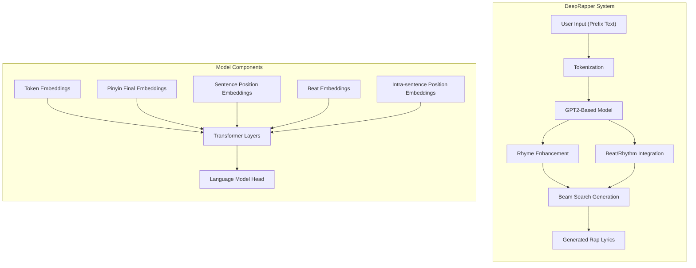
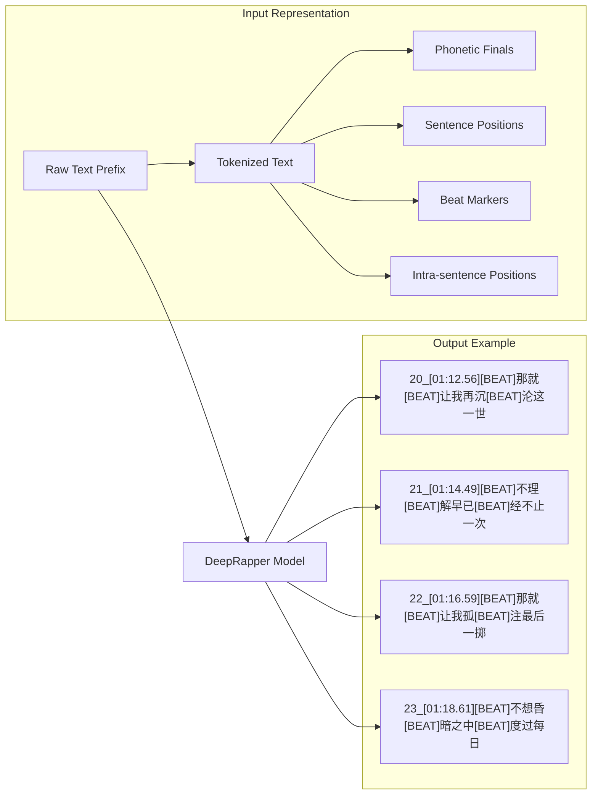
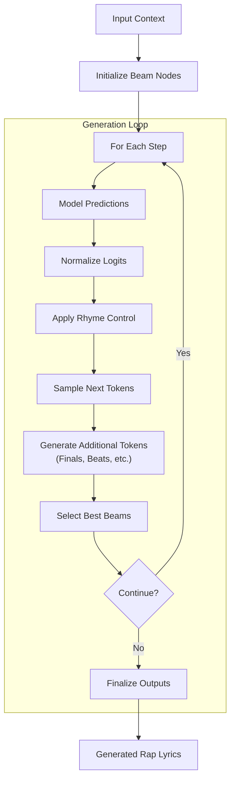
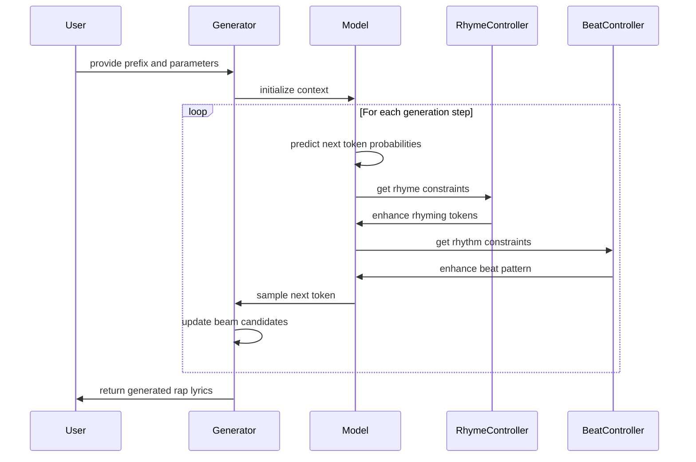
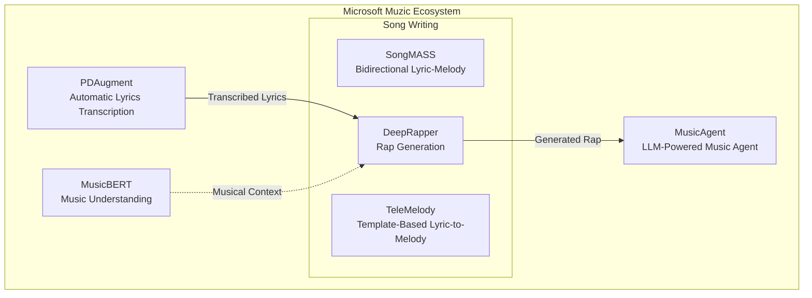

<!-- source: DeepWiki mcp.deepwiki.com · repo microsoft/muzic · extra page DeepRapper · fetched 2026-10-26 -->

# DeepRapper

<details>
<summary>Relevant source files</summary>

The following files were used as context for generating this wiki page:

- [deeprapper/README.md](deeprapper/README.md)
- [deeprapper/beam_search.py](deeprapper/beam_search.py)
- [deeprapper/generate.py](deeprapper/generate.py)
- [deeprapper/tokenizations/tokenization_bert.py](deeprapper/tokenizations/tokenization_bert.py)
- [deeprapper/tokenizations/tokenization_bert_word_level.py](deeprapper/tokenizations/tokenization_bert_word_level.py)
- [musicbert/README.md](musicbert/README.md)
- [musicbert/binarize_genre.sh](musicbert/binarize_genre.sh)
- [pdaugment/midi_preprocess/steps/track_separate.py](pdaugment/midi_preprocess/steps/track_separate.py)
- [pdaugment/midi_preprocess/utils/chord_recog.py](pdaugment/midi_preprocess/utils/chord_recog.py)
- [songmass/README.md](songmass/README.md)
- [songmass/mass/song_sequence_generator.py](songmass/mass/song_sequence_generator.py)
- [telemelody/README.md](telemelody/README.md)
- [telemelody/inferrence/infer_zh.py](telemelody/inferrence/infer_zh.py)

</details>


## Overview

DeepRapper is a Transformer-based rap generation system that can model both rhymes and rhythms simultaneously. It generates rap lyrics with appropriate rhythmic patterns and rhyming structures, creating outputs that capture the stylistic elements of rap music. DeepRapper specifically generates lyrics in reverse order with rhyme representation and constraints for rhyme enhancement, and inserts beat symbols into lyrics for rhythm/beat modeling.

Sources: [deeprapper/README.md:1-4]()

## System Architecture

DeepRapper employs a unique architecture designed to handle both linguistic content and musical elements of rap. The system uses a modified Transformer model with specialized representation for handling rhymes and rhythms.



The system has several key characteristics:

1. **Reverse Order Generation**: Generates lyrics from end to beginning to better control rhyming
2. **Rhyme Representation**: Uses phonetic finals (pinyin finals for Chinese) to model rhymes
3. **Rhythm Modeling**: Inserts [BEAT] symbols to represent musical beats
4. **Multi-embedding Approach**: Combines token, phonetic, position, and beat embeddings

Sources: [deeprapper/README.md:1-4](), [deeprapper/generate.py:46-106]()

## Input and Output Representation

DeepRapper uses a specialized representation format for both input and output that captures the rhythmic and rhyming structure of rap music.



The output format includes:
- Line numbers with timestamps
- [BEAT] markers indicating rhythmic positions
- Chinese characters (or other language tokens) forming lyrics
- Natural grouping of lyrics around beat positions

The system also maintains a parallel pinyin (phonetic) representation to track rhyming structures:

```
20_[01:12.56][BEAT] a ou [BEAT] ang o ai en [BEAT] en e i i
21_[01:14.49][BEAT] u i [BEAT] ie ao i [BEAT] in u i i i
22_[01:16.59][BEAT] a ou [BEAT] ang o u [BEAT] u ei ou i i
23_[01:18.61][BEAT] u ang en [BEAT] an i ong [BEAT] u o ei i
```

This representation helps the model understand and maintain rhyming patterns by tracking the phonetic finals.

Sources: [deeprapper/README.md:24-44]()

## Key Components

### 1. Tokenization System

DeepRapper utilizes multiple tokenization components to process different aspects of rap lyrics:

1. **Token Tokenizer**: Processes raw text into token IDs
2. **Final Tokenizer**: Converts text to phonetic finals for rhyme modeling
3. **Sentence Tokenizer**: Tracks sentence boundaries and positions
4. **Beat Tokenizer**: Handles rhythm markers
5. **Position Tokenizer**: Models relative positions within sentences

The system supports both character-level and word-level tokenization, with special handling for Chinese characters.

Sources: [deeprapper/tokenizations/tokenization_bert.py:86-156](), [deeprapper/tokenizations/tokenization_bert_word_level.py:90-158]()

### 2. GPT-2 Based Model

The core of DeepRapper is a modified GPT-2 model with:

- Support for multiple embedding types (token, final, sentence, beat, position)
- Integration of rhythmic and phonetic information during generation
- Special handling for generation in reverse order

Sources: [deeprapper/generate.py:138-142]()

### 3. Beam Search Generation

DeepRapper implements a specialized beam search algorithm that:

1. Maintains multiple candidate sequences
2. Scores candidates based on language model probability
3. Applies rhyme enhancement to promote better rhyming structures
4. Considers rhythm constraints during generation
5. Can generate in both forward and reverse directions



Sources: [deeprapper/beam_search.py:293-366](), [deeprapper/generate.py:47-112]()

## Data Preparation

To train or use DeepRapper, data needs to be prepared in a specific format:

1. **Lyrics**: Plain text of rap lyrics
2. **Pinyin**: Phonetic representation of lyrics for rhyme modeling
3. **Beat Markers**: Indicators of rhythmic beats in the lyrics

The data structure is organized as:

```
data/
└── lyrics/
    └── lyrics_samples/
        └── raw/
            └── singer01/
                └── album01/
                    ├── song01/
                    │   ├── lyric_with_beat_global.txt
                    │   └── mapped_final_with_beat_global.txt
                    └── song02/
                        ├── lyric_with_beat_global.txt
                        └── mapped_final_with_beat_global.txt
```

Each song requires two files:
- `lyric_with_beat_global.txt`: Lyrics with beat markers and timestamps
- `mapped_final_with_beat_global.txt`: Phonetic finals with beat markers

Sources: [deeprapper/README.md:6-45]()

## Training Process

Training DeepRapper involves the following steps:

1. Prepare the dataset in the required format with lyrics, phonetic finals, and beat markers
2. Configure training parameters including batch size, epoch count, etc.
3. Run the training script (`train.sh`)

During training, the model learns to:
- Generate coherent rap lyrics
- Maintain appropriate rhyming patterns
- Align lyrics with rhythmic beats

The model saves checkpoints to the specified directory (e.g., `model/lyrics/lyrics_samples_reverse/samples/final_model`).

Sources: [deeprapper/README.md:47-65]()

## Generation Process

Generating rap with DeepRapper involves:

1. **Input Preparation**: Providing a prefix text to start generation
2. **Parameter Configuration**: Setting beam width, rhythm controls, etc.
3. **Generation**: Running beam search to create rap lyrics

### Key Generation Parameters

| Parameter | Description | Default |
|-----------|-------------|---------|
| `beam_width` | Number of beam search hypotheses | 2 |
| `nsamples` | Number of samples to generate | 4 |
| `temperature` | Sampling temperature (higher = more random) | 1.0 |
| `prefix` | Text to start generation with | "大海" |
| `with_beat` | Whether to generate beat markers | True |
| `beat_mode` | Beat control (0=no control, 2=global, 3=local) | 0 |
| `dynamic_rhyme` | Whether to use dynamic rhyming | True |
| `rhyme_count` | Number of words rhyming | 2 |
| `rhyme_bonus` | Logits bonus for rhyming words | 5 |

The generation process integrates rhythm and rhyme constraints throughout the beam search, promoting outputs that have consistent rhyming and rhythmic patterns.



Sources: [deeprapper/generate.py:60-113](), [deeprapper/beam_search.py:293-366]()

## Pretrained Model

A pretrained DeepRapper model is available for immediate use:

1. Download the pretrained model from the provided link
2. Place the model files in the `model/deeprapper-model/` directory
3. Use the `generate_from_pretrain.sh` script to generate rap lyrics

The model demonstrates the ability to generate Chinese rap lyrics with appropriate rhyming and rhythmic patterns.

Sources: [deeprapper/README.md:75-91]()

## Integration with Other Muzic Components

DeepRapper is part of the larger Microsoft Muzic ecosystem, specifically within the Song Writing category of Music Generation components. It can potentially integrate with:

1. **PDAugment**: For automatic lyrics transcription (preprocessing)
2. **MusicAgent**: As a specialized rap generation component



Sources: [deeprapper/README.md:1-3](), [pdaugment/midi_preprocess/steps/track_separate.py:13-135]()

---

