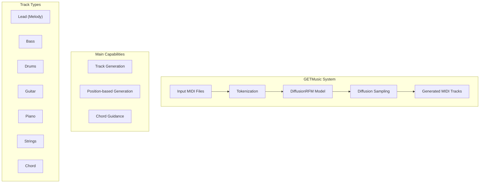
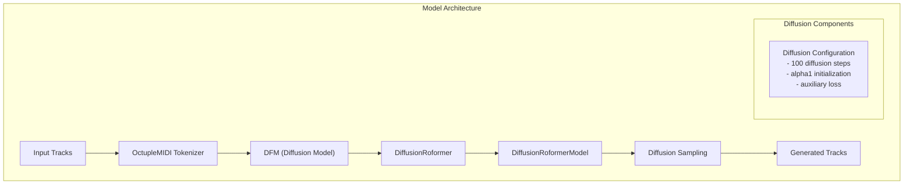
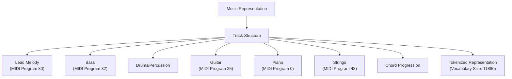
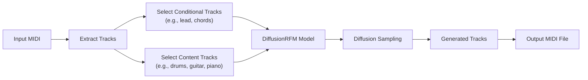
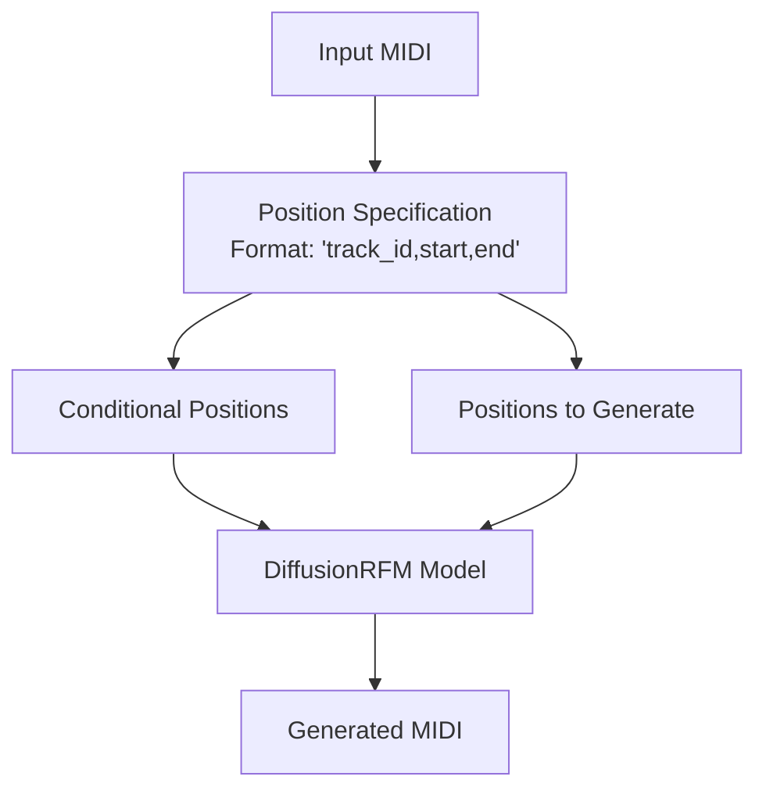
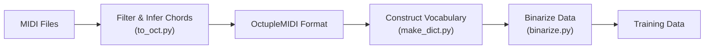

<!-- source: DeepWiki mcp.deepwiki.com · repo microsoft/muzic · extra page GETMusic · fetched 2026-10-26 -->

# GETMusic

<details>
<summary>Relevant source files</summary>

The following files were used as context for generating this wiki page:

- [getmusic/README.md](getmusic/README.md)
- [getmusic/configs/train.yaml](getmusic/configs/train.yaml)
- [getmusic/example_data/inference/childhood.mid](getmusic/example_data/inference/childhood.mid)
- [getmusic/example_data/train/0_01023_TS0.mid](getmusic/example_data/train/0_01023_TS0.mid)

</details>


GETMusic is a multi-track music generation system within the Microsoft Muzic project that employs a unified representation and diffusion framework to generate various instrumental tracks. This page documents the architecture, functionality, and usage of GETMusic for generating various music tracks such as drums, guitar, piano, bass, and strings based on conditional tracks (like lead melody and chord progressions).

## 1. System Overview

GETMusic is designed for multi-track music generation, enabling users to generate specific instrumental tracks while maintaining musical coherence with existing tracks. It falls under the Multi-Track Generation category within the Microsoft Muzic ecosystem, building upon foundations laid by MusicBERT and Museformer.



Sources: [getmusic/README.md:1-117]()

## 2. Architecture

GETMusic uses a diffusion-based framework with a RoFormer backbone. The architecture consists of several key components interacting to transform input tracks into generated music.



The model architecture as specified in the configuration file includes:

- **DFM**: Main diffusion model that orchestrates the generation process
- **DiffusionRFM**: Implements the diffusion process with RoFormer
- **DiffusionRoformerModel**: Configured with vocabulary size and condition weights
- **Diffusion Parameters**: 100 diffusion steps, alpha1 initialization type, and auxiliary loss with adaptive weighting

Sources: [getmusic/configs/train.yaml:1-72]()

## 3. Music Representation

GETMusic represents music through a multi-track structure where each track corresponds to a specific instrument or musical element.



The system uses the OctupleMIDI format for representation, which tokenizes music into discrete tokens that can be processed by the model. Each instrument type is assigned a specific MIDI program ID as shown in the diagram.

Sources: [getmusic/README.md:105-110]()

## 4. Generation Capabilities

### 4.1. Track Generation

The primary capability of GETMusic is generating specific instrumental tracks while conditioned on existing tracks. For example, users can generate drums, guitar, and piano tracks based on lead melody and chord tracks.



Sources: [getmusic/README.md:26-56]()

### 4.2. Position-based Generation

GETMusic supports more granular control through position-based generation, allowing users to specify which segments of tracks should be generated or preserved.



In position-based generation, users specify positions to condition on and positions to empty/generate using a format like `track_id,start,end`, where track_id corresponds to different instruments (0=lead, 1=bass, etc.).

Sources: [getmusic/README.md:64-94]()

### 4.3. Chord Guidance

Chord guidance is used to provide musical structure and harmony to the generated tracks. The system automatically infers chords from input tracks to guide generation.

Sources: [getmusic/README.md:97-99]()

## 5. Usage

### 5.1. Track Generation

The basic workflow for track generation involves:

1. Run the generation script:
```
python track_generation.py --load_path /path-of-checkpoint --file_path example_data/inference
```

2. For each MIDI file, specify:
   - Conditional tracks (what to base generation on)
   - Content tracks (what to generate)

For example, to generate drums, guitar, and piano tracks based on lead and chord tracks, you would specify:
```
Select condition tracks ('b' for bass, 'd' for drums, 'g' for guitar, 'l' for lead, 'p' for piano, 's' for strings, 'c' for chords; multiple choices): lc
Select content tracks ('l' for lead, 'b' for bass, 'd' for drums, 'g' for guitar, 'p' for piano, 's' for strings; multiple choices): dgp
```

Sources: [getmusic/README.md:23-56]()

### 5.2. Position-based Generation

For more advanced control, position-based generation allows specifying exact positions:

1. Run the position generation script:
```
python position_generation.py --load_path /path-of-checkpoint --file_path example_data/inference
```

2. Specify positions to condition on and positions to generate:
```
Input positions you want to condition on: 0,0,200;6,0,
Input positions you want to empty: 1,0,;4,0,;5,0,
```

This example conditions on the first 200 time units of the lead track (track 0) and the entire chord track (track 6), while generating the entire bass (track 1), piano (track 4), and string (track 5) tracks.

Sources: [getmusic/README.md:59-94]()

## 6. Implementation Details

### 6.1. Data Preprocessing

The data preprocessing pipeline transforms raw MIDI files into training data:



The preprocessing steps include:

1. Filter MIDI files and infer chords:
```
python preprocess/to_oct.py input_folder output_folder
```

2. Construct vocabulary:
```
python preprocess/make_dict.py processed_folder min_frequency
```

3. Binarize data for training:
```
python preprocess/binarize.py vocab_file octtxt_file output_folder
```

Sources: [getmusic/README.md:132-171]()

### 6.2. Training Configuration

GETMusic training is configured through `train.yaml`, which specifies model architecture, optimization parameters, and data settings:

| Component | Configuration |
|-----------|---------------|
| Model | DFM with DiffusionRFM and Roformer |
| Diffusion | 100 steps, alpha1 initialization |
| Optimizer | AdamW with betas=(0.9, 0.999), weight_decay=1.0e-2 |
| Learning rate | Base LR: 3.0e-6, min LR: 1.0e-6, warmup LR: 1.0e-4 |
| Training | 50 epochs, batch size 3 per GPU |
| Validation | Every epoch |

Sources: [getmusic/configs/train.yaml:1-72]()

## 7. Best Practices and Tips

Based on the documentation, here are some recommended practices for using GETMusic effectively:

1. **Enable Chord Guidance**: Always enable chord guidance for regular pattern generation
2. **Incremental Generation**: Use a two-stage generation approach for better results:
   - Stage 1: Chord → Lead
   - Stage 2: Chord, Lead → Bass, Drum, Guitar, Piano, String

3. **Check MIDI Program IDs**: Ensure instruments use correct MIDI program numbers:
   - Piano: 0
   - Guitar: 25
   - Bass: 32
   - String: 48
   - Lead melody: 80

4. **Volume Tuning**: Adjust volume levels of each track for balanced compositions

5. **Avoid Domain Gap**: Input MIDI should match the training data style (pop music)

Sources: [getmusic/README.md:102-127]()

## 8. Acknowledgements

GETMusic builds upon several other projects:
- VQ-diffusion
- MusicBert
- Roformer (from Hugging Face Transformers)

Sources: [getmusic/README.md:199-207]()

---

