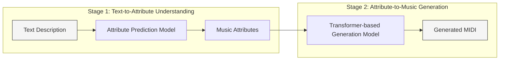
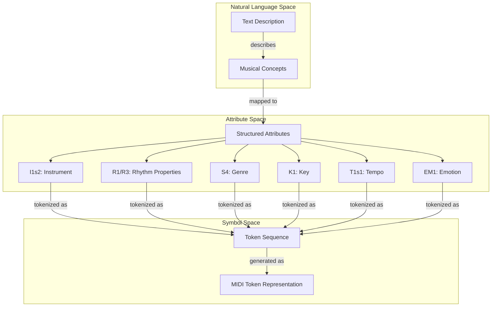
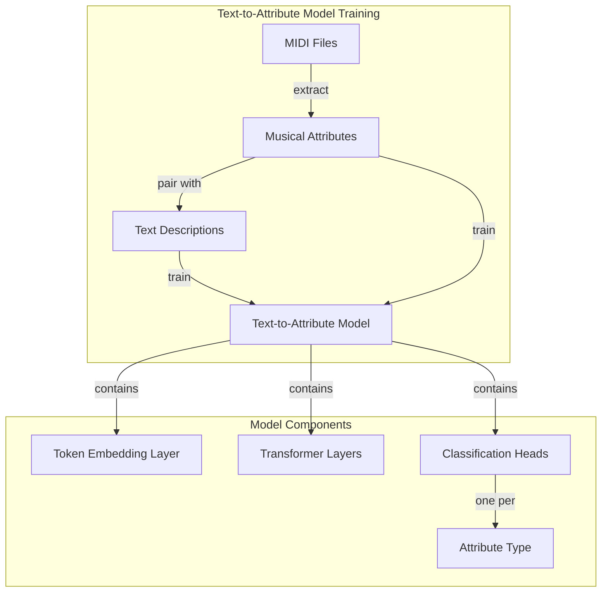
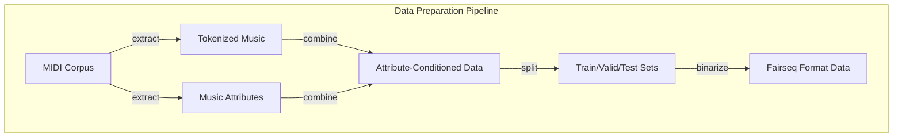
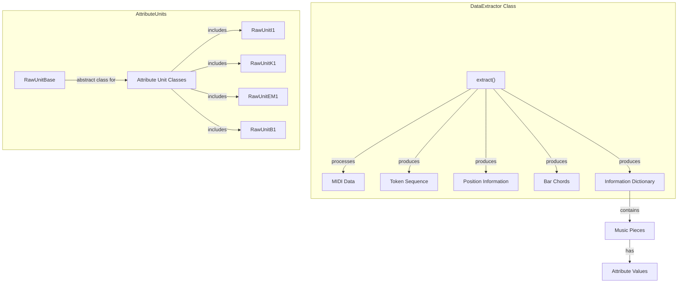
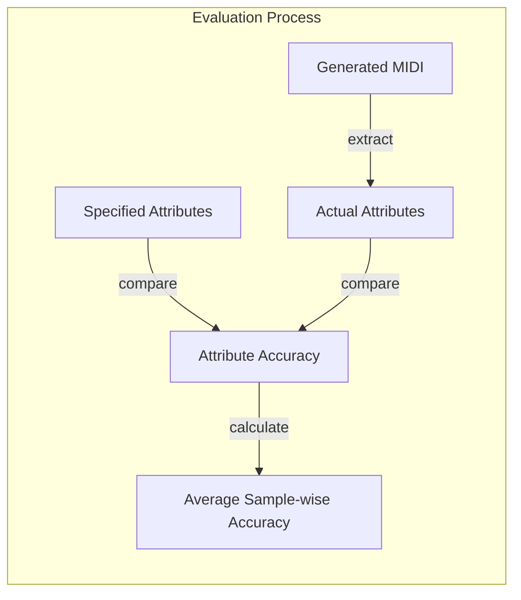

<!-- source: DeepWiki mcp.deepwiki.com · repo microsoft/muzic · extra page MuseCoco · fetched 2026-10-26 -->

# MuseCoco

Relevant source files

The following files were used as context for generating this wiki page:

- [musecoco/2-attribute2music_dataprepare/midi_data_extractor/attribute_unit/raw_unit_b.py](musecoco/2-attribute2music_dataprepare/midi_data_extractor/attribute_unit/raw_unit_b.py)
- [musecoco/2-attribute2music_dataprepare/midi_data_extractor/attribute_unit/raw_unit_base.py](musecoco/2-attribute2music_dataprepare/midi_data_extractor/attribute_unit/raw_unit_base.py)
- [musecoco/2-attribute2music_dataprepare/midi_data_extractor/attribute_unit/raw_unit_c.py](musecoco/2-attribute2music_dataprepare/midi_data_extractor/attribute_unit/raw_unit_c.py)
- [musecoco/2-attribute2music_dataprepare/midi_data_extractor/attribute_unit/raw_unit_em.py](musecoco/2-attribute2music_dataprepare/midi_data_extractor/attribute_unit/raw_unit_em.py)
- [musecoco/2-attribute2music_dataprepare/midi_data_extractor/attribute_unit/raw_unit_i.py](musecoco/2-attribute2music_dataprepare/midi_data_extractor/attribute_unit/raw_unit_i.py)
- [musecoco/2-attribute2music_dataprepare/midi_data_extractor/attribute_unit/raw_unit_k.py](musecoco/2-attribute2music_dataprepare/midi_data_extractor/attribute_unit/raw_unit_k.py)
- [musecoco/2-attribute2music_dataprepare/midi_data_extractor/attribute_unit/raw_unit_m.py](musecoco/2-attribute2music_dataprepare/midi_data_extractor/attribute_unit/raw_unit_m.py)
- [musecoco/2-attribute2music_dataprepare/midi_data_extractor/data_extractor.py](musecoco/2-attribute2music_dataprepare/midi_data_extractor/data_extractor.py)
- [musecoco/2-attribute2music_model/data/truncated_5120/dict.txt](musecoco/2-attribute2music_model/data/truncated_5120/dict.txt)
- [musecoco/README.md](musecoco/README.md)
- [musecoco/requirements.txt](musecoco/requirements.txt)

## Purpose and Scope

MuseCoco is a text-to-music generation system that creates symbolic music (MIDI files) from natural language descriptions. It is part of the Text-to-Music Generation component within the Microsoft Muzic project. This document explains the architecture, implementation, and usage of MuseCoco, focusing on its unique two-stage pipeline for controlled music generation.

Unlike other music generation systems that directly produce audio, MuseCoco generates structured MIDI files that can be edited, arranged, and produced further. For audio-based music generation, see other components of the Muzic project.

Sources: [musecoco/README.md:1-3]()

## System Architecture

MuseCoco uses a two-stage architecture to convert text descriptions into symbolic music:

1. **Text-to-Attribute Understanding**: Translates natural language descriptions into a set of structured musical attributes
2. **Attribute-to-Music Generation**: Converts these musical attributes into symbolic music (MIDI format)

This separation enables fine-grained control over the generated music while maintaining the flexibility of natural language input.

The text-to-attribute model is based on a pre-trained language model fine-tuned for the specific task of predicting musical attributes from text. The attribute-to-music model is a transformer-based architecture trained to generate music conditioned on attribute values.

Sources: [musecoco/README.md:9-18]()

## Musical Attributes

MuseCoco supports 12 different musical attributes that can be predicted from text and used to condition music generation:

| Attribute Code | Musical Property | Description |
|----------------|------------------|-------------|
| I1s2 | Instrument | Type of musical instrument to use |
| R1 | Rhythm Danceability | How suitable the rhythm is for dancing |
| R3 | Rhythm Intensity | Energy level and intensity of the rhythm |
| S2s1 | Artist | Artist or composer style to emulate |
| S4 | Genre | Musical genre of the composition |
| B1s1 | Bar | Number of bars in the piece |
| TS1s1 | Time Signature | Metric structure (e.g., 4/4, 3/4) |
| K1 | Key | Tonal center (major/minor) |
| T1s1 | Tempo | Speed of the music |
| P4 | Pitch Range | Range of pitches used |
| EM1 | Emotion | Emotional quality of the music |
| TM1 | Time | Temporal setting or era |

The mapping between these attributes and their implementation is handled in the attribute extraction modules, which extract and represent these properties from symbolic music.

Sources: [musecoco/README.md:35-51](), [musecoco/2-attribute2music_dataprepare/midi_data_extractor/attribute_unit/raw_unit_i.py](), [musecoco/2-attribute2music_dataprepare/midi_data_extractor/attribute_unit/raw_unit_em.py](), [musecoco/2-attribute2music_dataprepare/midi_data_extractor/attribute_unit/raw_unit_k.py]()

## Implementation Details

### Text-to-Attribute Understanding

The text-to-attribute component is responsible for predicting musical attributes from textual descriptions. This component is implemented as a classification model that processes natural language input and produces attribute values.

#### Training Process

The training process involves:

1. **Data Preparation**: Constructing attribute-text pairs by extracting attributes from MIDI files and pairing them with corresponding text descriptions
2. **Model Training**: Fine-tuning a pre-trained language model to predict attributes from text

#### Inference

During inference, the text-to-attribute model processes a text description and outputs predicted attribute values:

1. Prepare text in the required format
2. Run the model to predict attributes
3. Process the output for the attribute-to-music generation stage

Sources: [musecoco/README.md:55-69](), [musecoco/README.md:110-124]()

### Attribute-to-Music Generation

The attribute-to-music component generates symbolic music based on the predicted attributes. This component is implemented as a transformer-based language model that generates token sequences representing MIDI data.

#### Data Processing

The data processing pipeline for this stage involves:

1. Extracting tokens and attributes from MIDI files
2. Preparing the data in the format required by the model

The music tokenization follows a specific format represented in the dictionary file, with tokens for various musical elements like pitch, duration, velocity, etc.

#### Model Training

The model is trained using the Fairseq framework with approximately 200M parameters. It learns to generate music tokens conditioned on the attribute values.

#### Inference

During inference:

1. The attribute-to-music model takes attributes as input (from the text-to-attribute stage)
2. It generates music token sequences based on these attributes
3. The tokens are converted back to MIDI format

Sources: [musecoco/README.md:76-106](), [musecoco/README.md:125-141](), [musecoco/2-attribute2music_model/data/truncated_5120/dict.txt]()

## Data Extraction and Representation

MuseCoco uses a sophisticated data extraction pipeline to process MIDI files and extract relevant musical attributes.

The `DataExtractor` class is responsible for processing MIDI files and extracting relevant attributes. It uses various attribute unit classes to extract specific musical properties:

- `RawUnitI1`: Extracts instrument information
- `RawUnitK1`: Extracts key information (major/minor)
- `RawUnitB1`: Extracts bar count
- `RawUnitEM1`: Extracts emotion information
- And others for different attributes

These extracted attributes are then used to construct the dataset for both stages of the pipeline.

Sources: [musecoco/2-attribute2music_dataprepare/midi_data_extractor/data_extractor.py:87-302](), [musecoco/2-attribute2music_dataprepare/midi_data_extractor/attribute_unit/raw_unit_base.py]()

## Evaluation Methodology

MuseCoco provides a method to evaluate the accuracy of attribute control in the generated music. The evaluation focuses on objective attributes that can be automatically verified in the generated MIDI files.

The key metric is the Average Sample-wise Accuracy (ASA) for objective attributes, which measures how well the generated music adheres to the specified attributes.

The evaluation script compares the extracted attributes from the generated MIDI against the target attributes and computes accuracy scores for each attribute type and each sample.

Sources: [musecoco/README.md:141-148]()

## Usage Guidelines and Limitations

### Effective Usage

For optimal results with MuseCoco, follow these guidelines:

1. **Text Description Format**: Structure text descriptions to clearly specify desired musical attributes
2. **Attribute Coverage**: Include specific mentions of supported attributes for better control
3. **Generation Filtering**: Generate multiple samples and select those with the highest attribute accuracy

### Known Limitations

MuseCoco has several limitations to be aware of:

1. **Control Accuracy**: The system cannot guarantee 100% accuracy in attribute control
2. **Attribute Values**: Only use the specified attribute values provided in the documentation; other values may result in unexpected output
3. **Limited Attributes**: The system only supports the 12 attributes mentioned above

### Example Workflow

A typical workflow for using MuseCoco involves:

1. Creating a text description containing desired musical attributes
2. Running the text-to-attribute understanding model
3. Feeding the predicted attributes to the attribute-to-music generation model
4. Evaluating the attribute accuracy of the generated music
5. Selecting the best samples based on accuracy scores

Sources: [musecoco/README.md:150-155]()

## Conclusion

MuseCoco represents an innovative approach to text-to-music generation by decomposing the problem into attribute understanding and music generation stages. This architecture enables more controlled and interpretable music generation while maintaining the flexibility of natural language input. While it has limitations in terms of control accuracy and attribute coverage, it provides a solid foundation for further research in controllable music generation.

---

