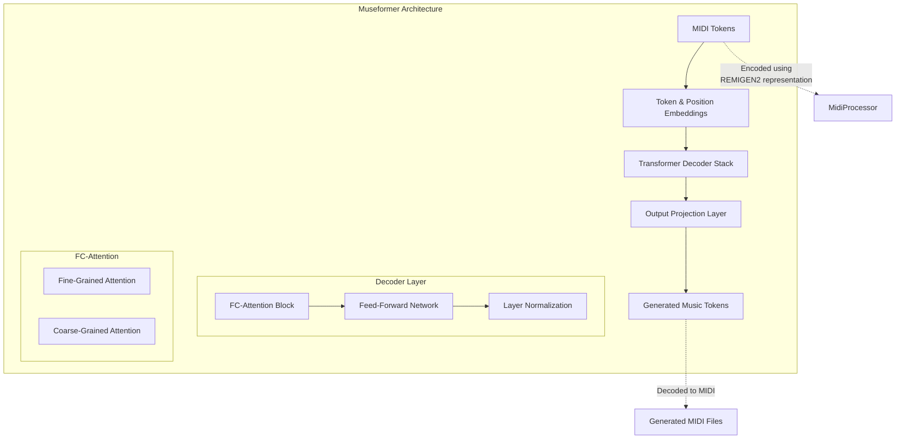
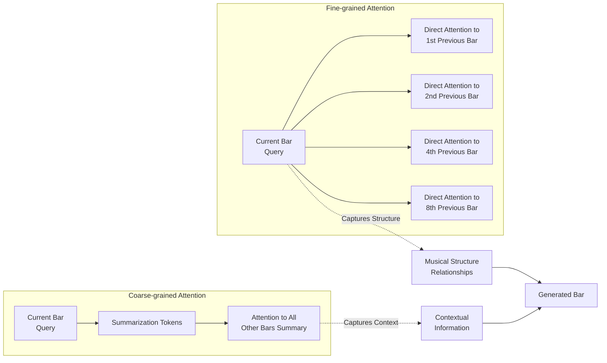
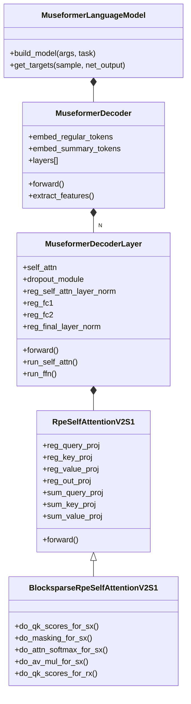
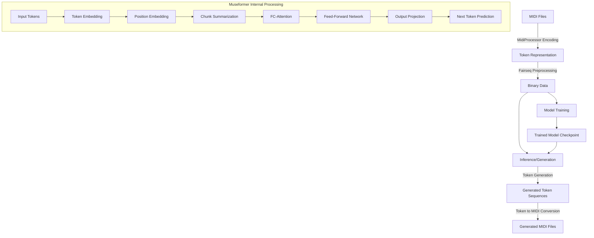
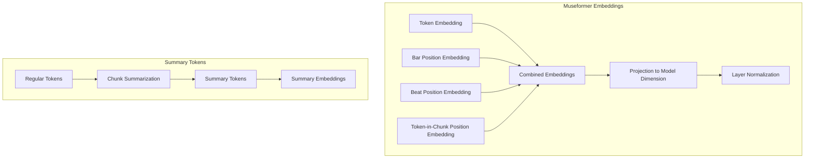

<!-- source: DeepWiki mcp.deepwiki.com · repo microsoft/muzic · extra page Museformer · fetched 2026-10-26 -->

# Museformer

<details>
<summary>Relevant source files</summary>

The following files were used as context for generating this wiki page:

- [museformer/README.md](museformer/README.md)
- [museformer/data/meta/general_use_dict.txt](museformer/data/meta/general_use_dict.txt)
- [museformer/museformer/attention/__init__.py](museformer/museformer/attention/__init__.py)
- [museformer/museformer/attention/self_attention_v2s1/rpe_self_attention_v2s1.py](museformer/museformer/attention/self_attention_v2s1/rpe_self_attention_v2s1.py)
- [museformer/museformer/museformer_decoder.py](museformer/museformer/museformer_decoder.py)
- [museformer/museformer/museformer_decoder_layer.py](museformer/museformer/museformer_decoder_layer.py)
- [museformer/museformer/museformer_lm.py](museformer/museformer/museformer_lm.py)
- [museformer/tgen/generation__mf-lmd6remi-x.sh](museformer/tgen/generation__mf-lmd6remi-x.sh)
- [museformer/ttrain/mf-lmd6remi-1.sh](museformer/ttrain/mf-lmd6remi-1.sh)

</details>


## Introduction and Purpose

Museformer is a transformer-based model with a novel fine- and coarse-grained attention (FC-Attention) mechanism designed specifically for music generation. It addresses the challenges of capturing long-term musical structures while maintaining computational efficiency. This page documents the architecture, implementation, and usage of the Museformer system within the Microsoft Muzic project.

Museformer enables the generation of high-quality music with coherent structures by allowing tokens to directly attend to structurally relevant bars while using summarized information for other context. This approach significantly improves efficiency, allowing the model to process sequences up to 3 times longer than traditional full-attention transformers.

Sources: [museformer/README.md:1-7]()

## Architecture Overview

Museformer follows a transformer-like architecture with specialized components for music understanding and generation. The model accepts tokenized MIDI files as input and produces music tokens that can be converted back to MIDI.



The model consists of several key components:

1. **Token Embeddings**: Encodes musical tokens into vector representations
2. **Position Embeddings**: Captures bar and beat positions to enhance musical understanding
3. **Transformer Decoder Layers**: Processes embeddings through multiple layers of FC-Attention
4. **FC-Attention Mechanism**: The core innovation that enables efficient processing of long musical sequences
5. **Output Projection**: Maps hidden states to token probabilities for generation

Sources: [museformer/README.md:1-11](), [museformer/museformer/museformer_lm.py:1-45](), [museformer/museformer/museformer_decoder.py:1-50]()

## Fine- and Coarse-Grained Attention (FC-Attention)

The key innovation in Museformer is the FC-Attention mechanism, which combines:

1. **Fine-grained attention**: Tokens directly attend to bars that are most relevant to music structures (e.g., previous 1st, 2nd, 4th, and 8th bars)
2. **Coarse-grained attention**: Tokens attend to summarized information from other bars rather than each token within them



The FC-Attention mechanism provides two main advantages:

1. **Structural awareness**: The fine-grained attention captures music structure-related correlations by focusing on musically relevant positions
2. **Computational efficiency**: The coarse-grained attention reduces computational complexity by attending to summaries rather than all tokens

Museformer implements this using summary tokens for each chunk (bar) of music that capture coarse-grained information, while fine-grained attention is implemented through specific attention patterns defined in the configuration.

Sources: [museformer/README.md:3-7](), [museformer/museformer/museformer_decoder_layer.py:126-144](), [museformer/museformer/attention/__init__.py:1-39]()

## Code Structure and Implementation

The Museformer implementation is organized into several key components:



### Key Components:

1. **MuseformerLanguageModel**: The top-level model class that inherits from `FairseqLanguageModel`
2. **MuseformerDecoder**: Implements the transformer decoder with specialized components for music generation
3. **MuseformerDecoderLayer**: Individual layers in the decoder stack that contain the FC-Attention mechanism
4. **RpeSelfAttentionV2S1**: Base class for the relative position-enhanced self-attention implementation
5. **BlocksparseRpeSelfAttentionV2S1**: Efficient implementation of FC-Attention with block-sparse operations

Sources: [museformer/museformer/museformer_lm.py:24-159](), [museformer/museformer/museformer_decoder.py:50-367](), [museformer/museformer/museformer_decoder_layer.py:126-466](), [museformer/museformer/attention/self_attention_v2s1/rpe_self_attention_v2s1.py:11-337]()

## Attention Pattern Configuration

Museformer's FC-Attention mechanism relies on carefully defined attention patterns that specify which bars a token should attend to. These patterns are defined in the model configuration:

```
--con2con '((((-2, 0), -4, -8, -12, -16, -24, -32),),)' 
--con2sum '((((None, -32), (-31, -24), (-23, -16), (-15, -12), (-11, -8), (-7, -4), -3,),),)'
```

These configuration strings define:

1. **con2con**: Fine-grained attention patterns where each token directly attends to tokens in specific bars (e.g., previous 2nd, 4th, 8th, etc. bars)
2. **con2sum**: Coarse-grained attention patterns where tokens attend to summaries of ranges of bars

This configuration is parsed by the `AttentionScheme` class and used to generate the appropriate attention masks for each layer.

The following table shows the common attention pattern configurations:

| Pattern | Description | Example Configuration |
|---------|-------------|------------------------|
| con2con | Content-to-content direct attention | `((((-2, 0), -4, -8, -12, -16, -24, -32),),)` |
| con2sum | Content-to-summary attention | `((((None, -32), (-31, -24), (-23, -16), (-15, -12), (-11, -8), (-7, -4), -3,),),)` |
| sum2con | Summary-to-content attention | `((None,),)` |
| sum2sum | Summary-to-summary attention | `((None,),)` |

Sources: [museformer/ttrain/mf-lmd6remi-1.sh:22-23](), [museformer/museformer/museformer_lm.py:54-78]()

## Data Flow and Processing

Museformer processes music data through several stages from tokenization to generation:



### Processing Steps:

1. **Data Preprocessing**:
   - MIDI files are encoded into tokens using the REMIGEN2 representation
   - Tokens are gathered by splits (train, valid, test) and converted to binary format

2. **Model Processing**:
   - Input tokens are embedded and processed through the decoder stack
   - Each layer applies FC-Attention to capture structure and context
   - The model outputs probabilities for the next token

3. **Generation**:
   - During inference, tokens are generated autoregressively
   - Generated token sequences are converted back to MIDI files

Sources: [museformer/README.md:13-152](), [museformer/tgen/generation__mf-lmd6remi-x.sh:1-16]()

## Embedding and Positional Information

Museformer uses various embeddings to capture musical structure and position information:



The model uses several types of embeddings to encode musical information:

1. **Token Embeddings**: Encode the musical events (notes, durations, etc.)
2. **Bar Position Embeddings**: Capture the absolute bar position for structural awareness
3. **Beat Position Embeddings**: Encode rhythmic information within bars
4. **Token-in-Chunk Position Embeddings**: Capture the position of tokens within a musical chunk

These embeddings are combined and projected to the model dimension to create rich representations of musical information.

Sources: [museformer/museformer/museformer_decoder.py:172-304](), [museformer/museformer/museformer_lm.py:134-149]()

## Usage and Training

Museformer can be trained on MIDI datasets and used to generate new music. The model is implemented using the Fairseq framework with custom components for music processing.

### Training Process:

To train Museformer, follow these steps:

1. **Data Preparation**:
   ```
   midi_dir=data/midi
   token_dir=data/token
   mp-batch-encoding $midi_dir $token_dir --encoding-method REMIGEN2 --normalize-pitch-value --remove-empty-bars --ignore-ts --sort-insts 6tracks_cst1
   ```

2. **Data Preprocessing**:
   ```
   fairseq-preprocess \
     --only-source \
     --trainpref $split_dir/train.data \
     --validpref $split_dir/valid.data \
     --testpref $split_dir/test.data \
     --destdir $data_bin_dir \
     --srcdict data/meta/dict.txt
   ```

3. **Model Training**:
   ```
   fairseq-train \
     $DATA_DIR \
     --user-dir museformer \
     --task museformer_language_modeling \
     --arch museformer_lm_v2s1 \
     --con2con '((((-2, 0), -4, -8, -12, -16, -24, -32),),)' \
     --con2sum '((((None, -32), (-31, -24), (-23, -16), (-15, -12), (-11, -8), (-7, -4), -3,),),)' \
     --num-layers 4 \
     --tokens-per-sample 100000 \
     --batch-size 1 \
     --optimizer adam \
     --lr 5e-4
   ```

### Generation Process:

To generate music with Museformer:

1. **Run Generation**:
   ```
   fairseq-interactive $DATA_DIR \
     --path checkpoints/$MODEL_NAME/checkpoint_best.pt \
     --user-dir museformer \
     --task museformer_language_modeling \
     --sampling --sampling-topk 8 --beam 1 --nbest 1 \
     --min-len 1024 \
     --max-len-b 20480 \
     --seed $SEED
   ```

2. **Extract Tokens**:
   ```
   python tools/batch_extract_log.py output_log/generation.log output/generation --start_idx 1
   ```

3. **Convert to MIDI**:
   ```
   python tools/batch_generate_midis.py --encoding-method REMIGEN2 --input-dir output/generation --output-dir output/generation
   ```

Sources: [museformer/README.md:13-152](), [museformer/ttrain/mf-lmd6remi-1.sh:1-47](), [museformer/tgen/generation__mf-lmd6remi-x.sh:1-16]()

## Technical Implementation Details

### FC-Attention Implementation

The FC-Attention mechanism is implemented in the `MuseformerDecoderLayer` class, which manages:

1. **Attention Mask Generation**: Creates masks that define which tokens can attend to which other tokens
2. **Separate Processing Paths**: Handles regular tokens and summary tokens separately
3. **Projections**: Applies various projections for queries, keys, and values

The attention computation is performed efficiently using block-sparse operations when possible, allowing the model to handle longer sequences.

```python
# Key attention configuration in the training script
--con2con '((((-2, 0), -4, -8, -12, -16, -24, -32),),)' 
--con2sum '((((None, -32), (-31, -24), (-23, -16), (-15, -12), (-11, -8), (-7, -4), -3,),),)'
```

The `con2con` parameter defines the fine-grained attention pattern, specifying that each token should attend to tokens in the previous 2nd, 4th, 8th, 12th, 16th, 24th, and 32nd bars directly.

The `con2sum` parameter defines the coarse-grained attention pattern, specifying that tokens should attend to summaries of ranges of bars (e.g., bars 31-24, 23-16, etc.).

Sources: [museformer/museformer/museformer_decoder_layer.py:126-466](), [museformer/ttrain/mf-lmd6remi-1.sh:17-47]()

### Performance Considerations

Museformer's design allows it to model significantly longer music sequences than traditional full-attention transformers. Key performance optimizations include:

1. **Block-sparse Operations**: The model uses block-sparse attention implementation for memory-efficient processing
2. **Attention Pattern Optimization**: The carefully designed attention patterns reduce computational complexity
3. **Gradient Checkpointing**: Supports training on longer sequences with limited memory

These optimizations enable Museformer to model music sequences that are over 3 times longer than those possible with full-attention models.

Sources: [museformer/README.md:3-7](), [museformer/museformer/museformer_decoder.py:371-379]()

## Conclusion

Museformer represents a significant advancement in music generation models by addressing the challenges of capturing long-term musical structure while maintaining computational efficiency. The FC-Attention mechanism enables the model to focus on musically relevant positions directly while using summarization for broader context, resulting in higher-quality music generation with coherent structure.

The model has been demonstrated to generate music with better structure and can handle sequences over 3 times longer than traditional full-attention transformers, making it particularly suitable for generating extended musical pieces.

Sources: [museformer/README.md:1-11]()

---

