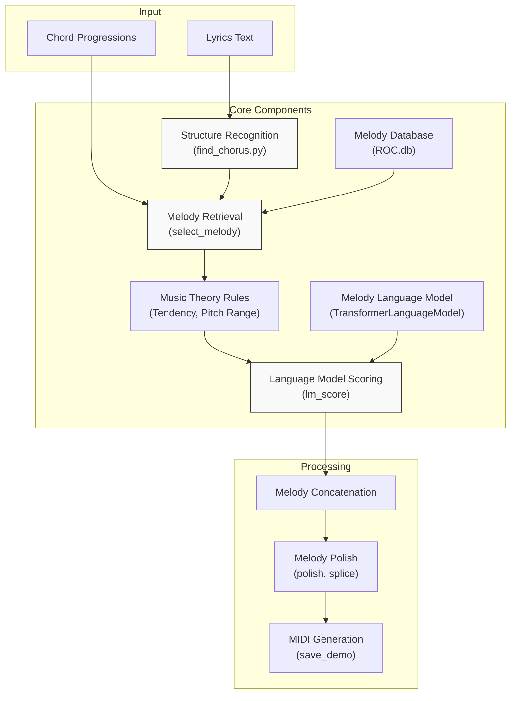
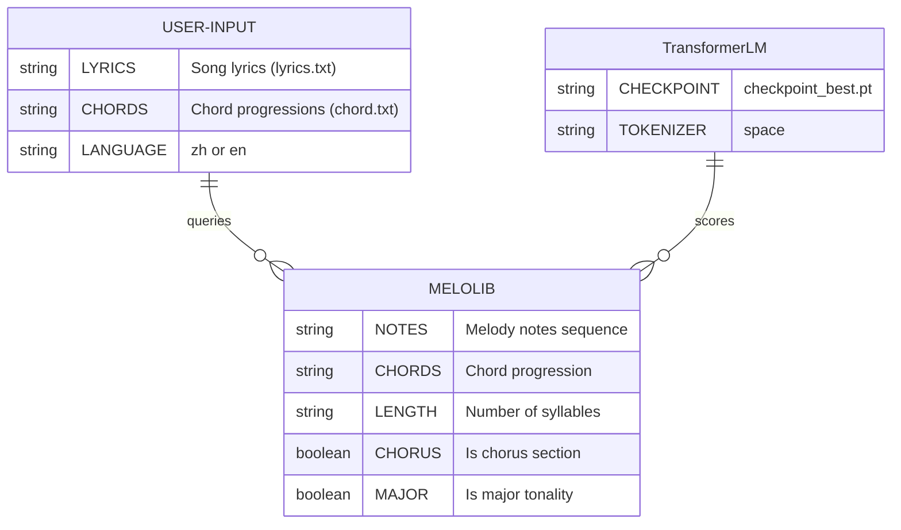
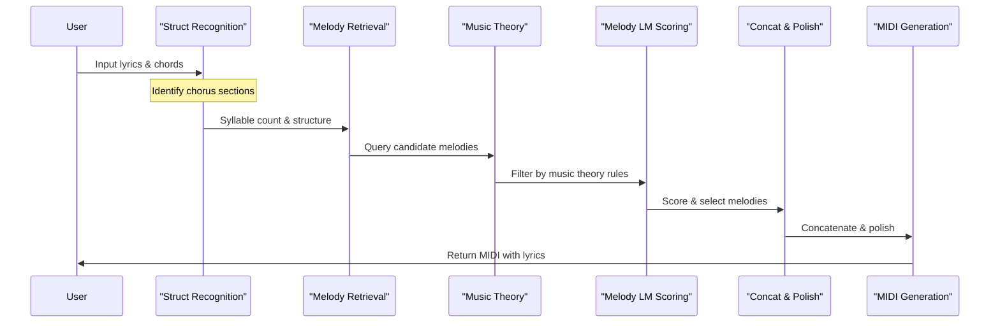
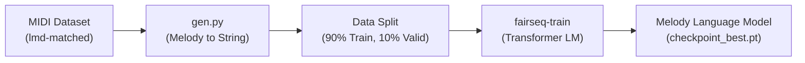
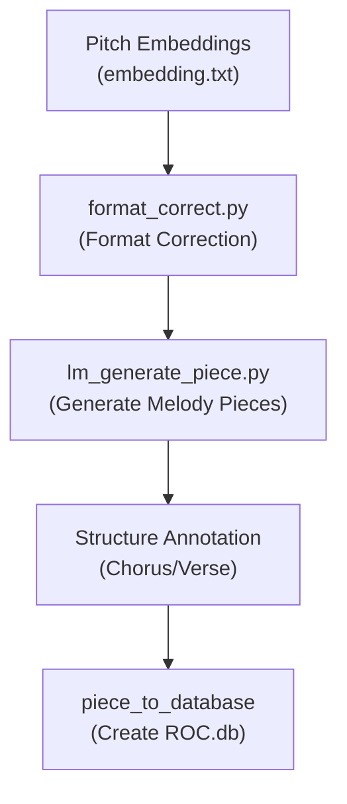

<!-- source: DeepWiki mcp.deepwiki.com · repo microsoft/muzic · extra page ROC · fetched 2026-10-26 -->

# ROC

<details>
<summary>Relevant source files</summary>

The following files were used as context for generating this wiki page:

- [roc/README.md](roc/README.md)
- [roc/chord.txt](roc/chord.txt)
- [roc/gen.py](roc/gen.py)
- [roc/lyrics.txt](roc/lyrics.txt)
- [roc/lyrics_to_melody.py](roc/lyrics_to_melody.py)
- [roc/meldoy_lm.sh](roc/meldoy_lm.sh)
- [roc/music-ckps/dict.txt](roc/music-ckps/dict.txt)
- [roc/utils/embedding.txt](roc/utils/embedding.txt)
- [roc/utils/find_chorus.py](roc/utils/find_chorus.py)
- [roc/utils/format_correct.py](roc/utils/format_correct.py)

</details>


## Purpose and Overview

ROC (Re-creation of Creations) is a paradigm for lyric-to-melody generation within the Microsoft Muzic project. It addresses two critical challenges: (1) the lack of aligned lyric-melody training data to sufficiently learn feature alignment, and (2) the lack of controllability in generation to explicitly guarantee lyric-melody feature alignment. 

Unlike other lyric-to-melody generation systems like [SongMASS](#3.1.1), [TeleMelody](#3.1.3), and [ReLyMe](#3.1.4), ROC doesn't require paired lyric-melody data and explicitly incorporates music theories and composition guidelines, providing greater controllability.

Sources: [roc/README.md:1-7]()

## Architecture and Components

ROC implements a generation-retrieval pipeline that combines a pre-trained melody language model with a database of melody segments to generate melodies for given lyrics.



**Diagram: ROC System Architecture**

Sources: [roc/README.md:3-7](), [roc/lyrics_to_melody.py:1-772]()

## Database and Model Structure

ROC uses a SQLite database to store melody segments and a transformer-based language model for melody generation and scoring.



**Diagram: ROC Data Structures**

Sources: [roc/lyrics_to_melody.py:9-27](), [roc/lyrics_to_melody.py:30-42]()

## Workflow and Process

The ROC system follows a well-defined workflow to convert lyrics into a melody:



**Diagram: ROC Workflow**

Sources: [roc/lyrics_to_melody.py:517-772]()

### 1. Input Processing

ROC takes two primary inputs:
- Lyrics in a text file (`lyrics.txt`)
- Chord progressions in a text file (`chord.txt`)

The system supports both Chinese (`zh`) and English (`en`) lyrics, with the language specified in the chord file.

```
zh C: G: A:m E: D:m G:
en A:m F: C: G:
```

Sources: [roc/chord.txt:1-2](), [roc/lyrics.txt:1-2](), [roc/lyrics_to_melody.py:537-545]()

### 2. Structure Recognition

ROC analyzes the structure of lyrics to identify repetitive sections, particularly chorus sections, using self-similarity matrices and pattern detection:

1. The system identifies the similarity between different sections of lyrics
2. It detects horizontal lines in the similarity matrix indicating repetitions
3. It selects the most likely chorus section based on repetition patterns

Sources: [roc/utils/find_chorus.py:1-186](), [roc/lyrics_to_melody.py:592-600]()

### 3. Melody Retrieval and Selection

For each lyric section, ROC:

1. Queries the database for melody segments matching the syllable count and structure type
2. Filters candidates by chord progression compatibility using regular expressions
3. Applies music theory rules for melody selection:
   - Considers melodic tendency (certain notes want to resolve to others)
   - Maintains reasonable pitch range between consecutive segments
   - Avoids monotonous or duplicate segments

Sources: [roc/lyrics_to_melody.py:30-161](), [roc/lyrics_to_melody.py:394-417]()

### 4. Language Model Scoring

Candidate melody segments are scored using a pre-trained melody language model:

1. For each candidate segment, the model calculates a likelihood score
2. Segments are ranked by their scores
3. Top-scoring segments (within a small margin of the best) are selected for consideration

```python
def lm_score(bars, note_string, bar_idx):
    tmp_string = []
    n = ' '.join(note_string.split(' ')[-100:])
    for sbar in bars:
        sbar_, _ = fill_template(sbar[0], bar_idx)
        tmp_string.append(n + sbar_)

    score = [x['score'].item() for x in custom_lm.score(tmp_string)]
    # Select top-scoring candidates
    tmp = list(zip(bars, score))
    tmp.sort(key=lambda x: x[1], reverse=True)
    tmp = tmp[:30]
    best_score = tmp[0][1]
    res = []
    for x in tmp:
        if best_score - x[1] < 0.1:
            res.append(x[0])
    return res
```

Sources: [roc/lyrics_to_melody.py:163-183]()

### 5. Melody Construction Strategies

ROC employs three strategies for melody construction based on the structure value:

1. **No sharing** (parent[i] == -1): Generate a completely new melody segment
2. **Partial sharing** (parent[i] == -2): Share part of the melody from the previous section with modifications
3. **Complete sharing** (parent[i] > 0): Directly reuse a melody from a previous section with the same lyrics

This approach creates coherent songs with appropriate repetition structure.

Sources: [roc/lyrics_to_melody.py:623-758]()

### 6. Melody Concatenation and Polishing

The selected melody segments are concatenated and polished to create a cohesive melody:

1. The `splice` function joins melody segments, handling transitions
2. The `polish` function ensures segments don't overlap, fixes rhythm, and adjusts note durations
3. The `polish_chord` function aligns chords with the melody

Sources: [roc/lyrics_to_melody.py:310-379](), [roc/lyrics_to_melody.py:419-514]()

### 7. MIDI Generation

Finally, ROC generates a MIDI file with both melody and chord tracks, with lyrics aligned to the melody notes:

1. Creates a two-track MIDI file (melody and chords)
2. Writes notes for both tracks based on selected segments
3. Adds lyrics as text events aligned with melody notes

Sources: [roc/lyrics_to_melody.py:190-294]()

## Training and Database Construction

ROC requires two main components that need to be prepared:

1. A melody language model
2. A database of melody segments

### 1. Melody Language Model Training

The melody language model is trained using the following steps:

1. Prepare MIDI files (using the lmd-matched dataset)
2. Convert melodies to string representations using `gen.py`
3. Train a transformer language model using `melody_lm.sh`



**Diagram: Melody Model Training Process**

Sources: [roc/README.md:33-52](), [roc/meldoy_lm.sh:1-26]()

### 2. Database Construction

The melody database is constructed through these steps:

1. Prepare pitch embeddings (provided or derived from the language model)
2. Correct melody format using `format_correct.py`
3. Generate short melody pieces using the language model
4. Store the pieces in the ROC database



**Diagram: Database Construction Process**

Sources: [roc/README.md:53-78](), [roc/utils/format_correct.py:1-41]()

## Usage and Inference

To use ROC for generating melodies from lyrics:

1. Prepare your melody language model and database
2. Create a lyrics file (`lyrics.txt`) and chord progression file (`chord.txt`)
3. Run `lyrics_to_melody.py` with desired options

### Command Line Arguments

| Argument | Default value | Description |
|----------|---------------|-------------|
| `--lyrics_path` | `lyrics.txt` | Path to lyrics file |
| `--chord_path` | `chord.txt` | Path to chord progressions file |
| `--db_path` | `database/ROC.db` | Path to database |
| `--debug` | False | If true, output composition details |
| `--sentiment` | False | If true, automatically set tonality by analyzing sentiment |

Sources: [roc/README.md:8-30](), [roc/lyrics_to_melody.py:518-526]()

## Evaluation

ROC can be evaluated using:
- DIST (Diversity) and ENT (Entropy) metrics
- Demo samples available at the ROC demo website

Sources: [roc/README.md:80-86]()

## Summary

ROC presents a novel approach to lyric-to-melody generation by combining machine learning with explicit music theory rules. Its generation-retrieval pipeline provides greater controllability without requiring aligned lyric-melody data. The system demonstrates how domain knowledge (music theory) can be integrated with neural models to create coherent, musically plausible compositions.

---

