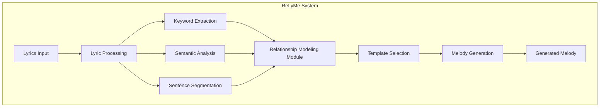
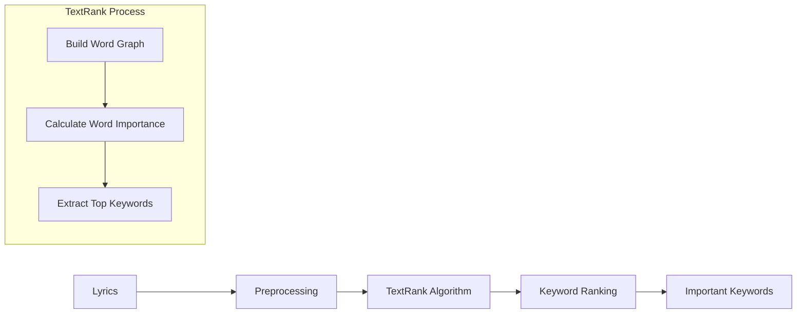
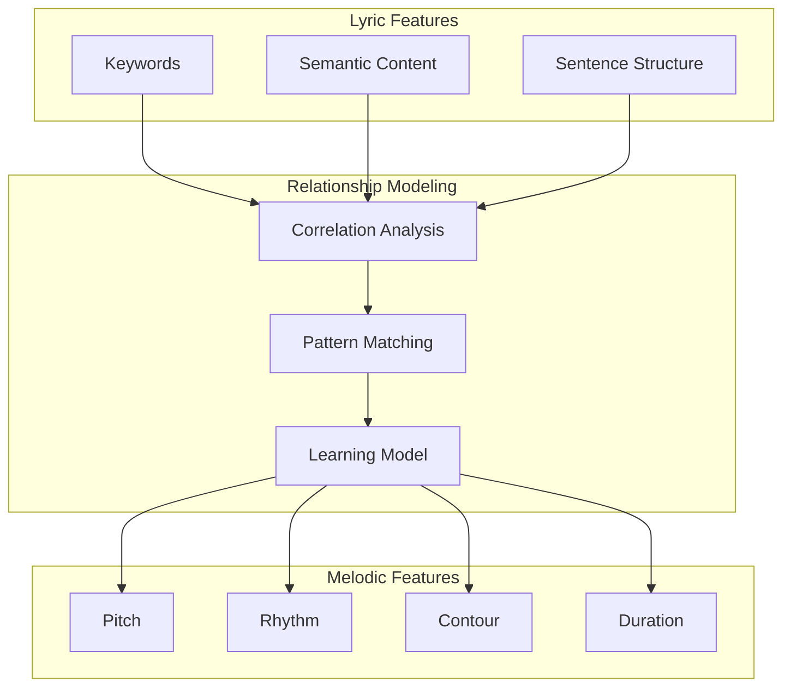
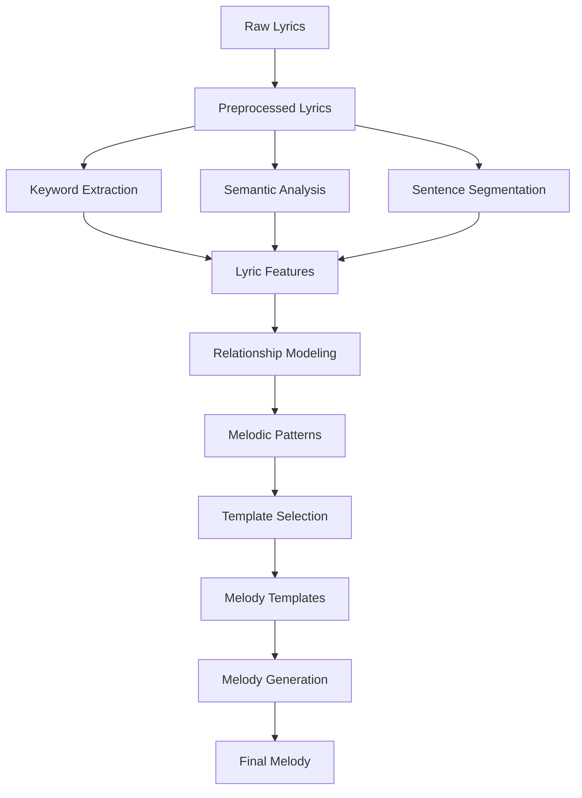
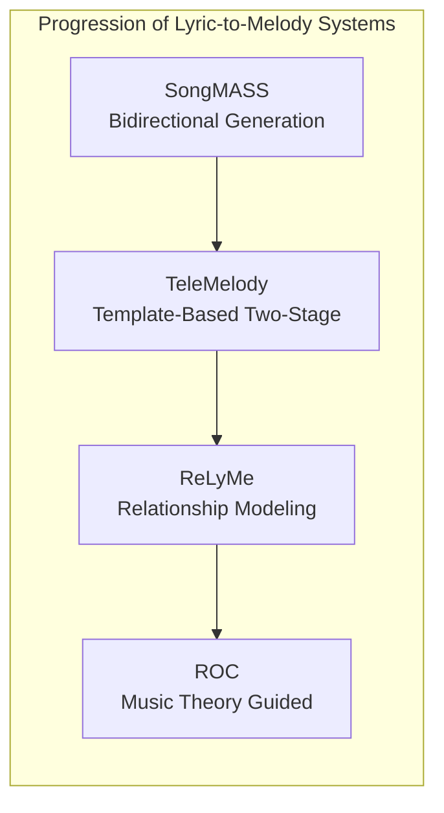

<!-- source: DeepWiki mcp.deepwiki.com · repo microsoft/muzic · extra page ReLyMe · fetched 2026-10-26 -->

# ReLyMe

<details>
<summary>Relevant source files</summary>

The following files were used as context for generating this wiki page:

- [README.md](README.md)
- [pdaugment/README.md](pdaugment/README.md)
- [relyme/telemelody_zh/_keyword.py](relyme/telemelody_zh/_keyword.py)

</details>


ReLyMe (Improving Lyric-to-Melody Generation by Incorporating Lyric-Melody Relationships) is a system developed by Microsoft Research that enhances automatic melody generation from lyrics by explicitly modeling and leveraging the relationships between lyric content and melodic structure. Published at ACM Multimedia 2022, ReLyMe represents an advancement over its predecessor [TeleMelody](#3.1.3) in the Microsoft Muzic ecosystem.

## Purpose and Scope

The purpose of ReLyMe is to improve lyric-to-melody generation by capturing the intrinsic relationships between lyrics and melodies more effectively. While [TeleMelody](#3.1.3) introduced a template-based two-stage method for melody generation, ReLyMe specifically focuses on understanding how lyric content (such as keywords, phrases, and sentiment) should influence melodic choices, resulting in more contextually appropriate and natural-sounding melodies.

This document covers the architecture of ReLyMe, its key components, and how it advances upon previous systems through relationship modeling. For information about the predecessor system, see [TeleMelody](#3.1.3), and for the successor system that builds upon ReLyMe's foundation with music theory guidance, see [ROC (Re-creation of Creations)](#3.1.5).

## System Architecture

### ReLyMe Architecture



ReLyMe builds upon the template-based approach of TeleMelody but introduces a critical new component: explicit modeling of the relationships between lyrics and melodies.

Sources: [README.md:35-36]()

### Key Components

1. **Lyric Processing**
   - Preprocesses input lyrics for downstream analysis
   - Segments lyrics into phrases and sentences 
   - Extracts structural information and contextual features

2. **Keyword Extraction**
   - Identifies important keywords from lyrics that should influence the melody
   - Uses TextRank algorithm to rank words by importance
   - May combine with TF-IDF for more robust keyword identification

3. **Relationship Modeling Module**
   - Core innovation of ReLyMe
   - Models correlations between lyric features and melodic characteristics
   - Maps lyrical content, sentiment, and structure to appropriate melodic patterns

4. **Template Selection**
   - Selects melodic templates based on lyric structure and content
   - Adapts templates according to the modeled relationships

5. **Melody Generation**
   - Produces the final melody by applying relationship-aware adjustments
   - Ensures musical coherence and quality

Sources: [relyme/telemelody_zh/_keyword.py:1-120]()

## Keyword Extraction Process

### Keyword Extraction Flow



The keyword extraction process in ReLyMe:

1. **Preprocessing**: Input lyrics are tokenized and processed to remove stop words and normalize text.

2. **TextRank Analysis**: A graph-based ranking algorithm identifies important words based on their relationships with other words in the text.

3. **Keyword Ranking**: Words are ranked by their importance, which will influence the melody generation.

The implementation uses the TextRank4Keyword library to analyze text and extract keywords:

```python
def get_textrank(text, topk=10) -> list:
    tr4w = TextRank4Keyword()
    tr4w.analyze(text=text, lower=True, window=2)
    rank = [ (item.word, item.weight) for item in tr4w.get_keywords(topk, word_min_len=1) ]
    return rank
```

Sources: [relyme/telemelody_zh/_keyword.py:84-90]()

## Lyric-Melody Relationship Modeling

### Relationship Modeling Flow



The core innovation of ReLyMe is its explicit modeling of relationships between lyric features and melodic characteristics:

1. **Lyric Feature Extraction**:
   - Extracts keywords, semantic content, and sentence structure
   - Analyzes emotional and contextual aspects of lyrics

2. **Relationship Analysis**:
   - Identifies correlations between lyric features and melodic elements
   - Maps patterns from lyrics to appropriate musical expressions

3. **Melodic Decision-Making**:
   - Determines appropriate pitch, rhythm, contour, and duration based on lyric features
   - Ensures musical coherence while maintaining lyric-melody relationship

Sources: [README.md:86]()

## Data Flow in ReLyMe

### End-to-End Processing Flow



The data flow in ReLyMe follows these main steps:

1. **Lyrics Processing**: Raw lyrics are preprocessed, normalized, and analyzed.

2. **Feature Extraction**: 
   - Keywords are identified using TextRank algorithm
   - Semantic content and sentence structure are analyzed

3. **Relationship Modeling**:
   - System models how lyric features should map to melodic elements
   - This is where ReLyMe improves upon TeleMelody

4. **Template Processing**:
   - Appropriate melodic templates are selected and adapted
   - Templates are modified based on the modeled relationships

5. **Melody Generation**:
   - Final melody is generated with relationship-aware adjustments
   - Musical coherence and quality are ensured

Sources: [README.md:35-36](), [relyme/telemelody_zh/_keyword.py:92-120]()

## ReLyMe in the Muzic Ecosystem

### Song Writing Systems Evolution



ReLyMe represents an important advancement in Microsoft's lyric-to-melody generation systems:

1. **SongMASS**: Introduced automatic song writing with bidirectional generation and alignment constraint.
2. **TeleMelody**: Developed a template-based two-stage method for more structured lyric-to-melody generation.
3. **ReLyMe**: Enhanced generation quality by explicitly modeling relationships between lyrics and melodies.
4. **ROC (Re-creation of Creations)**: Further improved the approach by incorporating music theory guidance.

Sources: [README.md:34-36]()

## Implementation Details

### Keyword Extraction Implementation

The keyword extraction component relies primarily on the TextRank algorithm to identify important words in lyrics that should influence melody generation:

```python
def get_keyword(text) -> dict:
    """Using TF-IDF and TextRank to find keywords

    Args:
        text (string): raw text

    Returns:
        results (dict): {[keywords]: [score]}
    """
    a = 0.5
    textrank = dict(get_textrank(text), topk=5)
    
    keys = sorted(textrank, key=textrank.get)
    results = { k: textrank[k] for k in keys }
    return results
```

The system can potentially combine TextRank with TF-IDF scores for more robust keyword identification, though the implementation provided focuses primarily on TextRank.

Sources: [relyme/telemelody_zh/_keyword.py:92-120]()

## Comparison with Related Systems

| System | Approach | Key Innovation | Limitations Addressed |
|--------|----------|----------------|----------------------|
| TeleMelody | Template-based two-stage | Uses templates to ensure musical quality | Limited relationship modeling |
| ReLyMe | Relationship modeling | Explicit modeling of lyric-melody correlations | Improves contextual appropriateness |
| ROC | Music theory guided | Incorporates musical theory into generation | Addresses musical rule compliance |

ReLyMe specifically addresses the limitation in TeleMelody where the relationship between lyric content and melodic choices wasn't fully captured. By explicitly modeling these relationships, ReLyMe produces melodies that better reflect the semantic and emotional content of the lyrics.

Sources: [README.md:35-36](), [README.md:86]()

## References

- Chen Zhang, LuChin Chang, Songruoyao Wu, Xu Tan, Tao Qin, Tie-Yan Liu, Kejun Zhang, "ReLyMe: Improving Lyric-to-Melody Generation by Incorporating Lyric-Melody Relationships," ACM Multimedia 2022.
- [Paper link](https://arxiv.org/abs/2207.05688)

---

