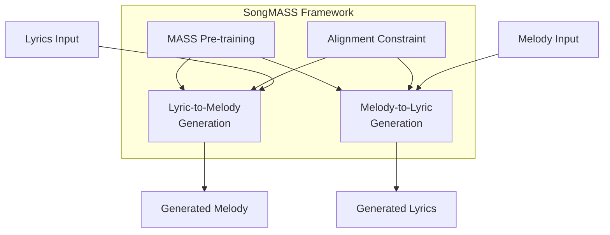
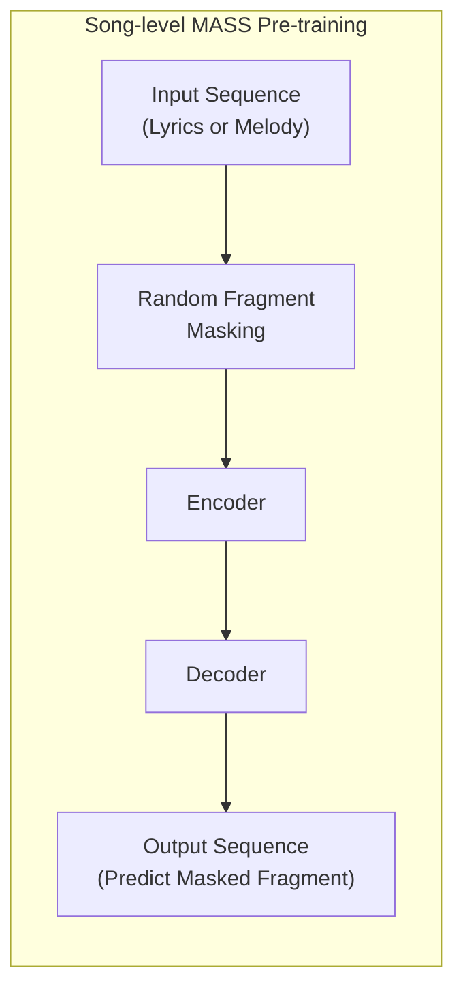
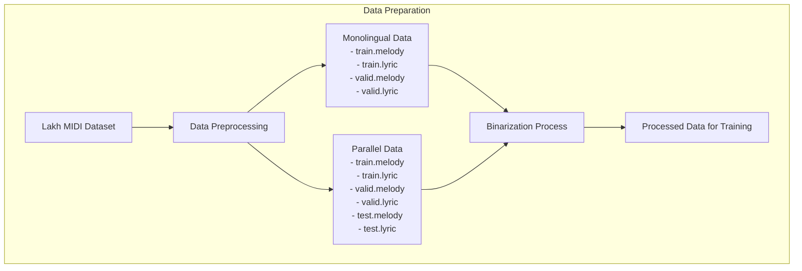
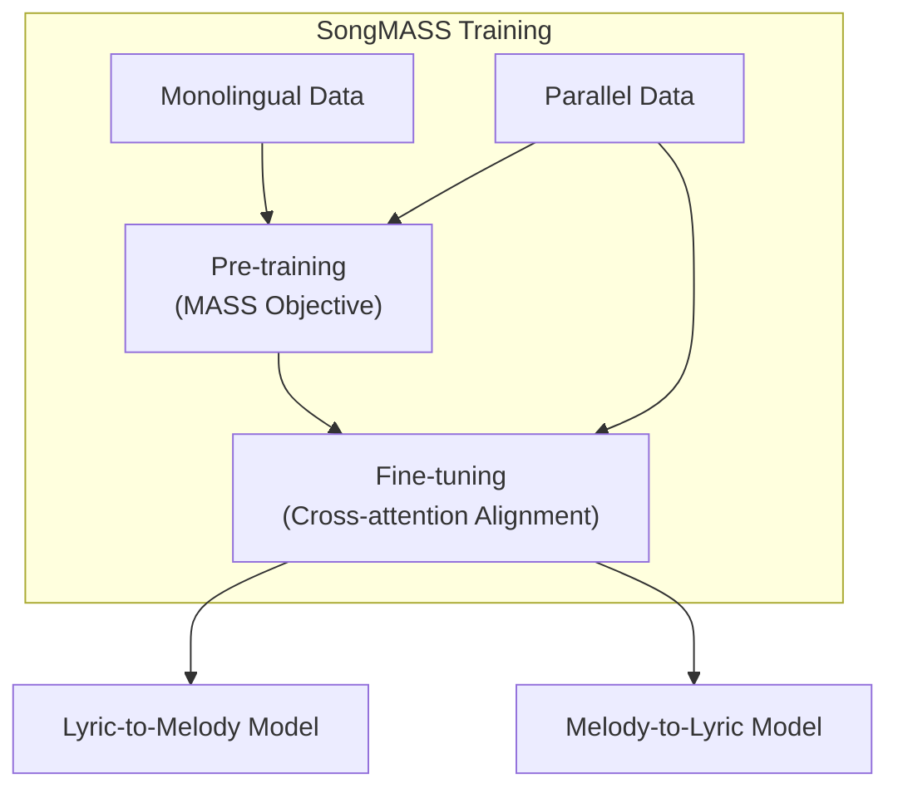
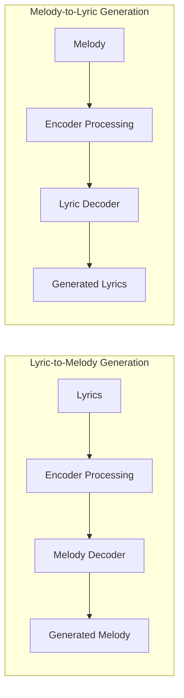
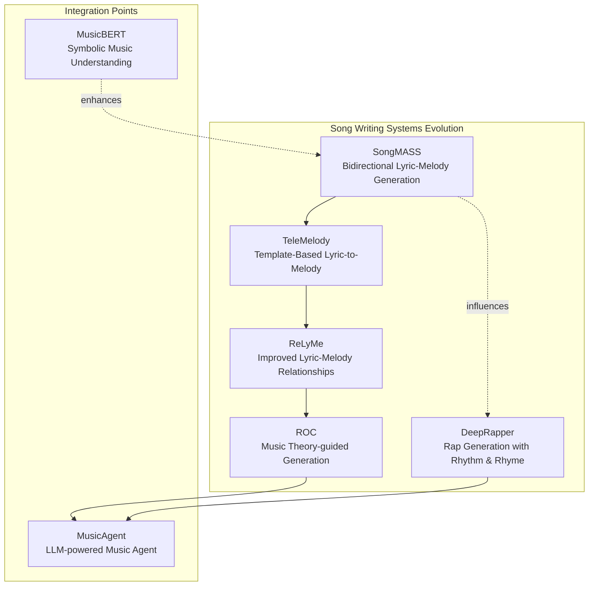

<!-- source: DeepWiki mcp.deepwiki.com · repo microsoft/muzic · extra page SongMASS · fetched 2026-10-26 -->

# SongMASS

Relevant source files

The following files were used as context for generating this wiki page:

- [deeprapper/README.md](deeprapper/README.md)
- [musicbert/README.md](musicbert/README.md)
- [songmass/README.md](songmass/README.md)
- [telemelody/README.md](telemelody/README.md)
- [telemelody/inferrence/infer_zh.py](telemelody/inferrence/infer_zh.py)

## Purpose and Overview

SongMASS is an automatic song writing system within the Microsoft Muzic project that enables bidirectional generation between lyrics and melodies. It leverages masked sequence to sequence (MASS) pre-training and attention-based alignment modeling to create high-quality lyric-to-melody and melody-to-lyric conversions. The system was published as "SongMASS: Automatic Song Writing with Pre-training and Alignment Constraint" at AAAI 2021.

SongMASS represents one of the foundational song writing systems in the Muzic ecosystem and serves as a predecessor to more specialized systems like [TeleMelody](#3.1.3), [ReLyMe](#3.1.4), and [ROC](#3.1.5).

Sources: [songmass/README.md:1-3]()

## Architecture and Working Principles

SongMASS introduces two key innovations for song writing:

1. **MASS Pre-training**: Adapts the masked sequence-to-sequence pre-training framework to the music domain
2. **Alignment Constraint**: Implements attention-based alignment modeling to ensure the generated content maintains proper structure

### System Architecture

Sources: [songmass/README.md:5-7]()

### MASS Pre-training

MASS (Masked Sequence to Sequence) pre-training is adapted for the music domain with song-level masking. The pre-training process involves:

1. Randomly masking a fragment of the input sequence
2. Predicting the masked fragment in the decoder side
3. Learning bidirectional context representation through this self-supervised task

Sources: [songmass/README.md:7-8]()

## Data Processing and Preparation

SongMASS is trained on the LMD (Lakh MIDI Dataset) with processed lyrics and melody pairs. The system requires both monolingual (unpaired) and parallel (paired lyric-melody) data.

### Data Structure

The data processing pipeline includes:
1. Obtaining LMD dataset
2. Parsing MIDI and lyrics data
3. Creating paired and unpaired datasets
4. Converting lyrics to BPE code
5. Binarizing the data for training

Sources: [songmass/README.md:9-51]()

## Model Training

SongMASS training involves two main stages:

1. **Pre-training Stage**: Uses MASS objective on both monolingual and parallel data
2. **Fine-tuning Stage**: Trains on parallel data with cross-attention alignment

### Training Process

The training process uses a Transformer-based architecture with encoder-decoder configuration and includes mechanisms for handling musical features such as pitch, duration, and rhythm.

Sources: [songmass/README.md:52-60]()

## Inference

SongMASS supports bidirectional generation:

1. **Lyric-to-Melody Generation**: Takes lyrics as input and generates corresponding melodies
2. **Melody-to-Lyric Generation**: Takes melodies as input and generates matching lyrics

### Inference Process

During inference, the system can:
- Generate melodies that match the structure and emotion of input lyrics
- Generate lyrics that align with the rhythm and mood of input melodies

Sources: [songmass/README.md:62-80]()

## Evaluation Metrics

SongMASS is evaluated using several metrics to measure the quality of generated content:

| Metric | Description | Implementation |
|--------|-------------|----------------|
| Pitch Distribution Similarity (PD) | Measures how closely the pitch distribution of generated melodies matches ground truth | [evaluate_histo.py](songmass/evaluate/) |
| Duration Distribution Similarity (DD) | Measures similarity of note duration distributions | [evaluate_histo.py](songmass/evaluate/) |
| Melody Distance (MD) | Calculates how close generated melodies are to ground truth using time series analysis | [evaluate_timeseries.py](songmass/evaluate/) |

These metrics provide quantitative measures of generation quality in terms of musical coherence and alignment with input content.

Sources: [songmass/README.md:82-114]()

## Integration with Muzic Ecosystem

SongMASS is a foundational component in the Microsoft Muzic project's song writing systems. It establishes techniques that are extended by later systems.

In the Muzic ecosystem, SongMASS introduces the fundamental approach for lyric-melody conversion that is later refined in subsequent systems:
- TeleMelody adds template-based generation with better control
- ReLyMe improves the lyric-melody relationship modeling
- ROC incorporates music theory guidance

Sources: [telemelody/README.md:1-3](), [deeprapper/README.md:1-2](), [musicbert/README.md:1-2]()

## Technical Implementation

SongMASS is implemented using the fairseq framework and consists of the following key components:

1. **Data Processing Pipeline**:
   - Parsing LMD dataset
   - Extracting lyric-melody pairs
   - BPE encoding for lyrics
   - Binarization for efficient training

2. **Model Architecture**:
   - Transformer-based encoder-decoder architecture
   - MASS pre-training implementation
   - Attention-based alignment mechanism

3. **Inference Components**:
   - Beam search for melody generation
   - Beam search for lyric generation
   - Post-processing to ensure musical coherence

The system outputs MIDI files for melodies and text files for lyrics, which can be auditioned to evaluate subjective quality.

Sources: [songmass/README.md:9-51](), [songmass/README.md:62-80]()

## Conclusion

SongMASS introduced innovative approaches for automatic song writing through bidirectional lyric-melody generation. Its main contributions—MASS pre-training and alignment constraint—enable the creation of coherent and matched lyric-melody pairs. As a foundational system in the Muzic ecosystem, it paved the way for more specialized and improved song writing approaches in subsequent research.

For more information about related systems, refer to:
- [TeleMelody](#3.1.3) for template-based lyric-to-melody generation
- [DeepRapper](#3.1.2) for rap generation with rhyme and rhythm modeling
- [ReLyMe](#3.1.4) for improved lyric-to-melody relationships
- [ROC](#3.1.5) for music theory-guided lyric-to-melody generation

Sources: [songmass/README.md:116]()

---

