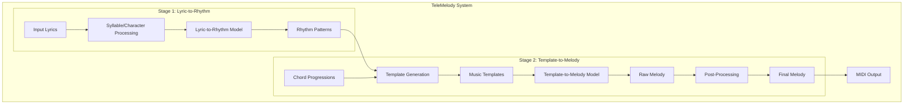
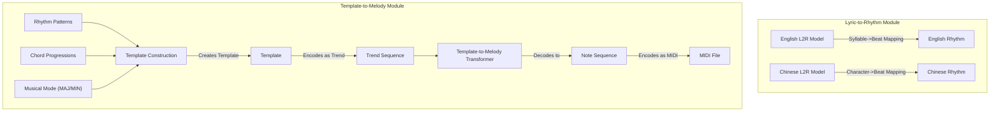
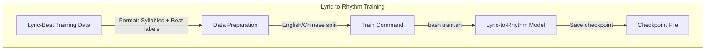
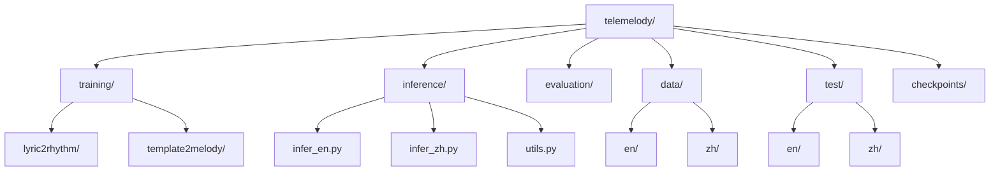

<!-- source: DeepWiki mcp.deepwiki.com · repo microsoft/muzic · extra page TeleMelody · fetched 2026-10-26 -->

# TeleMelody

<details>
<summary>Relevant source files</summary>

The following files were used as context for generating this wiki page:

- [deeprapper/README.md](deeprapper/README.md)
- [musicbert/README.md](musicbert/README.md)
- [songmass/README.md](songmass/README.md)
- [telemelody/README.md](telemelody/README.md)
- [telemelody/inferrence/infer_zh.py](telemelody/inferrence/infer_zh.py)
- [telemelody/test/en/phone_test.lyric](telemelody/test/en/phone_test.lyric)
- [telemelody/test/en/test.chord](telemelody/test/en/test.chord)
- [telemelody/test/en/test.lyric](telemelody/test/en/test.lyric)
- [telemelody/test/en/test.melody](telemelody/test/en/test.melody)
- [telemelody/test/zh/test.chord](telemelody/test/zh/test.chord)
- [telemelody/test/zh/test.lyric](telemelody/test/zh/test.lyric)
- [telemelody/test/zh/test.melody](telemelody/test/zh/test.melody)
- [telemelody/training/lyric2rhythm/data/en_example/test.beat](telemelody/training/lyric2rhythm/data/en_example/test.beat)
- [telemelody/training/lyric2rhythm/data/en_example/test.lyric](telemelody/training/lyric2rhythm/data/en_example/test.lyric)
- [telemelody/training/lyric2rhythm/data/en_example/train.beat](telemelody/training/lyric2rhythm/data/en_example/train.beat)
- [telemelody/training/lyric2rhythm/data/en_example/train.lyric](telemelody/training/lyric2rhythm/data/en_example/train.lyric)
- [telemelody/training/lyric2rhythm/data/en_example/valid.beat](telemelody/training/lyric2rhythm/data/en_example/valid.beat)
- [telemelody/training/lyric2rhythm/data/en_example/valid.lyric](telemelody/training/lyric2rhythm/data/en_example/valid.lyric)

</details>


TeleMelody is a template-based two-stage system for lyric-to-melody generation within the Microsoft Muzic project. It uses music templates (including tonality, chord progression, rhythm pattern, and cadence) to bridge the gap between lyrics and melodies, resulting in higher quality music generation with better controllability. Unlike earlier approaches such as [SongMASS](#3.1.1), TeleMelody requires less paired lyric-melody data while producing more coherent musical outputs.

## 1. System Architecture

TeleMelody employs a two-stage architecture that separates the lyric-to-rhythm conversion from the template-to-melody generation process.

### Two-Stage Generation Architecture



Sources: [telemelody/README.md:1-6](), [telemelody/README.md:48-109]()

### Component Detail



Sources: [telemelody/inferrence/infer_zh.py:152-162](), [telemelody/inferrence/infer_zh.py:260-307]()

## 2. Data Flow and Formats

TeleMelody processes different types of lyrics (English and Chinese) with specialized models, while sharing the same template-to-melody conversion framework.

### Data Processing Pipeline

```mermaid
flowchart LR
    subgraph "Input Data"
        ENLyrics["English Word-Level Lyrics"]
        ZHLyrics["Chinese Character-Level Lyrics"]
        ChordData["Chord Progression Data"]
    end
    
    subgraph "Preprocessing"
        ENLyrics --> PhoneticConv["Phonetic Conversion"]
        PhoneticConv --> SyllablesEN["Syllable-Level Lyrics"]
        ZHLyrics --> |"Direct Input"| SyllablesZH["Character-Level Lyrics"]
    end
    
    subgraph "Lyric-to-Rhythm"
        SyllablesEN --> L2R_EN["lyric2beats_en Model"]
        SyllablesZH --> L2R_ZH["lyric2beats_zh Model"]
        L2R_EN --> RhythmEN["Beat Patterns"]
        L2R_ZH --> RhythmZH["Beat Patterns"]
    end
    
    subgraph "Template Construction"
        RhythmEN --> AdaptRhythmEN["adapt() Function"]
        RhythmZH --> AdaptRhythmZH["adapt() Function"]
        AdaptRhythmEN --> TemplateEN["Rhythm Template"]
        AdaptRhythmZH --> TemplateZH["Rhythm Template"]
        
        ChordData --> ChordProc["Chord Processing"]
        ChordProc --> ChordTemplate["Chord Template"]
        
        TemplateEN & ChordTemplate --> CombinedTemplateEN["Combined Template"]
        TemplateZH & ChordTemplate --> CombinedTemplateZH["Combined Template"]
    end
    
    subgraph "Template-to-Melody"
        CombinedTemplateEN --> T2M["trend2notes Model"]
        CombinedTemplateZH --> T2M
        T2M --> RawNotes["Raw Note Sequence"]
        RawNotes --> AdaptNotes["adapt_e() Function"]
        AdaptNotes --> AlignedNotes["Aligned Note Sequence"]
    end
    
    subgraph "Output"
        AlignedNotes --> MIDIEncoding["encoding_to_midi()"]
        MIDIEncoding --> MIDIFile["MIDI File"]
    end
```



Sources: [telemelody/inferrence/infer_zh.py:167-327](), [telemelody/README.md:95-109]()

### Data Formats Example

| Stage | Format | Example |
|-------|--------|---------|
| English Lyrics | Phonetic Transcription | `dh_ax_s th_ih_ng k_ao_l_d l_ah_v ae_n_d ay jh_ah_s_t [sep]` |
| Chinese Lyrics | Character with Spaces | `今 夜 特 别 漫 长 [sep] 有 个 号 码 一 直 被 存 放 [sep]` |
| Beat Patterns | Integer Sequence | `1 1 1 1 2 2 2 2 [sep]` |
| Chord Progression | Text Format | `C:m C:m D:m7b5 Eb:maj7 C:m C:m D:m7b5 Eb:maj7` |
| Melody Encoding | Integer Pairs | `67 129 [align] 67 129 [align] 128 129 65 129 [align]` |

Sources: [telemelody/test/en/phone_test.lyric:1-10](), [telemelody/test/zh/test.lyric:1-10](), [telemelody/test/zh/test.chord:1-10](), [telemelody/test/zh/test.melody:1-10]()

## 3. Training Process

Training TeleMelody consists of training two separate models: the lyric-to-rhythm model and the template-to-melody model.

### Lyric-to-Rhythm Model Training



The lyric-to-rhythm model is trained on syllable/character-level lyrics paired with beat annotations. Due to potential copyright issues, limited training examples are provided, but the system can be trained following the pipeline mentioned in the paper.

Command:
```
cd training/lyric2rhythm/
bash train.sh data/example example 8192
```

Sources: [telemelody/README.md:10-21](), [telemelody/training/lyric2rhythm/data/en_example/train.lyric:1-10](), [telemelody/training/lyric2rhythm/data/en_example/train.beat:1-10]()

### Template-to-Melody Model Training

```mermaid
graph TD
    subgraph "Template-to-Melody Training"
        LMD["Lakh MIDI Dataset (lmd-matched)"]
        LMD --> |"Extract templates and melodies"| GenData["Generate Training Data"]
        GenData --> |"python gen.py lmd_matched lmd_matched"| DataDir["Training Data"]
        
        DataDir --> |"Generate Alignments"| GenAlign["Generate Alignments"]
        GenAlign --> |"python gen_align.py lmd_matched"| AlignDir["Alignment Data"]
        
        DataDir --> Preprocess["Preprocess Data"]
        AlignDir --> Preprocess
        Preprocess --> |"bash preprocess.sh"| BinData["Binarized Data"]
        
        BinData --> TrainCmd["Train Command"]
        TrainCmd --> |"bash train.sh lmd_matched"| T2MModel["Template-to-Melody Model"]
        T2MModel --> |"Save checkpoint"| Checkpoint["Checkpoint File"]
    end
```



The template-to-melody model is trained on the Lakh MIDI Dataset (lmd-matched), which provides rich musical examples for generating templates and corresponding melodies.

Sources: [telemelody/README.md:23-47]()

## 4. Inference Process

TeleMelody provides inference pipelines for both English and Chinese lyrics, with slight differences in the preprocessing step.

### English Inference Flow

For English lyrics, the inference process first converts word-level lyrics to syllable-level through phonetic transcription before generating rhythms.

```
cd inference/
python infer_en.py {en_lyric2rhythm_prefix} {template2melody_prefix} {en_data_prefix} {en_save_prefix}
```

### Chinese Inference Flow

For Chinese lyrics, characters are used directly as input units for the lyric-to-rhythm model.

```mermaid
graph TD
    subgraph "Chinese Inference Pipeline"
        LoadModels["Load Models"]
        LoadModels --> |"lyric2beats Model"| L2R["Lyric-to-Rhythm Model"]
        LoadModels --> |"trend2notes Model"| T2M["Template-to-Melody Model"]
        
        ReadInputs["Read Inputs"]
        ReadInputs --> |"Character-level lyrics"| Lyrics["Chinese Lyrics"]
        ReadInputs --> |"Bar-level chords"| Chords["Chord Progressions"]
        
        Lyrics --> L2R
        L2R --> |"lyric2beats.translate()"| BeatPatterns["Beat Patterns"]
        BeatPatterns --> |"adapt() Function"| AdaptedBeats["Adapted Beat Patterns"]
        
        AdaptedBeats --> |"Template Generation"| Template["Music Template"]
        Chords --> Template
        
        Template --> |"trend2notes.translate()"| T2M
        T2M --> |"Note Generation"| RawNotes["Raw Note Sequence"]
        
        RawNotes --> |"adapt_e() Function"| AlignedNotes["Aligned Note Sequence"]
        
        AlignedNotes --> |"encoding_to_midi()"| MIDI["MIDI Object"]
        MIDI --> |"Add Lyrics as MIDI text"| LyricMIDI["MIDI with Lyrics"]
        LyricMIDI --> |"midi_obj.dump()"| OutputMIDI["Output MIDI File"]
    end
```



Key code components:
- Loading models: [telemelody/inferrence/infer_zh.py:152-162]()
- Reading inputs: [telemelody/inferrence/infer_zh.py:167-169]()
- Generating beats: [telemelody/inferrence/infer_zh.py:205-214]()
- Creating templates: [telemelody/inferrence/infer_zh.py:260-286]()
- Generating notes: [telemelody/inferrence/infer_zh.py:299-307]()
- Post-processing: [telemelody/inferrence/infer_zh.py:313-326]()
- MIDI conversion: [telemelody/inferrence/infer_zh.py:344-382]()

Command:
```
cd inference/
python infer_zh.py {zh_lyric2rhythm_prefix} {template2melody_prefix} {zh_data_prefix} {zh_save_prefix}
```

Sources: [telemelody/README.md:102-109](), [telemelody/inferrence/infer_zh.py:148-383]()

## 5. Evaluation Metrics

TeleMelody's performance is evaluated using several metrics to measure the quality and accuracy of generated melodies:

### Objective Metrics

| Metric | Description | Calculation |
|--------|-------------|-------------|
| PD (Pitch Distribution) | Similarity between generated and ground-truth pitch distributions | `python cal_similarity.py {gt_prefix} {hyp_prefix}` |
| DD (Duration Distribution) | Similarity between generated and ground-truth duration distributions | `python cal_similarity.py {gt_prefix} {hyp_prefix}` |
| MD (Melody Distance) | Dynamic Time Warping distance between generated and ground-truth melodies | `python cal_dtw.py {gt_prefix} {hyp_prefix}` |

### Template Accuracy Metrics

| Metric | Description | Calculation |
|--------|-------------|-------------|
| TA (Tonality Accuracy) | Measures how well the generated melody follows the intended tonality | `python cal_acc.py {prefix}` |
| CA (Chord Accuracy) | Measures how well the generated melody aligns with the chord progression | `python cal_acc.py {prefix}` |
| RA (Rhythm Accuracy) | Measures how well the generated melody follows the rhythm template | `python cal_acc.py {prefix}` |
| AA (Accent Accuracy) | Measures how well the generated melody places accents according to the template | `python cal_acc.py {prefix}` |

Sources: [telemelody/README.md:114-138]()

## 6. Code Organization and Implementation

TeleMelody's implementation follows a modular structure with separate components for training, inference, and evaluation.

### Directory Structure



### Key Implementation Components

1. **Lyric-to-Rhythm Module**:
   - Transformer-based sequence-to-sequence model
   - Predicts beat positions for syllables/characters
   - Available pre-trained checkpoints for English and Chinese

2. **Template-to-Melody Module**:
   - Transformer-based sequence-to-sequence model
   - Converts templates into note sequences
   - Trained on the Lakh MIDI Dataset

3. **Post-Processing Utilities**:
   - `adapt()`: Adjusts rhythm patterns for musical coherence
   - `adapt_e()`: Adjusts note sequences for syllable alignment
   - `encoding_to_midi()`: Converts note encodings to MIDI format

4. **Data Formats**:
   - Syllable/Character representations for lyrics
   - Beat position encodings for rhythm patterns
   - Pitch and duration encodings for melodies

Sources: [telemelody/README.md:1-142](), [telemelody/inferrence/infer_zh.py:1-383]()

## 7. Usage Examples

To use TeleMelody for generating melodies from lyrics, follow these steps:

### For English Lyrics

1. Prepare word-level lyrics in `data/en/{data_prefix}/lyric.txt`
2. Prepare syllable-level lyrics in `data/en/{data_prefix}/syllable.txt`
3. Prepare chord progressions in `data/en/{data_prefix}/chord.txt`
4. Run inference:
   ```
   cd inference/
   python infer_en.py {en_lyric2rhythm_prefix} {template2melody_prefix} {en_data_prefix} {en_save_prefix}
   ```
5. Find generated MIDI files in `results/{save_prefix}/midi/`

### For Chinese Lyrics

1. Prepare character-level lyrics in `data/zh/{data_prefix}/lyric.txt`
2. Prepare chord progressions in `data/zh/{data_prefix}/chord.txt`
3. Run inference:
   ```
   cd inference/
   python infer_zh.py {zh_lyric2rhythm_prefix} {template2melody_prefix} {zh_data_prefix} {zh_save_prefix}
   ```
4. Find generated MIDI files in `results/{save_prefix}/midi/`

Sources: [telemelody/README.md:95-109]()

## 8. Contribution to the Muzic Ecosystem

Within the Microsoft Muzic project, TeleMelody represents an important step in the evolution of lyric-to-melody generation systems, building upon SongMASS and leading to further advancements like ReLyMe and ROC. Its template-based approach provides better controllability and musical coherence while requiring less paired training data than previous methods.

Sources: [musicbert/README.md:1-13](), [deeprapper/README.md:1-4](), [songmass/README.md:1-6]()

---

