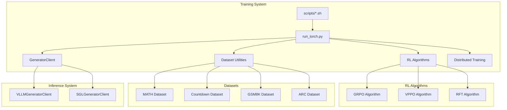
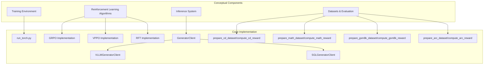
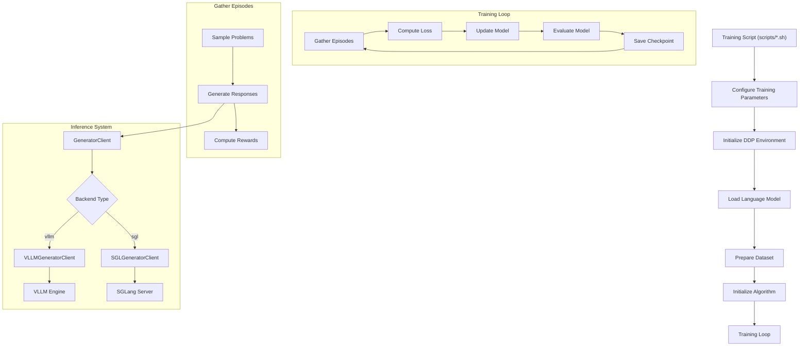

<!-- source: DeepWiki mcp.deepwiki.com · repo microsoft/nanovppo · page 1 Overview · fetched 2026-10-26 -->

# Overview

Relevant source files

The following files were used as context for generating this wiki page:

- [README.md](README.md)
- [algos/__init__.py](algos/__init__.py)
- [requirements.txt](requirements.txt)

nanovppo is a minimal, educational codebase designed to implement and reproduce reinforcement learning (RL) algorithms for Large Language Models (LLMs). The system focuses specifically on implementing three key algorithms: GRPO (Gradient Ratio Policy Optimization), VPPO (Value-Proximal Policy Optimization), and RFT (Reward Function Transformation). For detailed documentation of these specific algorithms, see [Reinforcement Learning Algorithms](#3).

## Purpose and Scope

This codebase serves as an educational tool for practitioners wanting to understand and experiment with RL for LLMs. It provides a self-contained, dependency-lean implementation that prioritizes clarity and reproducibility over production-level scalability.

nanovppo is designed to:
- Implement and reproduce popular RL algorithms for LLMs
- Provide efficient model inference through VLLM and SGLang backends
- Support training on mathematical reasoning datasets (Countdown, MATH, GSM8K, ARC)
- Facilitate multi-GPU training on a single node

The system is NOT designed for:
- Training large-scale production models
- Deployment in regulated domains
- Production-level applications

Sources: [README.md:11-31]()

## System Architecture

### High-Level Architecture

The nanovppo system is centered around `run_torch.py`, which orchestrates the training process. Training scripts in the `scripts` directory configure the training parameters and launch the training process. The system utilizes RL algorithms implemented in the codebase, dataset utilities for different reasoning tasks, and a generator client for efficient model inference.

Sources: [README.md:3-21]()

### Code to Concept Mapping

This diagram illustrates how the conceptual components of nanovppo map to specific code implementations. The training environment is primarily implemented in `run_torch.py`, while the RL algorithms have their respective implementations. The inference system uses a `GeneratorClient` with backend-specific implementations for VLLM and SGLang. Each dataset has corresponding preparation and reward computation functions.

Sources: [README.md:3-21]()

## Training Pipeline

The training pipeline begins with a training script that configures the parameters. The system initializes the distributed environment, loads the model and dataset, and sets up the selected algorithm. The training loop gathers episodes by sampling problems, generating responses through the inference system, and computing rewards. The model is then updated based on the computed loss, evaluated, and checkpointed before the next iteration.

Sources: [README.md:33-39]()

## Dependencies

nanovppo relies on the following key dependencies:

| Dependency | Version | Purpose |
|------------|---------|---------|
| sglang | 0.4.4.post4 | Efficient model inference backend |
| torch | 2.5.1 | Deep learning framework |
| vllm | 0.7.3 | Efficient model inference backend |
| transformers | 4.48.2 | Hugging Face transformers library |
| flash_attn | - | Optimized attention implementation |
| accelerate | - | Training optimization utilities |
| bitsandbytes | 0.43.3 | Quantization utilities |
| datasets | 3.0.1 | Dataset handling utilities |

Sources: [requirements.txt:1-10]()

## Getting Started

To begin using nanovppo, examine the training scripts in the `scripts` directory. These scripts provide examples of how to train models using different algorithms and datasets. For example:

- `scripts/grpo_cd.sh`: GRPO training on the Countdown dataset
- `scripts/vppo_cd.sh`: VPPO training on the Countdown dataset
- `scripts/grpo_math.sh`: GRPO training on the MATH dataset

When using SGLang as the backend, at least two GPUs are required (one for inference, one for training).

Sources: [README.md:33-39]()

## Limitations and Best Practices

### Limitations

- Designed for research and experimental purposes, not production use
- Optimized for English language only
- Not suitable for highly regulated domains
- Inherits biases from base models and training data
- Not optimized for training large-scale models

### Best Practices

- Source datasets legally and ethically
- Be mindful of data privacy concerns
- Ensure compliance with relevant data protection regulations

Sources: [README.md:40-59]()

---

