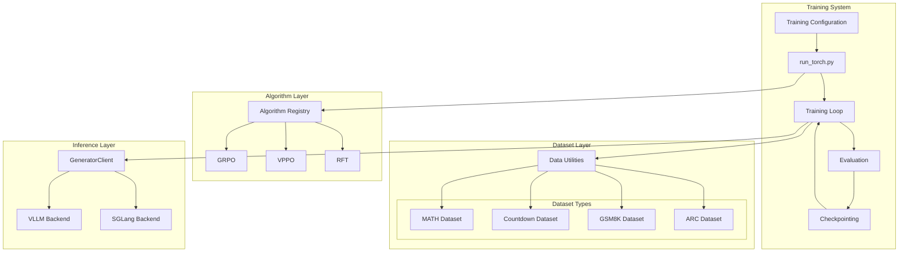
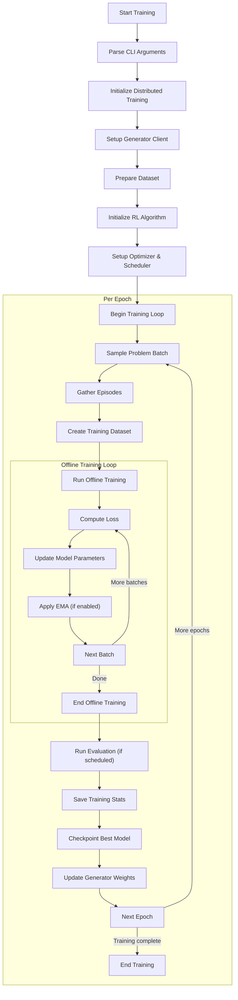
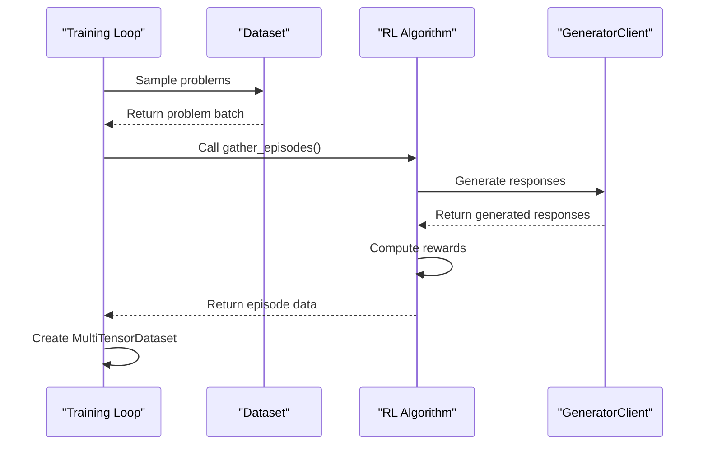
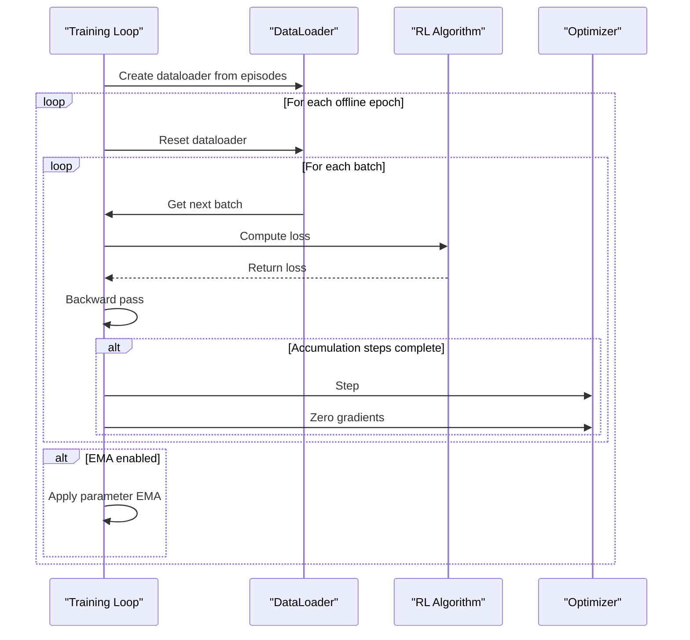
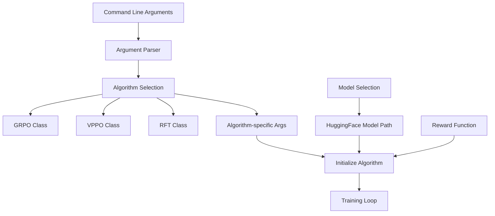
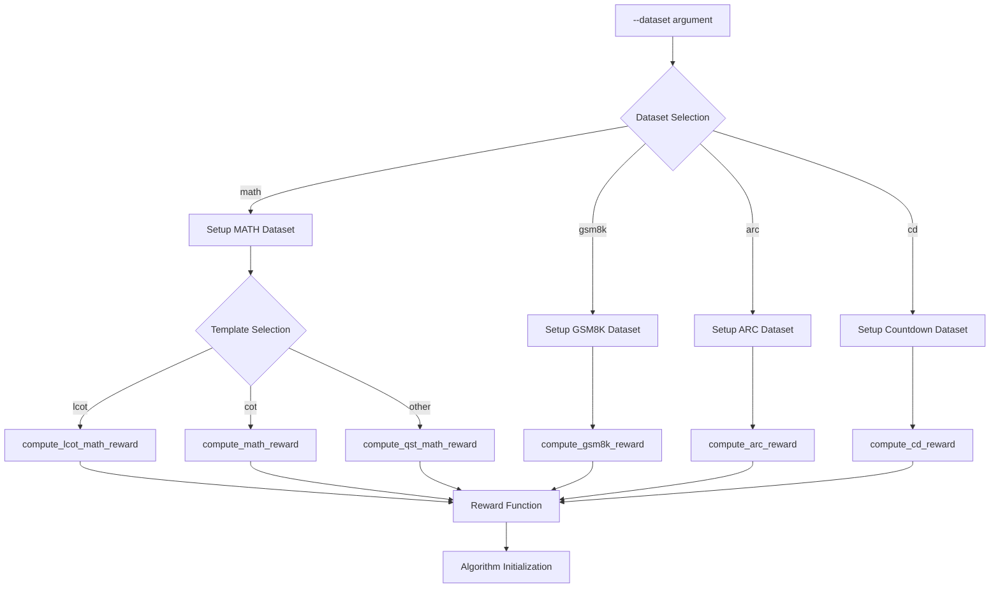
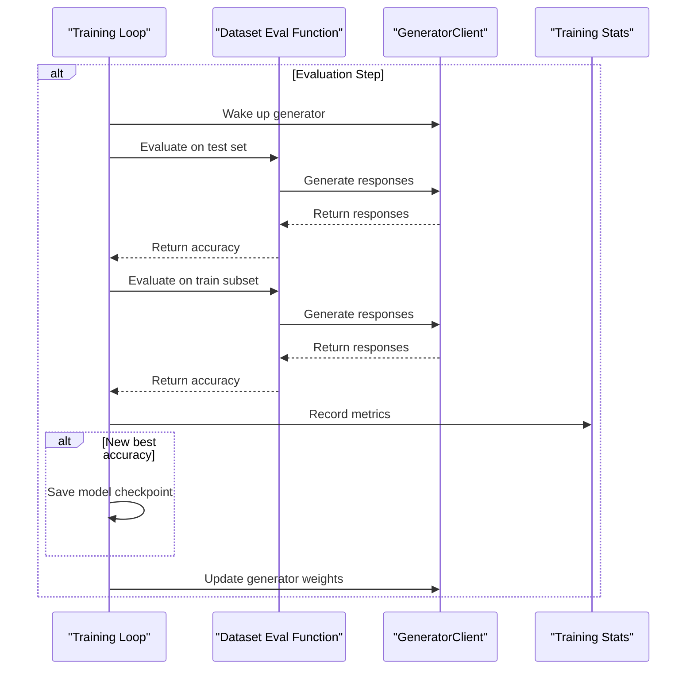
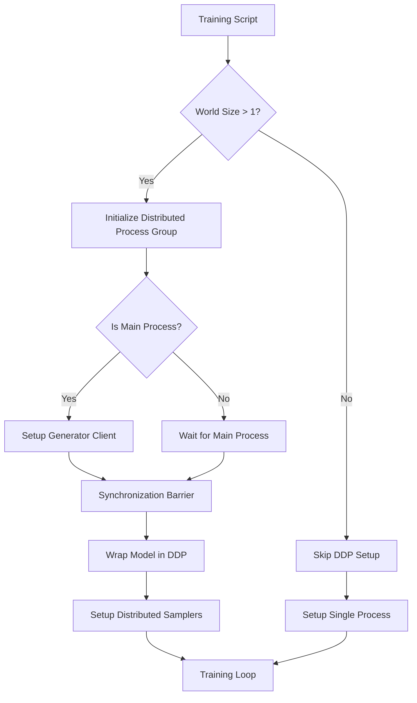
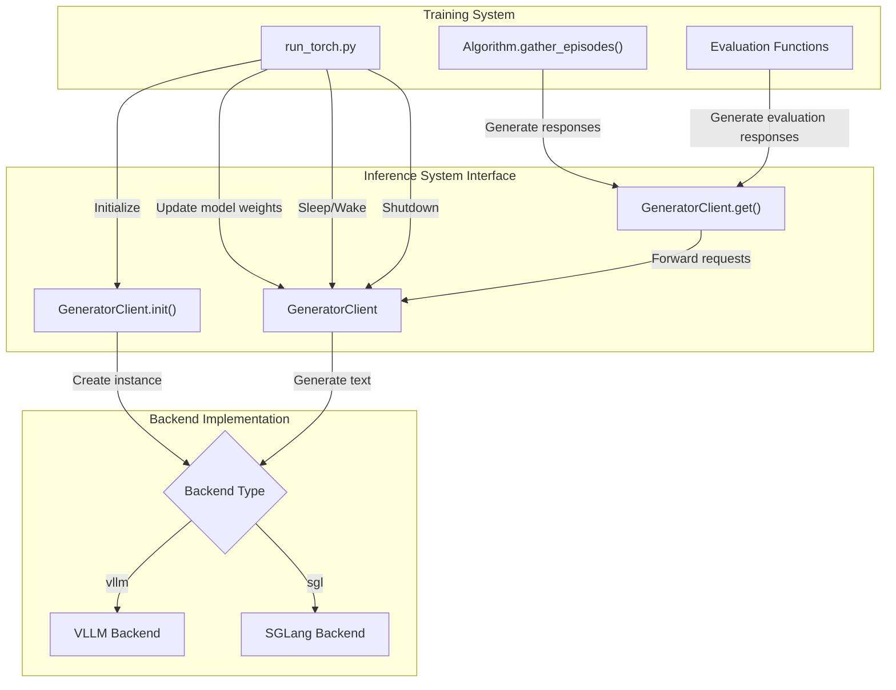

<!-- source: DeepWiki mcp.deepwiki.com · repo microsoft/nanovppo · page 2 Training System · fetched 2026-10-26 -->

# Training System

<details>
<summary>Relevant source files</summary>

The following files were used as context for generating this wiki page:

- [run_torch.py](run_torch.py)

</details>


The Training System in nanovppo is the core component responsible for handling the end-to-end reinforcement learning training process for language models. This document describes the architecture, components, and workflow of the training system, focusing on how it orchestrates model training across different algorithms, datasets, and infrastructure setups.

For information about specific algorithms, see [Reinforcement Learning Algorithms](#3). For details on the inference system that generates model responses during training, see [Inference System](#4).

## Architecture Overview

The training system is built around a central training loop that coordinates the interaction between reinforcement learning algorithms, language models, datasets, and inference backends. It supports distributed training through PyTorch's DistributedDataParallel (DDP) and manages the complete lifecycle of model training.



Sources: [run_torch.py:13-55]()

## Training Pipeline

The training system follows a structured pipeline that systematically processes data, trains models, and evaluates results. The main training loop in `run_torch.py` orchestrates this entire process.



Sources: [run_torch.py:84-461]()

## Configuration Options

The training system is highly configurable through command-line arguments. The most important configuration parameters are defined in the argument parser in `run_torch.py`.

| Parameter | Description | Default |
|-----------|-------------|---------|
| `-m` | Model name (e.g., "q1.5", "phi", "ll8b") | - |
| `-o` | Output directory | "auto" |
| `-s` | Random seed | 42 |
| `-a` | Algorithm (rft, grpo, vppo) | - |
| `--lr` | Learning rate | 1e-5 |
| `--maxepochs` | Maximum number of epochs | -1 |
| `--onlbsz` | Online batch size per GPU | 32 |
| `--offepc` | Number of offline epochs | 1 |
| `--offbsz` | Offline batch size per GPU | -1 |
| `--innbsz` | Inner batch size | 1 |
| `--dataset` | Dataset (math, gsm8k, arc, cd) | "math" |
| `--template` | Template type (cot, lcot, qst) | "cot" |
| `-b` | Backend (vllm, sgl) | "vllm" |
| `-k` | Number of samples per prompt | 5 |
| `-t` | Temperature | DEFAULT_TEMP |

Sources: [run_torch.py:464-545]()

## Training Loop Implementation

The main training loop handles both the online (on-policy) and offline (off-policy) phases of training. This dual approach allows for efficient data collection and model updates.

### Online Phase: Episode Collection

During the online phase, the system:
1. Samples a batch of problems from the dataset
2. Generates model responses using the current policy
3. Computes rewards for the generated responses
4. Constructs a dataset of experiences for offline learning



Sources: [run_torch.py:271-309]()

### Offline Phase: Policy Optimization

During the offline phase, the system:
1. Creates a dataloader from the collected episodes
2. Iterates through mini-batches to compute losses and update the model
3. Applies gradient updates with potential gradient accumulation
4. Updates learning rate using the scheduler
5. Optionally applies EMA to model parameters



Sources: [run_torch.py:319-383]()

## Model and Algorithm Integration

The training system is designed to work with multiple models and reinforcement learning algorithms. Models and algorithms are registered in dictionaries for easy selection.

### Model Registry

```python
models = {
    "q1.5": "Qwen/Qwen2.5-1.5B",
    "q3": "Qwen/Qwen2.5-3B",
    "q3i": "Qwen/Qwen2.5-3B-Instruct",
    "q1.5m": "Qwen/Qwen2.5-Math-1.5B",
    "q1.5i": "Qwen/Qwen2.5-1.5B-Instruct",
    "phi": "microsoft/Phi-3-mini-4k-instruct",
    "ll8b": "meta-llama/Llama-3.1-8B-Instruct",
}
```

Sources: [run_torch.py:59-67]()

### Algorithm Registry

```python
algos = {
    "rft": RFT,
    "grpo": GRPO,
    "vppo": VPPO,
}
```

Sources: [run_torch.py:69-74]()

The system dynamically loads the appropriate algorithm class based on the command-line argument and passes algorithm-specific parameters:



Sources: [run_torch.py:76-82](), [run_torch.py:150-159]()

## Dataset Processing and Rewards

The training system supports multiple datasets, each with specific preparation functions and reward computation methods.

### Dataset Selection Logic



Sources: [run_torch.py:107-130]()

## Evaluation and Checkpointing

The training system includes regular evaluation of the model's performance and checkpointing of the best models.

### Evaluation Process



Sources: [run_torch.py:386-456]()

## Distributed Training

The training system supports distributed training across multiple GPUs using PyTorch's DistributedDataParallel (DDP).



Sources: [run_torch.py:89-98](), [run_torch.py:163-168]()

## Integration with Inference System

The training system interacts with the inference system through the `GeneratorClient` interface, which provides a unified API for different backend implementations (VLLM, SGLang).



Sources: [run_torch.py:93-96](), [run_torch.py:307](), [run_torch.py:390](), [run_torch.py:455](), [run_torch.py:460]()

## Key Training System Events

The following table summarizes the key events in the training system lifecycle:

| Event | Description | Code Location |
|-------|-------------|--------------|
| Initialization | Parse arguments, initialize DDP, setup generator | [run_torch.py:84-102]() |
| Dataset Preparation | Load and prepare datasets based on configuration | [run_torch.py:107-130](), [run_torch.py:235-258]() |
| Algorithm Initialization | Initialize the selected RL algorithm with model and parameters | [run_torch.py:150-159]() |
| Online Phase | Sample problems and gather episodes | [run_torch.py:271-309]() |
| Offline Phase | Create dataset from episodes and update model | [run_torch.py:319-383]() |
| Evaluation | Evaluate model on test and train subsets | [run_torch.py:386-401]() |
| Checkpointing | Save training stats and best model | [run_torch.py:402-452]() |
| Generator Update | Update the generator's weights with the latest model | [run_torch.py:455]() |
| Shutdown | Clean up resources and shut down generator | [run_torch.py:459-461]() |

Sources: [run_torch.py:84-461]()

---

