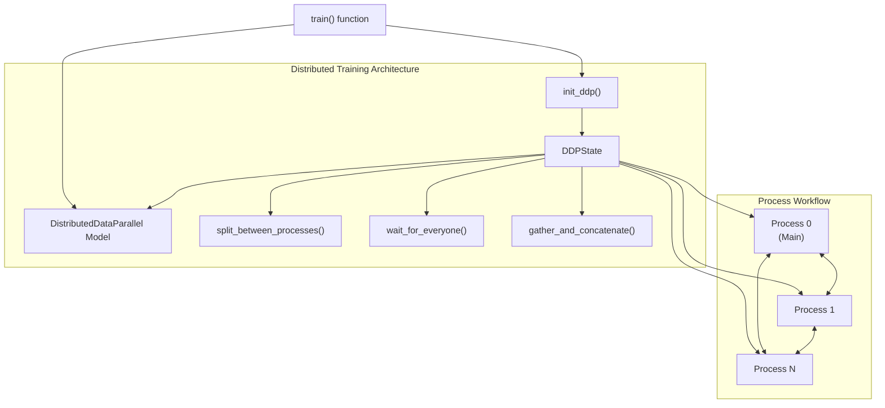
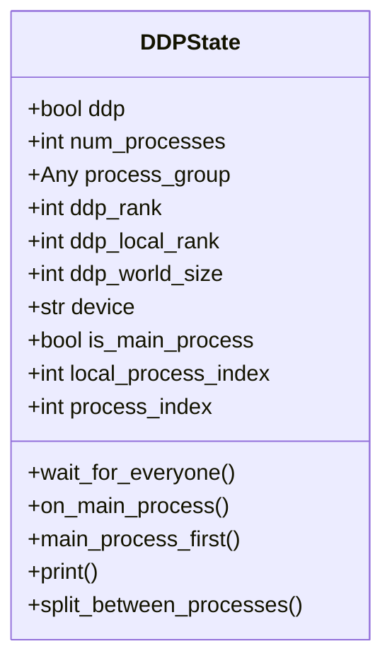
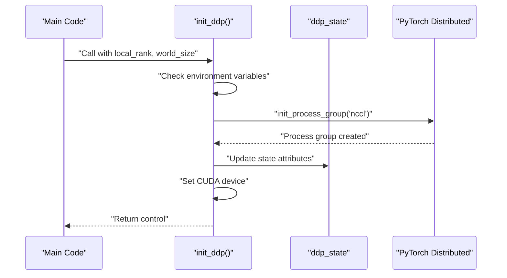
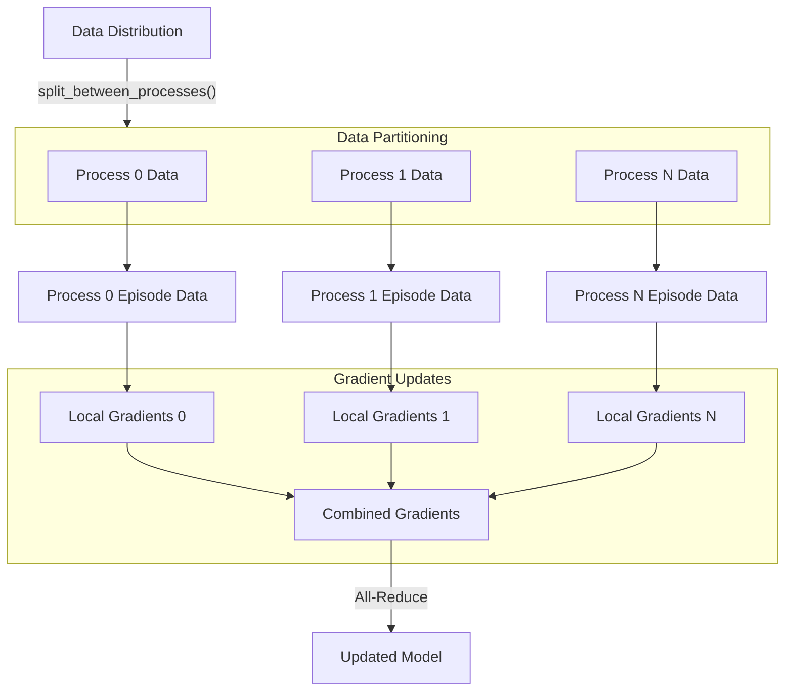
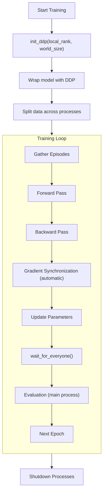

<!-- source: DeepWiki mcp.deepwiki.com · repo microsoft/nanovppo · page 2.1 Distributed Training · fetched 2026-10-26 -->

# Distributed Training

<details>
<summary>Relevant source files</summary>

The following files were used as context for generating this wiki page:

- [ddp_utils.py](ddp_utils.py)
- [run_torch.py](run_torch.py)

</details>


This page documents the distributed training implementation in nanovppo, which enables training reinforcement learning models across multiple GPUs. The system uses PyTorch's Distributed Data Parallelism (DDP) to parallelize training, improving training throughput and enabling larger batch sizes.

## Overview

nanovppo implements distributed training through a custom utility layer on top of PyTorch's DDP functionality. The distributed training architecture is designed to:

1. Initialize a distributed environment
2. Distribute model parameters across multiple GPUs
3. Coordinate data loading and partitioning
4. Synchronize gradients during backpropagation
5. Manage communication between processes



Diagram: Distributed Training Architecture Overview

Sources: [ddp_utils.py:1-163](), [run_torch.py:83-102]()

## DDPState Management

The core of nanovppo's distributed training implementation is the `DDPState` class, which encapsulates all state information and utilities for managing distributed processes.

### DDPState Class

The `DDPState` class manages the state of distributed training across processes and provides utility methods for process coordination.



Diagram: DDPState Class Structure

Key attributes and methods:

- `ddp`: Flag indicating if distributed training is active
- `num_processes`: Total number of processes (typically equal to number of GPUs)
- `process_group`: PyTorch distributed process group
- `ddp_rank` & `ddp_local_rank`: Process rank identifiers
- `is_main_process`: Flag indicating if current process is the main (rank 0) process
- `device`: CUDA device assigned to this process
- `wait_for_everyone()`: Synchronization barrier for all processes
- `split_between_processes()`: Context manager to partition data across processes

A global instance `ddp_state` is created to maintain consistent access to the distributed state throughout the codebase.

Sources: [ddp_utils.py:20-72]()

## Initialization Process

Distributed training is initialized through the `init_ddp` function, which sets up the distributed environment and configures the global `ddp_state`.

### Key Initialization Steps

1. The function checks for environment variables (`LOCAL_RANK`, `MASTER_ADDR`, `MASTER_PORT`)
2. Initializes the process group using NCCL backend
3. Sets the CUDA device for the current process
4. Updates the global `ddp_state` with process-specific information



Diagram: Distributed Training Initialization Sequence

The initialization is typically called from the `train` function in `run_torch.py` with:

```python
init_ddp(local_rank, world_size)
```

Where `local_rank` and `world_size` are obtained from environment variables:

```python
local_rank = int(os.environ.get("LOCAL_RANK", 0))
world_size = int(os.environ.get("WORLD_SIZE", 1))
```

Sources: [ddp_utils.py:75-104](), [run_torch.py:83-90](), [run_torch.py:547-549]()

## Model Distributed Training Implementation

Once the distributed environment is initialized, the model is wrapped in PyTorch's `DistributedDataParallel` (DDP) wrapper to enable synchronized gradient updates.

### Model Wrapping

```python
if ddp_state.ddp:
    algo.model = DDP(
        algo.model,
        device_ids=[ddp_state.local_process_index],
        output_device=ddp_state.local_process_index,
    )
    algo_module = algo.model.module
else:
    algo_module = algo.model
```

This pattern allows the code to work in both distributed and non-distributed settings.

### Data Partitioning

Data is partitioned across processes using the `split_between_processes` context manager:



Diagram: Data Partitioning and Gradient Flow

The data partitioning process ensures each GPU works on a subset of the total batch while maintaining synchronized gradients:

1. The total batch is divided equally across processes
2. Each process computes forward/backward passes on its data partition
3. Gradients are automatically synchronized during backward pass
4. All processes update their model with identical parameters

Sources: [run_torch.py:300-304](), [ddp_utils.py:56-69]()

## Training Synchronization

Several synchronization points ensure proper coordination between processes:

### Synchronization Barriers

The `wait_for_everyone()` method creates synchronization barriers where all processes wait until everyone reaches that point:

```python
ddp_state.wait_for_everyone()
```

These barriers are used at key points in the training loop:
- After initialization
- After model parameter updates
- Before and after evaluation
- Before shutdown

### Main Process First Pattern

The `main_process_first()` context manager ensures operations are performed by the main process first, then by other processes:

```python
with ddp_state.main_process_first():
    # Operations that should be performed by main process first
    all_queries, all_labels = prepare_dataset(...)
```

This pattern is particularly useful for dataset preparation and file system operations.

Sources: [ddp_utils.py:32-50](), [run_torch.py:98](), [run_torch.py:235-257](), [run_torch.py:384](), [run_torch.py:457]()

## Utility Functions

nanovppo provides several utility functions for distributed training:

### rank_zero_only Decorator

This decorator ensures a function only executes on the main process (rank 0), with synchronization to share results to other processes:

```python
@rank_zero_only
def some_function():
    # This will only run on the main process
    # Results will be broadcast to other processes
    pass
```

### gather_and_concatenate Function

This function gathers tensors from all processes and concatenates them:

```python
def gather_and_concatenate(data, dim=0):
    if not ddp_state.ddp:
        return data

    world_size = ddp_state.num_processes
    gathered_data = []
    for tensor in data:
        gathered_tensors = [torch.zeros_like(tensor) for _ in range(world_size)]
        torch.distributed.all_gather(gathered_tensors, tensor)
        gathered_data.append(torch.cat(gathered_tensors, dim=dim))
    return gathered_data
```

This is particularly useful for collecting distributed results for logging or evaluation.

Sources: [ddp_utils.py:107-162]()

## Backend Compatibility

Not all inference backends support distributed training. The code includes compatibility checks:

```python
if world_size > 1 and final_args.b == 'vllm':
    raise ValueError("VLLM backend does not support distributed training.")
```

Currently, the VLLM backend does not support distributed training, while SGLang can be used with distributed training.

| Backend | Distributed Training Support |
|---------|------------------------------|
| VLLM    | No                           |
| SGLang  | Yes                          |

Sources: [run_torch.py:551-552]()

## Usage in Training Loop

The distributed training functionality is integrated throughout the training loop in `run_torch.py`:



Diagram: Distributed Training in the Training Loop

Sources: [run_torch.py:83-461]()

## Practical Considerations

When using distributed training in nanovppo, consider the following:

1. **Environment Variables**: Proper environment variables must be set:
   - `LOCAL_RANK`: The local rank of the process
   - `WORLD_SIZE`: Total number of processes
   - `MASTER_ADDR`: Address of the master process (defaults to "localhost")
   - `MASTER_PORT`: Port for the master process (defaults to "29502")

2. **Backend Selection**: Choose a compatible backend (currently only SGLang supports distributed training)

3. **Batch Size**: The total batch size is multiplied by the number of GPUs, so adjust per-GPU batch size accordingly

4. **Memory Usage**: Monitor memory usage as the optimizer states are replicated on each GPU

5. **Launcher**: Use a distributed launcher like `torchrun` or `python -m torch.distributed.launch` to start the training script

Sources: [run_torch.py:547-552](), [ddp_utils.py:79-85]()

---

