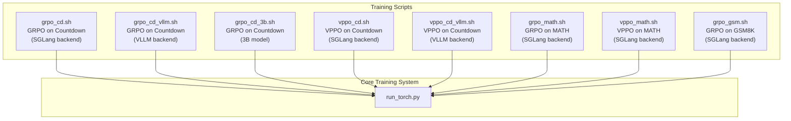
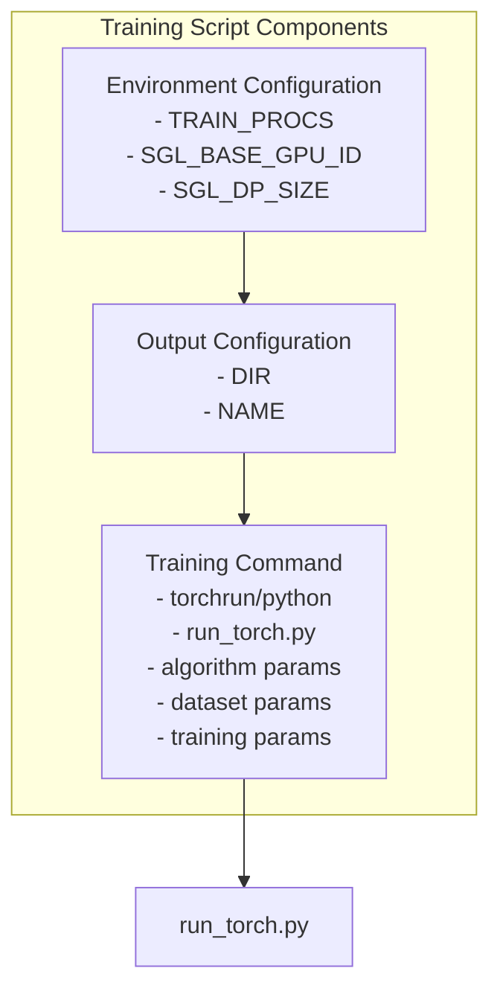
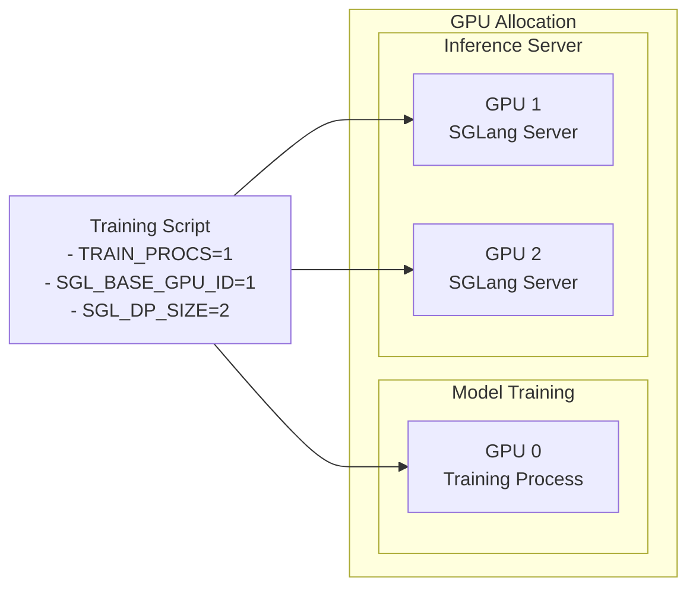
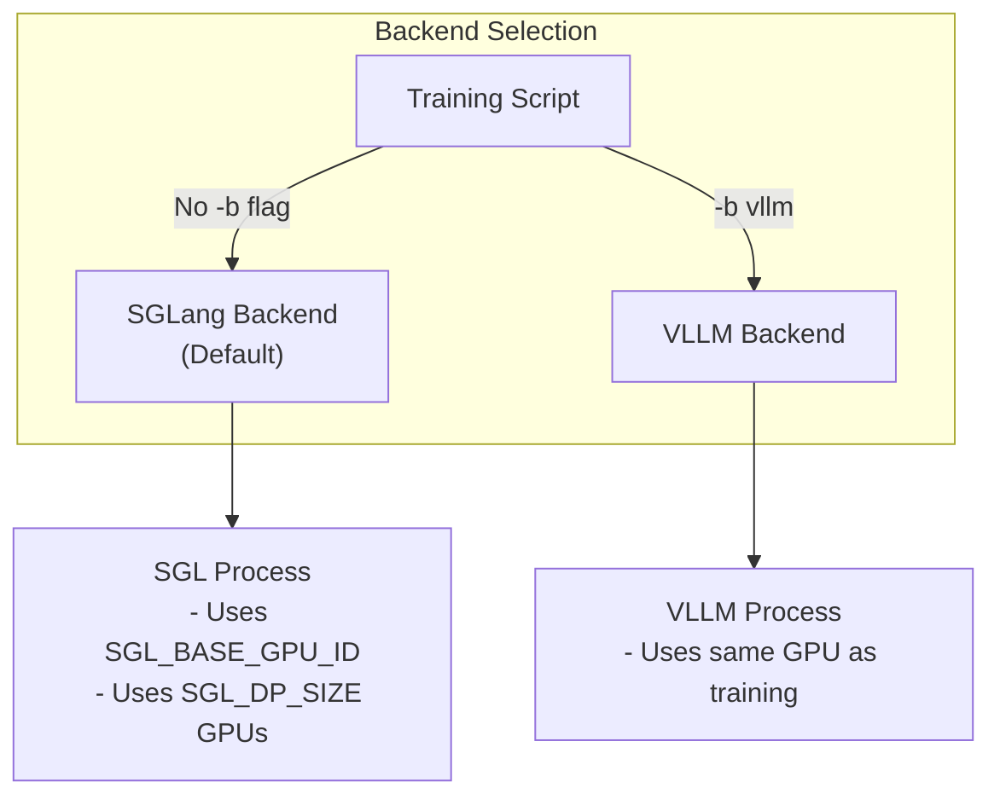
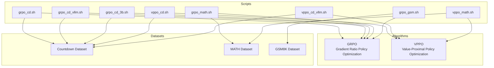

<!-- source: DeepWiki mcp.deepwiki.com · repo microsoft/nanovppo · page 2.2 Training Scripts · fetched 2026-10-26 -->

# Training Scripts

<details>
<summary>Relevant source files</summary>

The following files were used as context for generating this wiki page:

- [scripts/grpo_cd.sh](scripts/grpo_cd.sh)
- [scripts/grpo_cd_3b.sh](scripts/grpo_cd_3b.sh)
- [scripts/grpo_cd_vllm.sh](scripts/grpo_cd_vllm.sh)
- [scripts/grpo_gsm.sh](scripts/grpo_gsm.sh)
- [scripts/grpo_math.sh](scripts/grpo_math.sh)
- [scripts/vppo_cd.sh](scripts/vppo_cd.sh)
- [scripts/vppo_cd_vllm.sh](scripts/vppo_cd_vllm.sh)
- [scripts/vppo_math.sh](scripts/vppo_math.sh)

</details>


This page documents the training scripts available in the nanovppo repository and explains how to use them for training different reinforcement learning algorithms on various reasoning datasets. These scripts serve as convenient wrappers around the core training system, providing pre-configured command-line arguments for specific experiment configurations.

For information about the core training system implementation, see [Training System](#2), and for details about specific algorithms, see [Reinforcement Learning Algorithms](#3).

## Script Organization

The nanovppo repository contains several training scripts organized by algorithm and dataset combinations. These scripts are located in the `scripts/` directory and follow a naming convention of `{algorithm}_{dataset}[_{backend}].sh`.



Sources: [scripts/grpo_cd.sh](), [scripts/grpo_cd_vllm.sh](), [scripts/grpo_cd_3b.sh](), [scripts/vppo_cd.sh](), [scripts/vppo_cd_vllm.sh](), [scripts/grpo_math.sh](), [scripts/vppo_math.sh](), [scripts/grpo_gsm.sh]()

## Script Structure and Components

Each training script typically consists of the following components:

1. **Environment configuration**: Sets up variables for distributed training and GPU allocation
2. **Output configuration**: Defines output directory and experiment name
3. **Training command**: Calls `run_torch.py` with specific parameters for the algorithm and dataset



Sources: [scripts/grpo_cd.sh:1-10](), [scripts/vppo_cd.sh:1-14]()

## Common Command-Line Arguments

The training scripts use various command-line arguments to configure the training process. Below are the most common arguments used across different scripts:

| Argument | Description | Example Values |
|----------|-------------|----------------|
| `-m` | Model identifier | `q1.5i`, `q3i` |
| `-o` | Output directory | `runs_outputs/grpo_cd_42` |
| `-t` | Temperature | `1.0` |
| `-k` | Number of samples per problem | `4`, `5`, `8` |
| `--lr` | Learning rate | `5e-6`, `1e-5`, `3e-5` |
| `-a` | Algorithm | `grpo`, `vppo` |
| `-b` | Backend | `vllm` (default is SGLang) |
| `--dataset` | Dataset | `cd`, `math`, `gsm8k` |
| `--onlbsz` | Online batch size | `16`, `32` |
| `--offbsz` | Offline batch size | `8` |
| `--innbsz` | Inner batch size | `1` |
| `--maxtok` | Maximum tokens | `1024` |
| `--maxepochs` | Maximum training epochs | `1000` |
| `--offepc` | Offline epochs per online batch | `1`, `4` |
| `-s` | Random seed | `42` |
| `--kl_ctl` | KL divergence control parameter | `0.001`, `1e-6`, `0.04` |
| `--evalevery` | Evaluation frequency (epochs) | `10`, `25` |
| `--t500` | Use MATH-500 subset (faster) | flag |
| `--template` | Template format | `cot`, `lcot` |
| `--fast` | Enable fast mode | flag |

Sources: [scripts/grpo_cd.sh:12-28](), [scripts/vppo_math.sh:8-23](), [scripts/grpo_math.sh:25-43]()

## Training Script Examples

### GRPO on Countdown Dataset (with SGLang backend)

```bash
export TRAIN_PROCS=1

DIR="runs_outputs"
NAME="grpo_cd"

torchrun --nproc-per-node=${TRAIN_PROCS} run_torch.py \
    -m q1.5i \
    -o ${DIR}/${NAME}_42 \
    -t 1.0 \
    -k 4 \
    --lr 5e-6 \
    -a grpo \
    --dataset cd \
    --onlbsz 16 \
    --offbsz 8 \
    --innbsz 1 \
    --maxtok 1024 \
    --maxepochs 1000 \
    --offepc 1 \
    -s 42 \
    --kl_ctl 0.001 \
    --evalevery 25
```

This script trains a GRPO algorithm on the Countdown dataset using a 1.5B model with the SGLang backend. It uses one training process and conducts evaluation every 25 epochs.

Sources: [scripts/grpo_cd.sh]()

### VPPO on MATH Dataset (with SGLang backend)

```bash
DIR="runs_outputs"
NAME="vppo"

export TRAIN_PROCS=1
export SGL_BASE_GPU_ID=$TRAIN_PROCS
export SGL_DP_SIZE=1

torchrun --nproc_per_node=$TRAIN_PROCS run_torch.py \
    -m q1.5i \
    -o ${DIR}/${NAME}_42 \
    -t 1.0 --fast \
    -k 5 \
    --lr 1e-5 \
    -a vppo \
    --onlbsz 32 \
    --t500 \
    --template lcot \
    --dataset math \
    --maxtok 1024 \
    --maxepochs 1000 \
    --offepc 1 \
    -s 42 \
    --kl_ctl 1e-6
```

This script trains a VPPO algorithm on the MATH dataset (using the faster MATH-500 subset) with a 1.5B model. It uses the "lcot" (likely "labeled chain of thought") template and enables fast mode.

Sources: [scripts/vppo_math.sh]()

## GPU Configuration and Distributed Training

Training scripts can be configured to use multiple GPUs for both model training and inference. The scripts use environment variables to control GPU allocation:

- `TRAIN_PROCS`: Number of training processes (typically one per GPU)
- `SGL_BASE_GPU_ID`: Starting GPU ID for the SGLang inference server
- `SGL_DP_SIZE`: Number of GPUs to use for the SGLang backend

For example, setting `TRAIN_PROCS=1`, `SGL_BASE_GPU_ID=1`, and `SGL_DP_SIZE=2` means:
- Use GPU 0 for model training
- Use GPUs 1 and 2 for the SGLang inference server



Sources: [scripts/grpo_cd.sh:1-9](), [scripts/grpo_math.sh:1-22](), [scripts/vppo_cd.sh:1-9]()

## Backend Selection

The training scripts can use different backends for model inference:

1. **SGLang Backend (default)**: Used in most scripts like `grpo_cd.sh`, `vppo_cd.sh`
2. **VLLM Backend**: Specified with `-b vllm` in scripts like `grpo_cd_vllm.sh`, `vppo_cd_vllm.sh`



Sources: [scripts/grpo_cd.sh](), [scripts/grpo_cd_vllm.sh:15](), [scripts/vppo_cd_vllm.sh:15]()

## Algorithm and Dataset Mapping

The training scripts cover various combinations of algorithms and datasets:



Sources: All script files

## Running a Training Script

To run a training script:

1. Navigate to the nanovppo repository root directory
2. Make sure all dependencies are installed
3. Execute the desired script:

```bash
cd /path/to/nanovppo
bash scripts/grpo_cd.sh
```

The output and checkpoints will be saved in the directory specified by the `-o` parameter (typically `runs_outputs/{experiment_name}_{seed}`).

When running scripts that use SGLang as the backend, make sure that no other SGLang server is running on the same GPUs. Some scripts include a command to kill existing SGLang processes:

```bash
sudo kill -kill `ps -ax | grep sgl | awk '{print $1}' | xargs`
```

Sources: [scripts/grpo_math.sh:23](), [scripts/vppo_cd.sh:14](), [scripts/grpo_gsm.sh:9]()

---

