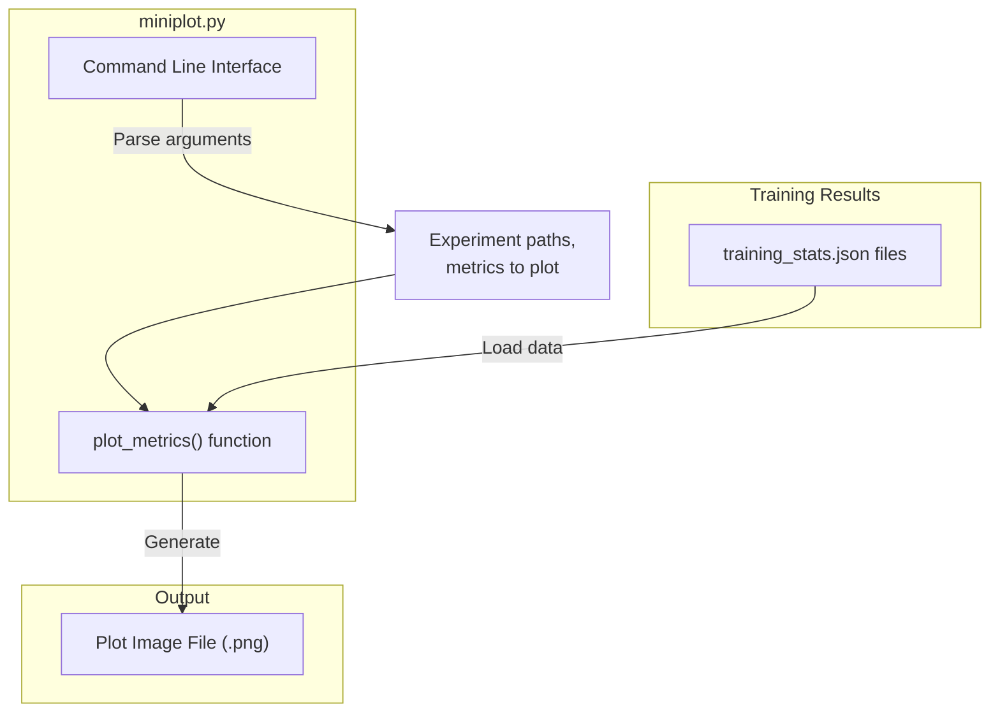

<!-- source: DeepWiki mcp.deepwiki.com · repo microsoft/nanovppo · page 2.3 Utilities · fetched 2026-10-26 -->

# Utilities

<details>
<summary>Relevant source files</summary>

The following files were used as context for generating this wiki page:

- [miniplot.py](miniplot.py)
- [utils.py](utils.py)

</details>


## Purpose and Scope
This document provides a comprehensive overview of the utility functions and classes that support operations across the nanovppo codebase. These utilities handle common tasks such as tensor manipulation, probability calculations, learning rate scheduling, parameter management, and visualization. For information about the training system architecture, see [Training System](#2).

Sources: [utils.py:1-430](), [miniplot.py:1-74]()

## Utility Categories Overview

```mermaid
graph TD
    subgraph "utils.py Utilities"
        AccumulatorDict["AccumulatorDict"]
        MaskUtils["Masking Utilities"]
        TensorUtils["Tensor Utilities"]
        ProbabilityUtils["Probability Utilities"]
        SchdulerUtils["Scheduler Utilities"]
        ParamUtils["Parameter Utilities"]
        DirUtils["Directory Management"]
        ListUtils["List Manipulation"]
        TokenizerUtils["Tokenizer Utilities"]
        VisUtils["Visualization Utilities"]
    end
    
    subgraph "miniplot.py Utilities"
        PlotUtils["Plotting Utilities"]
    end
    
    MaskUtils --> |"Functions"| masked_mean["masked_mean()"]
    MaskUtils --> |"Functions"| masked_var["masked_var()"]
    MaskUtils --> |"Functions"| masked_whiten["masked_whiten()"]
    
    TensorUtils --> |"Functions"| trim_to_longest["trim_to_longest()"]
    
    ProbabilityUtils --> |"Functions"| get_shifted_logprobs["get_shifted_logprobs()"]
    ProbabilityUtils --> |"Functions"| get_logprobs["get_logprobs()"]
    ProbabilityUtils --> |"Functions"| get_entropies["get_entropies()"]
    ProbabilityUtils --> |"Functions"| compute_kl_divergence["compute_kl_divergence()"]
    
    SchdulerUtils --> |"Class"| CosineWarmupScheduler["CosineWarmupScheduler"]
    SchdulerUtils --> |"Functions"| get_wsd_scheduler["get_wsd_scheduler()"]
    
    ParamUtils --> |"Functions"| param_ema["param_ema()"]
    ParamUtils --> |"Functions"| copy_model_param["copy_model_param()"]
    
    DirUtils --> |"Functions"| setup_output_directory["setup_output_directory()"]
    DirUtils --> |"Functions"| save_args["save_args()"]
    DirUtils --> |"Functions"| form_code_zip["form_code_zip()"]
    
    ListUtils --> |"Functions"| repeat["repeat()"]
    ListUtils --> |"Functions"| pack["pack()"]
    ListUtils --> |"Functions"| flatten["flatten()"]
    
    TokenizerUtils --> |"Functions"| get_ending_tokens["get_ending_tokens()"]
    
    VisUtils --> |"Functions"| print_metrics["print_metrics()"]
    
    PlotUtils --> |"Functions"| plot_metrics["plot_metrics()"]
```



Sources: [utils.py:1-430](), [miniplot.py:1-74]()

## Integration with Training Pipeline

```mermaid
graph TD
    subgraph "Training System"
        RT["run_torch.py"]
        RL["RL Algorithm"]
        Eval["Evaluation"]
    end
    
    subgraph "Utility Functions"
        LPUtils["Log Probability Utilities"]
        SchUtils["Scheduler Utilities"]
        MUtils["Masking Utilities"]
        PUtils["Parameter Utilities"]
        DUtils["Directory Utilities"]
        VUtils["Visualization Utilities"]
    end
    
    RT --> |"Uses"| LPUtils
    RL --> |"Uses"| LPUtils
    RL --> |"Uses"| MUtils
    RL --> |"Uses"| PUtils
    
    RT --> |"Uses"| SchUtils
    RT --> |"Uses"| DUtils
    
    RT --> |"Uses"| VUtils
    Eval --> |"Uses"| VUtils
    
    LPUtils --> |"Functions"| get_logprobs["get_logprobs()"]
    LPUtils --> |"Functions"| get_shifted_logprobs["get_shifted_logprobs()"]
    LPUtils --> |"Functions"| compute_kl_divergence["compute_kl_divergence()"]
    
    MUtils --> |"Functions"| masked_mean["masked_mean()"]
    MUtils --> |"Functions"| masked_var["masked_var()"]
    MUtils --> |"Functions"| masked_whiten["masked_whiten()"]
    
    SchUtils --> |"Functions"| get_wsd_scheduler["get_wsd_scheduler()"]
    SchUtils --> |"Classes"| CosineWarmupScheduler["CosineWarmupScheduler"]
    
    PUtils --> |"Functions"| param_ema["param_ema()"]
    PUtils --> |"Functions"| copy_model_param["copy_model_param()"]
    
    DUtils --> |"Functions"| setup_output_directory["setup_output_directory()"]
    DUtils --> |"Functions"| save_args["save_args()"]
    
    VUtils --> |"Functions"| print_metrics["print_metrics()"]
    VUtils --> |"Functions"| plot_metrics["plot_metrics()"]
```



Sources: [utils.py:1-430](), [miniplot.py:1-74]()

## Accumulator and Statistics Utilities

### AccumulatorDict

The `AccumulatorDict` class is a utility for accumulating values across training iterations and computing statistics.

Key methods:
- `accumulate(key, value)`: Add a value to a specific key
- `mean(key)`: Calculate mean of all values for a key
- `get()`: Return mean values for all keys and clear the internal data
- `clear()`: Reset all accumulated values

Usage: Used to track and report training metrics across iterations.

Sources: [utils.py:16-37]()

### Masking Utilities

These functions handle operations on masked tensors, which is essential for working with variable-length sequences:

| Function | Purpose | Implementation |
|----------|---------|----------------|
| `masked_mean(values, mask, axis=None)` | Compute mean of tensor with masked values | [utils.py:40-45]() |
| `masked_var(values, mask, unbiased=True)` | Compute variance of tensor with masked values | [utils.py:48-64]() |
| `masked_whiten(values, mask, shift_mean=False, unbiased_variance=False)` | Whiten values with masked values | [utils.py:67-75]() |

Usage: These functions are critical for RL algorithms that need to compute statistics on variable-length sequences or batches with different validity masks.

Sources: [utils.py:40-75]()

## Tensor and Probability Utilities

### Tensor Manipulation

- `trim_to_longest(sequences, pad_token_id)`: Trims each sequence in a batch to remove trailing pad tokens, reducing unnecessary computation. Returns a sub-tensor up to the longest real sequence length in the batch.

Sources: [utils.py:78-94]()

### Probability Utilities

| Function | Purpose | Implementation |
|----------|---------|----------------|
| `get_shifted_logprobs(logits, labels, mask, temperature, reduction)` | Compute log probabilities for shifted sequences | [utils.py:97-114]() |
| `get_logprobs(model, query_response, query_response_mask, response_mask, batch_size, reduction, temperature)` | Compute log probabilities using a model | [utils.py:117-153]() |
| `get_entropies(model, query_response, query_response_mask, response_mask, batch_size, temperature, normalize)` | Compute entropies using a model | [utils.py:157-196]() |
| `compute_kl_divergence(ref_logprobs, logprobs, mask, kl_min, kl_max)` | Compute KL divergence between two distributions | [utils.py:199-216]() |

Usage: These utilities are critical for RL algorithm implementations, particularly for computing policy gradients and KL-divergence penalties.

Sources: [utils.py:97-216]()

## Learning Rate Schedulers

### Scheduler Utilities

- `get_wsd_scheduler(optimizer, total_steps, min_lr_ratio, last_epoch)`: Creates a learning rate scheduler with warmup, stable, and decay phases. Implements a Lambda scheduler with different phases for warming up the learning rate, keeping it stable, and then decaying it.

- `CosineWarmupScheduler`: A PyTorch learning rate scheduler with cosine annealing and linear warmup. This custom scheduler extends `_LRScheduler` to provide:
  - Linear warmup for a specified number of steps
  - Cosine decay from maximum learning rate to minimum learning rate

Sources: [utils.py:219-260](), [utils.py:310-355]()

## Model Parameter Utilities

- `param_ema(P, model, eta)`: Applies exponential moving average to model parameters using the specified eta value.

- `copy_model_param(model)`: Creates a copy of model parameters, returning a dictionary mapping parameter names to their values on CPU.

Sources: [utils.py:358-373]()

## Directory and File Management

| Function | Purpose | Implementation |
|----------|---------|----------------|
| `setup_output_directory(output_dir)` | Set up an output directory for training results | [utils.py:376-387]() |
| `save_args(args, output_dir)` | Save arguments to a JSON file | [utils.py:390-398]() |
| `form_code_zip(output_dir)` | Create a zip file of the codebase for reproducibility | [utils.py:414-429]() |

Usage: These utilities help with experiment tracking, ensuring reproducibility, and organizing training outputs.

Sources: [utils.py:376-429]()

## List Manipulation Utilities

Simple utility functions for working with lists:

| Function | Purpose | Implementation |
|----------|---------|----------------|
| `repeat(ary, k)` | Create a new list by repeating each element k times | [utils.py:400-403]() |
| `pack(ary, k)` | Pack elements into sublists of size k | [utils.py:406-407]() |
| `flatten(ary)` | Flatten a list of lists | [utils.py:410-411]() |

Sources: [utils.py:400-412]()

## Tokenizer Utilities

- `get_ending_tokens(tokenizer)`: Extracts the ending tokens for the chat template of the tokenizer by applying the chat template to a dummy message and extracting the suffix.

Sources: [utils.py:263-272]()

## Visualization Utilities

### Text-based Visualization

- `print_metrics(data, min_value, max_value)`: Generates a sparkline-style visualization of numeric data using ASCII characters. Useful for quick visual inspection of metrics in terminal output.

Sources: [utils.py:275-307]()

### Graphical Visualization (miniplot)

The `miniplot.py` module provides utilities for plotting training metrics:

- `plot_metrics(groups, metrics, xlim, output_file)`: Plots training metrics from multiple experiments, creating a comparison visualization that helps track and analyze training progress.



Usage example:
```
python miniplot.py results/experiment1 results/experiment2 --metrics avg_reward kl_div --output comparison.png
```

Sources: [miniplot.py:10-74]()

## Constants

The utils module defines some common default constants:
- `DEFAULT_TEMP = 0.5`: Default temperature for sampling
- `DEFAULT_MAX_TOKENS = 1024`: Default maximum token length

Sources: [utils.py:12-13]()

---

