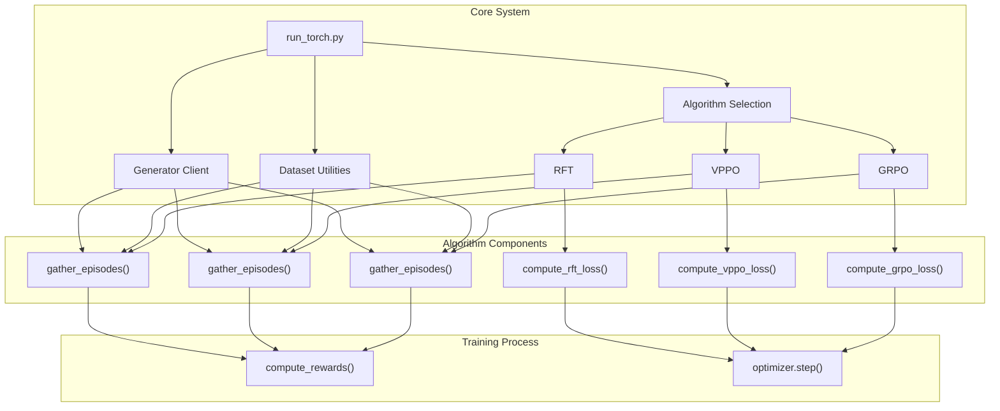
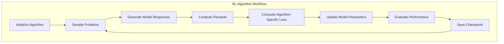
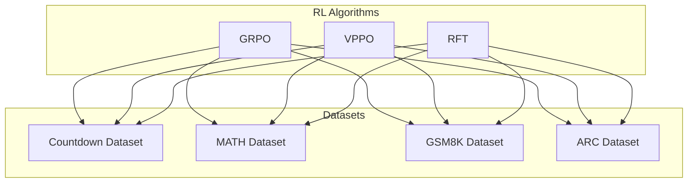

<!-- source: DeepWiki mcp.deepwiki.com · repo microsoft/nanovppo · page 3 Reinforcement Learning Algorithms · fetched 2026-10-26 -->

# Reinforcement Learning Algorithms

<details>
<summary>Relevant source files</summary>

The following files were used as context for generating this wiki page:

- [README.md](README.md)
- [algos/__init__.py](algos/__init__.py)

</details>


This document provides an overview of the reinforcement learning (RL) algorithms implemented in the nanovppo repository. It covers the core principles, architecture, and applications of these algorithms for training language models (LLMs) on reasoning tasks. For detailed information about specific algorithms, see the dedicated pages for [GRPO (Gradient Ratio Policy Optimization)](#3.1), [VPPO (Value-Proximal Policy Optimization)](#3.2), and [RFT (Reward Function Transformation)](#3.3).

## Algorithm Overview

Nanovppo implements three primary reinforcement learning algorithms designed specifically for fine-tuning language models:

1. **GRPO (Gradient Ratio Policy Optimization)**: An algorithm that uses gradient ratios to stabilize policy optimization
2. **VPPO (Value-Proximal Policy Optimization)**: A value-based extension of the PPO algorithm for language models
3. **RFT (Reward Function Transformation)**: An approach that directly transforms reward functions for model optimization

These algorithms share a common goal: to improve LLM performance on reasoning tasks by using reinforcement learning to fine-tune models based on reward signals derived from task performance.

Sources: [README.md:13-19]()

## Algorithm Architecture

### Algorithm Integration within nanovppo



The diagram above shows how the RL algorithms integrate with the core training system. Each algorithm follows a similar pattern of gathering episodes, computing losses based on rewards, and updating the model, while interfacing with the dataset utilities and generator client for model inference.

Sources: [README.md:13-20]()

## Common Training Workflow



All three algorithms share this common workflow, differing primarily in how they compute the loss function and update the model parameters.

Sources: [README.md:13-19]()

## Gradient Ratio Policy Optimization (GRPO)

GRPO is a recent algorithm designed to stabilize RL training for language models. It addresses optimization challenges by using gradient ratios rather than pure policy gradients.

### Key Characteristics:
- Computes gradient ratios to stabilize training
- Provides more reliable convergence compared to standard policy gradient methods
- Particularly effective for reasoning tasks requiring step-by-step problem solving

See [GRPO Algorithm](#3.1) for a detailed implementation explanation.

Sources: [README.md:15]()

## Value-Proximal Policy Optimization (VPPO)

VPPO extends the popular PPO algorithm with a value-based approach specifically adapted for language models.

### Key Characteristics:
- Incorporates value function estimation for advantage calculation
- Uses a trust region approach to constrain policy updates
- Balances exploration and exploitation effectively

See [VPPO Algorithm](#3.2) for a detailed implementation explanation.

Sources: [README.md:17]()

## Reward Function Transformation (RFT)

RFT takes a different approach by focusing on transforming the reward function itself to guide model optimization.

### Key Characteristics:
- Directly transforms reward functions rather than focusing on policy gradients
- Can provide more efficient learning signal for specific types of tasks
- Often simpler to implement than other RL approaches

See [RFT Algorithm](#3.3) for a detailed implementation explanation.

Sources: [README.md:19]()

## Algorithm Selection and Application

The table below compares the key characteristics of each algorithm to help guide selection for specific use cases:

| Algorithm | Key Strength | Best Use Case | Memory Requirements | Training Stability |
|-----------|--------------|---------------|---------------------|-------------------|
| GRPO      | Stability    | Complex reasoning tasks (e.g., MATH dataset) | Moderate | High |
| VPPO      | Balanced exploration | General reasoning tasks | Higher (due to value function) | Moderate to High |
| RFT       | Simplicity   | Well-defined reward structures | Lower | Moderate |

### Algorithm Components and Interface

```mermaid
classDiagram
    class "BaseRLAlgorithm" {
        +optimizer
        +model
        +gather_episodes()
        +compute_loss()
        +train_step()
        +evaluate()
    }
    
    class "GRPO" {
        +gradient_weights
        +gather_episodes()
        +compute_grpo_loss()
        +train_step()
    }
    
    class "VPPO" {
        +value_net
        +clip_ratio
        +gather_episodes()
        +compute_vppo_loss()
        +train_step()
    }
    
    class "RFT" {
        +reward_transform_fn
        +gather_episodes()
        +compute_rft_loss()
        +train_step()
    }
    
    BaseRLAlgorithm <|-- GRPO
    BaseRLAlgorithm <|-- VPPO
    BaseRLAlgorithm <|-- RFT
```

Each algorithm implements a common interface that allows them to be interchanged within the training framework. They share core components like episode gathering and loss computation but differ in the specific implementation details.

Sources: [README.md:13-19]()

## Integration with Datasets

The algorithms are designed to work with various reasoning datasets:



Each algorithm can be applied to any of the supported datasets, with dataset-specific reward functions guiding the optimization process. For more details on the datasets and their reward functions, see [Datasets and Evaluation](#5).

Sources: [README.md:13-19](), [README.md:37-39]()

## Usage Considerations

When selecting and implementing an RL algorithm for LLM fine-tuning, consider:

1. **Task Complexity**: For more complex reasoning tasks, GRPO may offer better stability
2. **Computational Resources**: VPPO requires more memory due to value function estimation
3. **Training Efficiency**: For quick prototyping or limited resources, RFT may be more practical
4. **Domain-Specific Considerations**: Some algorithms may perform better on specific domains

The nanovppo repository provides example scripts for training with these algorithms, such as `grpo_cd.sh` for GRPO training on the Countdown dataset.

Sources: [README.md:33-35]()

## Limitations

The current implementation of these algorithms in nanovppo has some limitations:

- Designed for research and experimental purposes rather than production deployment
- Not optimized for training very large-scale models
- Performance may vary depending on the base model and dataset selection

Sources: [README.md:30-31](), [README.md:42-51]()

---

