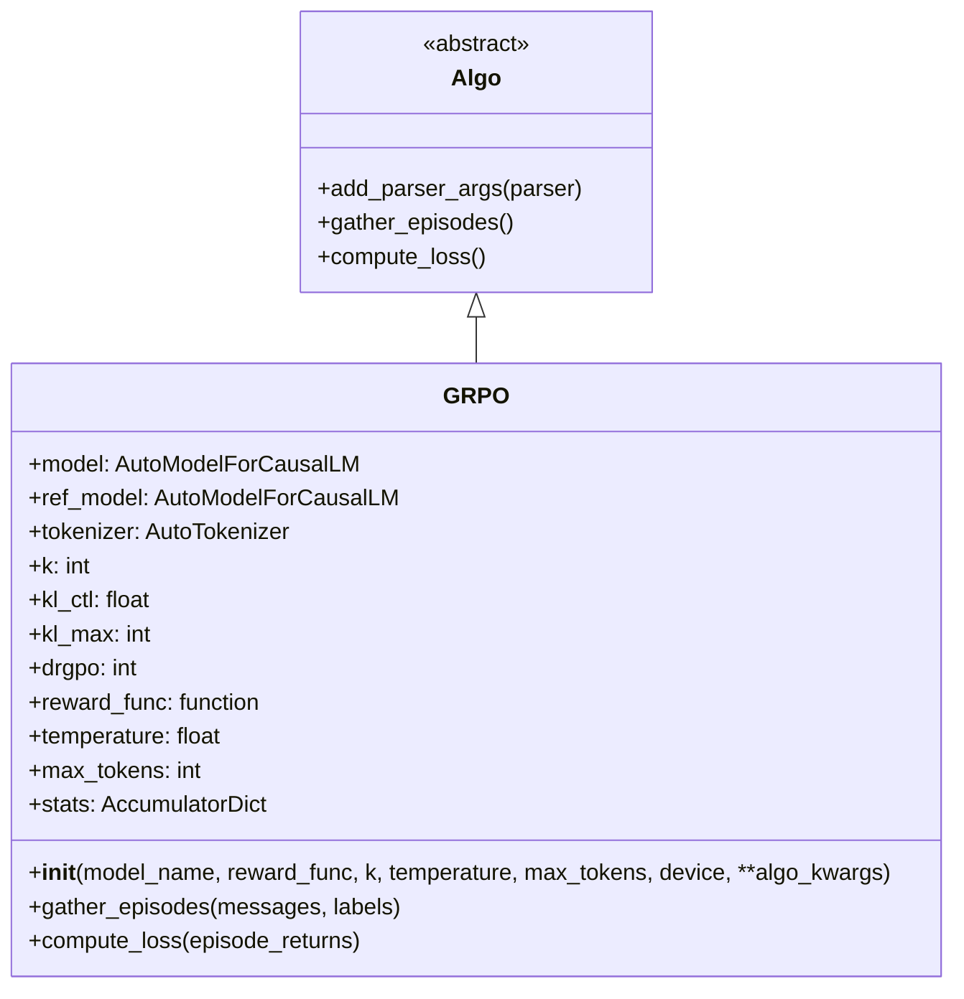
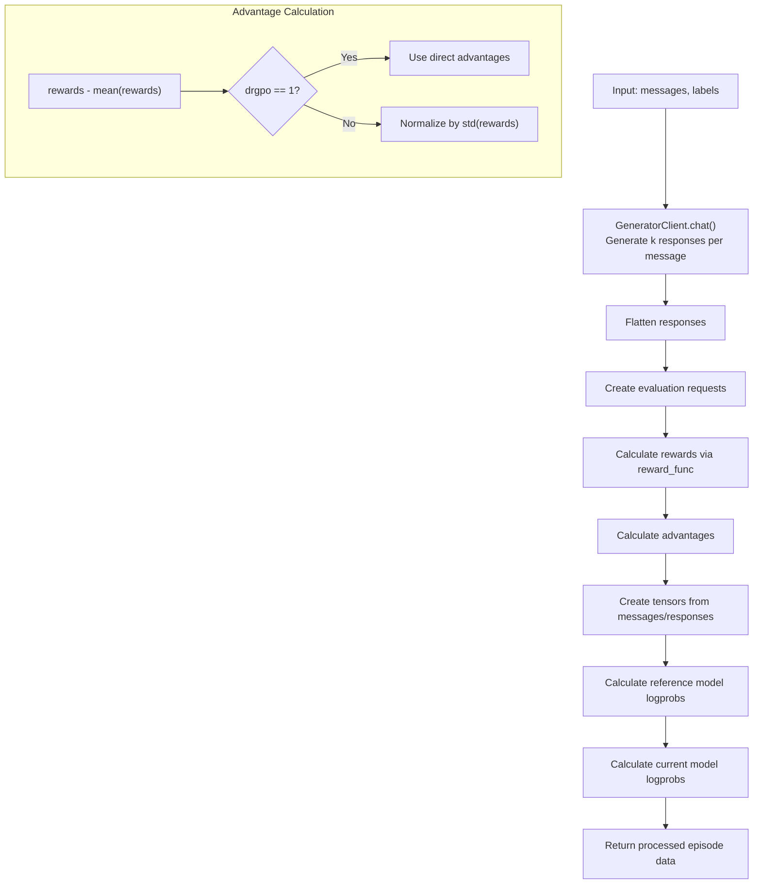
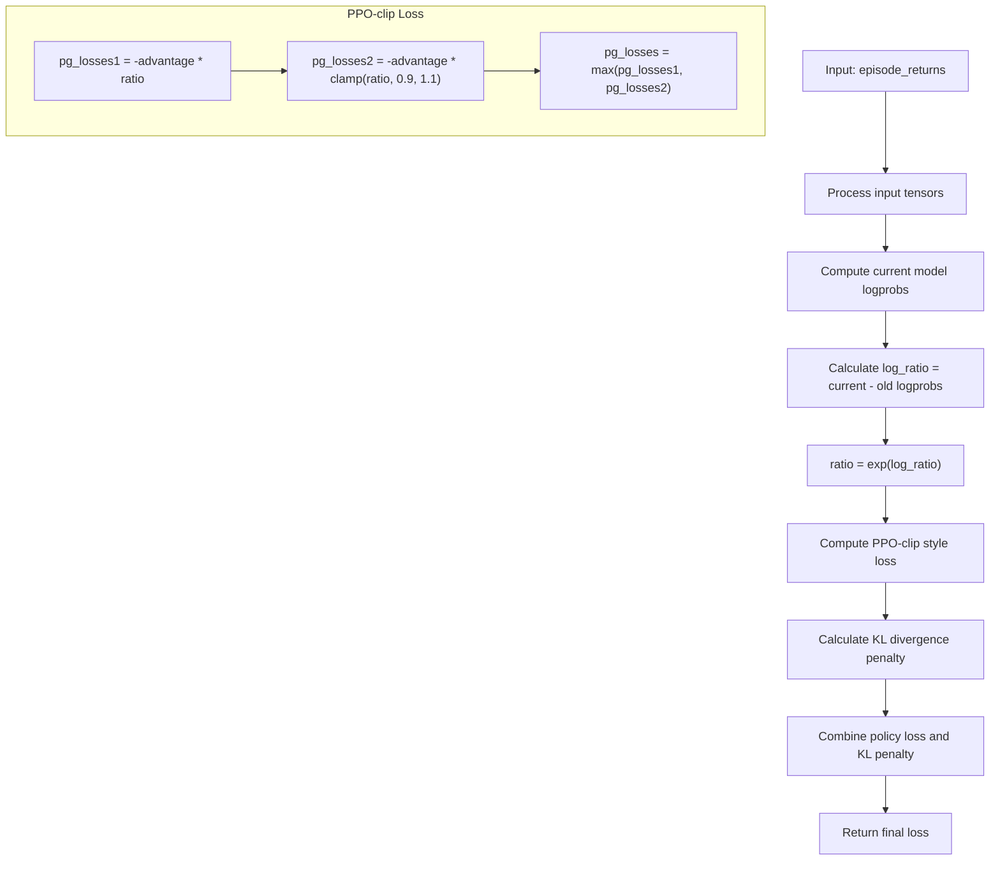
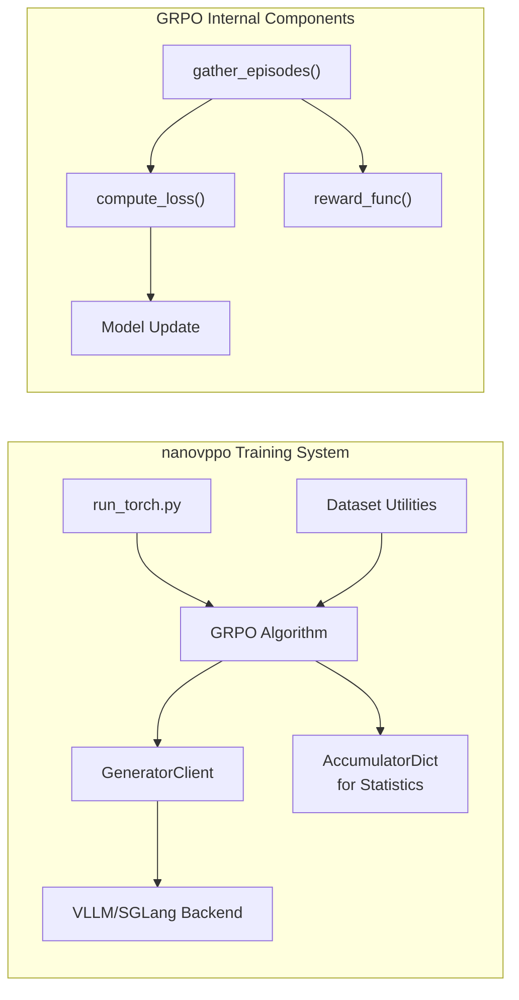

<!-- source: DeepWiki mcp.deepwiki.com · repo microsoft/nanovppo · page 3.1 GRPO (Gradient Ratio Policy Optimization) · fetched 2026-10-26 -->

# GRPO (Gradient Ratio Policy Optimization)

<details>
<summary>Relevant source files</summary>

The following files were used as context for generating this wiki page:

- [algos/grpo.py](algos/grpo.py)

</details>


## Purpose and Overview

This document describes the GRPO (Gradient Ratio Policy Optimization) algorithm implementation in the nanovppo repository. GRPO is a reinforcement learning algorithm designed for training language models on reasoning tasks by optimizing policy gradients with a ratio-based objective and KL-divergence controls. For information about other algorithms in this framework, see [VPPO (Value-Proximal Policy Optimization)](#3.2) and [RFT (Reward Function Transformation)](#3.3).

## Algorithm Description

GRPO is a policy optimization algorithm that combines elements of PPO (Proximal Policy Optimization) with a reference model approach for stable training. It works by sampling multiple responses for each prompt, computing rewards, deriving advantages, and updating the model with a clipped objective function while maintaining proximity to a reference model via KL divergence penalties.

```mermaid
flowchart TD
    subgraph "GRPO Algorithm Flow"
        A["Initialize Models"] --> B["Gather Episodes"]
        B --> C["Compute Rewards"]
        C --> D["Calculate Advantages"]
        D --> E["Compute Loss"]
        E --> F["Update Model"]
        F --> B
    end

    subgraph "gather_episodes Method"
        B1["Generate k Responses"] --> B2["Compute Rewards"]
        B2 --> B3["Calculate Advantages"]
        B3 --> B4["Get Reference Logprobs"]
        B4 --> B5["Get Current Model Logprobs"]
    end

    subgraph "compute_loss Method"
        E1["Compute Current Logprobs"] --> E2["Calculate Log Ratio"]
        E2 --> E3["Clip Ratio"]
        E3 --> E4["Calculate Policy Gradient Loss"]
        E4 --> E5["Add KL Penalty"]
        E5 --> E6["Return Final Loss"]
    end
```



Sources: [algos/grpo.py:30-252]()

## Key Components

### GRPO Class

The GRPO implementation inherits from the base `Algo` class and provides methods for gathering episodes and computing losses.



Sources: [algos/grpo.py:30-79]()

## Algorithm Parameters

The GRPO algorithm accepts several key parameters that influence its behavior:

| Parameter | Default | Description |
|-----------|---------|-------------|
| `kl_ctl` | 0.0001 | Controls the weight of the KL divergence term |
| `kl_max` | 10 | Maximum value to clip KL divergence |
| `drgrpo` | 0 | Flag to enable DrGRPO variant (Direct Ratio GRPO) |
| `k` | 5 | Number of samples to generate per prompt |
| `temperature` | DEFAULT_TEMP | Sampling temperature for generation |
| `max_tokens` | DEFAULT_MAX_TOKENS | Maximum number of tokens to generate |

Sources: [algos/grpo.py:32-42](), [algos/grpo.py:44-52]()

## Algorithm Workflow

### Initialization

During initialization, GRPO creates two models:
1. The main model that will be trained
2. A reference model that remains fixed (used for KL divergence calculation)

It also sets up the tokenizer and stores algorithm parameters.

Sources: [algos/grpo.py:54-79]()

### Episode Gathering

The `gather_episodes` method is responsible for collecting training data:



Sources: [algos/grpo.py:81-191]()

Key steps in this process:
1. Generate `k` responses for each input message using the `GeneratorClient`
2. Compute rewards for each response using the provided reward function
3. Calculate advantages by comparing rewards to the mean reward for each prompt
4. Process the messages and responses into tensors for model input
5. Compute log probabilities under both the reference model and current model

Sources: [algos/grpo.py:86-181]()

### Loss Computation

The `compute_loss` method calculates the loss for optimization:



Sources: [algos/grpo.py:192-252]()

Key components of the loss:
1. PPO-style clipped objective function
2. KL divergence penalty between current and reference model
3. Combination of policy gradient loss and KL penalty

Sources: [algos/grpo.py:229-244]()

## DrGRPO Variant

The algorithm supports a variant called DrGRPO (Direct Ratio GRPO) which modifies how advantages are calculated. When enabled (`drgrpo=1`), the algorithm skips normalizing advantages by the standard deviation, using the direct difference between rewards and mean rewards instead.

Sources: [algos/grpo.py:148-152]()

## Integration with Training System

GRPO interfaces with the rest of the training system through:

1. The `GeneratorClient` for generating responses
2. The reward function for evaluating responses
3. The `AccumulatorDict` for tracking statistics



Sources: [algos/grpo.py:83-94](), [algos/grpo.py:113-118]()

## Implementation Highlights

### Reward Processing

GRPO handles rewards in a specific way to compute advantages for policy optimization:

```python
rewards = np.asarray(rewards).reshape(-1, self.k)
advantages = (rewards - rewards.mean(axis=1, keepdims=True))
if not self.drgpo:
    advantages = advantages / (
        rewards.std(axis=1, keepdims=True) + 1e-8
    )
```

This approach normalizes rewards across samples for the same prompt, calculating advantages that guide the policy update toward higher-reward responses.

Sources: [algos/grpo.py:146-152]()

### PPO-Clip Style Loss

The algorithm uses a clipped objective function similar to PPO:

```python
log_ratio = (mb_logprobs - mb_old_logprobs)
ratio = torch.exp(log_ratio)

pg_losses1 = -mb_advantage.unsqueeze(1) * ratio
pg_losses2 = -mb_advantage.unsqueeze(1) * torch.clamp(ratio, 0.9, 1.1)
pg_losses = torch.max(pg_losses1, pg_losses2)
```

This clipping helps prevent excessively large policy updates that could destabilize training.

Sources: [algos/grpo.py:229-234]()

### KL Divergence Penalty

To prevent the model from deviating too far from the reference model, GRPO includes a KL divergence penalty:

```python
per_token_kl = (
    torch.exp(mb_ref_logprobs - mb_logprobs)
    - (mb_ref_logprobs - mb_logprobs)
    - 1
)

per_token_loss = pg_losses + self.kl_ctl * per_token_kl
```

This term, weighted by `kl_ctl`, encourages the model to stay close to the reference policy while learning to produce higher-reward responses.

Sources: [algos/grpo.py:235-243]()

## Usage in Training Scripts

GRPO is typically used in training scripts with specific configurations for different datasets. The algorithm can be initialized with various hyperparameters to control its behavior and adapt it to different tasks.

Sources: [algos/grpo.py:32-42]()

---

