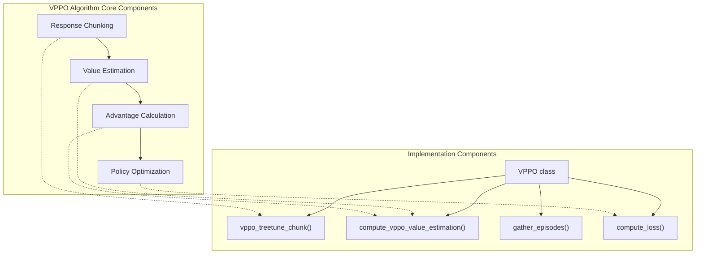
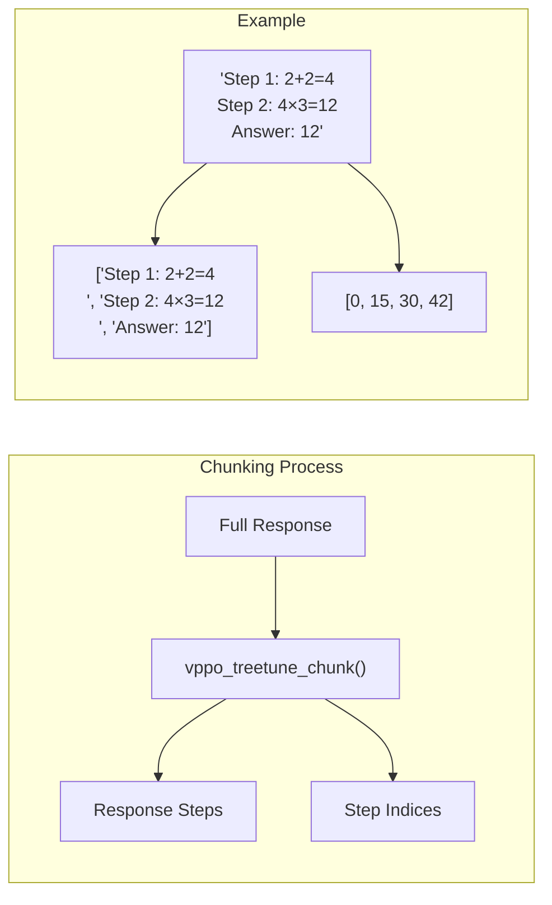
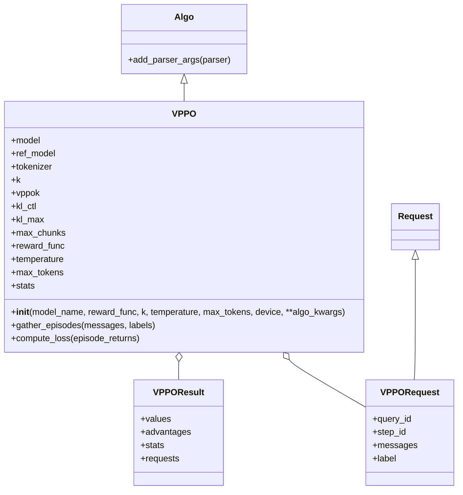
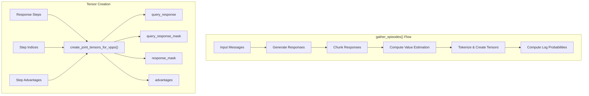
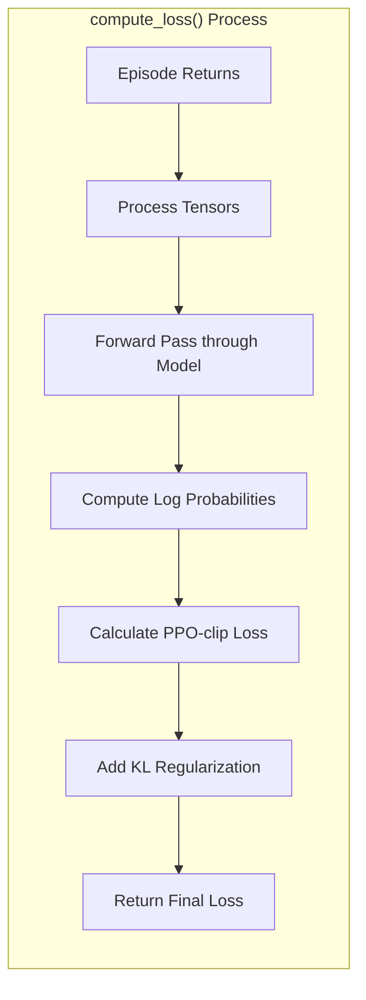
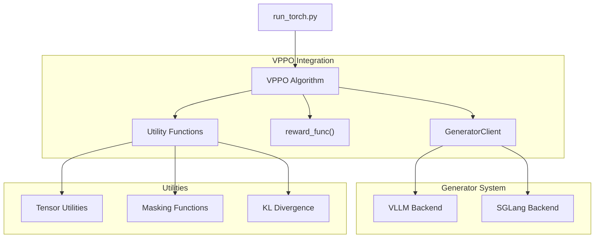
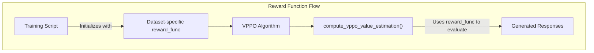

<!-- source: DeepWiki mcp.deepwiki.com · repo microsoft/nanovppo · page 3.2 VPPO (Value-Proximal Policy Optimization) · fetched 2026-10-26 -->

# VPPO (Value-Proximal Policy Optimization)

Relevant source files

The following files were used as context for generating this wiki page:

- [algos/vppo.py](algos/vppo.py)

## Purpose and Scope

This document describes the Value-Proximal Policy Optimization (VPPO) algorithm as implemented in the nanovppo repository. VPPO is a reinforcement learning approach designed for fine-tuning language models with step-wise credit assignment. This algorithm extends traditional PPO by incorporating value estimation for intermediate reasoning steps, enabling more precise reward distribution throughout a model's reasoning process. 

For information about other reinforcement learning algorithms in nanovppo, see [Reinforcement Learning Algorithms](#3) or the specific algorithm implementations: [GRPO (Gradient Ratio Policy Optimization)](#3.1) and [RFT (Reward Function Transformation)](#3.3).

Sources: [algos/vppo.py:419-657]()

## Algorithm Overview

VPPO extends traditional Proximal Policy Optimization by incorporating a value estimation approach that can assign credit to intermediate reasoning steps. This enables the model to learn which parts of its reasoning process contribute positively or negatively to the final outcome.

### Core Concepts

1. **Response Chunking**: Breaking model-generated responses into sequential reasoning steps
2. **Value Estimation**: Computing value estimates for each reasoning step
3. **Advantage Calculation**: Determining the advantage (improvement) each step provides
4. **Policy Optimization**: Training the model using PPO with KL regularization

Sources: [algos/vppo.py:419-483](), [algos/vppo.py:47-152](), [algos/vppo.py:294-416]()

## Response Chunking

A key innovation in VPPO is breaking down a model's response into meaningful reasoning steps to enable step-wise credit assignment. The implementation provides two chunking strategies:

1. **Tree-Tuning Chunking** (`vppo_treetune_chunk`): Splits solutions based on reasoning steps, with support for merging steps to control the total number of chunks
2. **Balanced Chunking** (`vppo_balanced_chunk`): A fallback method that divides responses into roughly equal-sized chunks

The chunking process creates a list of step-wise response segments and a corresponding list of character indices that mark the beginning of each chunk.

Sources: [algos/vppo.py:47-152]()

## Value Estimation and Advantage Calculation

VPPO uses Monte Carlo sampling to estimate the value of each reasoning step. This is implemented in the `compute_vppo_value_estimation` function, which:

1. For each step in each response, generates multiple completions
2. Computes rewards for these completions
3. Estimates the value of each step based on these rewards
4. Calculates advantages as the difference between consecutive step values

```mermaid
flowchart TD
    subgraph "Value Estimation Process"
        STEPS["Response Steps"] --> SAMPLE["Sample Continuations"]
        SAMPLE --> REWARD["Compute Rewards"]
        REWARD --> VALUE["Estimate Step Values"]
        VALUE --> ADV["Calculate Advantages"]
    end

    subgraph "Implementation"
        VPPO_RESULT["compute_vppo_value_estimation()"] --> REQUESTS["Generate Requests"]
        REQUESTS --> GEN_CLIENT["GeneratorClient.get().chat()"]
        GEN_CLIENT --> COMPUTE_REWARD["reward_func()"]
        COMPUTE_REWARD --> CALCULATE["Calculate Values & Advantages"]
    end
```

Sources: [algos/vppo.py:294-416]()

## Implementation Details

### Class Structure

The VPPO algorithm is implemented as a class that inherits from the base `Algo` class, with additional helper classes and functions:

- `VPPO`: Main algorithm implementation
- `VPPORequest`: Dataclass representing requests for value estimation
- `VPPOResult`: Dataclass storing value estimation results

Sources: [algos/vppo.py:281-288](), [algos/vppo.py:289-292](), [algos/vppo.py:419-483]()

### Configuration Parameters

The VPPO algorithm can be configured with several parameters that control its behavior:

| Parameter | Default | Description |
|-----------|---------|-------------|
| `kl_ctl` | 0.0001 | Control coefficient for KL divergence term |
| `kl_max` | 10 | Maximum value to clip KL divergence |
| `vppok` | 3 | Number of samples for VPPO value estimation |
| `max_chunks` | 32 | Maximum number of chunks to use for VPPO response splitting |
| `k` | 5 | Number of responses to generate for each prompt |
| `temperature` | DEFAULT_TEMP | Temperature for sampling |
| `max_tokens` | DEFAULT_MAX_TOKENS | Maximum tokens to generate |

Sources: [algos/vppo.py:422-437](), [algos/vppo.py:440-476]()

## Training Process

### Episode Gathering

The `gather_episodes` method generates episodes for training:

1. Generates responses for the given messages
2. Chunks the responses into reasoning steps
3. Computes value estimates and advantages for each step
4. Tokenizes inputs and creates tensors for training
5. Computes log probabilities under both policy and reference models

Sources: [algos/vppo.py:484-583]()

### Loss Computation

The `compute_loss` method calculates the loss for training:

1. Processes the episode data (input tensors, masks, advantages, log probabilities)
2. Computes new log probabilities under the current policy
3. Calculates the PPO-clip loss
4. Adds KL divergence regularization
5. Returns the final loss for optimization

Sources: [algos/vppo.py:585-657]()

## Integration with Other System Components

VPPO integrates with several other components of the nanovppo system:

Sources: [algos/vppo.py:346-352](), [algos/vppo.py:492-498]()

### Tensor Processing and Masking

VPPO relies heavily on tensor processing and masking operations to handle variable-length sequences and properly compute losses on the response tokens only. Key utility functions used include:

- `create_joint_tensors_for_vppo`: Creates tensors by mapping character-level advantages to token-level advantages
- `masked_mean` and `masked_whiten`: Apply operations only to masked (relevant) portions of tensors
- `get_logprobs` and `get_shifted_logprobs`: Compute log probabilities for autoregressive language models

Sources: [algos/vppo.py:183-278](), [algos/vppo.py:554-574](), [algos/vppo.py:623-628]()

### Reward Function Integration

VPPO receives a reward function as a parameter during initialization and uses it to evaluate the quality of generated responses. This function is usually dataset-specific and is passed from the training script.

Sources: [algos/vppo.py:366-366](), [algos/vppo.py:474-474]()

---

