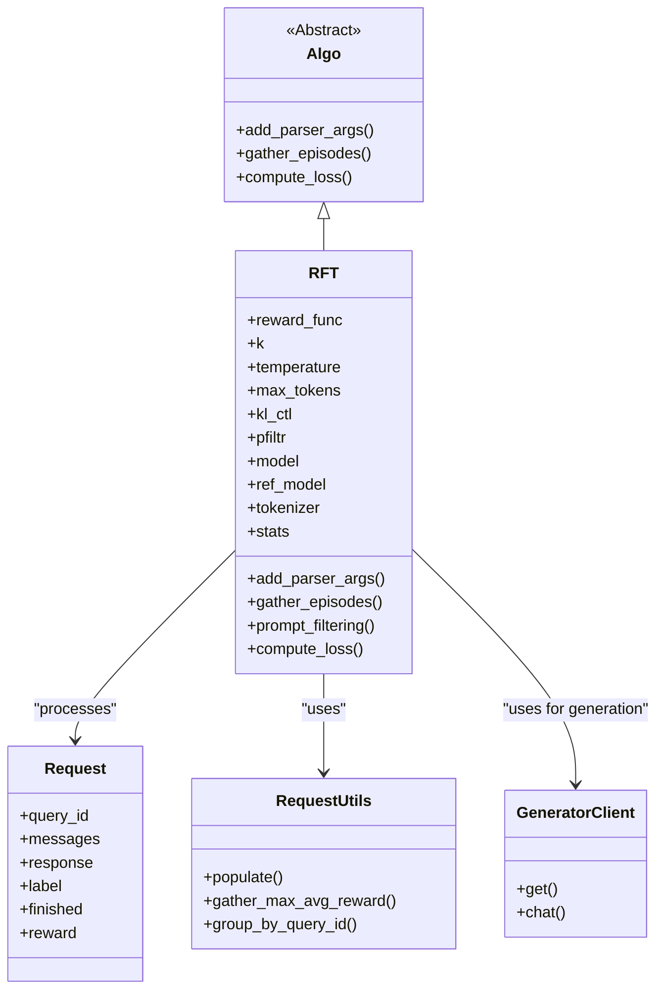
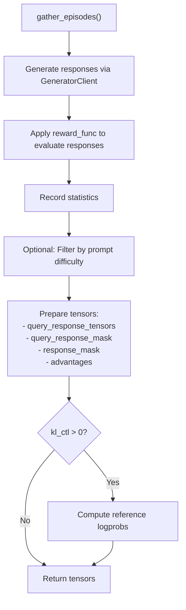
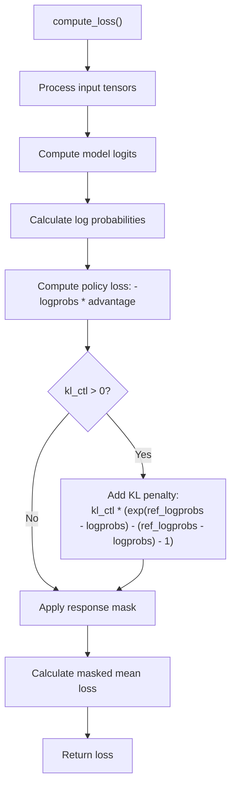
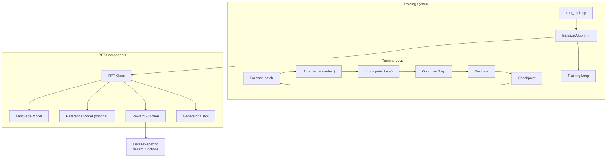

<!-- source: DeepWiki mcp.deepwiki.com · repo microsoft/nanovppo · page 3.3 RFT (Reward Function Transformation) · fetched 2026-10-26 -->

# RFT (Reward Function Transformation)

<details>
<summary>Relevant source files</summary>

The following files were used as context for generating this wiki page:

- [algos/rft.py](algos/rft.py)

</details>


## Purpose and Scope

This document provides a comprehensive overview of the Reward Function Transformation (RFT) algorithm as implemented in the nanovppo repository. RFT is one of the three core reinforcement learning algorithms in the codebase, alongside GRPO [Gradient Ratio Policy Optimization](#3.1) and VPPO [Value-Proximal Policy Optimization](#3.2). 

RFT focuses on transforming a language model's policy by directly optimizing it against a reward function. Unlike VPPO, it doesn't use a separate value function, and unlike GRPO, it applies rewards directly as advantage values for optimization.

Sources: [algos/rft.py:27-269]()

## Algorithm Overview

RFT works by generating multiple samples from a language model for each input prompt, evaluating these samples using a reward function, and then using the resulting rewards to adjust the model's parameters. The algorithm supports optional KL divergence control to prevent the policy from deviating too far from a reference policy, as well as prompt filtering to focus training on examples of appropriate difficulty.

```mermaid
flowchart TD
    subgraph "RFT Algorithm Workflow"
        START["Initialize RFT"] --> CONFIG["Configure Parameters"]
        CONFIG --> EPISODES["Gather Episodes"]
        
        subgraph "Gather Episodes Process"
            GEN["Generate k responses per prompt"] --> REWARD["Compute rewards"]
            REWARD --> FILTER["Optional: Filter prompts by difficulty"]
            FILTER --> PREPARE["Prepare tensors for optimization"]
        end
        
        EPISODES --> GEN
        PREPARE --> COMPUTE["Compute Loss"]
        
        subgraph "Loss Computation"
            LOG["Calculate log probabilities"] --> PLOSS["Compute policy loss"]
            PLOSS --> KL["Optional: Add KL penalty"]
        end
        
        COMPUTE --> LOG
        KL --> UPDATE["Update Model Parameters"]
        UPDATE --> NEXT["Next Iteration"]
    end
```



Sources: [algos/rft.py:27-45](), [algos/rft.py:79-196](), [algos/rft.py:213-269]()

## Key Components

RFT is implemented as a class that inherits from the base `Algo` class and consists of the following key components:



Sources: [algos/rft.py:27-69](), [algos/rft.py:24-25]()

## Configuration Parameters

RFT accepts the following key parameters during initialization:

| Parameter | Type | Default | Description |
|-----------|------|---------|-------------|
| `model_name` | string | required | Name or path of the model to fine-tune |
| `reward_func` | function | required | Function to evaluate responses and compute rewards |
| `k` | int | 5 | Number of responses to generate per prompt |
| `temperature` | float | DEFAULT_TEMP | Sampling temperature for text generation |
| `max_tokens` | int | DEFAULT_MAX_TOKENS | Maximum tokens to generate per response |
| `kl_ctl` | float | 0.0 | KL penalty coefficient to control divergence from reference policy |
| `pfiltr` | bool | False | Whether to filter prompts that are too easy or too hard |

Sources: [algos/rft.py:43-63](), [algos/rft.py:28-41]()

## Episode Gathering Process

The `gather_episodes` method implements the core data collection process:

1. Generate `k` responses for each input prompt using the `GeneratorClient`
2. Compute rewards for each response using the provided reward function
3. Optionally filter prompts based on difficulty (if `pfiltr=True`)
4. Create tensors for query-response pairs, masks, and advantages
5. If KL control is enabled, compute reference log probabilities



Sources: [algos/rft.py:79-196]()

## Prompt Filtering

When `pfiltr=True`, RFT filters out prompts that are either too easy or too difficult, keeping only those with average rewards between 0.2 and 0.8. This focuses training on the most useful examples.

```python
def prompt_filtering(self, evaluation_requests: List[Request]) -> List[Request]:
    """Filter prompts that are either too difficult or too easy (0.2 < r < 0.8)."""
    rewards_by_query_id = RequestUtils.group_by_query_id(
        evaluation_requests, "reward"
    )
    filtered_query_ids = [
        query_id
        for query_id, rewards in rewards_by_query_id.items()
        if 0.2 <= np.mean(rewards) <= 0.8
    ]
    evaluation_requests = [
        req for req in evaluation_requests if req.query_id in filtered_query_ids
    ]
    return evaluation_requests
```

Sources: [algos/rft.py:198-211]()

## Loss Computation

The `compute_loss` method calculates the loss function for optimization:

1. Process input tensors and compute log probabilities for responses
2. Calculate policy loss by multiplying negative log probabilities with advantages
3. If KL control is enabled (`kl_ctl > 0`), add KL divergence penalty
4. Return the masked mean loss



Sources: [algos/rft.py:213-269]()

## Integration with Training System

RFT integrates with the nanovppo training system as follows:



Sources: [algos/rft.py:27-45](), [algos/rft.py:79-121]()

## KL Divergence Control

When `kl_ctl` is greater than zero, RFT maintains a reference model (initialized with the same weights as the policy model) to compute KL divergence. This prevents the policy from diverging too far from the initial distribution, which can help maintain output quality and training stability.

The KL divergence penalty is computed as:
```
per_token_kl = torch.exp(mb_ref_logprobs - mb_logprobs) - (mb_ref_logprobs - mb_logprobs) - 1
```

And added to the loss:
```
per_token_loss = per_token_loss + self.kl_ctl * per_token_kl
```

Sources: [algos/rft.py:58-74](), [algos/rft.py:247-261]()

## Usage Example

To use RFT, you would typically:

1. Define a reward function that evaluates model outputs
2. Initialize the RFT algorithm with appropriate parameters
3. Set up a training loop that calls `gather_episodes` and `compute_loss`
4. Update the model using the computed loss

This would generally be configured through one of the training scripts in the repository, which passes appropriate parameters to `run_torch.py`.

Sources: [algos/rft.py:27-45](), [algos/rft.py:79-121]()

---

