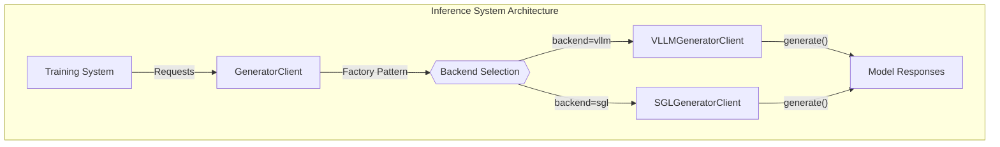
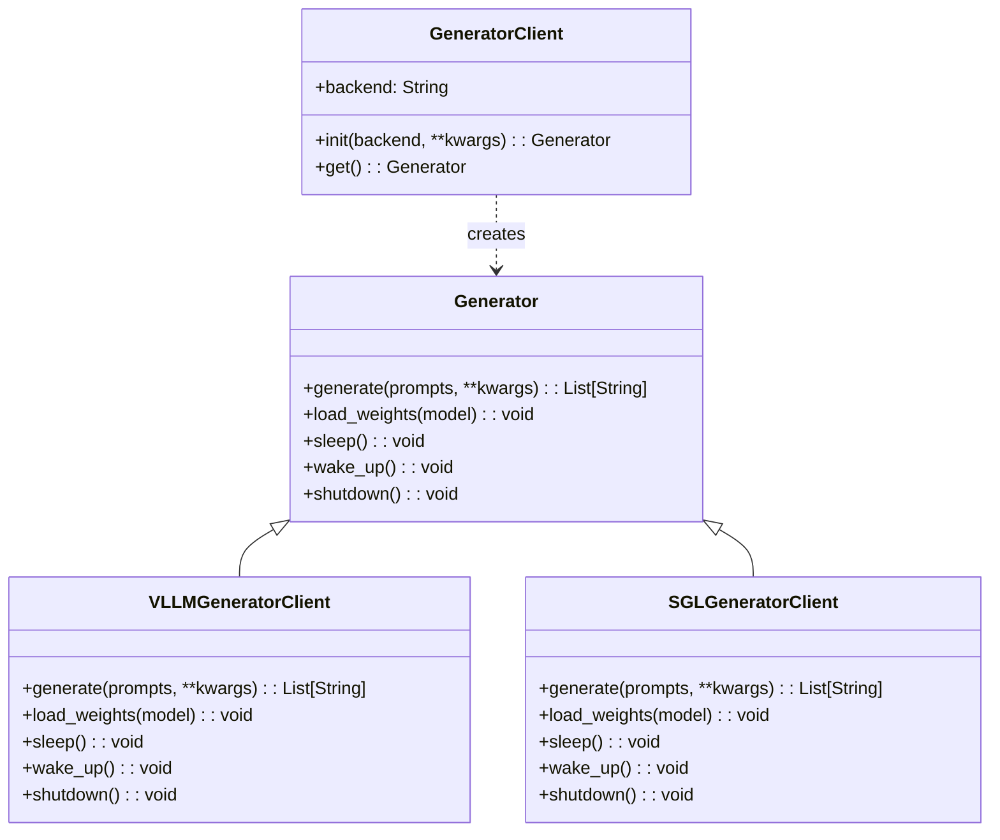
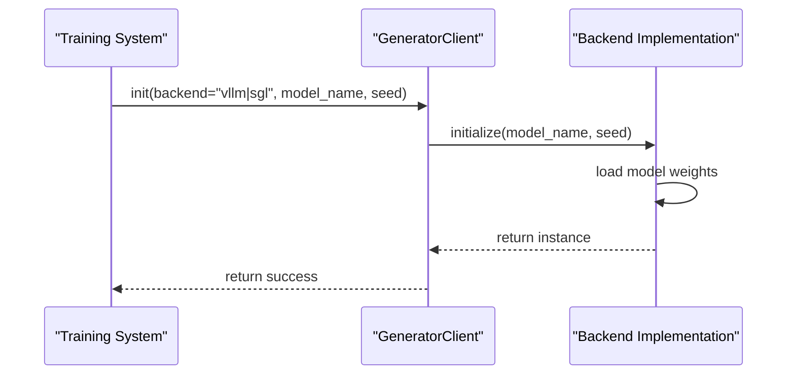
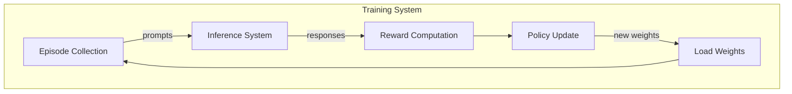
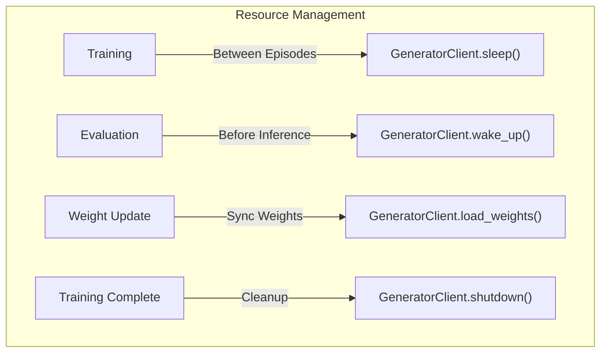

<!-- source: DeepWiki mcp.deepwiki.com · repo microsoft/nanovppo · page 4 Inference System · fetched 2026-10-26 -->

# Inference System

<details>
<summary>Relevant source files</summary>

The following files were used as context for generating this wiki page:

- [gen_utils.py](gen_utils.py)
- [run_torch.py](run_torch.py)

</details>


The Inference System in nanovppo provides efficient language model inference capabilities for generating responses during training and evaluation. This system abstracts away the specific backend implementation details, offering a unified interface for model inference while supporting different inference engines.

For information about the specific backends, see [VLLM Backend](#4.1) and [SGLang Backend](#4.2).

## Architecture Overview

The Inference System is built around a factory pattern that enables swapping different inference backends without changing the higher-level training code.



Sources: [gen_utils.py:2-27](), [run_torch.py:94-96]()

## Core Components

### GeneratorClient

The `GeneratorClient` class acts as a factory that manages the creation and access to specific backend implementations. It provides a unified interface for the training system to interact with different inference backends.



Sources: [gen_utils.py:2-27]()

The `GeneratorClient` provides the following key methods:

1. **init**: Initializes the selected backend with configuration parameters
2. **get**: Returns the singleton instance of the current backend

## Backend Selection and Initialization

The Inference System supports two backends:

1. **VLLM**: Optimized for large-scale deployment of language models with efficient memory management
2. **SGLang**: Provides structured generation capabilities with additional control mechanisms

Backend selection occurs during training initialization:



Sources: [run_torch.py:94-96](), [gen_utils.py:6-15]()

## Integration with Training Loop

The Inference System is tightly integrated with the training loop. It is used to:

1. Generate responses for prompts during episode collection
2. Evaluate model performance on test datasets
3. Periodically synchronize model weights between training and inference



Sources: [run_torch.py:304-307](), [run_torch.py:392-397](), [run_torch.py:455]()

## Inference Workflow

During training, the workflow for using the Inference System follows this pattern:

1. **Initialization**: Set up the backend at the beginning of training
   ```python
   generator = GeneratorClient.init(backend=args.b, model_name=models[args.m], seed=args.s)
   ```

2. **Episode Collection**: Generate responses for prompts during episode collection
   ```python
   episode_data = algo.gather_episodes(part_queries, part_labels)
   GeneratorClient.get().sleep()  # Optional: sleep to conserve resources
   ```

3. **Evaluation**: Generate responses for test examples during evaluation
   ```python
   GeneratorClient.get().wake_up()  # Wake up before evaluation
   acc_math = np.mean(eval_dataset(test_queries, test_labels, temperature=0.35, top_p=0.9))
   ```

4. **Model Weight Synchronization**: Update inference model with latest training weights
   ```python
   GeneratorClient.get().load_weights(algo.model)
   ```

5. **Shutdown**: Clean up resources when training completes
   ```python
   GeneratorClient.get().shutdown()
   ```

Sources: [run_torch.py:94-96](), [run_torch.py:304-307](), [run_torch.py:390-397](), [run_torch.py:455](), [run_torch.py:460]()

## Configuration Parameters

The Inference System can be configured through command line arguments in the main training script:

| Parameter | Description | Default |
|-----------|-------------|---------|
| `-b` | Backend to use (`vllm` or `sgl`) | `vllm` |
| `-m` | Model name to load | - |
| `-k` | Number of samples to generate | 5 |
| `-t` | Temperature for sampling | 0.8 |
| `--maxtok` | Maximum number of tokens to generate | 512 |
| `--tpsz` | Tensor parallel size for VLLM | 1 |

Sources: [run_torch.py:516-519](), [run_torch.py:525-526]()

## Special Backend Features

Both backends implement optional methods that optimize resource usage:

- **sleep/wake_up**: Allow the inference server to conserve resources when not actively generating
- **load_weights**: Synchronize model weights between training and inference
- **shutdown**: Clean up resources when training completes



Sources: [run_torch.py:307](), [run_torch.py:390](), [run_torch.py:455](), [run_torch.py:460]()

## Limitations and Considerations

- VLLM backend does not support distributed training:
  ```python
  if world_size > 1 and final_args.b == 'vllm':
      raise ValueError("VLLM backend does not support distributed training.")
  ```

Sources: [run_torch.py:551-552]()

## Typical Usage Patterns

The Inference System is used in several key places within the training loop:

1. **Episode Collection**: Generating model responses for reinforcement learning
2. **Evaluation**: Measuring model performance on test datasets
3. **Weight Synchronization**: Ensuring inference model has latest parameters

This modular design allows the system to efficiently support different backends while providing a consistent interface for the training system to use.

Sources: [run_torch.py:304-307](), [run_torch.py:390-397](), [run_torch.py:455]()

---

