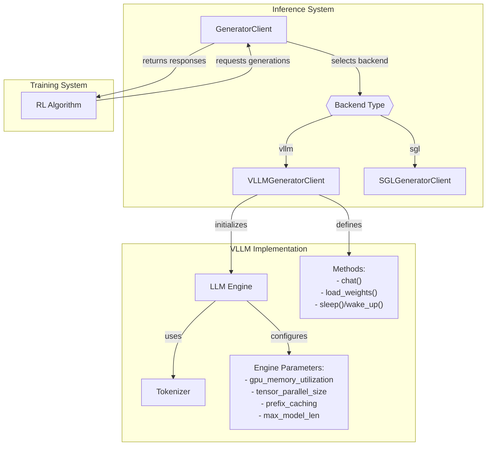
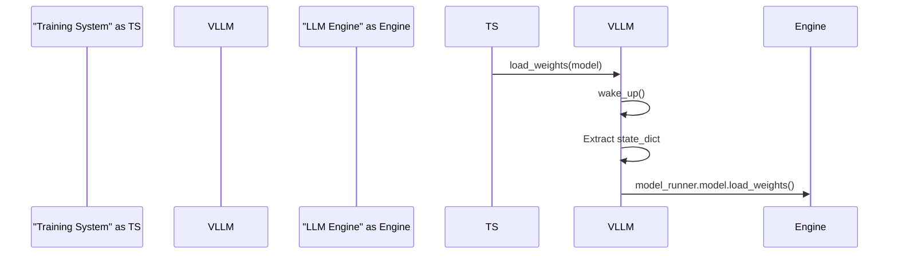
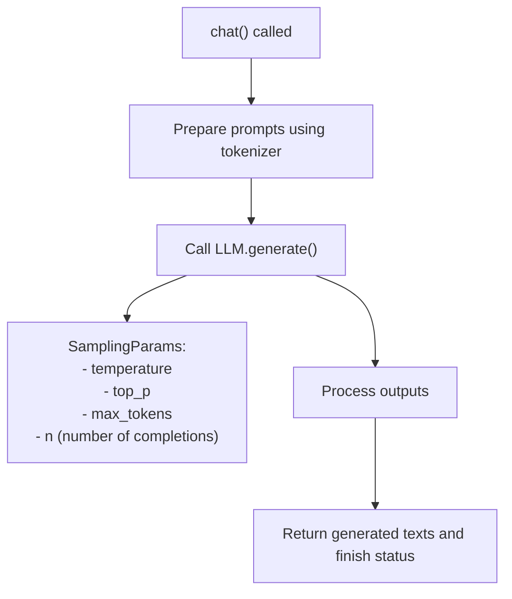
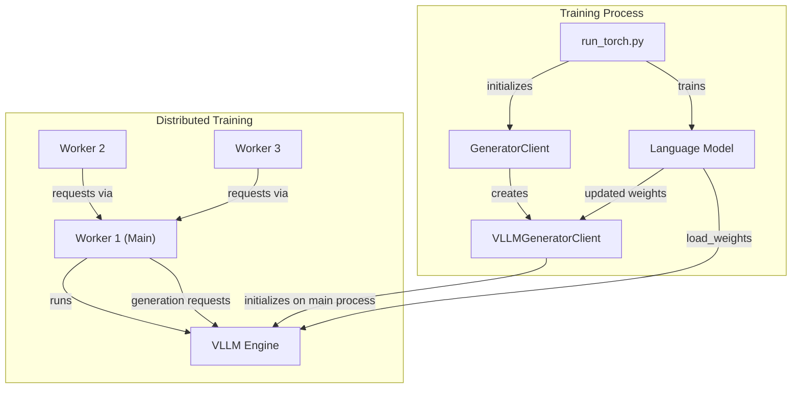

<!-- source: DeepWiki mcp.deepwiki.com · repo microsoft/nanovppo · page 4.1 VLLM Backend · fetched 2026-10-26 -->

# VLLM Backend

<details>
<summary>Relevant source files</summary>

The following files were used as context for generating this wiki page:

- [vllm_utils.py](vllm_utils.py)

</details>


## Purpose and Scope

This document describes the VLLM (Very Large Language Model) Backend implementation in nanovppo, which provides efficient model serving for large language model inference. The VLLM Backend is one of the inference backend options available in the system, focused on optimizing the generation throughput with techniques like continuous batching and tensor parallelism. For information about the alternative SGLang Backend, see [SGLang Backend](#4.2).

## Architecture Overview

The VLLM Backend fits into the nanovppo inference system as one of the available backends for serving language model requests during training and evaluation.



Sources: [vllm_utils.py:25-123]()

## Implementation Details

The VLLM Backend is implemented as the `VLLMGeneratorClient` class in `vllm_utils.py`. It follows a singleton pattern to ensure only one instance is active.

```mermaid
classDiagram
    class "VLLMGeneratorClient" {
        -_instance: VLLMGeneratorClient
        -model_name: str
        -seed: int
        -tokenizer: AutoTokenizer
        -llm: LLM
        +__init__(model_name, seed)
        +shutdown()
        +start()
        +sleep()
        +wake_up()
        +get()
        +load_weights(model)
        +chat(messages, temperature, top_p, max_tokens, n, return_finished)
    }
```

Sources: [vllm_utils.py:25-35]()

### Initialization

The `VLLMGeneratorClient` is initialized with a model name and seed. The initialization process:

1. Loads the tokenizer for the specified model
2. Calls the `start()` method decorated with `@ddp_state.on_main_process` to ensure it runs only on the main process
3. Creates a VLLM LLM instance with specific configuration parameters

Key configuration parameters include:

| Parameter | Default Value | Purpose |
|-----------|---------------|---------|
| gpu_memory_utilization | 0.2 | Controls GPU memory usage |
| tensor_parallel_size | 1 | Number of GPUs for tensor parallelism |
| enable_prefix_caching | True | Enables caching of prefixes for efficiency |
| max_model_len | 15616 | Maximum sequence length |
| swap_space | 1 | Memory swapping configuration |
| scheduling_policy | "fcfs" | First-Come-First-Served scheduling |
| dtype | torch.bfloat16 | Tensor data type |
| enable_sleep_mode | True | Enables sleep mode for efficiency |

Sources: [vllm_utils.py:28-51]()

### Power Management

The backend includes methods to manage power consumption:

- `sleep()`: Puts the LLM engine into sleep mode
- `wake_up()`: Reactivates the LLM engine

This functionality helps optimize resource usage during training when inference is not needed.

Sources: [vllm_utils.py:53-57]()

### Weight Management

The `load_weights` method allows updating the model weights during training:



This method:
1. Wakes up the LLM engine if it's in sleep mode
2. Extracts the state dictionary from the model
3. Loads the weights directly into the VLLM engine's model

The method is decorated with `@ddp_state.on_main_process` to ensure it only runs on the main process in distributed training.

Sources: [vllm_utils.py:64-75]()

### Text Generation

The `chat` method handles text generation requests:



This method:
1. Formats the input messages using the tokenizer's chat template
2. Creates appropriate prompts with or without generation prompts based on message roles
3. Calls the VLLM engine's generate method with specified sampling parameters
4. Processes the outputs and returns the generated texts

The method can optionally return information about whether generation completed normally or was stopped for other reasons (like reaching token limits).

Sources: [vllm_utils.py:77-122]()

## Integration with Training System

The VLLM Backend integrates with the training system through its singleton pattern and distributed training awareness.



Key aspects of integration:
- The backend initializes only on the main process using `@ddp_state.on_main_process` decorator
- All workers access the same backend instance through the singleton pattern
- Weight updates are synchronized across all workers

Sources: [vllm_utils.py:38-39](), [vllm_utils.py:64](), [vllm_utils.py:59-62]()

## Performance Considerations

The VLLM Backend is designed for efficient language model serving during training. Key performance optimizations include:

| Feature | Implementation | Benefit |
|---------|---------------|---------|
| Prefix Caching | `enable_prefix_caching=True` | Reduces redundant computation for shared prompt prefixes |
| Sleep Mode | `enable_sleep_mode=True` with `sleep()`/`wake_up()` | Reduces power consumption when not actively generating |
| BFloat16 Precision | `dtype=torch.bfloat16` | Balances performance and numerical stability |
| Memory Utilization | `gpu_memory_utilization=0.2` | Controls GPU memory usage for stable operation |
| Maximum Sequence Length | `max_model_len=15616` | Configured for longer reasoning chains |

The VLLM Backend is particularly suited for reinforcement learning scenarios where:
1. Multiple model versions need to be evaluated in the same session
2. Generation latency affects training throughput
3. Memory efficiency is important for running alongside training processes

Sources: [vllm_utils.py:40-51](), [vllm_utils.py:53-57]()

## Usage Example

To use the VLLM Backend with the nanovppo training system:

1. The backend is selected through the `GeneratorClient` factory
2. Once initialized, the singleton instance can be accessed via `VLLMGeneratorClient.get()`
3. Model weights are updated via `load_weights()` during training
4. Text generation is performed via the `chat()` method

The typical interaction flow with the VLLM Backend during training involves:
1. Initializing the backend once at the start of training
2. Updating weights after each optimization step
3. Generating responses for evaluation or reward computation
4. Optionally putting the engine to sleep during optimization phases

Sources: [vllm_utils.py:59-62](), [vllm_utils.py:64-75](), [vllm_utils.py:77-122]()

---

