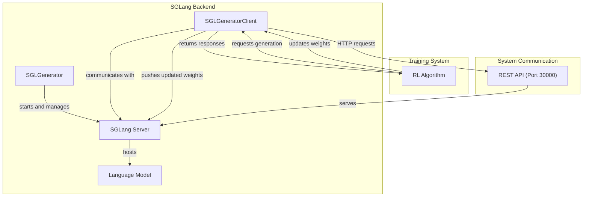
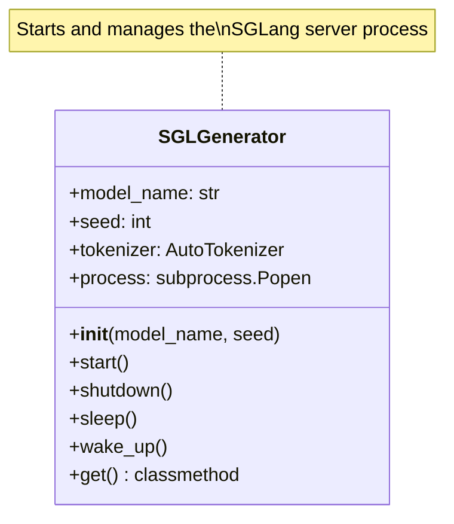
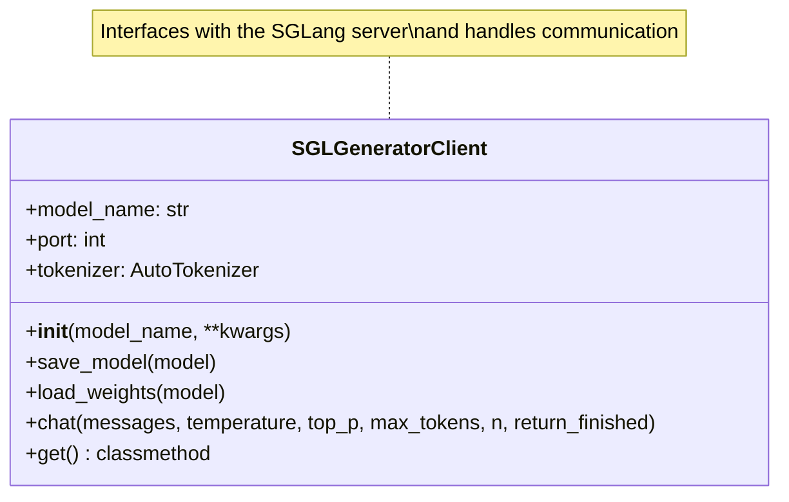
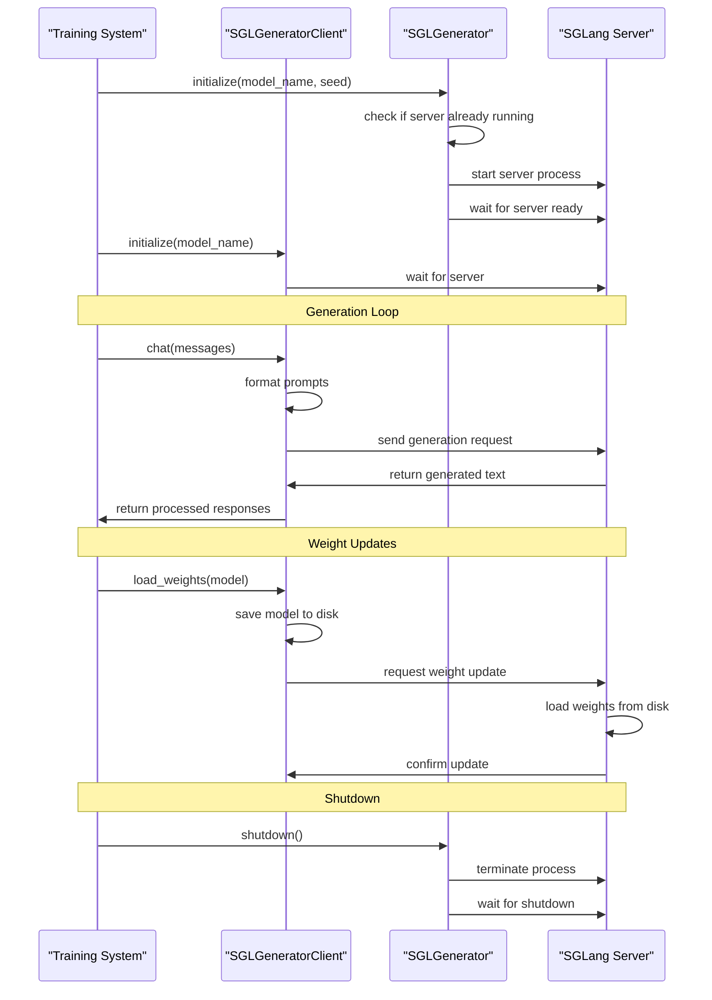
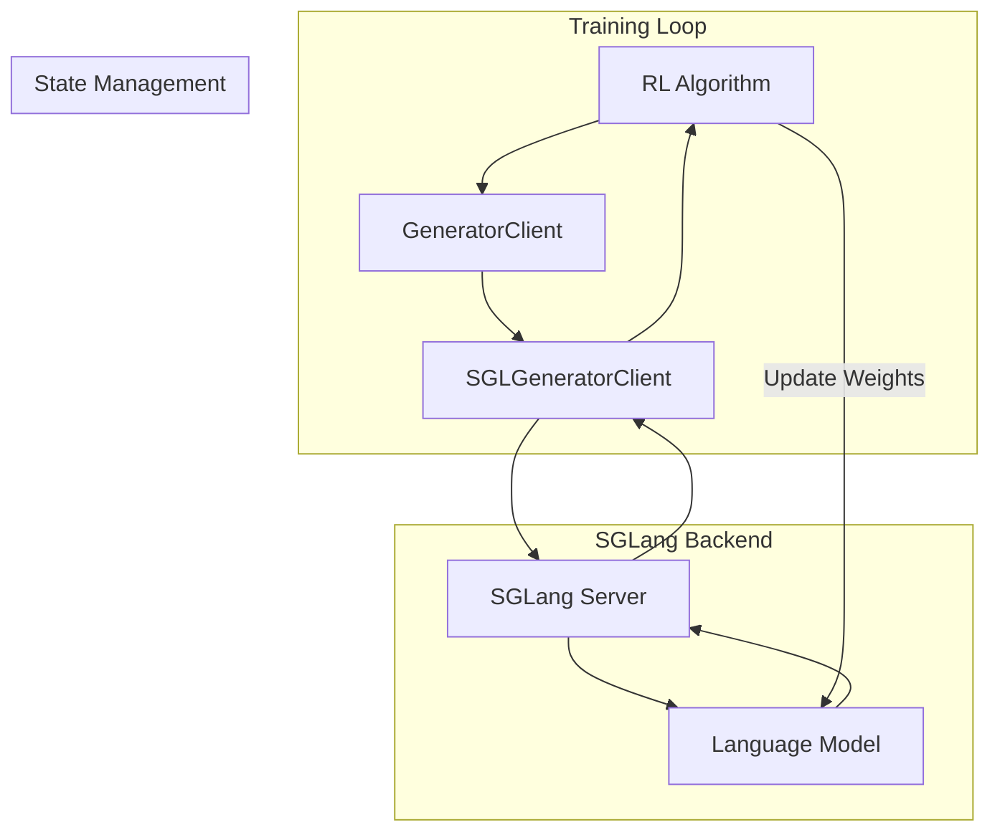

<!-- source: DeepWiki mcp.deepwiki.com · repo microsoft/nanovppo · page 4.2 SGLang Backend · fetched 2026-10-26 -->

# SGLang Backend

Relevant source files

The following files were used as context for generating this wiki page:

- [sgl_utils.py](sgl_utils.py)

## Purpose and Scope

This document details the SGLang Backend implementation within the nanovppo codebase. The SGLang Backend provides an efficient text generation service for language model inference during reinforcement learning training. It serves as an alternative to the VLLM Backend (for information about VLLM Backend, see [VLLM Backend](#4.1)) within the Inference System architecture.

Sources: [sgl_utils.py:1-273]()

## Architecture Overview

The SGLang Backend consists of two main components: a server process that hosts the language model and provides a REST API for generation requests, and a client component that interfaces with the training system.

Sources: [sgl_utils.py:82-151](), [sgl_utils.py:153-248]()

## Key Components

### SGLGenerator

The `SGLGenerator` class manages the SGLang server process. It handles starting the server, maintaining its lifecycle, and shutting it down when needed.

Key features:
- Implements the Singleton pattern to ensure only one server instance exists
- Executes the SGLang server as a subprocess with specific configuration
- Manages GPU allocation through environment variables

Sources: [sgl_utils.py:82-151]()

### SGLGeneratorClient

The `SGLGeneratorClient` class provides the interface between the training system and the SGLang server. It handles sending requests, formatting prompts, and processing responses.

Key features:
- Formats chat messages using the model's tokenizer
- Communicates with the server via HTTP requests
- Manages model weight updates between training iterations
- Provides a clean interface for generation requests

Sources: [sgl_utils.py:153-248]()

## Server Management and Communication

### Server Lifecycle

The SGLang Backend carefully manages the server lifecycle to ensure proper resource allocation and cleanup:

1. Server initialization checks if an existing server is running
2. The server process is started with cleaned environment variables
3. The client waits for the server to be ready before accepting requests
4. When done, the server process is properly terminated

Sources: [sgl_utils.py:23-43](), [sgl_utils.py:46-63](), [sgl_utils.py:66-79](), [sgl_utils.py:109-114](), [sgl_utils.py:115-151]()

### HTTP Communication

The client-server communication happens via HTTP endpoints:

| Endpoint | Purpose | Method |
|----------|---------|--------|
| `/v1/models` | Check if server is running | GET |
| `/generate` | Generate text from prompt | POST |
| `/update_weights_from_disk` | Update model weights | POST |

Sources: [sgl_utils.py:23-43](), [sgl_utils.py:184-195](), [sgl_utils.py:251-272]()

## Text Generation Process

When the training system requests text generation, the following process occurs:

1. The training algorithm calls `chat()` with messages and generation parameters
2. Messages are formatted using the tokenizer's chat template
3. Formatted prompts are sent to the server via HTTP
4. Responses are processed in parallel using a ThreadPoolExecutor
5. Generated text and completion status are returned to the caller

```mermaid
flowchart LR
    subgraph "Input Processing"
        IN["Input Messages"] --> FMT["Format with Tokenizer"]
        FMT --> REP["Repeat for n Samples"]
    end
    
    subgraph "Parallel Processing"
        REP --> THREAD["ThreadPoolExecutor"]
        THREAD --> REQ["send_request Function"]
    end
    
    subgraph "Server Communication"
        REQ --> HTTP["HTTP POST to /generate"]
        HTTP --> SVR["SGLang Server"]
        SVR --> RESP["JSON Response"]
    end
    
    subgraph "Result Processing"
        RESP --> EXT["Extract Text & Status"]
        EXT --> PACK["Pack Results"]
        PACK --> OUT["Return Outputs"]
    end
```

Sources: [sgl_utils.py:197-248](), [sgl_utils.py:251-272]()

## Weight Management

A critical feature of the SGLang Backend is its ability to update model weights during training:

1. The current model state is saved to a shared memory location (`/dev/shm/saved_model`)
2. The server is instructed to load weights from this location
3. This operation happens only on the main process in distributed training setups

This allows the training loop to continuously update the model parameters while maintaining efficient inference capabilities.

Sources: [sgl_utils.py:170-177](), [sgl_utils.py:183-195]()

## Configuration

The SGLang Backend can be configured through environment variables and initialization parameters:

| Parameter/Variable | Purpose | Default |
|--------------------|---------|---------|
| `SGL_BASE_GPU_ID` | Starting GPU index for inference | 1 |
| `SGL_DP_SIZE` | Number of GPUs for data parallelism | 1 |
| `model_name` | Path to pretrained model | Required |
| `seed` | Random seed for reproducibility | Required |
| `temperature` | Sampling temperature | 0.0 (Default) |
| `top_p` | Top-p sampling parameter | 1.0 |
| `max_tokens` | Maximum tokens to generate | 2048 (Default) |

Sources: [sgl_utils.py:82-85](), [sgl_utils.py:136-145](), [sgl_utils.py:197-205]()

## Distributed Training Support

The SGLang Backend is designed to work with distributed training setups:

1. Server management operations use the `@ddp_state.on_main_process` decorator to ensure they only run on the main process
2. Environment variables related to distributed training are carefully cleaned before starting the server
3. Weight updates occur on the main process and are synchronized with all workers

This design prevents conflicts in distributed training environments while maintaining efficient communication.

Sources: [sgl_utils.py:115-151](), [sgl_utils.py:123-134](), [sgl_utils.py:170-177](), [sgl_utils.py:183-195]()

## Integration with Training System

Within the nanovppo system, the SGLang Backend is used by reinforcement learning algorithms to generate model outputs during training. The backend provides an efficient way to run inference on language models while allowing the training loop to update model weights as learning progresses.

Sources: [sgl_utils.py:153-248]()

## Performance Considerations

The SGLang Backend includes several features designed for performance optimization:

1. Parallel request processing using a ThreadPoolExecutor
2. Memory-efficient weight updates using shared memory
3. Configurable GPU allocation for distributed inference
4. Server process management to ensure clean startup and shutdown

These optimizations allow for efficient text generation during the training process, which is critical for reinforcement learning algorithms that require many model evaluations.

Sources: [sgl_utils.py:82-85](), [sgl_utils.py:136-145](), [sgl_utils.py:222-234]()

---

