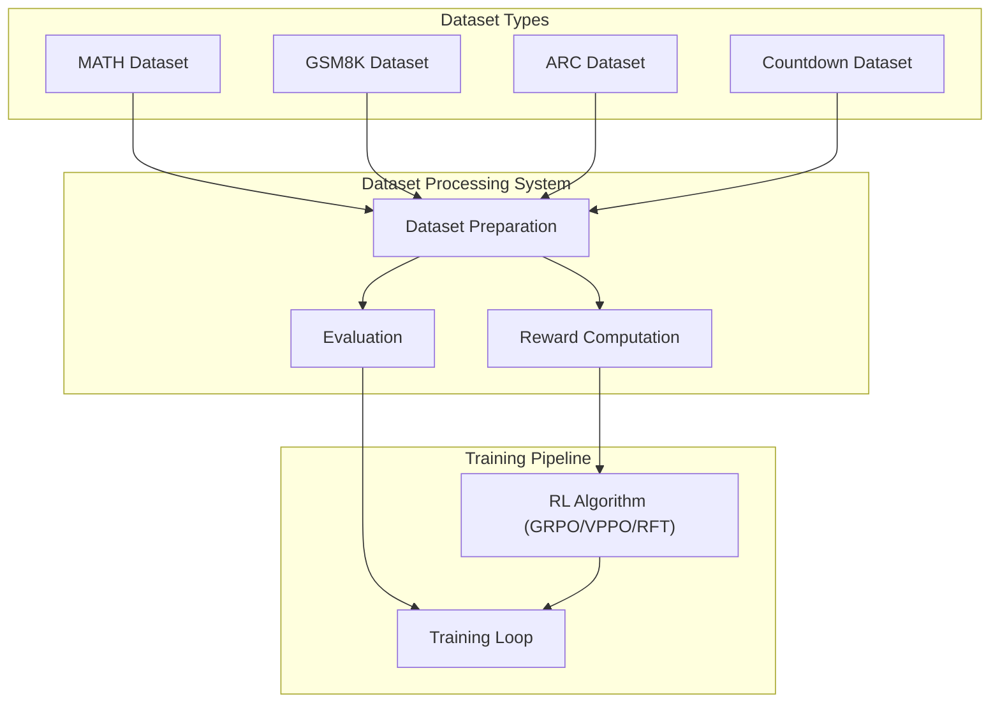
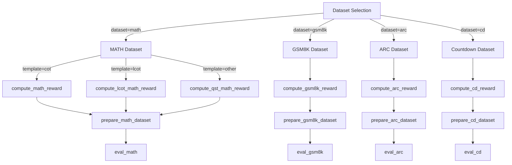
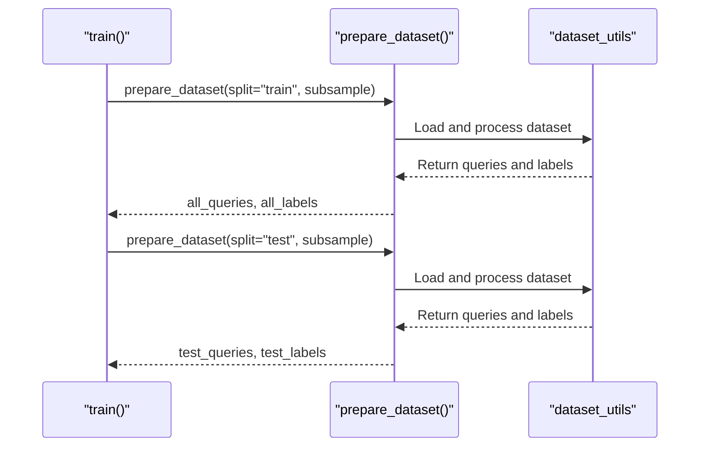
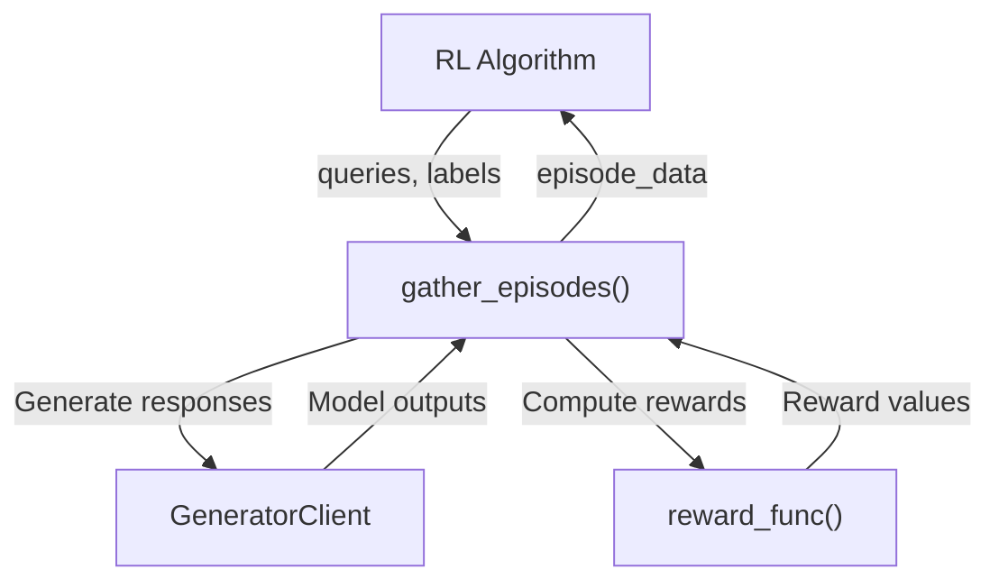
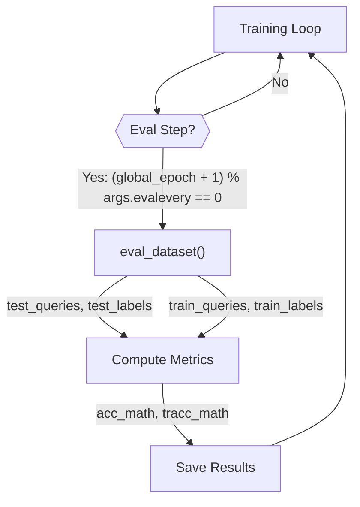
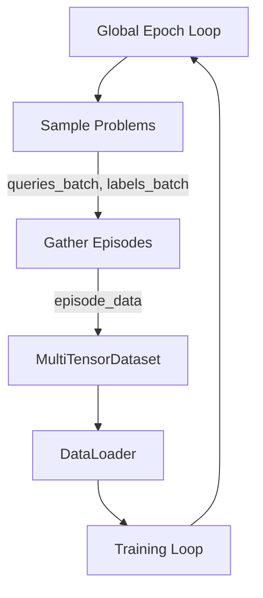
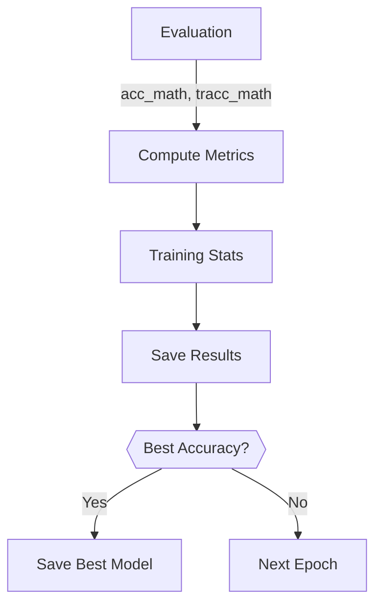

<!-- source: DeepWiki mcp.deepwiki.com · repo microsoft/nanovppo · page 5 Datasets and Evaluation · fetched 2026-10-26 -->

# Datasets and Evaluation

Relevant source files

The following files were used as context for generating this wiki page:

- [README.md](README.md)
- [algos/__init__.py](algos/__init__.py)
- [run_torch.py](run_torch.py)

This document describes the datasets and evaluation mechanisms used in the nanovppo codebase. It covers the supported datasets, how they are processed, reward computation methods, and evaluation metrics for reinforcement learning algorithms. For information about specific reinforcement learning algorithms, see [Reinforcement Learning Algorithms](#3).

## Overview of Dataset and Evaluation System

The nanovppo codebase supports multiple datasets for training and evaluating language models on reasoning tasks. Each dataset follows a standard interface with three key components:

1. **Dataset Preparation**: Functions to prepare and format the dataset for training
2. **Reward Computation**: Functions to compute rewards for reinforcement learning
3. **Evaluation**: Functions to evaluate model performance on the dataset

### Dataset and Evaluation Architecture

Sources: [run_torch.py:20-30](), [run_torch.py:107-130]()

## Supported Datasets

The nanovppo framework supports the following datasets for training and evaluating language models:

| Dataset | Description | Preparation Function | Reward Function | Evaluation Function |
|---------|-------------|----------------------|-----------------|---------------------|
| MATH | Mathematical problem-solving dataset | `prepare_math_dataset` | `compute_math_reward`, `compute_lcot_math_reward`, `compute_qst_math_reward` | `eval_math` |
| GSM8K | Grade School Math problems | `prepare_gsm8k_dataset` | `compute_gsm8k_reward` | `eval_gsm8k` |
| ARC | AI2 Reasoning Challenge | `prepare_arc_dataset` | `compute_arc_reward` | `eval_arc` |
| Countdown | Sequential reasoning task | `prepare_cd_dataset` | `compute_cd_reward` | `eval_cd` |

Sources: [run_torch.py:21-30](), [run_torch.py:108-130]()

### Dataset Selection and Processing Flow

Sources: [run_torch.py:107-130]()

## Dataset Integration with Training

The dataset utilities are integrated into the training process through a standard interface. Here's how datasets are used in the training pipeline:

### Dataset Preparation and Loading

During initialization, the appropriate dataset preparation function is selected based on the dataset argument:

Sources: [run_torch.py:235-251]()

### Reward Computation Flow

Rewards are computed for generated responses to guide the reinforcement learning process:

Sources: [run_torch.py:300-307]()

## MATH Dataset

The MATH dataset is used for training models on mathematical problem-solving tasks. It supports multiple templates for reward computation:

1. **Chain of Thought (COT)**: Standard chain-of-thought reasoning
2. **Long Chain of Thought (LCOT)**: Extended reasoning chains
3. **Question-Solution-Target (QST)**: Alternative format focused on direct solutions

For testing, the MATH dataset can use either the full test split or a subset of 500 examples (controlled by the `--t500` flag).

Sources: [run_torch.py:24-30](), [run_torch.py:108-116](), [run_torch.py:240-248]()

## GSM8K Dataset

The Grade School Math 8K (GSM8K) dataset consists of grade school math word problems. The dataset has a single reward computation function and evaluation method.

Sources: [run_torch.py:23](), [run_torch.py:117-120]()

## ARC Dataset

The AI2 Reasoning Challenge (ARC) dataset tests reasoning abilities through multiple-choice science questions. It uses a standard reward computation approach.

Sources: [run_torch.py:21](), [run_torch.py:121-124]()

## Countdown Dataset

The Countdown dataset involves sequential reasoning tasks. It has its own preparation, reward computation, and evaluation functions.

Sources: [run_torch.py:22](), [run_torch.py:125-128]()

## Evaluation System

The evaluation system measures model performance during training using accuracy metrics on both training and test sets.

### Evaluation Flow

Sources: [run_torch.py:386-401](), [run_torch.py:392-397]()

### Evaluation Parameters

The evaluation process uses specific parameters to control text generation:

| Parameter | Value | Description |
|-----------|-------|-------------|
| temperature | 0.35 | Controls randomness in generation |
| top_p | 0.9 | Nucleus sampling parameter |

Sources: [run_torch.py:392-397]()

## Training Integration

### Dataset Sampling and Episode Collection

During training, problems are sampled from the dataset and used to gather episodes for reinforcement learning:

Sources: [run_torch.py:271-276](), [run_torch.py:300-307](), [run_torch.py:309-310]()

### Metrics Tracking and Saving

Training metrics, including accuracy, are tracked and saved throughout the training process:

Sources: [run_torch.py:402-439](), [run_torch.py:442-452]()

## Command Line Arguments for Datasets

The following command-line arguments control dataset selection and processing:

| Argument | Description | Default |
|----------|-------------|---------|
| `--dataset` | Dataset to use (math, gsm8k, arc, cd) | math |
| `--template` | Template type (cot, lcot, etc.) | cot |
| `--ss` | Math subset to consider | all |
| `--subs` | Number of examples to subsample (-1 for all) | -1 |
| `--t500` | Use 500 examples for MATH test | False |

Sources: [run_torch.py:524-535]()

## Integration with Reinforcement Learning Algorithms

The datasets and evaluation system integrate with all reinforcement learning algorithms in the nanovppo framework (GRPO, VPPO, RFT). The reward functions provided by the dataset modules are used to guide policy optimization during training.

Sources: [run_torch.py:70-74](), [run_torch.py:151-159]()

---

