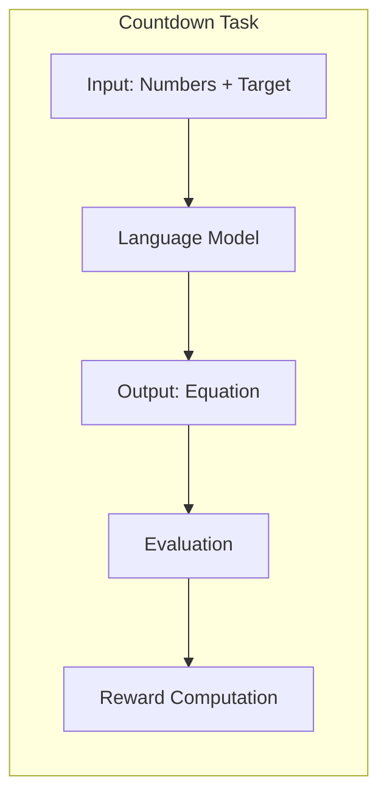
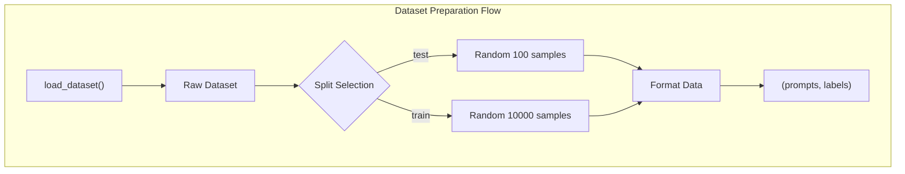
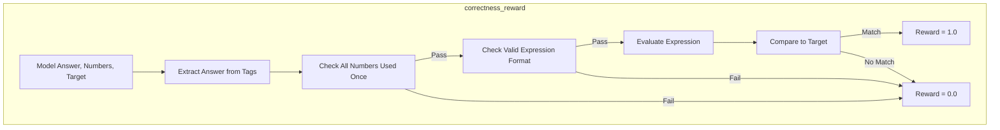
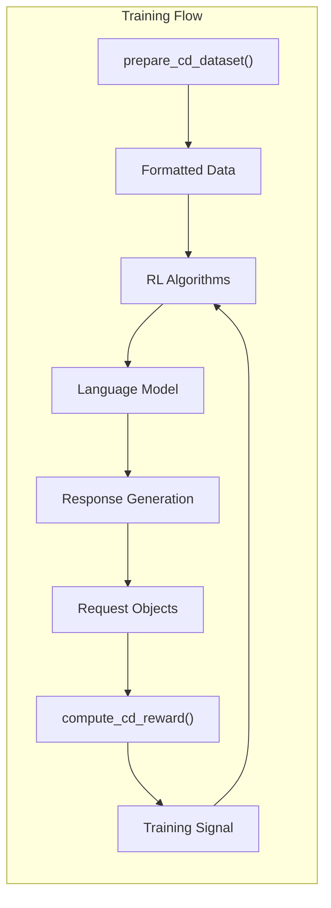
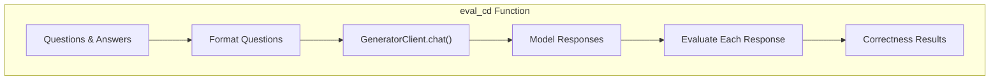

<!-- source: DeepWiki mcp.deepwiki.com · repo microsoft/nanovppo · page 5.1 Countdown Dataset · fetched 2026-10-26 -->

# Countdown Dataset

<details>
<summary>Relevant source files</summary>

The following files were used as context for generating this wiki page:

- [dataset/cd_utils.py](dataset/cd_utils.py)

</details>


This document describes the Countdown Dataset and its implementation within the nanovppo codebase. The Countdown Dataset is a mathematical reasoning task where language models must create an equation using given numbers to reach a target value, leveraging basic arithmetic operations.

## Overview

The Countdown Dataset implements a number puzzle task inspired by the television game show "Countdown." Each problem provides a set of numbers and a target value, with the goal of creating an arithmetic expression that equals the target using the provided numbers exactly once.



Sources: [dataset/cd_utils.py:15-26]()

## Dataset Structure and Implementation

The Countdown Dataset is loaded from the "Jiayi-Pan/Countdown-Tasks-3to4" collection on Hugging Face using the `datasets` library. The dataset preparation functionality is implemented in the `prepare_cd_dataset` function.



The dataset preparation:
1. Loads the dataset from Hugging Face
2. Selects samples based on the specified split (test=100 samples, train=10000 samples)
3. Formats each example as a prompt with system and user messages
4. Returns a tuple of (prompts, labels) where labels contain the numbers and target

Sources: [dataset/cd_utils.py:29-52]()

## Prompt Format

The Countdown Dataset uses a specific prompt template combining system and user messages:

**System Message**:
```
You are a helpful assistant. You first think about the reasoning process in the mind and then provide the user with the answer.
```

**User Message Template**:
```
Using the numbers {numbers}, create an equation that equals {target}. 
You can use basic arithmetic operations (+, -, *, /) and each number can only be used once. 
Show your work in  tags. And return the final equation and answer in 
<answer> </answer> tags, for example <answer>(1 + 2) / (3 * 5)</answer>.
```

This format encourages the model to:
1. Show its reasoning in the `` tags
- Contains valid `<answer>...</answer>` tags
- The content within answer tags only includes digits, operators, parentheses, and whitespace

Rewards:
- **1.0**: Perfect format compliance
- **0.5**: Tags present but answer content contains invalid characters
- **0.0**: Missing or incorrect tags

Sources: [dataset/cd_utils.py:127-169]()

### Correctness Reward

The correctness reward evaluates the mathematical validity of the solution:



The correctness evaluation:
1. Extracts the answer from the model's output
2. Verifies all input numbers are used exactly once
3. Checks that the answer only contains valid mathematical expressions
4. Evaluates the expression and compares it to the target
5. Awards 1.0 for correct answers and 0.0 for incorrect ones

Sources: [dataset/cd_utils.py:172-206]()

## Integration with Training System

The Countdown Dataset integrates with the nanovppo training system through the following interfaces:



During training, the system:
1. Prepares the dataset using `prepare_cd_dataset()`
2. Formats problems for model inference
3. Generates responses through the inference system
4. Creates Request objects containing responses and expected labels
5. Computes rewards with `compute_cd_reward()`
6. Uses these rewards to update the model via RL algorithms

Sources: [dataset/cd_utils.py:29-52](), [dataset/cd_utils.py:112-124]()

## Evaluation Process

The Countdown Dataset includes a specialized evaluation function `eval_cd` that:
1. Takes a batch of questions and expected answers
2. Generates model responses via the `GeneratorClient`
3. Evaluates correctness using the `correctness_reward` function
4. Returns a list of boolean values indicating correctness for each question

This evaluation process provides a standardized way to assess model performance on the Countdown task during and after training.



Sources: [dataset/cd_utils.py:86-109]()

## Response Processing

The system includes utilities to extract and validate model responses:

1. `extract_answer_from_model_output`: Extracts content from the last `<answer>` tag pair
2. `format_reward`: Validates proper formatting of responses
3. `correctness_reward`: Assesses mathematical correctness

These utilities ensure that model outputs are properly processed and evaluated according to the task requirements.

| Function | Purpose | Return Value |
|----------|---------|--------------|
| `extract_answer_from_model_output` | Extract content from `<answer>` tags | String or None |
| `format_reward` | Check if response follows expected format | 0.0, 0.5, or 1.0 |
| `correctness_reward` | Verify mathematical correctness | 0.0 or 1.0 |

Sources: [dataset/cd_utils.py:55-83](), [dataset/cd_utils.py:127-206]()

---

