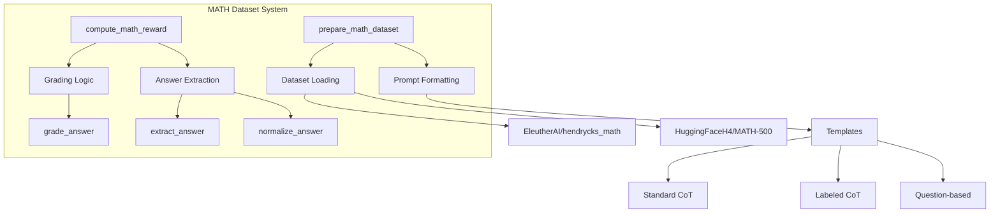
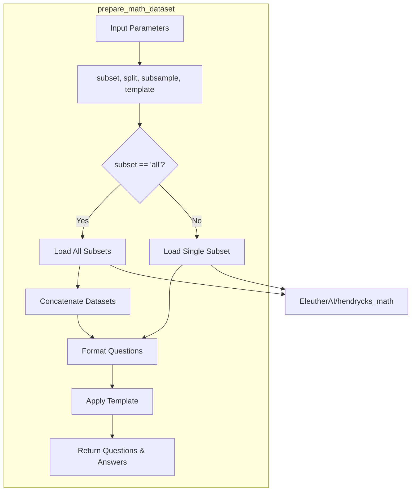
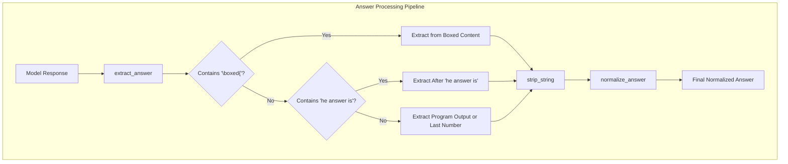
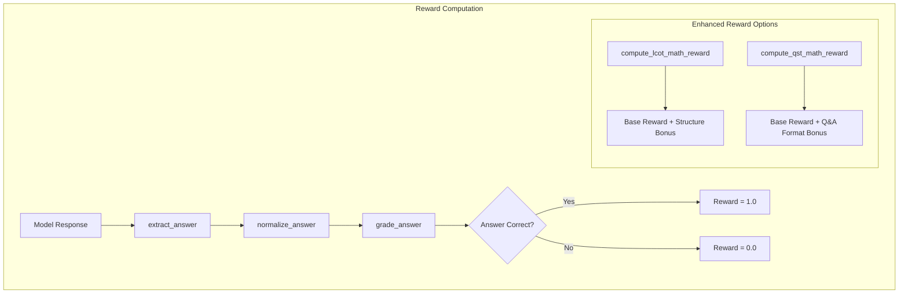
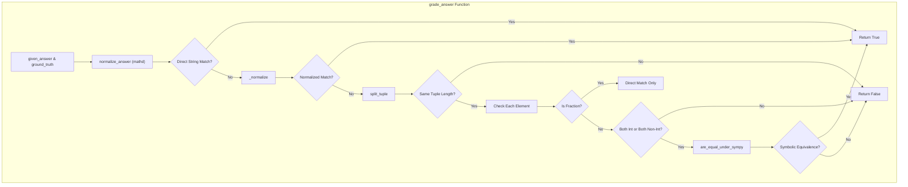
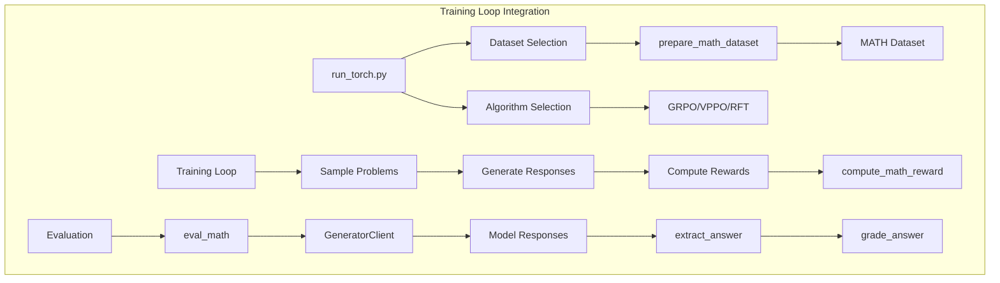

<!-- source: DeepWiki mcp.deepwiki.com · repo microsoft/nanovppo · page 5.2 MATH Dataset · fetched 2026-10-26 -->

# MATH Dataset

<details>
<summary>Relevant source files</summary>

The following files were used as context for generating this wiki page:

- [dataset/math_grader.py](dataset/math_grader.py)
- [dataset/math_utils.py](dataset/math_utils.py)

</details>


This document covers the MATH dataset implementation in nanovppo, including dataset loading, formatting, answer extraction, and reward computation for mathematical reasoning tasks. For other datasets in the system, see [Countdown Dataset](#5.1), [GSM8K Dataset](#5.3), and [ARC Dataset](#5.4).

## Overview

The MATH dataset is a challenging mathematical problem-solving dataset used for training and evaluating language models in the nanovppo system. It contains problems from various mathematical domains including algebra, geometry, number theory, probability, and calculus. The implementation provides utilities for loading the dataset, formatting prompts, extracting and normalizing answers, and computing rewards for reinforcement learning.



Sources: [dataset/math_utils.py:358-411]()

## Dataset Structure and Loading

The MATH dataset implementation supports loading from two sources:
- **EleutherAI/hendrycks_math**: The complete dataset with various mathematical subsets
- **HuggingFaceH4/MATH-500**: A smaller test set of 500 problems

The dataset is organized into mathematical domains (subsets):

| Subset | Description |
|--------|-------------|
| algebra | Algebraic equations and problems |
| counting_and_probability | Combinatorics and probability problems |
| geometry | Geometric problems |
| intermediate_algebra | More advanced algebraic concepts |
| number_theory | Number theory problems |
| prealgebra | Basic algebraic concepts |
| precalculus | Functions, trigonometry, etc. |

The `prepare_math_dataset` function handles loading and formatting the dataset:



Sources: [dataset/math_utils.py:358-411]()

## Prompt Templates

The system provides three different prompt templates for formatting the MATH problems:

1. **Standard Chain-of-Thought (CoT)**: Prompts the model to reason step by step and provide a boxed answer.
   ```
   {problem}
   
   Please reason step by step, and put your final answer within \boxed{}.
   ```

2. **Labeled Chain-of-Thought (LCoT)**: Adds explicit structure by requesting reasoning enclosed in specific tags.
   ```
   {problem}
   
   Think about the reasoning process to arrive at the answer. 
   First, reason step by step by enclosing your thinking into <reasoning> reasoning process here </reasoning>. 
   Then, put your final answer within \boxed{}.
   ```

3. **Question-based Reasoning**: Encourages the model to structure its reasoning as questions and answers.
   ```
   {problem}
   
   Please reason step by step. Structure your thought by formulating questions and giving answers.
   Questions should be enclosed in <question> </question> and answers in <answer> </answer>. 
   Once you are ready to give the final answer, put your final answer within \boxed{}.
   ```

Sources: [dataset/math_utils.py:14-30]()

## Answer Extraction and Normalization

Extracting correct answers from model outputs requires robust parsing due to the variety of ways models might format their responses.



The system employs several specialized functions for answer normalization:

1. `extract_boxed_answers`: Extracts content inside `\boxed{}` LaTeX environments
2. `extract_program_output`: Extracts output from code blocks if present
3. `strip_string`: Performs extensive normalization of mathematical expressions
4. `normalize_answer`: Applies final normalization to ensure consistent comparison

The normalization process handles various mathematical notations:
- LaTeX fractions (`\frac`, `\tfrac`, `\dfrac`)
- Square roots (`\sqrt`)
- Common mathematical symbols (∞, π, etc.)
- Units and unnecessary text

Sources: [dataset/math_utils.py:94-291](), [dataset/math_utils.py:207-278]()

## Reward Computation

The system offers three reward functions for the MATH dataset:



1. **Basic Reward** (`compute_math_reward`): 
   - Binary reward (0 or 1) based on answer correctness

2. **Labeled CoT Reward** (`compute_lcot_math_reward`):
   - Base reward for correct answer
   - Additional reward (up to 0.4) for properly structured reasoning with `<reasoning>` tags

3. **Question-based Reward** (`compute_qst_math_reward`):
   - Base reward for correct answer
   - Additional reward (1.0) for properly structured question-answer format

Sources: [dataset/math_utils.py:313-355]()

## Answer Grading Logic

The answer grading mechanism in `math_grader.py` implements a sophisticated approach to determining mathematical equivalence:



Key aspects of the grading system:

1. **Multiple Normalization Approaches**:
   - First tries `normalize_answer` from the math utilities
   - Then applies `_normalize` from the grading module

2. **Tuple Handling**:
   - Splits answers that may contain multiple values (tuples, intervals)
   - Ensures that tuple structure matches between answer and ground truth

3. **Symbolic Equivalence**:
   - Uses SymPy to check if expressions are mathematically equivalent
   - Handles fractions, algebraic expressions, and other mathematical forms
   - Implements timeouts to prevent hanging on complex expressions

Sources: [dataset/math_grader.py:286-341]()

## Integration with Training System

The MATH dataset integrates with the nanovppo training system through:



1. **Dataset Preparation**:
   - Called from the main training script
   - Provides formatted problems and ground truth answers

2. **Reward Computation**:
   - Used during training to provide feedback to the RL algorithms
   - Evaluates model outputs against ground truth answers

3. **Evaluation**:
   - The `eval_math` function provides a standardized way to evaluate model performance
   - Returns accuracy metrics for the model on MATH problems

Sources: [dataset/math_utils.py:414-444]()

## Customization Options

The MATH dataset implementation provides several customization options:

| Parameter | Description | Options |
|-----------|-------------|---------|
| `subset` | Mathematical domain | "all", "algebra", "geometry", etc. |
| `split` | Dataset split | "test", "train", "500" (special test set) |
| `subsample` | Number of examples to use | Any integer, None for all |
| `template` | Prompting style | "cot", "lcot", "qst", "none" |

These options allow for flexibility in training and evaluation, enabling targeted improvements on specific mathematical domains or reasoning approaches.

Sources: [dataset/math_utils.py:358-411]()

---

