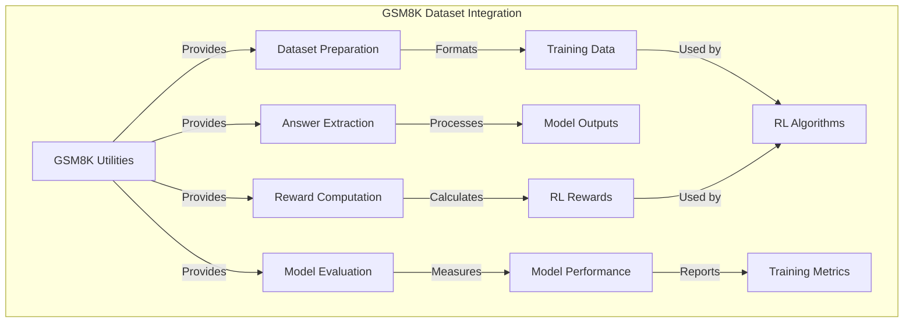
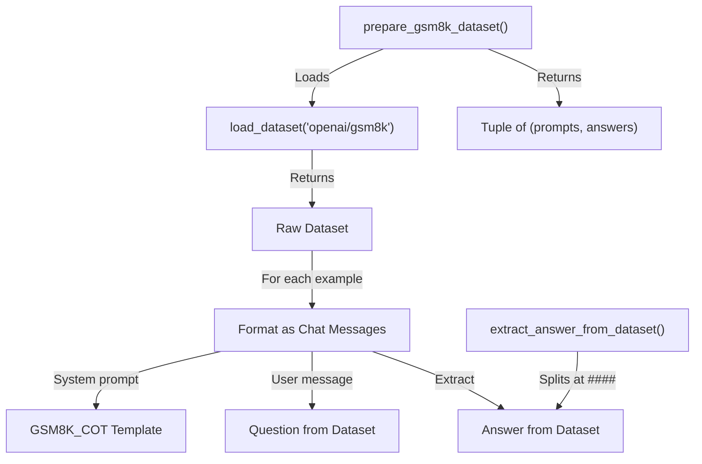
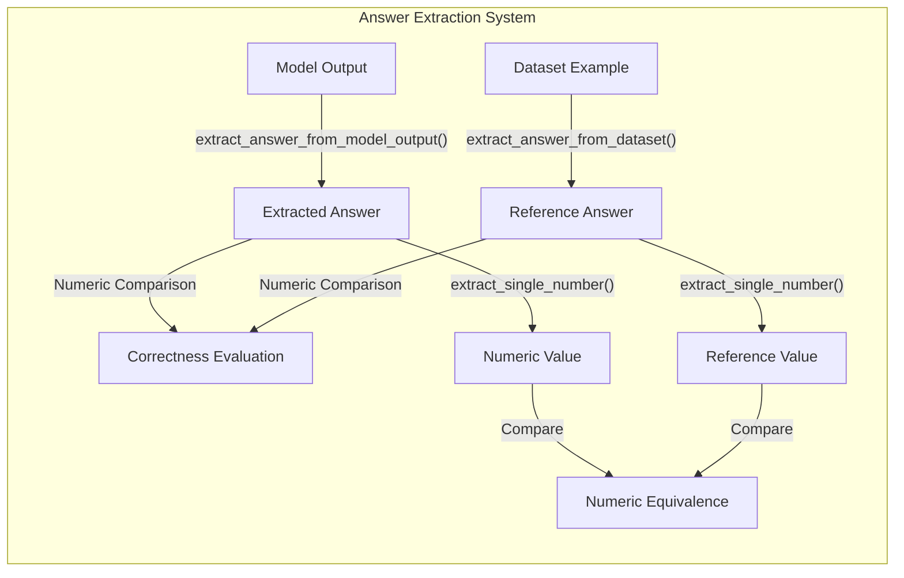
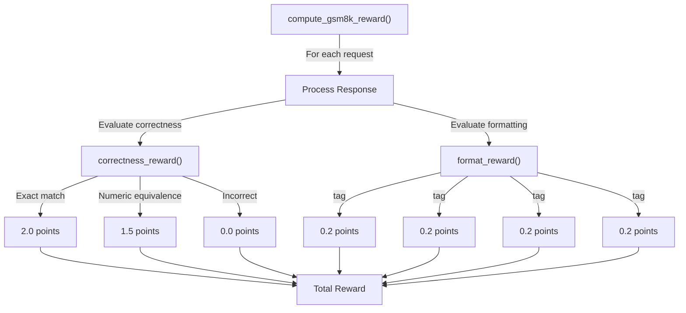
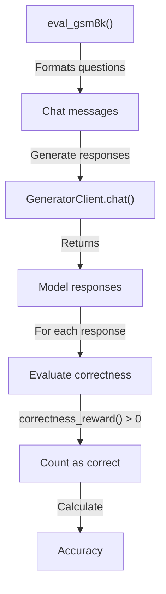
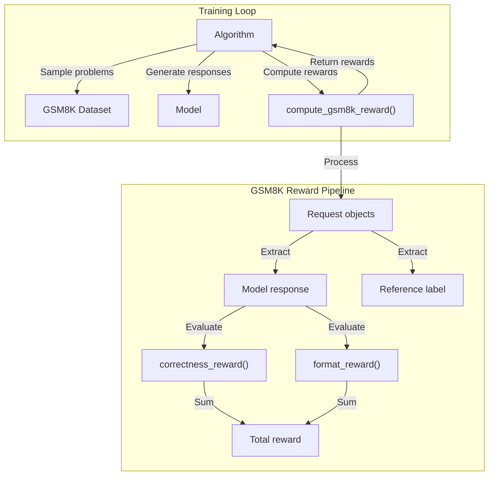

<!-- source: DeepWiki mcp.deepwiki.com · repo microsoft/nanovppo · page 5.3 GSM8K Dataset · fetched 2026-10-26 -->

# GSM8K Dataset

<details>
<summary>Relevant source files</summary>

The following files were used as context for generating this wiki page:

- [dataset/gsm8k_utils.py](dataset/gsm8k_utils.py)

</details>


## Purpose and Scope

This document describes the GSM8K (Grade School Math 8K) dataset implementation within the nanovppo codebase. It covers dataset preparation, answer extraction, evaluation methods, and reward computation used for training reinforcement learning models on mathematical reasoning tasks. The focus is on the technical utilities and integration points with the larger training system.

For an overview of all available datasets, see [Datasets and Evaluation](#5).

## Dataset Overview

The GSM8K dataset consists of grade school math word problems that require multi-step reasoning to solve. In nanovppo, this dataset is used as a benchmark for evaluating and training language models on arithmetic reasoning capabilities.



Sources: [dataset/gsm8k_utils.py:1-196]()

## Dataset Preparation

The GSM8K dataset is loaded using the Hugging Face datasets library and formatted into a structure suitable for the nanovppo training system. Each example is converted into a chat-based format with system and user messages.



Sources: [dataset/gsm8k_utils.py:26-37](), [dataset/gsm8k_utils.py:71-89]()

The dataset preparation involves formatting each problem into a specialized chat template with Chain-of-Thought (CoT) instructions. The system message contains a template that guides the model to structure its response with explicit reasoning and answer sections.

### GSM8K Prompt Template

The GSM8K dataset uses a specific prompt template that encourages the model to provide step-by-step reasoning:

```
Respond in the following format:
<reasoning>
...
</reasoning>
<answer>
...
</answer>
```

This template is defined in the `GSM8K_COT` constant and incorporated into each problem as a system message.

Sources: [dataset/gsm8k_utils.py:15-23]()

## Answer Extraction

The GSM8K utilities include several functions for extracting answers from different sources:

| Function | Purpose | Method |
|----------|---------|--------|
| `extract_answer_from_model_output` | Extracts answers from model responses | Parses content between `<answer>` tags |
| `extract_answer_from_dataset` | Extracts reference answers from dataset | Splits at `####` delimiter |
| `extract_last_number` | Gets the final number from text | Regex matching at end of string |
| `extract_single_number` | Gets a number if only one exists | Regex to find all numbers |

Sources: [dataset/gsm8k_utils.py:40-130]()



Sources: [dataset/gsm8k_utils.py:40-130](), [dataset/gsm8k_utils.py:173-186]()

## Reward Computation

The GSM8K dataset implements a reward system that evaluates both answer correctness and adherence to the specified response format.



Sources: [dataset/gsm8k_utils.py:162-195]()

### Correctness Reward

The `correctness_reward` function determines if the model's answer is correct through several methods:

1. **Exact match**: If the extracted answer exactly matches the reference answer, the model receives 2.0 points.
2. **Numeric equivalence**: If the extracted numbers are the same, the model receives 1.5 points.
3. **Incorrect**: If neither of the above conditions is met, the model receives 0.0 points.

Sources: [dataset/gsm8k_utils.py:173-186]()

### Format Reward

The `format_reward` function incentivizes the model to follow the specified format by awarding points for each format element:

- 0.2 points for including the `<reasoning>` opening tag
- 0.2 points for including the `</reasoning>` closing tag
- 0.2 points for including the `<answer>` opening tag
- 0.2 points for including the `</answer>` closing tag

This gives a maximum of 0.8 points for perfect formatting.

Sources: [dataset/gsm8k_utils.py:189-195]()

## Evaluation Pipeline

The GSM8K dataset includes an evaluation function (`eval_gsm8k`) that measures model performance on the dataset. This function is decorated with `@rank_zero_only`, indicating it's designed to run only on the primary process in a distributed training setup.



Sources: [dataset/gsm8k_utils.py:133-159]()

The evaluation process:

1. Converts questions into the chat format if needed
2. Logs information about the evaluation batch
3. Generates responses using the `GeneratorClient`
4. Evaluates each response for correctness
5. Returns a list of boolean values indicating correctness for each question

## Integration with Training System

The GSM8K dataset integrates with the nanovppo training system primarily through the `compute_gsm8k_reward` function, which accepts a list of `Request` objects and returns calculated rewards.



Sources: [dataset/gsm8k_utils.py:162-170]()

## Implementation Details

The GSM8K utilities file includes:

1. Loading and preparing the dataset using the Hugging Face datasets library
2. Extracting answers from both model outputs and reference solutions
3. Computing rewards for reinforcement learning
4. Evaluating model performance on the dataset

These functions are used by the main training system to provide data, compute rewards, and evaluate model performance during training.

Sources: [dataset/gsm8k_utils.py:1-196]()

---

