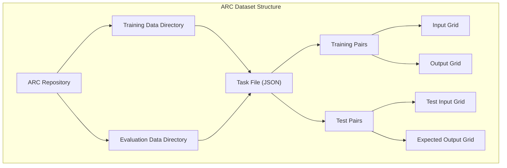
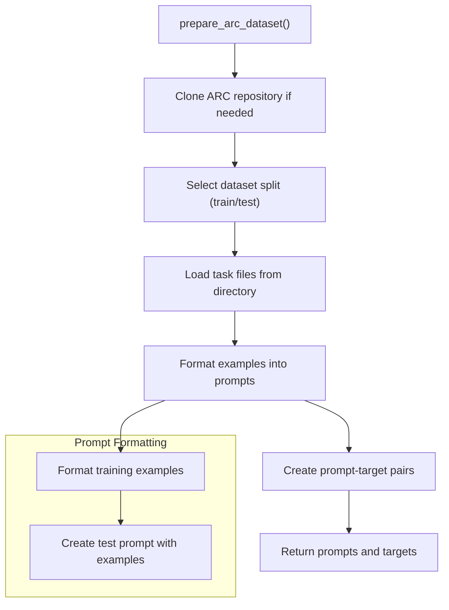
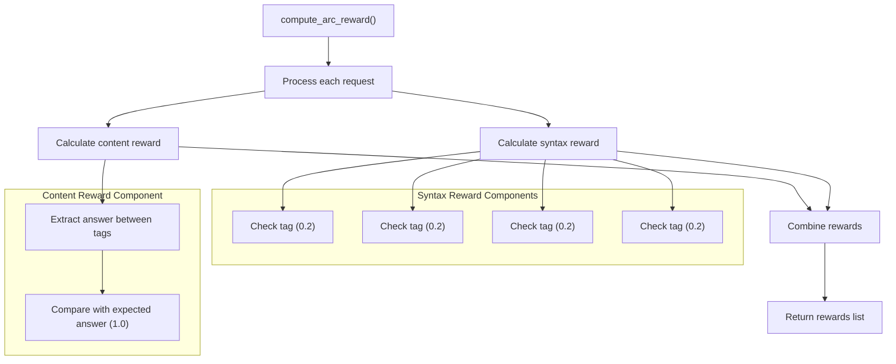
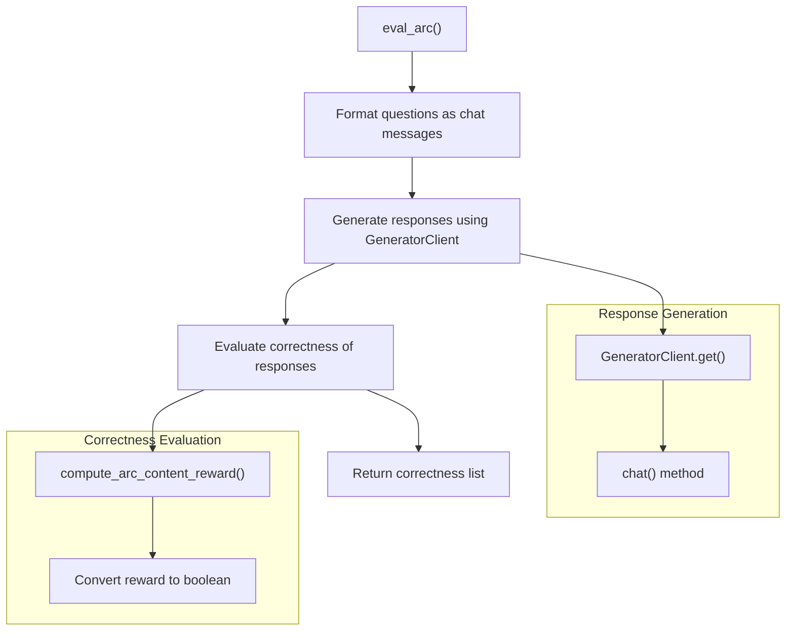
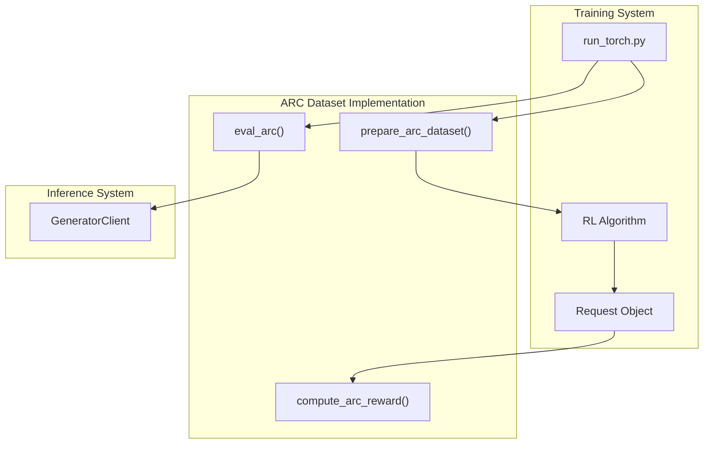

<!-- source: DeepWiki mcp.deepwiki.com · repo microsoft/nanovppo · page 5.4 ARC Dataset · fetched 2026-10-26 -->

# ARC Dataset

<details>
<summary>Relevant source files</summary>

The following files were used as context for generating this wiki page:

- [dataset/arc_utils.py](dataset/arc_utils.py)

</details>


This document provides a detailed technical reference for the Abstraction and Reasoning Corpus (ARC) dataset implementation in the nanovppo codebase. It covers the dataset preparation, prompt formatting, reward computation, and evaluation mechanisms specific to ARC tasks.

## Overview

The ARC dataset implementation provides utilities for loading, preparing, and evaluating language model performance on abstraction and reasoning tasks. These tasks involve finding patterns and rules in grid-based examples and applying them to new instances.

Sources: [dataset/arc_utils.py:1-233]()

## Dataset Structure

The ARC dataset contains grid-based problems that test abstract reasoning capabilities. Each problem consists of:

1. Training examples (input-output grid pairs)
2. Test examples (input grids requiring prediction)

The dataset is organized into training and evaluation splits, with each task stored in a separate JSON file containing both training and test pairs.



Sources: [dataset/arc_utils.py:71-106]()

## Dataset Preparation

The dataset preparation process involves cloning the ARC repository, loading task files, and formatting the examples into prompts suitable for model training.

### Preparation Pipeline



The `prepare_arc_dataset` function:

1. Clones the ARC-AGI repository if not already present
2. Selects the appropriate data directory based on the split (train/test)
3. Iterates through task files to extract examples
4. Formats training examples using a template
5. Creates prompts for each test example, including the formatted training examples
6. Returns the prepared prompts and targets

Sources: [dataset/arc_utils.py:71-106]()

## Prompt Structure

The ARC implementation uses a specific prompt structure to guide the model:

```
Find the common rule that maps an input grid to an output grid, given the examples below.

Example 0:

Input:
[input grid for example 0]
Output:
[output grid for example 0]

Example 1:

Input:
[input grid for example 1]
Output:
[output grid for example 1]

...

Below is a test input grid. Predict the corresponding output grid by applying the rule you found.
Think carefully about the problem by enclosing your reasoning inside <reasoning> </reasoning>.
Then, output your finale answer within <answer> </answer>. Your final answer should just be the text output grid itself.

Input:
[test input grid]
```

Sources: [dataset/arc_utils.py:19-39]()

## Reward Computation

The reward computation for ARC tasks evaluates both the syntax and content of model responses.

### Reward Structure



Reward computation consists of:

1. **Syntax reward (0.8 max)**: Points awarded for proper use of required tags:
   - 0.2 for `<reasoning>` tag
   - 0.2 for `</reasoning>` tag
   - 0.2 for `<answer>` tag
   - 0.2 for `</answer>` tag

2. **Content reward (1.0 max)**: Points awarded for correct answer:
   - 1.0 if the extracted answer matches the expected output

The total reward can range from 0.0 to 1.8, with 1.8 representing a perfect response.

Sources: [dataset/arc_utils.py:109-140]()

## Evaluation System

The `eval_arc` function provides a mechanism for evaluating model performance on ARC tasks.



The evaluation process:

1. Formats questions as chat messages if they aren't already
2. Uses the `GeneratorClient` to generate model responses
3. Evaluates each response using `compute_arc_content_reward`
4. Returns a list of boolean values indicating correctness for each question

Sources: [dataset/arc_utils.py:42-68]()

## Answer Extraction

The implementation includes specialized functions to extract answer content from model responses.

### Content Extraction

The `compute_arc_content_reward` function extracts the model's answer from between the `<answer>` and `</answer>` tags and compares it with the expected output.

```
Response: "I need to find the pattern... <reasoning>detailed reasoning</reasoning> <answer>[[1,0],[0,1]]</answer>"
↓
Extracted answer: "[[1,0],[0,1]]"
↓
Compare with expected output
```

For JSON grid formats, the `extract_json_grid_from_end` function handles various ways a model might output a grid, including:
- Complete JSON arrays with nested arrays
- Arrays without commas between rows
- Multi-line grid formats
- Line-by-line grid outputs

Sources: [dataset/arc_utils.py:109-125](), [dataset/arc_utils.py:143-216]()

## Integration with Training System

The ARC dataset implementation integrates with the broader nanovppo training system through the following connections:



The ARC dataset utilities provide:
1. Data preparation via `prepare_arc_dataset` for training
2. Reward computation via `compute_arc_reward` during the training loop
3. Evaluation metrics via `eval_arc` for assessing model performance

Sources: [dataset/arc_utils.py:8-10](), [dataset/arc_utils.py:42-68](), [dataset/arc_utils.py:128-140]()

## Submission Saving

The implementation includes functionality to save model submissions for later analysis:

```
save_submission(submission_dir, task_id, attempts)
  ↓
Creates: submission_dir/task_id.json
```

This allows for persistent storage of model attempts and outputs for each ARC task.

Sources: [dataset/arc_utils.py:219-232]()