# Page: Overview

# Overview

<details>
<summary>Relevant source files</summary>

The following files were used as context for generating this wiki page:

- [README.md](README.md)
- [algos/__init__.py](algos/__init__.py)
- [requirements.txt](requirements.txt)

</details>


nanovppo is a minimal, educational codebase designed to implement and reproduce reinforcement learning (RL) algorithms for Large Language Models (LLMs). The system focuses specifically on implementing three key algorithms: GRPO (Gradient Ratio Policy Optimization), VPPO (Value-Proximal Policy Optimization), and RFT (Reward Function Transformation). For detailed documentation of these specific algorithms, see [Reinforcement Learning Algorithms](#3).

## Purpose and Scope

This codebase serves as an educational tool for practitioners wanting to understand and experiment with RL for LLMs. It provides a self-contained, dependency-lean implementation that prioritizes clarity and reproducibility over production-level scalability.

nanovppo is designed to:
- Implement and reproduce popular RL algorithms for LLMs
- Provide efficient model inference through VLLM and SGLang backends
- Support training on mathematical reasoning datasets (Countdown, MATH, GSM8K, ARC)
- Facilitate multi-GPU training on a single node

The system is NOT designed for:
- Training large-scale production models
- Deployment in regulated domains
- Production-level applications

Sources: [README.md:11-31]()

## System Architecture

### High-Level Architecture

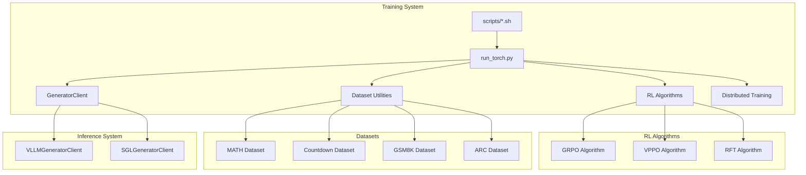

The nanovppo system is centered around `run_torch.py`, which orchestrates the training process. Training scripts in the `scripts` directory configure the training parameters and launch the training process. The system utilizes RL algorithms implemented in the codebase, dataset utilities for different reasoning tasks, and a generator client for efficient model inference.

Sources: [README.md:3-21]()

### Code to Concept Mapping

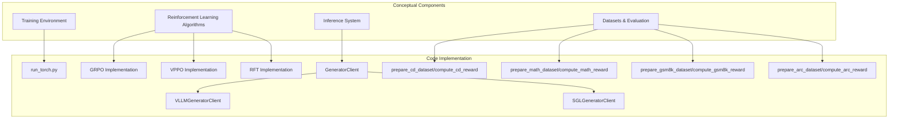

This diagram illustrates how the conceptual components of nanovppo map to specific code implementations. The training environment is primarily implemented in `run_torch.py`, while the RL algorithms have their respective implementations. The inference system uses a `GeneratorClient` with backend-specific implementations for VLLM and SGLang. Each dataset has corresponding preparation and reward computation functions.

Sources: [README.md:3-21]()

## Training Pipeline

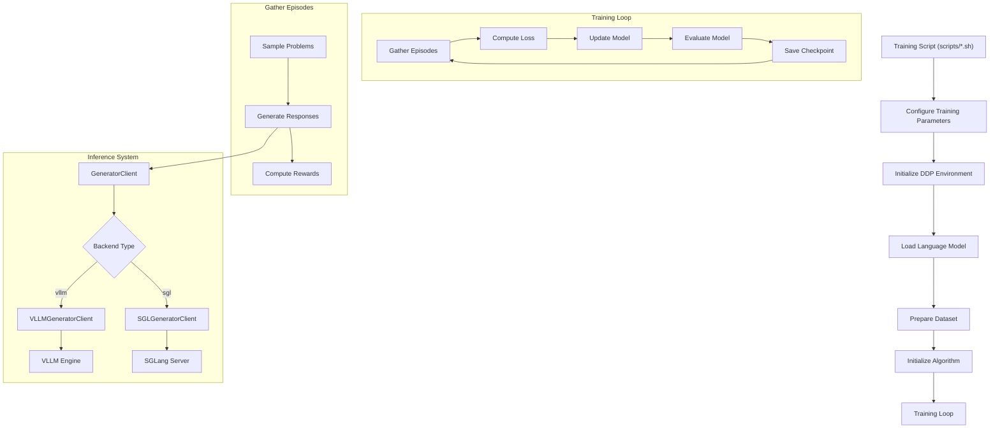

The training pipeline begins with a training script that configures the parameters. The system initializes the distributed environment, loads the model and dataset, and sets up the selected algorithm. The training loop gathers episodes by sampling problems, generating responses through the inference system, and computing rewards. The model is then updated based on the computed loss, evaluated, and checkpointed before the next iteration.

Sources: [README.md:33-39]()

## Dependencies

nanovppo relies on the following key dependencies:

| Dependency | Version | Purpose |
|------------|---------|---------|
| sglang | 0.4.4.post4 | Efficient model inference backend |
| torch | 2.5.1 | Deep learning framework |
| vllm | 0.7.3 | Efficient model inference backend |
| transformers | 4.48.2 | Hugging Face transformers library |
| flash_attn | - | Optimized attention implementation |
| accelerate | - | Training optimization utilities |
| bitsandbytes | 0.43.3 | Quantization utilities |
| datasets | 3.0.1 | Dataset handling utilities |

Sources: [requirements.txt:1-10]()

## Getting Started

To begin using nanovppo, examine the training scripts in the `scripts` directory. These scripts provide examples of how to train models using different algorithms and datasets. For example:

- `scripts/grpo_cd.sh`: GRPO training on the Countdown dataset
- `scripts/vppo_cd.sh`: VPPO training on the Countdown dataset
- `scripts/grpo_math.sh`: GRPO training on the MATH dataset

When using SGLang as the backend, at least two GPUs are required (one for inference, one for training).

Sources: [README.md:33-39]()

## Limitations and Best Practices

### Limitations

- Designed for research and experimental purposes, not production use
- Optimized for English language only
- Not suitable for highly regulated domains
- Inherits biases from base models and training data
- Not optimized for training large-scale models

### Best Practices

- Source datasets legally and ethically
- Be mindful of data privacy concerns
- Ensure compliance with relevant data protection regulations

Sources: [README.md:40-59]()

---

# Page: Training System

# Training System

<details>
<summary>Relevant source files</summary>

The following files were used as context for generating this wiki page:

- [run_torch.py](run_torch.py)

</details>


The Training System in nanovppo is the core component responsible for handling the end-to-end reinforcement learning training process for language models. This document describes the architecture, components, and workflow of the training system, focusing on how it orchestrates model training across different algorithms, datasets, and infrastructure setups.

For information about specific algorithms, see [Reinforcement Learning Algorithms](#3). For details on the inference system that generates model responses during training, see [Inference System](#4).

## Architecture Overview

The training system is built around a central training loop that coordinates the interaction between reinforcement learning algorithms, language models, datasets, and inference backends. It supports distributed training through PyTorch's DistributedDataParallel (DDP) and manages the complete lifecycle of model training.

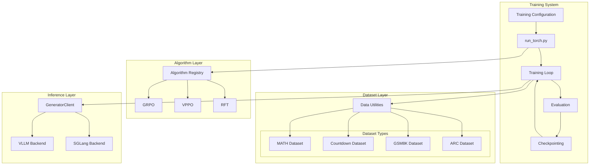

Sources: [run_torch.py:13-55]()

## Training Pipeline

The training system follows a structured pipeline that systematically processes data, trains models, and evaluates results. The main training loop in `run_torch.py` orchestrates this entire process.

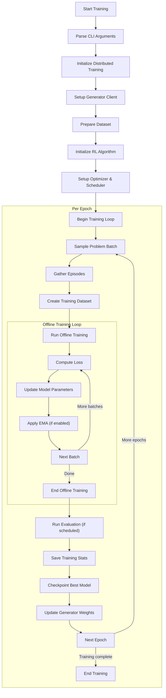

Sources: [run_torch.py:84-461]()

## Configuration Options

The training system is highly configurable through command-line arguments. The most important configuration parameters are defined in the argument parser in `run_torch.py`.

| Parameter | Description | Default |
|-----------|-------------|---------|
| `-m` | Model name (e.g., "q1.5", "phi", "ll8b") | - |
| `-o` | Output directory | "auto" |
| `-s` | Random seed | 42 |
| `-a` | Algorithm (rft, grpo, vppo) | - |
| `--lr` | Learning rate | 1e-5 |
| `--maxepochs` | Maximum number of epochs | -1 |
| `--onlbsz` | Online batch size per GPU | 32 |
| `--offepc` | Number of offline epochs | 1 |
| `--offbsz` | Offline batch size per GPU | -1 |
| `--innbsz` | Inner batch size | 1 |
| `--dataset` | Dataset (math, gsm8k, arc, cd) | "math" |
| `--template` | Template type (cot, lcot, qst) | "cot" |
| `-b` | Backend (vllm, sgl) | "vllm" |
| `-k` | Number of samples per prompt | 5 |
| `-t` | Temperature | DEFAULT_TEMP |

Sources: [run_torch.py:464-545]()

## Training Loop Implementation

The main training loop handles both the online (on-policy) and offline (off-policy) phases of training. This dual approach allows for efficient data collection and model updates.

### Online Phase: Episode Collection

During the online phase, the system:
1. Samples a batch of problems from the dataset
2. Generates model responses using the current policy
3. Computes rewards for the generated responses
4. Constructs a dataset of experiences for offline learning

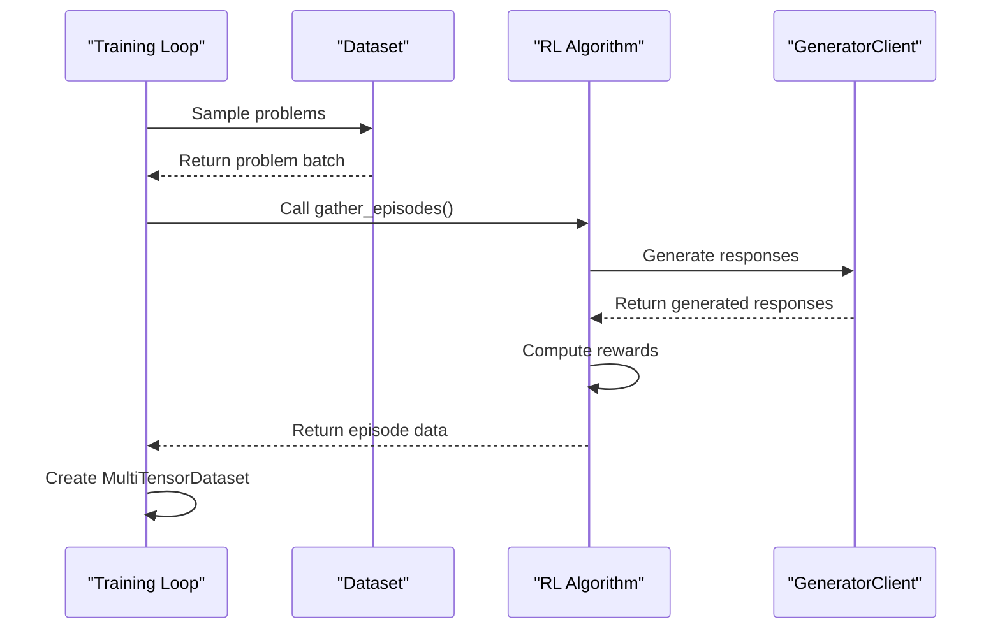

Sources: [run_torch.py:271-309]()

### Offline Phase: Policy Optimization

During the offline phase, the system:
1. Creates a dataloader from the collected episodes
2. Iterates through mini-batches to compute losses and update the model
3. Applies gradient updates with potential gradient accumulation
4. Updates learning rate using the scheduler
5. Optionally applies EMA to model parameters

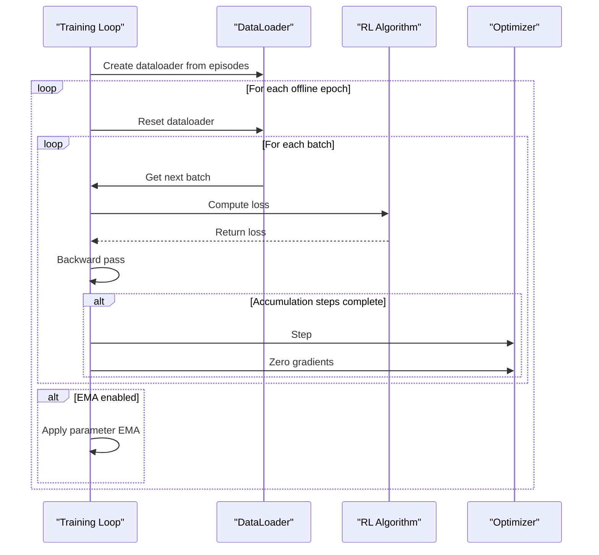

Sources: [run_torch.py:319-383]()

## Model and Algorithm Integration

The training system is designed to work with multiple models and reinforcement learning algorithms. Models and algorithms are registered in dictionaries for easy selection.

### Model Registry

```python
models = {
    "q1.5": "Qwen/Qwen2.5-1.5B",
    "q3": "Qwen/Qwen2.5-3B",
    "q3i": "Qwen/Qwen2.5-3B-Instruct",
    "q1.5m": "Qwen/Qwen2.5-Math-1.5B",
    "q1.5i": "Qwen/Qwen2.5-1.5B-Instruct",
    "phi": "microsoft/Phi-3-mini-4k-instruct",
    "ll8b": "meta-llama/Llama-3.1-8B-Instruct",
}
```

Sources: [run_torch.py:59-67]()

### Algorithm Registry

```python
algos = {
    "rft": RFT,
    "grpo": GRPO,
    "vppo": VPPO,
}
```

Sources: [run_torch.py:69-74]()

The system dynamically loads the appropriate algorithm class based on the command-line argument and passes algorithm-specific parameters:

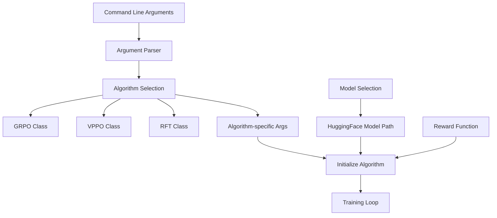

Sources: [run_torch.py:76-82](), [run_torch.py:150-159]()

## Dataset Processing and Rewards

The training system supports multiple datasets, each with specific preparation functions and reward computation methods.

### Dataset Selection Logic

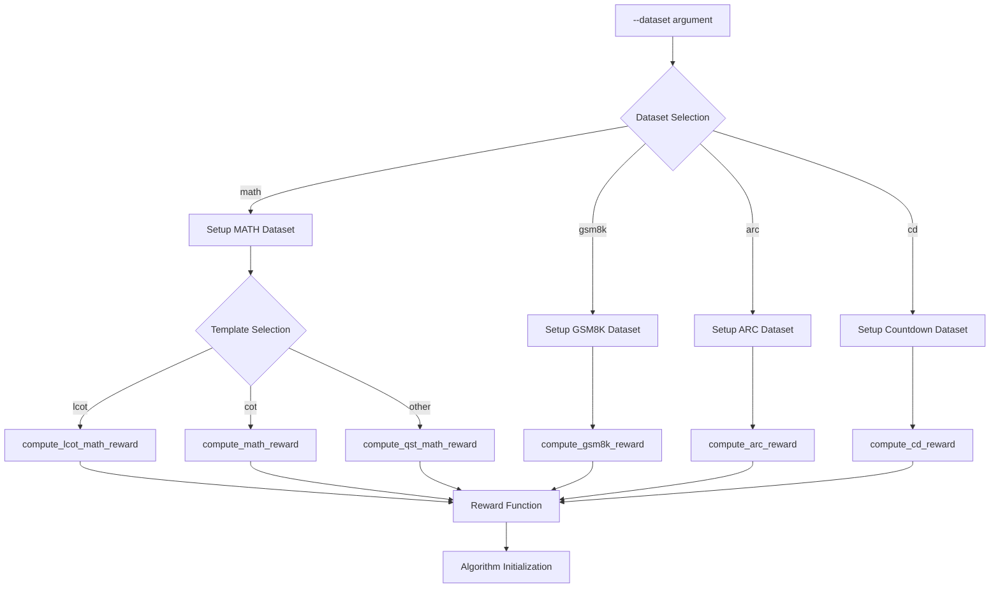

Sources: [run_torch.py:107-130]()

## Evaluation and Checkpointing

The training system includes regular evaluation of the model's performance and checkpointing of the best models.

### Evaluation Process

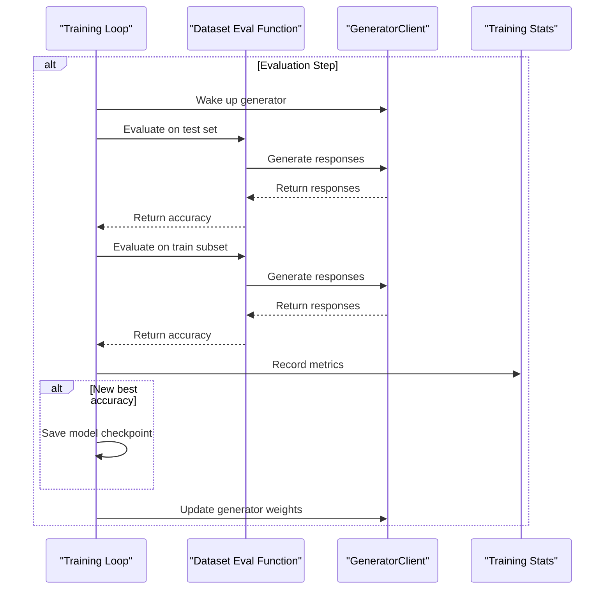

Sources: [run_torch.py:386-456]()

## Distributed Training

The training system supports distributed training across multiple GPUs using PyTorch's DistributedDataParallel (DDP).

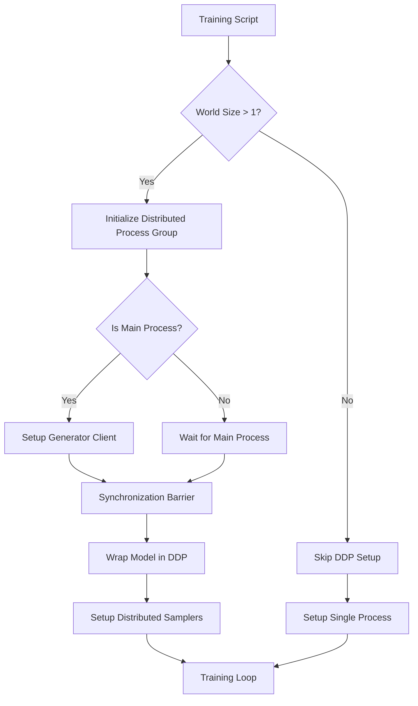

Sources: [run_torch.py:89-98](), [run_torch.py:163-168]()

## Integration with Inference System

The training system interacts with the inference system through the `GeneratorClient` interface, which provides a unified API for different backend implementations (VLLM, SGLang).

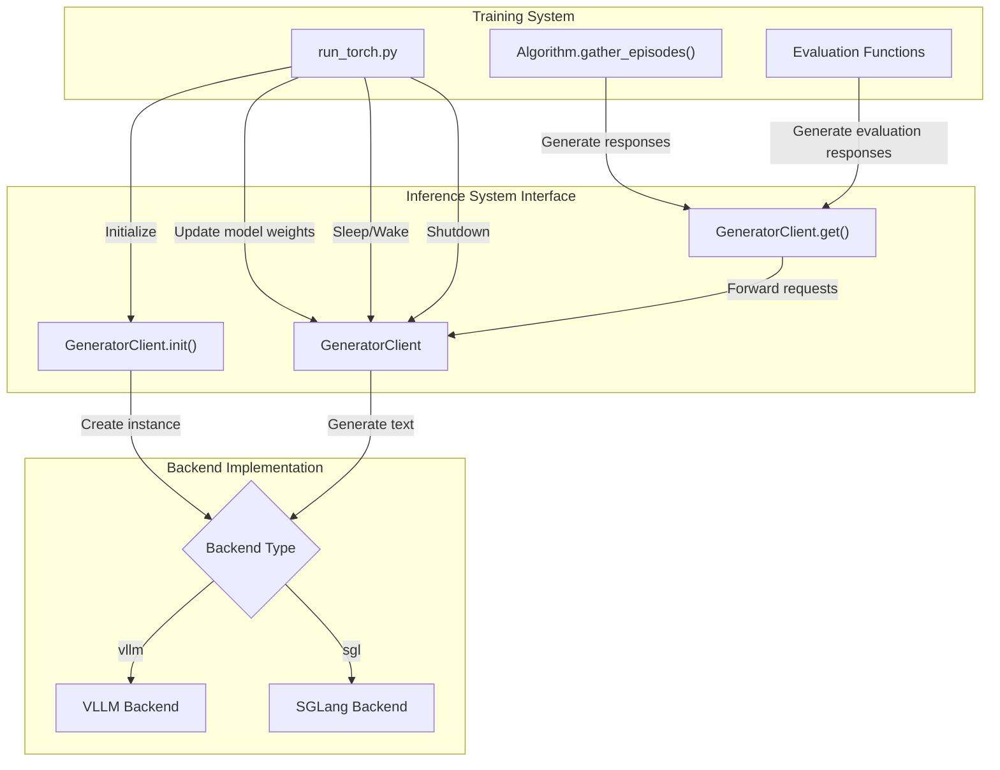

Sources: [run_torch.py:93-96](), [run_torch.py:307](), [run_torch.py:390](), [run_torch.py:455](), [run_torch.py:460]()

## Key Training System Events

The following table summarizes the key events in the training system lifecycle:

| Event | Description | Code Location |
|-------|-------------|--------------|
| Initialization | Parse arguments, initialize DDP, setup generator | [run_torch.py:84-102]() |
| Dataset Preparation | Load and prepare datasets based on configuration | [run_torch.py:107-130](), [run_torch.py:235-258]() |
| Algorithm Initialization | Initialize the selected RL algorithm with model and parameters | [run_torch.py:150-159]() |
| Online Phase | Sample problems and gather episodes | [run_torch.py:271-309]() |
| Offline Phase | Create dataset from episodes and update model | [run_torch.py:319-383]() |
| Evaluation | Evaluate model on test and train subsets | [run_torch.py:386-401]() |
| Checkpointing | Save training stats and best model | [run_torch.py:402-452]() |
| Generator Update | Update the generator's weights with the latest model | [run_torch.py:455]() |
| Shutdown | Clean up resources and shut down generator | [run_torch.py:459-461]() |

Sources: [run_torch.py:84-461]()

---

# Page: Distributed Training

# Distributed Training

<details>
<summary>Relevant source files</summary>

The following files were used as context for generating this wiki page:

- [ddp_utils.py](ddp_utils.py)
- [run_torch.py](run_torch.py)

</details>


This page documents the distributed training implementation in nanovppo, which enables training reinforcement learning models across multiple GPUs. The system uses PyTorch's Distributed Data Parallelism (DDP) to parallelize training, improving training throughput and enabling larger batch sizes.

## Overview

nanovppo implements distributed training through a custom utility layer on top of PyTorch's DDP functionality. The distributed training architecture is designed to:

1. Initialize a distributed environment
2. Distribute model parameters across multiple GPUs
3. Coordinate data loading and partitioning
4. Synchronize gradients during backpropagation
5. Manage communication between processes

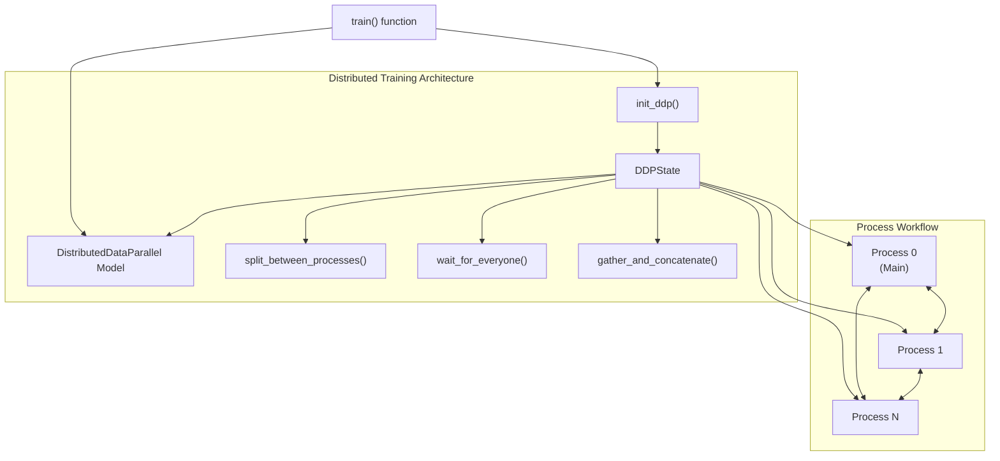

Diagram: Distributed Training Architecture Overview

Sources: [ddp_utils.py:1-163](), [run_torch.py:83-102]()

## DDPState Management

The core of nanovppo's distributed training implementation is the `DDPState` class, which encapsulates all state information and utilities for managing distributed processes.

### DDPState Class

The `DDPState` class manages the state of distributed training across processes and provides utility methods for process coordination.

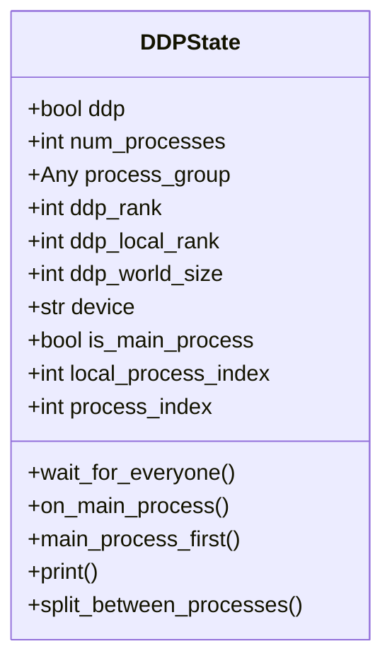

Diagram: DDPState Class Structure

Key attributes and methods:

- `ddp`: Flag indicating if distributed training is active
- `num_processes`: Total number of processes (typically equal to number of GPUs)
- `process_group`: PyTorch distributed process group
- `ddp_rank` & `ddp_local_rank`: Process rank identifiers
- `is_main_process`: Flag indicating if current process is the main (rank 0) process
- `device`: CUDA device assigned to this process
- `wait_for_everyone()`: Synchronization barrier for all processes
- `split_between_processes()`: Context manager to partition data across processes

A global instance `ddp_state` is created to maintain consistent access to the distributed state throughout the codebase.

Sources: [ddp_utils.py:20-72]()

## Initialization Process

Distributed training is initialized through the `init_ddp` function, which sets up the distributed environment and configures the global `ddp_state`.

### Key Initialization Steps

1. The function checks for environment variables (`LOCAL_RANK`, `MASTER_ADDR`, `MASTER_PORT`)
2. Initializes the process group using NCCL backend
3. Sets the CUDA device for the current process
4. Updates the global `ddp_state` with process-specific information

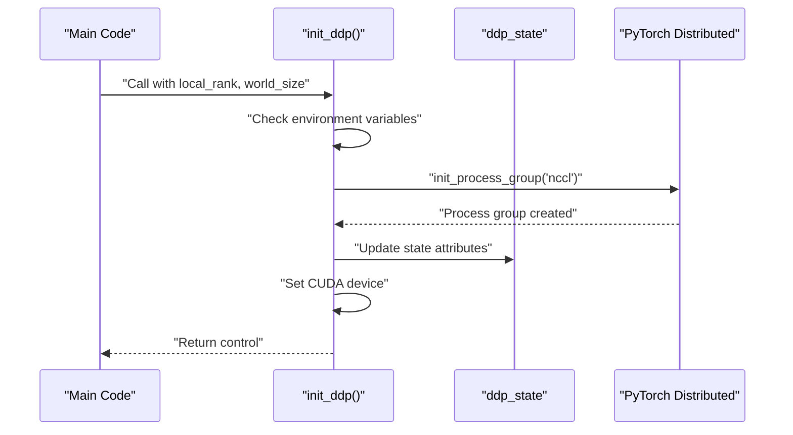

Diagram: Distributed Training Initialization Sequence

The initialization is typically called from the `train` function in `run_torch.py` with:

```python
init_ddp(local_rank, world_size)
```

Where `local_rank` and `world_size` are obtained from environment variables:

```python
local_rank = int(os.environ.get("LOCAL_RANK", 0))
world_size = int(os.environ.get("WORLD_SIZE", 1))
```

Sources: [ddp_utils.py:75-104](), [run_torch.py:83-90](), [run_torch.py:547-549]()

## Model Distributed Training Implementation

Once the distributed environment is initialized, the model is wrapped in PyTorch's `DistributedDataParallel` (DDP) wrapper to enable synchronized gradient updates.

### Model Wrapping

```python
if ddp_state.ddp:
    algo.model = DDP(
        algo.model,
        device_ids=[ddp_state.local_process_index],
        output_device=ddp_state.local_process_index,
    )
    algo_module = algo.model.module
else:
    algo_module = algo.model
```

This pattern allows the code to work in both distributed and non-distributed settings.

### Data Partitioning

Data is partitioned across processes using the `split_between_processes` context manager:

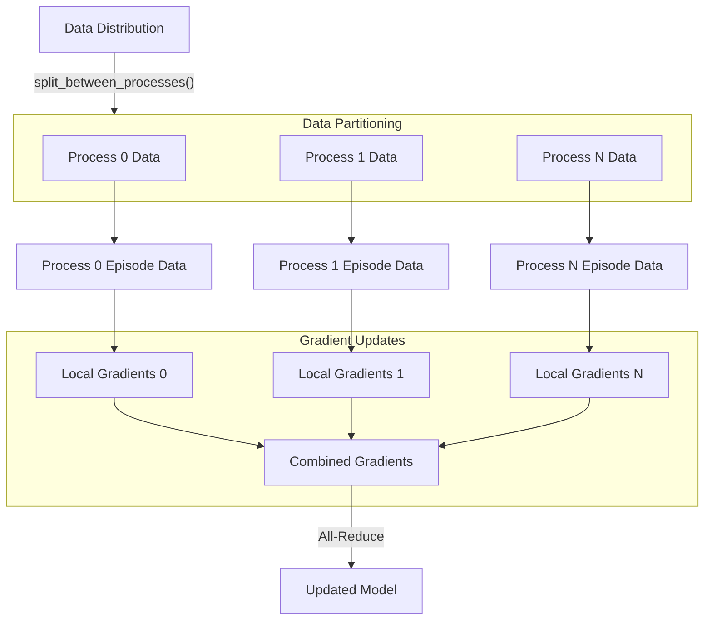

Diagram: Data Partitioning and Gradient Flow

The data partitioning process ensures each GPU works on a subset of the total batch while maintaining synchronized gradients:

1. The total batch is divided equally across processes
2. Each process computes forward/backward passes on its data partition
3. Gradients are automatically synchronized during backward pass
4. All processes update their model with identical parameters

Sources: [run_torch.py:300-304](), [ddp_utils.py:56-69]()

## Training Synchronization

Several synchronization points ensure proper coordination between processes:

### Synchronization Barriers

The `wait_for_everyone()` method creates synchronization barriers where all processes wait until everyone reaches that point:

```python
ddp_state.wait_for_everyone()
```

These barriers are used at key points in the training loop:
- After initialization
- After model parameter updates
- Before and after evaluation
- Before shutdown

### Main Process First Pattern

The `main_process_first()` context manager ensures operations are performed by the main process first, then by other processes:

```python
with ddp_state.main_process_first():
    # Operations that should be performed by main process first
    all_queries, all_labels = prepare_dataset(...)
```

This pattern is particularly useful for dataset preparation and file system operations.

Sources: [ddp_utils.py:32-50](), [run_torch.py:98](), [run_torch.py:235-257](), [run_torch.py:384](), [run_torch.py:457]()

## Utility Functions

nanovppo provides several utility functions for distributed training:

### rank_zero_only Decorator

This decorator ensures a function only executes on the main process (rank 0), with synchronization to share results to other processes:

```python
@rank_zero_only
def some_function():
    # This will only run on the main process
    # Results will be broadcast to other processes
    pass
```

### gather_and_concatenate Function

This function gathers tensors from all processes and concatenates them:

```python
def gather_and_concatenate(data, dim=0):
    if not ddp_state.ddp:
        return data

    world_size = ddp_state.num_processes
    gathered_data = []
    for tensor in data:
        gathered_tensors = [torch.zeros_like(tensor) for _ in range(world_size)]
        torch.distributed.all_gather(gathered_tensors, tensor)
        gathered_data.append(torch.cat(gathered_tensors, dim=dim))
    return gathered_data
```

This is particularly useful for collecting distributed results for logging or evaluation.

Sources: [ddp_utils.py:107-162]()

## Backend Compatibility

Not all inference backends support distributed training. The code includes compatibility checks:

```python
if world_size > 1 and final_args.b == 'vllm':
    raise ValueError("VLLM backend does not support distributed training.")
```

Currently, the VLLM backend does not support distributed training, while SGLang can be used with distributed training.

| Backend | Distributed Training Support |
|---------|------------------------------|
| VLLM    | No                           |
| SGLang  | Yes                          |

Sources: [run_torch.py:551-552]()

## Usage in Training Loop

The distributed training functionality is integrated throughout the training loop in `run_torch.py`:

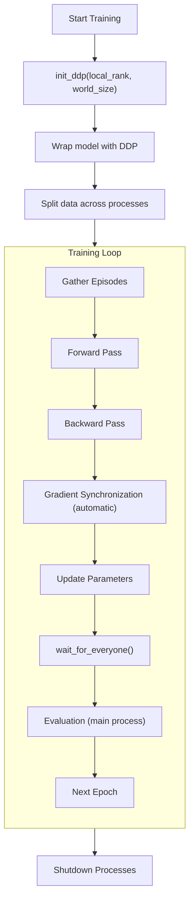

Diagram: Distributed Training in the Training Loop

Sources: [run_torch.py:83-461]()

## Practical Considerations

When using distributed training in nanovppo, consider the following:

1. **Environment Variables**: Proper environment variables must be set:
   - `LOCAL_RANK`: The local rank of the process
   - `WORLD_SIZE`: Total number of processes
   - `MASTER_ADDR`: Address of the master process (defaults to "localhost")
   - `MASTER_PORT`: Port for the master process (defaults to "29502")

2. **Backend Selection**: Choose a compatible backend (currently only SGLang supports distributed training)

3. **Batch Size**: The total batch size is multiplied by the number of GPUs, so adjust per-GPU batch size accordingly

4. **Memory Usage**: Monitor memory usage as the optimizer states are replicated on each GPU

5. **Launcher**: Use a distributed launcher like `torchrun` or `python -m torch.distributed.launch` to start the training script

Sources: [run_torch.py:547-552](), [ddp_utils.py:79-85]()

---

# Page: Training Scripts

# Training Scripts

<details>
<summary>Relevant source files</summary>

The following files were used as context for generating this wiki page:

- [scripts/grpo_cd.sh](scripts/grpo_cd.sh)
- [scripts/grpo_cd_3b.sh](scripts/grpo_cd_3b.sh)
- [scripts/grpo_cd_vllm.sh](scripts/grpo_cd_vllm.sh)
- [scripts/grpo_gsm.sh](scripts/grpo_gsm.sh)
- [scripts/grpo_math.sh](scripts/grpo_math.sh)
- [scripts/vppo_cd.sh](scripts/vppo_cd.sh)
- [scripts/vppo_cd_vllm.sh](scripts/vppo_cd_vllm.sh)
- [scripts/vppo_math.sh](scripts/vppo_math.sh)

</details>


This page documents the training scripts available in the nanovppo repository and explains how to use them for training different reinforcement learning algorithms on various reasoning datasets. These scripts serve as convenient wrappers around the core training system, providing pre-configured command-line arguments for specific experiment configurations.

For information about the core training system implementation, see [Training System](#2), and for details about specific algorithms, see [Reinforcement Learning Algorithms](#3).

## Script Organization

The nanovppo repository contains several training scripts organized by algorithm and dataset combinations. These scripts are located in the `scripts/` directory and follow a naming convention of `{algorithm}_{dataset}[_{backend}].sh`.

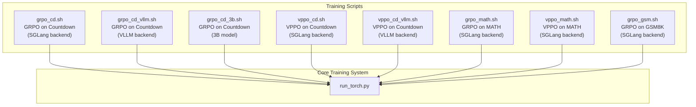

Sources: [scripts/grpo_cd.sh](), [scripts/grpo_cd_vllm.sh](), [scripts/grpo_cd_3b.sh](), [scripts/vppo_cd.sh](), [scripts/vppo_cd_vllm.sh](), [scripts/grpo_math.sh](), [scripts/vppo_math.sh](), [scripts/grpo_gsm.sh]()

## Script Structure and Components

Each training script typically consists of the following components:

1. **Environment configuration**: Sets up variables for distributed training and GPU allocation
2. **Output configuration**: Defines output directory and experiment name
3. **Training command**: Calls `run_torch.py` with specific parameters for the algorithm and dataset

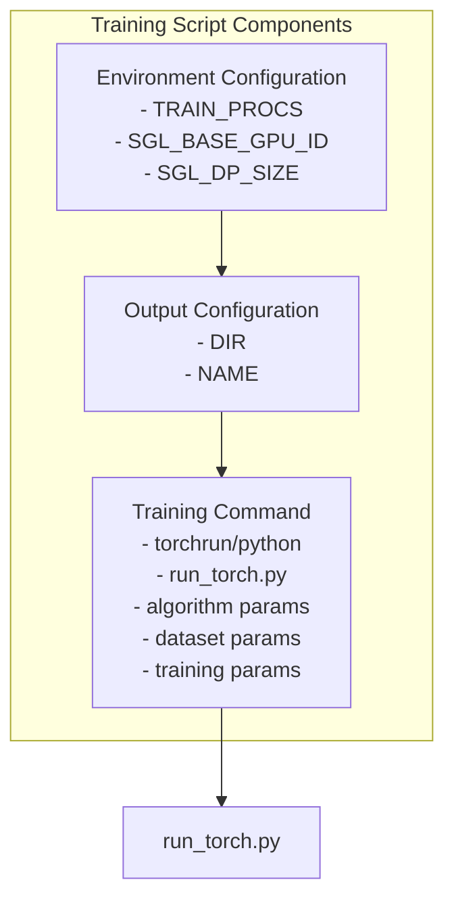

Sources: [scripts/grpo_cd.sh:1-10](), [scripts/vppo_cd.sh:1-14]()

## Common Command-Line Arguments

The training scripts use various command-line arguments to configure the training process. Below are the most common arguments used across different scripts:

| Argument | Description | Example Values |
|----------|-------------|----------------|
| `-m` | Model identifier | `q1.5i`, `q3i` |
| `-o` | Output directory | `runs_outputs/grpo_cd_42` |
| `-t` | Temperature | `1.0` |
| `-k` | Number of samples per problem | `4`, `5`, `8` |
| `--lr` | Learning rate | `5e-6`, `1e-5`, `3e-5` |
| `-a` | Algorithm | `grpo`, `vppo` |
| `-b` | Backend | `vllm` (default is SGLang) |
| `--dataset` | Dataset | `cd`, `math`, `gsm8k` |
| `--onlbsz` | Online batch size | `16`, `32` |
| `--offbsz` | Offline batch size | `8` |
| `--innbsz` | Inner batch size | `1` |
| `--maxtok` | Maximum tokens | `1024` |
| `--maxepochs` | Maximum training epochs | `1000` |
| `--offepc` | Offline epochs per online batch | `1`, `4` |
| `-s` | Random seed | `42` |
| `--kl_ctl` | KL divergence control parameter | `0.001`, `1e-6`, `0.04` |
| `--evalevery` | Evaluation frequency (epochs) | `10`, `25` |
| `--t500` | Use MATH-500 subset (faster) | flag |
| `--template` | Template format | `cot`, `lcot` |
| `--fast` | Enable fast mode | flag |

Sources: [scripts/grpo_cd.sh:12-28](), [scripts/vppo_math.sh:8-23](), [scripts/grpo_math.sh:25-43]()

## Training Script Examples

### GRPO on Countdown Dataset (with SGLang backend)

```bash
export TRAIN_PROCS=1

DIR="runs_outputs"
NAME="grpo_cd"

torchrun --nproc-per-node=${TRAIN_PROCS} run_torch.py \
    -m q1.5i \
    -o ${DIR}/${NAME}_42 \
    -t 1.0 \
    -k 4 \
    --lr 5e-6 \
    -a grpo \
    --dataset cd \
    --onlbsz 16 \
    --offbsz 8 \
    --innbsz 1 \
    --maxtok 1024 \
    --maxepochs 1000 \
    --offepc 1 \
    -s 42 \
    --kl_ctl 0.001 \
    --evalevery 25
```

This script trains a GRPO algorithm on the Countdown dataset using a 1.5B model with the SGLang backend. It uses one training process and conducts evaluation every 25 epochs.

Sources: [scripts/grpo_cd.sh]()

### VPPO on MATH Dataset (with SGLang backend)

```bash
DIR="runs_outputs"
NAME="vppo"

export TRAIN_PROCS=1
export SGL_BASE_GPU_ID=$TRAIN_PROCS
export SGL_DP_SIZE=1

torchrun --nproc_per_node=$TRAIN_PROCS run_torch.py \
    -m q1.5i \
    -o ${DIR}/${NAME}_42 \
    -t 1.0 --fast \
    -k 5 \
    --lr 1e-5 \
    -a vppo \
    --onlbsz 32 \
    --t500 \
    --template lcot \
    --dataset math \
    --maxtok 1024 \
    --maxepochs 1000 \
    --offepc 1 \
    -s 42 \
    --kl_ctl 1e-6
```

This script trains a VPPO algorithm on the MATH dataset (using the faster MATH-500 subset) with a 1.5B model. It uses the "lcot" (likely "labeled chain of thought") template and enables fast mode.

Sources: [scripts/vppo_math.sh]()

## GPU Configuration and Distributed Training

Training scripts can be configured to use multiple GPUs for both model training and inference. The scripts use environment variables to control GPU allocation:

- `TRAIN_PROCS`: Number of training processes (typically one per GPU)
- `SGL_BASE_GPU_ID`: Starting GPU ID for the SGLang inference server
- `SGL_DP_SIZE`: Number of GPUs to use for the SGLang backend

For example, setting `TRAIN_PROCS=1`, `SGL_BASE_GPU_ID=1`, and `SGL_DP_SIZE=2` means:
- Use GPU 0 for model training
- Use GPUs 1 and 2 for the SGLang inference server

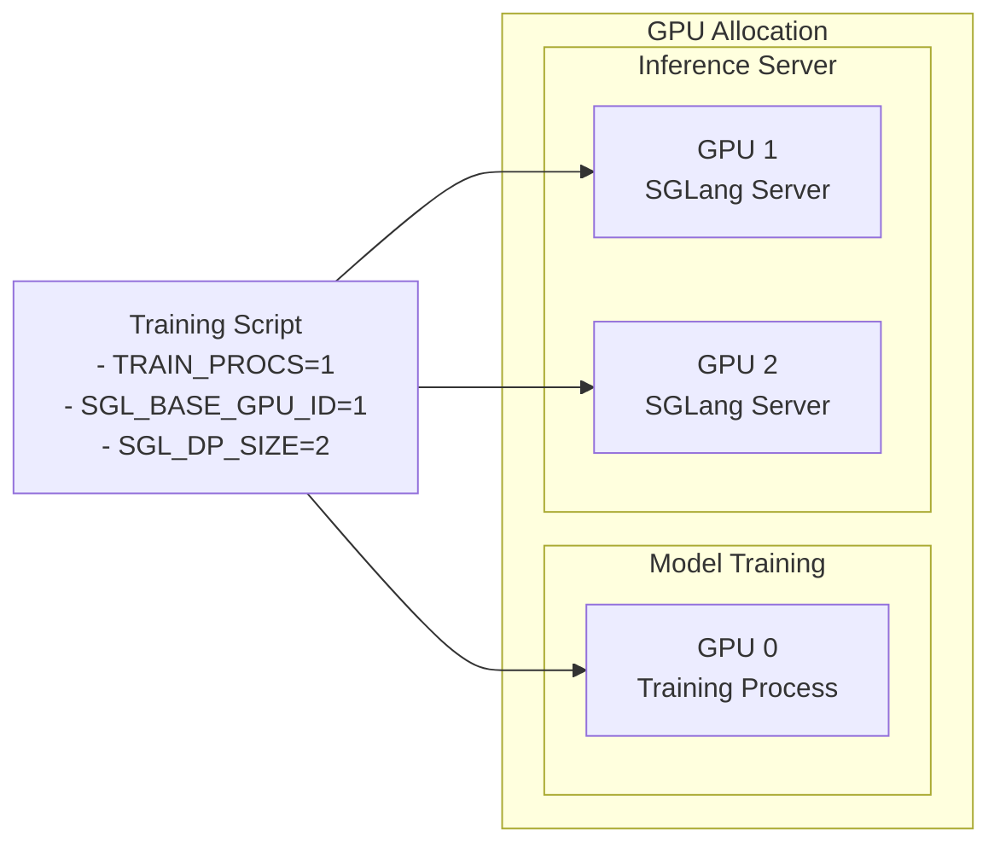

Sources: [scripts/grpo_cd.sh:1-9](), [scripts/grpo_math.sh:1-22](), [scripts/vppo_cd.sh:1-9]()

## Backend Selection

The training scripts can use different backends for model inference:

1. **SGLang Backend (default)**: Used in most scripts like `grpo_cd.sh`, `vppo_cd.sh`
2. **VLLM Backend**: Specified with `-b vllm` in scripts like `grpo_cd_vllm.sh`, `vppo_cd_vllm.sh`

```mermaid
graph TD
    subgraph "Backend Selection"
        SCRIPT["Training Script"]
        SCRIPT -- "No -b flag" --> SGL["SGLang Backend<br>(Default)"]
        SCRIPT -- "-b vllm" --> VLLM["VLLM Backend"]
    end
    
    SGL --> SGL_PROC["SGL Process<br>- Uses SGL_BASE_GPU_ID<br>- Uses SGL_DP_SIZE GPUs"]
    VLLM --> VLLM_PROC["VLLM Process<br>- Uses same GPU as training"]
```

Sources: [scripts/grpo_cd.sh](), [scripts/grpo_cd_vllm.sh:15](), [scripts/vppo_cd_vllm.sh:15]()

## Algorithm and Dataset Mapping

The training scripts cover various combinations of algorithms and datasets:

```mermaid
graph TD
    subgraph "Algorithms"
        GRPO["GRPO<br>Gradient Ratio Policy Optimization"]
        VPPO["VPPO<br>Value-Proximal Policy Optimization"]
    end
    
    subgraph "Datasets"
        CD["Countdown Dataset"]
        MATH["MATH Dataset"]
        GSM8K["GSM8K Dataset"]
    end
    
    subgraph "Scripts"
        GRPO_CD_SCRIPT["grpo_cd.sh"]
        GRPO_CD_VLLM_SCRIPT["grpo_cd_vllm.sh"]
        GRPO_CD_3B_SCRIPT["grpo_cd_3b.sh"]
        VPPO_CD_SCRIPT["vppo_cd.sh"]
        VPPO_CD_VLLM_SCRIPT["vppo_cd_vllm.sh"]
        GRPO_MATH_SCRIPT["grpo_math.sh"]
        VPPO_MATH_SCRIPT["vppo_math.sh"]
        GRPO_GSM_SCRIPT["grpo_gsm.sh"]
    end
    
    GRPO_CD_SCRIPT --> GRPO
    GRPO_CD_VLLM_SCRIPT --> GRPO
    GRPO_CD_3B_SCRIPT --> GRPO
    VPPO_CD_SCRIPT --> VPPO
    VPPO_CD_VLLM_SCRIPT --> VPPO
    GRPO_MATH_SCRIPT --> GRPO
    VPPO_MATH_SCRIPT --> VPPO
    GRPO_GSM_SCRIPT --> GRPO
    
    GRPO_CD_SCRIPT --> CD
    GRPO_CD_VLLM_SCRIPT --> CD
    GRPO_CD_3B_SCRIPT --> CD
    VPPO_CD_SCRIPT --> CD
    VPPO_CD_VLLM_SCRIPT --> CD
    GRPO_MATH_SCRIPT --> MATH
    VPPO_MATH_SCRIPT --> MATH
    GRPO_GSM_SCRIPT --> GSM8K
```

Sources: All script files

## Running a Training Script

To run a training script:

1. Navigate to the nanovppo repository root directory
2. Make sure all dependencies are installed
3. Execute the desired script:

```bash
cd /path/to/nanovppo
bash scripts/grpo_cd.sh
```

The output and checkpoints will be saved in the directory specified by the `-o` parameter (typically `runs_outputs/{experiment_name}_{seed}`).

When running scripts that use SGLang as the backend, make sure that no other SGLang server is running on the same GPUs. Some scripts include a command to kill existing SGLang processes:

```bash
sudo kill -kill `ps -ax | grep sgl | awk '{print $1}' | xargs`
```

Sources: [scripts/grpo_math.sh:23](), [scripts/vppo_cd.sh:14](), [scripts/grpo_gsm.sh:9]()

---

# Page: Utilities

# Utilities

<details>
<summary>Relevant source files</summary>

The following files were used as context for generating this wiki page:

- [miniplot.py](miniplot.py)
- [utils.py](utils.py)

</details>


## Purpose and Scope
This document provides a comprehensive overview of the utility functions and classes that support operations across the nanovppo codebase. These utilities handle common tasks such as tensor manipulation, probability calculations, learning rate scheduling, parameter management, and visualization. For information about the training system architecture, see [Training System](#2).

Sources: [utils.py:1-430](), [miniplot.py:1-74]()

## Utility Categories Overview

```mermaid
graph TD
    subgraph "utils.py Utilities"
        AccumulatorDict["AccumulatorDict"]
        MaskUtils["Masking Utilities"]
        TensorUtils["Tensor Utilities"]
        ProbabilityUtils["Probability Utilities"]
        SchdulerUtils["Scheduler Utilities"]
        ParamUtils["Parameter Utilities"]
        DirUtils["Directory Management"]
        ListUtils["List Manipulation"]
        TokenizerUtils["Tokenizer Utilities"]
        VisUtils["Visualization Utilities"]
    end
    
    subgraph "miniplot.py Utilities"
        PlotUtils["Plotting Utilities"]
    end
    
    MaskUtils --> |"Functions"| masked_mean["masked_mean()"]
    MaskUtils --> |"Functions"| masked_var["masked_var()"]
    MaskUtils --> |"Functions"| masked_whiten["masked_whiten()"]
    
    TensorUtils --> |"Functions"| trim_to_longest["trim_to_longest()"]
    
    ProbabilityUtils --> |"Functions"| get_shifted_logprobs["get_shifted_logprobs()"]
    ProbabilityUtils --> |"Functions"| get_logprobs["get_logprobs()"]
    ProbabilityUtils --> |"Functions"| get_entropies["get_entropies()"]
    ProbabilityUtils --> |"Functions"| compute_kl_divergence["compute_kl_divergence()"]
    
    SchdulerUtils --> |"Class"| CosineWarmupScheduler["CosineWarmupScheduler"]
    SchdulerUtils --> |"Functions"| get_wsd_scheduler["get_wsd_scheduler()"]
    
    ParamUtils --> |"Functions"| param_ema["param_ema()"]
    ParamUtils --> |"Functions"| copy_model_param["copy_model_param()"]
    
    DirUtils --> |"Functions"| setup_output_directory["setup_output_directory()"]
    DirUtils --> |"Functions"| save_args["save_args()"]
    DirUtils --> |"Functions"| form_code_zip["form_code_zip()"]
    
    ListUtils --> |"Functions"| repeat["repeat()"]
    ListUtils --> |"Functions"| pack["pack()"]
    ListUtils --> |"Functions"| flatten["flatten()"]
    
    TokenizerUtils --> |"Functions"| get_ending_tokens["get_ending_tokens()"]
    
    VisUtils --> |"Functions"| print_metrics["print_metrics()"]
    
    PlotUtils --> |"Functions"| plot_metrics["plot_metrics()"]
```

Sources: [utils.py:1-430](), [miniplot.py:1-74]()

## Integration with Training Pipeline

```mermaid
graph TD
    subgraph "Training System"
        RT["run_torch.py"]
        RL["RL Algorithm"]
        Eval["Evaluation"]
    end
    
    subgraph "Utility Functions"
        LPUtils["Log Probability Utilities"]
        SchUtils["Scheduler Utilities"]
        MUtils["Masking Utilities"]
        PUtils["Parameter Utilities"]
        DUtils["Directory Utilities"]
        VUtils["Visualization Utilities"]
    end
    
    RT --> |"Uses"| LPUtils
    RL --> |"Uses"| LPUtils
    RL --> |"Uses"| MUtils
    RL --> |"Uses"| PUtils
    
    RT --> |"Uses"| SchUtils
    RT --> |"Uses"| DUtils
    
    RT --> |"Uses"| VUtils
    Eval --> |"Uses"| VUtils
    
    LPUtils --> |"Functions"| get_logprobs["get_logprobs()"]
    LPUtils --> |"Functions"| get_shifted_logprobs["get_shifted_logprobs()"]
    LPUtils --> |"Functions"| compute_kl_divergence["compute_kl_divergence()"]
    
    MUtils --> |"Functions"| masked_mean["masked_mean()"]
    MUtils --> |"Functions"| masked_var["masked_var()"]
    MUtils --> |"Functions"| masked_whiten["masked_whiten()"]
    
    SchUtils --> |"Functions"| get_wsd_scheduler["get_wsd_scheduler()"]
    SchUtils --> |"Classes"| CosineWarmupScheduler["CosineWarmupScheduler"]
    
    PUtils --> |"Functions"| param_ema["param_ema()"]
    PUtils --> |"Functions"| copy_model_param["copy_model_param()"]
    
    DUtils --> |"Functions"| setup_output_directory["setup_output_directory()"]
    DUtils --> |"Functions"| save_args["save_args()"]
    
    VUtils --> |"Functions"| print_metrics["print_metrics()"]
    VUtils --> |"Functions"| plot_metrics["plot_metrics()"]
```

Sources: [utils.py:1-430](), [miniplot.py:1-74]()

## Accumulator and Statistics Utilities

### AccumulatorDict

The `AccumulatorDict` class is a utility for accumulating values across training iterations and computing statistics.

Key methods:
- `accumulate(key, value)`: Add a value to a specific key
- `mean(key)`: Calculate mean of all values for a key
- `get()`: Return mean values for all keys and clear the internal data
- `clear()`: Reset all accumulated values

Usage: Used to track and report training metrics across iterations.

Sources: [utils.py:16-37]()

### Masking Utilities

These functions handle operations on masked tensors, which is essential for working with variable-length sequences:

| Function | Purpose | Implementation |
|----------|---------|----------------|
| `masked_mean(values, mask, axis=None)` | Compute mean of tensor with masked values | [utils.py:40-45]() |
| `masked_var(values, mask, unbiased=True)` | Compute variance of tensor with masked values | [utils.py:48-64]() |
| `masked_whiten(values, mask, shift_mean=False, unbiased_variance=False)` | Whiten values with masked values | [utils.py:67-75]() |

Usage: These functions are critical for RL algorithms that need to compute statistics on variable-length sequences or batches with different validity masks.

Sources: [utils.py:40-75]()

## Tensor and Probability Utilities

### Tensor Manipulation

- `trim_to_longest(sequences, pad_token_id)`: Trims each sequence in a batch to remove trailing pad tokens, reducing unnecessary computation. Returns a sub-tensor up to the longest real sequence length in the batch.

Sources: [utils.py:78-94]()

### Probability Utilities

| Function | Purpose | Implementation |
|----------|---------|----------------|
| `get_shifted_logprobs(logits, labels, mask, temperature, reduction)` | Compute log probabilities for shifted sequences | [utils.py:97-114]() |
| `get_logprobs(model, query_response, query_response_mask, response_mask, batch_size, reduction, temperature)` | Compute log probabilities using a model | [utils.py:117-153]() |
| `get_entropies(model, query_response, query_response_mask, response_mask, batch_size, temperature, normalize)` | Compute entropies using a model | [utils.py:157-196]() |
| `compute_kl_divergence(ref_logprobs, logprobs, mask, kl_min, kl_max)` | Compute KL divergence between two distributions | [utils.py:199-216]() |

Usage: These utilities are critical for RL algorithm implementations, particularly for computing policy gradients and KL-divergence penalties.

Sources: [utils.py:97-216]()

## Learning Rate Schedulers

### Scheduler Utilities

- `get_wsd_scheduler(optimizer, total_steps, min_lr_ratio, last_epoch)`: Creates a learning rate scheduler with warmup, stable, and decay phases. Implements a Lambda scheduler with different phases for warming up the learning rate, keeping it stable, and then decaying it.

- `CosineWarmupScheduler`: A PyTorch learning rate scheduler with cosine annealing and linear warmup. This custom scheduler extends `_LRScheduler` to provide:
  - Linear warmup for a specified number of steps
  - Cosine decay from maximum learning rate to minimum learning rate

Sources: [utils.py:219-260](), [utils.py:310-355]()

## Model Parameter Utilities

- `param_ema(P, model, eta)`: Applies exponential moving average to model parameters using the specified eta value.

- `copy_model_param(model)`: Creates a copy of model parameters, returning a dictionary mapping parameter names to their values on CPU.

Sources: [utils.py:358-373]()

## Directory and File Management

| Function | Purpose | Implementation |
|----------|---------|----------------|
| `setup_output_directory(output_dir)` | Set up an output directory for training results | [utils.py:376-387]() |
| `save_args(args, output_dir)` | Save arguments to a JSON file | [utils.py:390-398]() |
| `form_code_zip(output_dir)` | Create a zip file of the codebase for reproducibility | [utils.py:414-429]() |

Usage: These utilities help with experiment tracking, ensuring reproducibility, and organizing training outputs.

Sources: [utils.py:376-429]()

## List Manipulation Utilities

Simple utility functions for working with lists:

| Function | Purpose | Implementation |
|----------|---------|----------------|
| `repeat(ary, k)` | Create a new list by repeating each element k times | [utils.py:400-403]() |
| `pack(ary, k)` | Pack elements into sublists of size k | [utils.py:406-407]() |
| `flatten(ary)` | Flatten a list of lists | [utils.py:410-411]() |

Sources: [utils.py:400-412]()

## Tokenizer Utilities

- `get_ending_tokens(tokenizer)`: Extracts the ending tokens for the chat template of the tokenizer by applying the chat template to a dummy message and extracting the suffix.

Sources: [utils.py:263-272]()

## Visualization Utilities

### Text-based Visualization

- `print_metrics(data, min_value, max_value)`: Generates a sparkline-style visualization of numeric data using ASCII characters. Useful for quick visual inspection of metrics in terminal output.

Sources: [utils.py:275-307]()

### Graphical Visualization (miniplot)

The `miniplot.py` module provides utilities for plotting training metrics:

- `plot_metrics(groups, metrics, xlim, output_file)`: Plots training metrics from multiple experiments, creating a comparison visualization that helps track and analyze training progress.

```mermaid
flowchart TD
    subgraph "miniplot.py"
        CLI["Command Line Interface"]
        Plot["plot_metrics() function"]
    end
    
    subgraph "Training Results"
        TrainingStats["training_stats.json files"]
    end
    
    subgraph "Output"
        ImageFile["Plot Image File (.png)"]
    end
    
    CLI --> |"Parse arguments"| Args["Experiment paths,\nmetrics to plot"]
    Args --> Plot
    TrainingStats --> |"Load data"| Plot
    Plot --> |"Generate"| ImageFile
```

Usage example:
```
python miniplot.py results/experiment1 results/experiment2 --metrics avg_reward kl_div --output comparison.png
```

Sources: [miniplot.py:10-74]()

## Constants

The utils module defines some common default constants:
- `DEFAULT_TEMP = 0.5`: Default temperature for sampling
- `DEFAULT_MAX_TOKENS = 1024`: Default maximum token length

Sources: [utils.py:12-13]()

---

# Page: Reinforcement Learning Algorithms

# Reinforcement Learning Algorithms

<details>
<summary>Relevant source files</summary>

The following files were used as context for generating this wiki page:

- [README.md](README.md)
- [algos/__init__.py](algos/__init__.py)

</details>


This document provides an overview of the reinforcement learning (RL) algorithms implemented in the nanovppo repository. It covers the core principles, architecture, and applications of these algorithms for training language models (LLMs) on reasoning tasks. For detailed information about specific algorithms, see the dedicated pages for [GRPO (Gradient Ratio Policy Optimization)](#3.1), [VPPO (Value-Proximal Policy Optimization)](#3.2), and [RFT (Reward Function Transformation)](#3.3).

## Algorithm Overview

Nanovppo implements three primary reinforcement learning algorithms designed specifically for fine-tuning language models:

1. **GRPO (Gradient Ratio Policy Optimization)**: An algorithm that uses gradient ratios to stabilize policy optimization
2. **VPPO (Value-Proximal Policy Optimization)**: A value-based extension of the PPO algorithm for language models
3. **RFT (Reward Function Transformation)**: An approach that directly transforms reward functions for model optimization

These algorithms share a common goal: to improve LLM performance on reasoning tasks by using reinforcement learning to fine-tune models based on reward signals derived from task performance.

Sources: [README.md:13-19]()

## Algorithm Architecture

### Algorithm Integration within nanovppo

```mermaid
graph TD
    subgraph "Core System"
        RT["run_torch.py"] --> ALG["Algorithm Selection"]
        ALG --> GRPO["GRPO"]
        ALG --> VPPO["VPPO"]
        ALG --> RFT["RFT"]
        RT --> DATA["Dataset Utilities"]
        RT --> GEN["Generator Client"]
    end

    subgraph "Algorithm Components"
        GRPO --> EP_GRPO["gather_episodes()"]
        GRPO --> LOSS_GRPO["compute_grpo_loss()"]
        
        VPPO --> EP_VPPO["gather_episodes()"]
        VPPO --> LOSS_VPPO["compute_vppo_loss()"]
        
        RFT --> EP_RFT["gather_episodes()"]
        RFT --> LOSS_RFT["compute_rft_loss()"]
    end

    subgraph "Training Process"
        EP_GRPO --> REW["compute_rewards()"]
        EP_VPPO --> REW
        EP_RFT --> REW
        
        LOSS_GRPO --> OPT["optimizer.step()"]
        LOSS_VPPO --> OPT
        LOSS_RFT --> OPT
    end
    
    DATA --> EP_GRPO
    DATA --> EP_VPPO
    DATA --> EP_RFT
    
    GEN --> EP_GRPO
    GEN --> EP_VPPO
    GEN --> EP_RFT
```

The diagram above shows how the RL algorithms integrate with the core training system. Each algorithm follows a similar pattern of gathering episodes, computing losses based on rewards, and updating the model, while interfacing with the dataset utilities and generator client for model inference.

Sources: [README.md:13-20]()

## Common Training Workflow

```mermaid
flowchart LR
    subgraph "RL Algorithm Workflow"
        direction LR
        START["Initialize Algorithm"] --> SAMPLE["Sample Problems"]
        SAMPLE --> GENERATE["Generate Model Responses"]
        GENERATE --> REWARD["Compute Rewards"]
        REWARD --> LOSS["Compute Algorithm-Specific Loss"]
        LOSS --> UPDATE["Update Model Parameters"]
        UPDATE --> EVAL["Evaluate Performance"]
        EVAL --> CHECKPOINT["Save Checkpoint"]
        CHECKPOINT --> SAMPLE
    end
```

All three algorithms share this common workflow, differing primarily in how they compute the loss function and update the model parameters.

Sources: [README.md:13-19]()

## Gradient Ratio Policy Optimization (GRPO)

GRPO is a recent algorithm designed to stabilize RL training for language models. It addresses optimization challenges by using gradient ratios rather than pure policy gradients.

### Key Characteristics:
- Computes gradient ratios to stabilize training
- Provides more reliable convergence compared to standard policy gradient methods
- Particularly effective for reasoning tasks requiring step-by-step problem solving

See [GRPO Algorithm](#3.1) for a detailed implementation explanation.

Sources: [README.md:15]()

## Value-Proximal Policy Optimization (VPPO)

VPPO extends the popular PPO algorithm with a value-based approach specifically adapted for language models.

### Key Characteristics:
- Incorporates value function estimation for advantage calculation
- Uses a trust region approach to constrain policy updates
- Balances exploration and exploitation effectively

See [VPPO Algorithm](#3.2) for a detailed implementation explanation.

Sources: [README.md:17]()

## Reward Function Transformation (RFT)

RFT takes a different approach by focusing on transforming the reward function itself to guide model optimization.

### Key Characteristics:
- Directly transforms reward functions rather than focusing on policy gradients
- Can provide more efficient learning signal for specific types of tasks
- Often simpler to implement than other RL approaches

See [RFT Algorithm](#3.3) for a detailed implementation explanation.

Sources: [README.md:19]()

## Algorithm Selection and Application

The table below compares the key characteristics of each algorithm to help guide selection for specific use cases:

| Algorithm | Key Strength | Best Use Case | Memory Requirements | Training Stability |
|-----------|--------------|---------------|---------------------|-------------------|
| GRPO      | Stability    | Complex reasoning tasks (e.g., MATH dataset) | Moderate | High |
| VPPO      | Balanced exploration | General reasoning tasks | Higher (due to value function) | Moderate to High |
| RFT       | Simplicity   | Well-defined reward structures | Lower | Moderate |

### Algorithm Components and Interface

```mermaid
classDiagram
    class "BaseRLAlgorithm" {
        +optimizer
        +model
        +gather_episodes()
        +compute_loss()
        +train_step()
        +evaluate()
    }
    
    class "GRPO" {
        +gradient_weights
        +gather_episodes()
        +compute_grpo_loss()
        +train_step()
    }
    
    class "VPPO" {
        +value_net
        +clip_ratio
        +gather_episodes()
        +compute_vppo_loss()
        +train_step()
    }
    
    class "RFT" {
        +reward_transform_fn
        +gather_episodes()
        +compute_rft_loss()
        +train_step()
    }
    
    BaseRLAlgorithm <|-- GRPO
    BaseRLAlgorithm <|-- VPPO
    BaseRLAlgorithm <|-- RFT
```

Each algorithm implements a common interface that allows them to be interchanged within the training framework. They share core components like episode gathering and loss computation but differ in the specific implementation details.

Sources: [README.md:13-19]()

## Integration with Datasets

The algorithms are designed to work with various reasoning datasets:

```mermaid
graph TD
    subgraph "RL Algorithms"
        GRPO["GRPO"]
        VPPO["VPPO"]
        RFT["RFT"]
    end
    
    subgraph "Datasets"
        CD["Countdown Dataset"]
        MATH["MATH Dataset"]
        GSM8K["GSM8K Dataset"]
        ARC["ARC Dataset"]
    end
    
    GRPO --> CD
    GRPO --> MATH
    GRPO --> GSM8K
    GRPO --> ARC
    
    VPPO --> CD
    VPPO --> MATH
    VPPO --> GSM8K
    VPPO --> ARC
    
    RFT --> CD
    RFT --> MATH
    RFT --> GSM8K
    RFT --> ARC
```

Each algorithm can be applied to any of the supported datasets, with dataset-specific reward functions guiding the optimization process. For more details on the datasets and their reward functions, see [Datasets and Evaluation](#5).

Sources: [README.md:13-19](), [README.md:37-39]()

## Usage Considerations

When selecting and implementing an RL algorithm for LLM fine-tuning, consider:

1. **Task Complexity**: For more complex reasoning tasks, GRPO may offer better stability
2. **Computational Resources**: VPPO requires more memory due to value function estimation
3. **Training Efficiency**: For quick prototyping or limited resources, RFT may be more practical
4. **Domain-Specific Considerations**: Some algorithms may perform better on specific domains

The nanovppo repository provides example scripts for training with these algorithms, such as `grpo_cd.sh` for GRPO training on the Countdown dataset.

Sources: [README.md:33-35]()

## Limitations

The current implementation of these algorithms in nanovppo has some limitations:

- Designed for research and experimental purposes rather than production deployment
- Not optimized for training very large-scale models
- Performance may vary depending on the base model and dataset selection

Sources: [README.md:30-31](), [README.md:42-51]()

---

# Page: GRPO (Gradient Ratio Policy Optimization)

# GRPO (Gradient Ratio Policy Optimization)

<details>
<summary>Relevant source files</summary>

The following files were used as context for generating this wiki page:

- [algos/grpo.py](algos/grpo.py)

</details>


## Purpose and Overview

This document describes the GRPO (Gradient Ratio Policy Optimization) algorithm implementation in the nanovppo repository. GRPO is a reinforcement learning algorithm designed for training language models on reasoning tasks by optimizing policy gradients with a ratio-based objective and KL-divergence controls. For information about other algorithms in this framework, see [VPPO (Value-Proximal Policy Optimization)](#3.2) and [RFT (Reward Function Transformation)](#3.3).

## Algorithm Description

GRPO is a policy optimization algorithm that combines elements of PPO (Proximal Policy Optimization) with a reference model approach for stable training. It works by sampling multiple responses for each prompt, computing rewards, deriving advantages, and updating the model with a clipped objective function while maintaining proximity to a reference model via KL divergence penalties.

```mermaid
flowchart TD
    subgraph "GRPO Algorithm Flow"
        A["Initialize Models"] --> B["Gather Episodes"]
        B --> C["Compute Rewards"]
        C --> D["Calculate Advantages"]
        D --> E["Compute Loss"]
        E --> F["Update Model"]
        F --> B
    end

    subgraph "gather_episodes Method"
        B1["Generate k Responses"] --> B2["Compute Rewards"]
        B2 --> B3["Calculate Advantages"]
        B3 --> B4["Get Reference Logprobs"]
        B4 --> B5["Get Current Model Logprobs"]
    end

    subgraph "compute_loss Method"
        E1["Compute Current Logprobs"] --> E2["Calculate Log Ratio"]
        E2 --> E3["Clip Ratio"]
        E3 --> E4["Calculate Policy Gradient Loss"]
        E4 --> E5["Add KL Penalty"]
        E5 --> E6["Return Final Loss"]
    end
```

Sources: [algos/grpo.py:30-252]()

## Key Components

### GRPO Class

The GRPO implementation inherits from the base `Algo` class and provides methods for gathering episodes and computing losses.

```mermaid
classDiagram
    class Algo {
        <<abstract>>
        +add_parser_args(parser)
        +gather_episodes()
        +compute_loss()
    }
    
    class GRPO {
        +model: AutoModelForCausalLM
        +ref_model: AutoModelForCausalLM
        +tokenizer: AutoTokenizer
        +k: int
        +kl_ctl: float
        +kl_max: int
        +drgpo: int
        +reward_func: function
        +temperature: float
        +max_tokens: int
        +stats: AccumulatorDict
        +__init__(model_name, reward_func, k, temperature, max_tokens, device, **algo_kwargs)
        +gather_episodes(messages, labels)
        +compute_loss(episode_returns)
    }
    
    Algo <|-- GRPO
```

Sources: [algos/grpo.py:30-79]()

## Algorithm Parameters

The GRPO algorithm accepts several key parameters that influence its behavior:

| Parameter | Default | Description |
|-----------|---------|-------------|
| `kl_ctl` | 0.0001 | Controls the weight of the KL divergence term |
| `kl_max` | 10 | Maximum value to clip KL divergence |
| `drgrpo` | 0 | Flag to enable DrGRPO variant (Direct Ratio GRPO) |
| `k` | 5 | Number of samples to generate per prompt |
| `temperature` | DEFAULT_TEMP | Sampling temperature for generation |
| `max_tokens` | DEFAULT_MAX_TOKENS | Maximum number of tokens to generate |

Sources: [algos/grpo.py:32-42](), [algos/grpo.py:44-52]()

## Algorithm Workflow

### Initialization

During initialization, GRPO creates two models:
1. The main model that will be trained
2. A reference model that remains fixed (used for KL divergence calculation)

It also sets up the tokenizer and stores algorithm parameters.

Sources: [algos/grpo.py:54-79]()

### Episode Gathering

The `gather_episodes` method is responsible for collecting training data:

```mermaid
flowchart TB
    A["Input: messages, labels"] --> B["GeneratorClient.chat()\nGenerate k responses per message"]
    B --> C["Flatten responses"]
    C --> D["Create evaluation requests"]
    D --> E["Calculate rewards via reward_func"]
    E --> F["Calculate advantages"]
    F --> G["Create tensors from messages/responses"]
    G --> H["Calculate reference model logprobs"]
    H --> I["Calculate current model logprobs"]
    I --> J["Return processed episode data"]

    subgraph "Advantage Calculation"
        F1["rewards - mean(rewards)"] --> F2{"drgpo == 1?"}
        F2 -- "Yes" --> F3["Use direct advantages"]
        F2 -- "No" --> F4["Normalize by std(rewards)"]
    end
```

Sources: [algos/grpo.py:81-191]()

Key steps in this process:
1. Generate `k` responses for each input message using the `GeneratorClient`
2. Compute rewards for each response using the provided reward function
3. Calculate advantages by comparing rewards to the mean reward for each prompt
4. Process the messages and responses into tensors for model input
5. Compute log probabilities under both the reference model and current model

Sources: [algos/grpo.py:86-181]()

### Loss Computation

The `compute_loss` method calculates the loss for optimization:

```mermaid
flowchart TB
    A["Input: episode_returns"] --> B["Process input tensors"]
    B --> C["Compute current model logprobs"]
    C --> D["Calculate log_ratio = current - old logprobs"]
    D --> E["ratio = exp(log_ratio)"]
    E --> F["Compute PPO-clip style loss"]
    F --> G["Calculate KL divergence penalty"]
    G --> H["Combine policy loss and KL penalty"]
    H --> I["Return final loss"]

    subgraph "PPO-clip Loss"
        F1["pg_losses1 = -advantage * ratio"] --> F2["pg_losses2 = -advantage * clamp(ratio, 0.9, 1.1)"]
        F2 --> F3["pg_losses = max(pg_losses1, pg_losses2)"]
    end
```

Sources: [algos/grpo.py:192-252]()

Key components of the loss:
1. PPO-style clipped objective function
2. KL divergence penalty between current and reference model
3. Combination of policy gradient loss and KL penalty

Sources: [algos/grpo.py:229-244]()

## DrGRPO Variant

The algorithm supports a variant called DrGRPO (Direct Ratio GRPO) which modifies how advantages are calculated. When enabled (`drgrpo=1`), the algorithm skips normalizing advantages by the standard deviation, using the direct difference between rewards and mean rewards instead.

Sources: [algos/grpo.py:148-152]()

## Integration with Training System

GRPO interfaces with the rest of the training system through:

1. The `GeneratorClient` for generating responses
2. The reward function for evaluating responses
3. The `AccumulatorDict` for tracking statistics

```mermaid
flowchart LR
    subgraph "nanovppo Training System"
        A["run_torch.py"] --> B["GRPO Algorithm"]
        C["Dataset Utilities"] --> B
        B --> D["GeneratorClient"]
        D --> E["VLLM/SGLang Backend"]
        B --> F["AccumulatorDict\nfor Statistics"]
    end

    subgraph "GRPO Internal Components"
        B1["gather_episodes()"] --> B2["compute_loss()"]
        B1 --> B3["reward_func()"]
        B2 --> B4["Model Update"]
    end
```

Sources: [algos/grpo.py:83-94](), [algos/grpo.py:113-118]()

## Implementation Highlights

### Reward Processing

GRPO handles rewards in a specific way to compute advantages for policy optimization:

```python
rewards = np.asarray(rewards).reshape(-1, self.k)
advantages = (rewards - rewards.mean(axis=1, keepdims=True))
if not self.drgpo:
    advantages = advantages / (
        rewards.std(axis=1, keepdims=True) + 1e-8
    )
```

This approach normalizes rewards across samples for the same prompt, calculating advantages that guide the policy update toward higher-reward responses.

Sources: [algos/grpo.py:146-152]()

### PPO-Clip Style Loss

The algorithm uses a clipped objective function similar to PPO:

```python
log_ratio = (mb_logprobs - mb_old_logprobs)
ratio = torch.exp(log_ratio)

pg_losses1 = -mb_advantage.unsqueeze(1) * ratio
pg_losses2 = -mb_advantage.unsqueeze(1) * torch.clamp(ratio, 0.9, 1.1)
pg_losses = torch.max(pg_losses1, pg_losses2)
```

This clipping helps prevent excessively large policy updates that could destabilize training.

Sources: [algos/grpo.py:229-234]()

### KL Divergence Penalty

To prevent the model from deviating too far from the reference model, GRPO includes a KL divergence penalty:

```python
per_token_kl = (
    torch.exp(mb_ref_logprobs - mb_logprobs)
    - (mb_ref_logprobs - mb_logprobs)
    - 1
)

per_token_loss = pg_losses + self.kl_ctl * per_token_kl
```

This term, weighted by `kl_ctl`, encourages the model to stay close to the reference policy while learning to produce higher-reward responses.

Sources: [algos/grpo.py:235-243]()

## Usage in Training Scripts

GRPO is typically used in training scripts with specific configurations for different datasets. The algorithm can be initialized with various hyperparameters to control its behavior and adapt it to different tasks.

Sources: [algos/grpo.py:32-42]()

---

# Page: VPPO (Value-Proximal Policy Optimization)

# VPPO (Value-Proximal Policy Optimization)

<details>
<summary>Relevant source files</summary>

The following files were used as context for generating this wiki page:

- [algos/vppo.py](algos/vppo.py)

</details>


## Purpose and Scope

This document describes the Value-Proximal Policy Optimization (VPPO) algorithm as implemented in the nanovppo repository. VPPO is a reinforcement learning approach designed for fine-tuning language models with step-wise credit assignment. This algorithm extends traditional PPO by incorporating value estimation for intermediate reasoning steps, enabling more precise reward distribution throughout a model's reasoning process. 

For information about other reinforcement learning algorithms in nanovppo, see [Reinforcement Learning Algorithms](#3) or the specific algorithm implementations: [GRPO (Gradient Ratio Policy Optimization)](#3.1) and [RFT (Reward Function Transformation)](#3.3).

Sources: [algos/vppo.py:419-657]()

## Algorithm Overview

VPPO extends traditional Proximal Policy Optimization by incorporating a value estimation approach that can assign credit to intermediate reasoning steps. This enables the model to learn which parts of its reasoning process contribute positively or negatively to the final outcome.

### Core Concepts

1. **Response Chunking**: Breaking model-generated responses into sequential reasoning steps
2. **Value Estimation**: Computing value estimates for each reasoning step
3. **Advantage Calculation**: Determining the advantage (improvement) each step provides
4. **Policy Optimization**: Training the model using PPO with KL regularization

```mermaid
flowchart TB
    subgraph "VPPO Algorithm Core Components"
        CHUNKING["Response Chunking"] --> VALUE["Value Estimation"]
        VALUE --> ADVANTAGE["Advantage Calculation"]
        ADVANTAGE --> POLICY["Policy Optimization"]
    end

    subgraph "Implementation Components"
        VPPO_CLASS["VPPO class"] --> CHUNK_FUNC["vppo_treetune_chunk()"]
        VPPO_CLASS --> VALUE_FUNC["compute_vppo_value_estimation()"]
        VPPO_CLASS --> GATHER["gather_episodes()"]
        VPPO_CLASS --> LOSS["compute_loss()"]
    end

    CHUNKING -.-> CHUNK_FUNC
    VALUE -.-> VALUE_FUNC
    ADVANTAGE -.-> VALUE_FUNC
    POLICY -.-> LOSS
```

Sources: [algos/vppo.py:419-483](), [algos/vppo.py:47-152](), [algos/vppo.py:294-416]()

## Response Chunking

A key innovation in VPPO is breaking down a model's response into meaningful reasoning steps to enable step-wise credit assignment. The implementation provides two chunking strategies:

1. **Tree-Tuning Chunking** (`vppo_treetune_chunk`): Splits solutions based on reasoning steps, with support for merging steps to control the total number of chunks
2. **Balanced Chunking** (`vppo_balanced_chunk`): A fallback method that divides responses into roughly equal-sized chunks

The chunking process creates a list of step-wise response segments and a corresponding list of character indices that mark the beginning of each chunk.

```mermaid
flowchart LR
    subgraph "Chunking Process"
        RESPONSE["Full Response"] --> CHUNK_FUNC["vppo_treetune_chunk()"]
        CHUNK_FUNC --> STEPS["Response Steps"]
        CHUNK_FUNC --> INDICES["Step Indices"]
    end

    subgraph "Example"
        EXAMPLE["'Step 1: 2+2=4\nStep 2: 4×3=12\nAnswer: 12'"] --> EX_CHUNKS["['Step 1: 2+2=4\n', 'Step 2: 4×3=12\n', 'Answer: 12']"]
        EXAMPLE --> EX_INDICES["[0, 15, 30, 42]"]
    end
```

Sources: [algos/vppo.py:47-152]()

## Value Estimation and Advantage Calculation

VPPO uses Monte Carlo sampling to estimate the value of each reasoning step. This is implemented in the `compute_vppo_value_estimation` function, which:

1. For each step in each response, generates multiple completions
2. Computes rewards for these completions
3. Estimates the value of each step based on these rewards
4. Calculates advantages as the difference between consecutive step values

```mermaid
flowchart TD
    subgraph "Value Estimation Process"
        STEPS["Response Steps"] --> SAMPLE["Sample Continuations"]
        SAMPLE --> REWARD["Compute Rewards"]
        REWARD --> VALUE["Estimate Step Values"]
        VALUE --> ADV["Calculate Advantages"]
    end

    subgraph "Implementation"
        VPPO_RESULT["compute_vppo_value_estimation()"] --> REQUESTS["Generate Requests"]
        REQUESTS --> GEN_CLIENT["GeneratorClient.get().chat()"]
        GEN_CLIENT --> COMPUTE_REWARD["reward_func()"]
        COMPUTE_REWARD --> CALCULATE["Calculate Values & Advantages"]
    end
```

Sources: [algos/vppo.py:294-416]()

## Implementation Details

### Class Structure

The VPPO algorithm is implemented as a class that inherits from the base `Algo` class, with additional helper classes and functions:

- `VPPO`: Main algorithm implementation
- `VPPORequest`: Dataclass representing requests for value estimation
- `VPPOResult`: Dataclass storing value estimation results

```mermaid
classDiagram
    Algo <|-- VPPO
    VPPO o-- VPPOResult
    VPPO o-- VPPORequest
    Request <|-- VPPORequest
    
    class Algo {
        +add_parser_args(parser)
    }
    
    class VPPO {
        +model
        +ref_model
        +tokenizer
        +k
        +vppok
        +kl_ctl
        +kl_max
        +max_chunks
        +reward_func
        +temperature
        +max_tokens
        +stats
        +__init__(model_name, reward_func, k, temperature, max_tokens, device, **algo_kwargs)
        +gather_episodes(messages, labels)
        +compute_loss(episode_returns)
    }
    
    class VPPORequest {
        +query_id
        +step_id
        +messages
        +label
    }
    
    class VPPOResult {
        +values
        +advantages
        +stats
        +requests
    }
```

Sources: [algos/vppo.py:281-288](), [algos/vppo.py:289-292](), [algos/vppo.py:419-483]()

### Configuration Parameters

The VPPO algorithm can be configured with several parameters that control its behavior:

| Parameter | Default | Description |
|-----------|---------|-------------|
| `kl_ctl` | 0.0001 | Control coefficient for KL divergence term |
| `kl_max` | 10 | Maximum value to clip KL divergence |
| `vppok` | 3 | Number of samples for VPPO value estimation |
| `max_chunks` | 32 | Maximum number of chunks to use for VPPO response splitting |
| `k` | 5 | Number of responses to generate for each prompt |
| `temperature` | DEFAULT_TEMP | Temperature for sampling |
| `max_tokens` | DEFAULT_MAX_TOKENS | Maximum tokens to generate |

Sources: [algos/vppo.py:422-437](), [algos/vppo.py:440-476]()

## Training Process

### Episode Gathering

The `gather_episodes` method generates episodes for training:

1. Generates responses for the given messages
2. Chunks the responses into reasoning steps
3. Computes value estimates and advantages for each step
4. Tokenizes inputs and creates tensors for training
5. Computes log probabilities under both policy and reference models

```mermaid
flowchart TD
    subgraph "gather_episodes() Flow"
        MESSAGES["Input Messages"] --> GEN["Generate Responses"]
        GEN --> CHUNK["Chunk Responses"]
        CHUNK --> VPPO_EST["Compute Value Estimation"]
        VPPO_EST --> TOKEN["Tokenize & Create Tensors"]
        TOKEN --> COMPUTE_LOGPROBS["Compute Log Probabilities"]
    end

    subgraph "Tensor Creation"
        CHUNK_STEPS["Response Steps"] --> JOINT_TENSORS["create_joint_tensors_for_vppo()"]
        CHUNK_INDICES["Step Indices"] --> JOINT_TENSORS
        ADVANTAGES["Step Advantages"] --> JOINT_TENSORS
        JOINT_TENSORS --> QR["query_response"]
        JOINT_TENSORS --> QRM["query_response_mask"]
        JOINT_TENSORS --> RM["response_mask"]
        JOINT_TENSORS --> ADV["advantages"]
    end
```

Sources: [algos/vppo.py:484-583]()

### Loss Computation

The `compute_loss` method calculates the loss for training:

1. Processes the episode data (input tensors, masks, advantages, log probabilities)
2. Computes new log probabilities under the current policy
3. Calculates the PPO-clip loss
4. Adds KL divergence regularization
5. Returns the final loss for optimization

```mermaid
flowchart LR
    subgraph "compute_loss() Process"
        EPISODES["Episode Returns"] --> PROCESS["Process Tensors"]
        PROCESS --> MODEL["Forward Pass through Model"]
        MODEL --> LOGPROBS["Compute Log Probabilities"]
        LOGPROBS --> PPO["Calculate PPO-clip Loss"]
        PPO --> KL["Add KL Regularization"]
        KL --> FINAL["Return Final Loss"]
    end
```

Sources: [algos/vppo.py:585-657]()

## Integration with Other System Components

VPPO integrates with several other components of the nanovppo system:

```mermaid
flowchart TD
    subgraph "VPPO Integration"
        VPPO["VPPO Algorithm"] --> GEN["GeneratorClient"]
        VPPO --> REWARD["reward_func()"]
        VPPO --> UTILS["Utility Functions"]
    end

    subgraph "Generator System"
        GEN --> VLLM["VLLM Backend"]
        GEN --> SGL["SGLang Backend"]
    end

    subgraph "Utilities"
        UTILS --> TENSOR["Tensor Utilities"]
        UTILS --> MASK["Masking Functions"]
        UTILS --> KL["KL Divergence"]
    end

    TRAIN["run_torch.py"] --> VPPO
```

Sources: [algos/vppo.py:346-352](), [algos/vppo.py:492-498]()

### Tensor Processing and Masking

VPPO relies heavily on tensor processing and masking operations to handle variable-length sequences and properly compute losses on the response tokens only. Key utility functions used include:

- `create_joint_tensors_for_vppo`: Creates tensors by mapping character-level advantages to token-level advantages
- `masked_mean` and `masked_whiten`: Apply operations only to masked (relevant) portions of tensors
- `get_logprobs` and `get_shifted_logprobs`: Compute log probabilities for autoregressive language models

Sources: [algos/vppo.py:183-278](), [algos/vppo.py:554-574](), [algos/vppo.py:623-628]()

### Reward Function Integration

VPPO receives a reward function as a parameter during initialization and uses it to evaluate the quality of generated responses. This function is usually dataset-specific and is passed from the training script.

```mermaid
flowchart TD
    subgraph "Reward Function Flow"
        SCRIPT["Training Script"] --> |"Initializes with"| REWARD["Dataset-specific reward_func"]
        REWARD --> VPPO["VPPO Algorithm"]
        VPPO --> COMPUTE["compute_vppo_value_estimation()"]
        COMPUTE --> |"Uses reward_func to evaluate"| RESPONSES["Generated Responses"]
    end
```

Sources: [algos/vppo.py:366-366](), [algos/vppo.py:474-474]()

---

# Page: RFT (Reward Function Transformation)

# RFT (Reward Function Transformation)

<details>
<summary>Relevant source files</summary>

The following files were used as context for generating this wiki page:

- [algos/rft.py](algos/rft.py)

</details>


## Purpose and Scope

This document provides a comprehensive overview of the Reward Function Transformation (RFT) algorithm as implemented in the nanovppo repository. RFT is one of the three core reinforcement learning algorithms in the codebase, alongside GRPO [Gradient Ratio Policy Optimization](#3.1) and VPPO [Value-Proximal Policy Optimization](#3.2). 

RFT focuses on transforming a language model's policy by directly optimizing it against a reward function. Unlike VPPO, it doesn't use a separate value function, and unlike GRPO, it applies rewards directly as advantage values for optimization.

Sources: [algos/rft.py:27-269]()

## Algorithm Overview

RFT works by generating multiple samples from a language model for each input prompt, evaluating these samples using a reward function, and then using the resulting rewards to adjust the model's parameters. The algorithm supports optional KL divergence control to prevent the policy from deviating too far from a reference policy, as well as prompt filtering to focus training on examples of appropriate difficulty.

```mermaid
flowchart TD
    subgraph "RFT Algorithm Workflow"
        START["Initialize RFT"] --> CONFIG["Configure Parameters"]
        CONFIG --> EPISODES["Gather Episodes"]
        
        subgraph "Gather Episodes Process"
            GEN["Generate k responses per prompt"] --> REWARD["Compute rewards"]
            REWARD --> FILTER["Optional: Filter prompts by difficulty"]
            FILTER --> PREPARE["Prepare tensors for optimization"]
        end
        
        EPISODES --> GEN
        PREPARE --> COMPUTE["Compute Loss"]
        
        subgraph "Loss Computation"
            LOG["Calculate log probabilities"] --> PLOSS["Compute policy loss"]
            PLOSS --> KL["Optional: Add KL penalty"]
        end
        
        COMPUTE --> LOG
        KL --> UPDATE["Update Model Parameters"]
        UPDATE --> NEXT["Next Iteration"]
    end
```

Sources: [algos/rft.py:27-45](), [algos/rft.py:79-196](), [algos/rft.py:213-269]()

## Key Components

RFT is implemented as a class that inherits from the base `Algo` class and consists of the following key components:

```mermaid
classDiagram
    class Algo {
        <<Abstract>>
        +add_parser_args()
        +gather_episodes()
        +compute_loss()
    }
    
    class RFT {
        +reward_func
        +k
        +temperature
        +max_tokens
        +kl_ctl
        +pfiltr
        +model
        +ref_model
        +tokenizer
        +stats
        +add_parser_args()
        +gather_episodes()
        +prompt_filtering()
        +compute_loss()
    }
    
    class Request {
        +query_id
        +messages
        +response
        +label
        +finished
        +reward
    }
    
    class RequestUtils {
        +populate()
        +gather_max_avg_reward()
        +group_by_query_id()
    }
    
    class GeneratorClient {
        +get()
        +chat()
    }
    
    Algo <|-- RFT
    RFT --> Request: "processes"
    RFT --> RequestUtils: "uses"
    RFT --> GeneratorClient: "uses for generation"
```

Sources: [algos/rft.py:27-69](), [algos/rft.py:24-25]()

## Configuration Parameters

RFT accepts the following key parameters during initialization:

| Parameter | Type | Default | Description |
|-----------|------|---------|-------------|
| `model_name` | string | required | Name or path of the model to fine-tune |
| `reward_func` | function | required | Function to evaluate responses and compute rewards |
| `k` | int | 5 | Number of responses to generate per prompt |
| `temperature` | float | DEFAULT_TEMP | Sampling temperature for text generation |
| `max_tokens` | int | DEFAULT_MAX_TOKENS | Maximum tokens to generate per response |
| `kl_ctl` | float | 0.0 | KL penalty coefficient to control divergence from reference policy |
| `pfiltr` | bool | False | Whether to filter prompts that are too easy or too hard |

Sources: [algos/rft.py:43-63](), [algos/rft.py:28-41]()

## Episode Gathering Process

The `gather_episodes` method implements the core data collection process:

1. Generate `k` responses for each input prompt using the `GeneratorClient`
2. Compute rewards for each response using the provided reward function
3. Optionally filter prompts based on difficulty (if `pfiltr=True`)
4. Create tensors for query-response pairs, masks, and advantages
5. If KL control is enabled, compute reference log probabilities

```mermaid
flowchart TD
    START["gather_episodes()"] --> GEN["Generate responses via GeneratorClient"]
    GEN --> REWARD["Apply reward_func to evaluate responses"]
    REWARD --> STATS["Record statistics"]
    STATS --> FILTER["Optional: Filter by prompt difficulty"]
    FILTER --> PREPARE["Prepare tensors:
    - query_response_tensors
    - query_response_mask
    - response_mask
    - advantages"]
    PREPARE --> KL{"kl_ctl > 0?"}
    KL -->|"Yes"| REF["Compute reference logprobs"]
    KL -->|"No"| RETURN["Return tensors"]
    REF --> RETURN
```

Sources: [algos/rft.py:79-196]()

## Prompt Filtering

When `pfiltr=True`, RFT filters out prompts that are either too easy or too difficult, keeping only those with average rewards between 0.2 and 0.8. This focuses training on the most useful examples.

```python
def prompt_filtering(self, evaluation_requests: List[Request]) -> List[Request]:
    """Filter prompts that are either too difficult or too easy (0.2 < r < 0.8)."""
    rewards_by_query_id = RequestUtils.group_by_query_id(
        evaluation_requests, "reward"
    )
    filtered_query_ids = [
        query_id
        for query_id, rewards in rewards_by_query_id.items()
        if 0.2 <= np.mean(rewards) <= 0.8
    ]
    evaluation_requests = [
        req for req in evaluation_requests if req.query_id in filtered_query_ids
    ]
    return evaluation_requests
```

Sources: [algos/rft.py:198-211]()

## Loss Computation

The `compute_loss` method calculates the loss function for optimization:

1. Process input tensors and compute log probabilities for responses
2. Calculate policy loss by multiplying negative log probabilities with advantages
3. If KL control is enabled (`kl_ctl > 0`), add KL divergence penalty
4. Return the masked mean loss

```mermaid
flowchart TD
    START["compute_loss()"] --> INPUTS["Process input tensors"]
    INPUTS --> LOGITS["Compute model logits"]
    LOGITS --> LOGPROBS["Calculate log probabilities"]
    LOGPROBS --> PLOSS["Compute policy loss: -logprobs * advantage"]
    PLOSS --> KL{"kl_ctl > 0?"}
    KL -->|"Yes"| KLPENALTY["Add KL penalty:
    kl_ctl * (exp(ref_logprobs - logprobs) - (ref_logprobs - logprobs) - 1)"]
    KL -->|"No"| MASK["Apply response mask"]
    KLPENALTY --> MASK
    MASK --> MEAN["Calculate masked mean loss"]
    MEAN --> RETURN["Return loss"]
```

Sources: [algos/rft.py:213-269]()

## Integration with Training System

RFT integrates with the nanovppo training system as follows:

```mermaid
flowchart TD
    subgraph "Training System"
        RT["run_torch.py"] --> ALGO["Initialize Algorithm"]
        ALGO --> TRAIN["Training Loop"]
        
        subgraph "Training Loop"
            LOOP["For each batch"] --> GATHER["rft.gather_episodes()"]
            GATHER --> LOSS["rft.compute_loss()"]
            LOSS --> OPT["Optimizer Step"]
            OPT --> EVAL["Evaluate"]
            EVAL --> CKPT["Checkpoint"]
            CKPT --> LOOP
        end
    end
    
    subgraph "RFT Components"
        RFT["RFT Class"] --> MODEL["Language Model"]
        RFT --> REFMODEL["Reference Model (optional)"]
        RFT --> RF["Reward Function"]
        RFT --> GC["Generator Client"]
    end
    
    ALGO --> RFT
    RF --> DATASETS["Dataset-specific 
    reward functions"]
```

Sources: [algos/rft.py:27-45](), [algos/rft.py:79-121]()

## KL Divergence Control

When `kl_ctl` is greater than zero, RFT maintains a reference model (initialized with the same weights as the policy model) to compute KL divergence. This prevents the policy from diverging too far from the initial distribution, which can help maintain output quality and training stability.

The KL divergence penalty is computed as:
```
per_token_kl = torch.exp(mb_ref_logprobs - mb_logprobs) - (mb_ref_logprobs - mb_logprobs) - 1
```

And added to the loss:
```
per_token_loss = per_token_loss + self.kl_ctl * per_token_kl
```

Sources: [algos/rft.py:58-74](), [algos/rft.py:247-261]()

## Usage Example

To use RFT, you would typically:

1. Define a reward function that evaluates model outputs
2. Initialize the RFT algorithm with appropriate parameters
3. Set up a training loop that calls `gather_episodes` and `compute_loss`
4. Update the model using the computed loss

This would generally be configured through one of the training scripts in the repository, which passes appropriate parameters to `run_torch.py`.

Sources: [algos/rft.py:27-45](), [algos/rft.py:79-121]()

---

# Page: Inference System

# Inference System

<details>
<summary>Relevant source files</summary>

The following files were used as context for generating this wiki page:

- [gen_utils.py](gen_utils.py)
- [run_torch.py](run_torch.py)

</details>


The Inference System in nanovppo provides efficient language model inference capabilities for generating responses during training and evaluation. This system abstracts away the specific backend implementation details, offering a unified interface for model inference while supporting different inference engines.

For information about the specific backends, see [VLLM Backend](#4.1) and [SGLang Backend](#4.2).

## Architecture Overview

The Inference System is built around a factory pattern that enables swapping different inference backends without changing the higher-level training code.

```mermaid
flowchart TD
    subgraph "Inference System Architecture"
        A["Training System"] --> |"Requests"| B["GeneratorClient"]
        B --> |"Factory Pattern"| C{{"Backend Selection"}}
        C --> |"backend=vllm"| D["VLLMGeneratorClient"]
        C --> |"backend=sgl"| E["SGLGeneratorClient"]
        D --> |"generate()"| F["Model Responses"]
        E --> |"generate()"| F
    end
```

Sources: [gen_utils.py:2-27](), [run_torch.py:94-96]()

## Core Components

### GeneratorClient

The `GeneratorClient` class acts as a factory that manages the creation and access to specific backend implementations. It provides a unified interface for the training system to interact with different inference backends.

```mermaid
classDiagram
    class GeneratorClient {
        +backend: String
        +init(backend, **kwargs): Generator
        +get(): Generator
    }
    class Generator {
        +generate(prompts, **kwargs): List[String]
        +load_weights(model): void
        +sleep(): void
        +wake_up(): void
        +shutdown(): void
    }
    class VLLMGeneratorClient {
        +generate(prompts, **kwargs): List[String]
        +load_weights(model): void
        +sleep(): void
        +wake_up(): void
        +shutdown(): void
    }
    class SGLGeneratorClient {
        +generate(prompts, **kwargs): List[String]
        +load_weights(model): void
        +sleep(): void
        +wake_up(): void
        +shutdown(): void
    }
    
    GeneratorClient ..> Generator: creates
    Generator <|-- VLLMGeneratorClient
    Generator <|-- SGLGeneratorClient
```

Sources: [gen_utils.py:2-27]()

The `GeneratorClient` provides the following key methods:

1. **init**: Initializes the selected backend with configuration parameters
2. **get**: Returns the singleton instance of the current backend

## Backend Selection and Initialization

The Inference System supports two backends:

1. **VLLM**: Optimized for large-scale deployment of language models with efficient memory management
2. **SGLang**: Provides structured generation capabilities with additional control mechanisms

Backend selection occurs during training initialization:

```mermaid
sequenceDiagram
    participant T as "Training System"
    participant GC as "GeneratorClient"
    participant Backend as "Backend Implementation"
    
    T->>GC: init(backend="vllm|sgl", model_name, seed)
    GC->>Backend: initialize(model_name, seed)
    Backend->>Backend: load model weights
    Backend-->>GC: return instance
    GC-->>T: return success
```

Sources: [run_torch.py:94-96](), [gen_utils.py:6-15]()

## Integration with Training Loop

The Inference System is tightly integrated with the training loop. It is used to:

1. Generate responses for prompts during episode collection
2. Evaluate model performance on test datasets
3. Periodically synchronize model weights between training and inference

```mermaid
flowchart TD
    subgraph "Training System"
        A["Episode Collection"] --> |"prompts"| B["Inference System"]
        B --> |"responses"| C["Reward Computation"]
        C --> D["Policy Update"]
        D --> |"new weights"| E["Load Weights"]
        E --> A
    end
```

Sources: [run_torch.py:304-307](), [run_torch.py:392-397](), [run_torch.py:455]()

## Inference Workflow

During training, the workflow for using the Inference System follows this pattern:

1. **Initialization**: Set up the backend at the beginning of training
   ```python
   generator = GeneratorClient.init(backend=args.b, model_name=models[args.m], seed=args.s)
   ```

2. **Episode Collection**: Generate responses for prompts during episode collection
   ```python
   episode_data = algo.gather_episodes(part_queries, part_labels)
   GeneratorClient.get().sleep()  # Optional: sleep to conserve resources
   ```

3. **Evaluation**: Generate responses for test examples during evaluation
   ```python
   GeneratorClient.get().wake_up()  # Wake up before evaluation
   acc_math = np.mean(eval_dataset(test_queries, test_labels, temperature=0.35, top_p=0.9))
   ```

4. **Model Weight Synchronization**: Update inference model with latest training weights
   ```python
   GeneratorClient.get().load_weights(algo.model)
   ```

5. **Shutdown**: Clean up resources when training completes
   ```python
   GeneratorClient.get().shutdown()
   ```

Sources: [run_torch.py:94-96](), [run_torch.py:304-307](), [run_torch.py:390-397](), [run_torch.py:455](), [run_torch.py:460]()

## Configuration Parameters

The Inference System can be configured through command line arguments in the main training script:

| Parameter | Description | Default |
|-----------|-------------|---------|
| `-b` | Backend to use (`vllm` or `sgl`) | `vllm` |
| `-m` | Model name to load | - |
| `-k` | Number of samples to generate | 5 |
| `-t` | Temperature for sampling | 0.8 |
| `--maxtok` | Maximum number of tokens to generate | 512 |
| `--tpsz` | Tensor parallel size for VLLM | 1 |

Sources: [run_torch.py:516-519](), [run_torch.py:525-526]()

## Special Backend Features

Both backends implement optional methods that optimize resource usage:

- **sleep/wake_up**: Allow the inference server to conserve resources when not actively generating
- **load_weights**: Synchronize model weights between training and inference
- **shutdown**: Clean up resources when training completes

```mermaid
flowchart TD
    subgraph "Resource Management"
        A["Training"] --> |"Between Episodes"| B["GeneratorClient.sleep()"]
        C["Evaluation"] --> |"Before Inference"| D["GeneratorClient.wake_up()"]
        E["Weight Update"] --> |"Sync Weights"| F["GeneratorClient.load_weights()"]
        G["Training Complete"] --> |"Cleanup"| H["GeneratorClient.shutdown()"]
    end
```

Sources: [run_torch.py:307](), [run_torch.py:390](), [run_torch.py:455](), [run_torch.py:460]()

## Limitations and Considerations

- VLLM backend does not support distributed training:
  ```python
  if world_size > 1 and final_args.b == 'vllm':
      raise ValueError("VLLM backend does not support distributed training.")
  ```

Sources: [run_torch.py:551-552]()

## Typical Usage Patterns

The Inference System is used in several key places within the training loop:

1. **Episode Collection**: Generating model responses for reinforcement learning
2. **Evaluation**: Measuring model performance on test datasets
3. **Weight Synchronization**: Ensuring inference model has latest parameters

This modular design allows the system to efficiently support different backends while providing a consistent interface for the training system to use.

Sources: [run_torch.py:304-307](), [run_torch.py:390-397](), [run_torch.py:455]()

---

# Page: VLLM Backend

# VLLM Backend

<details>
<summary>Relevant source files</summary>

The following files were used as context for generating this wiki page:

- [vllm_utils.py](vllm_utils.py)

</details>


## Purpose and Scope

This document describes the VLLM (Very Large Language Model) Backend implementation in nanovppo, which provides efficient model serving for large language model inference. The VLLM Backend is one of the inference backend options available in the system, focused on optimizing the generation throughput with techniques like continuous batching and tensor parallelism. For information about the alternative SGLang Backend, see [SGLang Backend](#4.2).

## Architecture Overview

The VLLM Backend fits into the nanovppo inference system as one of the available backends for serving language model requests during training and evaluation.

```mermaid
graph TD
    subgraph "Inference System"
        GEN["GeneratorClient"] -->|selects backend| BACKEND
        BACKEND{{"Backend Type"}} -->|"vllm"| VLLM["VLLMGeneratorClient"]
        BACKEND -->|"sgl"| SGL["SGLGeneratorClient"]
    end

    subgraph "VLLM Implementation"
        VLLM -->|"initializes"| ENGINE["LLM Engine"]
        VLLM -->|"defines"| METHODS["Methods:
        - chat()
        - load_weights()
        - sleep()/wake_up()"]
        ENGINE -->|"uses"| TOKENIZER["Tokenizer"]
        ENGINE -->|"configures"| PARAMS["Engine Parameters:
        - gpu_memory_utilization
        - tensor_parallel_size
        - prefix_caching
        - max_model_len"]
    end

    subgraph "Training System"
        ALG["RL Algorithm"] -->|"requests generations"| GEN
        GEN -->|"returns responses"| ALG
    end
```

Sources: [vllm_utils.py:25-123]()

## Implementation Details

The VLLM Backend is implemented as the `VLLMGeneratorClient` class in `vllm_utils.py`. It follows a singleton pattern to ensure only one instance is active.

```mermaid
classDiagram
    class "VLLMGeneratorClient" {
        -_instance: VLLMGeneratorClient
        -model_name: str
        -seed: int
        -tokenizer: AutoTokenizer
        -llm: LLM
        +__init__(model_name, seed)
        +shutdown()
        +start()
        +sleep()
        +wake_up()
        +get()
        +load_weights(model)
        +chat(messages, temperature, top_p, max_tokens, n, return_finished)
    }
```

Sources: [vllm_utils.py:25-35]()

### Initialization

The `VLLMGeneratorClient` is initialized with a model name and seed. The initialization process:

1. Loads the tokenizer for the specified model
2. Calls the `start()` method decorated with `@ddp_state.on_main_process` to ensure it runs only on the main process
3. Creates a VLLM LLM instance with specific configuration parameters

Key configuration parameters include:

| Parameter | Default Value | Purpose |
|-----------|---------------|---------|
| gpu_memory_utilization | 0.2 | Controls GPU memory usage |
| tensor_parallel_size | 1 | Number of GPUs for tensor parallelism |
| enable_prefix_caching | True | Enables caching of prefixes for efficiency |
| max_model_len | 15616 | Maximum sequence length |
| swap_space | 1 | Memory swapping configuration |
| scheduling_policy | "fcfs" | First-Come-First-Served scheduling |
| dtype | torch.bfloat16 | Tensor data type |
| enable_sleep_mode | True | Enables sleep mode for efficiency |

Sources: [vllm_utils.py:28-51]()

### Power Management

The backend includes methods to manage power consumption:

- `sleep()`: Puts the LLM engine into sleep mode
- `wake_up()`: Reactivates the LLM engine

This functionality helps optimize resource usage during training when inference is not needed.

Sources: [vllm_utils.py:53-57]()

### Weight Management

The `load_weights` method allows updating the model weights during training:

```mermaid
sequenceDiagram
    participant "Training System" as TS
    participant "VLLMGeneratorClient" as VLLM
    participant "LLM Engine" as Engine

    TS->>VLLM: load_weights(model)
    VLLM->>VLLM: wake_up()
    VLLM->>VLLM: Extract state_dict
    VLLM->>Engine: model_runner.model.load_weights()
```

This method:
1. Wakes up the LLM engine if it's in sleep mode
2. Extracts the state dictionary from the model
3. Loads the weights directly into the VLLM engine's model

The method is decorated with `@ddp_state.on_main_process` to ensure it only runs on the main process in distributed training.

Sources: [vllm_utils.py:64-75]()

### Text Generation

The `chat` method handles text generation requests:

```mermaid
flowchart TD
    START["chat() called"] --> PREP["Prepare prompts using tokenizer"]
    PREP --> GENERATE["Call LLM.generate()"]
    GENERATE --> PARAMS["SamplingParams:
    - temperature
    - top_p
    - max_tokens
    - n (number of completions)"]
    GENERATE --> PROCESS["Process outputs"]
    PROCESS --> FINISH["Return generated texts and finish status"]
```

This method:
1. Formats the input messages using the tokenizer's chat template
2. Creates appropriate prompts with or without generation prompts based on message roles
3. Calls the VLLM engine's generate method with specified sampling parameters
4. Processes the outputs and returns the generated texts

The method can optionally return information about whether generation completed normally or was stopped for other reasons (like reaching token limits).

Sources: [vllm_utils.py:77-122]()

## Integration with Training System

The VLLM Backend integrates with the training system through its singleton pattern and distributed training awareness.

```mermaid
graph TD
    subgraph "Training Process"
        RT["run_torch.py"] -->|"initializes"| GC["GeneratorClient"]
        GC -->|"creates"| VLLM["VLLMGeneratorClient"]
        RT -->|"trains"| MODEL["Language Model"]
        MODEL -->|"updated weights"| VLLM
    end

    subgraph "Distributed Training"
        WORKER1["Worker 1 (Main)"] -->|"runs"| VLLM_ENGINE["VLLM Engine"]
        WORKER2["Worker 2"] -->|"requests via"| WORKER1
        WORKER3["Worker 3"] -->|"requests via"| WORKER1
    end

    VLLM -->|"initializes on main process"| VLLM_ENGINE
    MODEL -->|"load_weights"| VLLM_ENGINE
    WORKER1 -->|"generation requests"| VLLM_ENGINE
```

Key aspects of integration:
- The backend initializes only on the main process using `@ddp_state.on_main_process` decorator
- All workers access the same backend instance through the singleton pattern
- Weight updates are synchronized across all workers

Sources: [vllm_utils.py:38-39](), [vllm_utils.py:64](), [vllm_utils.py:59-62]()

## Performance Considerations

The VLLM Backend is designed for efficient language model serving during training. Key performance optimizations include:

| Feature | Implementation | Benefit |
|---------|---------------|---------|
| Prefix Caching | `enable_prefix_caching=True` | Reduces redundant computation for shared prompt prefixes |
| Sleep Mode | `enable_sleep_mode=True` with `sleep()`/`wake_up()` | Reduces power consumption when not actively generating |
| BFloat16 Precision | `dtype=torch.bfloat16` | Balances performance and numerical stability |
| Memory Utilization | `gpu_memory_utilization=0.2` | Controls GPU memory usage for stable operation |
| Maximum Sequence Length | `max_model_len=15616` | Configured for longer reasoning chains |

The VLLM Backend is particularly suited for reinforcement learning scenarios where:
1. Multiple model versions need to be evaluated in the same session
2. Generation latency affects training throughput
3. Memory efficiency is important for running alongside training processes

Sources: [vllm_utils.py:40-51](), [vllm_utils.py:53-57]()

## Usage Example

To use the VLLM Backend with the nanovppo training system:

1. The backend is selected through the `GeneratorClient` factory
2. Once initialized, the singleton instance can be accessed via `VLLMGeneratorClient.get()`
3. Model weights are updated via `load_weights()` during training
4. Text generation is performed via the `chat()` method

The typical interaction flow with the VLLM Backend during training involves:
1. Initializing the backend once at the start of training
2. Updating weights after each optimization step
3. Generating responses for evaluation or reward computation
4. Optionally putting the engine to sleep during optimization phases

Sources: [vllm_utils.py:59-62](), [vllm_utils.py:64-75](), [vllm_utils.py:77-122]()

---

# Page: SGLang Backend

# SGLang Backend

<details>
<summary>Relevant source files</summary>

The following files were used as context for generating this wiki page:

- [sgl_utils.py](sgl_utils.py)

</details>


## Purpose and Scope

This document details the SGLang Backend implementation within the nanovppo codebase. The SGLang Backend provides an efficient text generation service for language model inference during reinforcement learning training. It serves as an alternative to the VLLM Backend (for information about VLLM Backend, see [VLLM Backend](#4.1)) within the Inference System architecture.

Sources: [sgl_utils.py:1-273]()

## Architecture Overview

The SGLang Backend consists of two main components: a server process that hosts the language model and provides a REST API for generation requests, and a client component that interfaces with the training system.

```mermaid
flowchart TB
    subgraph "SGLang Backend"
        SGL_GEN["SGLGenerator"] -- "starts and manages" --> SGL_SERVER["SGLang Server"]
        SGL_CLIENT["SGLGeneratorClient"] -- "communicates with" --> SGL_SERVER
        SGL_SERVER -- "hosts" --> LLM["Language Model"]
    end

    subgraph "Training System"
        RL_ALGO["RL Algorithm"] -- "requests generation" --> SGL_CLIENT
        SGL_CLIENT -- "returns responses" --> RL_ALGO
        RL_ALGO -- "updates weights" --> SGL_CLIENT
        SGL_CLIENT -- "pushes updated weights" --> SGL_SERVER
    end

    subgraph "System Communication"
        SGL_CLIENT -- "HTTP requests" --> API["REST API (Port 30000)"]
        API -- "serves" --> SGL_SERVER
    end
```

Sources: [sgl_utils.py:82-151](), [sgl_utils.py:153-248]()

## Key Components

### SGLGenerator

The `SGLGenerator` class manages the SGLang server process. It handles starting the server, maintaining its lifecycle, and shutting it down when needed.

Key features:
- Implements the Singleton pattern to ensure only one server instance exists
- Executes the SGLang server as a subprocess with specific configuration
- Manages GPU allocation through environment variables

```mermaid
classDiagram
    class SGLGenerator {
        +model_name: str
        +seed: int
        +tokenizer: AutoTokenizer
        +process: subprocess.Popen
        +__init__(model_name, seed)
        +start()
        +shutdown()
        +sleep()
        +wake_up()
        +get() classmethod
    }
    
    note for SGLGenerator "Starts and manages the\nSGLang server process"
```

Sources: [sgl_utils.py:82-151]()

### SGLGeneratorClient

The `SGLGeneratorClient` class provides the interface between the training system and the SGLang server. It handles sending requests, formatting prompts, and processing responses.

Key features:
- Formats chat messages using the model's tokenizer
- Communicates with the server via HTTP requests
- Manages model weight updates between training iterations
- Provides a clean interface for generation requests

```mermaid
classDiagram
    class SGLGeneratorClient {
        +model_name: str
        +port: int
        +tokenizer: AutoTokenizer
        +__init__(model_name, **kwargs)
        +save_model(model)
        +load_weights(model)
        +chat(messages, temperature, top_p, max_tokens, n, return_finished)
        +get() classmethod
    }
    
    note for SGLGeneratorClient "Interfaces with the SGLang server\nand handles communication"
```

Sources: [sgl_utils.py:153-248]()

## Server Management and Communication

### Server Lifecycle

The SGLang Backend carefully manages the server lifecycle to ensure proper resource allocation and cleanup:

1. Server initialization checks if an existing server is running
2. The server process is started with cleaned environment variables
3. The client waits for the server to be ready before accepting requests
4. When done, the server process is properly terminated

```mermaid
sequenceDiagram
    participant TS as "Training System"
    participant SGC as "SGLGeneratorClient"
    participant SGG as "SGLGenerator"
    participant SS as "SGLang Server"
    
    TS->>SGG: initialize(model_name, seed)
    SGG->>SGG: check if server already running
    SGG->>SS: start server process
    SGG->>SS: wait for server ready
    TS->>SGC: initialize(model_name)
    SGC->>SS: wait for server
    
    Note over TS,SS: Generation Loop
    
    TS->>SGC: chat(messages)
    SGC->>SGC: format prompts
    SGC->>SS: send generation request
    SS->>SGC: return generated text
    SGC->>TS: return processed responses
    
    Note over TS,SS: Weight Updates
    
    TS->>SGC: load_weights(model)
    SGC->>SGC: save model to disk
    SGC->>SS: request weight update
    SS->>SS: load weights from disk
    SS->>SGC: confirm update
    
    Note over TS,SS: Shutdown
    
    TS->>SGG: shutdown()
    SGG->>SS: terminate process
    SGG->>SS: wait for shutdown
```

Sources: [sgl_utils.py:23-43](), [sgl_utils.py:46-63](), [sgl_utils.py:66-79](), [sgl_utils.py:109-114](), [sgl_utils.py:115-151]()

### HTTP Communication

The client-server communication happens via HTTP endpoints:

| Endpoint | Purpose | Method |
|----------|---------|--------|
| `/v1/models` | Check if server is running | GET |
| `/generate` | Generate text from prompt | POST |
| `/update_weights_from_disk` | Update model weights | POST |

Sources: [sgl_utils.py:23-43](), [sgl_utils.py:184-195](), [sgl_utils.py:251-272]()

## Text Generation Process

When the training system requests text generation, the following process occurs:

1. The training algorithm calls `chat()` with messages and generation parameters
2. Messages are formatted using the tokenizer's chat template
3. Formatted prompts are sent to the server via HTTP
4. Responses are processed in parallel using a ThreadPoolExecutor
5. Generated text and completion status are returned to the caller

```mermaid
flowchart LR
    subgraph "Input Processing"
        IN["Input Messages"] --> FMT["Format with Tokenizer"]
        FMT --> REP["Repeat for n Samples"]
    end
    
    subgraph "Parallel Processing"
        REP --> THREAD["ThreadPoolExecutor"]
        THREAD --> REQ["send_request Function"]
    end
    
    subgraph "Server Communication"
        REQ --> HTTP["HTTP POST to /generate"]
        HTTP --> SVR["SGLang Server"]
        SVR --> RESP["JSON Response"]
    end
    
    subgraph "Result Processing"
        RESP --> EXT["Extract Text & Status"]
        EXT --> PACK["Pack Results"]
        PACK --> OUT["Return Outputs"]
    end
```

Sources: [sgl_utils.py:197-248](), [sgl_utils.py:251-272]()

## Weight Management

A critical feature of the SGLang Backend is its ability to update model weights during training:

1. The current model state is saved to a shared memory location (`/dev/shm/saved_model`)
2. The server is instructed to load weights from this location
3. This operation happens only on the main process in distributed training setups

This allows the training loop to continuously update the model parameters while maintaining efficient inference capabilities.

Sources: [sgl_utils.py:170-177](), [sgl_utils.py:183-195]()

## Configuration

The SGLang Backend can be configured through environment variables and initialization parameters:

| Parameter/Variable | Purpose | Default |
|--------------------|---------|---------|
| `SGL_BASE_GPU_ID` | Starting GPU index for inference | 1 |
| `SGL_DP_SIZE` | Number of GPUs for data parallelism | 1 |
| `model_name` | Path to pretrained model | Required |
| `seed` | Random seed for reproducibility | Required |
| `temperature` | Sampling temperature | 0.0 (Default) |
| `top_p` | Top-p sampling parameter | 1.0 |
| `max_tokens` | Maximum tokens to generate | 2048 (Default) |

Sources: [sgl_utils.py:82-85](), [sgl_utils.py:136-145](), [sgl_utils.py:197-205]()

## Distributed Training Support

The SGLang Backend is designed to work with distributed training setups:

1. Server management operations use the `@ddp_state.on_main_process` decorator to ensure they only run on the main process
2. Environment variables related to distributed training are carefully cleaned before starting the server
3. Weight updates occur on the main process and are synchronized with all workers

This design prevents conflicts in distributed training environments while maintaining efficient communication.

Sources: [sgl_utils.py:115-151](), [sgl_utils.py:123-134](), [sgl_utils.py:170-177](), [sgl_utils.py:183-195]()

## Integration with Training System

Within the nanovppo system, the SGLang Backend is used by reinforcement learning algorithms to generate model outputs during training. The backend provides an efficient way to run inference on language models while allowing the training loop to update model weights as learning progresses.

```mermaid
flowchart TD
    subgraph "Training Loop"
        RL["RL Algorithm"] --> GEN["GeneratorClient"]
        GEN --> SGL_C["SGLGeneratorClient"]
        SGL_C --> RL
    end
    
    subgraph "SGLang Backend"
        SGL_C --> SGL_S["SGLang Server"]
        SGL_S --> MODEL["Language Model"]
        MODEL --> SGL_S
        SGL_S --> SGL_C
    end
    
    subgraph "State Management"
        RL -- "Update Weights" --> MODEL
    end
```

Sources: [sgl_utils.py:153-248]()

## Performance Considerations

The SGLang Backend includes several features designed for performance optimization:

1. Parallel request processing using a ThreadPoolExecutor
2. Memory-efficient weight updates using shared memory
3. Configurable GPU allocation for distributed inference
4. Server process management to ensure clean startup and shutdown

These optimizations allow for efficient text generation during the training process, which is critical for reinforcement learning algorithms that require many model evaluations.

Sources: [sgl_utils.py:82-85](), [sgl_utils.py:136-145](), [sgl_utils.py:222-234]()

---

# Page: Datasets and Evaluation

# Datasets and Evaluation

<details>
<summary>Relevant source files</summary>

The following files were used as context for generating this wiki page:

- [README.md](README.md)
- [algos/__init__.py](algos/__init__.py)
- [run_torch.py](run_torch.py)

</details>


This document describes the datasets and evaluation mechanisms used in the nanovppo codebase. It covers the supported datasets, how they are processed, reward computation methods, and evaluation metrics for reinforcement learning algorithms. For information about specific reinforcement learning algorithms, see [Reinforcement Learning Algorithms](#3).

## Overview of Dataset and Evaluation System

The nanovppo codebase supports multiple datasets for training and evaluating language models on reasoning tasks. Each dataset follows a standard interface with three key components:

1. **Dataset Preparation**: Functions to prepare and format the dataset for training
2. **Reward Computation**: Functions to compute rewards for reinforcement learning
3. **Evaluation**: Functions to evaluate model performance on the dataset

### Dataset and Evaluation Architecture

```mermaid
flowchart TD
    subgraph "Dataset Processing System"
        direction TB
        PREP["Dataset Preparation"]
        REWARD["Reward Computation"]
        EVAL["Evaluation"]
        
        PREP --> REWARD
        PREP --> EVAL
    end
    
    subgraph "Dataset Types"
        MATH["MATH Dataset"]
        GSM8K["GSM8K Dataset"]
        ARC["ARC Dataset"]
        CD["Countdown Dataset"]
    end
    
    subgraph "Training Pipeline"
        RL_ALGO["RL Algorithm (GRPO/VPPO/RFT)"]
        TRAIN_LOOP["Training Loop"]
    end
    
    MATH --> PREP
    GSM8K --> PREP
    ARC --> PREP
    CD --> PREP
    
    REWARD --> RL_ALGO
    EVAL --> TRAIN_LOOP
    RL_ALGO --> TRAIN_LOOP
```

Sources: [run_torch.py:20-30](), [run_torch.py:107-130]()

## Supported Datasets

The nanovppo framework supports the following datasets for training and evaluating language models:

| Dataset | Description | Preparation Function | Reward Function | Evaluation Function |
|---------|-------------|----------------------|-----------------|---------------------|
| MATH | Mathematical problem-solving dataset | `prepare_math_dataset` | `compute_math_reward`, `compute_lcot_math_reward`, `compute_qst_math_reward` | `eval_math` |
| GSM8K | Grade School Math problems | `prepare_gsm8k_dataset` | `compute_gsm8k_reward` | `eval_gsm8k` |
| ARC | AI2 Reasoning Challenge | `prepare_arc_dataset` | `compute_arc_reward` | `eval_arc` |
| Countdown | Sequential reasoning task | `prepare_cd_dataset` | `compute_cd_reward` | `eval_cd` |

Sources: [run_torch.py:21-30](), [run_torch.py:108-130]()

### Dataset Selection and Processing Flow

```mermaid
flowchart TD
    START["Dataset Selection"]
    START -->|"dataset=math"| MATH["MATH Dataset"]
    START -->|"dataset=gsm8k"| GSM8K["GSM8K Dataset"]
    START -->|"dataset=arc"| ARC["ARC Dataset"]
    START -->|"dataset=cd"| CD["Countdown Dataset"]
    
    MATH -->|"template=cot"| MATH_COT["compute_math_reward"]
    MATH -->|"template=lcot"| MATH_LCOT["compute_lcot_math_reward"]
    MATH -->|"template=other"| MATH_QST["compute_qst_math_reward"]
    
    GSM8K --> GSM8K_RWD["compute_gsm8k_reward"]
    ARC --> ARC_RWD["compute_arc_reward"]
    CD --> CD_RWD["compute_cd_reward"]
    
    MATH_COT --> PREP_MATH["prepare_math_dataset"]
    MATH_LCOT --> PREP_MATH
    MATH_QST --> PREP_MATH
    GSM8K_RWD --> PREP_GSM8K["prepare_gsm8k_dataset"]
    ARC_RWD --> PREP_ARC["prepare_arc_dataset"]
    CD_RWD --> PREP_CD["prepare_cd_dataset"]
    
    PREP_MATH --> EVAL_MATH["eval_math"]
    PREP_GSM8K --> EVAL_GSM8K["eval_gsm8k"]
    PREP_ARC --> EVAL_ARC["eval_arc"]
    PREP_CD --> EVAL_CD["eval_cd"]
```

Sources: [run_torch.py:107-130]()

## Dataset Integration with Training

The dataset utilities are integrated into the training process through a standard interface. Here's how datasets are used in the training pipeline:

### Dataset Preparation and Loading

During initialization, the appropriate dataset preparation function is selected based on the dataset argument:

```mermaid
sequenceDiagram
    participant Train as "train()"
    participant PrepDataset as "prepare_dataset()"
    participant DatasetUtils as "dataset_utils"
    
    Train->>PrepDataset: prepare_dataset(split="train", subsample)
    PrepDataset->>DatasetUtils: Load and process dataset
    DatasetUtils-->>PrepDataset: Return queries and labels
    PrepDataset-->>Train: all_queries, all_labels
    
    Train->>PrepDataset: prepare_dataset(split="test", subsample)
    PrepDataset->>DatasetUtils: Load and process dataset 
    DatasetUtils-->>PrepDataset: Return queries and labels
    PrepDataset-->>Train: test_queries, test_labels
```

Sources: [run_torch.py:235-251]()

### Reward Computation Flow

Rewards are computed for generated responses to guide the reinforcement learning process:

```mermaid
flowchart TD
    ALGO["RL Algorithm"]
    EPISODES["gather_episodes()"]
    GENERATOR["GeneratorClient"]
    REWARD_FUNC["reward_func()"]
    
    ALGO -->|"queries, labels"| EPISODES
    EPISODES -->|"Generate responses"| GENERATOR
    GENERATOR -->|"Model outputs"| EPISODES
    EPISODES -->|"Compute rewards"| REWARD_FUNC
    REWARD_FUNC -->|"Reward values"| EPISODES
    EPISODES -->|"episode_data"| ALGO
```

Sources: [run_torch.py:300-307]()

## MATH Dataset

The MATH dataset is used for training models on mathematical problem-solving tasks. It supports multiple templates for reward computation:

1. **Chain of Thought (COT)**: Standard chain-of-thought reasoning
2. **Long Chain of Thought (LCOT)**: Extended reasoning chains
3. **Question-Solution-Target (QST)**: Alternative format focused on direct solutions

For testing, the MATH dataset can use either the full test split or a subset of 500 examples (controlled by the `--t500` flag).

Sources: [run_torch.py:24-30](), [run_torch.py:108-116](), [run_torch.py:240-248]()

## GSM8K Dataset

The Grade School Math 8K (GSM8K) dataset consists of grade school math word problems. The dataset has a single reward computation function and evaluation method.

Sources: [run_torch.py:23](), [run_torch.py:117-120]()

## ARC Dataset

The AI2 Reasoning Challenge (ARC) dataset tests reasoning abilities through multiple-choice science questions. It uses a standard reward computation approach.

Sources: [run_torch.py:21](), [run_torch.py:121-124]()

## Countdown Dataset

The Countdown dataset involves sequential reasoning tasks. It has its own preparation, reward computation, and evaluation functions.

Sources: [run_torch.py:22](), [run_torch.py:125-128]()

## Evaluation System

The evaluation system measures model performance during training using accuracy metrics on both training and test sets.

### Evaluation Flow

```mermaid
flowchart TD
    TRAIN_LOOP["Training Loop"]
    EVAL_CHECK{{"Eval Step?"}}
    EVAL_FUNC["eval_dataset()"]
    METRICS["Compute Metrics"]
    SAVE["Save Results"]
    
    TRAIN_LOOP --> EVAL_CHECK
    EVAL_CHECK -->|"Yes: (global_epoch + 1) % args.evalevery == 0"| EVAL_FUNC
    EVAL_CHECK -->|"No"| TRAIN_LOOP
    
    EVAL_FUNC -->|"test_queries, test_labels"| METRICS
    EVAL_FUNC -->|"train_queries, train_labels"| METRICS
    
    METRICS -->|"acc_math, tracc_math"| SAVE
    SAVE --> TRAIN_LOOP
```

Sources: [run_torch.py:386-401](), [run_torch.py:392-397]()

### Evaluation Parameters

The evaluation process uses specific parameters to control text generation:

| Parameter | Value | Description |
|-----------|-------|-------------|
| temperature | 0.35 | Controls randomness in generation |
| top_p | 0.9 | Nucleus sampling parameter |

Sources: [run_torch.py:392-397]()

## Training Integration

### Dataset Sampling and Episode Collection

During training, problems are sampled from the dataset and used to gather episodes for reinforcement learning:

```mermaid
flowchart TD
    GLOBAL_EPOCH["Global Epoch Loop"]
    SAMPLE["Sample Problems"]
    GATHER["Gather Episodes"]
    DATASET["MultiTensorDataset"]
    DATALOADER["DataLoader"]
    TRAIN["Training Loop"]
    
    GLOBAL_EPOCH --> SAMPLE
    SAMPLE -->|"queries_batch, labels_batch"| GATHER
    GATHER -->|"episode_data"| DATASET
    DATASET --> DATALOADER
    DATALOADER --> TRAIN
    TRAIN --> GLOBAL_EPOCH
```

Sources: [run_torch.py:271-276](), [run_torch.py:300-307](), [run_torch.py:309-310]()

### Metrics Tracking and Saving

Training metrics, including accuracy, are tracked and saved throughout the training process:

```mermaid
flowchart TD
    EVAL["Evaluation"]
    METRICS["Compute Metrics"]
    STATS["Training Stats"]
    SAVE["Save Results"]
    CHECKPOINT{{"Best Accuracy?"}}
    
    EVAL -->|"acc_math, tracc_math"| METRICS
    METRICS --> STATS
    STATS --> SAVE
    SAVE --> CHECKPOINT
    CHECKPOINT -->|"Yes"| SAVE_MODEL["Save Best Model"]
    CHECKPOINT -->|"No"| NEXT_EPOCH["Next Epoch"]
```

Sources: [run_torch.py:402-439](), [run_torch.py:442-452]()

## Command Line Arguments for Datasets

The following command-line arguments control dataset selection and processing:

| Argument | Description | Default |
|----------|-------------|---------|
| `--dataset` | Dataset to use (math, gsm8k, arc, cd) | math |
| `--template` | Template type (cot, lcot, etc.) | cot |
| `--ss` | Math subset to consider | all |
| `--subs` | Number of examples to subsample (-1 for all) | -1 |
| `--t500` | Use 500 examples for MATH test | False |

Sources: [run_torch.py:524-535]()

## Integration with Reinforcement Learning Algorithms

The datasets and evaluation system integrate with all reinforcement learning algorithms in the nanovppo framework (GRPO, VPPO, RFT). The reward functions provided by the dataset modules are used to guide policy optimization during training.

Sources: [run_torch.py:70-74](), [run_torch.py:151-159]()

---

# Page: Countdown Dataset

# Countdown Dataset

<details>
<summary>Relevant source files</summary>

The following files were used as context for generating this wiki page:

- [dataset/cd_utils.py](dataset/cd_utils.py)

</details>


This document describes the Countdown Dataset and its implementation within the nanovppo codebase. The Countdown Dataset is a mathematical reasoning task where language models must create an equation using given numbers to reach a target value, leveraging basic arithmetic operations.

## Overview

The Countdown Dataset implements a number puzzle task inspired by the television game show "Countdown." Each problem provides a set of numbers and a target value, with the goal of creating an arithmetic expression that equals the target using the provided numbers exactly once.

```mermaid
flowchart LR
    subgraph "Countdown Task"
        INPUT["Input: Numbers + Target"] --> MODEL["Language Model"]
        MODEL --> OUTPUT["Output: Equation"]
        OUTPUT --> EVAL["Evaluation"]
        EVAL --> REWARD["Reward Computation"]
    end
```

Sources: [dataset/cd_utils.py:15-26]()

## Dataset Structure and Implementation

The Countdown Dataset is loaded from the "Jiayi-Pan/Countdown-Tasks-3to4" collection on Hugging Face using the `datasets` library. The dataset preparation functionality is implemented in the `prepare_cd_dataset` function.

```mermaid
flowchart TD
    subgraph "Dataset Preparation Flow"
        LOAD["load_dataset()"] --> DATA["Raw Dataset"]
        DATA --> SPLIT{"Split Selection"}
        SPLIT -- "test" --> TEST["Random 100 samples"]
        SPLIT -- "train" --> TRAIN["Random 10000 samples"]
        TEST --> FORMAT["Format Data"]
        TRAIN --> FORMAT
        FORMAT --> READY["(prompts, labels)"]
    end
```

The dataset preparation:
1. Loads the dataset from Hugging Face
2. Selects samples based on the specified split (test=100 samples, train=10000 samples)
3. Formats each example as a prompt with system and user messages
4. Returns a tuple of (prompts, labels) where labels contain the numbers and target

Sources: [dataset/cd_utils.py:29-52]()

## Prompt Format

The Countdown Dataset uses a specific prompt template combining system and user messages:

**System Message**:
```
You are a helpful assistant. You first think about the reasoning process in the mind and then provide the user with the answer.
```

**User Message Template**:
```
Using the numbers {numbers}, create an equation that equals {target}. 
You can use basic arithmetic operations (+, -, *, /) and each number can only be used once. 
Show your work in  tags. And return the final equation and answer in 
<answer> </answer> tags, for example <answer>(1 + 2) / (3 * 5)</answer>.
```

This format encourages the model to:
1. Show its reasoning in the `` tags
- Contains valid `<answer>...</answer>` tags
- The content within answer tags only includes digits, operators, parentheses, and whitespace

Rewards:
- **1.0**: Perfect format compliance
- **0.5**: Tags present but answer content contains invalid characters
- **0.0**: Missing or incorrect tags

Sources: [dataset/cd_utils.py:127-169]()

### Correctness Reward

The correctness reward evaluates the mathematical validity of the solution:

```mermaid
flowchart TD
    subgraph "correctness_reward"
        INPUT["Model Answer, Numbers, Target"] --> EXTRACT["Extract Answer from Tags"]
        EXTRACT --> CHECK_NUMS["Check All Numbers Used Once"]
        CHECK_NUMS -- "Pass" --> CHECK_FORMAT["Check Valid Expression Format"]
        CHECK_FORMAT -- "Pass" --> EVAL["Evaluate Expression"]
        EVAL --> COMPARE["Compare to Target"]
        COMPARE -- "Match" --> REWARD_1["Reward = 1.0"]
        COMPARE -- "No Match" --> REWARD_0["Reward = 0.0"]
        CHECK_NUMS -- "Fail" --> REWARD_0
        CHECK_FORMAT -- "Fail" --> REWARD_0
    end
```

The correctness evaluation:
1. Extracts the answer from the model's output
2. Verifies all input numbers are used exactly once
3. Checks that the answer only contains valid mathematical expressions
4. Evaluates the expression and compares it to the target
5. Awards 1.0 for correct answers and 0.0 for incorrect ones

Sources: [dataset/cd_utils.py:172-206]()

## Integration with Training System

The Countdown Dataset integrates with the nanovppo training system through the following interfaces:

```mermaid
flowchart LR
    subgraph "Training Flow"
        PREP["prepare_cd_dataset()"] --> DATA["Formatted Data"]
        DATA --> RL["RL Algorithms"]
        RL --> MODEL["Language Model"]
        MODEL --> GEN["Response Generation"]
        GEN --> REQ["Request Objects"]
        REQ --> REWARD["compute_cd_reward()"]
        REWARD --> TRAIN["Training Signal"]
        TRAIN --> RL
    end
```

During training, the system:
1. Prepares the dataset using `prepare_cd_dataset()`
2. Formats problems for model inference
3. Generates responses through the inference system
4. Creates Request objects containing responses and expected labels
5. Computes rewards with `compute_cd_reward()`
6. Uses these rewards to update the model via RL algorithms

Sources: [dataset/cd_utils.py:29-52](), [dataset/cd_utils.py:112-124]()

## Evaluation Process

The Countdown Dataset includes a specialized evaluation function `eval_cd` that:
1. Takes a batch of questions and expected answers
2. Generates model responses via the `GeneratorClient`
3. Evaluates correctness using the `correctness_reward` function
4. Returns a list of boolean values indicating correctness for each question

This evaluation process provides a standardized way to assess model performance on the Countdown task during and after training.

```mermaid
flowchart TD
    subgraph "eval_cd Function"
        INPUTS["Questions & Answers"] --> FORMAT["Format Questions"]
        FORMAT --> GEN["GeneratorClient.chat()"]
        GEN --> RESPONSES["Model Responses"]
        RESPONSES --> EVALUATE["Evaluate Each Response"]
        EVALUATE --> RESULTS["Correctness Results"]
    end
```

Sources: [dataset/cd_utils.py:86-109]()

## Response Processing

The system includes utilities to extract and validate model responses:

1. `extract_answer_from_model_output`: Extracts content from the last `<answer>` tag pair
2. `format_reward`: Validates proper formatting of responses
3. `correctness_reward`: Assesses mathematical correctness

These utilities ensure that model outputs are properly processed and evaluated according to the task requirements.

| Function | Purpose | Return Value |
|----------|---------|--------------|
| `extract_answer_from_model_output` | Extract content from `<answer>` tags | String or None |
| `format_reward` | Check if response follows expected format | 0.0, 0.5, or 1.0 |
| `correctness_reward` | Verify mathematical correctness | 0.0 or 1.0 |

Sources: [dataset/cd_utils.py:55-83](), [dataset/cd_utils.py:127-206]()

---

# Page: MATH Dataset

# MATH Dataset

<details>
<summary>Relevant source files</summary>

The following files were used as context for generating this wiki page:

- [dataset/math_grader.py](dataset/math_grader.py)
- [dataset/math_utils.py](dataset/math_utils.py)

</details>


This document covers the MATH dataset implementation in nanovppo, including dataset loading, formatting, answer extraction, and reward computation for mathematical reasoning tasks. For other datasets in the system, see [Countdown Dataset](#5.1), [GSM8K Dataset](#5.3), and [ARC Dataset](#5.4).

## Overview

The MATH dataset is a challenging mathematical problem-solving dataset used for training and evaluating language models in the nanovppo system. It contains problems from various mathematical domains including algebra, geometry, number theory, probability, and calculus. The implementation provides utilities for loading the dataset, formatting prompts, extracting and normalizing answers, and computing rewards for reinforcement learning.

```mermaid
graph TD
    subgraph "MATH Dataset System"
        A["prepare_math_dataset"] --> B["Dataset Loading"]
        A --> C["Prompt Formatting"]
        D["compute_math_reward"] --> E["Answer Extraction"]
        D --> F["Grading Logic"]
        F --> G["grade_answer"]
        E --> H["extract_answer"]
        E --> I["normalize_answer"]
    end
    
    B --> J["EleutherAI/hendrycks_math"]
    B --> K["HuggingFaceH4/MATH-500"]
    
    C --> L["Templates"]
    L --> M["Standard CoT"]
    L --> N["Labeled CoT"]
    L --> O["Question-based"]
```

Sources: [dataset/math_utils.py:358-411]()

## Dataset Structure and Loading

The MATH dataset implementation supports loading from two sources:
- **EleutherAI/hendrycks_math**: The complete dataset with various mathematical subsets
- **HuggingFaceH4/MATH-500**: A smaller test set of 500 problems

The dataset is organized into mathematical domains (subsets):

| Subset | Description |
|--------|-------------|
| algebra | Algebraic equations and problems |
| counting_and_probability | Combinatorics and probability problems |
| geometry | Geometric problems |
| intermediate_algebra | More advanced algebraic concepts |
| number_theory | Number theory problems |
| prealgebra | Basic algebraic concepts |
| precalculus | Functions, trigonometry, etc. |

The `prepare_math_dataset` function handles loading and formatting the dataset:

```mermaid
flowchart TD
    subgraph "prepare_math_dataset"
        A["Input Parameters"] --> B["subset, split, subsample, template"]
        B --> C{"subset == 'all'?"}
        C -->|Yes| D["Load All Subsets"]
        C -->|No| E["Load Single Subset"]
        D --> F["Concatenate Datasets"]
        E --> G["Format Questions"]
        F --> G
        G --> H["Apply Template"]
        H --> I["Return Questions & Answers"]
    end
    
    D --> J["EleutherAI/hendrycks_math"]
    E --> J
```

Sources: [dataset/math_utils.py:358-411]()

## Prompt Templates

The system provides three different prompt templates for formatting the MATH problems:

1. **Standard Chain-of-Thought (CoT)**: Prompts the model to reason step by step and provide a boxed answer.
   ```
   {problem}
   
   Please reason step by step, and put your final answer within \boxed{}.
   ```

2. **Labeled Chain-of-Thought (LCoT)**: Adds explicit structure by requesting reasoning enclosed in specific tags.
   ```
   {problem}
   
   Think about the reasoning process to arrive at the answer. 
   First, reason step by step by enclosing your thinking into <reasoning> reasoning process here </reasoning>. 
   Then, put your final answer within \boxed{}.
   ```

3. **Question-based Reasoning**: Encourages the model to structure its reasoning as questions and answers.
   ```
   {problem}
   
   Please reason step by step. Structure your thought by formulating questions and giving answers.
   Questions should be enclosed in <question> </question> and answers in <answer> </answer>. 
   Once you are ready to give the final answer, put your final answer within \boxed{}.
   ```

Sources: [dataset/math_utils.py:14-30]()

## Answer Extraction and Normalization

Extracting correct answers from model outputs requires robust parsing due to the variety of ways models might format their responses.

```mermaid
flowchart TD
    subgraph "Answer Processing Pipeline"
        A["Model Response"] --> B["extract_answer"]
        B --> C{"Contains '\boxed{'?"}
        C -->|Yes| D["Extract from Boxed Content"]
        C -->|No| E{"Contains 'he answer is'?"}
        E -->|Yes| F["Extract After 'he answer is'"]
        E -->|No| G["Extract Program Output or Last Number"]
        D --> H["strip_string"]
        F --> H
        G --> H
        H --> I["normalize_answer"]
        I --> J["Final Normalized Answer"]
    end
```

The system employs several specialized functions for answer normalization:

1. `extract_boxed_answers`: Extracts content inside `\boxed{}` LaTeX environments
2. `extract_program_output`: Extracts output from code blocks if present
3. `strip_string`: Performs extensive normalization of mathematical expressions
4. `normalize_answer`: Applies final normalization to ensure consistent comparison

The normalization process handles various mathematical notations:
- LaTeX fractions (`\frac`, `\tfrac`, `\dfrac`)
- Square roots (`\sqrt`)
- Common mathematical symbols (∞, π, etc.)
- Units and unnecessary text

Sources: [dataset/math_utils.py:94-291](), [dataset/math_utils.py:207-278]()

## Reward Computation

The system offers three reward functions for the MATH dataset:

```mermaid
flowchart TD
    subgraph "Reward Computation"
        A["Model Response"] --> B["extract_answer"]
        B --> C["normalize_answer"]
        C --> D["grade_answer"]
        D --> E{"Answer Correct?"}
        E -->|Yes| F["Reward = 1.0"]
        E -->|No| G["Reward = 0.0"]
        
        subgraph "Enhanced Reward Options"
            H["compute_lcot_math_reward"] --> I["Base Reward + Structure Bonus"]
            J["compute_qst_math_reward"] --> K["Base Reward + Q&A Format Bonus"]
        end
    end
```

1. **Basic Reward** (`compute_math_reward`): 
   - Binary reward (0 or 1) based on answer correctness

2. **Labeled CoT Reward** (`compute_lcot_math_reward`):
   - Base reward for correct answer
   - Additional reward (up to 0.4) for properly structured reasoning with `<reasoning>` tags

3. **Question-based Reward** (`compute_qst_math_reward`):
   - Base reward for correct answer
   - Additional reward (1.0) for properly structured question-answer format

Sources: [dataset/math_utils.py:313-355]()

## Answer Grading Logic

The answer grading mechanism in `math_grader.py` implements a sophisticated approach to determining mathematical equivalence:

```mermaid
flowchart TD
    subgraph "grade_answer Function"
        A["given_answer & ground_truth"] --> B["normalize_answer (mathd)"]
        B --> C{"Direct String Match?"}
        C -->|Yes| D["Return True"]
        C -->|No| E["_normalize"]
        E --> F{"Normalized Match?"}
        F -->|Yes| D
        F -->|No| G["split_tuple"]
        G --> H{"Same Tuple Length?"}
        H -->|No| I["Return False"]
        H -->|Yes| J["Check Each Element"]
        J --> K{"Is Fraction?"}
        K -->|Yes| L["Direct Match Only"]
        K -->|No| M{"Both Int or Both Non-Int?"}
        M -->|No| I
        M -->|Yes| N["are_equal_under_sympy"]
        N --> O{"Symbolic Equivalence?"}
        O -->|Yes| D
        O -->|No| I
    end
```

Key aspects of the grading system:

1. **Multiple Normalization Approaches**:
   - First tries `normalize_answer` from the math utilities
   - Then applies `_normalize` from the grading module

2. **Tuple Handling**:
   - Splits answers that may contain multiple values (tuples, intervals)
   - Ensures that tuple structure matches between answer and ground truth

3. **Symbolic Equivalence**:
   - Uses SymPy to check if expressions are mathematically equivalent
   - Handles fractions, algebraic expressions, and other mathematical forms
   - Implements timeouts to prevent hanging on complex expressions

Sources: [dataset/math_grader.py:286-341]()

## Integration with Training System

The MATH dataset integrates with the nanovppo training system through:

```mermaid
graph TD
    subgraph "Training Loop Integration"
        A["run_torch.py"] --> B["Dataset Selection"]
        B --> C["prepare_math_dataset"]
        C --> D["MATH Dataset"]
        
        A --> E["Algorithm Selection"]
        E --> F["GRPO/VPPO/RFT"]
        
        G["Training Loop"] --> H["Sample Problems"]
        H --> I["Generate Responses"]
        I --> J["Compute Rewards"]
        J --> K["compute_math_reward"]
        
        L["Evaluation"] --> M["eval_math"]
        M --> N["GeneratorClient"]
        N --> O["Model Responses"]
        O --> P["extract_answer"]
        P --> Q["grade_answer"]
    end
```

1. **Dataset Preparation**:
   - Called from the main training script
   - Provides formatted problems and ground truth answers

2. **Reward Computation**:
   - Used during training to provide feedback to the RL algorithms
   - Evaluates model outputs against ground truth answers

3. **Evaluation**:
   - The `eval_math` function provides a standardized way to evaluate model performance
   - Returns accuracy metrics for the model on MATH problems

Sources: [dataset/math_utils.py:414-444]()

## Customization Options

The MATH dataset implementation provides several customization options:

| Parameter | Description | Options |
|-----------|-------------|---------|
| `subset` | Mathematical domain | "all", "algebra", "geometry", etc. |
| `split` | Dataset split | "test", "train", "500" (special test set) |
| `subsample` | Number of examples to use | Any integer, None for all |
| `template` | Prompting style | "cot", "lcot", "qst", "none" |

These options allow for flexibility in training and evaluation, enabling targeted improvements on specific mathematical domains or reasoning approaches.

Sources: [dataset/math_utils.py:358-411]()

---

# Page: GSM8K Dataset

# GSM8K Dataset

<details>
<summary>Relevant source files</summary>

The following files were used as context for generating this wiki page:

- [dataset/gsm8k_utils.py](dataset/gsm8k_utils.py)

</details>


## Purpose and Scope

This document describes the GSM8K (Grade School Math 8K) dataset implementation within the nanovppo codebase. It covers dataset preparation, answer extraction, evaluation methods, and reward computation used for training reinforcement learning models on mathematical reasoning tasks. The focus is on the technical utilities and integration points with the larger training system.

For an overview of all available datasets, see [Datasets and Evaluation](#5).

## Dataset Overview

The GSM8K dataset consists of grade school math word problems that require multi-step reasoning to solve. In nanovppo, this dataset is used as a benchmark for evaluating and training language models on arithmetic reasoning capabilities.

```mermaid
graph TD
    subgraph "GSM8K Dataset Integration"
        A["GSM8K Utilities"] -->|"Provides"| B["Dataset Preparation"]
        A -->|"Provides"| C["Answer Extraction"]
        A -->|"Provides"| D["Reward Computation"]
        A -->|"Provides"| E["Model Evaluation"]
        
        B -->|"Formats"| F["Training Data"]
        C -->|"Processes"| G["Model Outputs"]
        D -->|"Calculates"| H["RL Rewards"]
        E -->|"Measures"| I["Model Performance"]
        
        F -->|"Used by"| J["RL Algorithms"]
        H -->|"Used by"| J
        I -->|"Reports"| K["Training Metrics"]
    end
```

Sources: [dataset/gsm8k_utils.py:1-196]()

## Dataset Preparation

The GSM8K dataset is loaded using the Hugging Face datasets library and formatted into a structure suitable for the nanovppo training system. Each example is converted into a chat-based format with system and user messages.

```mermaid
flowchart TD
    A["prepare_gsm8k_dataset()"] -->|"Loads"| B["load_dataset('openai/gsm8k')"]
    B -->|"Returns"| C["Raw Dataset"]
    C -->|"For each example"| D["Format as Chat Messages"]
    D -->|"System prompt"| E["GSM8K_COT Template"]
    D -->|"User message"| F["Question from Dataset"]
    D -->|"Extract"| G["Answer from Dataset"]
    H["extract_answer_from_dataset()"] -->|"Splits at ####"| G
    A -->|"Returns"| I["Tuple of (prompts, answers)"]
```

Sources: [dataset/gsm8k_utils.py:26-37](), [dataset/gsm8k_utils.py:71-89]()

The dataset preparation involves formatting each problem into a specialized chat template with Chain-of-Thought (CoT) instructions. The system message contains a template that guides the model to structure its response with explicit reasoning and answer sections.

### GSM8K Prompt Template

The GSM8K dataset uses a specific prompt template that encourages the model to provide step-by-step reasoning:

```
Respond in the following format:
<reasoning>
...
</reasoning>
<answer>
...
</answer>
```

This template is defined in the `GSM8K_COT` constant and incorporated into each problem as a system message.

Sources: [dataset/gsm8k_utils.py:15-23]()

## Answer Extraction

The GSM8K utilities include several functions for extracting answers from different sources:

| Function | Purpose | Method |
|----------|---------|--------|
| `extract_answer_from_model_output` | Extracts answers from model responses | Parses content between `<answer>` tags |
| `extract_answer_from_dataset` | Extracts reference answers from dataset | Splits at `####` delimiter |
| `extract_last_number` | Gets the final number from text | Regex matching at end of string |
| `extract_single_number` | Gets a number if only one exists | Regex to find all numbers |

Sources: [dataset/gsm8k_utils.py:40-130]()

```mermaid
flowchart LR
    subgraph "Answer Extraction System"
        A["Model Output"] -->|"extract_answer_from_model_output()"| B["Extracted Answer"]
        C["Dataset Example"] -->|"extract_answer_from_dataset()"| D["Reference Answer"]
        
        B -->|"Numeric Comparison"| E["Correctness Evaluation"]
        D -->|"Numeric Comparison"| E
        
        B -->|"extract_single_number()"| F["Numeric Value"]
        D -->|"extract_single_number()"| G["Reference Value"]
        
        F -->|"Compare"| H["Numeric Equivalence"]
        G -->|"Compare"| H
    end
```

Sources: [dataset/gsm8k_utils.py:40-130](), [dataset/gsm8k_utils.py:173-186]()

## Reward Computation

The GSM8K dataset implements a reward system that evaluates both answer correctness and adherence to the specified response format.

```mermaid
flowchart TD
    A["compute_gsm8k_reward()"] -->|"For each request"| B["Process Response"]
    B -->|"Evaluate correctness"| C["correctness_reward()"]
    B -->|"Evaluate formatting"| D["format_reward()"]
    
    C -->|"Exact match"| E["2.0 points"]
    C -->|"Numeric equivalence"| F["1.5 points"]
    C -->|"Incorrect"| G["0.0 points"]
    
    D -->|"<reasoning> tag"| H["0.2 points"]
    D -->|"</reasoning> tag"| I["0.2 points"]
    D -->|"<answer> tag"| J["0.2 points"]
    D -->|"</answer> tag"| K["0.2 points"]
    
    E --> L["Total Reward"]
    F --> L
    G --> L
    H --> L
    I --> L
    J --> L
    K --> L
```

Sources: [dataset/gsm8k_utils.py:162-195]()

### Correctness Reward

The `correctness_reward` function determines if the model's answer is correct through several methods:

1. **Exact match**: If the extracted answer exactly matches the reference answer, the model receives 2.0 points.
2. **Numeric equivalence**: If the extracted numbers are the same, the model receives 1.5 points.
3. **Incorrect**: If neither of the above conditions is met, the model receives 0.0 points.

Sources: [dataset/gsm8k_utils.py:173-186]()

### Format Reward

The `format_reward` function incentivizes the model to follow the specified format by awarding points for each format element:

- 0.2 points for including the `<reasoning>` opening tag
- 0.2 points for including the `</reasoning>` closing tag
- 0.2 points for including the `<answer>` opening tag
- 0.2 points for including the `</answer>` closing tag

This gives a maximum of 0.8 points for perfect formatting.

Sources: [dataset/gsm8k_utils.py:189-195]()

## Evaluation Pipeline

The GSM8K dataset includes an evaluation function (`eval_gsm8k`) that measures model performance on the dataset. This function is decorated with `@rank_zero_only`, indicating it's designed to run only on the primary process in a distributed training setup.

```mermaid
flowchart TD
    A["eval_gsm8k()"] -->|"Formats questions"| B["Chat messages"]
    B -->|"Generate responses"| C["GeneratorClient.chat()"]
    C -->|"Returns"| D["Model responses"]
    D -->|"For each response"| E["Evaluate correctness"]
    E -->|"correctness_reward() > 0"| F["Count as correct"]
    F -->|"Calculate"| G["Accuracy"]
```

Sources: [dataset/gsm8k_utils.py:133-159]()

The evaluation process:

1. Converts questions into the chat format if needed
2. Logs information about the evaluation batch
3. Generates responses using the `GeneratorClient`
4. Evaluates each response for correctness
5. Returns a list of boolean values indicating correctness for each question

## Integration with Training System

The GSM8K dataset integrates with the nanovppo training system primarily through the `compute_gsm8k_reward` function, which accepts a list of `Request` objects and returns calculated rewards.

```mermaid
graph TD
    subgraph "Training Loop"
        A["Algorithm"] -->|"Sample problems"| B["GSM8K Dataset"]
        A -->|"Generate responses"| C["Model"]
        A -->|"Compute rewards"| D["compute_gsm8k_reward()"]
        D -->|"Return rewards"| A
    end
    
    subgraph "GSM8K Reward Pipeline"
        D -->|"Process"| E["Request objects"]
        E -->|"Extract"| F["Model response"]
        E -->|"Extract"| G["Reference label"]
        F -->|"Evaluate"| H["correctness_reward()"]
        F -->|"Evaluate"| I["format_reward()"]
        H -->|"Sum"| J["Total reward"]
        I -->|"Sum"| J
    end
```

Sources: [dataset/gsm8k_utils.py:162-170]()

## Implementation Details

The GSM8K utilities file includes:

1. Loading and preparing the dataset using the Hugging Face datasets library
2. Extracting answers from both model outputs and reference solutions
3. Computing rewards for reinforcement learning
4. Evaluating model performance on the dataset

These functions are used by the main training system to provide data, compute rewards, and evaluate model performance during training.

Sources: [dataset/gsm8k_utils.py:1-196]()

---

# Page: ARC Dataset

# ARC Dataset

<details>
<summary>Relevant source files</summary>

The following files were used as context for generating this wiki page:

- [dataset/arc_utils.py](dataset/arc_utils.py)

</details>


This document provides a detailed technical reference for the Abstraction and Reasoning Corpus (ARC) dataset implementation in the nanovppo codebase. It covers the dataset preparation, prompt formatting, reward computation, and evaluation mechanisms specific to ARC tasks.

## Overview

The ARC dataset implementation provides utilities for loading, preparing, and evaluating language model performance on abstraction and reasoning tasks. These tasks involve finding patterns and rules in grid-based examples and applying them to new instances.

Sources: [dataset/arc_utils.py:1-233]()

## Dataset Structure

The ARC dataset contains grid-based problems that test abstract reasoning capabilities. Each problem consists of:

1. Training examples (input-output grid pairs)
2. Test examples (input grids requiring prediction)

The dataset is organized into training and evaluation splits, with each task stored in a separate JSON file containing both training and test pairs.

```mermaid
graph TD
    subgraph "ARC Dataset Structure"
        Root["ARC Repository"]
        Training["Training Data Directory"]
        Evaluation["Evaluation Data Directory"]
        TaskFile["Task File (JSON)"]
        TrainPairs["Training Pairs"]
        TestPairs["Test Pairs"]
        
        Root --> Training
        Root --> Evaluation
        Training --> TaskFile
        Evaluation --> TaskFile
        TaskFile --> TrainPairs
        TaskFile --> TestPairs
        
        TrainPairs --> InputGrid["Input Grid"]
        TrainPairs --> OutputGrid["Output Grid"]
        TestPairs --> TestInput["Test Input Grid"]
        TestPairs --> ExpectedOutput["Expected Output Grid"]
    end
```

Sources: [dataset/arc_utils.py:71-106]()

## Dataset Preparation

The dataset preparation process involves cloning the ARC repository, loading task files, and formatting the examples into prompts suitable for model training.

### Preparation Pipeline

```mermaid
flowchart TD
    Start["prepare_arc_dataset()"] --> Clone["Clone ARC repository if needed"]
    Clone --> SelectSplit["Select dataset split (train/test)"]
    SelectSplit --> LoadTasks["Load task files from directory"]
    LoadTasks --> FormatPrompts["Format examples into prompts"]
    FormatPrompts --> CreatePairs["Create prompt-target pairs"]
    CreatePairs --> ReturnData["Return prompts and targets"]
    
    subgraph "Prompt Formatting"
        FormatTraining["Format training examples"]
        CreatePrompt["Create test prompt with examples"]
        
        FormatTraining --> CreatePrompt
    end
    
    FormatPrompts --> FormatTraining
```

The `prepare_arc_dataset` function:

1. Clones the ARC-AGI repository if not already present
2. Selects the appropriate data directory based on the split (train/test)
3. Iterates through task files to extract examples
4. Formats training examples using a template
5. Creates prompts for each test example, including the formatted training examples
6. Returns the prepared prompts and targets

Sources: [dataset/arc_utils.py:71-106]()

## Prompt Structure

The ARC implementation uses a specific prompt structure to guide the model:

```
Find the common rule that maps an input grid to an output grid, given the examples below.

Example 0:

Input:
[input grid for example 0]
Output:
[output grid for example 0]

Example 1:

Input:
[input grid for example 1]
Output:
[output grid for example 1]

...

Below is a test input grid. Predict the corresponding output grid by applying the rule you found.
Think carefully about the problem by enclosing your reasoning inside <reasoning> </reasoning>.
Then, output your finale answer within <answer> </answer>. Your final answer should just be the text output grid itself.

Input:
[test input grid]
```

Sources: [dataset/arc_utils.py:19-39]()

## Reward Computation

The reward computation for ARC tasks evaluates both the syntax and content of model responses.

### Reward Structure

```mermaid
flowchart TD
    Start["compute_arc_reward()"] --> ProcessRequests["Process each request"]
    ProcessRequests --> SyntaxReward["Calculate syntax reward"]
    ProcessRequests --> ContentReward["Calculate content reward"]
    SyntaxReward --> TotalReward["Combine rewards"]
    ContentReward --> TotalReward
    TotalReward --> ReturnRewards["Return rewards list"]
    
    subgraph "Syntax Reward Components"
        CheckReasoning["Check <reasoning> tag (0.2)"]
        CheckReasoningClose["Check </reasoning> tag (0.2)"]
        CheckAnswer["Check <answer> tag (0.2)"]
        CheckAnswerClose["Check </answer> tag (0.2)"]
    end
    
    subgraph "Content Reward Component"
        ExtractAnswer["Extract answer between tags"]
        CompareAnswer["Compare with expected answer (1.0)"]
    end
    
    SyntaxReward --> CheckReasoning
    SyntaxReward --> CheckReasoningClose
    SyntaxReward --> CheckAnswer
    SyntaxReward --> CheckAnswerClose
    
    ContentReward --> ExtractAnswer
    ExtractAnswer --> CompareAnswer
```

Reward computation consists of:

1. **Syntax reward (0.8 max)**: Points awarded for proper use of required tags:
   - 0.2 for `<reasoning>` tag
   - 0.2 for `</reasoning>` tag
   - 0.2 for `<answer>` tag
   - 0.2 for `</answer>` tag

2. **Content reward (1.0 max)**: Points awarded for correct answer:
   - 1.0 if the extracted answer matches the expected output

The total reward can range from 0.0 to 1.8, with 1.8 representing a perfect response.

Sources: [dataset/arc_utils.py:109-140]()

## Evaluation System

The `eval_arc` function provides a mechanism for evaluating model performance on ARC tasks.

```mermaid
flowchart TD
    Start["eval_arc()"] --> FormatQuestions["Format questions as chat messages"]
    FormatQuestions --> GenerateResponses["Generate responses using GeneratorClient"]
    GenerateResponses --> EvaluateResponses["Evaluate correctness of responses"]
    EvaluateResponses --> ReturnResults["Return correctness list"]
    
    subgraph "Response Generation"
        GeneratorClient["GeneratorClient.get()"]
        Chat["chat() method"]
        GeneratorClient --> Chat
    end
    
    subgraph "Correctness Evaluation"
        ComputeReward["compute_arc_content_reward()"]
        CheckCorrect["Convert reward to boolean"]
    end
    
    GenerateResponses --> GeneratorClient
    EvaluateResponses --> ComputeReward
    ComputeReward --> CheckCorrect
```

The evaluation process:

1. Formats questions as chat messages if they aren't already
2. Uses the `GeneratorClient` to generate model responses
3. Evaluates each response using `compute_arc_content_reward`
4. Returns a list of boolean values indicating correctness for each question

Sources: [dataset/arc_utils.py:42-68]()

## Answer Extraction

The implementation includes specialized functions to extract answer content from model responses.

### Content Extraction

The `compute_arc_content_reward` function extracts the model's answer from between the `<answer>` and `</answer>` tags and compares it with the expected output.

```
Response: "I need to find the pattern... <reasoning>detailed reasoning</reasoning> <answer>[[1,0],[0,1]]</answer>"
↓
Extracted answer: "[[1,0],[0,1]]"
↓
Compare with expected output
```

For JSON grid formats, the `extract_json_grid_from_end` function handles various ways a model might output a grid, including:
- Complete JSON arrays with nested arrays
- Arrays without commas between rows
- Multi-line grid formats
- Line-by-line grid outputs

Sources: [dataset/arc_utils.py:109-125](), [dataset/arc_utils.py:143-216]()

## Integration with Training System

The ARC dataset implementation integrates with the broader nanovppo training system through the following connections:

```mermaid
flowchart TD
    subgraph "Training System"
        RunTorch["run_torch.py"]
        RLAlgo["RL Algorithm"]
        Request["Request Object"]
    end
    
    subgraph "ARC Dataset Implementation"
        PrepareDataset["prepare_arc_dataset()"]
        ComputeReward["compute_arc_reward()"]
        EvalARC["eval_arc()"]
    end
    
    subgraph "Inference System"
        GenClient["GeneratorClient"]
    end
    
    RunTorch --> PrepareDataset
    PrepareDataset --> RLAlgo
    RLAlgo --> Request
    Request --> ComputeReward
    RunTorch --> EvalARC
    EvalARC --> GenClient
```

The ARC dataset utilities provide:
1. Data preparation via `prepare_arc_dataset` for training
2. Reward computation via `compute_arc_reward` during the training loop
3. Evaluation metrics via `eval_arc` for assessing model performance

Sources: [dataset/arc_utils.py:8-10](), [dataset/arc_utils.py:42-68](), [dataset/arc_utils.py:128-140]()

## Submission Saving

The implementation includes functionality to save model submissions for later analysis:

```
save_submission(submission_dir, task_id, attempts)
  ↓
Creates: submission_dir/task_id.json
```

This allows for persistent storage of model attempts and outputs for each ARC task.

Sources: [dataset/arc_utils.py:219-232]()