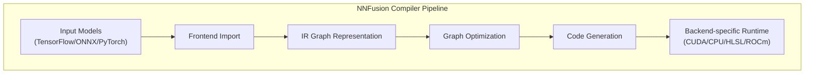
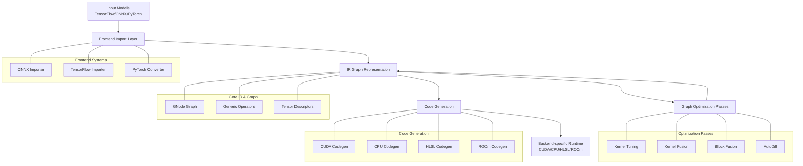
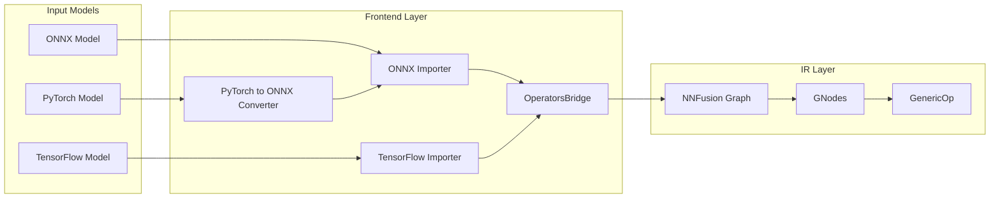
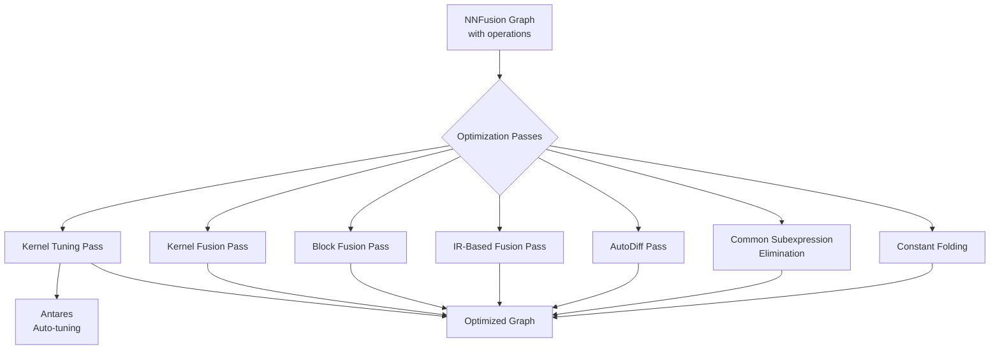
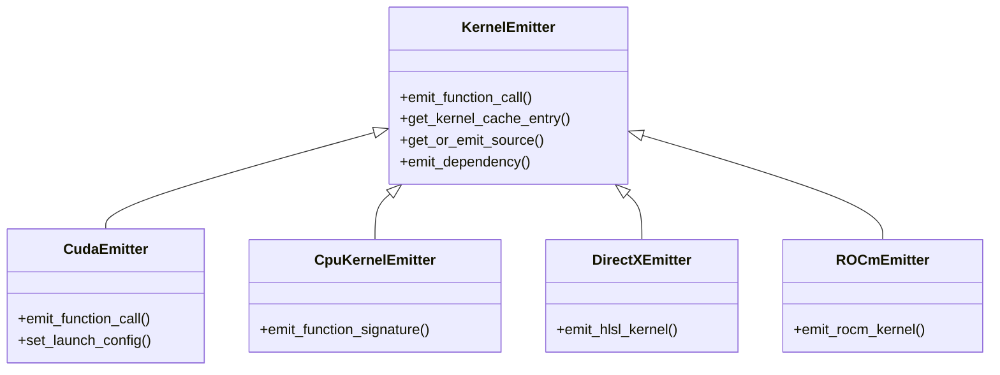
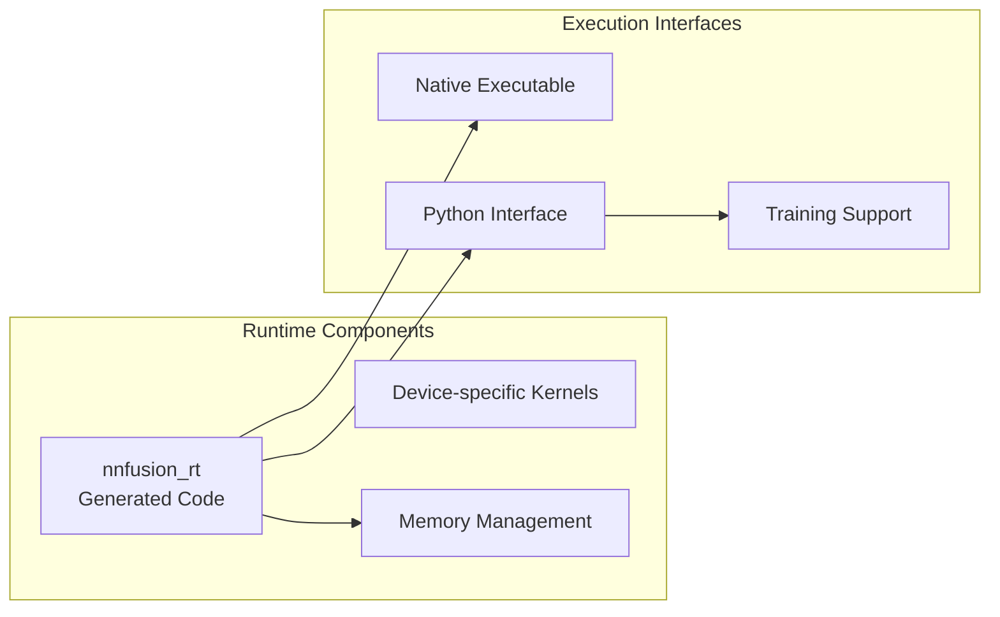
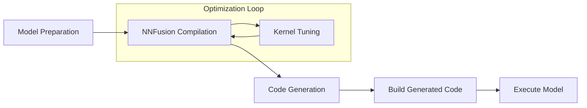

<!-- source: DeepWiki mcp.deepwiki.com · repo microsoft/nnfusion · page 1 Overview · fetched 2026-10-26 -->

# Overview

Relevant source files

The following files were used as context for generating this wiki page:

- [README.md](README.md)
- [docs/README.md](docs/README.md)

## Purpose and Scope

NNFusion is a flexible and efficient Deep Neural Network (DNN) compiler that generates high-performance executables from DNN model descriptions. This page provides a comprehensive overview of the NNFusion system architecture, its key components, and the workflow from model input to optimized code generation. For detailed information about specific subsystems, please refer to their respective wiki pages.

For model importing specifics, see [Frontend Systems](#2). For information about the internal representation, see [Core IR and Graph Representation](#3).

## What is NNFusion?

NNFusion is an optimizing compiler for deep learning models that takes models defined in frameworks like TensorFlow, ONNX, or PyTorch and generates highly efficient executable code tailored for specific hardware targets. It employs various compiler optimization techniques to improve performance beyond what's typically achievable with standard deep learning frameworks.

Sources: [README.md:1-23]()

## Key Objectives

NNFusion aims to achieve three primary goals:

1. **Full-stack Model Optimization**: Applying optimizations at different levels of abstraction, from graph-level to hardware-specific kernel tuning.
2. **Framework-free Code Generation**: Removing dependencies on deep learning frameworks for inference, reducing runtime overhead.
3. **Flexible Target Support**: Enabling deployment on various accelerator devices beyond just standard GPUs.

## System Architecture

NNFusion employs a modular architecture following the traditional compiler design pattern with frontend, intermediate representation, optimization, and backend components. The following diagram illustrates the high-level architecture:

Sources: [README.md:14-21]()

## Key Components

### Frontend Import Systems

The frontend subsystem is responsible for importing models from various deep learning frameworks and converting them to NNFusion's internal representation.

For detailed information about each frontend, refer to the [Frontend Systems](#2) page.

Sources: [README.md:19]()

### Core IR and Graph Representation

NNFusion uses a graph-based intermediate representation (IR) to capture the computational nature of deep learning models. The core components include:

- **GNode Graph**: Represents the dataflow graph of operations
- **Generic Operators**: Framework-agnostic representation of neural network operations
- **Tensor Descriptors**: Metadata about tensors including shape, data type, and memory layout

For more detailed information about the internal representation, see [Core IR and Graph Representation](#3).

Sources: [README.md:15]()

### Optimization Passes

NNFusion applies a series of optimization passes to the IR to improve performance:

The optimization passes fall into these categories:

| Optimization Type | Description | Examples |
|-------------------|-------------|----------|
| Graph Optimizations | Reduces computational graph complexity | Common Subexpression Elimination, Constant Folding |
| Kernel Optimizations | Improves individual kernel performance | Kernel Tuning with Antares |
| Fusion Optimizations | Combines operations to reduce overhead | Kernel Fusion, Block Fusion |
| Memory Optimizations | Optimizes memory usage patterns | Static Memory Layout Planning |
| Training Support | Enables gradient computation | Automatic Differentiation |

For detailed information on optimization techniques, see [Optimization Passes](#4).

Sources: [README.md:15-17]()

### Code Generation

The code generation subsystem produces optimized code for different hardware targets:

NNFusion supports generating code for:
- NVIDIA GPUs (CUDA)
- AMD GPUs (ROCm)
- CPUs
- DirectX Compute (HLSL)

The generated code is human-readable, allowing for manual inspection and additional customization when needed.

For more details, see [Code Generation](#5).

Sources: [README.md:18](), [README.md:21]()

### Runtime and Execution

After code generation, the model can be executed via different interfaces:

For more information about runtime systems, see [Runtime and Execution](#6).

Sources: [README.md:18](), [README.md:22](), [README.md:97]()

## Key Capabilities

### Supported Model Formats
- TensorFlow frozen models
- ONNX models
- PyTorch models (via conversion to ONNX)

### Supported Target Platforms
- NVIDIA GPUs (CUDA)
- AMD GPUs (ROCm)
- CPUs
- DirectX Compute (HLSL)

### Distinctive Features

| Feature | Description |
|---------|-------------|
| Source-to-Source Compilation | Generates human-readable, framework-independent source code |
| Kernel Auto-tuning | Integrates with Antares for hardware-specific kernel optimization |
| Fusion Techniques | Multiple fusion strategies to reduce kernel launch overhead |
| Training Support | Automatic differentiation for gradient computation |
| Custom Operator Support | Framework for extending with custom operators |

Sources: [README.md:14-22]()

## Typical Usage Workflow

1. **Model Preparation**: Freeze or export model from original framework (TensorFlow, ONNX, PyTorch)
2. **Compilation**: Use NNFusion to compile the model
3. **Optimization**: Apply automatic or manual optimizations
4. **Code Generation**: Generate code for target hardware
5. **Build and Execute**: Compile and run the generated code

For more detailed instructions on using NNFusion, refer to the specific guides for different model formats and optimization techniques.

Sources: [README.md:24-97]()

---

