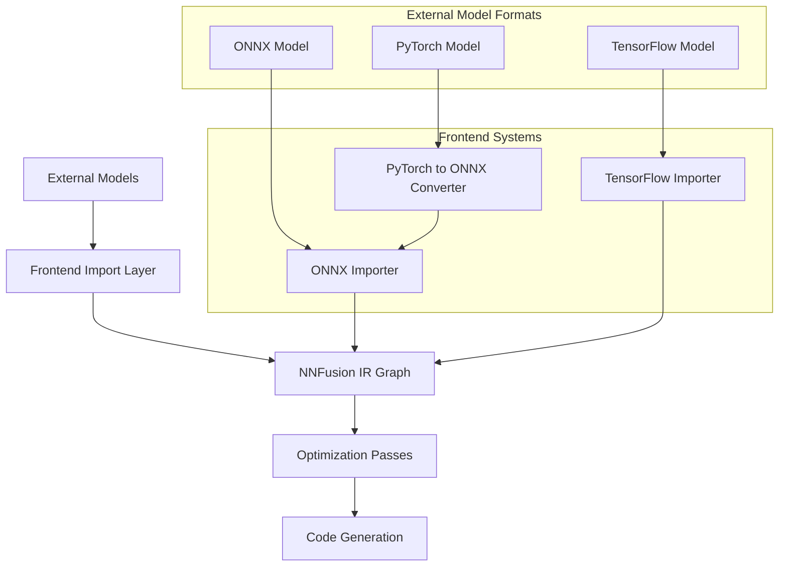
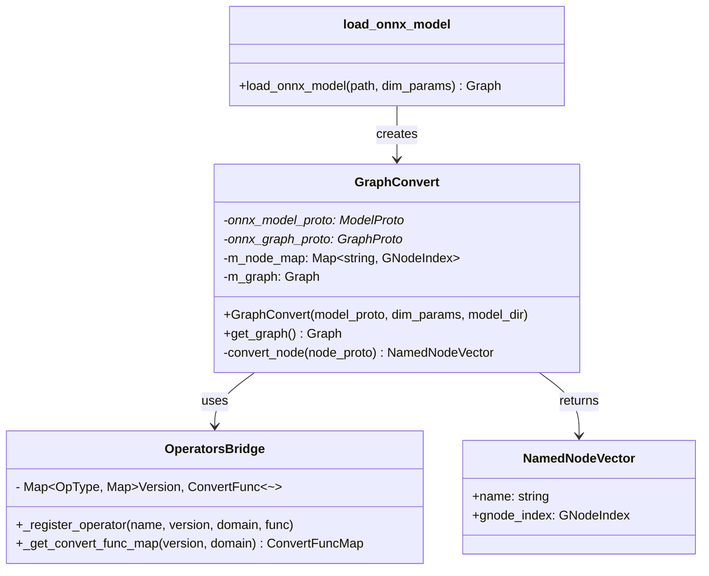
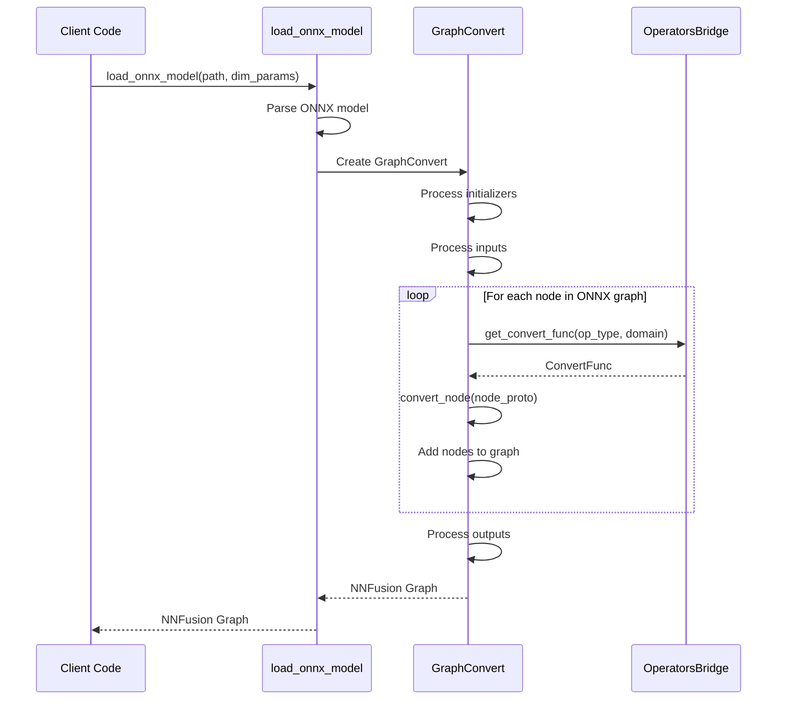
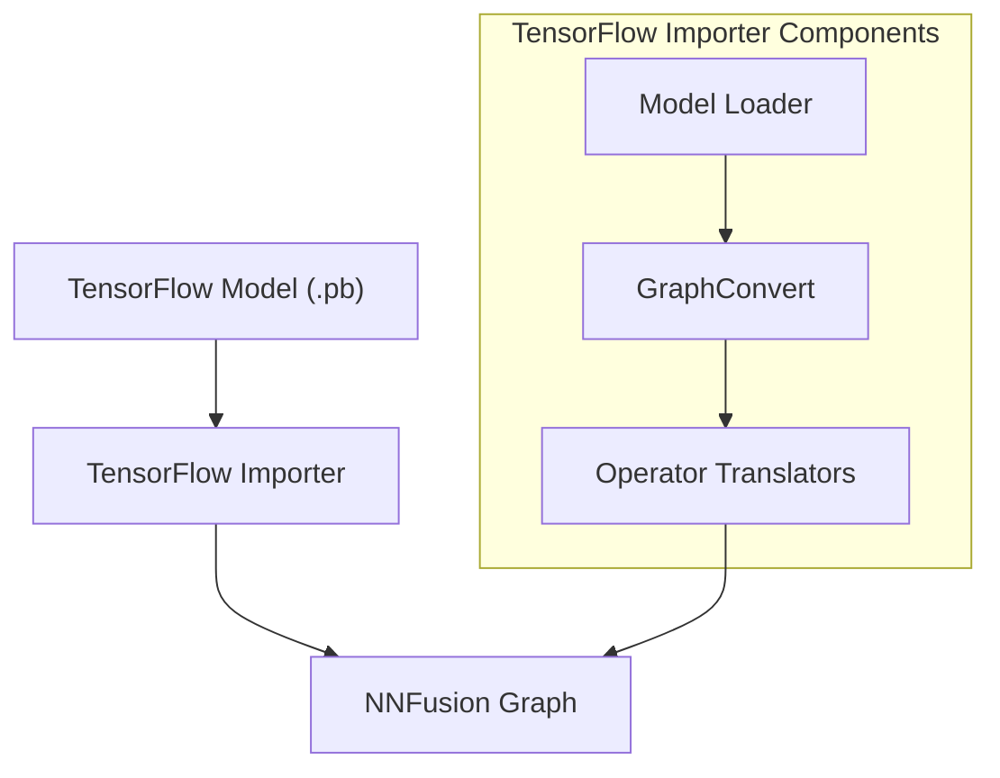
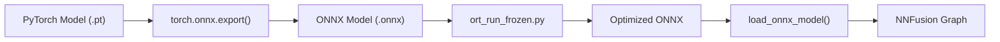

<!-- source: DeepWiki mcp.deepwiki.com · repo microsoft/nnfusion · page 2 Frontend Systems · fetched 2026-10-26 -->

# Frontend Systems

<details>
<summary>Relevant source files</summary>

The following files were used as context for generating this wiki page:

- [models/pytorch2onnx/ort_run_frozen.py](models/pytorch2onnx/ort_run_frozen.py)
- [models/pytorch2onnx/ort_run_frozen_each_layer.py](models/pytorch2onnx/ort_run_frozen_each_layer.py)
- [src/nnfusion/core/kernels/cuda_gpu/kernels/depthwise_conv2d.cpp](src/nnfusion/core/kernels/cuda_gpu/kernels/depthwise_conv2d.cpp)
- [src/nnfusion/core/operators/generic_op/generic_op_define/DepthwiseConv2dNative.cpp](src/nnfusion/core/operators/generic_op/generic_op_define/DepthwiseConv2dNative.cpp)
- [src/nnfusion/core/operators/generic_op/generic_op_define/Softmax.cpp](src/nnfusion/core/operators/generic_op/generic_op_define/Softmax.cpp)
- [src/nnfusion/frontend/onnx_import/CMakeLists.txt](src/nnfusion/frontend/onnx_import/CMakeLists.txt)
- [src/nnfusion/frontend/onnx_import/onnx.cpp](src/nnfusion/frontend/onnx_import/onnx.cpp)
- [src/nnfusion/frontend/onnx_import/op/conv.cpp](src/nnfusion/frontend/onnx_import/op/conv.cpp)
- [src/nnfusion/frontend/onnx_import/op/custom_op.hpp](src/nnfusion/frontend/onnx_import/op/custom_op.hpp)
- [src/nnfusion/frontend/onnx_import/op/depth_to_space.cpp](src/nnfusion/frontend/onnx_import/op/depth_to_space.cpp)
- [src/nnfusion/frontend/onnx_import/op/layer_norm.hpp](src/nnfusion/frontend/onnx_import/op/layer_norm.hpp)
- [src/nnfusion/frontend/onnx_import/ops_bridge.cpp](src/nnfusion/frontend/onnx_import/ops_bridge.cpp)
- [src/nnfusion/frontend/onnx_import/util/graph_convert.cpp](src/nnfusion/frontend/onnx_import/util/graph_convert.cpp)
- [src/nnfusion/frontend/tensorflow_import/util/graph_convert.cpp](src/nnfusion/frontend/tensorflow_import/util/graph_convert.cpp)
- [test/nnfusion/frontend/onnx_import.cpp](test/nnfusion/frontend/onnx_import.cpp)

</details>


The Frontend Systems in NNFusion are responsible for importing deep learning models from different frameworks (ONNX, TensorFlow, PyTorch) and converting them into NNFusion's internal representation. These systems serve as the bridge between external model formats and NNFusion's optimization and code generation pipeline.

## Architecture Overview

The Frontend Systems consist of importers for different model formats that follow a common workflow:



Each frontend module implements three primary functions:
1. **Model Loading**: Parsing the model file from the source format
2. **Operator Mapping**: Converting operators from the source format to NNFusion's operators
3. **Graph Construction**: Building a NNFusion graph with the converted operators

Sources: [src/nnfusion/frontend/onnx_import/onnx.cpp], [src/nnfusion/frontend/tensorflow_import/util/graph_convert.cpp]

## ONNX Import System

The ONNX import system translates ONNX models into NNFusion's internal representation. It is the most extensively developed frontend in NNFusion.



### ONNX Model Loading

The entry point for ONNX model import is `load_onnx_model()` which:
1. Parses the ONNX model file
2. Creates a `GraphConvert` instance
3. Returns the converted NNFusion graph



Sources: [src/nnfusion/frontend/onnx_import/onnx.cpp:31-48]()

### Operator Bridge

The `OperatorsBridge` class serves as a registry that maps ONNX operators to their corresponding NNFusion implementations. It maintains a hierarchical map of:
- Domain (e.g., "", "com.microsoft")
- Operator type (e.g., "Conv", "Relu")
- Version (e.g., 1, 7)
- Translator function

Operators are registered in the `OperatorsBridge` constructor:

```cpp
// Registration example
REGISTER_OPERATOR("Abs", 1, TranslateUnaryOp<op::Abs>);
REGISTER_OPERATOR("Conv", 1, TranslateConvOp);
REGISTER_OPERATOR("MatMul", 1, TranslateMatmulOp);
```

Sources: [src/nnfusion/frontend/onnx_import/ops_bridge.cpp:112-137](), [src/nnfusion/frontend/onnx_import/ops_bridge.cpp:150-288]()

### Graph Conversion

The `GraphConvert` class performs the actual conversion of an ONNX graph to a NNFusion graph by:
1. Processing initializers (constant tensors)
2. Processing inputs (parameters)
3. Converting each node using the appropriate translator
4. Setting up the graph outputs

The conversion process handles node ordering, tensor types, dimensions, and operator-specific attributes.

Sources: [src/nnfusion/frontend/onnx_import/util/graph_convert.cpp:229-515]()

### Operator Translation

Each ONNX operator has a corresponding translator function that creates one or more NNFusion operators. For example, the convolution translator:

1. Extracts inputs (data, filters, optional bias)
2. Parses attributes (strides, dilations, padding, etc.)
3. Creates the appropriate NNFusion convolution operator
4. Sets up the connections in the graph

Translators are implemented as free functions that take an ONNX node, a map of existing nodes, and the NNFusion graph, and return a vector of named nodes.

Sources: [src/nnfusion/frontend/onnx_import/op/conv.cpp:93-273]()

## TensorFlow Import System

The TensorFlow import system follows a similar architecture to the ONNX importer, but is tailored to TensorFlow's model format.



### TensorFlow Operator Translation

TensorFlow operators are translated using specialized functions for different operator types:

```cpp
// Template for unary operators (Relu, Tanh, etc.)
template <typename T>
NamedNodeVector TranslateUnaryOp(const tensorflow::NodeDef& node,
                               const NodeMap& all_ng_nodes,
                               std::shared_ptr<nnfusion::graph::Graph> m_graph)

// Template for binary operators (Add, Mul, etc.)
template <typename T>
NamedNodeVector TranslateBinaryOp(const tensorflow::NodeDef& node,
                                const NodeMap& all_ng_nodes,
                                std::shared_ptr<nnfusion::graph::Graph> m_graph)

// Specialized translators for complex operators
NamedNodeVector TranslateMatMulOp(const tensorflow::NodeDef& node,
                                const NodeMap& all_ng_nodes,
                                std::shared_ptr<nnfusion::graph::Graph> m_graph)
```

For operators without explicit translators, a generic approach is used:

```cpp
NamedNodeVector TranslateGenericNoAttrOp(const tensorflow::NodeDef& node,
                                       const NodeMap& all_ng_nodes,
                                       std::shared_ptr<nnfusion::graph::Graph> m_graph)
```

Sources: [src/nnfusion/frontend/tensorflow_import/util/graph_convert.cpp:130-461](), [src/nnfusion/frontend/tensorflow_import/util/graph_convert.cpp:26-83]()

## PyTorch Integration

PyTorch models are supported through a two-step conversion process:



### PyTorch to ONNX Utilities

NNFusion provides utilities in the `models/pytorch2onnx` directory for converting and working with ONNX models:

1. **ort_run_frozen.py**: Validates and optimizes ONNX models using ONNX Runtime
   - Loads ONNX models and performs basic validation
   - Supports optimization with ONNX Runtime
   - Provides benchmarking capabilities

2. **ort_run_frozen_each_layer.py**: Provides layer-by-layer debugging for ONNX models
   - Analyzes the output of each layer
   - Useful for identifying issues in converted models

Sources: [models/pytorch2onnx/ort_run_frozen.py](), [models/pytorch2onnx/ort_run_frozen_each_layer.py]()

### ONNX Model Optimization

When importing an ONNX model, NNFusion automatically attempts to optimize it using ONNX Runtime:

```cpp
// Optimize ONNX model using external tool
string cmd = "python3 " + script_path +
             " --graph_optimization_level ORT_ENABLE_BASIC " +
             "--warmup 1 --iters 0 --file " +
             path + " --optimized_model_filepath " + optimized_filename;

// Run optimization
int sys_ret = system(cmd.c_str());
```

This optimization can improve model performance and compatibility by applying ONNX Runtime's graph transformations.

Sources: [src/nnfusion/frontend/onnx_import/onnx.cpp:54-79]()

## Supported Operators

The frontend systems support a wide range of operators from each framework:

| Framework | Operator Categories | Examples |
|-----------|---------------------|----------|
| ONNX | Math, Neural Network, Tensor, Activation | Add, Conv, Reshape, Relu, MatMul, BatchNorm |
| TensorFlow | Math, Neural Network, Tensor, Control Flow | Add, Conv2D, Reshape, Relu, MatMul, BiasAdd |
| PyTorch | Via ONNX conversion | All operators supported by PyTorch's ONNX exporter |

New operators can be added by implementing the appropriate translator functions and registering them with the operator bridge.

## Integration with Core IR

The frontend systems produce a NNFusion `Graph` object that is passed to the optimization and code generation components:


This integration allows models from any supported framework to benefit from NNFusion's optimization and code generation capabilities.

## Summary

The Frontend Systems in NNFusion provide a unified approach to importing deep learning models from different frameworks. By converting these models to a common internal representation, NNFusion can apply optimizations and generate efficient code regardless of the original model format.

Key features:
- Support for ONNX, TensorFlow, and PyTorch models
- Extensible architecture for adding new operators and frameworks
- Integration with NNFusion's optimization and code generation pipeline

For more information on specific frontend systems, see:
- ONNX Import: [Section 2.1](#2.1)
- TensorFlow Import: [Section 2.2](#2.2)
- PyTorch Integration: [Section 2.3](#2.3)

Sources: [src/nnfusion/frontend/onnx_import/ops_bridge.cpp], [src/nnfusion/frontend/onnx_import/util/graph_convert.cpp], [src/nnfusion/frontend/tensorflow_import/util/graph_convert.cpp], [models/pytorch2onnx/ort_run_frozen.py]

---

