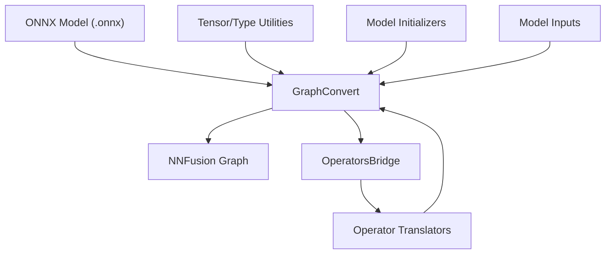
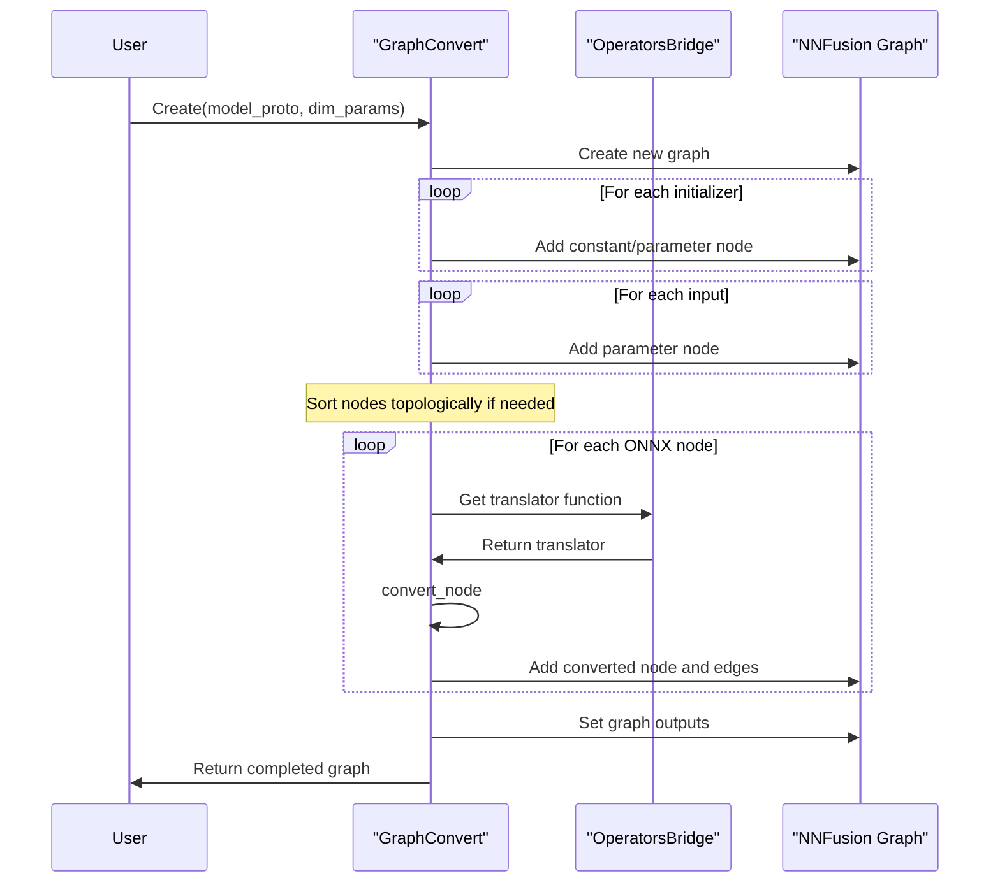
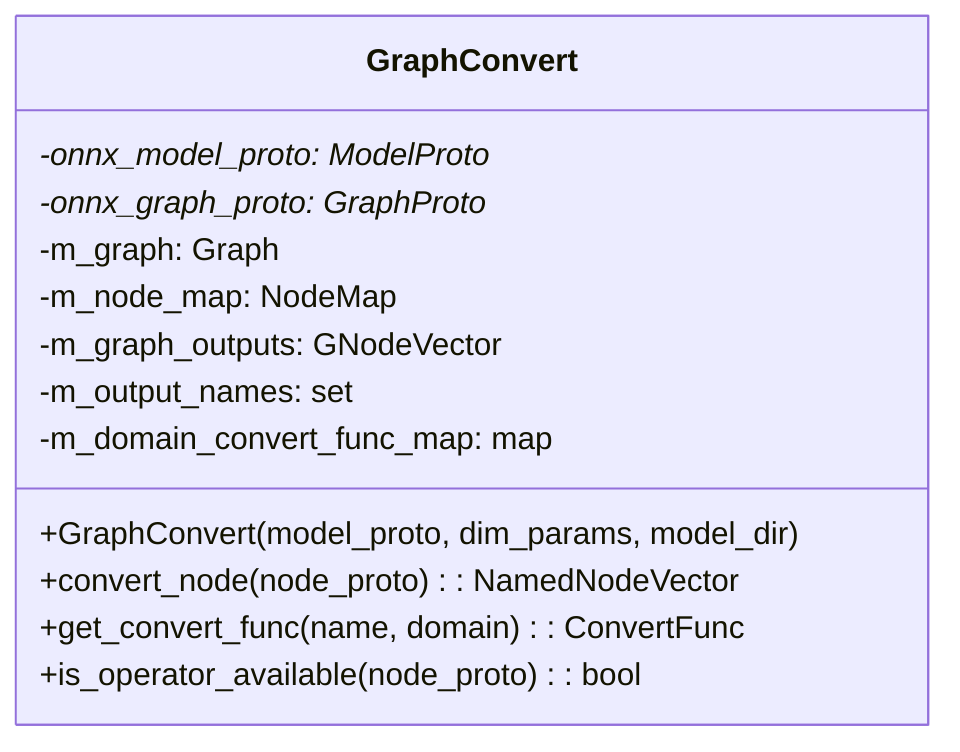
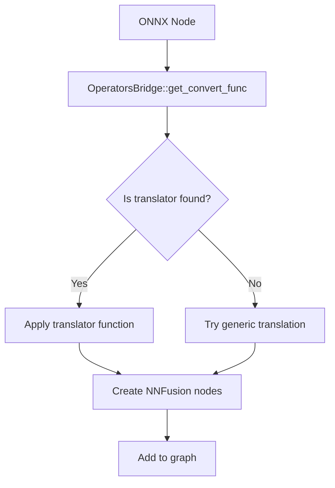

<!-- source: DeepWiki mcp.deepwiki.com · repo microsoft/nnfusion · page 2.1 ONNX Import · fetched 2026-10-26 -->

# ONNX Import

<details>
<summary>Relevant source files</summary>

The following files were used as context for generating this wiki page:

- [src/nnfusion/core/kernels/cuda_gpu/kernels/batch_matmul.cpp](src/nnfusion/core/kernels/cuda_gpu/kernels/batch_matmul.cpp)
- [src/nnfusion/core/kernels/cuda_gpu/kernels/batch_norm.cpp](src/nnfusion/core/kernels/cuda_gpu/kernels/batch_norm.cpp)
- [src/nnfusion/core/kernels/cuda_gpu/kernels/dot.cpp](src/nnfusion/core/kernels/cuda_gpu/kernels/dot.cpp)
- [src/nnfusion/core/kernels/cuda_gpu/kernels/reduce.hpp](src/nnfusion/core/kernels/cuda_gpu/kernels/reduce.hpp)
- [src/nnfusion/core/operators/op_define/constant.hpp](src/nnfusion/core/operators/op_define/constant.hpp)
- [src/nnfusion/frontend/onnx_import/CMakeLists.txt](src/nnfusion/frontend/onnx_import/CMakeLists.txt)
- [src/nnfusion/frontend/onnx_import/core/tensor.hpp](src/nnfusion/frontend/onnx_import/core/tensor.hpp)
- [src/nnfusion/frontend/onnx_import/op/custom_op.hpp](src/nnfusion/frontend/onnx_import/op/custom_op.hpp)
- [src/nnfusion/frontend/onnx_import/op/depth_to_space.cpp](src/nnfusion/frontend/onnx_import/op/depth_to_space.cpp)
- [src/nnfusion/frontend/onnx_import/op/layer_norm.hpp](src/nnfusion/frontend/onnx_import/op/layer_norm.hpp)
- [src/nnfusion/frontend/onnx_import/ops_bridge.cpp](src/nnfusion/frontend/onnx_import/ops_bridge.cpp)
- [src/nnfusion/frontend/onnx_import/util/graph_convert.cpp](src/nnfusion/frontend/onnx_import/util/graph_convert.cpp)
- [src/nnfusion/frontend/onnx_import/util/util.cpp](src/nnfusion/frontend/onnx_import/util/util.cpp)
- [src/nnfusion/frontend/onnx_import/util/util.hpp](src/nnfusion/frontend/onnx_import/util/util.hpp)
- [test/nnfusion/frontend/onnx_import.cpp](test/nnfusion/frontend/onnx_import.cpp)

</details>


This document describes the ONNX import system in NNFusion, which enables the conversion of models from the Open Neural Network Exchange (ONNX) format into NNFusion's internal representation. This functionality allows NNFusion to optimize and compile deep learning models that were originally created in other frameworks like PyTorch and TensorFlow.

## System Overview

The ONNX import system in NNFusion converts ONNX models into NNFusion's graph representation through a series of transformations. This process involves parsing the ONNX protobuf, mapping ONNX operators to NNFusion operators, and building a new graph structure that preserves the computational semantics of the original model.

### Architecture Diagram



Sources: [src/nnfusion/frontend/onnx_import/util/graph_convert.cpp](src/nnfusion/frontend/onnx_import/util/graph_convert.cpp), [src/nnfusion/frontend/onnx_import/ops_bridge.cpp](src/nnfusion/frontend/onnx_import/ops_bridge.cpp)

## Import Process

The ONNX import process follows a sequence of steps to transform the ONNX model into NNFusion's representation:



Sources: [src/nnfusion/frontend/onnx_import/util/graph_convert.cpp:229-515](src/nnfusion/frontend/onnx_import/util/graph_convert.cpp:229-515)

The import process consists of the following key steps:

1. **Initialize the Graph**: Create a new NNFusion graph structure.
2. **Register Operator Sets**: Register the ONNX operator sets needed for translation.
3. **Process Initializers**: Convert ONNX initializers (constant values) to NNFusion constant nodes.
4. **Process Inputs**: Convert ONNX inputs to NNFusion parameter nodes.
5. **Topological Sort**: Ensure nodes are processed in the correct dependency order.
6. **Convert Nodes**: Translate each ONNX node to its NNFusion equivalent using the appropriate translator.
7. **Set Outputs**: Configure the graph outputs based on ONNX model outputs.

## Key Components

### GraphConvert

The `GraphConvert` class is the central component of the ONNX import system. It orchestrates the entire conversion process from ONNX to NNFusion.



Sources: [src/nnfusion/frontend/onnx_import/util/graph_convert.cpp:229-564](src/nnfusion/frontend/onnx_import/util/graph_convert.cpp:229-564)

### OperatorsBridge

The `OperatorsBridge` class maintains a registry of translator functions that convert ONNX operators to NNFusion operators. It supports different versions and domains of ONNX operators.

```mermaid
classDiagram
    class OperatorsBridge {
        -m_map: map<string, map<string, map<int64_t, ConvertFunc>>>
        
        +_register_operator(name, version, domain, fn)
        +_get_convert_func_map(version, domain): ConvertFuncMap
        +static get_convert_func_map(version, domain): ConvertFuncMap
    }
    
    class ConvertFunc {
        <<typedef>>
        function<NamedNodeVector(NodeProto, NodeMap, Graph)>
    }
    
    OperatorsBridge --> ConvertFunc: registers
```

Sources: [src/nnfusion/frontend/onnx_import/ops_bridge.cpp:93-288](src/nnfusion/frontend/onnx_import/ops_bridge.cpp:93-288)

The `OperatorsBridge` constructor registers a wide variety of operator translators:

```cpp
// Registration pattern
REGISTER_OPERATOR("Add", 1, TranslateLegacyBinaryOp<op::Add>);
REGISTER_OPERATOR("Add", 7, TranslateBinaryOp<op::Add>);
REGISTER_OPERATOR("Conv", 1, TranslateConvOp);
// Many more operators...
```

### Utility Functions

The ONNX import system includes various utility functions for working with ONNX data types, tensors, and attributes:

1. **Type Conversion**: 
   - `ONNXDataTypeToNNFusionElementType`: Converts ONNX data types to NNFusion element types
   - Example: `TensorProto_DataType_FLOAT` → `element::f32`

2. **Tensor Data Extraction**:
   - `get_data<T>`: Extracts typed data from ONNX tensors
   - Handles different storage formats (raw_data, typed_data, etc.)

3. **Shape and Attribute Handling**:
   - Functions for extracting kernel shapes, pads, strides, etc.

Sources: [src/nnfusion/frontend/onnx_import/util/util.cpp:31-285](src/nnfusion/frontend/onnx_import/util/util.cpp:31-285), [src/nnfusion/frontend/onnx_import/util/util.hpp:216-358](src/nnfusion/frontend/onnx_import/util/util.hpp:216-358)

## Operator Translation

The translation of ONNX operators to NNFusion operators is a key part of the import process. NNFusion supports a wide range of ONNX operators with specific translators for each.

### Translation Process



Sources: [src/nnfusion/frontend/onnx_import/util/graph_convert.cpp:517-542](src/nnfusion/frontend/onnx_import/util/graph_convert.cpp:517-542)

### Operator Categories

The supported operators can be broadly categorized as:

1. **Simple Unary Operators**: Translated using template functions
   - Examples: Abs, Relu, Sigmoid, Tanh
   - Pattern: `REGISTER_OPERATOR("Relu", 1, TranslateUnaryOp<op::Relu>);`

2. **Simple Binary Operators**: Translated using template functions
   - Examples: Add, Mul, Div, Sub
   - Pattern: `REGISTER_OPERATOR("Add", 7, TranslateBinaryOp<op::Add>);`

3. **Complex Operators**: Have dedicated translator functions
   - Examples: Conv, BatchNorm, LSTM, Attention
   - Pattern: `REGISTER_OPERATOR("Conv", 1, TranslateConvOp);`

4. **Custom/Unsupported Operators**: Translated to Generic Operators
   - Uses the `TranslateCustomOp` function from [src/nnfusion/frontend/onnx_import/op/custom_op.hpp](src/nnfusion/frontend/onnx_import/op/custom_op.hpp)

## Data Type Handling

NNFusion supports a variety of ONNX data types and converts them to the appropriate NNFusion element types:

| ONNX Data Type | NNFusion Element Type |
|----------------|------------------------|
| FLOAT          | element::f32          |
| FLOAT16        | element::f16          |
| DOUBLE         | element::f64          |
| INT8           | element::i8           |
| INT16          | element::i16          |
| INT32          | element::i32          |
| INT64          | element::i64          |
| UINT8          | element::u8           |
| UINT16         | element::u16          |
| UINT32         | element::u32          |
| UINT64         | element::u64          |
| BOOL           | element::boolean      |

Source: [src/nnfusion/frontend/onnx_import/util/util.cpp:31-78](src/nnfusion/frontend/onnx_import/util/util.cpp:31-78)

## Special Considerations

The ONNX import system includes several special features and handling mechanisms:

1. **External Data Support**: The importer can load tensor data stored in external files.
   - See: [src/nnfusion/frontend/onnx_import/util/graph_convert.cpp:185-226](src/nnfusion/frontend/onnx_import/util/graph_convert.cpp:185-226)

2. **Topological Sorting**: Nodes are sorted to ensure proper execution order.
   - See: [src/nnfusion/frontend/onnx_import/util/graph_convert.cpp:41-153](src/nnfusion/frontend/onnx_import/util/graph_convert.cpp:41-153)

3. **Training Mode**: Special handling for training mode where initializers are treated as parameters.
   - See: [src/nnfusion/frontend/onnx_import/util/graph_convert.cpp:353-369](src/nnfusion/frontend/onnx_import/util/graph_convert.cpp:353-369)

4. **Version Support**: Different ONNX opset versions are supported through version-specific translators.
   - See: ONNX_OPSET_VERSION defined in [src/nnfusion/frontend/onnx_import/CMakeLists.txt:17](src/nnfusion/frontend/onnx_import/CMakeLists.txt:17)

## Usage Example

The ONNX import functionality can be used as follows:

```cpp
// Import a model
auto model = frontend::load_onnx_model("path/to/model.onnx");

// Execute the model with input data
Inputs inputs = {...};  // Model input data
Outputs outputs = execute(model, inputs, "NNFusion");

// Or compile the model for deployment
// ...
```

Source: [test/nnfusion/frontend/onnx_import.cpp:109-122](test/nnfusion/frontend/onnx_import.cpp:109-122)

## Summary

The ONNX import functionality in NNFusion provides a robust bridge between models created in other frameworks and NNFusion's optimization capabilities. By supporting the ONNX standard, NNFusion enables users to leverage models from various sources while benefiting from its performance optimization and code generation features.

Sources: [src/nnfusion/frontend/onnx_import/util/graph_convert.cpp](src/nnfusion/frontend/onnx_import/util/graph_convert.cpp), [src/nnfusion/frontend/onnx_import/ops_bridge.cpp](src/nnfusion/frontend/onnx_import/ops_bridge.cpp), [src/nnfusion/frontend/onnx_import/util/util.cpp](src/nnfusion/frontend/onnx_import/util/util.cpp)

---

