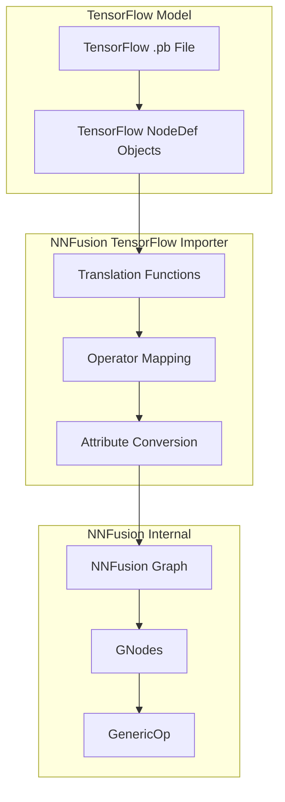
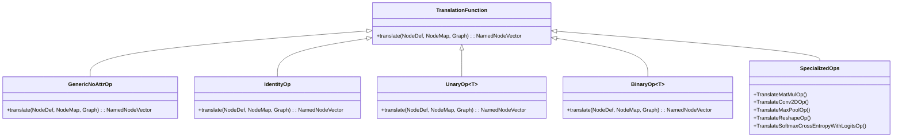
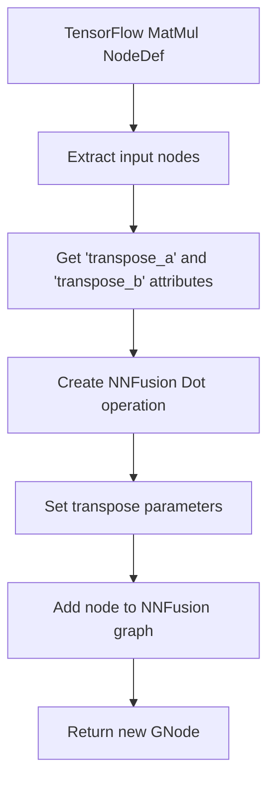
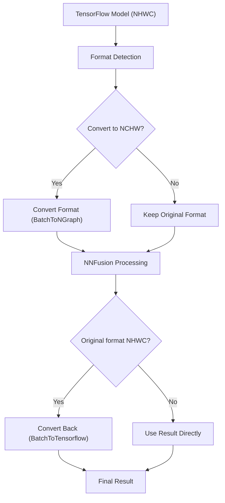
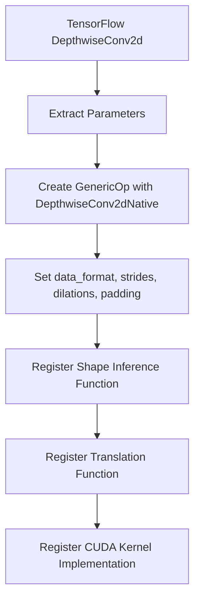
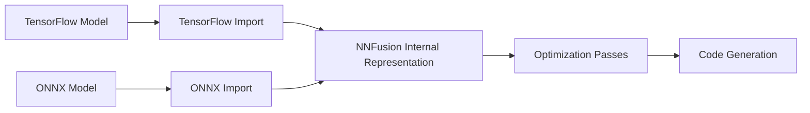

<!-- source: DeepWiki mcp.deepwiki.com · repo microsoft/nnfusion · page 2.2 TensorFlow Import · fetched 2026-10-26 -->

# TensorFlow Import

<details>
<summary>Relevant source files</summary>

The following files were used as context for generating this wiki page:

- [src/nnfusion/core/kernels/cuda_gpu/kernels/depthwise_conv2d.cpp](src/nnfusion/core/kernels/cuda_gpu/kernels/depthwise_conv2d.cpp)
- [src/nnfusion/core/operators/generic_op/generic_op_define/DepthwiseConv2dNative.cpp](src/nnfusion/core/operators/generic_op/generic_op_define/DepthwiseConv2dNative.cpp)
- [src/nnfusion/core/operators/generic_op/generic_op_define/Softmax.cpp](src/nnfusion/core/operators/generic_op/generic_op_define/Softmax.cpp)
- [src/nnfusion/frontend/onnx_import/op/conv.cpp](src/nnfusion/frontend/onnx_import/op/conv.cpp)
- [src/nnfusion/frontend/tensorflow_import/util/graph_convert.cpp](src/nnfusion/frontend/tensorflow_import/util/graph_convert.cpp)

</details>


This document describes the TensorFlow Import system in NNFusion, which enables the compilation and optimization of TensorFlow models. The TensorFlow Import module converts TensorFlow graph definitions into NNFusion's internal graph representation, preserving the computational semantics while enabling the application of NNFusion's optimization passes and code generation capabilities.

## Overview

The TensorFlow Import system is responsible for translating TensorFlow model graphs into NNFusion's internal representation. It parses TensorFlow's NodeDef objects, maps them to equivalent NNFusion operations, and constructs a corresponding graph structure in NNFusion.



**TensorFlow Import Architecture**

Sources: [src/nnfusion/frontend/tensorflow_import/util/graph_convert.cpp:19-161]()

## Translation Process

The TensorFlow importer translates TensorFlow operations to NNFusion operations through a set of specialized translation functions. Each TensorFlow operation type has a corresponding translation function that handles the specifics of that operation.

### Core Translation Functions

The translation system includes several patterns for handling different types of operations:

1. **Generic Translation** - For operations with no special handling requirements
2. **Identity Translation** - For operations that pass through values unchanged
3. **Unary/Binary Operation Translation** - For mathematical operations with one or two inputs
4. **Specialized Translation** - For complex operations like convolution, pooling, etc.



**Translation Function Hierarchy**

Sources: [src/nnfusion/frontend/tensorflow_import/util/graph_convert.cpp:26-83](), [src/nnfusion/frontend/tensorflow_import/util/graph_convert.cpp:85-92](), [src/nnfusion/frontend/tensorflow_import/util/graph_convert.cpp:129-159]()

### Attribute Conversion

TensorFlow operation attributes are converted to NNFusion operation configuration parameters. The system supports various attribute types:

- Strings
- Integers
- Floats
- Booleans
- Data types

```
auto config = nnfusion::op::OpConfig::any{};
for (auto& entry : node.attr()) {
    switch (entry.second.value_case()) {
    case ::tensorflow::AttrValue::ValueCase::kS:
        config[entry.first] = entry.second.s();
        break;
    case ::tensorflow::AttrValue::ValueCase::kI:
        config[entry.first] = entry.second.i();
        break;
    // ... other types
    }
}
```

Sources: [src/nnfusion/frontend/tensorflow_import/util/graph_convert.cpp:36-73]()

## Supported Operations

The TensorFlow Import system supports a wide range of TensorFlow operations, with special handling for many common neural network operations.

### Basic Operations

| Operation Type | Translation Function | Notes |
|----------------|----------------------|-------|
| Identity | TranslateIdentityOp | Simply passes through input node |
| NoOp | TranslateNoOp | Handles control dependencies |
| Cast | TranslateCastOp | Converts data types |
| Reshape | TranslateReshapeOp | Reshapes tensors with shape inference |

Sources: [src/nnfusion/frontend/tensorflow_import/util/graph_convert.cpp:85-92](), [src/nnfusion/frontend/tensorflow_import/util/graph_convert.cpp:111-127](), [src/nnfusion/frontend/tensorflow_import/util/graph_convert.cpp:602-619](), [src/nnfusion/frontend/tensorflow_import/util/graph_convert.cpp:530-600]()

### Mathematical Operations

| Operation Type | Translation Function | Notes |
|----------------|----------------------|-------|
| MatMul | TranslateMatMulOp | Handles transpose_a and transpose_b attributes |
| BatchMatMul | TranslateBatchMatMulOp | Handled via GenericOp |
| BiasAdd | TranslateBiasAddOp | Supports NHWC and NCHW formats |
| Unary Ops (Relu, Tanh, etc.) | TranslateUnaryOp | Template for various unary operations |
| Binary Ops (Add, Mul, etc.) | TranslateBinaryOp | Template for various binary operations |

Sources: [src/nnfusion/frontend/tensorflow_import/util/graph_convert.cpp:313-344](), [src/nnfusion/frontend/tensorflow_import/util/graph_convert.cpp:346-374](), [src/nnfusion/frontend/tensorflow_import/util/graph_convert.cpp:376-431](), [src/nnfusion/frontend/tensorflow_import/util/graph_convert.cpp:129-140](), [src/nnfusion/frontend/tensorflow_import/util/graph_convert.cpp:142-159]()

### Neural Network Operations

| Operation Type | Translation Function | Implementation |
|----------------|----------------------|----------------|
| Conv2D | TranslateConv2DOp | Supports padding, strides, dilations |
| DepthwiseConv2d | Via GenericOp | Custom implementation with CUDA kernel |
| MaxPool | TranslateMaxPoolOp | Supports various data formats and padding |
| Softmax | Via GenericOp | Specialized implementation |
| SparseSoftmaxCrossEntropyWithLogits | TranslateSparseSoftmaxCrossEntropyWithLogitsOp | Translation for loss function |

Sources: [src/nnfusion/frontend/tensorflow_import/util/graph_convert.cpp:707-874](), [src/nnfusion/core/operators/generic_op/generic_op_define/DepthwiseConv2dNative.cpp:6-181](), [src/nnfusion/frontend/tensorflow_import/util/graph_convert.cpp:621-705](), [src/nnfusion/core/operators/generic_op/generic_op_define/Softmax.cpp:6-38](), [src/nnfusion/frontend/tensorflow_import/util/graph_convert.cpp:231-311]()

## Detailed Translation Example

Let's examine how a MatMul operation is translated from TensorFlow to NNFusion:



**MatMul Translation Process**

Sources: [src/nnfusion/frontend/tensorflow_import/util/graph_convert.cpp:313-344]()

The function `TranslateMatMulOp` takes a TensorFlow NodeDef, retrieves the input nodes and required attributes, then creates a NNFusion Dot operation with the appropriate configuration:

1. Get input nodes using `GetInputNode`
2. Retrieve transpose_a and transpose_b attributes
3. Create a Dot operation with the transpose settings
4. Add the operation to the graph
5. Return the new node

## Data Format Handling

TensorFlow primarily uses the NHWC (batch, height, width, channels) data format, while many other frameworks use NCHW. NNFusion supports both formats and provides conversion mechanisms.



**Data Format Conversion Flow**

Sources: [src/nnfusion/frontend/tensorflow_import/util/graph_convert.cpp:642-706]()

The system can:
1. Detect the input data format
2. Convert between formats as needed
3. Process using the preferred format
4. Convert back to the original format if required

The conversion is controlled by the flag `FLAGS_fnchw`, which determines whether to convert NHWC data to NCHW for internal processing.

## Gradient Operation Support

NNFusion's TensorFlow importer supports gradient operations for backpropagation during training:

| Gradient Operation | Translation Function | Description |
|--------------------|----------------------|-------------|
| ReluGrad | TranslateReluGradOp | Gradient for ReLU operation |
| Relu6Grad | TranslateRelu6GradOp | Gradient for ReLU6 operation |
| SigmoidGrad | TranslateSigmoidGradOp | Gradient for Sigmoid operation |
| BiasAddGrad | TranslateBiasAddGradOp | Gradient for BiasAdd operation |

Sources: [src/nnfusion/frontend/tensorflow_import/util/graph_convert.cpp:433-461](), [src/nnfusion/frontend/tensorflow_import/util/graph_convert.cpp:448-461](), [src/nnfusion/frontend/tensorflow_import/util/graph_convert.cpp:463-475](), [src/nnfusion/frontend/tensorflow_import/util/graph_convert.cpp:477-528]()

## Special Case: Depthwise Convolution

Depthwise convolution is a specialized form of convolution that processes each input channel separately. NNFusion provides a dedicated implementation for this operation:



**Depthwise Convolution Support**

Sources: [src/nnfusion/core/operators/generic_op/generic_op_define/DepthwiseConv2dNative.cpp:6-181](), [src/nnfusion/core/kernels/cuda_gpu/kernels/depthwise_conv2d.cpp:10-377]()

NNFusion implements DepthwiseConv2dNative as a GenericOp with:
1. Shape inference function
2. IR translation function
3. Specialized CUDA kernel implementation for both NHWC and NCHW formats

## Integration with ONNX Import

While distinct systems, the TensorFlow and ONNX importers share similar patterns for handling operations like convolution. The ONNX importer provides insights into how operations can be translated across frameworks:



**Frontend Import Systems**

Sources: [src/nnfusion/frontend/onnx_import/op/conv.cpp:36-274]()

## Conclusion

The TensorFlow Import system in NNFusion enables efficient translation of TensorFlow models to NNFusion's internal representation, preserving the computational semantics while enabling NNFusion's optimization capabilities. The system supports a wide range of TensorFlow operations and provides specialized handling for complex neural network operations.

For information on importing ONNX models, see the [ONNX Import](#2.1) page.

For details about the Core IR and Graph Representation that TensorFlow models are converted to, see [Core IR and Graph Representation](#3).

---

