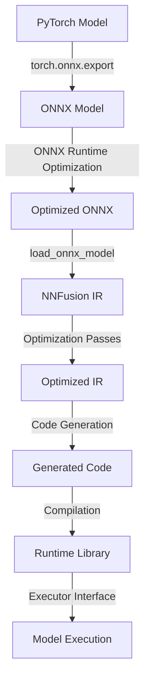
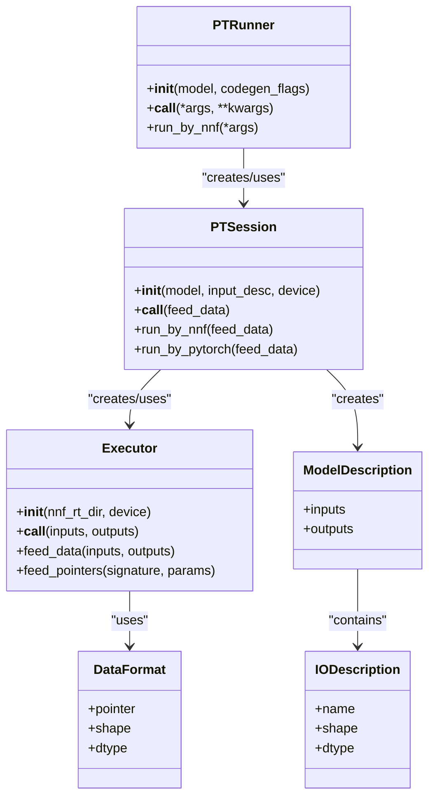
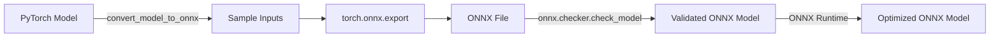
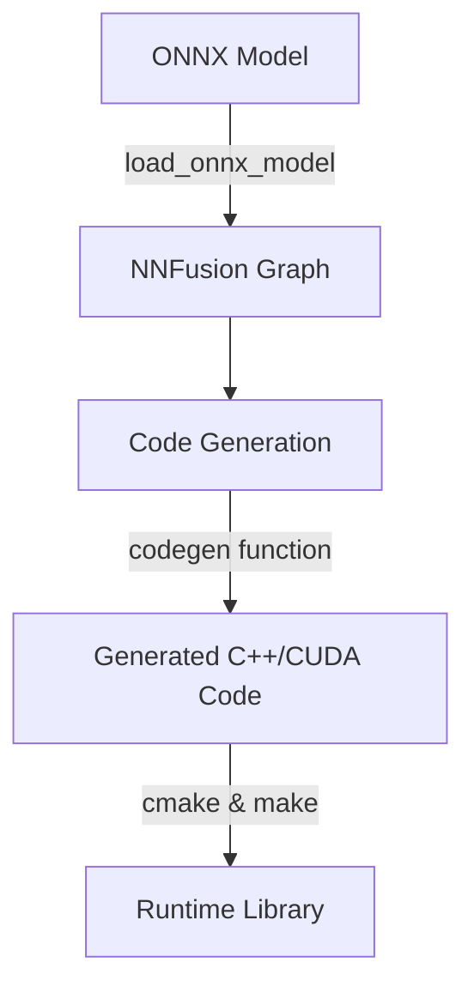
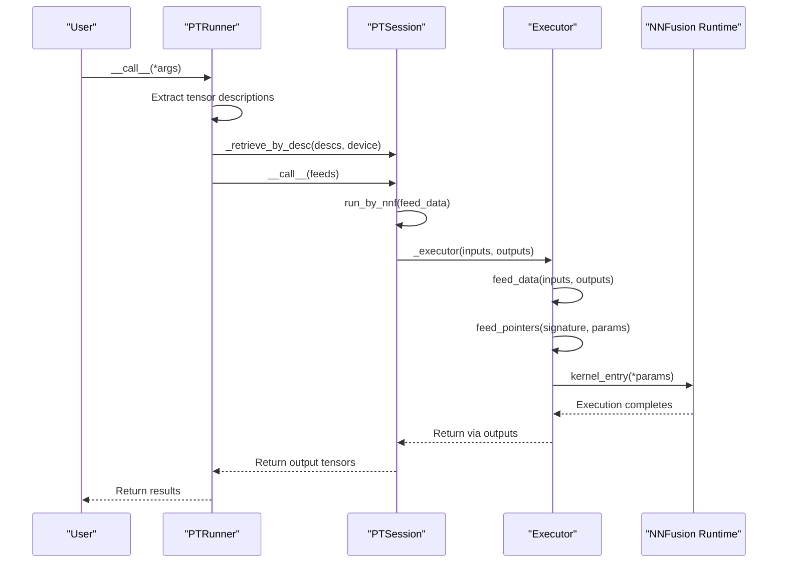
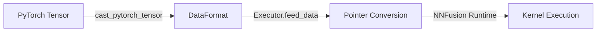

<!-- source: DeepWiki mcp.deepwiki.com · repo microsoft/nnfusion · page 2.3 PyTorch Integration · fetched 2026-10-26 -->

# PyTorch Integration

<details>
<summary>Relevant source files</summary>

The following files were used as context for generating this wiki page:

- [models/pytorch2onnx/ort_run_frozen.py](models/pytorch2onnx/ort_run_frozen.py)
- [models/pytorch2onnx/ort_run_frozen_each_layer.py](models/pytorch2onnx/ort_run_frozen_each_layer.py)
- [src/nnfusion/frontend/onnx_import/onnx.cpp](src/nnfusion/frontend/onnx_import/onnx.cpp)
- [src/python/nnfusion/data_format.py](src/python/nnfusion/data_format.py)
- [src/python/nnfusion/description.py](src/python/nnfusion/description.py)
- [src/python/nnfusion/executor.py](src/python/nnfusion/executor.py)
- [src/python/nnfusion/runner.py](src/python/nnfusion/runner.py)
- [src/python/nnfusion/session.py](src/python/nnfusion/session.py)

</details>


This page documents how PyTorch models can be converted, optimized, and executed using NNFusion. The PyTorch integration enables users to benefit from NNFusion's advanced optimization capabilities while maintaining their existing PyTorch workflows.

## Overview

NNFusion provides a seamless integration with PyTorch through a conversion and execution pipeline. The main components of this integration include:

1. **PyTorch to ONNX conversion** - Converting PyTorch models to ONNX format
2. **NNFusion compilation** - Processing the ONNX model through NNFusion's optimization pipeline
3. **Runtime execution** - Executing the optimized model using NNFusion's runtime

### PyTorch Integration Workflow



Sources: [src/python/nnfusion/session.py:50-81](), [src/nnfusion/frontend/onnx_import/onnx.cpp:31-108]()

## Key Components

### Core Classes

The PyTorch integration consists of several key classes that handle different aspects of the conversion and execution process:



Sources: [src/python/nnfusion/runner.py:30-91](), [src/python/nnfusion/session.py:107-302](), [src/python/nnfusion/executor.py:70-243]()

## PyTorch to ONNX Conversion

The first step in the PyTorch integration pipeline is converting PyTorch models to the ONNX format, which serves as an intermediate representation.

### Conversion Process



The conversion process is handled by the `convert_model_to_onnx` function in the `PTSession` class. This function:

1. Generates sample inputs based on the provided input descriptions
2. Calls `torch.onnx.export` to convert the PyTorch model to ONNX
3. The ONNX model can optionally be optimized using ONNX Runtime

Sources: [src/python/nnfusion/session.py:50-81](), [models/pytorch2onnx/ort_run_frozen.py:1-137]()

## NNFusion Compilation

After conversion to ONNX, the model is imported into NNFusion, optimized, and compiled into an executable runtime.

### Compilation Process



The compilation process includes:

1. Loading the ONNX model using NNFusion's ONNX importer
2. Applying various optimization passes to the model
3. Generating backend-specific code (CUDA, CPU, etc.)
4. Compiling the generated code into a runtime library

Sources: [src/python/nnfusion/session.py:84-105](), [src/nnfusion/frontend/onnx_import/onnx.cpp:31-108]()

## Execution Interfaces

NNFusion provides several interfaces for executing the optimized PyTorch models:

### PTSession

`PTSession` is the main interface for converting and executing PyTorch models. It handles:

1. Converting the PyTorch model to ONNX
2. Compiling the ONNX model with NNFusion
3. Creating an Executor to run the compiled model
4. Handling the data transfer between PyTorch and NNFusion

Example usage:

```python
# Create a session
session = nnfusion.session.PTSession(
    model=model,                  # PyTorch model
    input_desc=input_desc,        # Input descriptions
    device="cuda:0"               # Execution device
)

# Run the model
outputs = session(feed_data)      # Dictionary of input tensors
```

Sources: [src/python/nnfusion/session.py:107-302]()

### Executor

`Executor` is a lower-level interface that wraps the NNFusion runtime library:

1. Loads the compiled NNFusion runtime library
2. Initializes the runtime environment
3. Parses the model's input and output information
4. Handles data conversion between PyTorch tensors and NNFusion's format
5. Executes the model using the runtime library

Sources: [src/python/nnfusion/executor.py:70-243]()

### PTRunner

`PTRunner` provides a higher-level interface that caches sessions for different input shapes:

1. Creates and caches `PTSession` instances for different input configurations
2. Automatically selects or creates the appropriate session when called
3. Simplifies the execution of models with varying input shapes

Example usage:

```python
# Create a runner
runner = nnfusion.runner.PTRunner(
    model=model,                  # PyTorch model
    codegen_flags={...}           # NNFusion codegen flags
)

# Run the model with any input shape
outputs = runner(*inputs)         # PyTorch tensors
```

Sources: [src/python/nnfusion/runner.py:30-91]()

## Execution Flow

The following sequence diagram illustrates the execution flow when running a PyTorch model with NNFusion:



Sources: [src/python/nnfusion/runner.py:63-90](), [src/python/nnfusion/session.py:262-290](), [src/python/nnfusion/executor.py:179-230]()

## Data Format Conversion

NNFusion provides utilities for converting data between PyTorch tensors and NNFusion's internal data format:

### Tensor Conversion Flow



The `cast_pytorch_tensor` function converts PyTorch tensors to NNFusion's `DataFormat`, which includes:

- A pointer to the tensor data
- The tensor's shape and data type
- A reference to the original PyTorch tensor

Sources: [src/python/nnfusion/data_format.py:9-62]()

## Data Type Handling

The following table shows the mapping between PyTorch tensor types and NNFusion data types:

| PyTorch Type | NNFusion Type |
|--------------|---------------|
| float32      | float32       |
| float64      | float64       |
| float16      | float16       |
| int32        | int32         |
| int64        | int64         |
| int16        | int16         |
| int8         | int8          |
| uint8        | uint8         |
| bool         | bool          |

The type conversion is handled automatically during the conversion process.

Sources: [src/python/nnfusion/executor.py:35-64](), [models/pytorch2onnx/ort_run_frozen.py:37-64]()

## Summary

The PyTorch integration in NNFusion provides a powerful way to optimize PyTorch models for faster execution. By converting PyTorch models to ONNX and then leveraging NNFusion's optimization capabilities, users can achieve significant performance improvements while maintaining their existing PyTorch workflows.

Key benefits include:
- Seamless integration with existing PyTorch models
- Advanced optimization capabilities through NNFusion
- Support for multiple backends (CUDA, CPU, etc.)
- Easy-to-use Python interfaces

The `PTSession` and `PTRunner` classes provide convenient interfaces for converting and executing PyTorch models with NNFusion, making it easy to integrate NNFusion into existing PyTorch workflows.

---

