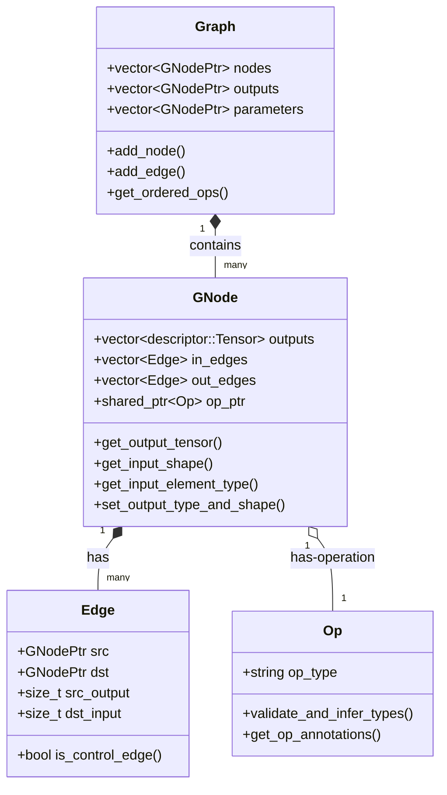
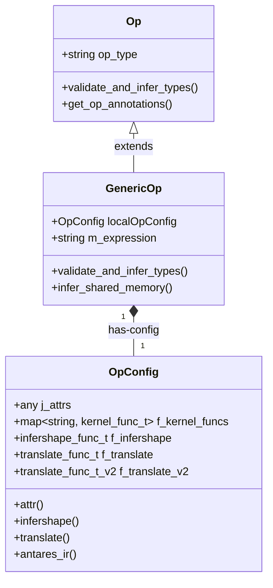
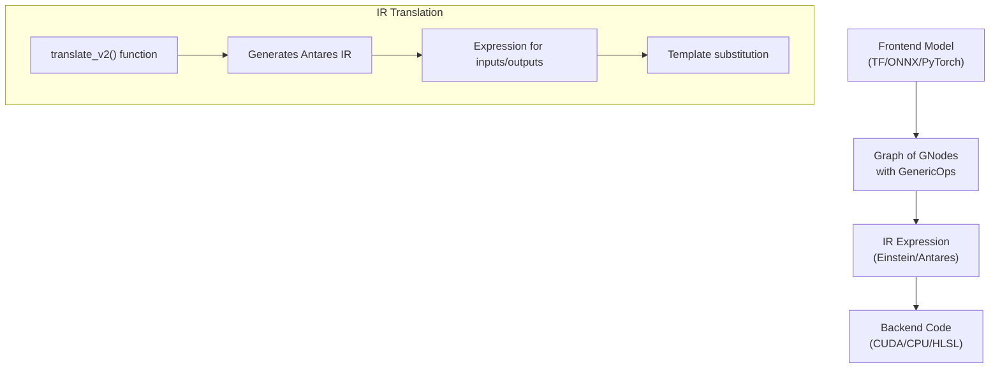
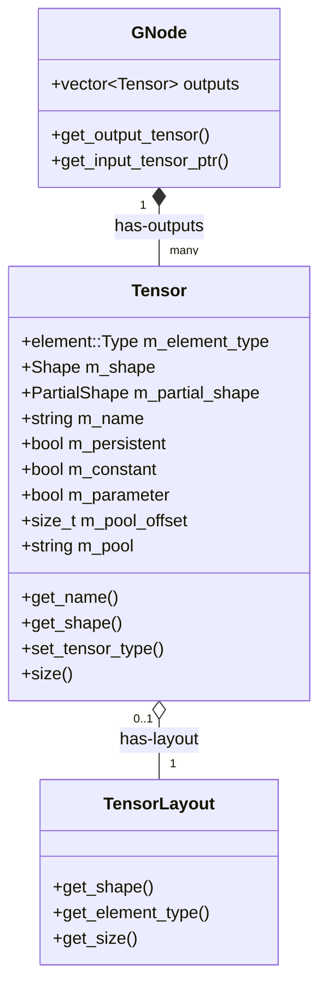
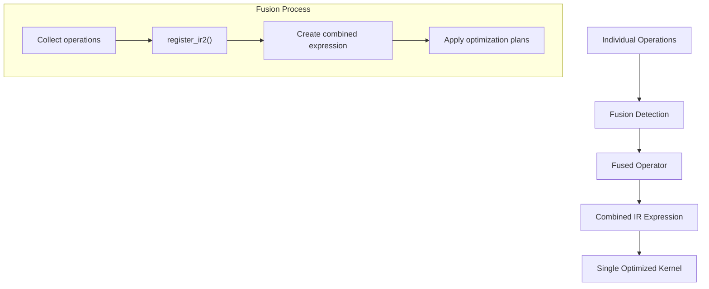
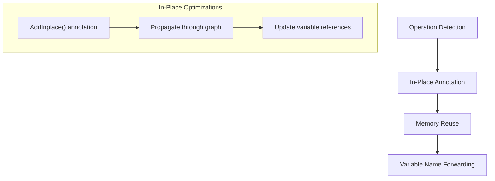

<!-- source: DeepWiki mcp.deepwiki.com · repo microsoft/nnfusion · page 3 Core IR and Graph Representation · fetched 2026-10-26 -->

# Core IR and Graph Representation

<details>
<summary>Relevant source files</summary>

The following files were used as context for generating this wiki page:

- [docs/Compile-a-model-with-kernel-tuning-enabled.md](docs/Compile-a-model-with-kernel-tuning-enabled.md)
- [src/nnfusion/common/descriptor/tensor.cpp](src/nnfusion/common/descriptor/tensor.cpp)
- [src/nnfusion/common/descriptor/tensor.hpp](src/nnfusion/common/descriptor/tensor.hpp)
- [src/nnfusion/core/operators/generic_op/generic_op.hpp](src/nnfusion/core/operators/generic_op/generic_op.hpp)
- [src/nnfusion/core/operators/generic_op/op_registration.cpp](src/nnfusion/core/operators/generic_op/op_registration.cpp)
- [src/nnfusion/core/operators/op_define/fused.cpp](src/nnfusion/core/operators/op_define/fused.cpp)
- [src/nnfusion/core/operators/op_define/fused.hpp](src/nnfusion/core/operators/op_define/fused.hpp)
- [src/nnfusion/engine/pass/extract_graph_signature.cpp](src/nnfusion/engine/pass/extract_graph_signature.cpp)
- [src/nnfusion/engine/pass/graph/op_inplace_pass.cpp](src/nnfusion/engine/pass/graph/op_inplace_pass.cpp)
- [src/nnfusion/frontend/onnx_import/op/gemm.cpp](src/nnfusion/frontend/onnx_import/op/gemm.cpp)
- [src/tools/nnfusion/extensions/Slice](src/tools/nnfusion/extensions/Slice)

</details>


## Purpose and Overview

This document describes the internal representation (IR) and graph structure used by NNFusion to represent deep learning models. The Core IR serves as the central data structure that connects the frontend import systems with backend code generation and optimization passes.

The Core IR is based on a computational graph model where operations (represented as nodes) are connected through data dependencies (represented as edges). This representation enables powerful graph-based optimizations and transformations while maintaining a clean abstraction of the underlying computation.

For information about how models are imported into this representation, see [Frontend Systems](#2).

## Graph Structure

The NNFusion Core IR is structured as a directed graph where each node (GNode) represents an operation and edges represent data flow between operations.



Key components of the graph structure:

1. **GNode**: Represents a computational node in the graph, holding information about its operation, inputs, and outputs
2. **Edge**: Connects nodes with directional data flow, specifying which output of the source node connects to which input of the destination node
3. **Graph**: Contains and manages the entire collection of nodes and their connections

Sources: [src/nnfusion/core/operators/generic_op/generic_op.hpp:315-456](), [src/nnfusion/engine/pass/extract_graph_signature.cpp:42-128]()

## Generic Operators Framework

The core of NNFusion's IR is the Generic Operator framework, which provides a unified representation for all operations.



### Operator Registration and Configuration

The Generic Operator system uses a registration mechanism to define operations with their properties:

```
REGISTER_OP(operation_name)
```

The `OpConfig` class provides a fluent interface to configure operations with:
- Shape inference functions (`infershape`)
- Translation functions for code generation (`translate`, `translate_v2`)
- Kernel implementation functions for different backends (`cuda_kernel`, `cpu_kernel`, etc.)
- Attributes and constraints

Example configuration from the codebase:

```
// Sample operator registration pattern
REGISTER_OP(MyOp)
    .attr("attribute1", value1)
    .attr("attribute2", value2)
    .infershape(my_infershape_function)
    .translate_v2(my_translation_function)
    .cuda_kernel(my_kernel_function, {launch_config})
```

The registered operations are stored in a global registry accessed via `get_op_configs()`.

Sources: [src/nnfusion/core/operators/generic_op/generic_op.hpp:54-198](), [src/nnfusion/core/operators/generic_op/op_registration.cpp:10-109]()

## Expression IR and Translation

NNFusion uses textual expressions to represent operations in an intermediate form before generating backend code. This representation is crucial for optimization and code generation.

### Translation Process



The translation process:

1. Each `GenericOp` can provide a translation function that converts the operation to a string-based IR
2. Two translation mechanisms are supported:
   - `f_translate`: Original translation mechanism
   - `f_translate_v2`: Enhanced translation mechanism with better templating support
3. The expressions can include annotations for optimization hints and performance plans

For example, a matrix multiplication operation might be translated to an expression like:
```
output0[N0, N2] += input0[N0, N1] * input1[N1, N2] where N0 in 128, N1 in 256, N2 in 512
```

Sources: [src/nnfusion/core/operators/generic_op/generic_op.hpp:99-115](), [src/nnfusion/core/operators/generic_op/op_registration.cpp:16-109](), [src/tools/nnfusion/extensions/Slice:1-19]()

## Tensor Representation

Tensors are the primary data structure in NNFusion's IR, representing both inputs/outputs of operations and intermediate results.



Key aspects of tensor representation:

1. **Element Type**: Data type of tensor elements (float32, int32, etc.)
2. **Shape**: Dimensions of the tensor
3. **Memory Management**:
   - Pool allocation with offsets
   - Support for persistent, constant, and parameter tensors
4. **Device Placement**: Information about which device holds the tensor data
5. **Tensor Identity**: Unique naming and identification

Tensors can be rooted in:
- Parameter nodes (inputs to the graph)
- Constant nodes (embedded values)
- Intermediate operation outputs

Sources: [src/nnfusion/common/descriptor/tensor.hpp:40-152](), [src/nnfusion/common/descriptor/tensor.cpp:27-209]()

## Operator Fusion Representation

NNFusion supports operator fusion to optimize performance by combining multiple operations into a single optimized kernel.



The `Fused` operator class handles:

1. Combining multiple operations into a single logical operator
2. Generating a combined IR expression that represents the fused computation
3. Preserving input/output relationships with the rest of the graph
4. Providing optimization hints through plan rules

Fusion is a critical optimization that reduces kernel launch overhead and improves data locality.

Sources: [src/nnfusion/core/operators/op_define/fused.hpp:25-44](), [src/nnfusion/core/operators/op_define/fused.cpp:27-234]()

## In-Place Operations

NNFusion supports in-place operations to optimize memory usage by allowing operations to modify their inputs directly.



The `OpInplacePass` identifies operators that can perform in-place computation and annotates them accordingly. This information is then used during code generation to reuse memory buffers.

Common in-place operations include:
- Element-wise operations
- Reshaping without layout changes
- Result operations (output nodes)

Sources: [src/nnfusion/engine/pass/graph/op_inplace_pass.cpp:22-109]()

## IR to Backend Translation

The Core IR serves as a bridge between frontend model importers and backend code generators. The translation process involves:

1. **Graph Analysis**:
   - Extracting signature information (inputs, outputs, constants)
   - Identifying data dependencies
   - Determining memory requirements

2. **IR Expression Extraction**:
   - Getting expressions for each operation
   - Applying annotations and optimization hints

3. **Code Generation**:
   - Backend-specific kernel emission
   - Memory allocation and management
   - Data movement and synchronization

The entire process preserves the computational semantics of the original model while enabling optimizations specific to the target platform.

Sources: [src/nnfusion/engine/pass/extract_graph_signature.cpp:130-238]()

## Relation to Other Components

The Core IR and graph representation is the centerpiece of the NNFusion architecture, connecting:

- **Frontend Importers**: Convert external model formats into the Core IR
- **Optimization Passes**: Transform the graph to improve performance
- **Backend Code Generators**: Convert the IR into executable code for different targets

This central position allows NNFusion to support multiple frontend frameworks and backend targets while sharing common optimizations and transformations.

---

