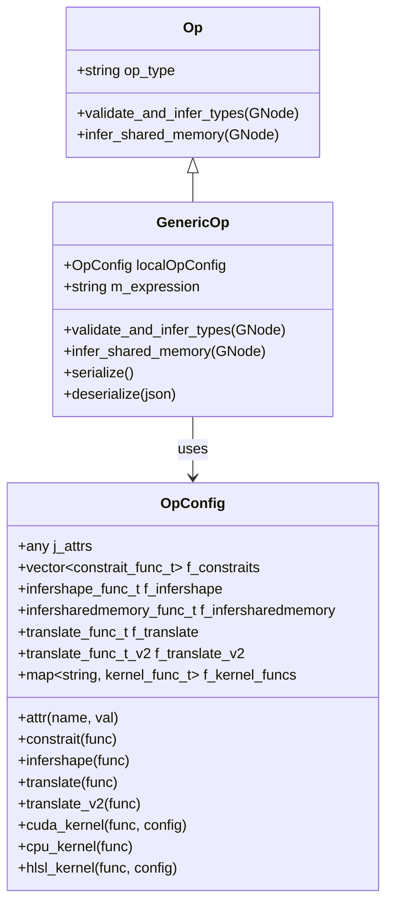
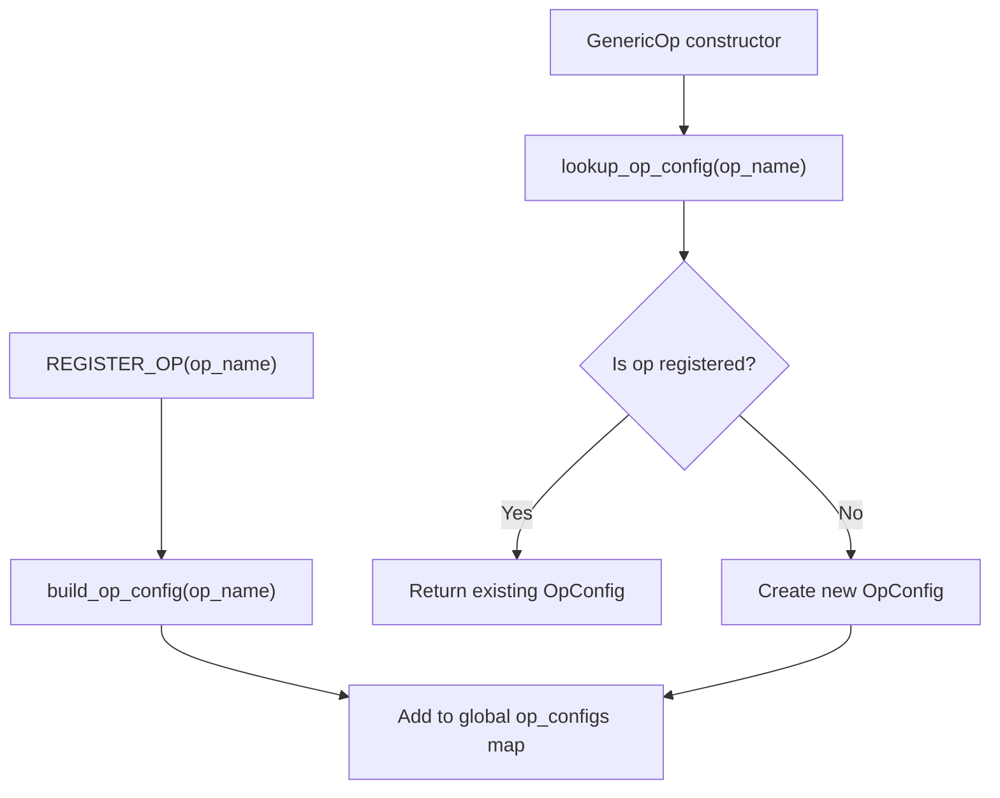
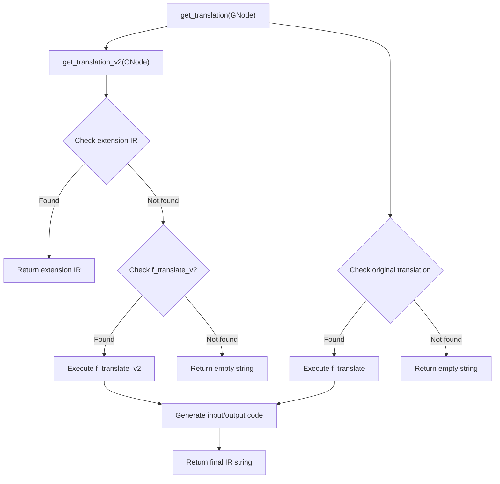
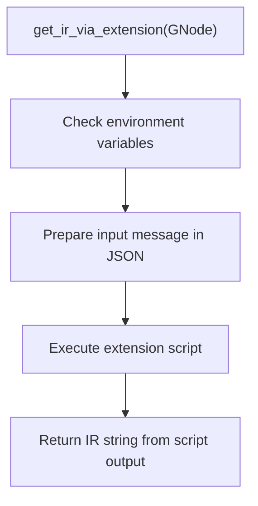
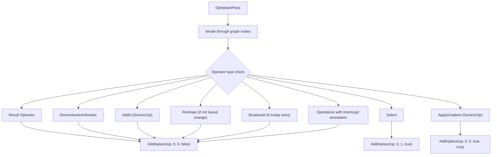
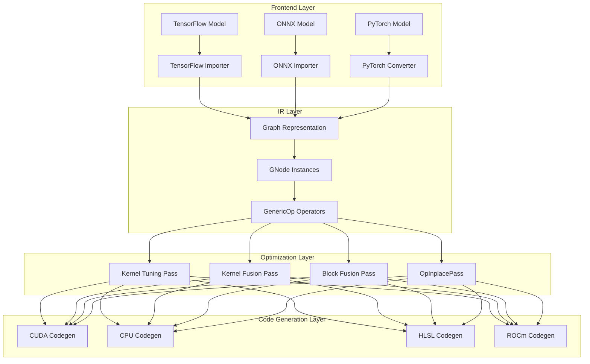

<!-- source: DeepWiki mcp.deepwiki.com · repo microsoft/nnfusion · page 3.1 Generic Operators · fetched 2026-10-26 -->

# Generic Operators

<details>
<summary>Relevant source files</summary>

The following files were used as context for generating this wiki page:

- [src/nnfusion/core/operators/generic_op/generic_op.hpp](src/nnfusion/core/operators/generic_op/generic_op.hpp)
- [src/nnfusion/core/operators/generic_op/op_registration.cpp](src/nnfusion/core/operators/generic_op/op_registration.cpp)
- [src/nnfusion/engine/pass/graph/op_inplace_pass.cpp](src/nnfusion/engine/pass/graph/op_inplace_pass.cpp)
- [src/tools/nnfusion/extensions/Slice](src/tools/nnfusion/extensions/Slice)

</details>


This document details NNFusion's Generic Operator framework, which provides a flexible system for defining, registering, and implementing neural network operations across various hardware targets. Generic Operators are a core component of NNFusion's Intermediate Representation (IR) layer, bridging the gap between imported model formats and hardware-specific code generation.

For information about tensors and memory management, see [Tensors and Memory](#3.2). For information about optimization passes that work with Generic Operators, see [Optimization Passes](#4).

## Core Architecture

The Generic Operator framework consists of two primary classes that work together to provide a comprehensive abstraction for neural network operations:



Sources: [src/nnfusion/core/operators/generic_op/generic_op.hpp:54-171](), [src/nnfusion/core/operators/generic_op/generic_op.hpp:315-455]()

### OpConfig Class

`OpConfig` is a configuration class that stores and manages operator attributes, constraints, inference functions, translation functions, and kernel implementations.

Key capabilities of `OpConfig` include:

1. **Attribute Management**: Add custom attributes using the `attr(name, value)` method
2. **Constraint Specification**: Add validation constraints with the `constrait(func)` method
3. **Shape Inference**: Set shape inference logic with `infershape(func)`
4. **Shared Memory Inference**: Set shared memory requirements with `infersharedmemory(func)`
5. **Translation Functions**: Define how to translate to Antares IR with `translate(func)` or `translate_v2(func)`
6. **Backend-Specific Implementations**: Configure kernels for different backends:
   - CUDA: `cuda_kernel(func, config)`
   - CPU: `cpu_kernel(func)`
   - HLSL/DirectX: `hlsl_kernel(func, config)`

Sources: [src/nnfusion/core/operators/generic_op/generic_op.hpp:54-171]()

### GenericOp Class

`GenericOp` inherits from the base `Op` class and uses an `OpConfig` instance to define its behavior. Key methods include:

1. **Construction**: Takes an operator name, type, and custom configuration
2. **Type and Shape Inference**: Implements `validate_and_infer_types` to determine output shapes
3. **Shared Memory Inference**: Implements `infer_shared_memory` for shared memory requirements
4. **Serialization**: Supports serialization/deserialization to/from JSON

Sources: [src/nnfusion/core/operators/generic_op/generic_op.hpp:315-455]()

## Operator Registration and Lookup

The Generic Operator framework provides mechanisms for registering and looking up operators:



Sources: [src/nnfusion/core/operators/generic_op/generic_op.hpp:173-199](), [src/nnfusion/core/operators/generic_op/op_registration.cpp:10-14]()

### Registration Macro

Operators are registered using the `REGISTER_OP` macro, which creates an `OpConfig` instance and adds it to the global operators map:

```cpp
#define REGISTER_OP(op_x)                                                                          \
    static nnfusion::op::OpConfig __register_op_##op_x = nnfusion::op::build_op_config(#op_x)
```

Sources: [src/nnfusion/core/operators/generic_op/generic_op.hpp:13-14]()

### Global Operator Registry

All registered operators are stored in a global static map, accessed via the `get_op_configs()` function:

```cpp
std::unordered_map<std::string, OpConfig>& get_op_configs()
{
    static std::unordered_map<std::string, OpConfig> __op_configs;
    return __op_configs;
}
```

Sources: [src/nnfusion/core/operators/generic_op/op_registration.cpp:10-14]()

## Shape Inference System

Shape inference is a critical component of the Generic Operator framework. It determines the output tensor shapes based on input shapes and operator attributes.

### Default Shape Inference Functions

The framework provides several default shape inference functions:

1. **Copy Shapes**: Simply copies input shapes to outputs
   ```cpp
   inline void copy_shape_from_inputs(std::shared_ptr<graph::GNode> gnode)
   {
       for (int i = 0; i < gnode->get_input_size(); ++i)
       {
           gnode->set_output_type_and_shape(
               0, gnode->get_input_element_type(i), gnode->get_input_shape(i));
       }
   }
   ```

2. **Boolean Output**: Copies input shapes but sets output type to boolean
   ```cpp
   inline void copy_shape_from_inputs_with_boolean(std::shared_ptr<graph::GNode> gnode)
   {
       for (int i = 0; i < gnode->get_input_size(); ++i)
       {
           gnode->set_output_type_and_shape(
               0, nnfusion::element::boolean, gnode->get_input_shape(i));
       }
   }
   ```

Sources: [src/nnfusion/core/operators/generic_op/generic_op.hpp:24-52]()

### Advanced Shape Inference

For operators with complex shape transformations, custom shape inference functions can be provided. If no shape inference function is provided, NNFusion will attempt to infer shapes through Antares IR execution.

Sources: [src/nnfusion/core/operators/generic_op/generic_op.hpp:348-441]()

## Translation to Antares IR

The Generic Operator framework provides a translation mechanism that converts operator nodes to Antares IR for code generation and auto-tuning.



Sources: [src/nnfusion/core/operators/generic_op/op_registration.cpp:17-109]()

### Translation Functions

There are two kinds of translation functions:
1. **Original Translation (`f_translate`)**: The first-generation translation function
2. **Advanced Translation (`f_translate_v2`)**: The second-generation translation function that generates Antares-compatible IR

Sources: [src/nnfusion/core/operators/generic_op/generic_op.hpp:99-115](), [src/nnfusion/core/operators/generic_op/op_registration.cpp:17-109]()

### Extension Mechanism

The framework supports an extension mechanism through the `get_ir_via_extension` function. This allows external scripts to generate IR code for operators:



Sources: [src/nnfusion/core/operators/generic_op/op_registration.cpp:135-197](), [src/tools/nnfusion/extensions/Slice:1-19]()

## In-place Operation Support

The Generic Operator framework supports in-place operations, which can improve memory efficiency by reusing input memory for outputs.



Sources: [src/nnfusion/engine/pass/graph/op_inplace_pass.cpp:22-109]()

## Code Generation Templates

The framework includes utilities for generating code from templates using a simple placeholder replacement mechanism:

```cpp
inline std::string create_code_from_template(std::string templ,
                                           const OpConfig::any& feed_dict)
{
    std::unordered_map<std::string, std::string> feed_pairs;
    for (auto& it : feed_dict.items())
    {
        // Convert values to strings
        std::string value;
        if (it.value().is_string())
            value = it.value();
        else if (it.value().is_null())
            value = "NULL";
        else if (it.value().is_number_float())
        {
            // Handle floating point values precisely
            std::stringstream ss;
            ss.flags(std::ios_base::scientific);
            ss << std::setprecision(std::numeric_limits<float>::digits)
               << (float)it.value();
            value = ss.str();
        }
        else
        {
            std::stringstream ss;
            ss << it.value();
            value = ss.str();
        }
        feed_pairs.insert(std::make_pair("@" + it.key() + "@", value));
    }

    // Replace all placeholders in the template
    int at = templ.find("@");
    while (true)
    {
        int cur_at = templ.find("@", at + 1);
        if (cur_at == std::string::npos || at == std::string::npos)
            break;
        auto placeholder = templ.substr(at, cur_at - at + 1);
        auto feed_pair = feed_pairs.find(placeholder);
        if (feed_pair != feed_pairs.end())
        {
            templ = templ.substr(0, at) + feed_pair->second + templ.substr(cur_at + 1);
            at += feed_pair->second.size();
        }
        else
        {
            at = cur_at;
        }
    }
    return std::move(templ);
}
```

Sources: [src/nnfusion/core/operators/generic_op/generic_op.hpp:210-260]()

## Operator Annotation System

The framework includes an annotation system that allows operators to specify additional properties or hints for code generation and optimization:

```cpp
std::string get_annotation(std::string translation)
{
    std::string options;
    const char annotation[] = "## @: ";
    int pos = translation.find(annotation);
    if (pos >= 0)
    {
        pos += sizeof(annotation) - 1;
        options = translation.substr(pos);
        options.erase(remove(options.begin(), options.end(), ' '), options.end());
        std::replace(options.begin(), options.end(), ',', '|');
    }

    if (options.size() > 0)
    {
        if (options[0] != '|')
            options = "|" + options;
        if (options.back() != '|')
            options += "|";
    }

    return options;
}
```

Sources: [src/nnfusion/core/operators/generic_op/op_registration.cpp:111-133]()

## Integration with NNFusion Framework

The Generic Operator framework is a central component of NNFusion's IR layer, connecting high-level model representations with backend-specific code generation:



Sources: [src/nnfusion/core/operators/generic_op/generic_op.hpp:315-455](), [src/nnfusion/engine/pass/graph/op_inplace_pass.cpp:22-109]()

## Usage Examples

### 1. Registering a New Operator

To register a new operator, use the `REGISTER_OP` macro followed by method chaining:

```cpp
REGISTER_OP(MyCustomOp)
    .attr("dimensions", {1, 2, 3})  // Add custom attributes
    .infershape(my_shape_inference_function)  // Set shape inference
    .translate_v2([](std::shared_ptr<graph::GNode> gnode) -> std::string {
        // Generate Antares IR code
        return "output0[N0, N1] = input0[N0, N1] * input1[N0, N1] where N0 in 64, N1 in 128;";
    })
    .cuda_kernel(my_cuda_kernel_function, {32, 32, 1});  // Set CUDA kernel
```

### 2. Using a GenericOp in a Graph

To create and use a GenericOp instance:

```cpp
// Custom configuration
OpConfig::any custom_config;
custom_config["dimensions"] = {1, 2, 3};

// Create operator instance
auto op = std::make_shared<GenericOp>("instance_name", "MyCustomOp", custom_config);

// Create graph node using this operator
auto node = graph->add_node(op, inputs);
```

### 3. Example: Slice Operator Extension

The Slice operator is implemented as an extension script that generates Antares IR:

```python
#!/usr/bin/env python3
import sys, json
op_v2 = json.loads(sys.argv[1])
inputs, config = op_v2["input_dict"], op_v2["config"]
output_name = op_v2["output_name"]
where_range = [x for x in inputs[0]["shape"]]
in_items, out_items = [f'N{i}' for i in range(len(where_range))], [f'N{i}' for i in range(len(where_range))]
for dim, start, end, stride in zip(config["axes"], config["starts"], config["ends"], config["steps"]):
  if dim < 0:
    dim += len(where_range)
  if start > where_range[dim]:
    start = where_range[dim]
  if end > where_range[dim]:
    end = where_range[dim]
  in_items[dim] = f'''{start} + ({stride}) * {in_items[dim]}'''
  where_range[dim] = (end - start) // stride
  assert where_range[dim] > 0
where_range = [f'N{i} in {x}' for i, x in enumerate(where_range)]
print(f'''{output_name}[{", ".join(out_items)}] = {inputs[0]["name"]}[{", ".join(in_items)}] where {", ".join(where_range)}; ''')
```

Sources: [src/tools/nnfusion/extensions/Slice:1-19]()

## Summary

The Generic Operator framework provides a flexible and extensible system for defining, registering, and implementing neural network operations in NNFusion. Key features include:

1. **Flexible Configuration**: Operators can be configured with various attributes, constraints, and functions
2. **Shape Inference**: Automatic and custom inference of output shapes
3. **Multiple Translation Paths**: Support for original and Antares-compatible IR
4. **Extension Mechanism**: External scripts for operator implementation
5. **Backend Support**: Configurable kernels for CUDA, CPU, and HLSL/DirectX
6. **In-place Operations**: Memory optimization through in-place execution
7. **Code Generation**: Template-based code generation utilities

The framework serves as a critical layer in NNFusion, enabling the compiler to generate optimized code for a wide range of neural network operations across different hardware targets.

---

