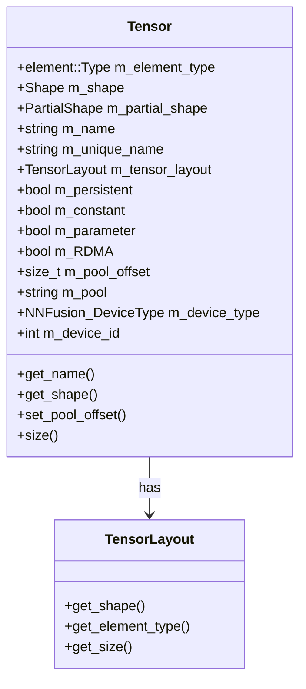
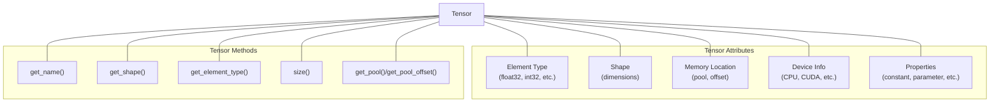
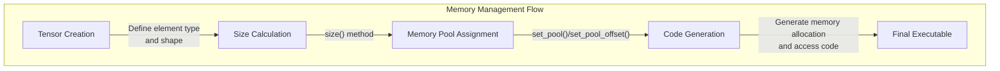
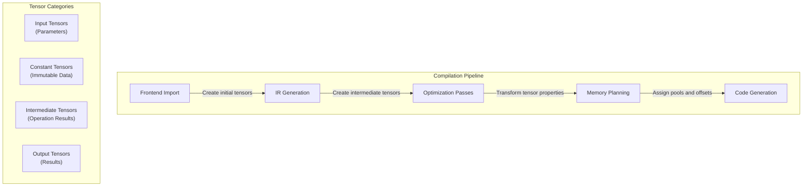

<!-- source: DeepWiki mcp.deepwiki.com · repo microsoft/nnfusion · page 3.2 Tensors and Memory · fetched 2026-10-26 -->

# Tensors and Memory

Relevant source files

The following files were used as context for generating this wiki page:

- [docs/Compile-a-model-with-kernel-tuning-enabled.md](docs/Compile-a-model-with-kernel-tuning-enabled.md)
- [src/nnfusion/common/descriptor/tensor.cpp](src/nnfusion/common/descriptor/tensor.cpp)
- [src/nnfusion/common/descriptor/tensor.hpp](src/nnfusion/common/descriptor/tensor.hpp)
- [src/nnfusion/core/operators/op_define/fused.cpp](src/nnfusion/core/operators/op_define/fused.cpp)
- [src/nnfusion/core/operators/op_define/fused.hpp](src/nnfusion/core/operators/op_define/fused.hpp)
- [src/nnfusion/engine/pass/extract_graph_signature.cpp](src/nnfusion/engine/pass/extract_graph_signature.cpp)
- [src/nnfusion/frontend/onnx_import/op/gemm.cpp](src/nnfusion/frontend/onnx_import/op/gemm.cpp)

This document explains how tensors are represented and how memory is managed in the NNFusion compiler framework. It describes the data structures and mechanisms used to handle tensor data throughout the compilation process, from frontend import to backend code generation.

For information about generic operators that work with these tensors, see [Generic Operators](#3.1).

## Tensor Representation Overview

In NNFusion, tensors are the fundamental data structures that represent multi-dimensional arrays of values used in deep learning models. The tensor system provides a flexible and efficient way to manage these data structures across different devices and memory spaces.

Sources: [src/nnfusion/common/descriptor/tensor.hpp:40-150](), [src/nnfusion/common/descriptor/tensor.cpp:27-54]()

## Core Tensor Class

The `Tensor` class is defined in the `nnfusion::descriptor` namespace and is the primary data structure for representing tensor data in NNFusion. A tensor encapsulates:

1. **Data Type** - The element type of the tensor (e.g., float32, int64)
2. **Shape** - The dimensions of the tensor
3. **Memory Location** - Where the tensor data is stored
4. **Device Information** - Which device the tensor is allocated on
5. **Properties** - Flags indicating the tensor's characteristics

Tensor instances are usually stored and passed as shared pointers (`std::shared_ptr<Tensor>`) throughout the codebase to ensure proper memory management.

Sources: [src/nnfusion/common/descriptor/tensor.hpp:40-150](), [src/nnfusion/common/descriptor/tensor.cpp:27-54]()

## Tensor Creation and Properties

Tensors are created during different phases of the compilation process:

1. **Model Import** - Created when importing models from frameworks like TensorFlow, ONNX, or PyTorch
2. **Graph Transformation** - Created during graph transformation passes
3. **Code Generation** - Referenced during code generation to create memory allocations

Each tensor has several important properties:

| Property | Description |
|----------|-------------|
| `m_element_type` | The data type of tensor elements (float32, int32, etc.) |
| `m_shape` | The static shape of the tensor (if known) |
| `m_partial_shape` | Potentially dynamic shape information |
| `m_name` | Human-readable name (often from the source model) |
| `m_unique_name` | System-generated unique identifier |
| `m_persistent` | Whether the tensor should persist across iterations |
| `m_constant` | Whether the tensor contains immutable data |
| `m_parameter` | Whether the tensor is a model parameter |
| `m_RDMA` | Whether the tensor is accessed via RDMA |
| `m_pool` | Memory pool identifier |
| `m_pool_offset` | Offset in the memory pool |
| `m_device_type` | Type of device (CPU, CUDA, HLSL, etc.) |
| `m_device_id` | ID of the device |

Sources: [src/nnfusion/common/descriptor/tensor.hpp:122-149](), [src/nnfusion/common/descriptor/tensor.cpp:27-54]()

## Memory Management

NNFusion uses a memory pool system to manage tensor allocations efficiently. Instead of allocating memory for each tensor individually, tensors are assigned to memory pools with specific offsets.

Sources: [src/nnfusion/common/descriptor/tensor.cpp:142-161](), [src/nnfusion/common/descriptor/tensor.cpp:169-180]()

Key aspects of memory management include:

1. **Memory Pools**: Tensors are assigned to named memory pools (`m_pool`)
2. **Pool Offsets**: Each tensor has an offset within its pool (`m_pool_offset`)
3. **Size Calculation**: The `size()` method calculates tensor size in bytes or elements
4. **Memory Sharing**: Tensors can share memory through reference mechanisms
5. **In-place Operations**: Some operations modify tensors in-place to reduce memory usage

The memory management system allows NNFusion to:
- Minimize memory allocation overhead
- Enable memory reuse between operations
- Optimize memory layout for specific devices
- Handle device-specific memory constraints

Sources: [src/nnfusion/engine/pass/extract_graph_signature.cpp:84-128](), [src/nnfusion/common/descriptor/tensor.cpp:142-180]()

## Tensor Layouts

Tensors can have associated layout information through the `TensorLayout` class. This allows for device-specific memory organizations that can optimize access patterns.

A tensor layout provides:
- Physical arrangement of tensor elements in memory
- Device-specific optimizations
- Support for specialized memory formats (e.g., blocked layouts for CPUs)

When a tensor has a layout, the layout's shape and element type must match those of the tensor.

Sources: [src/nnfusion/common/descriptor/tensor.cpp:182-196](), [src/nnfusion/common/descriptor/tensor.hpp:66-71]()

## Tensor Usage During Compilation

During the compilation process, tensors serve multiple roles:

Sources: [src/nnfusion/engine/pass/extract_graph_signature.cpp:11-238]()

The `ExtractGraphSignature` pass in NNFusion identifies different categories of tensors:

1. **Input Tensors (Parameters)**: External inputs to the model
2. **Constant Tensors**: Immutable tensor values (e.g., weights)
3. **Output Tensors (Results)**: Tensors that need to be returned
4. **Intermediate Tensors**: Temporary results between operations

This categorization is crucial for:
- Generating function signatures for compiled code
- Allocating memory correctly
- Optimizing memory usage through tensor reuse
- Managing data transfers between host and devices

Sources: [src/nnfusion/engine/pass/extract_graph_signature.cpp:130-170](), [src/nnfusion/engine/pass/extract_graph_signature.cpp:172-223]()

## In-place Operations and Memory Optimization

NNFusion optimizes memory usage by identifying operations that can modify tensors in-place, avoiding unnecessary copies. The system tracks:

1. **In-place Input Propagation**: When an operation's input is the same memory as another tensor
2. **In-place Output Propagation**: When an operation's output is the same memory as its input

This is implemented in the `propagate_in_place_input` and `propagate_in_place_output` methods.

Sources: [src/nnfusion/engine/pass/extract_graph_signature.cpp:43-77](), [src/nnfusion/engine/pass/extract_graph_signature.cpp:84-128]()

## Device-specific Memory Handling

Tensors in NNFusion can be associated with different device types and IDs. This information is used during code generation to:

1. Generate device-specific memory allocation code
2. Handle data transfers between devices
3. Apply device-specific optimizations
4. Support heterogeneous execution environments

The device information includes:
- `m_device_type`: The type of device (CPU, CUDA, HLSL, ROCm)
- `m_device_id`: The specific device ID (important for multi-GPU systems)
- `m_RDMA`: Flag indicating whether the tensor is accessed via RDMA

Sources: [src/nnfusion/common/descriptor/tensor.cpp:198-203](), [src/nnfusion/common/descriptor/tensor.hpp:113-117]()

## Tensor Naming and Identification

Each tensor in NNFusion has several identification mechanisms:

1. **Name**: Human-readable name (often from the source model)
2. **Unique Name**: System-generated unique identifier
3. **Instance ID**: Unique numeric ID assigned when the tensor is created

These identifiers are used in:
- Code generation to create variable names
- Debugging and visualization
- Mapping between different compilation stages

Sources: [src/nnfusion/common/descriptor/tensor.cpp:57-104](), [src/nnfusion/common/descriptor/tensor.hpp:57-58]()

## Integration with Operator System

Tensors are tightly integrated with NNFusion's operator system, especially in the context of fused operations. When operators are fused:

1. Intermediate tensors are managed to optimize memory usage
2. Tensor expressions are retargeted to reflect the fusion
3. Memory allocation for intermediate results is optimized

The `Fused` operator handles tensor references through expressions and mediates (intermediate tensors).

Sources: [src/nnfusion/core/operators/op_define/fused.cpp:80-201](), [src/nnfusion/core/operators/op_define/fused.hpp:25-43]()

## Summary

The tensor and memory management system in NNFusion provides a flexible and efficient way to represent and manipulate multi-dimensional data. Key aspects include:

1. Comprehensive tensor representation via the `Tensor` class
2. Memory pool-based allocation system for efficient memory usage
3. Support for different device types and memory spaces
4. In-place operation detection for memory optimization
5. Integration with the operator system for optimized execution

This infrastructure forms the backbone of NNFusion's ability to efficiently compile deep learning models for various target platforms.

---

