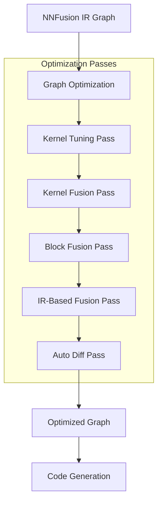
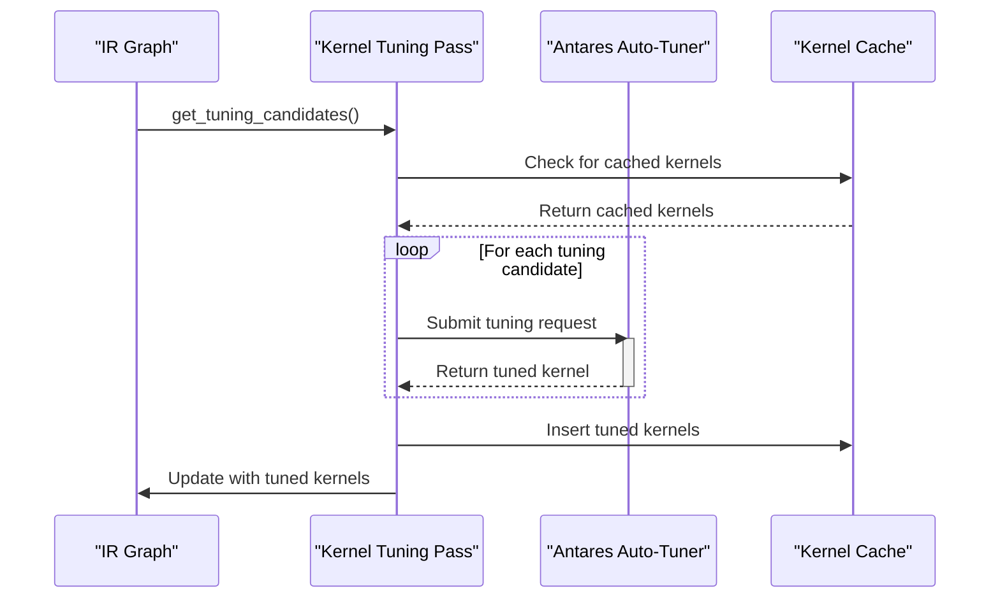
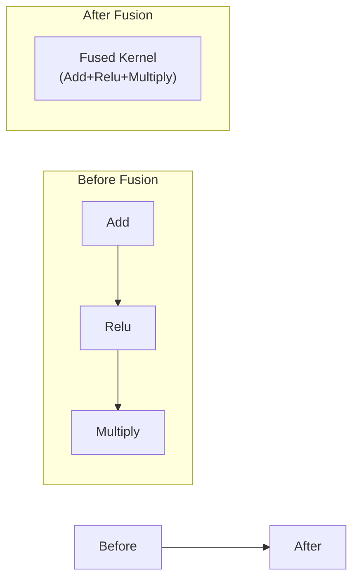
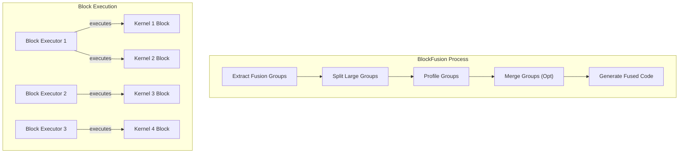
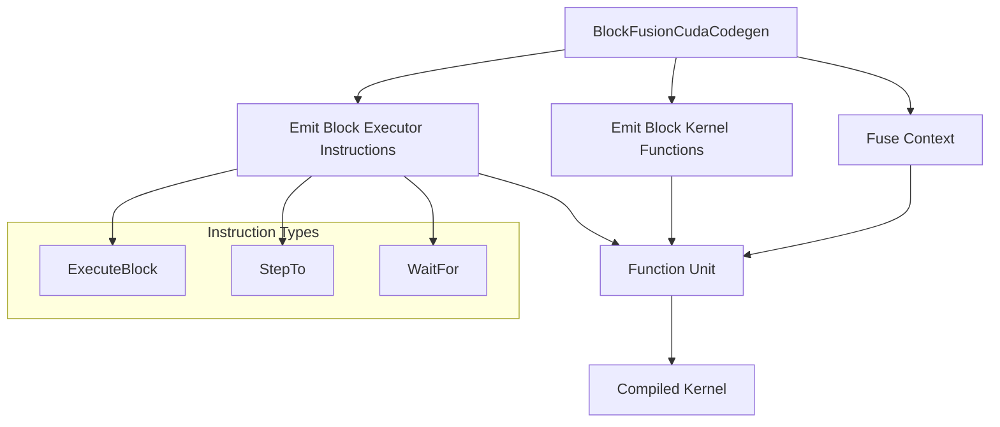
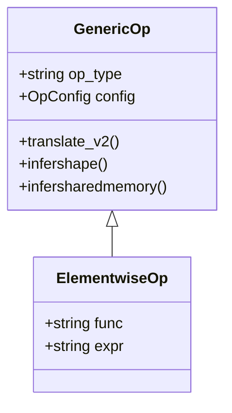
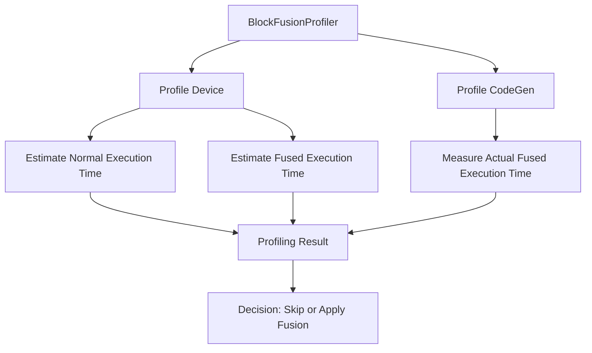

<!-- source: DeepWiki mcp.deepwiki.com · repo microsoft/nnfusion · page 4 Optimization Passes · fetched 2026-10-26 -->

# Optimization Passes

<details>
<summary>Relevant source files</summary>

The following files were used as context for generating this wiki page:

- [src/nnfusion/core/graph/gnode.cpp](src/nnfusion/core/graph/gnode.cpp)
- [src/nnfusion/core/graph/gnode.hpp](src/nnfusion/core/graph/gnode.hpp)
- [src/nnfusion/core/graph/graph_util.cpp](src/nnfusion/core/graph/graph_util.cpp)
- [src/nnfusion/core/graph/subgraph_match.cpp](src/nnfusion/core/graph/subgraph_match.cpp)
- [src/nnfusion/core/kernels/kernel_emitter.cpp](src/nnfusion/core/kernels/kernel_emitter.cpp)
- [src/nnfusion/core/operators/generic_op/generic_op_define/AvgPool.cpp](src/nnfusion/core/operators/generic_op/generic_op_define/AvgPool.cpp)
- [src/nnfusion/core/operators/generic_op/generic_op_define/DepthToSpace.cpp](src/nnfusion/core/operators/generic_op/generic_op_define/DepthToSpace.cpp)
- [src/nnfusion/core/operators/generic_op/generic_op_define/Elementwise.cpp](src/nnfusion/core/operators/generic_op/generic_op_define/Elementwise.cpp)
- [src/nnfusion/core/operators/generic_op/generic_op_define/GatherV2.cpp](src/nnfusion/core/operators/generic_op/generic_op_define/GatherV2.cpp)
- [src/nnfusion/engine/pass/graph/blockfusion/blockfusion_codegen.cpp](src/nnfusion/engine/pass/graph/blockfusion/blockfusion_codegen.cpp)
- [src/nnfusion/engine/pass/graph/blockfusion/blockfusion_optimizer.cpp](src/nnfusion/engine/pass/graph/blockfusion/blockfusion_optimizer.cpp)
- [src/nnfusion/engine/pass/graph/blockfusion/blockfusion_optimizer.hpp](src/nnfusion/engine/pass/graph/blockfusion/blockfusion_optimizer.hpp)
- [src/nnfusion/engine/pass/graph/blockfusion/blockfusion_profiler.cpp](src/nnfusion/engine/pass/graph/blockfusion/blockfusion_profiler.cpp)
- [src/nnfusion/engine/pass/graph/blockfusion/blockfusion_profiler.hpp](src/nnfusion/engine/pass/graph/blockfusion/blockfusion_profiler.hpp)
- [src/nnfusion/engine/pass/graph/blockfusion/common.hpp](src/nnfusion/engine/pass/graph/blockfusion/common.hpp)
- [src/nnfusion/engine/pass/graph/blockfusion_pass.cpp](src/nnfusion/engine/pass/graph/blockfusion_pass.cpp)
- [src/nnfusion/engine/pass/graph/ir_based_fusion_pass.hpp](src/nnfusion/engine/pass/graph/ir_based_fusion_pass.hpp)
- [src/nnfusion/engine/pass/graph/kernel_fusion_pass.cpp](src/nnfusion/engine/pass/graph/kernel_fusion_pass.cpp)
- [src/nnfusion/engine/pass/graph/kernel_tuning.cpp](src/nnfusion/engine/pass/graph/kernel_tuning.cpp)
- [src/nnfusion/engine/pass/graph/kernel_tuning.hpp](src/nnfusion/engine/pass/graph/kernel_tuning.hpp)
- [src/nnfusion/engine/pass/tensor/liveness_analysis.cpp](src/nnfusion/engine/pass/tensor/liveness_analysis.cpp)
- [src/nnfusion/frontend/torchscript_import/util/graph_convert.cpp](src/nnfusion/frontend/torchscript_import/util/graph_convert.cpp)
- [src/nnfusion/frontend/util/evaluator.hpp](src/nnfusion/frontend/util/evaluator.hpp)
- [test/nnfusion/scripts/testcase_configs/blockfusion_tests.json](test/nnfusion/scripts/testcase_configs/blockfusion_tests.json)

</details>


This document describes the optimization passes in NNFusion, which are critical components in the compiler pipeline that transform and improve the computational graph for better performance. These passes operate on the graph representation after the frontend import phase and before the code generation phase. For information about the core IR itself, see [Core IR and Graph Representation](#3).

## Overview

Optimization passes in NNFusion are graph-to-graph transformations that analyze and modify the internal representation to achieve better performance. The primary goals of these passes include:

1. Optimizing individual kernels through auto-tuning
2. Combining operations to reduce kernel launch overhead
3. Improving data locality and memory access patterns
4. Enabling other performance optimizations like automatic differentiation



Sources: [src/nnfusion/engine/pass/graph/kernel_tuning.hpp](https://github.com/microsoft/nnfusion/src/nnfusion/engine/pass/graph/kernel_tuning.hpp), [src/nnfusion/engine/pass/graph/blockfusion_pass.cpp](https://github.com/microsoft/nnfusion/src/nnfusion/engine/pass/graph/blockfusion_pass.cpp), [src/nnfusion/engine/pass/graph/kernel_fusion_pass.cpp](https://github.com/microsoft/nnfusion/src/nnfusion/engine/pass/graph/kernel_fusion_pass.cpp)

## Kernel Tuning Pass

The Kernel Tuning Pass optimizes individual kernels to achieve the best performance on target hardware. It interfaces with an auto-tuning system called Antares to search for optimal kernel implementations.

### Key Features

- Automatically tunes kernels for maximum performance
- Leverages Antares tuning service for kernel optimization
- Caches tuned kernels for later reuse
- Supports blocking of specific operators from tuning



### Implementation Details

The `KernelTuning` class is the main implementation of this pass. 

- It first identifies tuning candidates in the graph by examining each node's operator type and checking if they're in the blocklist.
- For each candidate, it either submits a tuning request to an Antares service or performs synchronous tuning.
- Tuning can be performed asynchronously, with results being saved for later compilation runs.
- Performance results are collected and can be dumped to a CSV file for analysis.
- Tuned kernels are registered in the kernel registry and can be inserted into a kernel cache.

Configuration parameters include:
- Maximum tuning steps (`FLAGS_fkernel_tuning_steps`)
- Operator blocklist (`FLAGS_ftuning_blocklist`)
- Performance file location (`FLAGS_fantares_perf_file`)
- Target platform (`FLAGS_ftuning_platform`)

Sources: [src/nnfusion/engine/pass/graph/kernel_tuning.cpp:30-113](https://github.com/microsoft/nnfusion/src/nnfusion/engine/pass/graph/kernel_tuning.cpp:30-113), [src/nnfusion/engine/pass/graph/kernel_tuning.cpp:409-538](https://github.com/microsoft/nnfusion/src/nnfusion/engine/pass/graph/kernel_tuning.cpp:409-538)

## Fusion Passes

NNFusion implements several fusion passes that combine multiple operations to reduce kernel launch overhead and improve data locality.

### Kernel Fusion Pass

The Kernel Fusion Pass combines element-wise operations into a single operation to reduce kernel launch overhead and improve memory access patterns.



Key aspects:
- Focuses on fusing element-wise operations (e.g., Add, Multiply, Relu)
- Can fuse reshape and broadcast operations with element-wise operations
- Identifies independent groups that can be fused separately
- Extracts fusion groups based on topological ordering

The implementation uses a `KernelFuseOptimizer` class, which:
1. Extracts fusion groups from the graph
2. Optimizes reshape and broadcast operations in these groups
3. Splits independent operation groups to increase fusion opportunities
4. Fuses element groups on the graph

The fusion level can be configured with `FLAGS_fkernel_fusion_level`:
- Level 0: Disable fusion
- Level 1: Basic fusion
- Level 2: Enable reshapes and broadcasts fusion
- Level 3: Split independent groups for more fusion opportunities

Sources: [src/nnfusion/engine/pass/graph/kernel_fusion_pass.cpp:73-143](https://github.com/microsoft/nnfusion/src/nnfusion/engine/pass/graph/kernel_fusion_pass.cpp:73-143), [src/nnfusion/engine/pass/graph/kernel_fusion_pass.cpp:533-602](https://github.com/microsoft/nnfusion/src/nnfusion/engine/pass/graph/kernel_fusion_pass.cpp:533-602)

### Block Fusion Pass

The Block Fusion Pass is a more advanced fusion technique that groups operations into "blocks" that can be executed in parallel by GPU blocks. This approach leverages the parallel nature of GPU execution to improve performance.



Key features:
- Uses a wavefront optimization approach to identify groups of operations that can be executed in parallel
- Profiles fusion groups to determine if fusion will improve performance
- Supports different fusion levels with increasing aggressiveness
- Generates CUDA/ROCm code for the fused blocks

The `BlockFusionWavefrontOptimizer` class implements this pass with the following key methods:
- `ExtractFusionGroups()`: Identifies groups of operations that can be fused
- `SplitGroup()`: Splits large groups to ensure they fit within resource limits
- `MergeGroups()`: Optionally merges compatible groups for better performance
- `GroupProfiler()`: Profiles groups to determine if fusion will improve performance
- `FuseGroupOnGraph()`: Performs the actual fusion on the graph

The fusion level is controlled by `FLAGS_fblockfusion_level`:
- Level 0: Disable block fusion
- Level 1: Enable wavefront optimization
- Level 2: Enable wavefront optimization with wave merging (experimental)

Sources: [src/nnfusion/engine/pass/graph/blockfusion/blockfusion_optimizer.cpp:52-143](https://github.com/microsoft/nnfusion/src/nnfusion/engine/pass/graph/blockfusion/blockfusion_optimizer.cpp:52-143), [src/nnfusion/engine/pass/graph/blockfusion_pass.cpp:25-65](https://github.com/microsoft/nnfusion/src/nnfusion/engine/pass/graph/blockfusion_pass.cpp:25-65)

### Block Fusion Code Generation

Once block fusion groups are identified, code must be generated for the fused operations. The `BlockFusionCudaCodegen` class handles this task:



Key components:
- `FuseContext()`: Merges the contexts of individual kernels into a unified context
- `emit_block_kernel_functions()`: Generates code for all kernel functions in the block
- `emit_block_executor_instruction_*()`: Generates code for different instruction types
- `emit_block_executor()`: Generates code for a specific block executor

Block fusion instructions include:
- `ExecuteBlock`: Executes a specific kernel block
- `StepTo`: Advances the execution to a specific step (for synchronization)
- `WaitFor`: Waits for other executors to reach a specific step

Sources: [src/nnfusion/engine/pass/graph/blockfusion/blockfusion_codegen.cpp:16-137](https://github.com/microsoft/nnfusion/src/nnfusion/engine/pass/graph/blockfusion/blockfusion_codegen.cpp:16-137), [src/nnfusion/engine/pass/graph/blockfusion/common.hpp:18-153](https://github.com/microsoft/nnfusion/src/nnfusion/engine/pass/graph/blockfusion/common.hpp:18-153)

## IR-Based Fusion Pass

The IR-Based Fusion Pass leverages Antares IR to perform fusion. While less information is available in the provided files, this pass appears to be another approach to operator fusion that works at the IR level rather than the graph level.

Sources: [src/nnfusion/engine/pass/graph/ir_based_fusion_pass.hpp:19-23](https://github.com/microsoft/nnfusion/src/nnfusion/engine/pass/graph/ir_based_fusion_pass.hpp:19-23)

## Working with Generic Operators

Many optimization passes work with generic operators, which are a flexible representation of operations in NNFusion. For example, element-wise operations are defined in a generic way to facilitate optimization:



The generic operator system allows for easy definition of operations like element-wise arithmetic, pooling, reshaping, etc., and facilitates their fusion and optimization.

Sources: [src/nnfusion/core/operators/generic_op/generic_op_define/Elementwise.cpp:6-75](https://github.com/microsoft/nnfusion/src/nnfusion/core/operators/generic_op/generic_op_define/Elementwise.cpp:6-75), [src/nnfusion/core/operators/generic_op/generic_op_define/AvgPool.cpp:6-113](https://github.com/microsoft/nnfusion/src/nnfusion/core/operators/generic_op/generic_op_define/AvgPool.cpp:6-113)

## Liveness Analysis and Memory Optimization

While not strictly an optimization pass itself, liveness analysis is a crucial component that supports optimization by determining when tensors are created and when they're no longer needed. This information is used by optimization passes to make decisions about memory allocation and reuse.

Sources: [src/nnfusion/engine/pass/tensor/liveness_analysis.cpp:22-194](https://github.com/microsoft/nnfusion/src/nnfusion/engine/pass/tensor/liveness_analysis.cpp:22-194)

## Performance Profiling

Optimization passes rely on performance profiling to make decisions about which optimizations to apply. The `BlockFusionProfiler` class provides profiling capabilities for block fusion:



Key metrics tracked include:
- Number of block executors and kernels
- Normal execution time vs. fused execution time
- Resource requirements of the fused kernel

Sources: [src/nnfusion/engine/pass/graph/blockfusion/blockfusion_profiler.cpp:34-134](https://github.com/microsoft/nnfusion/src/nnfusion/engine/pass/graph/blockfusion/blockfusion_profiler.cpp:34-134), [src/nnfusion/engine/pass/graph/blockfusion/blockfusion_profiler.hpp:13-34](https://github.com/microsoft/nnfusion/src/nnfusion/engine/pass/graph/blockfusion/blockfusion_profiler.hpp:13-34)

## Integration with Graph Traversal

Optimization passes often need to traverse the graph in specific orders. NNFusion provides utilities for this:

- `ReverseDFS`: Depth-first search on the graph in reverse order
- `BFS`: Breadth-first search on the graph

These traversal methods are used by optimization passes to analyze and transform the graph efficiently.

Sources: [src/nnfusion/core/graph/graph_util.cpp:7-171](https://github.com/microsoft/nnfusion/src/nnfusion/core/graph/graph_util.cpp:7-171)

## How to Add a New Optimization Pass

To create a new optimization pass in NNFusion, follow these steps:

1. Create a new class that inherits from `GraphPassBase`
2. Implement the `run_on_graph` method
3. Register the pass in the appropriate pipeline

Here's an example template:

```cpp
class MyOptimizationPass : public GraphPassBase
{
public:
    bool run_on_graph(std::shared_ptr<nnfusion::graph::Graph>& graph) override
    {
        // Implement your optimization logic here
        return true; // Return true if graph was modified, false otherwise
    }
};
```

Important considerations:
- Ensure your pass correctly handles all node types it encounters
- Check for existing optimizations that might conflict with yours
- Consider adding configuration options for enabling/disabling features
- Add profiling to verify performance improvements

## Summary

Optimization passes are a critical component of NNFusion that transform the computational graph to achieve better performance. The system includes several sophisticated passes:

| Pass | Purpose | Key Features |
|------|---------|-------------|
| Kernel Tuning | Optimize individual kernels | Auto-tuning with Antares, caching |
| Kernel Fusion | Combine element-wise operations | Reduces kernel launches, improves memory access |
| Block Fusion | Group operations into parallel blocks | Wavefront optimization, profiling-guided |
| IR-Based Fusion | Fusion at the IR level | Works with Antares IR |

These passes work together to create an optimized executable that makes efficient use of the target hardware.

---

