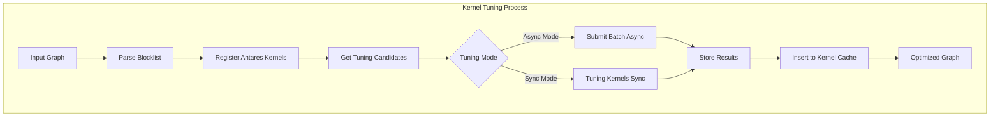
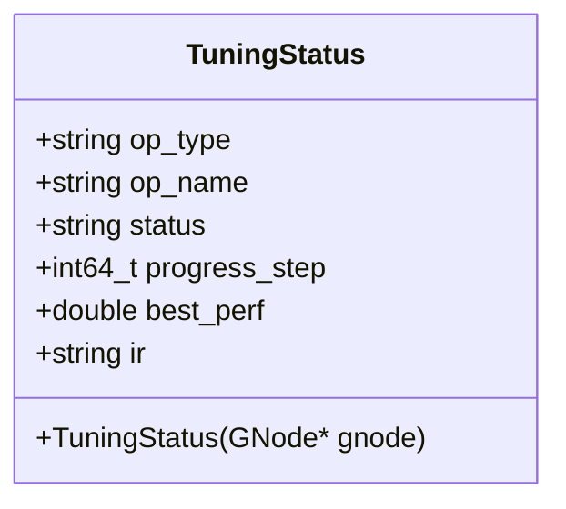
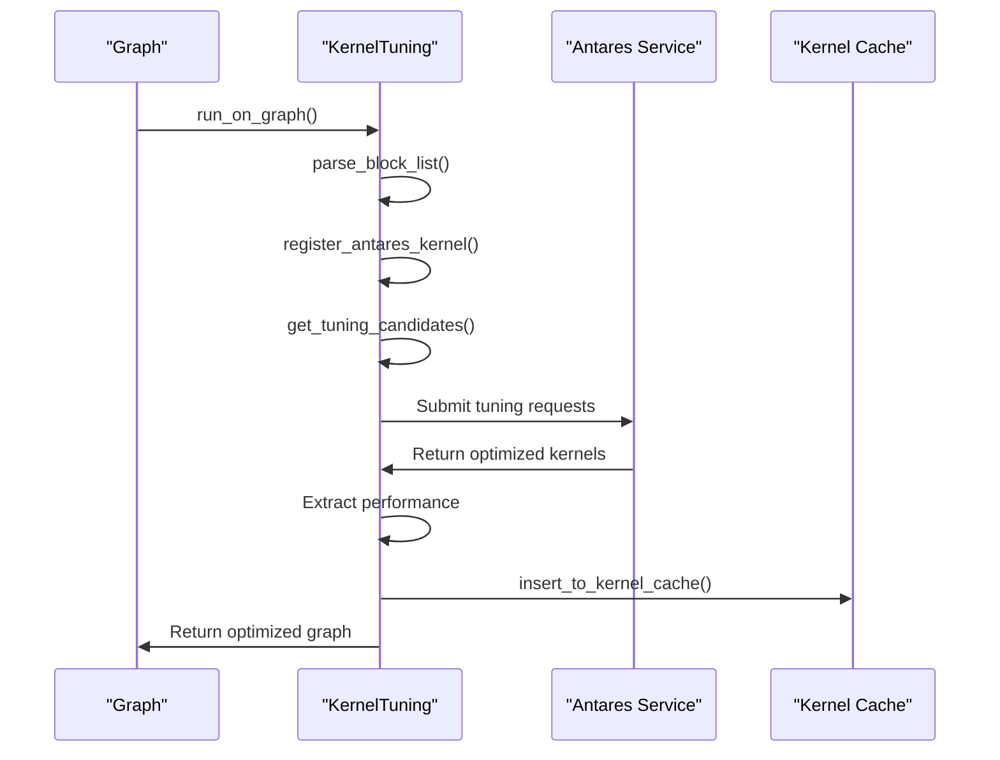
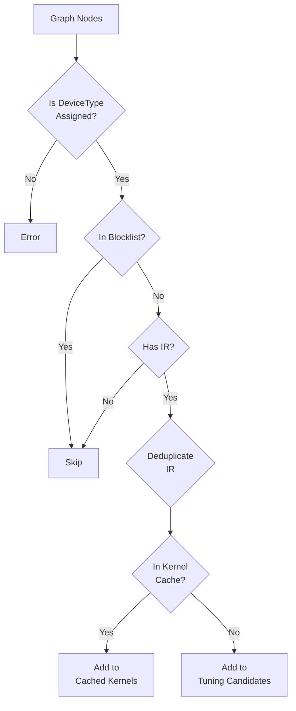
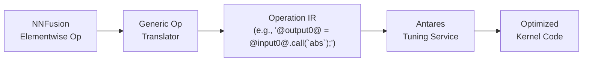
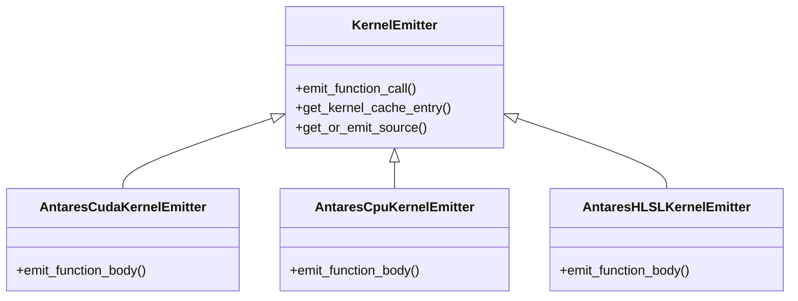
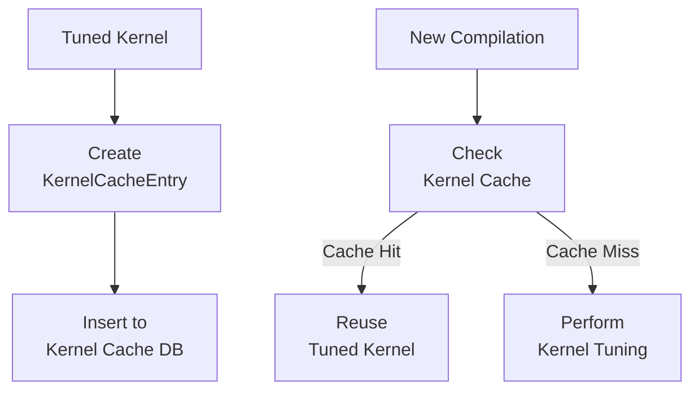
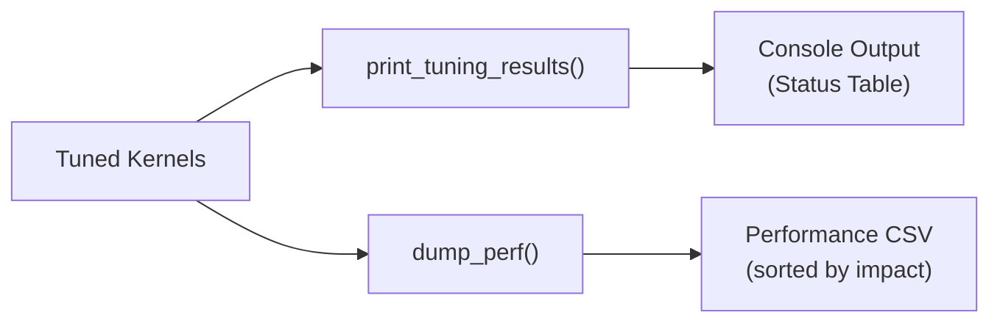
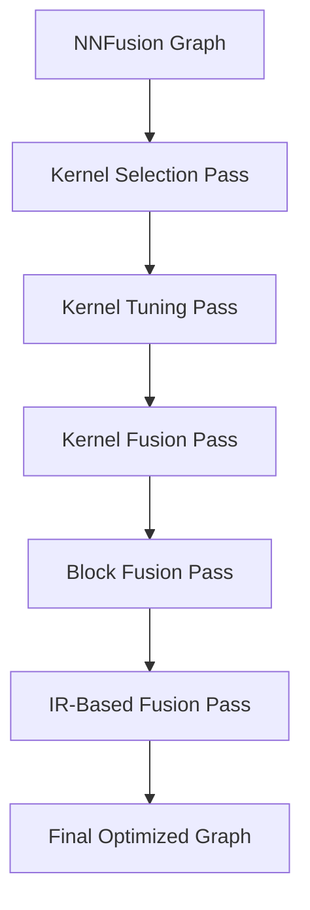

<!-- source: DeepWiki mcp.deepwiki.com · repo microsoft/nnfusion · page 4.1 Kernel Tuning · fetched 2026-10-26 -->

# Kernel Tuning

Relevant source files

The following files were used as context for generating this wiki page:

- [src/nnfusion/core/kernels/kernel_emitter.cpp](src/nnfusion/core/kernels/kernel_emitter.cpp)
- [src/nnfusion/core/operators/generic_op/generic_op_define/AvgPool.cpp](src/nnfusion/core/operators/generic_op/generic_op_define/AvgPool.cpp)
- [src/nnfusion/core/operators/generic_op/generic_op_define/DepthToSpace.cpp](src/nnfusion/core/operators/generic_op/generic_op_define/DepthToSpace.cpp)
- [src/nnfusion/core/operators/generic_op/generic_op_define/Elementwise.cpp](src/nnfusion/core/operators/generic_op/generic_op_define/Elementwise.cpp)
- [src/nnfusion/core/operators/generic_op/generic_op_define/GatherV2.cpp](src/nnfusion/core/operators/generic_op/generic_op_define/GatherV2.cpp)
- [src/nnfusion/engine/pass/graph/ir_based_fusion_pass.hpp](src/nnfusion/engine/pass/graph/ir_based_fusion_pass.hpp)
- [src/nnfusion/engine/pass/graph/kernel_tuning.cpp](src/nnfusion/engine/pass/graph/kernel_tuning.cpp)
- [src/nnfusion/engine/pass/graph/kernel_tuning.hpp](src/nnfusion/engine/pass/graph/kernel_tuning.hpp)
- [src/nnfusion/engine/pass/tensor/liveness_analysis.cpp](src/nnfusion/engine/pass/tensor/liveness_analysis.cpp)

## Purpose and Scope

This document describes the kernel tuning mechanism in NNFusion, which optimizes individual computational kernels through auto-tuning to achieve better performance on various hardware targets. Kernel tuning works by automatically generating and evaluating multiple implementations of the same computational kernel to find the most efficient version for the target hardware platform.

For information about broader optimization techniques like kernel fusion, see [Fusion Techniques](#4.2).

Sources: [src/nnfusion/engine/pass/graph/kernel_tuning.hpp:33-54](), [src/nnfusion/engine/pass/graph/kernel_tuning.cpp:4-18]()

## Overview of Kernel Tuning in NNFusion

Kernel tuning in NNFusion is implemented as a graph pass that analyzes computation nodes in the graph, identifies tuning candidates, and applies tuning techniques to optimize their performance. The primary focus is on finding optimal implementations for individual operations in the computation graph.

Sources: [src/nnfusion/engine/pass/graph/kernel_tuning.cpp:409-443]()

## Tuning Components and Workflow

### TuningStatus 

The tuning process tracks the status and progress of each kernel being tuned using the `TuningStatus` structure:

This structure captures:
- The operation type and name
- Current tuning status (e.g., "completed", "submitted", "tuning")
- Progress through the tuning steps
- Best performance achieved so far (in milliseconds)
- The Intermediate Representation (IR) string used for tuning

Sources: [src/nnfusion/engine/pass/graph/kernel_tuning.hpp:16-31]()

### Kernel Tuning Workflow

Sources: [src/nnfusion/engine/pass/graph/kernel_tuning.cpp:409-443](), [src/nnfusion/engine/pass/graph/kernel_tuning.cpp:271-315](), [src/nnfusion/engine/pass/graph/kernel_tuning.cpp:333-407]()

## Tuning Process in Detail

### 1. Candidate Selection

The tuning process begins by identifying appropriate candidates for tuning from the computation graph:

The candidate selection process:
1. Filters out nodes in the blocklist
2. Checks if a valid IR can be generated for the node
3. Deduplicates identical IRs to avoid redundant tuning
4. Checks if a tuned kernel already exists in the cache

Sources: [src/nnfusion/engine/pass/graph/kernel_tuning.cpp:115-227]()

### 2. Tuning Execution Modes

NNFusion supports two modes for kernel tuning:

#### Asynchronous Tuning

In asynchronous mode, tuning requests are submitted to an external Antares code generation server:

1. For each candidate node, an IR is generated and sent to the server
2. The server starts tuning the kernel and returns a status
3. The process continues with other candidates while tuning happens in the background
4. If tuning is incomplete, the compilation process will prompt the user to retry later

Sources: [src/nnfusion/engine/pass/graph/kernel_tuning.cpp:271-315]()

#### Synchronous Tuning

In synchronous mode, tuning is performed locally:

1. For each candidate node, an IR is generated
2. The Antares command line tool is invoked with the IR
3. The system waits for the tuning process to complete
4. The optimized kernel code is extracted and performance is measured
5. Results are stored for future use

Sources: [src/nnfusion/engine/pass/graph/kernel_tuning.cpp:333-407]()

### 3. IR Translation for Tuning

The kernel tuning process relies on translating NNFusion's operators to a domain-specific IR format that Antares can understand. This translation is handled by the `translate_v2` method in operator definitions.

For example, with elementwise operators:

Sources: [src/nnfusion/core/operators/generic_op/generic_op_define/Elementwise.cpp:93-126]()

## Device Backend Integration

Kernel tuning supports multiple device backends by registering appropriate kernel emitters for each device type:

The `register_antares_kernel` method registers appropriate kernel emitters for different device types, with:
- CUDA_GPU: Using `AntaresCudaKernelEmitter`
- GENERIC_CPU: Using `AntaresCpuKernelEmitter`
- HLSL: Using `AntaresHLSLKernelEmitter`

Sources: [src/nnfusion/engine/pass/graph/kernel_tuning.cpp:445-500](), [src/nnfusion/core/kernels/kernel_emitter.cpp:50-62]()

## Caching Mechanism

Tuned kernels are cached to avoid redundant tuning in future compilations:

The cache stores:
1. The kernel's unique identifier
2. Operation type and attributes
3. Device type and platform information
4. The optimized function code
5. Performance metrics

Sources: [src/nnfusion/engine/pass/graph/kernel_tuning.cpp:502-538](), [src/nnfusion/core/kernels/kernel_emitter.cpp:321-399]()

## Configuration Options

NNFusion provides several configuration options to control the kernel tuning process:

| Option | Description | Default |
|--------|-------------|---------|
| `fkernel_tuning_steps` | Maximum number of tuning steps to perform | 0 (disabled) |
| `ftuning_blocklist` | List of operator types to skip during tuning | "" (empty) |
| `fantares_perf_file` | File to save Antares kernel performance data | "./antares_perf.csv" |
| `ftuning_platform` | Target platform for tuning (e.g., win64, xbox) | "" (empty) |
| `fantares_mode` | Enable Antares tuning mode | false |
| `fantares_codegen_server` | URL of Antares code generation server | "" (empty) |

Sources: [src/nnfusion/engine/pass/graph/kernel_tuning.cpp:19-25]()

## Performance Analysis and Reporting

The kernel tuning system includes functionality to analyze and report the performance of tuned kernels:

The performance reporting includes:
1. A status table showing the tuning progress for each kernel
2. A detailed CSV file with performance measurements
3. Sort ordering based on cumulative performance impact

Sources: [src/nnfusion/engine/pass/graph/kernel_tuning.cpp:50-113]()

## Integration with Graph Optimization Pipeline

Kernel tuning is just one of the optimization passes in NNFusion's graph optimization pipeline. It works alongside other passes like kernel fusion, IR-based fusion, and automatic differentiation:

For automatic differentiation support, see [Automatic Differentiation](#4.3).

Sources: [src/nnfusion/engine/pass/graph/ir_based_fusion_pass.hpp:19-23]()

## Example: Tuning an Elementwise Operation

To illustrate the kernel tuning process, consider an elementwise operation like `Add`. The system:

1. Translates the operation to an IR string like: `@output0@@data_layout@ = @input0@@data_layout@ + @input1@@data_layout@;`
2. Sends this IR to the Antares tuning service
3. Antares explores different implementation strategies (e.g., thread block sizes, memory access patterns)
4. The best-performing implementation is selected and integrated back into NNFusion

Sources: [src/nnfusion/core/operators/generic_op/generic_op_define/Elementwise.cpp:38-41](), [src/nnfusion/core/operators/generic_op/generic_op_define/Elementwise.cpp:128-196]()

---

