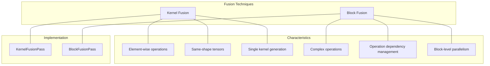
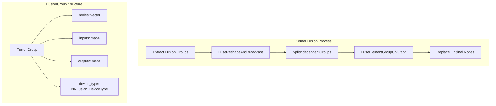
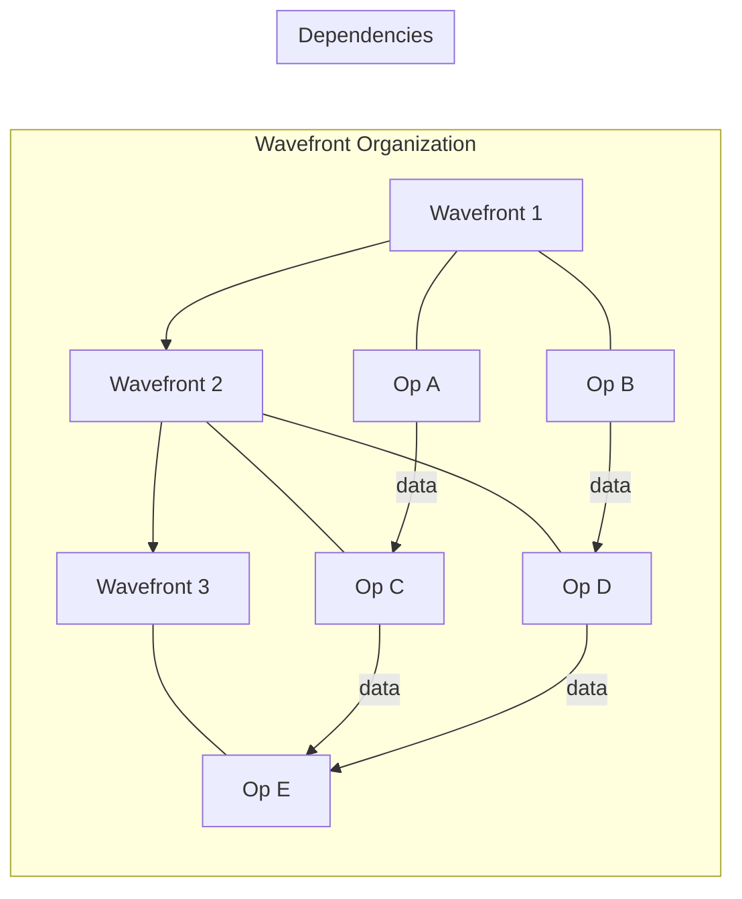
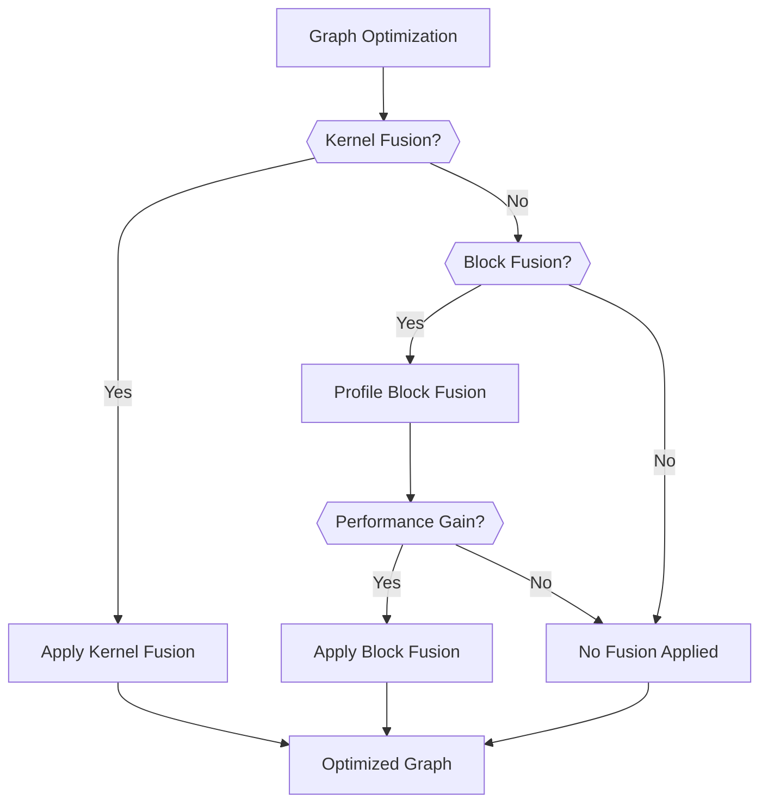

<!-- source: DeepWiki mcp.deepwiki.com · repo microsoft/nnfusion · page 4.2 Fusion Techniques · fetched 2026-10-26 -->

# Fusion Techniques

Relevant source files

The following files were used as context for generating this wiki page:

- [src/nnfusion/core/graph/gnode.cpp](src/nnfusion/core/graph/gnode.cpp)
- [src/nnfusion/core/graph/gnode.hpp](src/nnfusion/core/graph/gnode.hpp)
- [src/nnfusion/core/graph/graph_util.cpp](src/nnfusion/core/graph/graph_util.cpp)
- [src/nnfusion/core/graph/subgraph_match.cpp](src/nnfusion/core/graph/subgraph_match.cpp)
- [src/nnfusion/engine/pass/graph/blockfusion/blockfusion_codegen.cpp](src/nnfusion/engine/pass/graph/blockfusion/blockfusion_codegen.cpp)
- [src/nnfusion/engine/pass/graph/blockfusion/blockfusion_optimizer.cpp](src/nnfusion/engine/pass/graph/blockfusion/blockfusion_optimizer.cpp)
- [src/nnfusion/engine/pass/graph/blockfusion/blockfusion_optimizer.hpp](src/nnfusion/engine/pass/graph/blockfusion/blockfusion_optimizer.hpp)
- [src/nnfusion/engine/pass/graph/blockfusion/blockfusion_profiler.cpp](src/nnfusion/engine/pass/graph/blockfusion/blockfusion_profiler.cpp)
- [src/nnfusion/engine/pass/graph/blockfusion/blockfusion_profiler.hpp](src/nnfusion/engine/pass/graph/blockfusion/blockfusion_profiler.hpp)
- [src/nnfusion/engine/pass/graph/blockfusion/common.hpp](src/nnfusion/engine/pass/graph/blockfusion/common.hpp)
- [src/nnfusion/engine/pass/graph/blockfusion_pass.cpp](src/nnfusion/engine/pass/graph/blockfusion_pass.cpp)
- [src/nnfusion/engine/pass/graph/kernel_fusion_pass.cpp](src/nnfusion/engine/pass/graph/kernel_fusion_pass.cpp)
- [src/nnfusion/frontend/torchscript_import/util/graph_convert.cpp](src/nnfusion/frontend/torchscript_import/util/graph_convert.cpp)
- [src/nnfusion/frontend/util/evaluator.hpp](src/nnfusion/frontend/util/evaluator.hpp)
- [test/nnfusion/scripts/testcase_configs/blockfusion_tests.json](test/nnfusion/scripts/testcase_configs/blockfusion_tests.json)

## Purpose and Scope

This document details the fusion techniques implemented in NNFusion to optimize neural network execution. Fusion is a critical optimization that combines multiple operations to reduce kernel launch overhead, improve data locality, and enhance memory access patterns. NNFusion implements two principal fusion techniques: Kernel Fusion and Block Fusion, each with different strengths and application scenarios.

For more information about other optimization passes, see [Optimization Passes](#4).

## Overview of Fusion Techniques in NNFusion

Sources:
- [src/nnfusion/engine/pass/graph/kernel_fusion_pass.cpp:701-705]()
- [src/nnfusion/engine/pass/graph/blockfusion_pass.cpp:25-65]()

## Kernel Fusion

### Overview and Architecture

Kernel Fusion identifies element-wise operations and combines them into a single kernel. It's particularly effective for operations like addition, multiplication, and activation functions that operate on tensors of the same shape.

Sources:
- [src/nnfusion/engine/pass/graph/kernel_fusion_pass.cpp:85-143]()
- [src/nnfusion/engine/pass/graph/kernel_fusion_pass.cpp:605-653]()

### Implementation Details

The Kernel Fusion technique is implemented through the `KernelFuseOptimizer` class with multiple optimization levels:

| Fusion Level | Description |
|--------------|-------------|
| 0 | Fusion disabled |
| 1 | Basic fusion of element-wise operations |
| 2 | Level 1 + fusion of reshape and broadcast operations |
| 3 | Level 2 + splitting of independent operation groups |

The optimization process works as follows:

1. **Group Extraction**: `ExtractFusionGroups` method identifies operations that can be fused based on operation type (element-wise arithmetic, reshape), device type, and output tensor size.

2. **Group Refinement**: Operations like `FuseReshapeAndBroadcast` and `SplitIndependentGroups` refine the fusion groups to maximize optimization opportunities.

3. **Fusion Implementation**: `FuseElementGroupOnGraph` creates a `FusedGNode` for each fusion group, building a fused operation that replaces the original nodes in the graph.

Sources:
- [src/nnfusion/engine/pass/graph/kernel_fusion_pass.cpp:191-365]()
- [src/nnfusion/engine/pass/graph/kernel_fusion_pass.cpp:367-497]()
- [src/nnfusion/engine/pass/graph/kernel_fusion_pass.cpp:533-602]()

## Block Fusion

### Overview and Architecture

Block Fusion is a more sophisticated technique that handles operations with complex dependencies. It uses a block-parallel execution model where each CUDA/ROCm block can execute multiple operations in a coordinated manner.

```mermaid
graph TD
    subgraph "Block Fusion Components"
        BFO["BlockFusionWavefrontOptimizer"] --> BPD["BlockParallelDevice"]
        BPD --> BEI["BlockExecutorInstructions"]
        BEI --> BFC["BlockFusionCudaCodegen"]
        BFC --> BFP["BlockFusionProfiler"]
    end
    
    subgraph "Execution Flow"
        F1["Extract Fusion Groups"] --> F2["Split/Merge Groups"]
        F2 --> F3["Create Block Execution Plan"]
        F3 --> F4["Generate Fused Kernel Code"]
        F4 --> F5["Profile Performance"]
        F5 --> F6["Replace Original Operations"]
    end
```

Sources:
- [src/nnfusion/engine/pass/graph/blockfusion/blockfusion_optimizer.hpp:58-146]()
- [src/nnfusion/engine/pass/graph/blockfusion/blockfusion_optimizer.cpp:27-42]()

### Wavefront Optimization

The core of Block Fusion is the `BlockFusionWavefrontOptimizer`, which organizes operations into wavefronts - groups of operations that can be executed in parallel:

The optimizer extracts fusion groups by topologically sorting the operations in the graph and identifying operations that can be executed in parallel. It then creates a wavefront execution schedule that maintains correct execution order while maximizing parallelism.

Sources:
- [src/nnfusion/engine/pass/graph/blockfusion/blockfusion_optimizer.cpp:214-298]()
- [src/nnfusion/engine/pass/graph/blockfusion/blockfusion_optimizer.cpp:300-361]()

### Block Execution Instructions

Block Fusion uses three main types of instructions to coordinate execution:

1. **ExecuteBlock**: Executes a specific kernel block.
2. **StepTo**: Updates execution state to indicate progress.
3. **WaitFor**: Waits for other blocks to reach a specific execution state.

These instructions are implemented in the `BlockFusionCudaCodegen` class which generates CUDA code for the fused operations.

Sources:
- [src/nnfusion/engine/pass/graph/blockfusion/common.hpp:102-153]()
- [src/nnfusion/engine/pass/graph/blockfusion/blockfusion_codegen.cpp:372-518]()

### Profiling and Decision Making

Block Fusion includes a profiling mechanism (`BlockFusionProfiler`) that compares the estimated execution time of the original operations against the fused operations. Fusion is only applied if the profiling results indicate a performance improvement.

The profiler considers several metrics:
- Number of kernels in the fusion group
- Number of large kernels (with grid size >= number of block executors)
- Normal execution time vs. fused execution time

Sources:
- [src/nnfusion/engine/pass/graph/blockfusion/blockfusion_profiler.hpp:13-34]()
- [src/nnfusion/engine/pass/graph/blockfusion/blockfusion_profiler.cpp:83-134]()
- [src/nnfusion/engine/pass/graph/blockfusion/blockfusion_optimizer.cpp:500-550]()

## Fusion Decision Process

The following diagram illustrates the decision process for selecting and applying fusion techniques:

Sources:
- [src/nnfusion/engine/pass/graph/blockfusion/blockfusion_optimizer.cpp:51-143]()
- [src/nnfusion/engine/pass/graph/blockfusion/blockfusion_optimizer.cpp:500-550]()
- [src/nnfusion/engine/pass/graph/kernel_fusion_pass.cpp:87-110]()

## Fusion Techniques Comparison

| Feature | Kernel Fusion | Block Fusion |
|---------|--------------|--------------|
| Target Operations | Element-wise, reshape, broadcast | Complex operations with dependencies |
| Execution Model | Single fused kernel | Multiple kernels with coordinated execution |
| Dependencies | Limited handling | Advanced dependency management |
| Optimization Levels | 0-3 | 0-2 |
| Implementation | `KernelFuseOptimizer` | `BlockFusionWavefrontOptimizer` |
| Performance Factors | Reduced kernel launches | Coordinated execution |
| Backends | CUDA, ROCm, CPU | CUDA, ROCm |

Sources:
- [src/nnfusion/engine/pass/graph/kernel_fusion_pass.cpp:21-22]()
- [src/nnfusion/engine/pass/graph/blockfusion_pass.cpp:11-21]()
- [src/nnfusion/engine/pass/graph/blockfusion/common.hpp:16-17]()

## Conclusion

NNFusion's fusion techniques provide powerful optimization capabilities by combining operations to reduce overhead and improve performance. The choice between Kernel Fusion and Block Fusion depends on the characteristics of the operations being optimized:

- **Kernel Fusion** is best for simple element-wise operations with similar tensor shapes and no complex dependencies.
- **Block Fusion** is more suitable for operations with complex dependencies that cannot be fused into a single kernel but can benefit from coordinated execution.

These fusion techniques are crucial components of NNFusion's optimization pipeline, enabling efficient execution of neural network models across different hardware backends.

---

