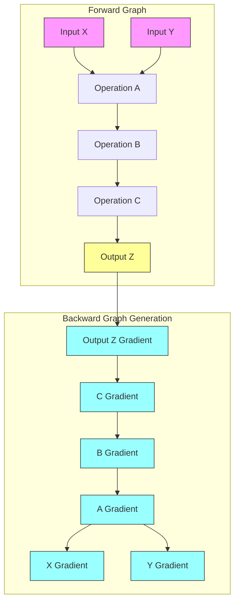
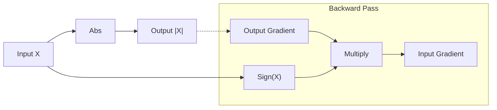
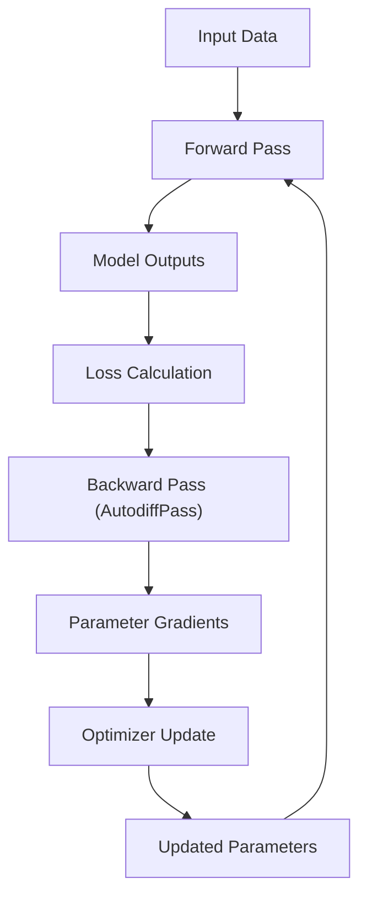

<!-- source: DeepWiki mcp.deepwiki.com · repo microsoft/nnfusion · page 4.3 Automatic Differentiation · fetched 2026-10-26 -->

# Automatic Differentiation

<details>
<summary>Relevant source files</summary>

The following files were used as context for generating this wiki page:

- [src/nnfusion/engine/pass/graph/autodiff/abs.cpp](src/nnfusion/engine/pass/graph/autodiff/abs.cpp)
- [src/nnfusion/engine/pass/graph/autodiff/roll.cpp](src/nnfusion/engine/pass/graph/autodiff/roll.cpp)
- [src/nnfusion/engine/pass/graph/autodiff/sigmoid.cpp](src/nnfusion/engine/pass/graph/autodiff/sigmoid.cpp)
- [src/nnfusion/engine/pass/graph/autodiff_pass.hpp](src/nnfusion/engine/pass/graph/autodiff_pass.hpp)
- [test/models/onnx/roll.onnx](test/models/onnx/roll.onnx)
- [test/nnfusion/engine/autodiff.cpp](test/nnfusion/engine/autodiff.cpp)

</details>


## Overview

Automatic Differentiation (AD) in NNFusion provides the capability to automatically generate gradient computation for deep learning models. This is essential for model training workflows where gradients are required for backpropagation. The AD system works by analyzing a computational graph and systematically applying derivative rules to create a corresponding backward graph that computes gradients.

This page documents the implementation and usage of automatic differentiation in NNFusion, including the architecture, supported operations, and integration with the rest of the compiler pipeline.

Sources: [src/nnfusion/engine/pass/graph/autodiff_pass.hpp:33-39]()

## System Architecture

Automatic differentiation in NNFusion is implemented as a graph pass that transforms the original forward computation graph by adding gradient nodes for each operation. The system uses a registry-based approach where each operation type has a registered "backward translator" that defines how to compute gradients for that operation.

```mermaid
graph TD
    subgraph "NNFusion Compilation Flow"
        A["Input Model"] --> B["Frontend Import"]
        B --> C["IR Graph Representation"]
        C --> D["Optimization Passes"]
        D --> E["AutodiffPass"]
        E --> F["Other Optimization Passes"]
        F --> G["Code Generation"]
        G --> H["Compiled Model"]
    end

    subgraph "AutodiffPass Internals"
        AA["Original Forward Graph"] --> BB["Operation Traversal"]
        BB --> CC["Backward Translator Lookup"]
        CC --> DD["Gradient Node Generation"]
        DD --> EE["Graph Augmentation"]
        EE --> FF["Complete Forward+Backward Graph"]
    end
```



The `AutodiffPass` sits within the optimization pipeline of NNFusion, transforming the computational graph to include gradient computations. This is typically invoked when NNFusion is used to compile models for training rather than just inference.

Sources: [src/nnfusion/engine/pass/graph/autodiff_pass.hpp:33-39](), [test/nnfusion/engine/autodiff.cpp:80-87]()

## Backward Translator Registry

The backbone of the autodiff system is the backward translator registry. Each operation type in NNFusion registers a function that knows how to generate the gradient computation nodes for that operation.

```mermaid
classDiagram
    class "BackwardTranslatorRegistry" {
        +Register(opType, translator)
        +GetTranslator(opType)
    }
    
    class "BackwardTranslator" {
        +translator(node, outputsGrad, graph) : GNodeIndexVector
    }
    
    class "OperationGradients" {
        +AbsGradient
        +SigmoidGradient
        +TanhGradient
        +ConvGradient
        +MatMulGradient
        +etc...
    }
    
    "BackwardTranslatorRegistry" --> "BackwardTranslator" : contains
    "OperationGradients" --> "BackwardTranslator" : implements
```

The registration of backward translators is done using the `REGISTER_BACKWARD_TRANSLATOR` macro. The translator function takes the forward operation node, the gradient of the output, and the graph as inputs, and returns the gradient of the inputs.

Here's an example of how the backward translator for the `Sigmoid` operation is registered:

```
REGISTER_BACKWARD_TRANSLATOR(Sigmoid).translator(
    [](std::shared_ptr<GNode> forward_node,
       const GNodeIndexVector& outputs_grad,
       std::shared_ptr<nnfusion::graph::Graph> graph) -> GNodeIndexVector {
        // Implementation of sigmoid gradient calculation
        auto x_grad = graph->add_node_and_edge(std::make_shared<op::SigmoidBackprop>(),
                                              {get_node_input(forward_node, 0), outputs_grad[0]});
        return GNodeIndexVector{GNodeIndex{x_grad, 0}};
    });
```

Sources: [src/nnfusion/engine/pass/graph/autodiff/sigmoid.cpp:6-15](), [src/nnfusion/engine/pass/graph/autodiff/abs.cpp:6-22]()

## Gradient Computation Flow

When automatic differentiation is enabled, the forward graph is traversed to generate the corresponding backward graph. The process involves:

1. Identifying all outputs of the graph
2. Creating gradient variables for each output
3. Working backwards through the computational graph
4. Applying the appropriate backward translator for each operation
5. Accumulating gradients for operations with multiple outgoing edges
6. Connecting the generated gradient nodes to form a complete backward graph



Sources: [test/nnfusion/engine/autodiff.cpp:80-87]()

## Supported Operations

NNFusion's autodiff system supports a wide range of operations commonly used in deep learning models. Each operation has its own backward translator implementation that defines how to compute gradients.

| Operation | Backward Implementation | Description |
|-----------|-------------------------|-------------|
| Abs | [abs.cpp]() | Computes gradient as `sign(x) * grad_output` |
| Sigmoid | [sigmoid.cpp]() | Uses the `SigmoidBackprop` operation |
| Tanh | Similar to sigmoid | Computes gradient based on tanh derivative |
| Convolution | Complex implementation | Computes gradients for inputs and weights |
| MatMul/BatchMatMul | Matrix multiplication rules | Computes gradients following matrix calculus |
| Roll | [roll.cpp]() | Reverses the roll operation to compute gradients |
| Softmax | Special implementation | Handles the complex derivative of softmax |
| Log | Simple derivative rule | Computes gradient as `1/x * grad_output` |
| Divide | Quotient rule | Applies the quotient rule of differentiation |
| Gather | Index-based gradients | Accumulates gradients at the gathered indices |
| AvgPool | Distributes gradients | Evenly distributes gradients across the pooling window |

The test file contains various examples demonstrating the correctness of these gradient implementations.

Sources: [test/nnfusion/engine/autodiff.cpp:90-505](), [src/nnfusion/engine/pass/graph/autodiff/sigmoid.cpp:6-15](), [src/nnfusion/engine/pass/graph/autodiff/abs.cpp:6-22](), [src/nnfusion/engine/pass/graph/autodiff/roll.cpp:6-31]()

## Implementation Example: Abs Gradient

To illustrate how backward translators work, here's a detailed look at the implementation for the `Abs` operation:



The backward translator for `Abs`:
1. Takes the original input `X` and computes `Sign(X)` (which is 1 for positive values, -1 for negative values, and 0 for zero)
2. Multiplies the output gradient by this sign to get the input gradient
3. This implements the rule that the derivative of `abs(x)` is `sign(x)`

Sources: [src/nnfusion/engine/pass/graph/autodiff/abs.cpp:6-22]()

## Usage

### Enabling Automatic Differentiation

To enable automatic differentiation in NNFusion, you can set the `fautodiff` flag to true. Additionally, you can configure the optimization algorithm using the `ftraining_optimizer` flag.

```
FLAGS_fautodiff = true;
FLAGS_ftraining_optimizer = "{\"optimizer\": \"SGD\", \"learning_rate\": 0.1}";
```

Once enabled, the autodiff pass will automatically generate backward graphs for your models.

Sources: [test/nnfusion/engine/autodiff.cpp:80-87]()

### Integration with Training Workflows

When automatic differentiation is enabled, NNFusion generates a complete forward and backward computational graph. The backward graph computes gradients for all trainable parameters in the model, which can then be used by an optimizer to update the parameters.

The output of the model after compilation includes:
1. The original model outputs
2. Gradients for all input parameters

These gradients can be passed to an optimizer like SGD (Stochastic Gradient Descent) to update the model parameters during training.



Sources: [test/nnfusion/engine/autodiff.cpp:90-112](), [test/nnfusion/engine/autodiff.cpp:80-87]()

## Examples

The test file [test/nnfusion/engine/autodiff.cpp]() contains numerous examples of gradient computations for various operations, demonstrating how automatic differentiation works in practice.

For instance, the test for the `multiply` operation:
1. Creates a model with a multiplication operation
2. Applies the autodiff pass
3. Runs forward and backward computation
4. Verifies that the gradients match the expected values

For a multiply operation `C = A * B`:
- The gradient of A is B
- The gradient of B is A

Similar patterns are shown for other operations, with tests that validate the correctness of the gradient calculations.

Sources: [test/nnfusion/engine/autodiff.cpp:90-112]()

## Conclusion

Automatic differentiation is a critical component of NNFusion that enables the compilation of training workflows. By automatically generating gradient computations for a wide range of operations, NNFusion allows for efficient training of deep learning models on various hardware targets.

The autodiff system is well-integrated with the rest of the NNFusion compiler infrastructure, allowing for optimized gradient computations that can be targeted to different hardware backends like CUDA, CPU, HLSL, and ROCm.

---

