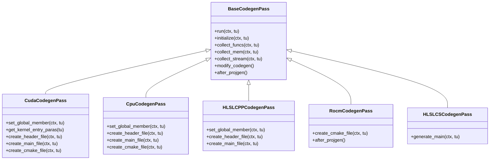
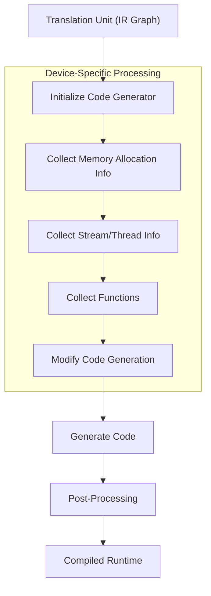
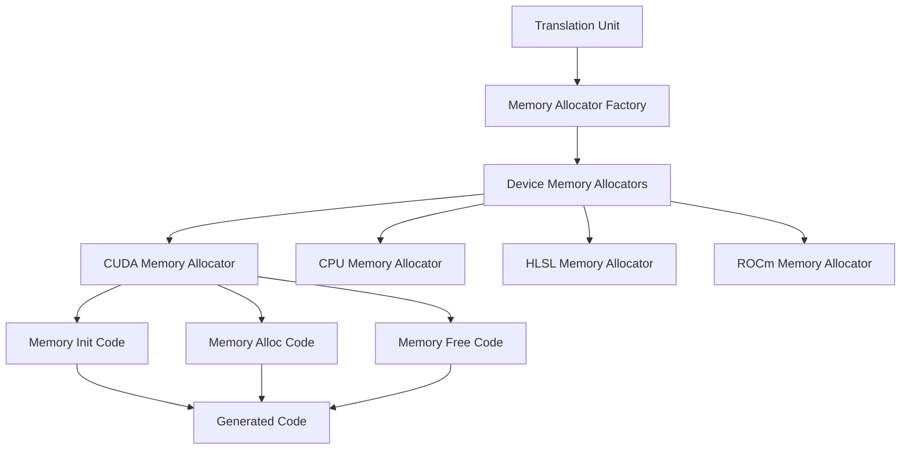
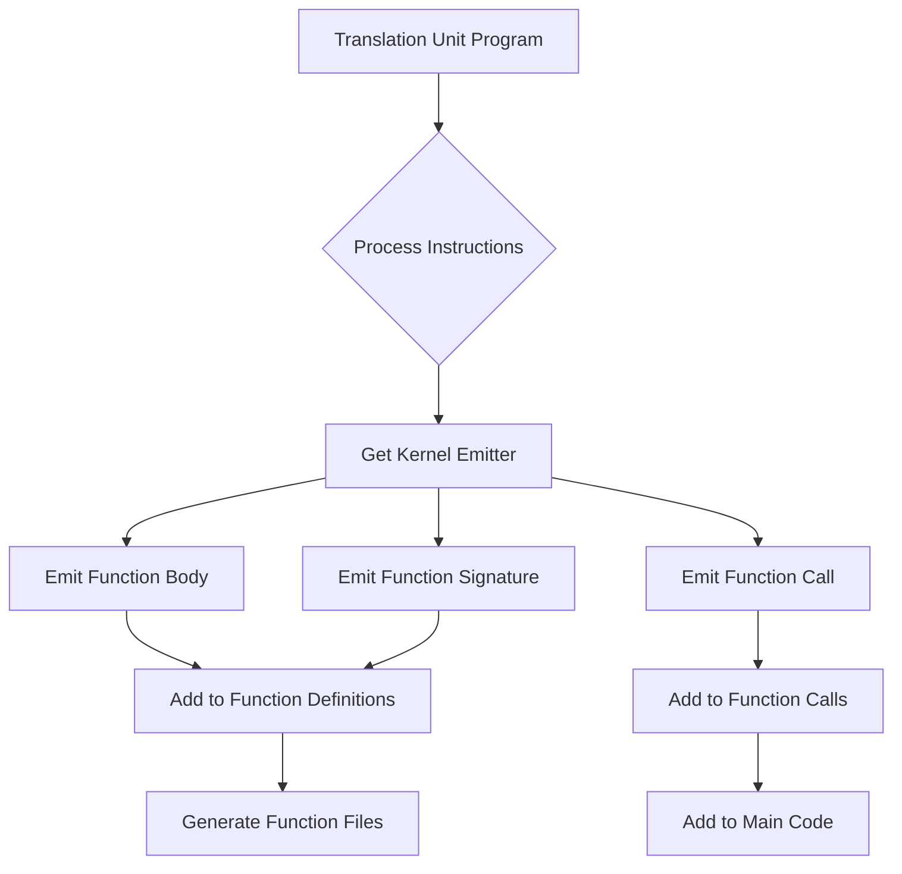
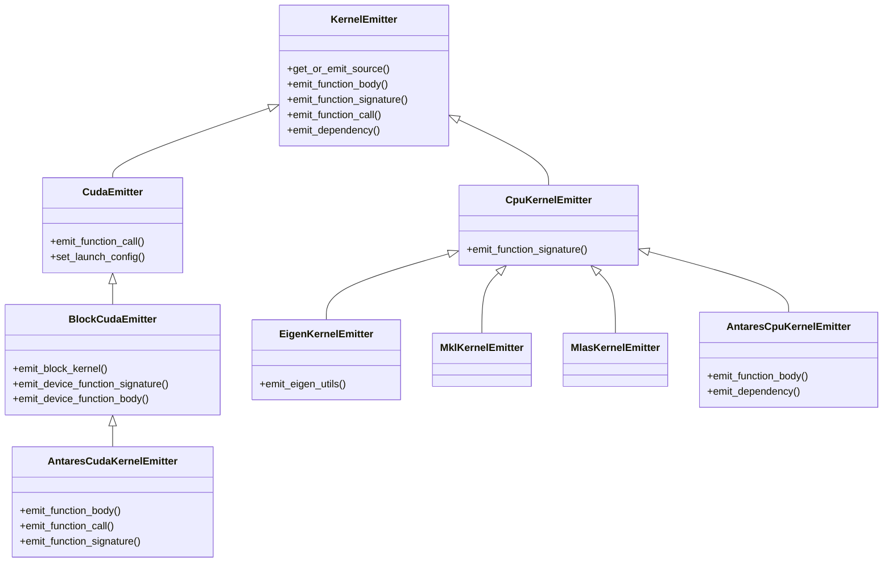
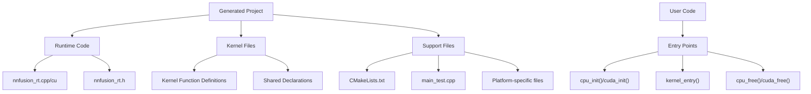
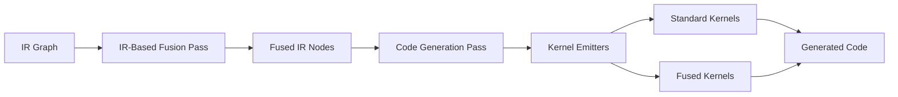

<!-- source: DeepWiki mcp.deepwiki.com · repo microsoft/nnfusion · page 5 Code Generation · fetched 2026-10-26 -->

# Code Generation

<details>
<summary>Relevant source files</summary>

The following files were used as context for generating this wiki page:

- [src/nnfusion/core/kernels/cpu/cpu_kernel_emitter.hpp](src/nnfusion/core/kernels/cpu/cpu_kernel_emitter.hpp)
- [src/nnfusion/core/kernels/cuda_gpu/cuda_emitter.cpp](src/nnfusion/core/kernels/cuda_gpu/cuda_emitter.cpp)
- [src/nnfusion/core/kernels/cuda_gpu/cuda_emitter.hpp](src/nnfusion/core/kernels/cuda_gpu/cuda_emitter.hpp)
- [src/nnfusion/engine/memory_allocator.cpp](src/nnfusion/engine/memory_allocator.cpp)
- [src/nnfusion/engine/memory_allocator.hpp](src/nnfusion/engine/memory_allocator.hpp)
- [src/nnfusion/engine/pass/codegen/base_codegen_pass.cpp](src/nnfusion/engine/pass/codegen/base_codegen_pass.cpp)
- [src/nnfusion/engine/pass/codegen/base_codegen_pass.hpp](src/nnfusion/engine/pass/codegen/base_codegen_pass.hpp)
- [src/nnfusion/engine/pass/codegen/codegen_langunit.cpp](src/nnfusion/engine/pass/codegen/codegen_langunit.cpp)
- [src/nnfusion/engine/pass/codegen/codegen_langunit.hpp](src/nnfusion/engine/pass/codegen/codegen_langunit.hpp)
- [src/nnfusion/engine/pass/codegen/cpu_codegen_pass.cpp](src/nnfusion/engine/pass/codegen/cpu_codegen_pass.cpp)
- [src/nnfusion/engine/pass/codegen/cuda_codegen_pass.cpp](src/nnfusion/engine/pass/codegen/cuda_codegen_pass.cpp)
- [src/nnfusion/engine/pass/codegen/hlsl_cpp_codegen_pass.cpp](src/nnfusion/engine/pass/codegen/hlsl_cpp_codegen_pass.cpp)
- [src/nnfusion/engine/pass/codegen/hlsl_cs_codegen_pass.cpp](src/nnfusion/engine/pass/codegen/hlsl_cs_codegen_pass.cpp)
- [src/nnfusion/engine/pass/codegen/rocm_codegen_pass.cpp](src/nnfusion/engine/pass/codegen/rocm_codegen_pass.cpp)
- [src/nnfusion/engine/pass/graph/ir_based_fusion_pass.cpp](src/nnfusion/engine/pass/graph/ir_based_fusion_pass.cpp)

</details>


Code generation is a core component of the NNFusion compiler framework, responsible for translating the optimized computational graph into executable code for different hardware targets. This page explains how NNFusion converts its internal graph representation into platform-specific code that can be compiled and executed efficiently.

For information about specific backend code generation, see [CUDA Code Generation](#5.1) and [DirectX Compute Integration](#5.2).

## Overview of Code Generation Architecture

The code generation system in NNFusion follows a modular architecture that separates the common code generation logic from device-specific implementations. This allows NNFusion to support multiple backends while sharing common functionality.



Sources: [src/nnfusion/engine/pass/codegen/base_codegen_pass.hpp:17-106](), [src/nnfusion/engine/pass/codegen/cuda_codegen_pass.cpp:38-1035](), [src/nnfusion/engine/pass/codegen/cpu_codegen_pass.cpp:36-777](), [src/nnfusion/engine/pass/codegen/hlsl_cpp_codegen_pass.cpp:29-247](), [src/nnfusion/engine/pass/codegen/rocm_codegen_pass.cpp:24-296](), [src/nnfusion/engine/pass/codegen/hlsl_cs_codegen_pass.cpp:27-122]()

## Code Generation Process

The code generation process in NNFusion follows a consistent workflow regardless of the target device, with device-specific aspects handled by the corresponding subclasses.



Sources: [src/nnfusion/engine/pass/codegen/base_codegen_pass.cpp:17-33]()

### 1. Initialization Phase

The initialization phase prepares the code generator for a specific device target:

1. Sets up global members and requirements
2. Configures the code output location
3. Prepares the code template structure with initialization, execution, and cleanup blocks
4. Creates supporting files (headers, main file, CMakeLists.txt)

```cpp
void BaseCodegenPass::initialize(std::shared_ptr<InterpreterContext> ctx,
                              std::shared_ptr<TranslationUnit> tu)
{
    // setup lup_codegen execution info
    projgen->lup_codegen->pwd = m_codegen_folder;
    projgen->lup_codegen->write_to = "nnfusion_rt.h";
    // ...
}
```

Sources: [src/nnfusion/engine/pass/codegen/base_codegen_pass.cpp:34-43](), [src/nnfusion/engine/pass/codegen/cuda_codegen_pass.cpp:66-247](), [src/nnfusion/engine/pass/codegen/cpu_codegen_pass.cpp:65-167]()

### 2. Memory Collection

This phase analyzes the necessary memory allocations and generates code for memory management:

1. Tracks all tensors that need memory allocation
2. Calculates total memory requirements
3. Generates code for memory allocation, freeing, and initialization
4. Handles device-specific memory management (e.g., CUDA vs. CPU)



Sources: [src/nnfusion/engine/pass/codegen/base_codegen_pass.cpp:164-204](), [src/nnfusion/engine/memory_allocator.cpp:268-304](), [src/nnfusion/engine/memory_allocator.cpp:320-366]()

### 3. Stream and Thread Collection

For device types that support streams or parallel execution, this phase:

1. Identifies concurrent operations
2. Sets up code for stream/thread creation
3. Configures synchronization points
4. Handles event recording and waiting

Sources: [src/nnfusion/engine/pass/codegen/cuda_codegen_pass.cpp:811-866]()

### 4. Function Collection

The core of code generation, this phase:

1. Collects all kernel functions from the computation graph
2. Processes each function through its corresponding emitter
3. Organizes functions into initialization and execution blocks
4. Handles function dependencies and shared code



Sources: [src/nnfusion/engine/pass/codegen/base_codegen_pass.cpp:109-162](), [src/nnfusion/engine/pass/codegen/cuda_codegen_pass.cpp:248-430]()

## Kernel Emitters Hierarchy

The kernel emitters are responsible for generating the actual computational code for different devices and operations. They follow a class hierarchy that separates common functionality from device-specific implementations.



Sources: [src/nnfusion/core/kernels/cuda_gpu/cuda_emitter.hpp:38-444](), [src/nnfusion/core/kernels/cpu/cpu_kernel_emitter.hpp:21-178]()

### Key Emitter Components

1. **Function Signature Generation**: Creates the function declaration with proper parameters
2. **Function Body Generation**: Implements the computational logic
3. **Function Call Generation**: Creates code to invoke the function with proper arguments
4. **Dependency Management**: Tracks and includes necessary headers and helper functions

```cpp
// Example of function signature generation in CudaEmitter
LanguageUnit_p cuda::CudaEmitter::emit_function_signature()
{
    LanguageUnit_p _lu(new LanguageUnit(this->m_kernel_name + "_sig"));
    auto& lu = *_lu;
    
    // Generate parameter list
    vector<string> params;
    for (size_t i = 0; i < m_context->inputs.size(); i++)
    {
        stringstream ss;
        ss << m_context->inputs[i]->get_element_type().c_type_string() << "* ";
        ss << "input" << i;
        params.push_back(ss.str());
    }
    
    // Add function declaration
    set_launch_config();
    emit_function_body();
    lu << "extern \"C\" __launch_bounds__(" << m_blockDim.x * m_blockDim.y * m_blockDim.z
       << ") __global__ void "
       << "(" << join(params, ", ") << ")";
    return _lu;
}
```

Sources: [src/nnfusion/core/kernels/cuda_gpu/cuda_emitter.cpp:36-64](), [src/nnfusion/core/kernels/cuda_gpu/cuda_emitter.cpp:205-327]()

## Generated Code Structure

The code generation produces a complete project with all necessary files to compile and execute the neural network model on the target platform.



Sources: [src/nnfusion/engine/pass/codegen/cuda_codegen_pass.cpp:128-246](), [src/nnfusion/engine/pass/codegen/base_codegen_pass.cpp:74-97]()

### Main Runtime Components

1. **Initialization Code**: Sets up the runtime environment, including device selection, memory allocation, and stream creation
2. **Execution Code**: Implements the main execution logic
3. **Cleanup Code**: Handles resource freeing and cleanup
4. **Header Declarations**: Declares interfaces for external use
5. **Kernel Definitions**: Contains the implementation of all computational kernels

```cpp
// Structure of generated initialization code
extern "C" void cuda_init()
{
    // Memory allocation
    CUDA_SAFE_CALL(cudaMalloc((void**)&memory_pool, size));
    
    // Stream creation
    CUDA_SAFE_CALL(cudaStreamCreate(&stream_0));
    
    // Event creation
    CUDA_SAFE_CALL(cudaEventCreate(&event_0));
}

// Structure of generated execution code
extern "C" int kernel_entry(float* input0, float* output0)
{
    // Execute kernels
    kernel_func<<<grid, block, 0, stream_0>>>(input0, output0);
    return 0;
}

// Structure of generated cleanup code
extern "C" void cuda_free()
{
    // Free memory
    CUDA_SAFE_CALL(cudaFree(memory_pool));
    
    // Destroy streams
    CUDA_SAFE_CALL(cudaStreamDestroy(stream_0));
}
```

Sources: [src/nnfusion/engine/pass/codegen/cuda_codegen_pass.cpp:114-166](), [src/nnfusion/engine/pass/codegen/cpu_codegen_pass.cpp:109-155]()

## Device-Specific Code Generation

Each supported device type has specific code generation approaches:

### CUDA GPU Code Generation

The CUDA code generator produces:
- CUDA kernel functions (`__global__ void kernel_func(...)`)
- Kernel launch configurations with grid and block dimensions
- Stream and event management for asynchronous execution
- CUDA memory allocation and management

Sources: [src/nnfusion/engine/pass/codegen/cuda_codegen_pass.cpp:38-135]()

### CPU Code Generation

The CPU code generator produces:
- C++ functions for CPU execution
- Thread pool management for parallel execution
- Integration with CPU libraries (Eigen, MKL, MLAS)
- Host memory allocation and management

Sources: [src/nnfusion/engine/pass/codegen/cpu_codegen_pass.cpp:36-168]()

### HLSL/DirectX Code Generation

The HLSL code generator produces:
- HLSL compute shaders
- DirectX resource management
- Descriptor heap handling
- Two forms: C++ wrapper (HLSLCPPCodegenPass) and C# wrapper (HLSLCSCodegenPass)

Sources: [src/nnfusion/engine/pass/codegen/hlsl_cpp_codegen_pass.cpp:29-142]()

### ROCm Code Generation

The ROCm code generator:
- Starts with CUDA-like code generation
- Post-processes the code with HIPify to convert CUDA to HIP
- Adds ROCm-specific libraries and includes
- Configures for AMD GPU execution

Sources: [src/nnfusion/engine/pass/codegen/rocm_codegen_pass.cpp:24-185](), [src/nnfusion/engine/pass/codegen/rocm_codegen_pass.cpp:186-296]()

## Code Generation and IR-Based Fusion

Code generation works closely with IR-based fusion optimization to generate optimized code for fused operations:



When IR-based fusion is enabled, the code generator:
1. Identifies fused node patterns
2. Uses specialized kernel emitters (like AntaresCudaKernelEmitter) to generate optimized code
3. Incorporates the fused kernels into the runtime

Sources: [src/nnfusion/engine/pass/graph/ir_based_fusion_pass.cpp:21-169]()

## Memory Management in Generated Code

The code generator implements an optimized memory allocation strategy:

1. **Memory Pool**: Creates a single large allocation for all tensors
2. **Offset Management**: Assigns offsets within the pool to tensors
3. **Memory Reuse**: Reuses memory when tensors have non-overlapping lifetimes
4. **In-place Operations**: Optimizes operations to work in-place when possible

```cpp
// Example of memory pool allocation in generated code
CUDA_SAFE_CALL(cudaMalloc((void**)&memory_pool, total_size));

// Assigning tensor addresses from the pool
tensor1 = (float*)(memory_pool + offset1);
tensor2 = (float*)(memory_pool + offset2);
```

Sources: [src/nnfusion/engine/memory_allocator.cpp:268-366](), [src/nnfusion/engine/memory_allocator.hpp:16-107]()

## Summary

The code generation system in NNFusion is a flexible and extensible framework for translating computational graphs into efficient executable code for various hardware targets. By separating common code generation logic from device-specific implementations, NNFusion can easily support multiple backends while maximizing code reuse.

The key components of the code generation system include:
1. The base code generation pass that defines the common workflow
2. Device-specific code generation passes for different hardware targets
3. Kernel emitters that generate the actual computational code
4. Memory allocators that manage tensor memory
5. A comprehensive code project structure with runtime, kernels, and support files

This modular architecture allows NNFusion to generate optimized code for CPUs, NVIDIA GPUs, AMD GPUs, and DirectX compute devices from a unified internal representation.

---

