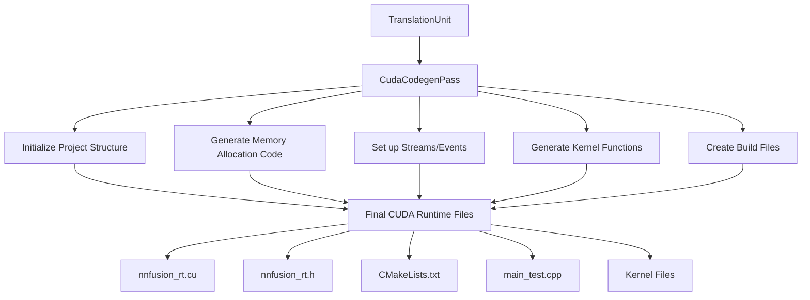
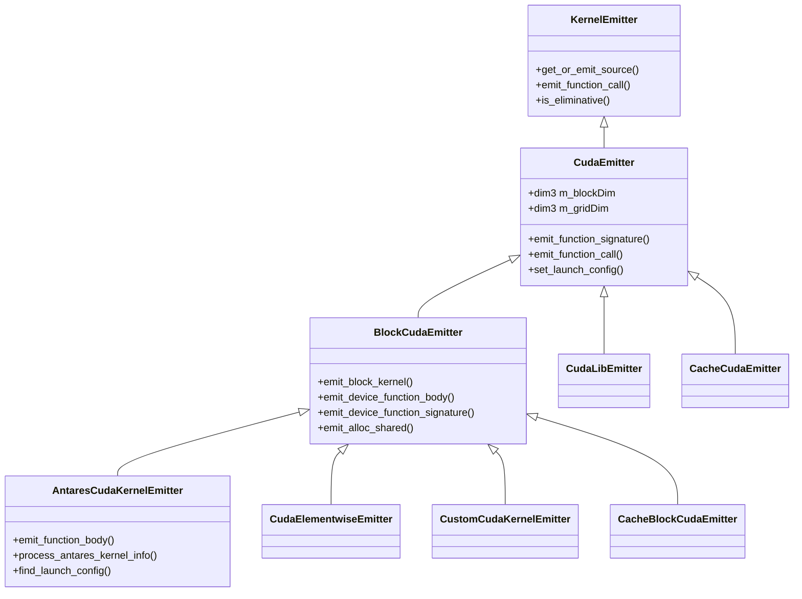
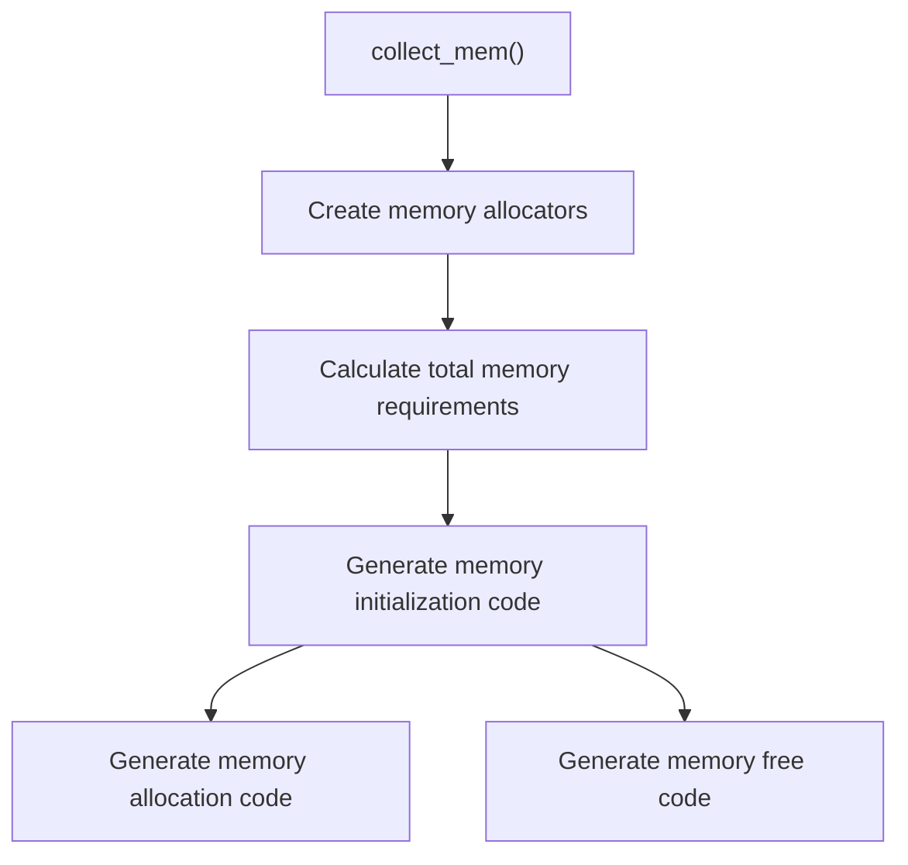
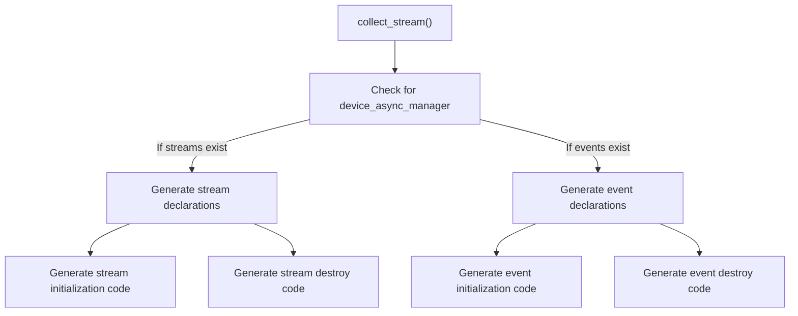
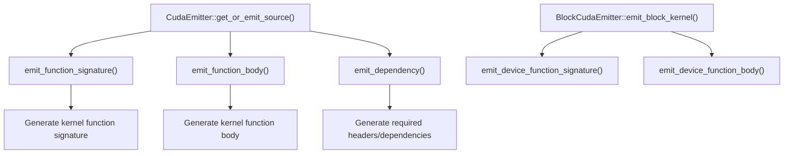
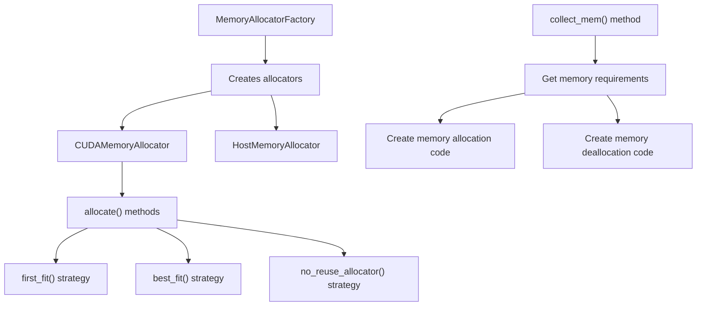
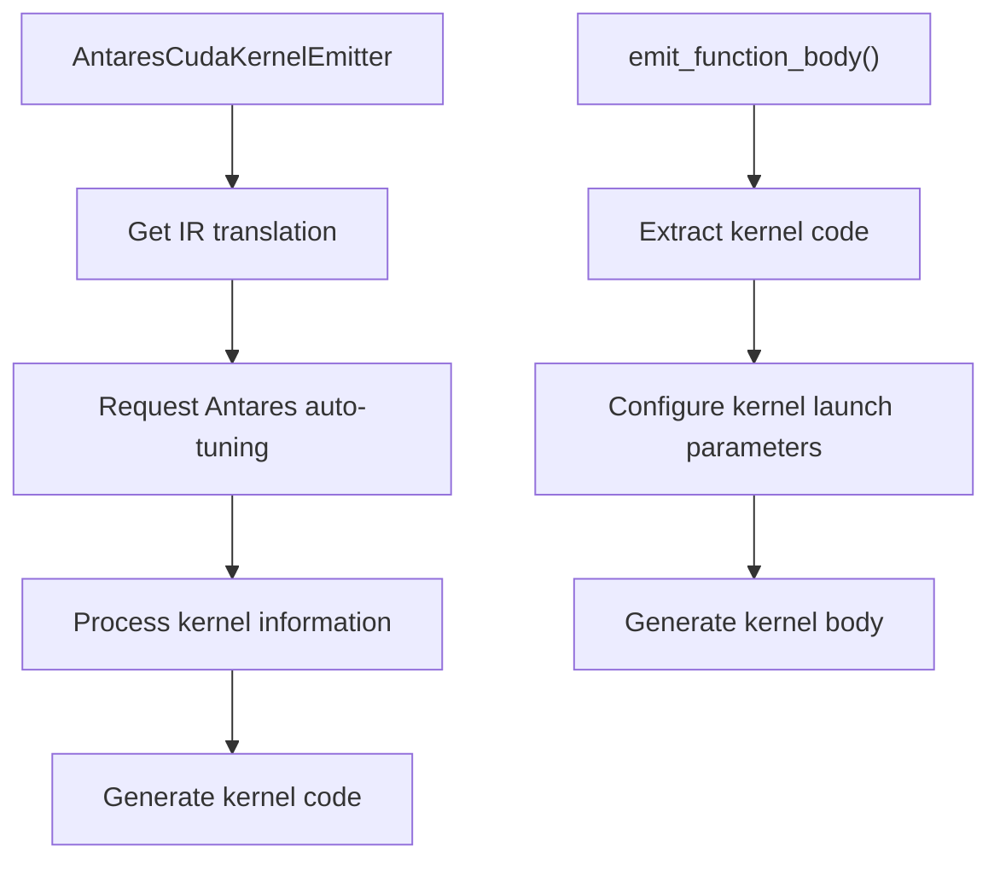
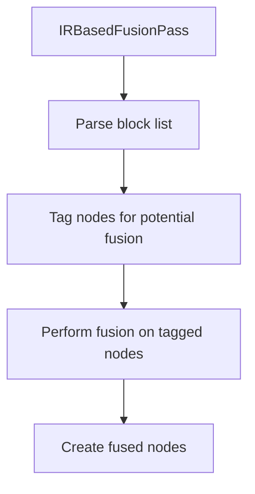

<!-- source: DeepWiki mcp.deepwiki.com · repo microsoft/nnfusion · page 5.1 CUDA Code Generation · fetched 2026-10-26 -->

# CUDA Code Generation

<details>
<summary>Relevant source files</summary>

The following files were used as context for generating this wiki page:

- [src/nnfusion/core/kernels/cpu/cpu_kernel_emitter.hpp](src/nnfusion/core/kernels/cpu/cpu_kernel_emitter.hpp)
- [src/nnfusion/core/kernels/cuda_gpu/cuda_emitter.cpp](src/nnfusion/core/kernels/cuda_gpu/cuda_emitter.cpp)
- [src/nnfusion/core/kernels/cuda_gpu/cuda_emitter.hpp](src/nnfusion/core/kernels/cuda_gpu/cuda_emitter.hpp)
- [src/nnfusion/engine/memory_allocator.cpp](src/nnfusion/engine/memory_allocator.cpp)
- [src/nnfusion/engine/memory_allocator.hpp](src/nnfusion/engine/memory_allocator.hpp)
- [src/nnfusion/engine/pass/codegen/base_codegen_pass.cpp](src/nnfusion/engine/pass/codegen/base_codegen_pass.cpp)
- [src/nnfusion/engine/pass/codegen/base_codegen_pass.hpp](src/nnfusion/engine/pass/codegen/base_codegen_pass.hpp)
- [src/nnfusion/engine/pass/codegen/codegen_langunit.cpp](src/nnfusion/engine/pass/codegen/codegen_langunit.cpp)
- [src/nnfusion/engine/pass/codegen/codegen_langunit.hpp](src/nnfusion/engine/pass/codegen/codegen_langunit.hpp)
- [src/nnfusion/engine/pass/codegen/cpu_codegen_pass.cpp](src/nnfusion/engine/pass/codegen/cpu_codegen_pass.cpp)
- [src/nnfusion/engine/pass/codegen/cuda_codegen_pass.cpp](src/nnfusion/engine/pass/codegen/cuda_codegen_pass.cpp)
- [src/nnfusion/engine/pass/codegen/hlsl_cpp_codegen_pass.cpp](src/nnfusion/engine/pass/codegen/hlsl_cpp_codegen_pass.cpp)
- [src/nnfusion/engine/pass/codegen/hlsl_cs_codegen_pass.cpp](src/nnfusion/engine/pass/codegen/hlsl_cs_codegen_pass.cpp)
- [src/nnfusion/engine/pass/codegen/rocm_codegen_pass.cpp](src/nnfusion/engine/pass/codegen/rocm_codegen_pass.cpp)
- [src/nnfusion/engine/pass/graph/ir_based_fusion_pass.cpp](src/nnfusion/engine/pass/graph/ir_based_fusion_pass.cpp)

</details>


This page documents the CUDA code generation system in NNFusion, which transforms the internal IR representation into optimized CUDA code for GPU execution. This module is responsible for generating CUDA kernel functions, setting up memory allocation, managing device resources, and creating the runtime infrastructure for model execution.

For information about other code generation targets like CPU or DirectX, see the relevant sections in [Code Generation](#5).

## Overview of the CUDA Codegen Architecture

The CUDA code generation system takes a `TranslationUnit` (containing the computation graph and program information) and transforms it into a complete CUDA runtime application. It handles kernel code generation, memory management, asynchronous execution streams, and creates all necessary build files for compilation.



Sources: [src/nnfusion/engine/pass/codegen/cuda_codegen_pass.cpp:1-246](), [src/nnfusion/engine/pass/codegen/base_codegen_pass.cpp:1-48]()

## Key Components

### CudaCodegenPass

`CudaCodegenPass` is the main class responsible for orchestrating the CUDA code generation process. It inherits from `BaseCodegenPass` and implements CUDA-specific functionality.

Key responsibilities include:
- Setting up the project structure
- Collecting and generating memory allocation code
- Setting up CUDA streams and events for asynchronous execution
- Collecting and generating kernel function definitions and calls
- Creating necessary build files (CMakeLists.txt, headers, etc.)

Sources: [src/nnfusion/engine/pass/codegen/cuda_codegen_pass.cpp:38-246]()

### CUDA Kernel Emitters Hierarchy

The CUDA code generation relies on a hierarchy of kernel emitters that generate code for different types of operations. Each emitter is specialized for a specific type of operation or optimization.



Sources: [src/nnfusion/core/kernels/cuda_gpu/cuda_emitter.hpp:38-444]()

## Code Generation Process

The CUDA code generation process follows these main steps:

### 1. Initialization

The `initialize` method sets up the basic structure for code generation, including:
- Creating language units for initialization, execution, and cleanup
- Setting up file paths and templates
- Defining entry point functions

```cpp
void CudaCodegenPass::initialize(std::shared_ptr<InterpreterContext> ctx,
                                std::shared_ptr<TranslationUnit> tu)
{
    set_global_member(ctx, tu);
    projgen->lup_codegen->pwd = m_codegen_folder;
    projgen->lup_codegen->write_to = "nnfusion_rt.cu";
    // ... Setup entry points and requirements ...
}
```

Sources: [src/nnfusion/engine/pass/codegen/cuda_codegen_pass.cpp:66-246]()

### 2. Collecting Memory Allocation Information

The `collect_mem` method analyzes memory requirements and generates code for memory allocation and deallocation:



Sources: [src/nnfusion/engine/pass/codegen/base_codegen_pass.cpp:164-204](), [src/nnfusion/engine/memory_allocator.cpp:268-339]()

### 3. Setting up CUDA Streams and Events

The `collect_stream` method sets up CUDA streams and events for asynchronous execution:



Sources: [src/nnfusion/engine/pass/codegen/cuda_codegen_pass.cpp:811-866]()

### 4. Collecting and Generating Kernel Functions

The `collect_funcs` method is responsible for collecting and generating all kernel functions:

1. It collects all instructions from the program
2. For each instruction, it gets the associated kernel
3. It generates the kernel function definition and call
4. It handles special cases like memory copy operations

```cpp
bool CudaCodegenPass::collect_funcs(std::shared_ptr<InterpreterContext> ctx,
                                   std::shared_ptr<TranslationUnit> tu)
{
    auto pairs = collect_ins(ctx, tu);
    for (auto& it : pairs) {
        auto lup_func_calls = get_kernel_func_calls(it.first + "_func_calls", nullptr);
        for (auto ins : it.second) {
            auto kernel = ins->getKernel();
            // Generate function definition and call
            // ...
        }
    }
    // ...
}
```

Sources: [src/nnfusion/engine/pass/codegen/cuda_codegen_pass.cpp:248-430]()

### 5. Kernel Function Generation

Kernel function generation is primarily handled by the `CudaEmitter` class hierarchy:



Sources: [src/nnfusion/core/kernels/cuda_gpu/cuda_emitter.cpp:10-64](), [src/nnfusion/core/kernels/cuda_gpu/cuda_emitter.cpp:100-190]()

## Memory Management

The CUDA code generator handles memory allocation for tensors using the `MemoryAllocator` system:



The memory allocator provides several allocation strategies:
- `first_fit`: Allocates memory in the first available block of sufficient size
- `best_fit`: Allocates memory in the smallest available block of sufficient size
- `no_reuse_allocator`: Allocates memory without reusing memory blocks

Sources: [src/nnfusion/engine/memory_allocator.hpp:16-207](), [src/nnfusion/engine/memory_allocator.cpp:9-366]()

## Asynchronous Execution Support

NNFusion's CUDA code generation supports asynchronous execution through CUDA streams and events. This is managed through the AsyncManager system:

```cpp
bool CudaCodegenPass::collect_stream(std::shared_ptr<InterpreterContext> ctx,
                                    std::shared_ptr<TranslationUnit> tu)
{
    // Handle CUDA streams
    if (device_async_manager && device_async_manager->num_stream() > 0) {
        auto stream_decl = device_async_manager->emit_stream_decl();
        auto stream_init = device_async_manager->emit_stream_init();
        auto stream_destroy = device_async_manager->emit_stream_destroy();
        // ...
    }
    
    // Handle CUDA events
    if (device_async_manager && device_async_manager->num_event() > 0) {
        auto event_decl = device_async_manager->emit_event_decl();
        auto event_init = device_async_manager->emit_event_init();
        auto event_destroy = device_async_manager->emit_event_destroy();
        // ...
    }
    
    return true;
}
```

Sources: [src/nnfusion/engine/pass/codegen/cuda_codegen_pass.cpp:811-866]()

## Kernel Function Call Generation

The generation of kernel function calls is handled by the `func_call_codegen` method, which creates CUDA kernel launch code with the appropriate grid and block dimensions:

```cpp
nnfusion::LanguageUnit_p CudaCodegenPass::func_call_codegen(
    nnfusion::ir::Instruction::Pointer ins,
    bool func_call_only,
    const std::string& func_call)
{
    // Generate function call with proper event synchronization
    // ...
}
```

This method handles:
- Waiting for dependent events and barriers
- Generating the actual kernel launch
- Recording events after execution
- Adding debug code for kernel outputs if needed

Sources: [src/nnfusion/engine/pass/codegen/cuda_codegen_pass.cpp:675-809]()

## Integration with Antares

NNFusion integrates with Antares, an auto-tuning framework for tensor operations. The `AntaresCudaKernelEmitter` class handles this integration:



The integration with Antares allows automatic generation and tuning of efficient kernel implementations.

Sources: [src/nnfusion/core/kernels/cuda_gpu/cuda_emitter.hpp:201-335](), [src/nnfusion/core/kernels/cuda_gpu/cuda_emitter.cpp:205-328]()

## Output Files

The CUDA code generation process produces several output files:

| File | Description |
|------|-------------|
| `nnfusion_rt.cu` | Main CUDA runtime file with all kernel code |
| `nnfusion_rt.h` | Header file with function declarations |
| `main_test.cpp` | Test application to execute the model |
| `CMakeLists.txt` | Build file for compiling the project |
| `kernels/*.cu` | Individual kernel files (if split) |

These files collectively form a complete, deployable CUDA application that can execute the neural network model.

Sources: [src/nnfusion/engine/pass/codegen/cuda_codegen_pass.cpp:66-133]()

## Memory Optimizations

NNFusion's CUDA code generation implements various memory optimizations:

1. **Memory Pool**: Allocates a single large memory pool and manages allocations within it
2. **Memory Reuse**: Reuses memory between operations when possible
3. **In-place Operations**: Identifies operations that can operate in-place to reduce memory usage
4. **Memory Allocation Strategies**: Supports different allocation strategies (first-fit, best-fit)

These optimizations help reduce the memory footprint of the generated code.

Sources: [src/nnfusion/engine/memory_allocator.cpp:38-187]()

## Integration with Build System

The code generator creates CMake files for building the CUDA project:

```cpp
// Add CUDA requirements
projgen->lup_codegen->require(header::assert);
projgen->lup_codegen->require(header::stdexcept);
projgen->lup_codegen->require(header::sstream);
projgen->lup_codegen->require(header::cuda);
projgen->lup_codegen->require(header::cublas);
projgen->lup_codegen->require(header::cudnn);
// ...
```

It also includes necessary dependencies:
- CUDA runtime libraries
- cuBLAS for matrix operations
- cuDNN for deep learning primitives
- Other utility libraries as needed

Sources: [src/nnfusion/engine/pass/codegen/cuda_codegen_pass.cpp:223-245](), [src/nnfusion/engine/pass/codegen/codegen_langunit.cpp:1-139]()

## Advanced Features

### Block Fusion

NNFusion can fuse multiple operations into a single CUDA kernel to reduce kernel launch overhead and improve data locality. The `BlockCudaEmitter` class handles this feature:

```cpp
LanguageUnit_p cuda::BlockCudaEmitter::emit_block_kernel()
{
    LanguageUnit_p _lu(new LanguageUnit(this->m_kernel_name + "_device_kernel"));
    auto& lu = *_lu;

    is_emitting_block_kernel = true;
    FunctionUnit_p fu = this->get_or_emit_source();
    is_emitting_block_kernel = false;
    // Generate block kernel code
    // ...
    return _lu;
}
```

Sources: [src/nnfusion/core/kernels/cuda_gpu/cuda_emitter.cpp:109-127]()

### IR-Based Fusion

NNFusion also supports IR-based fusion for more complex fusion patterns. This is handled by the `IRBasedFusionPass`:



IR-based fusion allows fusing operations based on their intermediate representation, which can capture more complex patterns than direct kernel fusion.

Sources: [src/nnfusion/engine/pass/graph/ir_based_fusion_pass.cpp:22-159]()

## Summary

The CUDA code generation system in NNFusion provides a comprehensive pipeline for transforming neural network models into optimized CUDA code. It handles kernel generation, memory management, asynchronous execution, and integration with external tools like Antares for auto-tuning. The modular design with different emitter classes allows specialized code generation for different types of operations, enabling various optimizations for performance.

---

