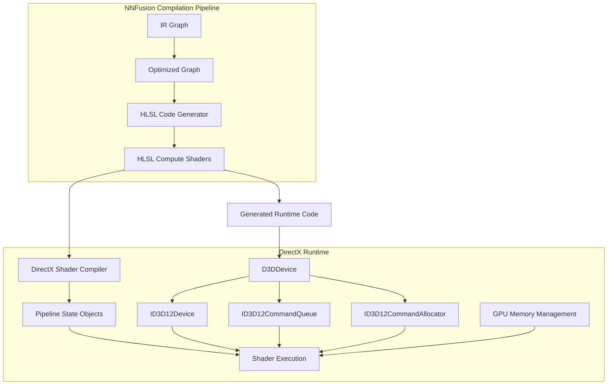
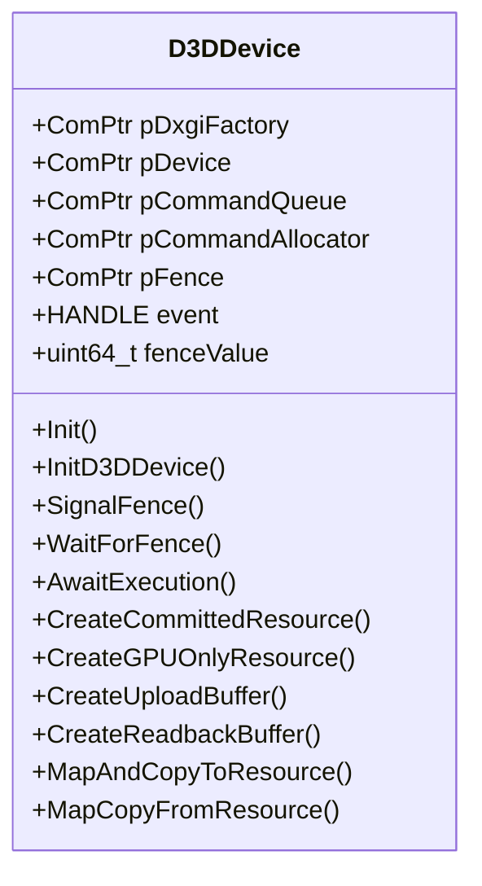
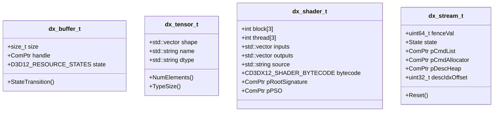
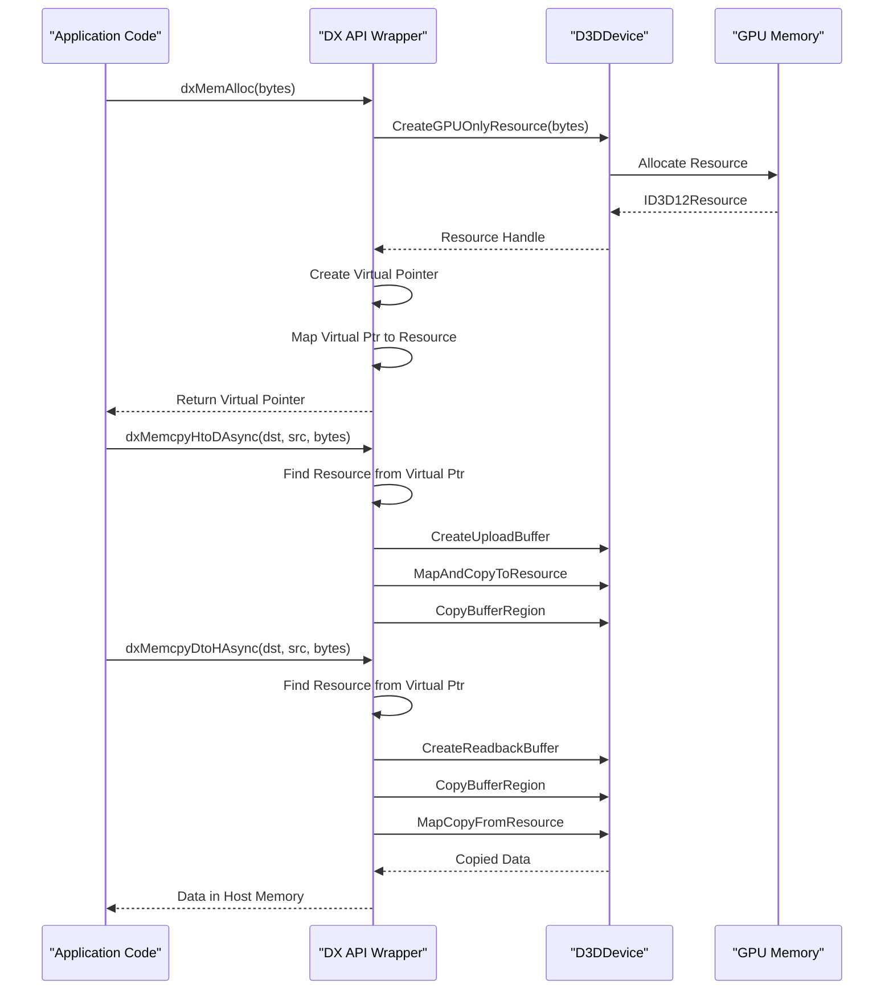
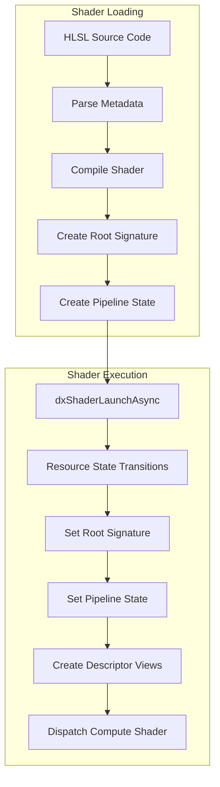
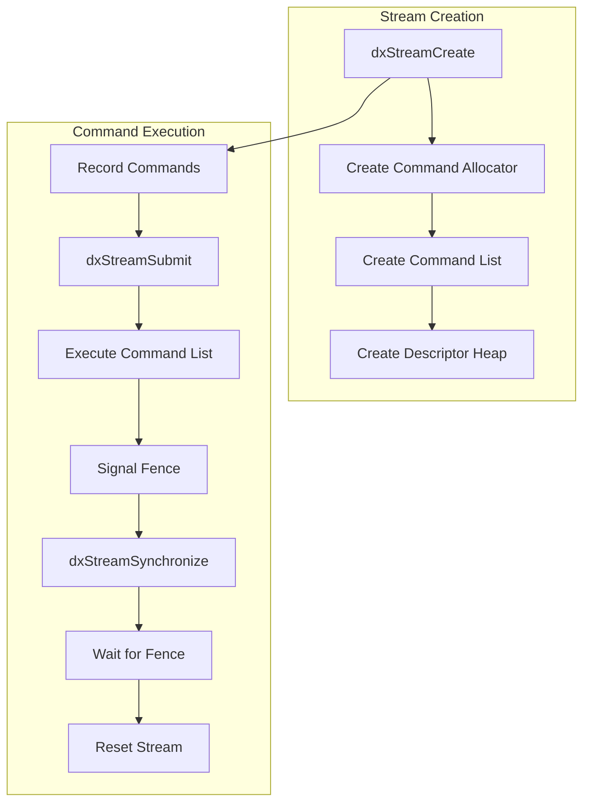

<!-- source: DeepWiki mcp.deepwiki.com · repo microsoft/nnfusion · page 5.2 DirectX Compute Integration · fetched 2026-10-26 -->

# DirectX Compute Integration

Relevant source files

The following files were used as context for generating this wiki page:

- [src/nnfusion/engine/pass/graph/hlsl_required_pass.hpp](src/nnfusion/engine/pass/graph/hlsl_required_pass.hpp)
- [src/nnfusion/engine/pass/graph/runtime_const_folding_pass.cpp](src/nnfusion/engine/pass/graph/runtime_const_folding_pass.cpp)
- [src/nnfusion/frontend/onnx_import/op/where.cpp](src/nnfusion/frontend/onnx_import/op/where.cpp)
- [src/tools/nnfusion/templates/dxcompute/Direct3DWinNN/runtime/D3D12APIWrapper.cpp](src/tools/nnfusion/templates/dxcompute/Direct3DWinNN/runtime/D3D12APIWrapper.cpp)
- [src/tools/nnfusion/templates/dxcompute/Direct3DWinNN/runtime/D3D12Util.h](src/tools/nnfusion/templates/dxcompute/Direct3DWinNN/runtime/D3D12Util.h)
- [src/tools/nnfusion/templates/dxcompute/Direct3DXBoxNN/runtime/D3D12APIWrapper.cpp](src/tools/nnfusion/templates/dxcompute/Direct3DXBoxNN/runtime/D3D12APIWrapper.cpp)
- [src/tools/nnfusion/templates/dxcompute/Direct3DXBoxNN/runtime/D3D12Util.h](src/tools/nnfusion/templates/dxcompute/Direct3DXBoxNN/runtime/D3D12Util.h)

This document describes the DirectX Compute integration in NNFusion, which enables neural network models to be executed using DirectX Compute shaders on Windows platforms. This integration serves as an alternative to CUDA and ROCm backends, providing acceleration capabilities on Windows devices with DirectX-compatible GPUs.

For information about CUDA code generation, see [CUDA Code Generation](#5.1).

## Overview of DirectX Compute in NNFusion

NNFusion's DirectX Compute backend translates neural network operations into High-Level Shading Language (HLSL) compute shaders. These shaders are then compiled and executed using the DirectX 12 API. The integration includes a complete runtime system that manages device initialization, memory allocation, shader compilation, execution, and synchronization.

Sources: [src/tools/nnfusion/templates/dxcompute/Direct3DWinNN/runtime/D3D12Util.h:689-860](), [src/tools/nnfusion/templates/dxcompute/Direct3DWinNN/runtime/D3D12APIWrapper.cpp:226-364]()

## Core Components

The DirectX Compute integration consists of several key components:

### D3DDevice Class

The `D3DDevice` class is the core component that manages DirectX resources, including:
- DirectX device initialization
- Command queue management 
- Resource creation and memory management
- Synchronization primitives
- Query handling for profiling

Sources: [src/tools/nnfusion/templates/dxcompute/Direct3DWinNN/runtime/D3D12Util.h:689-890]()

### Buffer Management Structures

The runtime uses several key structures to manage GPU resources:

- `dx_buffer_t`: Represents a buffer in GPU memory with state management
- `dx_tensor_t`: Represents tensor metadata including shape and data type
- `dx_shader_t`: Represents a compiled compute shader with associated metadata
- `dx_stream_t`: Represents a command stream for execution

Sources: [src/tools/nnfusion/templates/dxcompute/Direct3DWinNN/runtime/D3D12APIWrapper.cpp:21-127]()

### DirectX API Wrapper

The DirectX API Wrapper provides a C-style interface for interacting with DirectX resources. Key functions include:

| Function | Description |
|----------|-------------|
| `dxInit` | Initialize the DirectX backend |
| `dxFinalize` | Clean up resources |
| `dxMemAlloc` | Allocate GPU memory |
| `dxMemFree` | Free GPU memory |
| `dxMemcpyHtoDAsync` | Copy from host to device asynchronously |
| `dxMemcpyDtoHAsync` | Copy from device to host asynchronously |
| `dxMemcpyDtoDAsync` | Copy between device buffers asynchronously |
| `dxShaderLoad_v2` | Load and compile a shader |
| `dxShaderLaunchAsync` | Launch a shader asynchronously |
| `dxStreamCreate` | Create a command stream |
| `dxStreamSubmit` | Submit commands for execution |
| `dxStreamSynchronize` | Wait for command completion |

Sources: [src/tools/nnfusion/templates/dxcompute/Direct3DWinNN/runtime/D3D12APIWrapper.cpp:176-700]()

## Memory Management

The DirectX backend implements a sophisticated memory management system that maps virtual pointers to DirectX resources. This allows a consistent API regardless of the underlying memory architecture.

Key aspects of the memory management system:

1. **Virtual Memory Mapping**: 
   - Virtual address space is reserved using `VirtualAlloc` 
   - DirectX resources are mapped to these virtual addresses
   - Provides a CUDA-like pointer interface

2. **Resource State Management**:
   - Automatically tracks and transitions resource states
   - Handles barriers for proper synchronization
   - Supports copy, shader resource, and unordered access states

3. **Buffer Types**:
   - GPU-only buffers for device computation
   - Upload buffers for host-to-device transfers
   - Readback buffers for device-to-host transfers

Sources: [src/tools/nnfusion/templates/dxcompute/Direct3DWinNN/runtime/D3D12APIWrapper.cpp:201-217](), [src/tools/nnfusion/templates/dxcompute/Direct3DWinNN/runtime/D3D12APIWrapper.cpp:523-599]()

## Shader Compilation and Execution

The DirectX backend uses the following process to compile and execute compute shaders:

### Shader Loading Process

1. **Metadata Parsing**: 
   - Extracts input and output tensor information
   - Determines thread block dimensions

2. **Shader Compilation**:
   - Uses DirectX Shader Compiler (DXC) or legacy D3DCompile
   - Compiles HLSL code to shader bytecode

3. **Root Signature Creation**:
   - Creates descriptor tables or root parameters
   - Configures shader resource views (SRVs) and unordered access views (UAVs)

4. **Pipeline State Creation**:
   - Links compiled shader and root signature
   - Creates pipeline state object for execution

Sources: [src/tools/nnfusion/templates/dxcompute/Direct3DWinNN/runtime/D3D12APIWrapper.cpp:226-364]()

### Shader Execution Process

1. **Resource Preparation**:
   - Maps virtual pointers to DirectX resources
   - Calculates buffer offsets

2. **State Transitions**:
   - Transitions input buffers to shader resource state
   - Transitions output buffers to unordered access state

3. **Command Setup**:
   - Sets root signature and pipeline state
   - Creates or updates descriptors

4. **Dispatch**:
   - Launches compute shader with specified dimensions
   - Manages execution through command lists

5. **Synchronization**:
   - Uses fences to track completion
   - Provides synchronization primitives to wait for results

Sources: [src/tools/nnfusion/templates/dxcompute/Direct3DWinNN/runtime/D3D12APIWrapper.cpp:602-700]()

## Command Stream Management

The DirectX backend manages command execution through streams that encapsulate command lists and allocators:

Key aspects of command stream management:

1. **Stream Creation**:
   - Each stream has its own command allocator and list
   - Optional descriptor heap for resource binding
   - State tracking for proper command recording

2. **Command Recording**:
   - Operations are recorded into command lists
   - Resource transitions are tracked and managed
   - Descriptor tables are updated when needed

3. **Command Submission**:
   - Command lists are closed and submitted
   - Fence values are used to track completion
   - Multiple streams can be managed independently

4. **Synchronization**:
   - Fence-based synchronization ensures completion
   - Streams can be reset for reuse after completion
   - Explicit or implicit synchronization is supported

Sources: [src/tools/nnfusion/templates/dxcompute/Direct3DWinNN/runtime/D3D12APIWrapper.cpp:417-498]()

## DirectX Version and Platform Support

The DirectX Compute backend supports both regular Windows platforms and Xbox platforms. The implementation includes conditional compilation for different target environments:

- Standard Windows: Uses DXGI and standard DirectX 12 APIs
- Xbox: Uses Xbox-specific DirectX 12 APIs

The backend supports both DXC (DirectX Shader Compiler) and the legacy D3DCompiler based on configuration and platform requirements.

Sources: [src/tools/nnfusion/templates/dxcompute/Direct3DWinNN/runtime/D3D12Util.h:23-47](), [src/tools/nnfusion/templates/dxcompute/Direct3DXBoxNN/runtime/D3D12Util.h:23-47]()

## Integration with NNFusion Compilation Pipeline

The DirectX Compute backend integrates with NNFusion's compilation pipeline by:

1. Converting optimized IR graphs to HLSL compute shaders
2. Generating runtime code to load and execute these shaders
3. Managing memory transfers between host and device
4. Providing synchronization mechanisms for execution

The backend is integrated into NNFusion's code generation system alongside other backends like CUDA, ROCm, and CPU.

Sources: [src/nnfusion/engine/pass/graph/hlsl_required_pass.hpp:14-20]()

## Conclusion

The DirectX Compute integration in NNFusion provides a robust backend for executing neural network models on Windows platforms using DirectX 12. This integration leverages DirectX Compute shaders for high-performance computation while providing a consistent programming interface similar to other backends in NNFusion.

The implementation includes comprehensive memory management, shader compilation and execution, command stream handling, and synchronization mechanisms necessary for efficient neural network inference on DirectX-compatible GPUs.

---

