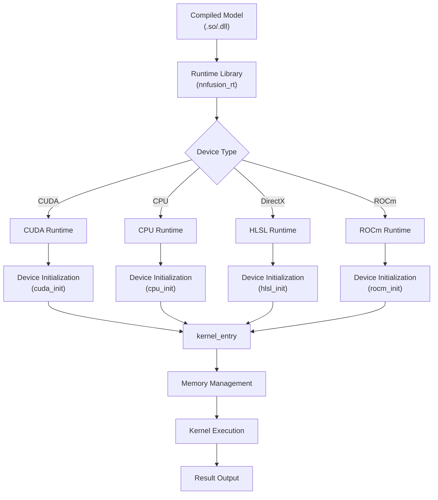
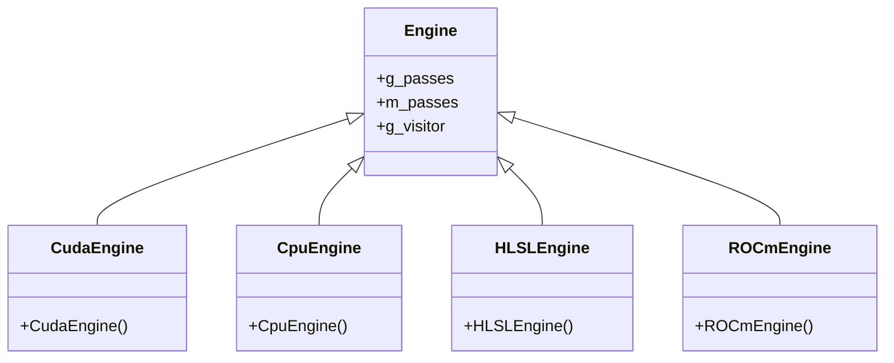
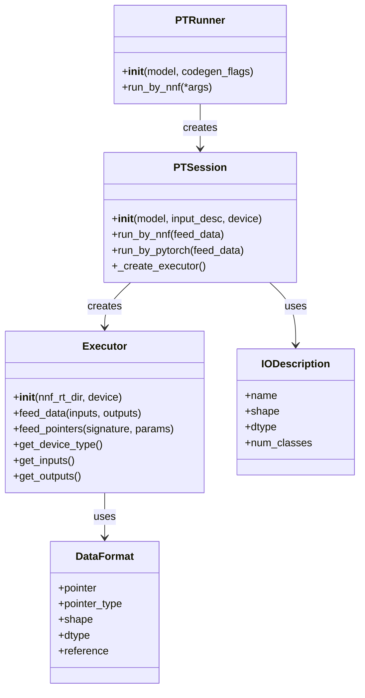
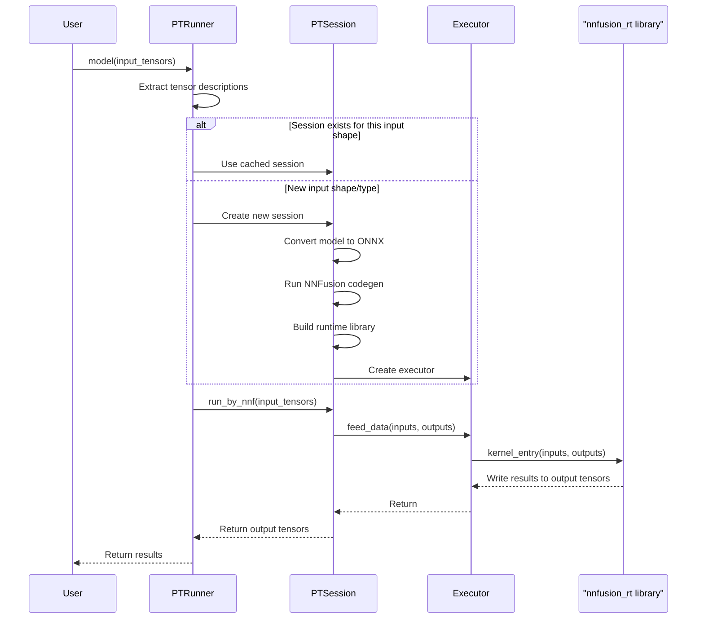
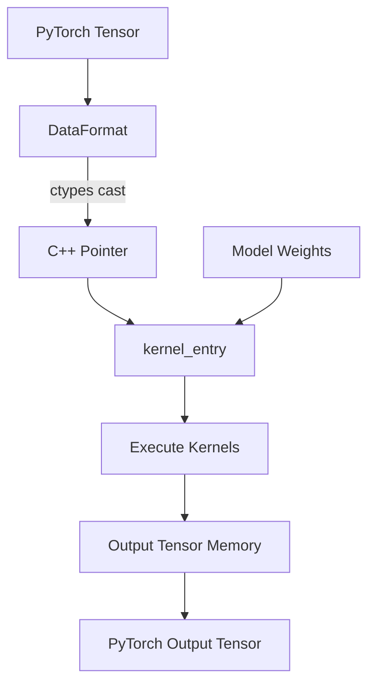

<!-- source: DeepWiki mcp.deepwiki.com · repo microsoft/nnfusion · page 6 Runtime and Execution · fetched 2026-10-26 -->

# Runtime and Execution

<details>
<summary>Relevant source files</summary>

The following files were used as context for generating this wiki page:

- [src/nnfusion/core/kernels/cpu/cpu_kernel_emitter.cpp](src/nnfusion/core/kernels/cpu/cpu_kernel_emitter.cpp)
- [src/nnfusion/engine/device/cpu.cpp](src/nnfusion/engine/device/cpu.cpp)
- [src/nnfusion/engine/device/cuda.cpp](src/nnfusion/engine/device/cuda.cpp)
- [src/nnfusion/engine/device/hlsl.cpp](src/nnfusion/engine/device/hlsl.cpp)
- [src/nnfusion/engine/device/rocm.cpp](src/nnfusion/engine/device/rocm.cpp)
- [src/nnfusion/engine/pass/graph/CMakeLists.txt](src/nnfusion/engine/pass/graph/CMakeLists.txt)
- [src/nnfusion/engine/pass/graph/graph_pass.cpp](src/nnfusion/engine/pass/graph/graph_pass.cpp)
- [src/python/nnfusion/data_format.py](src/python/nnfusion/data_format.py)
- [src/python/nnfusion/description.py](src/python/nnfusion/description.py)
- [src/python/nnfusion/executor.py](src/python/nnfusion/executor.py)
- [src/python/nnfusion/runner.py](src/python/nnfusion/runner.py)
- [src/python/nnfusion/session.py](src/python/nnfusion/session.py)

</details>


This document describes the runtime and execution system of NNFusion, focusing on how compiled models are loaded and executed after the compilation phase. For information about the compilation process itself, see [Code Generation](#5).

## Runtime System Overview

After a model is compiled by NNFusion, the runtime system handles loading the compiled code, managing memory, initializing the target device, and executing computational kernels. NNFusion supports multiple backend targets including CUDA, CPU, HLSL (DirectX), and ROCm, each with its own runtime implementation.

### Runtime System Architecture



Sources:
- [src/python/nnfusion/executor.py:70-83]()
- [src/python/nnfusion/executor.py:114-128]()

## Device-specific Runtime Engines

Each supported backend has its own runtime engine with specific optimization passes and code generation techniques.



Each engine initializes specific sets of passes for optimizing and generating code:

| Engine | Code Generation Pass | Device Init/Free Functions |
|--------|----------------------|----------------------------|
| CudaEngine | CudaCodegenPass | cuda_init, cuda_free |
| CpuEngine | CpuCodegenPass | cpu_init, cpu_free |
| HLSLEngine | HLSLCodegenPass/HLSLCSCodegenPass/HLSLCPPCodegenPass | hlsl_init, hlsl_free |
| ROCmEngine | RocmCodegenPass | rocm_init, rocm_free |

Sources:
- [src/nnfusion/engine/device/cuda.cpp:45-101]()
- [src/nnfusion/engine/device/cpu.cpp:40-87]()
- [src/nnfusion/engine/device/hlsl.cpp:46-152]()
- [src/nnfusion/engine/device/rocm.cpp:41-90]()

## Python Execution Interface

NNFusion provides a Python interface that allows for seamless integration with PyTorch models. The interface consists of three main components:

1. `Executor`: Loads and interfaces with the compiled runtime library
2. `PTSession`: Manages PyTorch model conversion and execution
3. `PTRunner`: Provides caching for multiple executions with different inputs

### Python Interface Component Diagram



Sources:
- [src/python/nnfusion/executor.py:70-244]()
- [src/python/nnfusion/session.py:107-302]()
- [src/python/nnfusion/runner.py:30-91]()
- [src/python/nnfusion/data_format.py:9-70]()
- [src/python/nnfusion/description.py:4-71]()

### Execution Flow

The execution flow using the Python interface follows this sequence:



Sources:
- [src/python/nnfusion/runner.py:64-90]()
- [src/python/nnfusion/session.py:262-290]()
- [src/python/nnfusion/executor.py:179-230]()

## Memory Management

The runtime system handles memory management for inputs, outputs, and intermediate tensors. The memory management process includes:

1. **Input Memory**: References PyTorch tensors directly to avoid copying
2. **Workspace Memory**: Reserved for intermediate computations
3. **Output Memory**: Allocated for storing computation results
4. **Parameter Memory**: Stores model weights and constants

When using PyTorch integration, NNFusion uses CUDA or CPU memory directly from PyTorch tensors through `ctypes` pointers, ensuring zero-copy data transfer between PyTorch and the compiled runtime.



Sources:
- [src/python/nnfusion/data_format.py:50-61]()
- [src/python/nnfusion/executor.py:232-243]()

## Runtime Implementation Details

### Runtime Library Structure

The NNFusion runtime library (`nnfusion_rt`) contains these key components:

1. **Device Type Detection**: Identifies the target hardware device via `get_device_type()`
2. **Device Initialization**: Functions for each supported backend (e.g., `cuda_init()`)
3. **kernel_entry Function**: Main entry point for executing the compiled model
4. **Parameter Information**: Metadata in `para_info.json` about inputs and outputs

### Runtime API

The core runtime C++ API exposed through the compiled library includes:

- **Device Type Detection**: `get_device_type()`
- **Device Initialization**: `cuda_init()`, `cpu_init()`, `hlsl_init()`, `rocm_init()`
- **Device Cleanup**: `cuda_free()`, `cpu_free()`, `hlsl_free()`, `rocm_free()`
- **Execution**: `kernel_entry()` or `kernel_entry_host()`
- **Workspace Size Query**: `get_workspace_size()` (optional)

Sources:
- [src/python/nnfusion/executor.py:107-113]()
- [src/python/nnfusion/executor.py:161-165]()

## Usage Examples

### Using PTSession Directly

```python
import torch
from nnfusion.session import PTSession
from nnfusion.description import IODescription

# Create a PyTorch model
model = MyModel()

# Define input descriptions
input_desc = [IODescription("input_0", shape=(1, 3, 224, 224), dtype="float32")]

# Create a session
session = PTSession(
    model=model,
    input_desc=input_desc,
    device="cuda:0",
    workdir="./compiled_model",
    codegen_flags={"extern_result_memory": 1}
)

# Prepare input tensor
input_tensor = torch.rand(1, 3, 224, 224).cuda()

# Execute the model
outputs = session.run_by_nnf({"input_0": input_tensor})
```

### Using PTRunner for Repeated Execution

```python
import torch
from nnfusion.runner import PTRunner

# Create a PyTorch model
model = MyModel()

# Create a runner (manages sessions automatically)
runner = PTRunner(model, codegen_flags={"extern_result_memory": 1})

# First execution will compile and cache
input1 = torch.rand(1, 3, 224, 224).cuda()
output1 = runner(input1)

# Subsequent executions with same shapes will use cache
input2 = torch.rand(1, 3, 224, 224).cuda()
output2 = runner(input2)

# Different shapes will create a new session
input3 = torch.rand(2, 3, 224, 224).cuda()
output3 = runner(input3)
```

## Integration with Other Systems

NNFusion's runtime can integrate with other systems:

1. **PyTorch**: Seamless integration through PTSession and PTRunner
2. **DirectX**: HLSL backend for DirectX 12 Compute integration
3. **C++ Applications**: Direct usage of the compiled runtime library
4. **Custom Operators**: Extension with custom C++/CUDA operators

## Performance Considerations

The runtime implementation focuses on performance with the following features:

1. **Zero-copy Data Transfer**: Direct pointer access to PyTorch tensors
2. **Minimal Overhead**: Thin C++ wrapper around optimized kernels
3. **Workspace Memory Reuse**: Single allocation for all intermediate results
4. **Cached Compilation**: PTRunner caches sessions for repeated shape patterns
5. **Device-specific Optimizations**: Each backend has tailored runtime code

Sources:
- [src/python/nnfusion/executor.py:232-243]()
- [src/python/nnfusion/runner.py:30-91]()

---

