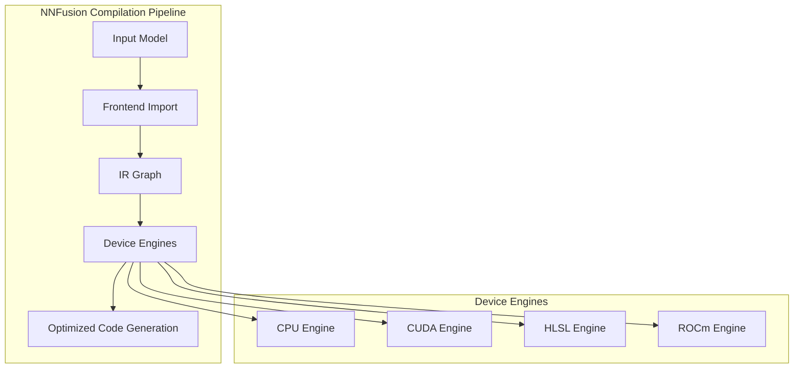
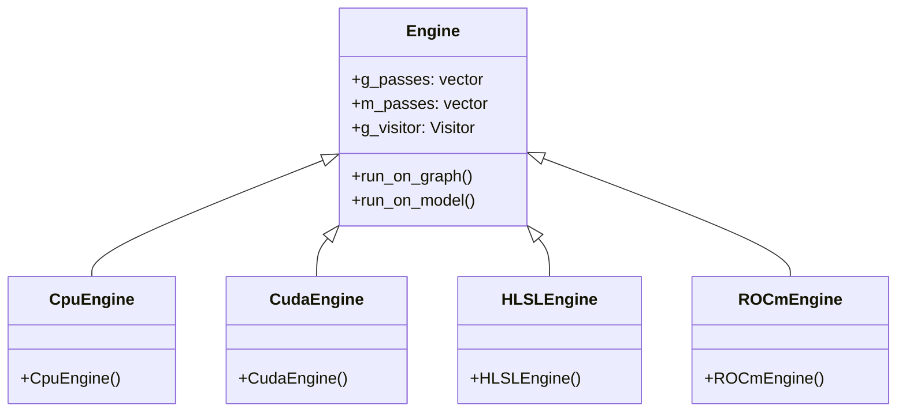
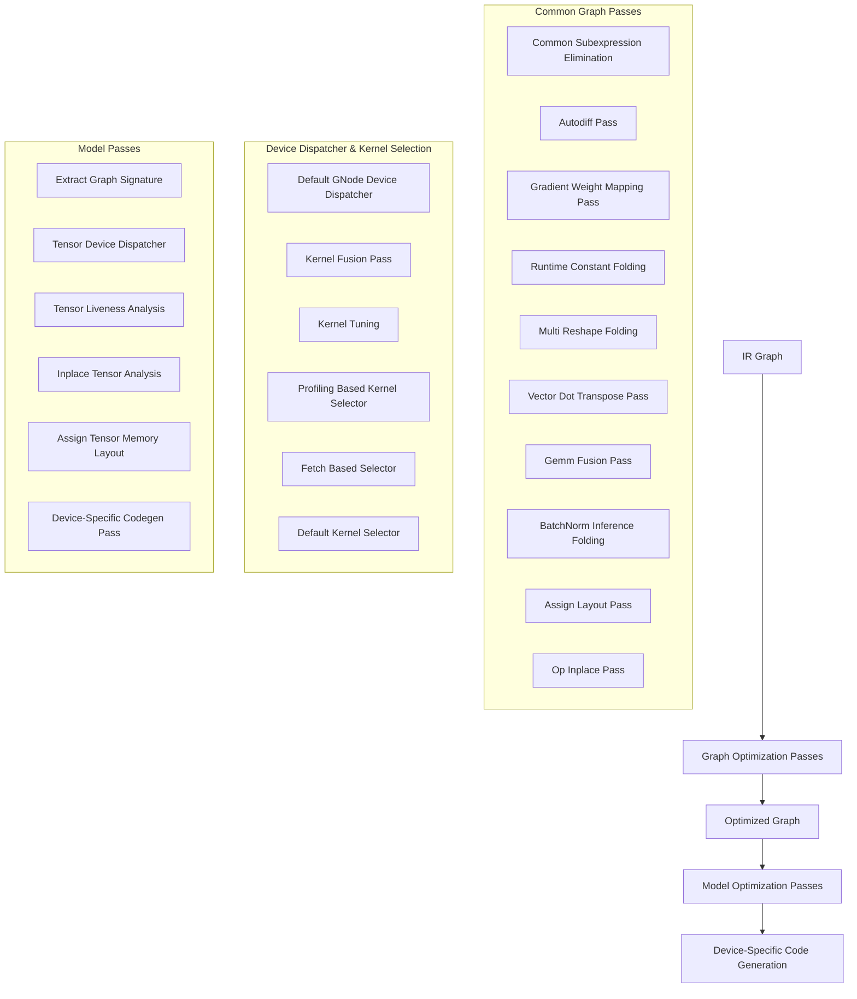
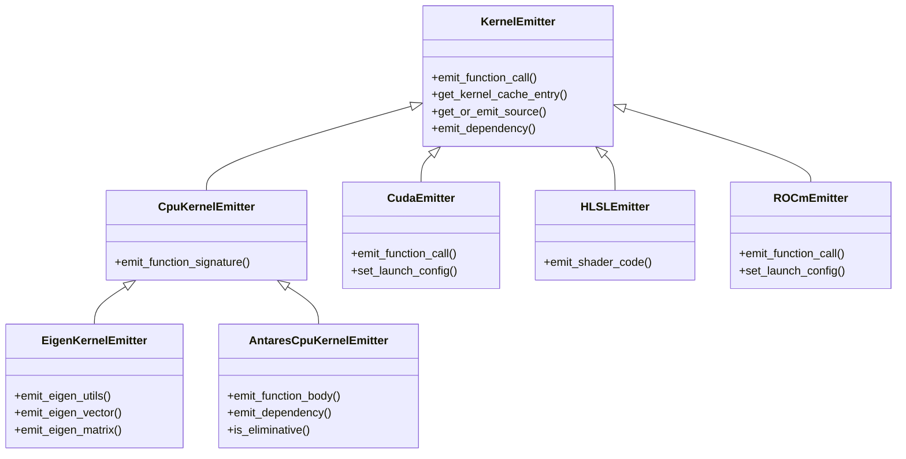
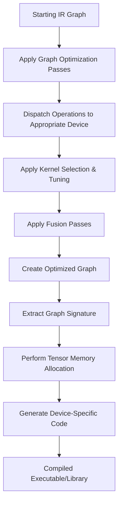

<!-- source: DeepWiki mcp.deepwiki.com · repo microsoft/nnfusion · page 6.1 Device Engines · fetched 2026-10-26 -->

# Device Engines

<details>
<summary>Relevant source files</summary>

The following files were used as context for generating this wiki page:

- [src/nnfusion/core/kernels/cpu/cpu_kernel_emitter.cpp](src/nnfusion/core/kernels/cpu/cpu_kernel_emitter.cpp)
- [src/nnfusion/engine/device/cpu.cpp](src/nnfusion/engine/device/cpu.cpp)
- [src/nnfusion/engine/device/cuda.cpp](src/nnfusion/engine/device/cuda.cpp)
- [src/nnfusion/engine/device/hlsl.cpp](src/nnfusion/engine/device/hlsl.cpp)
- [src/nnfusion/engine/device/rocm.cpp](src/nnfusion/engine/device/rocm.cpp)
- [src/nnfusion/engine/pass/graph/CMakeLists.txt](src/nnfusion/engine/pass/graph/CMakeLists.txt)
- [src/nnfusion/engine/pass/graph/graph_pass.cpp](src/nnfusion/engine/pass/graph/graph_pass.cpp)

</details>


## Purpose and Scope

This document describes the Device Engines in NNFusion, which are specialized optimization and code generation pipelines for different hardware backends. Device Engines translate NNFusion's internal representation (IR) into optimized code tailored for specific hardware targets. For details on the IR itself, see [Core IR and Graph Representation](#3).



Sources: [src/nnfusion/engine/device/cpu.cpp](), [src/nnfusion/engine/device/cuda.cpp](), [src/nnfusion/engine/device/hlsl.cpp](), [src/nnfusion/engine/device/rocm.cpp]()

## Device Engine Architecture

Each Device Engine is an implementation of the base `Engine` class with device-specific optimization passes and code generation. The Device Engines are responsible for:

1. Configuring a sequence of graph optimization passes (`g_passes`)
2. Setting up a graph visitor pattern for traversal
3. Establishing a sequence of model passes (`m_passes`) for memory allocation and code generation
4. Executing the final code generation for the target hardware



Sources: [src/nnfusion/engine/device/cpu.cpp:40-87](), [src/nnfusion/engine/device/cuda.cpp:45-101](), [src/nnfusion/engine/device/hlsl.cpp:46-152](), [src/nnfusion/engine/device/rocm.cpp:41-90]()

## Optimization Passes Pipeline

Each Device Engine configures a tailored optimization pipeline. The following diagram illustrates the common pattern of optimization passes across different engines:



Sources: [src/nnfusion/engine/device/cpu.cpp:43-86](), [src/nnfusion/engine/device/cuda.cpp:48-100](), [src/nnfusion/engine/pass/graph/graph_pass.cpp]()

## CPU Engine

The CPU Engine targets execution on CPUs and includes optimization passes specifically for CPU execution.

### Key Components:

- Uses `ReversedDFSVisitor` for graph traversal
- Applies generic optimizations like Common Subexpression Elimination and Auto-differentiation
- Configures CPU-specific memory layout
- Generates code using the `CpuCodegenPass`

### CPU-Specific Optimization Passes:

- Vector operation optimizations (`VectorDotTransposePass`)
- GEMM fusion optimizations
- In-place operation passes to reduce memory usage

Sources: [src/nnfusion/engine/device/cpu.cpp:40-87](), [src/nnfusion/core/kernels/cpu/cpu_kernel_emitter.cpp]()

## CUDA Engine

The CUDA Engine targets NVIDIA GPUs using CUDA. It includes several GPU-specific optimizations not present in the CPU engine.

### Key Components:

- Uses `ReversedDFSVisitor` for graph traversal (same as CPU)
- Adds GPU-specific optimizations like `BlockFusionPass` for merging kernel launches
- Includes `AssignAsyncInfoPass` for CUDA stream management
- Generates CUDA code using the `CudaCodegenPass`

### CUDA-Specific Optimization Passes:

- `ReduceFusionPass` for optimizing reduction operations
- `BlockFusionPass` for fusing computation blocks to reduce kernel launches
- `KernelProfilingPass` for performance measurement
- `DotTransposePass` for optimizing matrix operations

Sources: [src/nnfusion/engine/device/cuda.cpp:45-101]()

## HLSL Engine

The HLSL Engine targets DirectX hardware through HLSL (High-Level Shading Language) code generation. It features multiple codegen types based on the target integration environment.

### HLSL Codegen Types:

1. **Default** - Core HLSL code generation
2. **C#** - HLSL code with C# integration for DirectX applications
3. **C++** - HLSL code with C++ integration

### Key Components:

- Uses either `ReversedDFSVisitor` or `DegreeBasedVisitor` depending on codegen type
- Contains specific passes for optimizing DirectX Compute execution
- Generates shader code through `HLSLCodegenPass`, `HLSLCSCodegenPass`, or `HLSLCPPCodegenPass`

Sources: [src/nnfusion/engine/device/hlsl.cpp:46-152]()

## ROCm Engine

The ROCm Engine targets AMD GPUs using the ROCm platform, which is similar to CUDA but for AMD hardware.

### Key Components:

- Uses `ReversedDFSVisitor` for graph traversal
- Shares many optimization passes with the CUDA Engine
- Contains ROCm-specific implementations for kernel fusion and code generation
- Generates code using the `RocmCodegenPass`

Sources: [src/nnfusion/engine/device/rocm.cpp:41-90]()

## Device-Specific Kernel Emitters

Each Device Engine relies on corresponding kernel emitters that generate the actual device-specific code for operators.



### Function Signature Generation

Kernel emitters generate function signatures appropriate to the target device. For example, CPU kernel emitters produce functions that can work with thread pools:

```cpp
// Example from CpuKernelEmitter::emit_function_signature()
void (concurrency::ThreadPool* thread_pool, float* input0, float* output0)
```

Sources: [src/nnfusion/core/kernels/cpu/cpu_kernel_emitter.cpp:210-246]()

## Engine Execution Flow

The Device Engines follow a similar execution flow, with device-specific variations:



Each Device Engine configures this flow via different sets of passes, but the general pattern remains the same across all supported devices.

Sources: [src/nnfusion/engine/device/cpu.cpp:40-87](), [src/nnfusion/engine/device/cuda.cpp:45-101](), [src/nnfusion/engine/device/hlsl.cpp:46-152](), [src/nnfusion/engine/device/rocm.cpp:41-90]()

## Summary

Device Engines are a critical part of NNFusion that enable targeting multiple hardware platforms with optimized code. Each Device Engine encapsulates a series of tailored optimization passes and code generation strategies specific to its target hardware. This modular architecture allows NNFusion to support CPUs, NVIDIA GPUs, AMD GPUs, and DirectX-compatible devices within a unified compilation framework.

---

