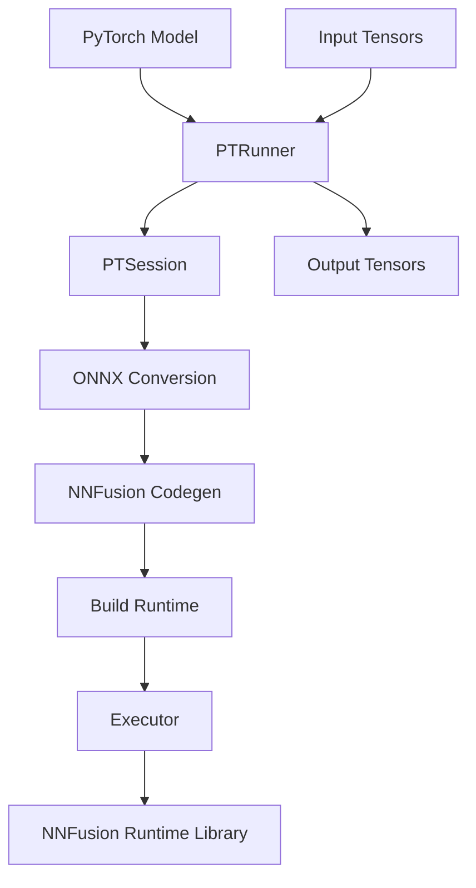
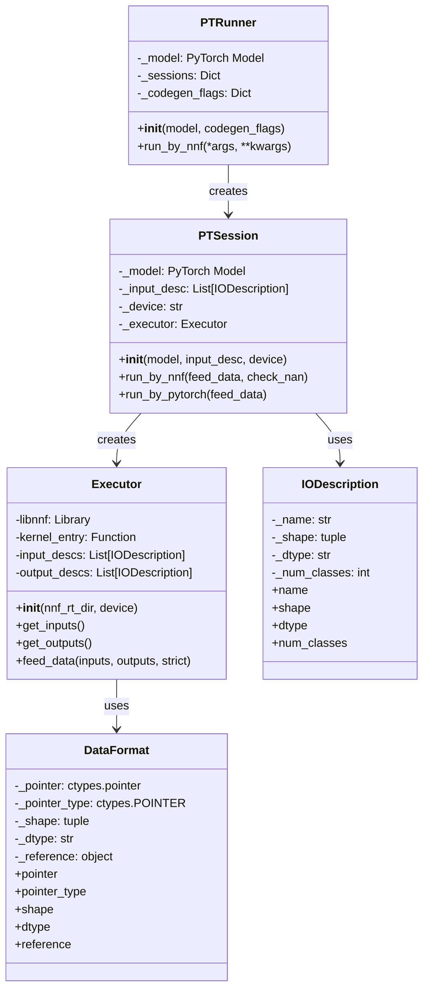
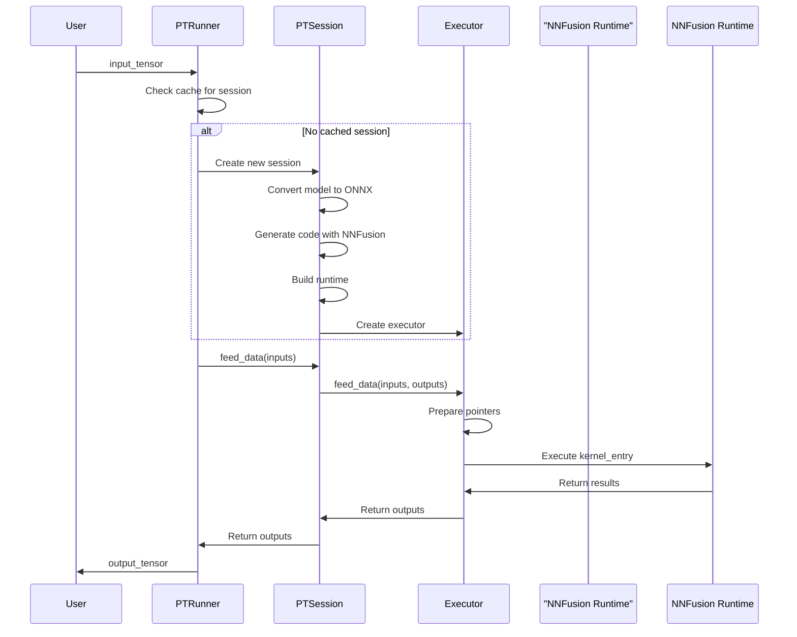

<!-- source: DeepWiki mcp.deepwiki.com · repo microsoft/nnfusion · page 6.2 Python Interface · fetched 2026-10-26 -->

# Python Interface

<details>
<summary>Relevant source files</summary>

The following files were used as context for generating this wiki page:

- [src/python/nnfusion/data_format.py](src/python/nnfusion/data_format.py)
- [src/python/nnfusion/description.py](src/python/nnfusion/description.py)
- [src/python/nnfusion/executor.py](src/python/nnfusion/executor.py)
- [src/python/nnfusion/runner.py](src/python/nnfusion/runner.py)
- [src/python/nnfusion/session.py](src/python/nnfusion/session.py)

</details>


## Purpose and Scope

The Python Interface provides a bridge between Python-based deep learning frameworks (especially PyTorch) and NNFusion's optimization capabilities. This document covers how to use the Python interface to convert, optimize, and execute neural network models through NNFusion.

For information about the device-specific runtime engines that execute the compiled models, see [Device Engines](#6.1).

## Architecture Overview

The Python Interface consists of several hierarchical components that enable the conversion from PyTorch models to optimized NNFusion executables:



Sources: [src/python/nnfusion/runner.py:30-90](), [src/python/nnfusion/session.py:107-300](), [src/python/nnfusion/executor.py:70-177]()

## Core Components

The Python Interface consists of several key components that work together:

### Component Hierarchy and Responsibilities



Sources: [src/python/nnfusion/runner.py:30-90](), [src/python/nnfusion/session.py:107-300](), [src/python/nnfusion/executor.py:70-177](), [src/python/nnfusion/description.py:4-71](), [src/python/nnfusion/data_format.py:9-70]()

| Component | Description | Responsibility |
|-----------|-------------|----------------|
| **PTRunner** | High-level interface that acts as a drop-in replacement for PyTorch models | Caches sessions for different input shapes and handles automatic session creation |
| **PTSession** | Mid-level interface that manages a single compilation pipeline | Converts PyTorch models to ONNX, runs NNFusion compilation, builds the runtime |
| **Executor** | Low-level interface that wraps the compiled NNFusion runtime | Loads the dynamic library, manages memory, executes the compiled kernels |
| **IODescription** | Utility class for tensor metadata | Describes tensor name, shape, and data type for model inputs and outputs |
| **DataFormat** | Utility class for data exchange | Manages pointers and memory for passing data between Python and C++ |

Sources: [src/python/nnfusion/runner.py:30-90](), [src/python/nnfusion/session.py:107-300](), [src/python/nnfusion/executor.py:70-177](), [src/python/nnfusion/description.py:4-71](), [src/python/nnfusion/data_format.py:9-70]()

## Execution Flow

The following diagram illustrates the data flow when executing a PyTorch model through NNFusion:



Sources: [src/python/nnfusion/runner.py:63-90](), [src/python/nnfusion/session.py:262-290](), [src/python/nnfusion/executor.py:179-230]()

## Usage Examples

### Basic Usage with PTRunner

The simplest way to use NNFusion with PyTorch is through the `PTRunner` class:

```python
import torch
import torch.nn as nn
from nnfusion.runner import PTRunner

# Define a simple PyTorch model
class SimpleModel(nn.Module):
    def __init__(self):
        super().__init__()
        self.fc1 = nn.Linear(10, 5)
        self.fc2 = nn.Linear(5, 1)
        
    def forward(self, x):
        x = torch.relu(self.fc1(x))
        x = self.fc2(x)
        return x

# Create the model
model = SimpleModel()

# Create a PTRunner with the model
runner = PTRunner(model)

# Create input tensor
input_tensor = torch.randn(1, 10, device="cuda:0")

# Execute the model with NNFusion
output = runner(input_tensor)
```

The `PTRunner` automatically handles:
1. Creating a session for the input tensor shape
2. Converting the model to ONNX
3. Generating and building NNFusion code
4. Executing the model with the input tensor

Sources: [src/python/nnfusion/runner.py:30-90]()

### Advanced Usage with PTSession

For more control over the compilation process, you can use `PTSession` directly:

```python
import torch
import torch.nn as nn
from nnfusion.session import PTSession
from nnfusion.description import IODescription

# Define a PyTorch model
model = nn.Sequential(
    nn.Conv2d(3, 16, 3, padding=1),
    nn.ReLU(),
    nn.MaxPool2d(2),
    nn.Conv2d(16, 32, 3, padding=1),
    nn.ReLU(),
    nn.MaxPool2d(2),
    nn.Flatten(),
    nn.Linear(32 * 8 * 8, 10)
)

# Define input description
input_desc = [IODescription("input", (1, 3, 32, 32), "float32")]

# Create a PTSession with custom configurations
session = PTSession(
    model,
    input_desc,
    device="cuda:0",
    workdir="./my_model",
    codegen_flags={"antares_mode": True, "extern_result_memory": 1}
)

# Create input tensor
input_tensor = torch.randn(1, 3, 32, 32, device="cuda:0")

# Execute the model with NNFusion
output = session.run_by_nnf({"input": input_tensor})
```

With `PTSession`, you can:
1. Specify input/output descriptions
2. Set a working directory for generated code
3. Provide custom codegen flags
4. Control the model conversion and execution process

Sources: [src/python/nnfusion/session.py:107-300]()

## Low-Level Components

### Executor

The `Executor` class wraps the compiled NNFusion runtime library:

```python
class Executor:
    """
    Python wrapper for NNFusion runtime.
    Executor loads a compiled nnf_rt dynamic lib, provide a __call__ func to
    execute the "kernel_entry" in nnf_rt with given data.
    """
```

Key methods:
- `__init__(nnf_rt_dir, device=None)`: Initializes the executor with a path to the runtime directory
- `get_inputs()`: Returns descriptions of the required inputs
- `get_outputs()`: Returns descriptions of the expected outputs
- `feed_data(inputs, outputs, strict=True)`: Executes the model with the given inputs and outputs

Sources: [src/python/nnfusion/executor.py:70-230]()

### Data Handling

The interface uses two main classes for data handling:

1. **IODescription**: Describes the metadata of tensors (name, shape, data type)
2. **DataFormat**: Handles the conversion between PyTorch tensors and C pointers

```python
# Converting a PyTorch tensor to a format NNFusion can use
from nnfusion.data_format import cast_pytorch_tensor

tensor = torch.randn(1, 3, 224, 224, device="cuda:0")
data_format = cast_pytorch_tensor(tensor)
```

Sources: [src/python/nnfusion/description.py:4-51](), [src/python/nnfusion/data_format.py:9-61]()

## Limitations and Considerations

When using the Python Interface, be aware of the following:

1. **Device Support**: Currently, only CUDA devices are well-tested for execution.
2. **Input Format**: The interface only supports model conversion from PyTorch to ONNX format.
3. **Tensor Requirements**: Input tensors must be contiguous in memory. Use `tensor.detach().clone().contiguous()` if needed.
4. **Device Consistency**: All input tensors must be on the same device.
5. **Model Compatibility**: Complex models may require custom codegen flags.

Table of supported devices:

| Device Type | Status | Notes |
|-------------|--------|-------|
| CUDA GPU | ✅ Supported | Primary target, well-tested |
| CPU | ⚠️ Limited support | Partial implementation |
| ROCm GPU | ⚠️ Limited support | "ROCm not supported yet" in PTSession |
| DirectX | ⚠️ Limited support | Only through Executor directly |
| Other | ❌ Not supported | |

Sources: [src/python/nnfusion/session.py:198-206](), [src/python/nnfusion/runner.py:83-87](), [src/python/nnfusion/data_format.py:50-61]()

## Conclusion

The Python Interface for NNFusion provides a convenient way to leverage NNFusion's optimization capabilities with PyTorch models. By converting PyTorch models to NNFusion's internal representation and generating optimized code, it allows for efficient model execution directly from Python, with minimal changes to existing code.

---

