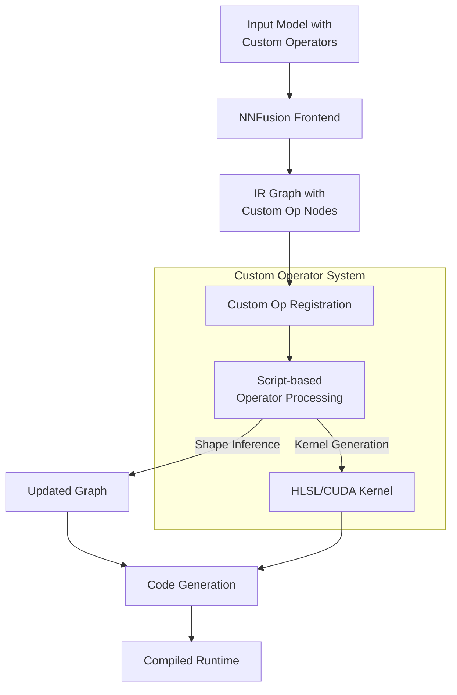
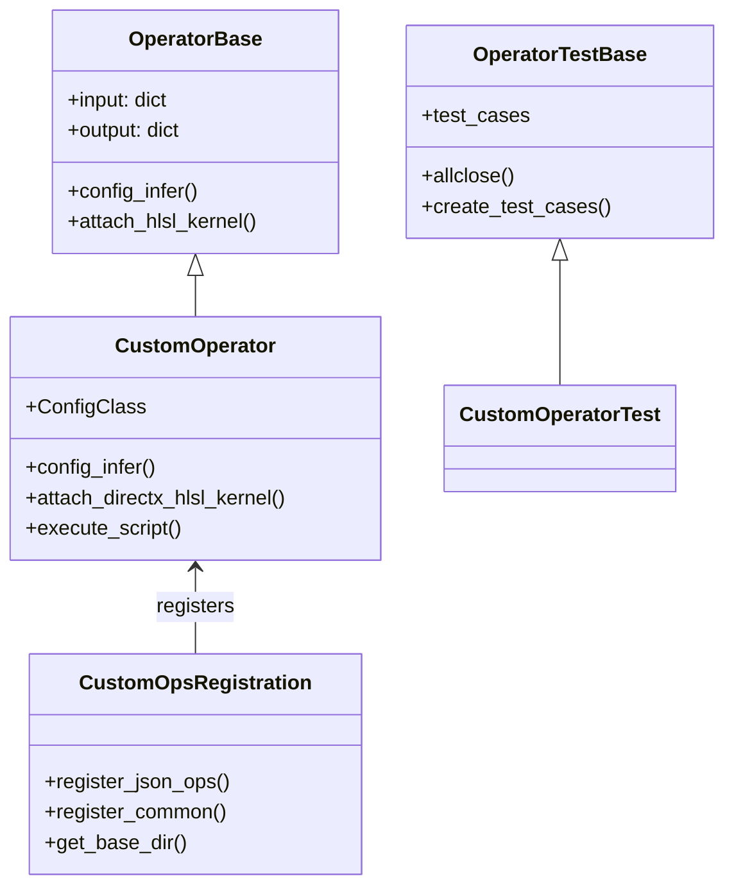
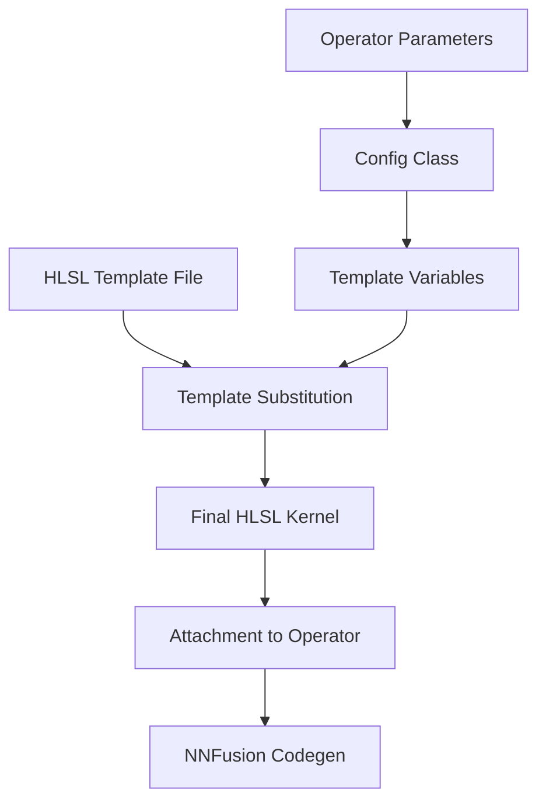
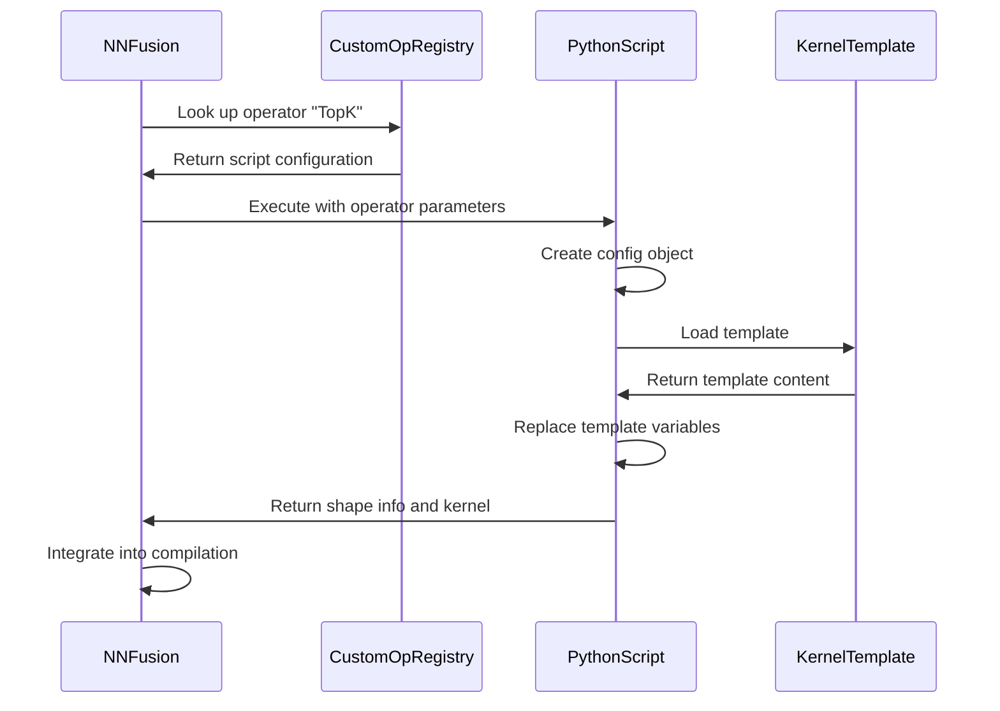

<!-- source: DeepWiki mcp.deepwiki.com · repo microsoft/nnfusion · page 7 Custom Operators · fetched 2026-10-26 -->

# Custom Operators

<details>
<summary>Relevant source files</summary>

The following files were used as context for generating this wiki page:

- [src/contrib/custom_op/custom_op.cpp](src/contrib/custom_op/custom_op.cpp)
- [src/contrib/custom_op/script/ArgMax.py](src/contrib/custom_op/script/ArgMax.py)
- [src/contrib/custom_op/script/TopK.py](src/contrib/custom_op/script/TopK.py)
- [src/contrib/custom_op/script/__operator__.py](src/contrib/custom_op/script/__operator__.py)
- [src/contrib/custom_op/script/hlsl/argmax/argmax.hlsl](src/contrib/custom_op/script/hlsl/argmax/argmax.hlsl)
- [src/contrib/custom_op/script/hlsl/topk/topk.hlsl](src/contrib/custom_op/script/hlsl/topk/topk.hlsl)
- [src/contrib/custom_op/script/op.json](src/contrib/custom_op/script/op.json)
- [src/nnfusion/common/util.cpp](src/nnfusion/common/util.cpp)

</details>


This document describes how to extend NNFusion with custom operators. Custom operators provide a mechanism to implement operations that are not natively supported in NNFusion's core framework, allowing you to execute models with specialized functions. For information on how standard operators are processed, see [Core IR and Graph Representation](#3).

## Overview

NNFusion's custom operator framework allows you to define new operations that can be used in neural network models. The system uses a script-based approach with Python files defining the operator logic and behavior, along with HLSL kernel implementations for DirectX backend support.



Sources: [src/contrib/custom_op/custom_op.cpp](), [src/contrib/custom_op/script/op.json]()

## Custom Operator Framework

The custom operator system consists of several components that work together to integrate new operators into NNFusion's compilation pipeline.



Sources: [src/contrib/custom_op/script/__operator__.py](), [src/contrib/custom_op/custom_op.cpp]()

### Base Classes

The custom operator system is built on several base classes that provide the framework for implementing new operators:

1. **OperatorBase**: The foundational class for all custom operators that provides common functionality.
2. **OperatorTestBase**: Provides testing capabilities for custom operators.
3. **CustomOpsRegistration**: Handles registration of custom operators with the NNFusion system.

Each custom operator inherits from `OperatorBase` and implements specific methods to define its behavior.

Sources: [src/contrib/custom_op/script/__operator__.py:19-36]()

### Configuration and Shape Inference

Custom operators must implement a `config_infer` method that determines the output shape and data type based on input characteristics. This is crucial for the NNFusion compiler to properly construct the computational graph.

For example, the `TopK` operator determines its output shape based on the input shape and the k value:

```python
def config_infer(self, input_dict=None):
    outputs = {"shape": [], "dtype": []}
    # output 0: values
    outputs["shape"].append(input_dict["input"]["shape"][0].copy())
    # output 1: indicies
    outputs["shape"].append(input_dict["input"]["shape"][0].copy())
    # Apply K to reduce the target axis
    outputs["shape"][0][self['axis']] = input_dict["K"]
    outputs["shape"][1][self['axis']] = input_dict["K"]
    return outputs
```

Sources: [src/contrib/custom_op/script/TopK.py:110-140](), [src/contrib/custom_op/script/ArgMax.py:77-97]()

### Kernel Generation

The core of a custom operator is its kernel implementation. NNFusion supports several backends, with HLSL being particularly well-supported for custom operators.

Custom operators generate kernels by:

1. Defining a configuration class that contains parameters needed for kernel generation
2. Reading a template HLSL file
3. Replacing template variables with actual values
4. Attaching the generated kernel to the operator



Sources: [src/contrib/custom_op/script/TopK.py:65-108](), [src/contrib/custom_op/script/ArgMax.py:56-75]()

## Custom Operator Registration

To make custom operators available to NNFusion, they must be registered through the registration system. The `op.json` file lists all available custom operators.

```json
{
    "ops": [
        {
            "op": "Round",
            "script" : "python <NNFUSION_CONTRIB>/custom_op/script --operator-name=\"<OP_NAME>\" --input-config=<OP_JSON>"
        },
        {
            "op": "TopK",
            "script" : "python <NNFUSION_CONTRIB>/custom_op/script --operator-name=\"<OP_NAME>\" --input-config=<OP_JSON>"
        },
        {
            "op": "GridSample",
            "script" : "python <NNFUSION_CONTRIB>/custom_op/script --operator-name=\"<OP_NAME>\" --input-config=<OP_JSON>"
        },
        {
            "op": "ArgMax",
            "script" : "python <NNFUSION_CONTRIB>/custom_op/script --operator-name=\"<OP_NAME>\" --input-config=<OP_JSON>"
        }
    ]
}
```

When NNFusion encounters one of these operators during compilation, it executes the associated script to generate the necessary kernels and configuration.

Sources: [src/contrib/custom_op/script/op.json](), [src/contrib/custom_op/custom_op.cpp:6-22]()

## Execution Flow

When NNFusion processes a model with custom operators, the following steps occur:

1. The model is imported and converted to NNFusion's internal representation
2. When a custom operator is encountered, NNFusion looks it up in the registration system
3. The associated script is executed with the operator's configuration
4. The script returns shape information and kernel code
5. NNFusion integrates the custom operator into the compilation process
6. The generated kernel is included in the final compiled output



Sources: [src/contrib/custom_op/custom_op.cpp:74-132](), [src/contrib/custom_op/custom_op.cpp:134-256]()

## Example: TopK Operator

The TopK operator is a concrete example of a custom operator in NNFusion. It finds the k largest (or smallest) elements along a specified axis of an input tensor.

### Configuration

The `TopKConfig` class handles configuration parameters:

```python
class TopKConfig(dict):
    def __init__(self, topkop):
        self.input_dtype_0 = topkop["input"]["dtype"][0]
        self.input_shape_0 = topkop["input"]["shape"][0]
        self.output_dtype_1 = topkop["output"]["dtype"][1]
        self.axis = topkop["axis"]
        self.largest = True 
        self.__K__ = topkop["K"]
        if 'largest' in topkop and topkop["largest"] == 0:
            self.largest = False
        self.get_config()
        self.init_dict()
```

The configuration includes parameters like:
- Input data type and shape
- Output data type
- Axis along which to find top-k elements
- Whether to find largest or smallest elements
- The value of k

Sources: [src/contrib/custom_op/script/TopK.py:10-76]()

### HLSL Kernel

The TopK operator uses a bitonic sort algorithm implemented in HLSL to find the top-k elements. Key parts of the implementation include:

1. Loading input data into shared memory
2. Sorting elements using a bitonic sort algorithm
3. Extracting the k largest/smallest elements
4. Writing the results to output buffers

The kernel is implemented to work efficiently on GPU hardware, using techniques like shared memory and efficient thread organization.

Sources: [src/contrib/custom_op/script/hlsl/topk/topk.hlsl]()

### Integration

The TopK operator integrates with NNFusion by:

1. Implementing the `config_infer` method to determine output shapes
2. Attaching the HLSL kernel to the operator
3. Providing launch configuration for the kernel
4. Adding metadata for the Antares kernel configuration system

Sources: [src/contrib/custom_op/script/TopK.py:78-108]()

## Example: ArgMax Operator

The ArgMax operator is another example that returns the indices of the maximum values along a specified axis.

### Configuration

Similar to TopK, ArgMax has its own configuration class:

```python
class ArgMaxConfig(dict):
    def __init__(self, op) -> None:
        self.input_dtype_0 = op["input"]["dtype"][0]
        self.input_shape_0 = op["input"]["shape"][0]
        self.output_dtype_0 = op["output"]["dtype"][0]
        self.output_shape_0 = op["output"]["shape"][0]
        self.axis = op["axis"]
        self.keepdims = op["keepdims"]
        self.get_config()
        self.init_dict()
```

Key parameters include:
- Input and output types and shapes
- Axis along which to find the maximum
- Whether to keep the reduced dimension (keepdims)

Sources: [src/contrib/custom_op/script/ArgMax.py:11-50]()

### HLSL Kernel

The ArgMax HLSL kernel efficiently finds the maximum value along the specified axis using parallel processing techniques on the GPU:

1. Loading input data into shared memory
2. Using WaveActive operations for efficient reduction
3. Finding the maximum value and its index across threads
4. Writing the result to the output buffer

Sources: [src/contrib/custom_op/script/hlsl/argmax/argmax.hlsl]()

## Creating Your Own Custom Operator

To create a new custom operator, follow these steps:

1. **Create a Python script** in the `src/contrib/custom_op/script` directory
2. **Inherit from OperatorBase** to define your operator class
3. **Implement the config_infer method** to determine output shapes and types
4. **Create an HLSL kernel template** for your operator
5. **Implement kernel generation logic** to create the final kernel
6. **Register your operator** in the `op.json` file

### Required Methods

- **`__init__`**: Initialize your operator and call the parent constructor
- **`config_infer`**: Determine output shapes and types based on inputs
- **`attach_directx_hlsl_kernel`**: Generate and attach an HLSL kernel
- **`attach_antares_hlsl_kernel_config`**: Add metadata for Antares integration

### Testing

To ensure your custom operator works correctly, create a test class that inherits from both your operator class and `OperatorTestBase`. Implement test case generation methods that start with `create_` to automatically generate test cases.

## Conclusion

The custom operator framework in NNFusion provides a flexible way to extend the system's capabilities. By following the patterns established in existing operators like TopK and ArgMax, you can add support for new operations that integrate seamlessly with the NNFusion compilation pipeline.

For more information on how these custom operators are used in the broader context of NNFusion's code generation, see [Code Generation](#5).

---

